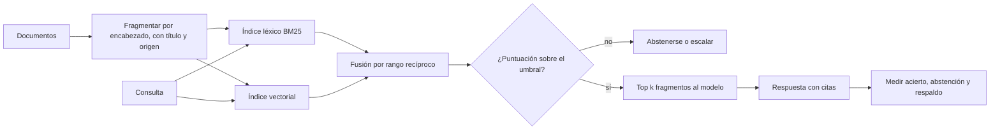

# SE-510 — Embeddings, recuperación y agentic RAG

[← SE-509 — Memoria y gestión de estado de agentes](https://github.com/vladimiracunadev-create/modern-software-engineering-program/blob/main/classes/part-42-patrones-agenticos-y-sistemas-con-llm/se-509-memoria-y-gestion-de-estado-de-agentes/README.md) · [↑ Parte 42](https://github.com/vladimiracunadev-create/modern-software-engineering-program/blob/main/classes/part-42-patrones-agenticos-y-sistemas-con-llm/README.md) · [📚 Índice completo](https://github.com/vladimiracunadev-create/modern-software-engineering-program/blob/main/classes/README.md) · [🌐 Portal](https://vladimiracunadev-create.github.io/modern-software-engineering-program/classes/SE-510.html) · [SE-511 — Interoperabilidad entre agentes: MCP y A2A →](https://github.com/vladimiracunadev-create/modern-software-engineering-program/blob/main/classes/part-42-patrones-agenticos-y-sistemas-con-llm/se-511-interoperabilidad-entre-agentes-mcp-y-a2a/README.md)

## Punto profesional y fundamento pedagógico

**Punto profesional.** La clase existe para que construyas la recuperación de información de un sistema con LLM **como un componente que se mide**, no como un paso de moda. Un modelo responde mejor sobre documentos propios si el sistema le entrega los fragmentos pertinentes, y esa entrega es un problema de búsqueda con sus métricas de siempre: acierto en el primer resultado, acierto entre los cinco primeros, rango recíproco. Quien comprende qué hace un embedding, qué hace BM25 y qué aporta decidir cuándo recuperar puede elegir el recuperador con evidencia, saber cuándo abstenerse y evitar el error más común: confiar en que «buscar por significado» es siempre mejor que buscar por palabras.

**Por qué aparece aquí.** Sigue a `SE-509`, donde la memoria se leía por clave. Cuando no se conoce la clave, hay que buscar. Usa de la Parte 26 los conceptos de índice y de la Parte 30 las métricas de prueba; aplica la regla de las clases anteriores: cada capacidad añadida (reformular, recuperar de nuevo) es una decisión que debe justificarse con una medida.

**Error conceptual que debe corregir.** Creer que los embeddings «entienden» y por eso reemplazan a la búsqueda léxica. Un embedding es un vector que se calcula con un modelo y cuya cercanía aproxima la similitud de significado según lo que el modelo aprendió; captura paráfrasis que BM25 no ve, pero puede fallar con identificadores, números y términos poco frecuentes, y su calidad depende del modelo y del dominio. La búsqueda híbrida existe porque cada método falla donde el otro acierta. Y la creencia gemela: que «agentic RAG» (un agente que decide cuándo recuperar y reformula) mejora siempre: es una capacidad más, con costo, que hay que medir.

**Secuencia de aprendizaje.** Antes de ejecutar predices el acierto en primer lugar de tres recuperadores con consultas exactas y con erratas, y si una reformulación automática mejora. Después ejecutas sobre un corpus real (los fragmentos de las Partes 39 y 40 de este programa) y miras qué ocurre.

**Evidencia de aprendizaje.** `recuperacion-log.md` con tu predicción, las dos tablas medidas, un conjunto de al menos 20 consultas etiquetadas de tu propio corpus, el umbral de abstención elegido y la política de citas.

**Límite de la conclusión.** El «embedding» del experimento es un vector disperso por trigramas de caracteres con hashing: **no es un modelo semántico** y no capta sinonimia. Las 120 consultas se generan desde el propio texto (ocho palabras de un fragmento, con erratas y raíces), así que favorecen la coincidencia léxica; con consultas de personas y paráfrasis reales el orden entre recuperadores puede cambiar. No se invocó ningún modelo.

### Trazabilidad fuente → afirmación

| Fuente primaria u oficial | Afirmación que respalda | Lo que no prueba |
|---|---|---|
| [Lewis et al., «Retrieval-Augmented Generation»](https://arxiv.org/abs/2005.11401) | Introduce combinar un modelo generativo con un recuperador sobre una memoria no paramétrica para tareas intensivas en conocimiento. | No compara recuperadores en tu corpus. |
| [Reimers y Gurevych, «Sentence-BERT»](https://arxiv.org/abs/1908.10084) | Muestra cómo obtener embeddings de oraciones comparables por coseno para búsqueda semántica. | No garantiza calidad en tu dominio. |
| [Anthropic, «Introducing Contextual Retrieval»](https://www.anthropic.com/news/contextual-retrieval) | Describe que combinar embeddings con BM25 y añadir contexto a los fragmentos mejora la recuperación en sus pruebas. | Son resultados de su corpus y modelos. |
| [Liu et al., «Lost in the Middle»](https://arxiv.org/abs/2307.03172) | Muestra que la posición de la información relevante dentro del contexto afecta el uso que hace el modelo. | No dice cuántos fragmentos entregar. |

## Antes de empezar

Recupera `SE-509`: la memoria externa se lee por clave y esa lectura es exacta. La pregunta activa es: **la última vez que buscaste algo en tus propios documentos con las palabras equivocadas, ¿qué hiciste para encontrarlo, y qué haría un sistema que no puede probar otra palabra?**

## Prerrequisitos

- Haber completado `SE-509` o poder explicar la diferencia entre lectura por clave y por similitud.
- Conocer de la Parte 26 qué es un índice y de la Parte 30 qué es una métrica de acierto.
- Python 3.11 o posterior con la biblioteca estándar.

## Problema auténtico

El asistente de *Avisos* debe contestar preguntas sobre el propio programa de formación (políticas, plazos, procedimientos) a partir de documentos escritos por personas. Un docente pregunta «¿qué se hace cuando un aviso se envía dos veces?» y la respuesta está en un fragmento que habla de «idempotencia» y «reintentos» sin usar la palabra «duplicado». Otro escribe con una errata («recordartorio») y una palabra en singular donde el documento está en plural. Y un tercero pregunta algo que **no está** en ningún documento: ¿qué debe hacer el sistema?

Hay que decidir cómo fragmentar los documentos, cómo recuperar, cuántos fragmentos entregar al modelo, cuándo decir «no encontré nada» y cómo citar el origen de cada afirmación. Esta clase mide cada decisión sobre 835 fragmentos reales de las Partes 39 y 40 de este programa.

## Objetivos observables

Al terminar podrás:

1. explicar qué representa un embedding y qué no, y cómo se compara con BM25;
2. medir un recuperador con acierto@1, acierto@5 y rango recíproco medio sobre consultas etiquetadas;
3. combinar dos recuperadores con fusión por rango recíproco y explicar cuándo ayuda;
4. definir un umbral de abstención y medir su costo en consultas válidas;
5. decidir si una reformulación automática de consultas mejora, con evidencia, y citar los fragmentos usados.

## Mapa conceptual



El mapa muestra dos índices que alimentan una fusión, un umbral que permite abstenerse y una respuesta que cita sus fragmentos; la última caja devuelve el resultado a la medición.

## Temas y por qué importan

| Tema | Por qué cambia una decisión profesional | Evidencia mínima |
|---|---|---|
| Fragmentación | Decide qué unidad se recupera y con qué contexto. | Número y tamaño de los fragmentos |
| BM25 | Es un recuperador léxico fuerte y barato. | Acierto con consultas exactas y con erratas |
| Embeddings | Aportan similitud tolerante a variaciones. | Acierto del vector frente a BM25 |
| Fusión híbrida | Combina fortalezas y exige medirse. | Acierto del híbrido |
| Abstención | Evita responder con algo irrelevante. | Rechazo de consultas ajenas y costo en válidas |
| Reformulación agéntica | Es una capacidad con costo que puede no mejorar. | Acierto antes y después |

## Conceptos y decisiones

### 1. Fragmentar: la unidad de recuperación

Un documento largo no se entrega entero: se divide en **fragmentos** (aquí, por encabezado de Markdown, con al menos 40 palabras) que se indexan y recuperan por separado. La fragmentación decide mucho: un fragmento demasiado corto pierde el contexto que lo hace entendible («el plazo es de 72 horas» ¿de qué?); uno demasiado largo diluye la señal y llena el contexto. Una práctica descrita por Anthropic («contextual retrieval») es añadir a cada fragmento una breve descripción de dónde está dentro del documento antes de indexarlo. Aquí el título del encabezado y el archivo de origen se conservan como metadatos, porque son lo que permitirá **citar**.

### 2. BM25: léxico, fuerte y transparente

BM25 puntúa un documento por las palabras de la consulta que contiene, ponderando cada palabra por su rareza en el corpus (las palabras raras pesan más, el IDF) y por cuántas veces aparece, con una saturación y una normalización por longitud. No «entiende», cuenta. Es rápido, no necesita un modelo, es depurable (se puede ver qué palabras puntuaron) y es difícil de superar cuando la consulta comparte vocabulario con el documento. En el experimento, con consultas exactas, BM25 acierta en primer lugar el 98,3 % y entre los cinco primeros el 100 %. Su debilidad es la distancia léxica: una errata o un sinónimo no puntúan.

### 3. Embeddings: similitud como cercanía de vectores

Un **embedding** convierte un texto en un vector de números de modo que textos con significado parecido queden cerca (por ejemplo, con coseno). Los modelos de oraciones como Sentence-BERT se entrenan para que esa cercanía refleje similitud semántica, lo que permite encontrar «reintento» desde «volver a intentar». El experimento **no** usa un modelo de ese tipo: usa un vector disperso por trigramas de caracteres con hashing, que capta similitud ortográfica (tolera erratas y raíces) pero no sinonimia. Sirve para ver el mecanismo (indexar vectores, comparar por coseno, combinar con BM25) sin descargar un modelo, y se declara como sustituto. Con consultas exactas acierta en primer lugar el 65,0 %; con erratas y raíces, el 59,2 %.

### 4. Los dos recuperadores fallan de modo distinto

La tabla de resultados tiene una lección más sutil que «gana BM25». Con consultas exactas, BM25 (98,3 %) supera con mucho al vector de trigramas (65,0 %). Con erratas y raíces, BM25 cae a 75,0 % porque las palabras mal escritas no puntúan, pero el vector de trigramas no mejora (59,2 %) porque su señal global es más ruidosa. La **fusión por rango recíproco (RRF)** combina las dos listas: cada documento suma 1/(60 + posición) en cada lista. Con consultas exactas el híbrido (85,0 %) queda **por debajo** de BM25 solo (98,3 %) porque el recuperador débil arrastra; con erratas y raíces queda por encima (77,5 % frente a 75,0 %) y mejora el acierto entre los cinco primeros respecto del vector (90,0 % frente a 77,5 %). La fusión no es gratis: ayuda cuando los dos recuperadores aciertan donde el otro falla, y perjudica cuando uno es claramente peor.


**Cómo leer la figura.** Cada fila es un recuperador con un tipo de consulta; las columnas dan el acierto en primer lugar, entre los cinco primeros y el rango recíproco medio. Se busca el valor más alto en las tres, sabiendo que importa el primero si se entrega un solo fragmento y los cinco si se entregan varios. **Dónde deja de valer:** las consultas salen del propio texto (ocho palabras elegidas al azar), lo que favorece la coincidencia léxica; con paráfrasis de personas reales y un modelo de embeddings semántico, el orden entre BM25 y el vector podría cambiar. No se evaluó ningún modelo de embeddings.

### 5. Agentic RAG: decidir cuándo y cómo recuperar

En el **RAG clásico** la recuperación ocurre una vez por pregunta. En el **agentic RAG** el modelo decide si recuperar, qué consulta formular, si los resultados bastan y si reformular y recuperar de nuevo. Es el bucle de `SE-508` aplicado a la búsqueda, con sus costos: más llamadas, más tokens, más latencia. El experimento prueba una reformulación sencilla: si la diferencia entre los dos mejores resultados de BM25 es menor del 10 %, se amplía la consulta con cuatro términos de los tres mejores fragmentos (retroalimentación de pseudorrelevancia) y se recupera de nuevo. Resultado: 39 de 120 consultas se reformulan y el acierto en primer lugar pasa de 68,3 % a 66,7 %. **No mejoró.** Es un resultado valioso: la reformulación puede arrastrar términos de fragmentos equivocados y empeorar, y solo la medición lo muestra.

### 6. Abstenerse y citar

Un sistema que siempre devuelve algo responderá con fragmentos irrelevantes ante una consulta ajena al corpus. La alternativa es un **umbral** sobre la puntuación del mejor fragmento: por debajo, el sistema dice que no encontró nada o escala. En el experimento, el umbral se fija en el percentil 10 de las puntuaciones de las consultas válidas (6,46), de modo que por construcción se rechaza el 10 % de las válidas; con ese umbral se rechaza el 67 % de seis consultas ajenas al corpus (cocina, trenes, deportes). Dos de las seis pasan. Es el compromiso de siempre: más umbral rechaza más ajenas y también más válidas. El otro mecanismo que sostiene la confianza es **citar**: cada afirmación de la respuesta enlaza el fragmento y el archivo de origen, de modo que una persona pueda verificarla y que el sistema pueda ser evaluado por respuestas sin respaldo.


**Cómo leer la figura.** Cada fila es una decisión del sistema con su resultado medido y su lectura; las dos primeras tienen un costo medible y la tercera es de verificación. **Dónde deja de valer:** la reformulación es por retroalimentación de pseudorrelevancia, no por un modelo que reescriba la consulta, y solo hay seis consultas ajenas al corpus escritas a mano; el umbral de un sistema real se calibra con muchas más.

## La canalización completa

La recuperación no es una función, es una canalización con puntos de medida: fragmentar, indexar, recuperar, filtrar, responder con citas, medir. Cada etapa puede fallar de modo distinto y por eso se mide por separado: si la respuesta es mala, la primera pregunta es si el fragmento correcto estaba entre los recuperados (un problema de recuperación) o si estaba y el modelo no lo usó (un problema de generación o de posición en el contexto).


**Cómo leer la figura.** Cada caja es un lugar donde se puede medir y fallar por separado, de izquierda a derecha y de arriba abajo. **Dónde deja de valer:** en corpus que cambian a diario la fragmentación y el índice se vuelven un proceso operativo con su propio ciclo, y la actualización de un fragmento obsoleto es tan importante como su recuperación (la misma regla de versión de `SE-509`).

## Definiciones de trabajo

- **Fragmento:** unidad de texto que se indexa y recupera, con título y origen.
- **BM25:** función de puntuación léxica que pondera la rareza de las palabras y normaliza por longitud.
- **Embedding:** vector que representa un texto de modo que la cercanía aproxima la similitud.
- **Acierto@k:** fracción de consultas con el fragmento correcto entre los k primeros.
- **MRR:** media del inverso de la posición del fragmento correcto.
- **RRF:** fusión de listas ordenadas que suma 1/(k + posición) por lista.
- **Abstención:** decisión de no responder porque la evidencia recuperada no alcanza un umbral.

## Ejemplo mínimo

Fusión de dos listas ordenadas por rango recíproco:

```python
def rrf(*puntuaciones, k=60):
    n = len(puntuaciones[0])
    total = [0.0] * n
    for p in puntuaciones:
        orden = sorted(range(n), key=lambda i: -p[i])
        for pos, i in enumerate(orden):
            total[i] += 1.0 / (k + pos + 1)
    return total
```

Cada recuperador aporta su orden, no su puntuación: así dos escalas incompatibles (BM25 y coseno) se combinan sin normalizar.

## Ejemplo profesional

*Escenario ilustrativo: las cifras de este ejemplo son supuestos de la narración, no mediciones.*

El equipo indexa los 300 documentos del programa, fragmentados por encabezado, con título y ruta como metadatos. Escribe 60 preguntas reales de docentes con el fragmento que las responde y mide BM25, un modelo de embeddings y su fusión. Elige BM25 más embeddings con RRF porque el híbrido gana en las preguntas con paráfrasis y no pierde en las exactas. Fija un umbral con las preguntas fuera del corpus que recogió de los registros, de modo que el sistema responda «no lo encontré» en el 80 % de ellas y acepte el 92 % de las válidas. La respuesta cita siempre los fragmentos usados con enlace, y una prueba rechaza respuestas con afirmaciones sin cita. El equipo no activa la reformulación automática hasta medir, con las mismas 60 preguntas, que mejora el acierto sin subir la latencia por encima de un presupuesto.

## Práctica guiada

1. Predice el acierto en primer lugar de BM25, del vector y del híbrido con consultas exactas y con erratas.
2. Ejecuta `python scripts/experiments_part42_a.py 510` y compara con tu predicción.
3. Cambia la proporción de erratas de 0,35 a 0,60 en `make_query` y observa si el vector supera a BM25.
4. Cambia el umbral de abstención al percentil 25 y anota qué ocurre con las consultas ajenas y con las válidas.
5. Escribe 20 consultas de tu propio corpus con su fragmento correcto y mide acierto@1 de BM25.

## Ejercicios

1. **Básico.** Explica por qué BM25 no encuentra «volver a intentar» al buscar «reintento» y qué haría un embedding semántico.
2. **Intermedio.** Calcula a mano la puntuación RRF de un documento que es primero en una lista y tercero en otra.
3. **Avanzado.** Diseña el experimento que decidiría si la reformulación agéntica de consultas merece su costo: qué conjunto, qué métricas y qué criterio de aceptación.

## Reto verificable

Entrega `recuperacion-log.md` con tu predicción, las dos tablas medidas, 20 consultas etiquetadas de tu corpus con el acierto@1 y @5 de dos recuperadores, el umbral de abstención con su costo en válidas y una política de citas con una prueba que rechace una respuesta sin cita. Es válido si otra persona reproduce las tablas del experimento con la misma semilla y las medidas de tu corpus con tus consultas.

## Caso conductor

El asistente de *Avisos* contesta preguntas sobre el programa citando fragmentos. Aquí se mide su recuperación sobre el propio corpus de las Partes 39 y 40. En `SE-513` esa medida se convierte en una evaluación continua con puerta de release y en `SE-514` se estudia el riesgo de que un fragmento recuperado contenga instrucciones hostiles.

## Preguntas frecuentes

### ¿Necesito una base de datos vectorial?

Depende del tamaño. Para unos miles de fragmentos, un índice en memoria basta. Una base vectorial aporta escalabilidad, filtros y actualización, no calidad por sí misma: la calidad la determina el modelo de embeddings y la fragmentación.

### ¿Cuántos fragmentos entrego al modelo?

Los que mejoren la respuesta medida sin llenar el contexto: empieza con pocos (tres a cinco), mide y ajusta. Más fragmentos aumentan la probabilidad de incluir el correcto y la de distraer, además del costo.

### ¿El híbrido siempre es mejor?

No: en el experimento, con consultas exactas, empeora a BM25. Es mejor cuando los recuperadores fallan en consultas distintas. Se mide con tus consultas.

### ¿Cómo sé que el modelo usó el fragmento y no lo inventó?

Con citas verificables y una evaluación de respaldo: comprobar que cada afirmación tiene un fragmento que la soporta. Un modelo puede ignorar el contexto recuperado, y la medición debe detectarlo.

## Fallo controlado y diagnóstico

**Fallo.** El asistente responde con seguridad una política que no existe, citando un fragmento que habla de otra cosa.

**Diagnóstico paso a paso.** (1) Se revisa la consulta: no está en el corpus. (2) Se ve que el recuperador devolvió el fragmento más parecido con una puntuación baja. (3) Se comprueba que no había umbral de abstención. (4) Se identifica que la cita era correcta como origen pero no respaldaba la afirmación.

**Corrección.** Se añade un umbral calibrado con consultas ajenas al corpus y la respuesta «no lo encontré, escalo a una persona». Se añade una prueba que verifica que cada afirmación coincide con un fragmento citado (por palabras clave del dato afirmado), y se registran las consultas rechazadas para ampliar el corpus.

## Errores comunes y cómo corregirlos

- **Responder siempre.** Síntoma: respuestas con fragmentos irrelevantes. Causa: sin umbral. Solución: umbral calibrado y vía de escape.
- **Fragmentos sin contexto.** Síntoma: el fragmento correcto es ambiguo. Causa: se corta sin título ni origen. Solución: conserva título y ruta y valora añadir contexto.
- **Elegir el recuperador por moda.** Síntoma: calidad peor que la de BM25. Causa: no se midió. Solución: conjunto etiquetado y comparación.
- **Activar la reformulación sin medir.** Síntoma: más llamadas y menor acierto. Causa: se asume que ayuda. Solución: compara antes y después con el mismo conjunto.
- **Índice desactualizado.** Síntoma: respuestas con un procedimiento viejo. Causa: no se reindexa al cambiar el documento. Solución: reindexado con versión y retirada de fragmentos obsoletos.

## Entorno y archivos clave

- `scripts/experiments_part42_a.py`: función `exp510` con BM25, el vector de trigramas, la fusión por rango recíproco, la reformulación y la abstención; `python scripts/experiments_part42_a.py 510`.
- `content/part-39/` y `content/part-40/`: corpus de 835 fragmentos que usa el experimento.
- `content/part-42/figures/`: figuras de la clase.
- Entorno: CPython 3.11 o posterior; semilla 10; tarda unos segundos.

## Seguridad, ética y accesibilidad

Todo fragmento recuperado entra al contexto del modelo, y un fragmento con instrucciones hostiles (un documento editable por terceros) puede intentar dirigir al agente: la recuperación es una vía de inyección indirecta (`SE-514`). Los permisos deben aplicarse **antes** de recuperar: un usuario no debe recuperar fragmentos que no podría leer. Privacidad: el índice contiene datos del corpus; si hay datos personales, el borrado debe alcanzar al índice. Ética: citar es una obligación de transparencia, y un sistema que no encuentra debe decirlo. Accesibilidad: las figuras son tablas y un diagrama con texto alternativo; las citas son enlaces con texto descriptivo.

## Puente hacia el trabajo con agentes

Un agente de programación que implementa recuperación suele añadir una base vectorial y un modelo de embeddings «porque es lo que se hace» y no mide contra BM25. La instrucción de repositorio es: «antes de añadir embeddings, mide BM25 sobre 20 consultas etiquetadas y entrega el acierto@1 y @5 de cada alternativa». La comprobación mecánica: una prueba con una consulta ajena al corpus debe terminar en abstención, y una con un fragmento obsoleto debe devolver la versión vigente.

## Transferencia

Reúne 20 preguntas reales de tu sistema y el documento que las responde. Fragmenta tu corpus, mide BM25 y, si lo tienes, un modelo de embeddings, y decide la política: recuperador, número de fragmentos, umbral de abstención, citas. Registra cuántas consultas válidas pierdes por el umbral y cuántas ajenas se cuelan.

## Evaluación y evidencia

| Criterio | Evidencia aceptable | Rechazo |
|---|---|---|
| Conjunto de evaluación | Consultas etiquetadas con su fragmento | Ejemplos sueltos |
| Comparación | Acierto@1, @5 y MRR de al menos dos recuperadores | «Embeddings es mejor» |
| Abstención | Umbral con costo en válidas y rechazo de ajenas | Sin umbral |
| Citas | Prueba que rechaza una afirmación sin cita | «Citamos a veces» |
| Reformulación | Acierto antes y después con el mismo conjunto | Se activa sin medir |
| Límite | Declara que el vector no es semántico y que las consultas son sintéticas | Presenta una tasa real |

## Fuentes

- Lewis, P. et al. [«Retrieval-Augmented Generation for Knowledge-Intensive NLP Tasks»](https://arxiv.org/abs/2005.11401).
- Reimers, N. y Gurevych, I. [«Sentence-BERT»](https://arxiv.org/abs/1908.10084).
- Anthropic. [«Introducing Contextual Retrieval»](https://www.anthropic.com/news/contextual-retrieval).
- Liu, N. F. et al. [«Lost in the Middle»](https://arxiv.org/abs/2307.03172).

## Límites y siguiente paso

El vector del experimento no es un modelo de embeddings semántico; las consultas son sintéticas y salen del propio corpus; solo hay seis consultas ajenas; no se evaluó ningún modelo de embeddings, ninguna base vectorial ni ningún producto de RAG. El siguiente paso, `SE-511`, sale del proceso: cómo un agente descubre y llama herramientas de otros y cómo se comunican entre sí agentes distintos con protocolos como MCP y A2A.

## Glosario

| Término | Definición breve |
|---|---|
| Fragmento | Unidad de texto indexada con título y origen |
| BM25 | Puntuación léxica con rareza y normalización por longitud |
| Embedding | Vector cuya cercanía aproxima la similitud |
| Acierto@k | Fracción con el fragmento correcto en los k primeros |
| MRR | Media del inverso de la posición correcta |
| RRF | Fusión de listas por rango recíproco |
| Abstención | No responder por falta de evidencia suficiente |
