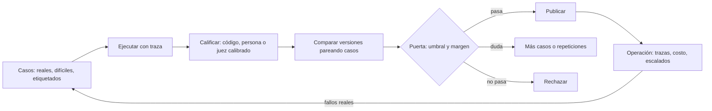
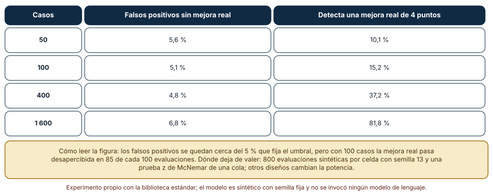
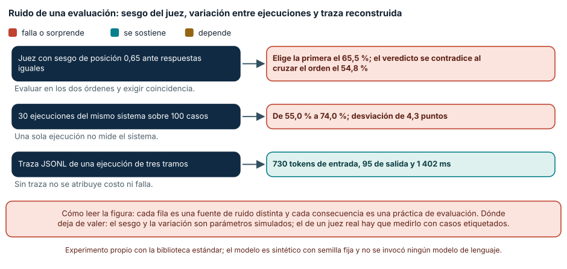

# SE-513 — Evals y LLMOps de sistemas con LLM

[← SE-512 — Ejecución durable, reintentos e idempotencia](https://github.com/vladimiracunadev-create/modern-software-engineering-program/blob/main/classes/part-42-patrones-agenticos-y-sistemas-con-llm/se-512-ejecucion-durable-reintentos-e-idempotencia/README.md) · [↑ Parte 42](https://github.com/vladimiracunadev-create/modern-software-engineering-program/blob/main/classes/part-42-patrones-agenticos-y-sistemas-con-llm/README.md) · [📚 Índice completo](https://github.com/vladimiracunadev-create/modern-software-engineering-program/blob/main/classes/README.md) · [🌐 Portal](https://vladimiracunadev-create.github.io/modern-software-engineering-program/classes/SE-513.html) · [SE-514 — Costo, latencia y seguridad en sistemas con LLM →](https://github.com/vladimiracunadev-create/modern-software-engineering-program/blob/main/classes/part-42-patrones-agenticos-y-sistemas-con-llm/se-514-costo-latencia-y-seguridad-en-sistemas-con-llm/README.md)

## Punto profesional y fundamento pedagógico

**Punto profesional.** La clase existe para que **midas** un sistema con LLM con el mismo rigor con que mides cualquier otro componente que decide cosas: con un conjunto de casos, un criterio de calificación, una comparación entre versiones que tenga en cuenta el ruido y una puerta que decida si una versión sale. Un sistema con un modelo dentro cambia aunque nadie toque el código (el proveedor actualiza el modelo, el prompt cambia una palabra, una herramienta devuelve otro texto), así que sin evaluaciones no hay forma de saber si «mejoró» o «empeoró». El «LLMOps» es lo que rodea a esa medición: trazas, versiones de prompts y modelos, monitoreo y el ciclo por el que los fallos de producción se convierten en casos de prueba.

**Por qué aparece aquí.** Sigue a `SE-512`, donde el sistema se volvió durable. Ahora hay que decidir con evidencia si una nueva versión puede salir. Retoma de la Parte 40 (`SE-489`) la evaluación como especificación y puerta de release, y de la Parte 30 la estrategia de prueba; la novedad es aplicarla a un componente **probabilístico** y con un criterio que a veces ejerce un juez.

**Error conceptual que debe corregir.** Creer que una evaluación da un número y que comparar números basta. Una evaluación es un **instrumento con ruido**: el sistema puede responder distinto a la misma entrada, los casos son una muestra, el juez tiene sesgos. Con 100 casos, una mejora real de unos 4 puntos pasa desapercibida en 85 de cada 100 evaluaciones; con 1 600 se detecta en 82 de cada 100. Declarar «v2 es mejor que v1» porque sacó 3 puntos más sobre 100 casos es leer ruido como señal. Y la creencia gemela: que un juez basado en un modelo «califica como una persona»: tiene sesgos medibles, como preferir la primera respuesta.

**Secuencia de aprendizaje.** Antes de ejecutar predices la probabilidad de declarar mejor una versión que no lo es y de detectar una que sí lo es, con 50, 100, 400 y 1 600 casos; el sesgo de un juez con preferencia de posición; y cuánto varía el mismo sistema entre ejecuciones. Después ejecutas las simulaciones y comparas.

**Evidencia de aprendizaje.** `evals-log.md` con tus predicciones, las tablas medidas, un conjunto de al menos 30 casos de tu sistema con la señal de calificación de cada uno (código, persona o juez), la puerta con su umbral y su margen, y el esquema de traza.

**Límite de la conclusión.** Los resultados de los «sistemas» son sintéticos (probabilidad de acierto por caso según una dificultad inventada), las 800 evaluaciones por celda y la prueba z de McNemar de una cola son una elección del autor, el sesgo del juez (0,65) es un supuesto y las trazas son de una ejecución inventada. No se invocó ningún modelo real.

### Trazabilidad fuente → afirmación

| Fuente primaria u oficial | Afirmación que respalda | Lo que no prueba |
|---|---|---|
| [Anthropic, «Demystifying evals for AI agents»](https://www.anthropic.com/engineering/demystifying-evals-for-ai-agents) | Describe evaluaciones de agentes: tareas con criterio de éxito, calificadores de código, de modelo y humanos, y la dificultad del no determinismo. | No fija umbrales ni tamaños de muestra. |
| [Zheng et al., «Judging LLM-as-a-Judge»](https://arxiv.org/abs/2306.05685) | Documenta sesgos de los jueces basados en modelos, entre ellos de posición y de longitud, y su acuerdo con personas. | No mide tu juez ni tu dominio. |
| [OpenTelemetry, convenciones semánticas para IA generativa](https://opentelemetry.io/docs/specs/semconv/gen-ai/) | Define atributos y tramos estándar para trazar llamadas a modelos y herramientas. | No dicta qué guardar ni cuánto retener. |
| [Anthropic, «Building effective agents»](https://www.anthropic.com/engineering/building-effective-agents) | Recomienda probar de forma extensa en entornos controlados y añadir complejidad solo cuando mejora de forma medida. | No define la puerta de tu sistema. |

## Antes de empezar

Recupera `SE-489` (Parte 40): una evaluación es un instrumento con ruido y una puerta necesita umbral, margen y zona de duda. La pregunta activa es: **cuando compararon dos versiones de algo con una muestra pequeña, ¿qué diferencia habría tenido que aparecer para que la tomaran por real?**

## Prerrequisitos

- Haber completado `SE-512` o poder explicar la reanudación y la idempotencia.
- Conocer de la Parte 40 la evaluación como puerta de release y el efecto del número de casos y repeticiones.
- Python 3.11 o posterior.

## Problema auténtico

El equipo de *Avisos* prepara la versión 2 del asistente: otro prompt y un modelo más reciente. En una prueba con 100 solicitudes, v1 resuelve 66 y v2 resuelve 70. ¿Sale v2? Hay cuatro fuentes de incertidumbre. La muestra: 100 casos no son todos los casos. El sistema: v2 ejecutada de nuevo podría dar 65 o 74. El juez: quien califica las respuestas ambiguas tiene sus propios sesgos. Y los casos: están elegidos por conveniencia y pueden no parecerse al tráfico real.

Además, una vez en producción hay que saber qué pasa: cuántas llamadas, qué costo, qué pasos fallan, qué solicitudes terminan en escalado. Y cuando algo falla en producción hay que convertirlo en un caso para que no vuelva. La clase mide el ruido y construye los componentes de esa disciplina: una puerta estadística, un juez calibrado y una traza que permita atribuir.

## Objetivos observables

Al terminar podrás:

1. diseñar un conjunto de casos con su señal de calificación (código, persona, juez);
2. estimar con una simulación pareada la probabilidad de falsos positivos y la potencia de una puerta según el número de casos;
3. medir el sesgo de posición de un juez y neutralizarlo cruzando el orden;
4. medir la variación del mismo sistema entre ejecuciones y decidir cuántas repeticiones usar;
5. definir una traza estructurada que permita reconstruir costo, latencia y tokens por tramo.

## Mapa conceptual



El mapa muestra un bucle: los fallos de producción vuelven a los casos, y la puerta tiene una vía de «duda» que pide más evidencia en vez de decidir con ruido.

## Temas y por qué importan

| Tema | Por qué cambia una decisión profesional | Evidencia mínima |
|---|---|---|
| Conjunto de casos | Define qué significa «mejor». | Casos con etiqueta y su origen |
| Falsos positivos de la puerta | Se publica una versión que no mejora. | Tasa sin mejora real |
| Potencia de la puerta | Se rechaza una mejora que sí existe. | Detección según casos |
| Comparación pareada | Reduce la varianza al usar los mismos casos. | z de McNemar |
| Sesgo del juez | Un juez con sesgo contamina todas las comparaciones. | Contradicción al cruzar el orden |
| Traza | Sin ella no se atribuye costo ni falla. | Traza reconstruida |

## Conceptos y decisiones

### 1. El conjunto de casos es la especificación

Lo que una evaluación mide es lo que sus casos cubren. Un conjunto útil mezcla casos reales (tomados de solicitudes de usuarios, anonimizadas), casos difíciles (los que fallaron antes, los límites, las ambigüedades) y casos adversariales (intentos de inyección, entradas vacías, texto en otro idioma). Cada caso tiene una **señal de calificación**: código cuando el resultado es verificable (la fecha coincide con la tabla), una persona cuando requiere criterio, un juez basado en modelo cuando el volumen lo exige y se ha calibrado. La documentación de Anthropic sobre evaluaciones de agentes distingue justo esos tres tipos de calificador y subraya que el comportamiento no determinista exige repetir. Un conjunto sin dueño ni fecha se pudre: los casos nuevos entran desde los fallos de producción.

### 2. Una puerta estadística: falsos positivos y potencia

Comparar dos versiones sobre los mismos casos es una comparación **pareada**: interesan los casos donde las versiones discrepan. Sea *b* el número de casos que v2 acierta y v1 falla, y *c* el de los que v1 acierta y v2 falla; el estadístico z de McNemar, (b − c) / √(b + c), mide cuánto se aparta de cero esa diferencia. Si se exige z > 1,645 (una cola, 5 %), la tasa de **falsos positivos** (declarar mejor una versión idéntica) queda cerca del 5 %: en el experimento, 5,6 %, 5,1 %, 4,8 % y 6,8 % con 50, 100, 400 y 1 600 casos. La **potencia** (detectar una mejora real de unos 4 puntos) es otra cosa: 10,1 %, 15,2 %, 37,2 % y 81,8 %. Con 100 casos, una mejora real de 4 puntos se declara solo en 15 de cada 100 evaluaciones.

### 3. Qué hacer con la potencia baja

Una puerta con potencia baja no es una puerta mala: es una puerta que **no puede responder** con esos casos. La acción correcta ante «no concluyente» no es publicar ni rechazar sino ampliar la evidencia: más casos, más repeticiones, casos más discriminantes (los que dos versiones resuelven distinto). Otra opción es cambiar la pregunta: en vez de «v2 es mejor» (que exige potencia), «v2 no es peor en más de 3 puntos» (no inferioridad), que se puede sostener con menos casos si v2 se publica por otras razones (costo, latencia). La puerta debe declararse **antes** de ver los resultados, con su umbral, su margen y su zona de duda; ajustar el umbral después de ver el número es leer el ruido a conveniencia.



**Cómo leer la figura.** El eje horizontal son los casos de la evaluación, en escala logarítmica, y el vertical la proporción de evaluaciones; la línea coral son los falsos positivos sin mejora real y la verde azulada, la detección de una mejora real. Mira que la coral se queda cerca del 5 % que fija el umbral y que la verde azulada tarda en subir: con 100 casos una mejora real pasa desapercibida casi siempre. **Dónde deja de valer:** 800 evaluaciones sintéticas por celda con semilla 13, una prueba z de McNemar de una cola y una dificultad por caso inventada; otros diseños (intervalos de bootstrap, varias repeticiones por caso) tienen otra potencia, y una mejora de otro tamaño cambia la columna derecha.

### 4. El juez basado en modelo y sus sesgos

Usar un modelo como calificador permite evaluar a escala lo que el código no puede (tono, claridad, utilidad). Pero un juez tiene sesgos documentados: prefiere la respuesta que aparece primera, o la más larga, o la que se parece a las suyas. En el experimento, un juez con sesgo de posición de 0,65 elige la primera respuesta el 65,5 % de las veces **aunque sean iguales**, y cuando se le presenta cada par en los dos órdenes, el 54,8 % de las veces su veredicto se **contradice** (dice «A» en un orden y «B» en el otro). La práctica estándar es evaluar en ambos órdenes y contar como empate los desacuerdos. Más allá, un juez se **calibra**: se mide su acuerdo con personas sobre un conjunto etiquetado y se corrige o se descarta.

### 5. La variación entre ejecuciones

El mismo sistema, sobre los mismos 100 casos, no da el mismo resultado: 30 ejecuciones del experimento van de 55,0 % a 74,0 %, con una desviación de 4,3 puntos. Esa varianza viene del muestreo del modelo y de las herramientas. Consecuencia: una sola ejecución no mide al sistema y comparar «una corrida de v1» contra «una corrida de v2» confunde la diferencia entre versiones con la variación entre corridas. Se repite (tres a cinco veces, más si el ruido es grande) y se reporta media y dispersión. También se puede bajar la varianza fijando la temperatura y la semilla cuando el proveedor lo permite, sabiendo que eso mide una configuración y no el comportamiento real.



**Cómo leer la figura.** Cada tarjeta es una fuente de ruido con su magnitud a la derecha y la práctica de evaluación que implica debajo; las dos coral son ruido que oculta el resultado y la verde azulada, la traza que permite atribuirlo. **Dónde deja de valer:** el sesgo (0,65) y la variación son parámetros simulados; el sesgo y la desviación de un juez y de un sistema reales hay que medirlos con casos etiquetados y repeticiones propias.

### 6. Trazas, versiones y el ciclo de operación

Una **traza** registra, para cada solicitud, los tramos que la componen: cada llamada al modelo (con tokens de entrada y salida y latencia), cada herramienta y cada decisión. El estándar de OpenTelemetry define convenciones para llamadas a modelos generativos. En el experimento, un archivo JSONL de tres tramos permite reconstruir 730 tokens de entrada, 95 de salida y 1 402 ms; sin esos registros no se puede atribuir un costo o un fallo a un paso. Junto con la traza van las **versiones**: del prompt, del modelo, de las herramientas y del conjunto de casos, porque un resultado sin la versión que lo produjo no se puede reproducir. Y el ciclo se cierra con **operación**: tasa de escalado, costo por solicitud, errores por herramienta y muestras de producción revisadas por personas; los fallos relevantes se convierten en casos nuevos.

## El bucle completo

La disciplina se resume en un bucle con cuatro propiedades: los casos crecen con los fallos reales, la calificación declara su señal, la comparación es pareada y repetida, y la puerta se fija antes de ver el resultado y tiene una salida para «no concluyente».


**Cómo leer la figura.** La primera fila prepara la evidencia y la segunda decide y realimenta; la última caja devuelve al principio y por eso el conjunto de casos crece con la operación. **Dónde deja de valer:** con datos personales en los casos, guardar trazas y casos exige minimizar, anonimizar y fijar retención; y un conjunto que solo contiene fallos pasados no detecta los fallos nuevos.

## Definiciones de trabajo

- **Evaluación (eval):** conjunto de casos con un criterio de calificación que mide un sistema.
- **Calificador:** componente que decide si una respuesta es correcta: código, persona o modelo.
- **Comparación pareada:** comparación de dos versiones sobre los mismos casos.
- **Falso positivo de la puerta:** declarar mejor una versión que no lo es.
- **Potencia:** probabilidad de detectar una mejora real.
- **Sesgo de posición:** tendencia de un juez a preferir una respuesta por el orden en que aparece.
- **Traza:** registro estructurado de los tramos de una solicitud.

## Ejemplo mínimo

La puerta de McNemar sobre resultados pareados:

```python
import math

def z_mcnemar(resultados_v1, resultados_v2):
    b = sum(1 for a, c in zip(resultados_v1, resultados_v2) if c and not a)  # v2 acierta, v1 falla
    c = sum(1 for a, c in zip(resultados_v1, resultados_v2) if a and not c)  # v1 acierta, v2 falla
    return (b - c) / math.sqrt(b + c) if b + c else 0.0

def decision(z, umbral=1.645, duda=1.0):
    return "publicar" if z > umbral else "más casos" if z > duda else "no publicar"
```

La función no sabe nada del modelo: compara listas de aciertos de los mismos casos. La zona de duda convierte un «casi» en una petición de más evidencia.

## Ejemplo profesional

*Escenario ilustrativo: las cifras de este ejemplo son supuestos de la narración, no mediciones.*

El equipo de *Avisos* mantiene 400 casos: 250 tomados de solicitudes reales anonimizadas, 100 difíciles (fallos previos y límites) y 50 adversariales. El 70 % se califica con código, el 20 % con un juez calibrado contra 60 casos etiquetados por dos personas (acuerdo del 88 %) y el 10 % con revisión humana de una muestra. Cada versión candidata se ejecuta tres veces; la comparación es pareada y la puerta, fijada antes: publicar si v2 no es peor que v1 en más de 3 puntos en calidad, **y** su costo por solicitud baja al menos un 10 %. Si la diferencia no es concluyente, se añaden 200 casos de la cola de fallos de producción. Cada solicitud en producción emite una traza con versiones y tramos; un panel muestra tasa de escalado, costo y errores por herramienta, y cada semana el equipo revisa 30 trazas al azar y las que fallaron se convierten en casos.

## Práctica guiada

1. Predice los falsos positivos y la potencia con 100 y con 1 600 casos y el sesgo de un juez con preferencia 0,65.
2. Ejecuta `python scripts/experiments_part42_b.py 513` y compara con tu predicción.
3. Cambia la mejora real de 4 a 8 puntos y mira cuántos casos hacen falta para una potencia del 80 %.
4. Cambia el sesgo del juez a 0,55 y a 0,80 y observa cuánto se contradice al cruzar el orden.
5. Escribe 30 casos de tu sistema con su señal de calificación y mide dos veces el mismo sistema para estimar su variación.

## Ejercicios

1. **Básico.** Explica por qué una diferencia de 4 puntos sobre 100 casos no basta para declarar una mejora.
2. **Intermedio.** Diseña una puerta de no inferioridad: qué margen aceptas, qué mides y qué haces si el resultado es dudoso.
3. **Avanzado.** Propón cómo calibrarías un juez para «claridad» con 60 casos y dos personas, y qué acuerdo exigirías antes de usarlo.

## Reto verificable

Entrega `evals-log.md` con tus predicciones, las tablas medidas, un conjunto de 30 casos con su señal de calificación, la puerta con umbral, margen y zona de duda fijados antes de medir, y el esquema de traza. Es válido si otra persona reproduce las tablas con la misma semilla, ejecuta tu puerta sobre dos listas de resultados y obtiene la misma decisión.

## Caso conductor

El asistente de *Avisos* pasa de «parece que funciona» a una puerta con 400 casos. La traza reutiliza el diario de `SE-512` como fuente de pasos, y la puerta de esta clase es la que `SE-516` aplicará al sistema completo junto con las medidas de costo, latencia y seguridad de `SE-514`.

## Preguntas frecuentes

### ¿Cuántos casos necesito?

Depende de la mejora que quieras detectar y del ruido. Con una mejora de 4 puntos, el experimento necesita del orden de 1 600 casos para 80 % de potencia; para mejoras mayores, menos. Calcúlalo con tus propios datos antes de fijar la puerta.

### ¿Puedo usar un modelo para generar los casos?

Para ampliar variantes, sí, con revisión humana. Un conjunto generado solo por un modelo hereda sus sesgos y rara vez contiene los fallos reales.

### ¿Y si el juez y yo discrepamos?

Es un dato. Revisa los casos donde discrepan: o el criterio es ambiguo (se precisa la rúbrica) o el juez falla de forma sistemática (se corrige o se sustituye).

### ¿Es suficiente evaluar antes de publicar?

No: el tráfico real cambia y el proveedor actualiza modelos. La evaluación continua sobre una muestra de producción y los fallos que se convierten en casos son parte de la operación.

## Fallo controlado y diagnóstico

**Fallo.** Se publica v2 por haber sacado 4 puntos más que v1 sobre 100 casos. Una semana después, las escaladas suben y nadie nota una mejora.

**Diagnóstico paso a paso.** (1) Se repite la evaluación tres veces: v1 y v2 se solapan (de 61 % a 71 % ambas). (2) Se calcula z de McNemar: 0,7, por debajo de cualquier umbral. (3) Se revisa la traza de producción: el costo por solicitud subió un 18 % por un prompt más largo. (4) Se concluye que la «mejora» era ruido y el cambio añadió costo.

**Corrección.** Se revierte a v1 y se adopta la puerta de dos condiciones (no inferioridad en calidad y bajada de costo), con tres repeticiones y casos adicionales de la cola de fallos. Se registra en la traza la versión del prompt para atribuir el costo.

## Errores comunes y cómo corregirlos

- **Comparar dos corridas únicas.** Síntoma: «mejoras» que desaparecen al repetir. Causa: se ignora la variación entre ejecuciones. Solución: repeticiones y comparación pareada.
- **Fijar el umbral después de ver el resultado.** Síntoma: la puerta siempre pasa. Causa: se ajusta a conveniencia. Solución: umbral, margen y zona de duda previos.
- **Juez sin calibrar.** Síntoma: veredictos que cambian con el orden. Causa: sesgo no medido. Solución: cruzar el orden y medir el acuerdo con personas.
- **Conjunto estático.** Síntoma: el sistema aprueba y falla en producción. Causa: los casos no incluyen fallos nuevos. Solución: ciclo de fallos a casos.
- **Traza sin versiones.** Síntoma: no se puede reproducir un resultado. Causa: no se registran prompt, modelo ni herramientas. Solución: versiones en cada traza.

## Entorno y archivos clave

- `scripts/experiments_part42_b.py`: función `exp513` con la puerta de McNemar, el juez sesgado, la variación entre ejecuciones y la traza JSONL; `python scripts/experiments_part42_b.py 513`.
- `content/part-42/figures/`: figuras de la clase.
- Entorno: CPython 3.11 o posterior; la traza se escribe en un directorio temporal que se borra; semillas 13, 17 y 23.

## Seguridad, ética y accesibilidad

Las trazas y los casos contienen entradas reales: se anonimizan, se limita su retención y se controla quién las lee. Un juez basado en modelo recibe el texto de la respuesta, que puede contener instrucciones hostiles dirigidas a él: el juez también es un punto de inyección. Ética: una evaluación que solo mide el promedio oculta los grupos donde el sistema falla (un idioma, un tipo de curso); conviene desglosar. Accesibilidad: las figuras son tablas y un diagrama con texto alternativo.

## Puente hacia el trabajo con agentes

Un agente de programación al que se le pide «evalúa la nueva versión» ejecuta los casos una vez y compara dos porcentajes. La instrucción de repositorio es: «compara pareando casos, repite al menos tres veces, reporta la diferencia con su zona de duda y no declares mejora sin la puerta definida de antemano». La comprobación mecánica: dos listas de resultados con una diferencia pequeña sobre pocos casos deben producir «más casos» y no «publicar».

## Transferencia

Reúne 30 casos de tu sistema con su señal de calificación. Mide dos veces el sistema para estimar su variación y calcula cuántos casos necesitarías para detectar la mejora que te interesa. Escribe la puerta con su umbral y zona de duda antes de medir, y el esquema de traza con versiones.

## Evaluación y evidencia

| Criterio | Evidencia aceptable | Rechazo |
|---|---|---|
| Casos | Reales, difíciles y adversariales, con origen y etiqueta | Ejemplos de conveniencia |
| Puerta | Umbral, margen y duda fijados antes de medir | Umbral ajustado después |
| Ruido | Variación medida con repeticiones | Una sola corrida |
| Juez | Orden cruzado y acuerdo con personas | «El modelo califica» |
| Traza | Tramos, tokens, latencia y versiones | Solo el resultado final |
| Límite | Declara que los sistemas son sintéticos | Presenta una tasa real |

## Fuentes

- Anthropic. [«Demystifying evals for AI agents»](https://www.anthropic.com/engineering/demystifying-evals-for-ai-agents).
- Zheng, L. et al. [«Judging LLM-as-a-Judge with MT-Bench and Chatbot Arena»](https://arxiv.org/abs/2306.05685).
- OpenTelemetry. [«Semantic conventions for generative AI systems»](https://opentelemetry.io/docs/specs/semconv/gen-ai/).
- Anthropic. [«Building effective agents»](https://www.anthropic.com/engineering/building-effective-agents).

## Límites y siguiente paso

Los sistemas, la dificultad por caso, el sesgo del juez y la traza son sintéticos; la puerta usa una prueba z de McNemar de una cola con 800 evaluaciones por celda; no se evaluó ningún modelo real ni ninguna herramienta de evaluación. El siguiente paso, `SE-514`, trata las tres restricciones que decide un sistema en operación: cuánto cuesta, cuánto tarda y cómo se protege.

## Glosario

| Término | Definición breve |
|---|---|
| Eval | Conjunto de casos con criterio de calificación |
| Calificador | Código, persona o modelo que juzga una respuesta |
| Comparación pareada | Comparación sobre los mismos casos |
| Falso positivo de la puerta | Declarar mejor una versión que no lo es |
| Potencia | Probabilidad de detectar una mejora real |
| Sesgo de posición | Preferencia de un juez por el orden de aparición |
| Traza | Registro estructurado de tramos de una solicitud |

---

[← SE-512 — Ejecución durable, reintentos e idempotencia](https://github.com/vladimiracunadev-create/modern-software-engineering-program/blob/main/classes/part-42-patrones-agenticos-y-sistemas-con-llm/se-512-ejecucion-durable-reintentos-e-idempotencia/README.md) · [↑ Parte 42](https://github.com/vladimiracunadev-create/modern-software-engineering-program/blob/main/classes/part-42-patrones-agenticos-y-sistemas-con-llm/README.md) · [📚 Índice completo](https://github.com/vladimiracunadev-create/modern-software-engineering-program/blob/main/classes/README.md) · [🌐 Portal](https://vladimiracunadev-create.github.io/modern-software-engineering-program/classes/SE-513.html) · [SE-514 — Costo, latencia y seguridad en sistemas con LLM →](https://github.com/vladimiracunadev-create/modern-software-engineering-program/blob/main/classes/part-42-patrones-agenticos-y-sistemas-con-llm/se-514-costo-latencia-y-seguridad-en-sistemas-con-llm/README.md)
