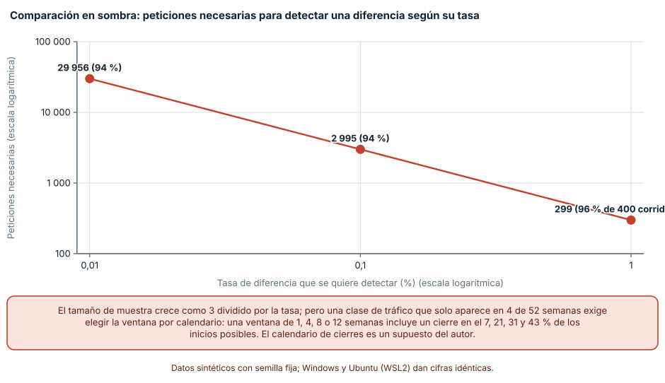

# SE-521 — Strangler, branch by abstraction y anticorruption

[← SE-520 — Dependencias obsoletas y riesgo acumulado](https://github.com/vladimiracunadev-create/modern-software-engineering-program/blob/main/classes/part-43-mantenimiento-y-modernizacion-legacy/se-520-dependencias-obsoletas-y-riesgo-acumulado/README.md) · [↑ Parte 43](https://github.com/vladimiracunadev-create/modern-software-engineering-program/blob/main/classes/part-43-mantenimiento-y-modernizacion-legacy/README.md) · [📚 Índice completo](https://github.com/vladimiracunadev-create/modern-software-engineering-program/blob/main/classes/README.md) · [🌐 Portal](https://vladimiracunadev-create.github.io/modern-software-engineering-program/classes/SE-521.html) · [SE-522 — Migraciones de runtime, lenguaje y framework →](https://github.com/vladimiracunadev-create/modern-software-engineering-program/blob/main/classes/part-43-mantenimiento-y-modernizacion-legacy/se-522-migraciones-de-runtime-lenguaje-y-framework/README.md)

## Punto profesional y fundamento pedagógico

**Punto profesional.** La clase existe para que sustituyas un sistema que no puedes detener por partes pequeñas, cada una reversible, en lugar de apostar todo a un corte. Los tres patrones de la clase (estrangulamiento, rama por abstracción y capa anticorrupción) responden a tres preguntas distintas: por dónde entra el tráfico a la versión nueva, cómo se cambia una implementación sin ramas largas y cómo se evita que el modelo viejo contamine al nuevo. La habilidad profesional es combinarlos con una medida de cuánto daño causa cada paso si sale mal.

**Por qué aparece aquí.** Sigue a **Dependencias obsoletas y riesgo acumulado**: la política de actualización dejó claro qué piezas conviene reemplazar; ahora hace falta saber cómo. El caso conductor es el **módulo legado de calificaciones**: sus rutas (calcular nota, cerrar acta, exportar) pueden migrarse una a una, y su modelo de datos (textos con coma, estados de una letra, fechas de dos dígitos) no debe filtrarse al sistema nuevo.

**Error conceptual que debe corregir.** Creer que un reemplazo incremental es solo un corte más lento. La diferencia no es de ritmo: en el corte único todo el tráfico queda expuesto al mismo defecto a la vez, y en el incremental cada paso expone una fracción pequeña, se compara con el sistema viejo antes de servir a nadie y se puede revertir. Esa reducción del daño por paso es lo que se compra con el tiempo adicional.

**Secuencia de aprendizaje.** Antes de mirar los resultados, predices cuántas peticiones afectadas produce un corte único frente a uno escalonado al 5 % si el 10 % de las rutas migradas trae una regresión; después simulas tres estrategias con 2 000 historias, calculas cuántas peticiones hay que comparar en sombra para ver una diferencia rara y cuándo aparece la clase de tráfico que solo ocurre al cierre del semestre, y mides qué hace una capa anticorrupción con 5 000 registros del modelo antiguo. La secuencia usa predicción, explicación propia, contraste y recuperación. [ICAP](https://icap.education.asu.edu/research) distingue participación de construcción de conocimiento; [How People Learn II](https://nap.nationalacademies.org/catalog/24783/how-people-learn-ii-learners-contexts-and-cultures) respalda diseñar la práctica con contextos reales y retroalimentación.

**Evidencia de aprendizaje.** `estrangulamiento-log.md` con la predicción, las tres figuras reproducidas, un plan de rebanadas del módulo con el tráfico por etapa, el criterio de comparación en sombra y su ventana, la lista de campos que la capa anticorrupción traduce con su decisión para cada caso ambiguo, y una nota que separe qué es medido, qué inferido y qué supuesto.

**Límite de la conclusión.** El 10 % de regresiones, el tráfico diario, el 5 % de la etapa inicial, la eficacia de la sombra, el calendario de cierres y los 5 000 registros con sus anomalías son sintéticos, escritos por el autor con semilla fija. No se migró ningún sistema real; las cifras muestran la forma del compromiso entre daño y tiempo, no el valor para tu migración.

### Trazabilidad fuente → afirmación

| Fuente primaria u oficial | Afirmación que respalda | Lo que no prueba |
|---|---|---|
| [Fowler, «StranglerFigApplication»](https://martinfowler.com/bliki/StranglerFigApplication.html) | Presenta el patrón de reemplazar un sistema envolviéndolo y desviando funcionalidad hacia el nuevo poco a poco. | No dice cuántas rebanadas ni en qué orden son adecuadas para tu sistema. |
| [Microsoft Azure Architecture Center: patrón Strangler Fig](https://learn.microsoft.com/en-us/azure/architecture/patterns/strangler-fig) | Describe una fachada que enruta peticiones entre el sistema antiguo y el nuevo, con consideraciones de datos y retiro. | Es guía de una plataforma; no sustituye el análisis de tu acoplamiento. |
| [Fowler, «BranchByAbstraction»](https://martinfowler.com/bliki/BranchByAbstraction.html) y [Trunk Based Development](https://trunkbaseddevelopment.com/branch-by-abstraction/) | Explican cómo introducir una abstracción para cambiar una implementación sin ramas largas. | No resuelven la migración de datos que acompaña al cambio. |
| [Microsoft Azure Architecture Center: Anti-corruption Layer](https://learn.microsoft.com/en-us/azure/architecture/patterns/anti-corruption-layer) | Describe una capa que traduce entre modelos para que el sistema nuevo no adopte la semántica del antiguo. | No decide cómo se traducen los casos ambiguos de tu modelo. |
| [Fowler, «DarkLaunching»](https://martinfowler.com/bliki/DarkLaunching.html) | Describe ejecutar una funcionalidad con tráfico real sin que las personas usuarias vean el resultado. | No dice cuánto tráfico basta para detectar una diferencia. |

## Antes de empezar

Recupera lo aprendido en `SE-520`: el costo de un salto crece con lo que se acumula. La pregunta activa es: **¿cuál es la unidad más pequeña de tu sistema que podrías reemplazar y volver a dejar como estaba en una hora si saliera mal?**

## Prerrequisitos

- Haber completado `SE-520` o poder explicar por qué los saltos grandes cuestan más que los pasos pequeños.
- Python 3.11 o posterior; los experimentos usan solo la biblioteca estándar (`random`, `math`, `datetime`).
- Saber qué es un enrutador o una fachada y qué es una bandera de funcionalidad.

## Problema auténtico

El equipo planeó reemplazar el módulo de calificaciones en un fin de semana de corte: cuarenta rutas, una sola fecha. La noche anterior, una revisión encontró que el sistema nuevo calculaba mal la nota cuando faltaba una parte, y la fecha se pospuso tres meses. En el segundo intento se optó por migrar ruta por ruta detrás de una fachada, y en la quinta ruta el sistema nuevo falló al leer fechas de dos dígitos del año 1999. Como solo el 5 % del tráfico de esa ruta pasaba por el sistema nuevo y se comparaba antes con el viejo, el error se detectó con unas decenas de peticiones afectadas. Sin embargo, otro error no apareció: el sistema nuevo calculaba mal una nota del cierre de semestre y esa clase de tráfico solo ocurre dos semanas al año; la sombra de tres semanas no la vio. La clase enseña a diseñar rebanadas reversibles, a elegir la ventana de comparación con el calendario del negocio en la mano y a traducir el modelo antiguo sin heredarlo.

## Objetivos observables

Al terminar podrás:

1. explicar el patrón de estrangulamiento, la rama por abstracción y la capa anticorrupción y cuándo se usa cada uno;
2. dividir un sistema en rebanadas migrables con un criterio y un orden;
3. calcular cuántas peticiones comparar en sombra para detectar una diferencia de una tasa dada y por qué la ventana debe cubrir el calendario del negocio;
4. comparar el daño esperado de un corte único, de uno escalonado y de uno escalonado con sombra previa;
5. escribir las reglas de traducción de una capa anticorrupción y decidir qué se hace con lo que no se puede traducir.

## Mapa conceptual


El mapa separa tres mecanismos: la **fachada** decide por dónde pasa cada petición, la **sombra** compara sin exponer y la **capa anticorrupción** traduce entre modelos. La flecha que vuelve desde el retiro indica que el sistema antiguo solo se apaga cuando nadie lo usa, no cuando la migración «terminó».

## Temas y por qué importan

| Tema | Por qué cambia una decisión profesional | Evidencia mínima |
|---|---|---|
| Estrangulamiento y rebanadas | Reduce el daño por paso y permite revertir. | Plan de rebanadas con tráfico por etapa |
| Rama por abstracción | Cambia una implementación sin ramas largas ni congelar el desarrollo. | Abstracción con dos implementaciones y bandera |
| Comparación en sombra | Detecta diferencias antes de servir a nadie. | Tamaño de muestra y ventana justificados |
| El calendario del negocio | Hay tráfico que solo aparece unas semanas al año. | Ventana que incluye las semanas raras |
| Capa anticorrupción | Evita que el modelo antiguo se vuelva el nuevo. | Reglas de traducción con casos no traducibles |

## Conceptos y decisiones

### 1. Estrangulamiento y rebanadas

El nombre viene de las higueras estranguladoras, que crecen alrededor de un árbol hasta sustituirlo. El patrón coloca una **fachada** (un enrutador, un proxy o una capa en el propio código) delante del sistema antiguo; al principio todo pasa por el antiguo, y se va desviando hacia el nuevo, **rebanada** por rebanada, la funcionalidad migrada. Cada rebanada debe ser lo bastante pequeña para migrarse y revertirse rápido, y lo bastante independiente para que migrarla no obligue a migrar otra. Los criterios para cortar son tres: por **ruta o capacidad** (calcular nota, cerrar acta, exportar), por **datos** (los cursos de un año) o por **tipo de cliente**. El mejor primer corte no es el más fácil sino el que enseña más con menos riesgo: una ruta con poco tráfico y pocas dependencias. El patrón tiene un costo que no conviene ocultar: durante la migración hay dos sistemas que mantener, un enrutador que es un punto de falla nuevo y la tentación de dejar la migración a medias, convirtiendo la fachada en parte permanente de la arquitectura.

### 2. Rama por abstracción

Cuando el código a reemplazar está dentro del mismo programa, la técnica equivalente es la **rama por abstracción**: se introduce una abstracción (una interfaz o una función) sobre el comportamiento a cambiar; el código existente pasa a ser una implementación; se desarrolla la nueva implementación detrás de la misma abstracción, con una bandera que decide cuál se usa; se cambia el valor de la bandera gradualmente y, cuando la nueva es la única en uso, se retira la antigua y la bandera. La técnica evita ramas largas de control de versiones, que acumulan conflictos, y permite integrar con frecuencia código que aún no está activo. La abstracción es una costura de objeto (`SE-519`) y la prueba de caracterización es la que garantiza que ambas implementaciones se comportan igual. El riesgo es que las banderas se acumulen: cada una debe tener dueño y fecha de retiro.

### 3. Comparación en sombra

Antes de servir tráfico real desde el sistema nuevo, se le puede enviar una **copia** de cada petición y comparar su respuesta con la del antiguo, sin que la persona vea la respuesta nueva. La técnica (lanzamiento oscuro, ejecución en paralelo) detecta diferencias sin exponer a nadie, con tres cautelas. Los efectos secundarios no deben duplicarse: la copia en sombra no puede escribir en la base real ni enviar correos. La comparación debe tener una **regla de equivalencia** (qué diferencias importan: los décimos de una nota sí, el orden de los campos o la hora de generación no). Y la muestra debe ser suficiente: si una diferencia ocurre en una fracción d de las peticiones, la probabilidad de ver al menos una en n comparaciones es 1 − (1 − d)^n, de modo que para el 95 % de confianza hacen falta aproximadamente 3/d peticiones: 300 para una diferencia del 1 %, 3 000 para el 0,1 %, 30 000 para el 0,01 %.

### 4. El calendario del negocio

El tráfico no es homogéneo en el tiempo: hay cierres de semestre, picos de matrícula, procesos anuales. Una diferencia que solo ocurre con un tipo de petición que aparece dos semanas al año no se ve en una sombra de tres semanas que no incluya esas dos. La ventana de comparación debe elegirse con el calendario del negocio en la mano, listando las clases de tráfico raras y asegurando que cada una se ejercite, ya sea esperando a que ocurra, reproduciendo tráfico grabado de la última vez o generando casos sintéticos de esa clase. No hay estimación de n que sustituya a esto: 30 000 peticiones normales no incluyen una sola petición de cierre.

### 5. Capa anticorrupción

El sistema antiguo tiene un modelo con sus propias convenciones: textos con coma decimal, estados de una letra con significados implícitos, fechas de dos dígitos, nulos y espacios que significan cosas distintas. Si el sistema nuevo habla ese lenguaje directamente, lo hereda. La **capa anticorrupción** (concepto del diseño orientado al dominio) es un traductor entre los dos modelos: expone al sistema nuevo un modelo limpio y se ocupa de convertir. Sus decisiones son semánticas: qué se hace con una nota vacía, con un estado desconocido, con una fecha imposible. Una buena capa **no lanza excepciones** ante datos raros: los clasifica (traducido, traducido con advertencia, no traducible) y envía lo no traducible a una cuarentena para revisión. Y debe poder desaparecer: cuando el sistema antiguo se retira, la capa se retira con él.

### Cuántas peticiones quedan expuestas

Se simula una migración de 40 rutas con 100 000 peticiones diarias, el 10 % de las rutas con una regresión y 2 000 historias. Estrategias: **corte único** (cada ruta pasa al 100 % y la regresión afecta a su parte del tráfico durante dos días antes de decidir el retroceso); **escalonado al 5 %** (la regresión se ve con el 5 % del tráfico durante dos días); **escalonado con sombra previa** (la comparación en sombra descubre el 60 % de las regresiones antes de que se sirva a nadie).

| Estrategia | Peticiones afectadas (mediana · p95) | Regresiones por migración | Semanas |
|---|---|---:|---:|
| Corte único | 20 000 · 35 000 | 4,0 | 4 |
| Escalonado al 5 % | 1 000 · 1 750 | 4,0 | 20 |
| Escalonado con sombra previa | 250 · 1 000 | 4,0 | 40 |

La regresión ocurre las mismas 4,0 veces por migración en las tres estrategias; lo que cambia es cuántas peticiones alcanza. El escalonado reduce el daño de mediana de 20 000 a 1 000 peticiones, veinte veces menos, a cambio de cinco veces más duración; la sombra previa lo reduce a 250 y duplica otra vez la duración. El tiempo es el precio del daño evitado, y la decisión es cuánto daño se tolera por cada semana que se gana.


**Cómo leer la figura.** Cada fila es una estrategia de migración y su tramo va de la mediana al percentil 95 de peticiones afectadas, en escala logarítmica. Mira primero que el escalonado desplaza todo el tramo a la izquierda, a un orden de magnitud menos de daño, a cambio de las semanas de la etiqueta. **Dónde deja de valer:** el 10 % de rutas defectuosas, los dos días hasta decidir el retroceso, el 60 % de eficacia de la sombra y la duración por ruta son supuestos del autor; el modelo asume que todas las rutas pesan igual y que la regresión afecta a todas sus peticiones, cuando en la realidad hay rutas con mucho más tráfico y defectos que dependen de datos. No incluye el costo de mantener dos sistemas.

### Cuánto hay que comparar y cuándo aparece lo raro

Primero se calcula el tamaño de muestra para detectar una diferencia del 1 %, del 0,1 % y del 0,01 % con el 95 % de probabilidad y se comprueba con 400 corridas simuladas. Después se sitúa una clase de tráfico que solo aparece en cuatro semanas de las 52 del año (las de cierre) y se estima, para ventanas de sombra de distinta duración que empiezan en una semana al azar, con qué frecuencia incluyen alguna de esas semanas.

| Pregunta | Dato | Resultado |
|---|---|---:|
| Peticiones para ver una diferencia del 1 % | 95 % de confianza | 299 (96 % de 400 corridas la ven) |
| Peticiones para el 0,1 % | 95 % de confianza | 2 995 (94 %) |
| Peticiones para el 0,01 % | 95 % de confianza | 29 956 (94 %) |
| Ventana de 1 semana incluye un cierre | cuatro semanas de 52 | 7 % |
| Ventana de 4 semanas | | 21 % |
| Ventana de 8 semanas | | 31 % |
| Ventana de 12 semanas | | 43 % |

Para ver una diferencia que ocurre una vez de cada diez mil peticiones hacen falta casi treinta mil comparaciones, lo que un sistema con 100 000 peticiones diarias reúne en unas siete horas. Pero una ventana de tres meses, con 12 semanas, incluye una semana de cierre en solo el 43 % de los inicios posibles: la cantidad de peticiones no resuelve el problema de las clases de tráfico que no están en la ventana. La conclusión práctica es doble: calcular el tamaño de muestra por tasa, y elegir la ventana por calendario o reproducir las clases raras con tráfico grabado o casos sintéticos.



**Cómo leer la figura.** El eje horizontal es la tasa de diferencia que se quiere detectar y el vertical, las peticiones necesarias; ambos en escala logarítmica. Mira primero que cada vez que la tasa se divide entre diez las peticiones se multiplican por diez, y la etiqueta de cada punto, el porcentaje de corridas que la ven. **Dónde deja de valer:** el cálculo supone que cada petición es independiente y que la diferencia ocurre con la misma probabilidad en todas, algo falso cuando la diferencia afecta a una clase concreta de peticiones; las cuatro semanas de cierre son un calendario inventado, y el 43 % es una estimación, no un porcentaje para citar.

### Qué hace una capa anticorrupción con 5 000 registros

Se generan 5 000 registros del modelo antiguo con anomalías: notas como `5,5`, `5.5`, vacío, con espacios, `x` o nulo; estados `A`, `I`, espacio, nulo, `X` o `a`; fechas `05/03/24`, `31/12/99`, `00/00/00`, vacío, `29/02/23` y `15/08/05`. Se compara una traducción ingenua (convertir directamente) con una capa que normaliza la coma decimal, reconoce los espacios, interpreta los años de dos dígitos con una regla de pivote (menos de 70 es 2000, el resto 1900) y clasifica lo que no puede traducir.

| Resultado | Registros |
|---|---:|
| Traducción ingenua: lanza excepción | 4 402 (88,0 %) |
| Capa anticorrupción: sin errores | 2 175 |
| Capa: con error de nota (valor no numérico) | 642 |
| Capa: con error de fecha (imposible o vacía) | 2 491 |
| Estado «desconocido» (vacío, nulo o `X`) | 2 429 |
| Nota sin valor (vacía o nula) | 1 879 |
| Estado espacio y nulo, distintos en el antiguo, iguales tras traducir | 1 606 |

La traducción ingenua se cae con el 88 % de los registros. La capa no lanza ninguna excepción: clasifica, deja 2 175 registros limpios y envía el resto a cuarentena con la etiqueta del campo que falló. La última fila muestra el límite: espacio y nulo se traducen al mismo estado «desconocido» y se pierde una distinción que el modelo antiguo hacía, quizá con significado (campo nunca informado frente a campo borrado). Una capa siempre toma decisiones semánticas, y deben escribirse con quién las aprobó.


**Cómo leer la figura.** Cada barra son los registros de 5 000 que caen en un resultado de la traducción; la raya marca el total. Mira primero la barra de la traducción ingenua, de 4 402 excepciones, frente a las de la capa, que no lanza ninguna pero clasifica y colapsa estados. **Dónde deja de valer:** las anomalías y sus frecuencias son una construcción del autor (en un sistema real la proporción de datos limpios suele ser mayor, y las anomalías distintas); la regla de pivote 70 es una convención, y una fecha de dos dígitos con significado histórico puede interpretarse mal.

## Definiciones de trabajo

- **estrangulamiento:** reemplazo de un sistema desviando su funcionalidad, rebanada por rebanada, hacia uno nuevo detrás de una fachada.
- **rebanada:** unidad de funcionalidad migrable y reversible de forma independiente.
- **rama por abstracción:** técnica que introduce una abstracción para cambiar una implementación sin ramas largas, con una bandera que elige la implementación.
- **comparación en sombra:** ejecución del sistema nuevo con una copia del tráfico real, sin servir su respuesta, para compararla con la del antiguo.
- **capa anticorrupción:** traductor que impide que el modelo del sistema antiguo se imponga al del nuevo.

Las definiciones son operativas para el módulo de calificaciones. No convierten términos con una historia más amplia en sinónimos y deben contrastarse con la documentación primaria enlazada al final.

## Ejemplo mínimo

El fragmento muestra la capa más pequeña posible: traducir un texto numérico sin lanzar excepciones. Antes de ejecutarlo, predice qué devuelve con `'5,5'`, `'x'` y `None`.

```python
def traduce_nota(t):
    if t is None or t.strip() == "": return None, None
    try: return float(t.strip().replace(",", ".")), None
    except ValueError: return None, "nota"
print(traduce_nota("5,5"), traduce_nota("x"), traduce_nota(None))
```

Devuelve `(5.5, None)`, `(None, 'nota')` y `(None, None)`. Observa que `'x'` y `None` producen resultados distintos: el primero es un error a revisar, el segundo una ausencia. Registra versión de Python, comando y salida.

## Ejemplo profesional

Escenario hipotético, construido para la clase y sin datos reales. El equipo divide el módulo en cuatro rebanadas: consulta de nota (poco tráfico, lectura), cálculo de nota, cierre de acta y exportación. Empieza por la consulta: la fachada la envía al sistema nuevo al 5 % y copia el 100 % en sombra al antiguo para comparar; la regla de equivalencia compara la nota al décimo y estado traducido, e ignora la marca de tiempo. Antes de subir a 25 % exige 3 000 comparaciones sin diferencias, calculadas para detectar una tasa del 0,1 %. Para el cálculo de nota, identifica en el calendario las dos semanas de cierre y no sube más allá del 25 % hasta haber reproducido tráfico grabado de la última de esas semanas. La capa anticorrupción manda a cuarentena los 2 825 registros con errores de la muestra y una persona del área académica decide el tratamiento de las fechas imposibles. Cada paso tiene un punto de retroceso: volver la bandera al sistema antiguo, sin cambios de datos. Compara con el plan de un corte único de fin de semana: el daño máximo esperado por paso baja de miles de peticiones a decenas.

## Práctica guiada

1. Divide un sistema propio o el módulo sintético en rebanadas con un criterio y ordénalas por riesgo y valor.
2. Predice cuántas peticiones afectadas produce un corte único frente a uno escalonado y escribe el número antes de simular.
3. Reproduce la tabla de estrategias con las semillas fijadas en el código; cambia la eficacia de la sombra del 60 % al 20 % y observa cuándo deja de compensar.
4. Calcula el tamaño de muestra para una diferencia de 0,5 % con el 99 % de confianza y compáralo con una simulación.
5. Escribe el calendario del negocio de tu sistema y la ventana de sombra que cubriría cada clase de tráfico rara.
6. Escribe las reglas de la capa anticorrupción para cinco campos y la política de cuarentena.
7. Entrega `estrangulamiento-log.md` y pide a otra persona que encuentre una petición que tu regla de equivalencia trate como igual y que ella consideraría distinta.

## Ejercicios

1. **Rebanadas:** explica por qué empezar por la ruta con más tráfico es un error y propón un criterio de orden con dos factores.
2. **Muestra:** una diferencia ocurre en el 0,2 % de las peticiones. ¿Cuántas comparaciones necesitas para el 99 %? Calcula con la fórmula y comprueba con una simulación.
3. **Capa:** una nota vacía puede significar «aún no calificada» o «ausente». Redacta dos políticas de traducción y las consecuencias de cada una para el cálculo de promedios.
4. **Bandera:** una rama por abstracción deja una bandera encendida durante un año. Redacta la regla que evita que se acumulen banderas y quién la hace cumplir.

## Reto verificable

Entrega `estrangulamiento-log.md` con la predicción, las tres tablas, el plan de rebanadas con tráfico por etapa y punto de retroceso, la regla de equivalencia de la sombra con su ventana y la tabla de traducción de la capa con su política de cuarentena. Se aprueba si otra persona ejecuta el código desde un checkout limpio, obtiene los mismos números con las mismas semillas y puede decir qué haría falta para pasar del 5 % al 25 % de una rebanada. No se aprueba por afirmar que la sombra «no encontró diferencias» sin decir cuántas peticiones ni qué clases de tráfico cubrió.

## Caso conductor

El módulo de calificaciones es el caso conductor de la [Parte 43](../README.md). Esta clase deja el quinto artefacto: el plan de rebanadas con su sombra y su capa de traducción. `SE-522` preguntará cómo se migra el runtime que sostiene al módulo, y `SE-523` cómo se migran los datos que la capa traduce. Cambia después un solo dato, el calendario de cierre de cuatro semanas a ocho, y observa cómo cambia la ventana necesaria.

## Preguntas frecuentes

### ¿El estrangulamiento sirve si el sistema antiguo comparte base de datos con el nuevo?

Sirve, pero con una restricción: los dos sistemas deben ponerse de acuerdo sobre quién es dueño de cada dato en cada etapa. Compartir tablas sin reglas produce el peor de los mundos, un monolito distribuido; por eso `SE-523` y `SE-524` se ocupan de migrar y coexistir.

### ¿La comparación en sombra duplica la carga del sistema?

Sí, en la parte del tráfico copiada. Puede ser un 100 % de las peticiones o una muestra, y conviene hacerla asíncrona para no añadir latencia a la respuesta real. El costo de la carga adicional forma parte del plan.

### ¿Cuándo es mejor una rama por abstracción que un estrangulamiento?

Cuando la sustitución es interna al programa y no se puede interponer una fachada de red: una biblioteca, un algoritmo, un acceso a datos. El estrangulamiento actúa en las fronteras del sistema; la rama por abstracción, dentro.

### ¿Se puede dejar la capa anticorrupción para siempre?

Puede ser necesario mientras el sistema antiguo siga siendo una fuente de datos. El riesgo es que la capa se vuelva un segundo modelo permanente que nadie se atreve a tocar; por eso debe tener una condición de retiro.

## Fallo controlado y diagnóstico

Reproduce el fallo clásico de la clase: **una sombra sin diferencias que no había visto el tráfico raro**. Ejecuta la comparación en sombra durante cuatro semanas en las que no hay cierre y observa que no hay diferencias.

Registra síntoma, entrada mínima, hipótesis, observación que descarta cada hipótesis, causa, corrección y prueba de regresión. **Síntoma:** cuatro semanas de sombra sin diferencias y, a las pocas semanas de la migración, un cálculo erróneo en el cierre de semestre. **Hipótesis rivales:** (a) la sombra no comparaba bien; (b) hubo un cambio posterior en el sistema nuevo; (c) la clase de tráfico del cierre no estuvo en la ventana. **Prueba:** reproduce tráfico grabado de la última semana de cierre en la sombra; si aparecen diferencias, la causa es la ventana. **Conclusión:** una ventana de cuatro semanas incluye una semana de cierre en solo el 21 % de los inicios posibles. **Regresión:** añade al plan la lista de clases de tráfico raras y exige que cada una tenga casos reproducidos antes de subir el porcentaje. No cambies a la vez la ventana y la regla de equivalencia.

## Errores comunes y cómo corregirlos

| Síntoma | Causa probable | Corrección |
|---|---|---|
| El corte se pospone una y otra vez | El paso es demasiado grande para verificarse | Dividir en rebanadas con retroceso independiente |
| La sombra no muestra diferencias y hay error en producción | La ventana no incluye el tráfico raro | Elegir la ventana por calendario y reproducir tráfico grabado |
| La sombra escribe datos duplicados | La copia ejecuta efectos secundarios | Aislar la sombra de escrituras y envíos |
| El sistema nuevo adopta las rarezas del antiguo | No hay capa de traducción | Introducir una capa anticorrupción con cuarentena |
| Las banderas se acumulan | No tienen dueño ni fecha | Registrar dueño y fecha de retiro para cada una |

## Entorno y archivos clave

```text
work/SE-521/
├── README.md
├── estrangulamiento/
│   ├── estrategias.py
│   ├── sombra.py
│   └── capa_anticorrupcion.py
├── PLAN-REBANADAS.md
├── tests/test_estrangulamiento.py
└── evidence/estrangulamiento-log.md
```

El `README` declara plataforma, versión de Python, semillas y comandos. Los experimentos usan solo la biblioteca estándar (`random`, `math`, `datetime`) y se ejecutaron con CPython 3.12.9 en Windows 11 y 3.12.3 en Ubuntu bajo WSL2: las salidas fueron idénticas. Si añades una dependencia, fija procedencia y versión.

## Seguridad, ética y accesibilidad

- la comparación en sombra copia tráfico real: puede contener datos personales y debe tratarse con la misma protección que la producción, con retención mínima;
- un error de traducción en la capa puede asignar mal una nota a una persona; la cuarentena con revisión humana es una garantía de equidad, no un trámite;
- la sombra no debe producir efectos visibles (correos, notificaciones) ni escrituras reales;
- las tablas y figuras deben tener texto alternativo y no depender del color;
- los patrones citados son textos de sus autores: cita las ideas y vincula la fuente, no copies sus textos ni diagramas.

## Puente hacia el trabajo con agentes

Un agente al que se le pide «migra este módulo al nuevo framework» reescribirá el módulo entero y dirá que las pruebas pasan. Pídele en cambio que proponga rebanadas con su orden y su punto de retroceso, que escriba la abstracción y las dos implementaciones con una bandera, que genere la regla de equivalencia y que liste las clases de tráfico que no cubre. Revisa especialmente cualquier cambio que toque a la vez el comportamiento y la estructura, y cualquier traducción de datos que no distinga entre «sin valor» y «valor inválido».

## Transferencia

Traslada el análisis a otro dominio (por ejemplo, un sistema de reservas de un taller con una API de pagos antigua): cambia las rebanadas, el calendario y el modelo antiguo y conserva el procedimiento de cortar por rutas, comparar en sombra con una ventana por calendario y traducir con cuarentena. La transferencia está lograda cuando puedes decir qué clase de tráfico raro tendría tu dominio y qué paso tendría un retroceso gratuito, no cuando el plan se parece al del módulo de calificaciones.

## Evaluación y evidencia

| Criterio | Evidencia para aprobar |
|---|---|
| comprensión | explicación de qué hace cada patrón y de qué reduce cada uno |
| corrección | tablas de exposición, de muestra y ventana, y de traducción reproducibles con las mismas semillas |
| diseño | plan de rebanadas con retroceso, regla de equivalencia y reglas de traducción con cuarentena |
| diagnóstico | reproducción del fallo «sombra sin el tráfico raro» con regresión |
| incertidumbre | declaración de que las tasas, el calendario y las anomalías son del autor |
| reproducibilidad | versiones, comandos, salida y límites declarados |

## Fuentes

- [Fowler, «StranglerFigApplication»](https://martinfowler.com/bliki/StranglerFigApplication.html) — el patrón de estrangulamiento; autoridad: autor del texto.
- [Microsoft Azure Architecture Center: Strangler Fig](https://learn.microsoft.com/en-us/azure/architecture/patterns/strangler-fig) — fachada y migración incremental; autoridad: documentación de Microsoft.
- [Fowler, «BranchByAbstraction»](https://martinfowler.com/bliki/BranchByAbstraction.html) y [Trunk Based Development](https://trunkbaseddevelopment.com/branch-by-abstraction/) — cambio de implementación sin ramas largas; autoridad: autor del texto y comunidad.
- [Microsoft Azure Architecture Center: Anti-corruption Layer](https://learn.microsoft.com/en-us/azure/architecture/patterns/anti-corruption-layer) — traducción entre modelos; autoridad: documentación de Microsoft.
- [Fowler, «DarkLaunching»](https://martinfowler.com/bliki/DarkLaunching.html) — ejecutar con tráfico real sin exponer el resultado; autoridad: autor del texto.
- [Fowler, «FeatureToggle»](https://martinfowler.com/bliki/FeatureToggle.html) — banderas de funcionalidad y su costo; autoridad: autor del texto.

Cada fuente respalda el mecanismo indicado; ninguna demuestra que los 20 000 frente a 1 000 de peticiones afectadas, el 43 % de la ventana de doce semanas o el 88 % de excepciones se observen en tu sistema. Esa afirmación depende del tráfico, del calendario y del modelo de datos reales.

## Límites y siguiente paso

Se ejecutaron tres experimentos con datos sintéticos en Windows y Ubuntu (WSL2) con resultados idénticos. No se migró ningún sistema ni se comparó tráfico real; el 10 % de rutas con regresión, los dos días hasta decidir, la eficacia de la sombra, el calendario de cuatro semanas de cierre y las anomalías de los 5 000 registros son construcciones del autor, y el modelo supone rutas de igual peso. La siguiente clase pregunta cómo se migra el runtime, el lenguaje o el framework que sostiene al módulo.

## Glosario

- **estrangulamiento:** reemplazo de un sistema desviando su funcionalidad, rebanada por rebanada, hacia uno nuevo detrás de una fachada.
- **rebanada:** unidad de funcionalidad migrable y reversible de forma independiente.
- **rama por abstracción:** técnica que introduce una abstracción para cambiar una implementación sin ramas largas, con una bandera que elige la implementación.
- **comparación en sombra:** ejecución del sistema nuevo con una copia del tráfico real, sin servir su respuesta, para compararla con la del antiguo.
- **capa anticorrupción:** traductor que impide que el modelo del sistema antiguo se imponga al del nuevo.

---

[← SE-520 — Dependencias obsoletas y riesgo acumulado](https://github.com/vladimiracunadev-create/modern-software-engineering-program/blob/main/classes/part-43-mantenimiento-y-modernizacion-legacy/se-520-dependencias-obsoletas-y-riesgo-acumulado/README.md) · [↑ Parte 43](https://github.com/vladimiracunadev-create/modern-software-engineering-program/blob/main/classes/part-43-mantenimiento-y-modernizacion-legacy/README.md) · [📚 Índice completo](https://github.com/vladimiracunadev-create/modern-software-engineering-program/blob/main/classes/README.md) · [🌐 Portal](https://vladimiracunadev-create.github.io/modern-software-engineering-program/classes/SE-521.html) · [SE-522 — Migraciones de runtime, lenguaje y framework →](https://github.com/vladimiracunadev-create/modern-software-engineering-program/blob/main/classes/part-43-mantenimiento-y-modernizacion-legacy/se-522-migraciones-de-runtime-lenguaje-y-framework/README.md)
