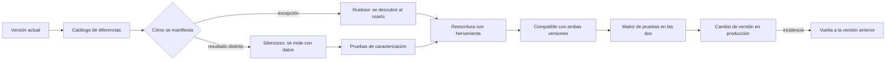

# SE-522 — Migraciones de runtime, lenguaje y framework

[← SE-521 — Strangler, branch by abstraction y anticorruption](https://github.com/vladimiracunadev-create/modern-software-engineering-program/blob/main/classes/part-43-mantenimiento-y-modernizacion-legacy/se-521-strangler-branch-by-abstraction-y-anticorruption/README.md) · [↑ Parte 43](https://github.com/vladimiracunadev-create/modern-software-engineering-program/blob/main/classes/part-43-mantenimiento-y-modernizacion-legacy/README.md) · [📚 Índice completo](https://github.com/vladimiracunadev-create/modern-software-engineering-program/blob/main/classes/README.md) · [🌐 Portal](https://vladimiracunadev-create.github.io/modern-software-engineering-program/classes/SE-522.html) · [SE-523 — Migraciones de datos sin interrupción →](https://github.com/vladimiracunadev-create/modern-software-engineering-program/blob/main/classes/part-43-mantenimiento-y-modernizacion-legacy/se-523-migraciones-de-datos-sin-interrupcion/README.md)

## Punto profesional y fundamento pedagógico

**Punto profesional.** La clase existe para que puedas mover un sistema a otra versión del lenguaje, del runtime o del framework sin que el cambio falle de la forma más peligrosa: sin hacer ruido. Las migraciones de plataforma fallan de dos maneras. Las que lanzan una excepción se descubren al primer uso. Las que cambian el resultado en silencio (un redondeo, un orden, un ancho de campo) llegan a producción. La habilidad es catalogar qué cambia, medir cuántos datos reales tocan esos cambios y automatizar las reescrituras con una herramienta que entienda la estructura del código.

**Por qué aparece aquí.** Sigue a **Strangler, branch by abstraction y anticorruption**: esa clase repartió el reemplazo por rebanadas; esta trata el caso en que lo que se cambia es el suelo sobre el que corre el sistema. El caso conductor es el **módulo legado de calificaciones**, escrito para una versión antigua del lenguaje, con una regla de redondeo (`int(n * 10 + 0.5)`), campos de ancho fijo en bytes y un exportador que ordena por texto.

**Error conceptual que debe corregir.** Creer que, si el programa arranca y las pruebas pasan, la migración está terminada. Los cambios de plataforma que más daño hacen no son los que rompen el arranque sino los que cambian el significado de operaciones que siguen ejecutándose: la comparación, el orden, la división, el redondeo, la codificación de texto. Una suite que no los ejercita aprueba una migración que ya cambió los datos.

**Secuencia de aprendizaje.** Antes de mirar los resultados, predices qué fracción de las notas de un decimal cambia al sustituir el redondeo antiguo por el de la biblioteca estándar actual; después ejecutas cuatro sondas sobre comportamientos reales del intérprete (redondeo, orden alfabético, truncado en bytes y división), comparas tres formas de reescribir una llamada obsoleta sobre 400 fragmentos de código y simulas tres políticas de seguimiento de versiones frente a un calendario de soporte. La secuencia usa predicción, explicación propia, contraste y recuperación. [ICAP](https://icap.education.asu.edu/research) distingue participación de construcción de conocimiento; [How People Learn II](https://nap.nationalacademies.org/catalog/24783/how-people-learn-ii-learners-contexts-and-cultures) respalda diseñar la práctica con contextos reales y retroalimentación.

**Evidencia de aprendizaje.** `migracion-runtime-log.md` con la predicción, las tres figuras reproducidas, un catálogo de diferencias de comportamiento del módulo con su recuento sobre datos reales o sintéticos, un script de reescritura basado en el árbol sintáctico con su prueba y una política de seguimiento de versiones con su calendario.

**Límite de la conclusión.** Las sondas se ejecutan de verdad sobre CPython 3.12.9 y 3.12.3, pero los datos (centésimas de nota, 2 000 nombres, 400 fragmentos de código y el tren de versiones) son sintéticos y escritos por el autor. No se migró ningún sistema real de Python 2 a 3 ni de un framework a otro; el calendario de soporte (una versión al año, tres años de soporte) es un supuesto, no el calendario de ningún producto.

### Trazabilidad fuente → afirmación

| Fuente primaria u oficial | Afirmación que respalda | Lo que no prueba |
|---|---|---|
| [Python: función integrada round](https://docs.python.org/3/library/functions.html) | Documenta que, para empates, `round` redondea hacia el valor par, y advierte de que los flotantes no representan exactamente todas las fracciones decimales. | No dice cómo debe redondear tu sistema de calificaciones. |
| [Python: Porting Python 2 Code to Python 3](https://docs.python.org/3/howto/pyporting.html) | Describe una estrategia de portar por pasos, con herramientas y comprobaciones, y mantener compatibilidad con ambas versiones durante la transición. | Es la guía de un caso concreto; no cubre otros lenguajes ni frameworks. |
| [Python: What's New in Python 3.0](https://docs.python.org/3/whatsnew/3.0.html) | Lista cambios que alteran el comportamiento, entre ellos la división de enteros y la separación entre texto y bytes. | No dice cuántos de esos cambios tocan tu código. |
| [PEP 602: Annual Release Cycle for Python](https://peps.python.org/pep-0602/) y [Python Developer's Guide: versiones](https://devguide.python.org/versions/) | Documentan el ciclo anual de versiones y la ventana de soporte de cada una. | No fijan la política de tu equipo ni valen para otros productos. |
| [Python: ast](https://docs.python.org/3/library/ast.html) | Documenta el árbol sintáctico, base de las reescrituras que entienden la estructura del código. | No resuelve por sí solo la reescritura que debe conservar formato y comentarios. |
| [Unicode UAX #15: formas de normalización](https://unicode.org/reports/tr15/) | Define la normalización de texto que permite comparar «é» como un carácter o como dos. | No define el orden alfabético de una lengua. |

## Antes de empezar

Recupera lo aprendido en `SE-521`: dividir en pasos reversibles reduce el daño. La pregunta activa es: **¿qué operaciones de tu sistema (redondear, ordenar, dividir, truncar, comparar texto) cambiarían de resultado sin lanzar ninguna excepción si cambiara la versión del lenguaje?**

## Prerrequisitos

- Haber completado `SE-521` o poder explicar el patrón de rebanadas con retroceso.
- Python 3.11 o posterior; los experimentos usan solo la biblioteca estándar (`ast`, `re`, `unicodedata`, `random`).
- Saber qué es un árbol sintáctico y qué diferencia hay entre texto y bytes.

## Problema auténtico

El módulo de calificaciones corría en un runtime que dejaba de recibir correcciones en seis meses. El plan era «subir la versión y ejecutar las pruebas». Las pruebas pasaron. Al revisar la primera semana de producción, el área académica encontró notas que diferían en un décimo respecto de las del trimestre anterior, un listado alfabético con «Ángel» después de «Zoe» y dos nombres cortados con un carácter ilegible en el archivo para el ministerio. Ninguna excepción había saltado. La causa de las tres cosas no era un error de la nueva versión sino un comportamiento distinto en operaciones que el código ya usaba: el redondeo de una función integrada, el orden por punto de código y el truncado de un campo de ancho fijo medido en bytes. La clase enseña a buscar esos cambios antes de migrar, a medir cuántos datos los activan y a reescribir con herramientas que no confundan una llamada con un texto que se le parece.

## Objetivos observables

Al terminar podrás:

1. clasificar un cambio de plataforma como ruidoso (lanza una excepción) o silencioso (cambia un resultado);
2. ejecutar sondas que midan cuántos datos de un conjunto cambian de resultado bajo un comportamiento nuevo;
3. comparar la reescritura por texto, por expresión regular y por árbol sintáctico y contar sus errores;
4. escribir una política de seguimiento de versiones frente a un calendario de soporte y estimar el tiempo sin soporte que deja;
5. diseñar una migración con compatibilidad en ambas versiones, pruebas de caracterización y un interruptor de vuelta.

## Mapa conceptual



El mapa separa los cambios **ruidosos** de los **silenciosos** y muestra que el paso intermedio es un código compatible con ambas versiones: así el cambio de versión en producción es un interruptor y no una reescritura.

## Temas y por qué importan

| Tema | Por qué cambia una decisión profesional | Evidencia mínima |
|---|---|---|
| Qué cambia en una migración | Sin catálogo, solo se descubre lo ruidoso. | Lista de diferencias con su tipo |
| Cambios silenciosos de semántica | Alteran datos sin dejar rastro. | Recuento de datos afectados por sonda |
| Reescritura automática | Una herramienta imprecisa introduce más errores de los que corrige. | Comparación de falsos positivos por método |
| Calendario de versiones y soporte | Migrar tarde obliga a hacerlo con prisa y sin soporte. | Política con fracción de tiempo sin soporte |
| Compatibilidad en ambas versiones | Convierte el corte en un interruptor reversible. | Matriz de pruebas en las dos versiones |

## Conceptos y decisiones

### 1. Qué cambia en una migración

Una migración de plataforma cambia algo bajo el código: la versión del lenguaje, el runtime que lo ejecuta, el framework que estructura la aplicación o el lenguaje mismo. Las diferencias se agrupan en cinco tipos. **Sintaxis y API eliminadas**: lo que ya no existe y lanza una excepción. **Comportamiento redefinido**: lo que existe y hace otra cosa (división, redondeo, orden). **Valores por defecto**: la codificación de texto, el nivel de seguridad, el tamaño de un pool. **Rendimiento**: lo que sigue funcionando y tarda más o menos. **Ecosistema**: bibliotecas que dejan de soportar la versión. El primer tipo es ruidoso por naturaleza. Los demás pueden no serlo, y son los que la guía de portado y las notas de cambio de cada versión documentan, con una condición: solo se leen si alguien las busca. El primer entregable de una migración es, por tanto, un catálogo de diferencias aplicables a este código, con un recuento de dónde se ejercitan.

### 2. Cambios ruidosos y silenciosos

Un cambio **ruidoso** se descubre al ejecutarlo: la llamada a una función eliminada lanza una excepción y la suite, si la ejercita, falla. Un cambio **silencioso** produce un resultado distinto sin excepción: el redondeo de empates, la división de enteros, el orden de un diccionario o un conjunto, la codificación por defecto al abrir un archivo. Los silenciosos son más peligrosos por dos razones: la suite solo los detecta si compara valores en los puntos exactos donde difieren, y el daño se acumula en los datos mientras nadie mira. Las sondas son el instrumento: se toman datos representativos, se aplica la operación con el comportamiento antiguo y con el nuevo y se cuenta cuántos resultados difieren. Un recuento de cero justifica ignorar el cambio; uno distinto de cero obliga a decidir si se conserva el comportamiento antiguo (reescribiendo el código para obtenerlo) o se acepta el nuevo, con una comunicación a quienes usan los datos.

### 3. Reescritura automática: de texto, de expresión y de estructura

Cuando una API cambia de nombre o de firma, en un código grande la reescritura manual es lenta y propensa a omisiones, y se automatiza. Hay tres niveles de herramienta. La **sustitución de texto** reemplaza la cadena donde la encuentra, sin distinguir una llamada de un comentario, un nombre parecido, un texto de usuario o una variable. La **expresión regular con límites de palabra** evita los nombres parecidos pero sigue sin distinguir una llamada de un comentario, un texto o una definición. La reescritura **por árbol sintáctico** reconoce la estructura: solo cambia nodos que son llamadas a ese nombre. La de estructura es la más precisa y exige conservar lo que el árbol descarta (comentarios, formato), motivo por el que existen herramientas que trabajan sobre un árbol concreto que los preserva. Cualquier herramienta, aun la más precisa, se valida con las pruebas de caracterización y una revisión del diff: el árbol evita una clase de error, no todas.

### 4. Calendario de versiones y soporte

Los lenguajes y frameworks publican versiones con un ritmo y reciben correcciones durante una ventana. Python, por ejemplo, publica una versión mayor cada año y mantiene cada una un número fijo de años; otros productos tienen soporte de largo plazo en versiones escogidas. Un equipo puede seguir ese calendario con tres políticas. **Al ser forzado**: se migra cuando la versión actual pierde el soporte, y durante la migración, que dura meses, se corre sin soporte. **Con un año de margen**: se empieza a migrar un año antes de que termine el soporte. **Paso a paso**: se sigue cada versión con un pequeño retraso, de modo que cada migración es pequeña. La diferencia no es solo de tiempo sin soporte sino de forma del esfuerzo: pocas migraciones grandes o muchas pequeñas. Las pequeñas son más fáciles de revertir y de aprender, y suman menos meses de trabajo, si la plataforma cambia de forma incremental.

### 5. Compatibilidad en ambas versiones y vuelta atrás

La estrategia que más reduce el riesgo es hacer que el código funcione **en la versión actual y en la nueva** antes de cambiar la de producción. Se hace en pasos: se ejecutan las pruebas en las dos versiones (una matriz de pruebas), se reescribe lo que difiere de manera que dé el mismo resultado en ambas, se retiran las dependencias que no soportan la nueva y, solo entonces, se cambia la versión en producción, con el interruptor de volver a la anterior disponible mientras dura un periodo de observación. El código compatible con ambas versiones es provisional y se limpia después. La alternativa, reescribir y cambiar de versión a la vez, mezcla dos fuentes de fallo y hace imposible saber cuál causó un problema.

### Cuatro comportamientos que cambian sin excepción

Se miden cuatro operaciones del módulo ejecutadas de verdad en CPython (3.12.9 en Windows, 3.12.3 en Ubuntu).

```python
viejo = int(x * 10 + 0.5) / 10      # regla antigua: la mitad sube
nuevo = round(x, 1)                 # round: la mitad va al par y los flotantes no son exactos
```

| Operación | Datos | Resultados distintos |
|---|---|---:|
| Redondear a un decimal: regla antigua frente a `round` | 1 000 centésimas, 0,00 a 9,99 | 50 (5,0 %); las que terminan en 5 son 100 |
| Ordenar 2 000 nombres: punto de código frente a plegado de acentos y mayúsculas | 15 nombres base con sufijos | 1 828 posiciones distintas (91,4 %) |
| Truncar a 6 bytes en UTF-8 | 1 000 nombres | 114 con un carácter partido (11,4 %); en latin-1, ninguno |
| `7n/2` frente a `7n//2` | n de 1 a 1 000 | 500 (los impares) |

De las 100 centésimas que terminan en 5, la mitad cambia al pasar de la regla antigua a `round`: unas porque el empate se resuelve hacia el valor par (0,25 pasa a 0,2) y otras porque la fracción decimal no es exacta en binario (0,15 se almacena como un valor ligeramente menor que 0,15 y baja). El 5 % de todas las notas con dos decimales cambia de un décimo en un sentido o en otro; cada cambio es un décimo, y en una escala con aprobado en 4,0 puede cruzar la frontera. El orden alfabético difiere en el 91,4 % de las posiciones porque la comparación por punto de código pone todas las mayúsculas antes de todas las minúsculas y los acentuados al final. El truncado de un campo de 6 bytes parte el 11,4 % de los nombres porque una vocal acentuada ocupa dos bytes.


**Cómo leer la figura.** Cada barra es una operación y su longitud, el porcentaje de resultados que cambian respecto de la versión anterior, ninguno con excepción. Mira primero que el orden con plegado de acentos cambia nueve de cada diez posiciones y que incluso el redondeo cambia una de cada veinte. **Dónde deja de valer:** los datos son sintéticos (centésimas uniformes, 15 nombres base, sufijos al azar) y las frecuencias en datos reales serán otras; la comparación del orden usa un plegado a ASCII que no es el orden de ninguna lengua concreta. Las cuatro sondas ilustran el tipo de cambio, no son una lista completa de las diferencias de ninguna versión.

### Tres formas de reescribir una llamada obsoleta

Se generan 400 fragmentos de código de nueve tipos: llamadas reales (`leer_nota(a)`, con y sin espacio, dos en la misma línea), un método de otro objeto, un comentario, un texto, otro nombre que contiene el nombre buscado, una variable y una definición. La tarea es reescribir las llamadas reales a `obtener_nota`. Se comparan la sustitución de texto, una expresión regular con límites de palabra y la reescritura por árbol sintáctico con `ast` y las posiciones de cada nodo.

| Método | Reescrituras indebidas | Llamadas sin reescribir o mal reescritas |
|---|---:|---:|
| Sustitución de texto | 252 | 0 |
| Expresión regular con límites de palabra | 166 | 0 |
| Árbol sintáctico | 0 | 0 |

Entre los 400 fragmentos hay 148 llamadas reales. La sustitución de texto las reescribe todas y además cambia 252 fragmentos que no debía tocar (el método de otro objeto, el comentario, el texto, el otro nombre, la variable y la definición). La expresión regular elimina los nombres parecidos y deja 166 cambios indebidos (el método de otro objeto, el comentario, el texto y la definición). El árbol sintáctico no comete ningún error en este conjunto. Que no cometa errores aquí no lo hace infalible: no conserva comentarios dentro de la misma línea de la llamada, y la definición de la función debe renombrarse por separado.


**Cómo leer la figura.** Cada barra son las reescrituras indebidas de un método; la verde es el árbol sintáctico. Mira primero que la sustitución de texto y la expresión regular tocan comentarios, textos y otros métodos, y el árbol, ninguno. **Dónde deja de valer:** los nueve tipos de fragmento son del autor y se escribieron para exhibir las diferencias; en código real la proporción de comentarios y textos parecidos es menor y los errores de la sustitución de texto serían menos frecuentes, aunque seguirían siendo posibles. El árbol no se probó con código mal formado ni con llamadas por reflexión.

### Seguir las versiones: tres políticas frente a un calendario

Cada año sale una versión mayor y cada una recibe soporte durante tres años. El equipo parte de la versión 0 y simula diez años (120 meses). Una migración dura una mediana de 6 meses con dispersión lognormal de 0,6, y la de la política paso a paso cuesta el 30 % porque cada salto es pequeño. Se repite con 1 000 semillas.

| Política | Tiempo sin soporte (mediana · p90) | Migraciones en diez años | Meses de migración |
|---|---|---:|---:|
| Al ser forzado | 16,3 % · 24,9 % | 3,0 | 21 |
| Con un año de margen | 0,0 % · 6,3 % | 4,0 | 28 |
| Paso a paso (con 6 meses de retraso) | 0,0 % · 0,0 % | 9,0 | 19 |

Esperar a que el soporte termine deja al equipo sin soporte el 16,3 % del tiempo de mediana, porque cada migración se hace con la versión ya caducada. Empezar un año antes lo evita en la mediana pero en el percentil 90 aún hay 6,3 % de tiempo sin soporte, cuando una migración dura más de lo previsto. Seguir paso a paso hace más migraciones (9,0) y menos meses totales (19) que las otras, bajo el supuesto de que cada migración pequeña cuesta el 30 %. Ese supuesto es el núcleo de la ventaja: si la plataforma hiciera cambios que no se pueden dividir, no habría ahorro.


**Cómo leer la figura.** Cada fila es una política de seguimiento y su tramo va de la mediana al percentil 90 del tiempo sin soporte, en porcentaje de los diez años; la etiqueta añade migraciones y meses. Mira primero que solo la política forzada deja un tramo largo y que seguir paso a paso lo lleva a cero a cambio de más migraciones. **Dónde deja de valer:** el calendario de un año y tres años de soporte, la mediana de 6 meses por migración y el 30 % de las migraciones pequeñas son supuestos del autor; la dispersión de 0,6 es una elección. El modelo no incluye el costo de coordinar ni la posibilidad de que una versión intermedia no sea compatible con las bibliotecas.

## Definiciones de trabajo

- **cambio ruidoso:** diferencia entre versiones que lanza una excepción al ejecutarse.
- **cambio silencioso:** diferencia entre versiones que produce un resultado distinto sin lanzar una excepción.
- **sonda:** programa que aplica una operación con el comportamiento antiguo y el nuevo sobre datos representativos y cuenta cuántos resultados difieren.
- **reescritura por estructura:** modificación automática del código que opera sobre su árbol sintáctico y no sobre su texto.
- **matriz de pruebas:** ejecución de la misma suite en varias versiones de la plataforma.

Las definiciones son operativas para el módulo de calificaciones. No convierten términos con una historia más amplia en sinónimos y deben contrastarse con la documentación primaria enlazada al final.

## Ejemplo mínimo

El fragmento muestra que dos reglas de redondeo difieren en un empate exacto. Antes de ejecutarlo, predice los dos valores.

```python
x = 0.25
print(int(x * 10 + 0.5) / 10, round(x, 1))
```

Imprime `0.3 0.2`: la regla antigua sube el empate y `round` lo lleva al par. Registra versión de Python, comando y salida; después prueba `0.15` y `0.35` y explica por qué el resultado no sigue la regla del par.

## Ejemplo profesional

Escenario hipotético, construido para la clase y sin datos reales. El equipo hace el catálogo de diferencias entre la versión actual y la objetivo y lo cruza con el código: encuentra 14 usos de `round`, 6 ordenamientos de nombres y un campo de 12 bytes. Ejecuta las sondas con las notas del último año: 38 de 760 resultados cambian de un décimo y 2 cruzan la frontera de aprobado. Decide conservar el comportamiento antiguo en el cálculo (una función explícita de redondeo, con la regla escrita y probada) y aceptar el orden con plegado de acentos, con aviso al área académica. Para la llamada obsoleta que aparece 148 veces escribe un script con `ast`, lo prueba con el conjunto de 400 fragmentos y revisa el diff completo. Configura una matriz de pruebas con las dos versiones, deja el código compatible con ambas durante un trimestre y cambia producción con la versión anterior lista para volver. La política resultante: empezar a migrar cuando la versión actual tenga un año de soporte por delante. Compara con el plan inicial («subir la versión y ver si pasa»): el catálogo convirtió tres sorpresas en tres decisiones tomadas de antemano.

## Práctica guiada

1. Haz el catálogo de operaciones de tu código sensibles a la plataforma (redondeo, orden, división, codificación, orden de iteración).
2. Predice qué fracción de las centésimas cambia de redondeo y escribe el número antes de medir.
3. Ejecuta las cuatro sondas y reproduce la tabla; añade una quinta sonda para otra operación de tu código.
4. Genera los 400 fragmentos y compara los tres métodos de reescritura; añade un fragmento donde incluso el árbol falle.
5. Simula las tres políticas con 1 000 semillas; cambia el 30 % de la migración pequeña a 100 % y observa si el paso a paso sigue ganando.
6. Configura una matriz de pruebas con dos versiones y ejecuta las pruebas de caracterización en ambas.
7. Entrega `migracion-runtime-log.md` y pide a otra persona que encuentre una operación de tu código con un cambio silencioso que tu catálogo no incluya.

## Ejercicios

1. **Silencioso:** propón dos operaciones de un lenguaje que conozcas cuyo resultado cambie entre versiones sin excepción y di cómo escribirías una sonda para cada una.
2. **Redondeo:** explica por qué 0,15 y 0,25 se comportan distinto con `round(x, 1)` y qué función con aritmética decimal exacta usarías para obtener la regla antigua.
3. **Reescritura:** diseña un fragmento que el árbol sintáctico reescriba mal y explica qué comprobación lo detectaría.
4. **Calendario:** con soporte de dos años en vez de tres, ¿qué política deja menos tiempo sin soporte? Justifica con la simulación.

## Reto verificable

Entrega `migracion-runtime-log.md` con la predicción, las tres tablas, el catálogo de diferencias con su recuento, el script de reescritura con su prueba y la política de versiones con su calendario. Se aprueba si otra persona ejecuta el código desde un checkout limpio, obtiene los mismos números con las mismas semillas y puede decir qué cambiaría en las notas del último año al migrar. No se aprueba por declarar la migración terminada porque la suite pasa ni por reescribir con sustitución de texto sin revisar el diff.

## Caso conductor

El módulo de calificaciones es el caso conductor de la [Parte 43](../README.md). Esta clase deja el sexto artefacto: el catálogo de diferencias de plataforma con sus sondas y la política de versiones. `SE-523` preguntará cómo se migran los datos sin interrumpir el servicio, y `SE-524` cómo coexisten dos versiones del sistema mientras tanto. Cambia después un solo dato, el redondeo de empates, y observa cuántas notas cruzan la frontera del aprobado.

## Preguntas frecuentes

### ¿Por qué no migrar siempre a la última versión disponible?

Porque la última versión puede no estar soportada por las bibliotecas que usas, y porque cada versión nueva trae cambios que conviene absorber en pasos. Seguir el calendario con un pequeño retraso suele equilibrar ambos riesgos.

### ¿El portado automático de una herramienta basta?

Resuelve la parte mecánica y deja intacta la semántica. La herramienta cambia sintaxis; no sabe si `round` debía subir los empates o si una división debía ser entera. Esas decisiones salen de las sondas y de las pruebas de caracterización.

### ¿Qué pasa si no puedo mantener ambas versiones por una dependencia que solo soporta una?

La dependencia pasa a ser el primer paso: sustitúyela, actualízala o aíslala detrás de una abstracción (`SE-521`) antes de tocar el resto. Es el uso típico del inventario de `SE-520`.

### ¿Cambiar de lenguaje es una migración como las otras?

Es una migración con más superficie: cambian la semántica, las bibliotecas, las herramientas y las personas. Los patrones son los mismos (rebanadas, sombra, pruebas de caracterización) y el riesgo mayor es subestimar las diferencias silenciosas que el nuevo lenguaje tiene respecto del antiguo.

## Fallo controlado y diagnóstico

Reproduce el fallo clásico de la clase: **una migración con la suite en verde que cambia notas**. Ejecuta el cálculo con `round` en lugar de la regla antigua sobre las 1 000 centésimas.

Registra síntoma, entrada mínima, hipótesis, observación que descarta cada hipótesis, causa, corrección y prueba de regresión. **Síntoma:** tras la migración, 50 de cada 1 000 notas difieren en un décimo y ninguna prueba falló. **Hipótesis rivales:** (a) hay un error en la nueva versión; (b) los datos de entrada cambiaron; (c) el redondeo de la función integrada resuelve los empates de otra manera. **Prueba:** compara las dos reglas sobre las centésimas; si la diferencia aparece exactamente en las que terminan en 5, la causa es el redondeo. **Conclusión:** las pruebas existentes no incluían empates. **Regresión:** añade las 100 centésimas que terminan en 5 al maestro dorado y encapsula el redondeo en una función propia con la regla escrita. No cambies a la vez el redondeo y la versión del runtime.

## Errores comunes y cómo corregirlos

| Síntoma | Causa probable | Corrección |
|---|---|---|
| La suite pasa y los datos cambian | Cambio silencioso no ejercitado por las pruebas | Escribir sondas con datos reales y ampliar el maestro dorado |
| El script de reescritura cambió comentarios y textos | Sustitución de texto o expresión regular | Reescribir por árbol sintáctico y revisar el diff |
| Nombres con acentos aparecen cortados | Ancho medido en bytes con otra codificación | Medir en caracteres o definir la codificación explícitamente |
| Se migra con prisa por falta de soporte | Se esperó a que terminara | Empezar con un año de margen o seguir paso a paso |
| No se sabe qué causó una diferencia | Se cambiaron versión y código a la vez | Separar: código compatible primero, versión después |

## Entorno y archivos clave

```text
work/SE-522/
├── README.md
├── migracion/
│   ├── sondas.py
│   ├── reescritura_ast.py
│   └── politicas_version.py
├── CATALOGO-DIFERENCIAS.md
├── tests/test_migracion.py
└── evidence/migracion-runtime-log.md
```

El `README` declara plataforma, versión de Python, semillas y comandos. Los experimentos usan solo la biblioteca estándar (`ast`, `re`, `unicodedata`, `random`) y se ejecutaron con CPython 3.12.9 en Windows 11 y 3.12.3 en Ubuntu bajo WSL2: las cifras fueron idénticas en ambos sistemas. Para matrices de pruebas con varias versiones se necesita instalarlas de forma aislada.

## Seguridad, ética y accesibilidad

- una versión sin soporte acumula vulnerabilidades sin corrección: migrar tarde expone a las personas cuyos datos maneja el sistema;
- un cambio silencioso en un cálculo de notas afecta a personas concretas; comunica el cambio de comportamiento a quien usa los datos antes de aplicarlo;
- ejecutar código de herramientas de migración de terceros sobre el repositorio es ejecutar código no revisado: hazlo en una rama y revisa el diff;
- los nombres con acentos y la normalización de texto afectan sobre todo a quienes tienen nombres que el sistema trata peor: probar con nombres diversos es una cuestión de equidad;
- las tablas y figuras deben tener texto alternativo y no depender del color.

## Puente hacia el trabajo con agentes

Un agente al que se le pide «migra este código a la nueva versión» cambiará lo que ve y dirá que las pruebas pasan. Pídele en cambio que liste primero los cambios de comportamiento aplicables a este código con su fuente, que escriba una sonda para cada cambio silencioso y ejecute el recuento, que haga las reescrituras mecánicas con árbol sintáctico y que muestre el diff completo. Revisa especialmente las reescrituras que tocan cadenas y comentarios y cualquier cambio de redondeo, orden o codificación que el agente haya «normalizado» sin consultar.

## Transferencia

Traslada el análisis a otro dominio (por ejemplo, una aplicación de reservas que cambia de framework web): cambia las operaciones sensibles y el calendario de soporte y conserva el procedimiento de catalogar diferencias, medir las silenciosas con sondas, reescribir por estructura y mantener el código compatible con ambas versiones. La transferencia está lograda cuando puedes decir qué operación de ese dominio cambia en silencio y cuántos datos toca, no cuando el catálogo se parece al del módulo de calificaciones.

## Evaluación y evidencia

| Criterio | Evidencia para aprobar |
|---|---|
| comprensión | explicación de la diferencia entre cambios ruidosos y silenciosos y del papel de las sondas |
| corrección | tablas de sondas, de reescritura y de políticas reproducibles con las mismas semillas |
| diseño | catálogo de diferencias, decisión por cada cambio silencioso y matriz de pruebas en dos versiones |
| diagnóstico | reproducción del fallo «suite en verde y notas distintas» con regresión |
| incertidumbre | declaración de que los datos, los fragmentos y el calendario son del autor |
| reproducibilidad | versiones, comandos, salida y límites declarados |

## Fuentes

- [Python: round (funciones integradas)](https://docs.python.org/3/library/functions.html) — redondeo de empates y representación de flotantes; autoridad: documentación de Python.
- [Python: Porting Python 2 Code to Python 3](https://docs.python.org/3/howto/pyporting.html) — estrategia de portado por pasos; autoridad: documentación de Python.
- [Python: What's New in Python 3.0](https://docs.python.org/3/whatsnew/3.0.html) — cambios de comportamiento entre versiones mayores; autoridad: documentación de Python.
- [PEP 602](https://peps.python.org/pep-0602/) y [Python Developer's Guide: versiones](https://devguide.python.org/versions/) — ciclo anual y ventana de soporte; autoridad: Python Software Foundation.
- [Python: ast](https://docs.python.org/3/library/ast.html) — árbol sintáctico para reescrituras; autoridad: documentación de Python.
- [Unicode UAX #15](https://unicode.org/reports/tr15/) — normalización de texto; autoridad: Unicode Consortium.

Cada fuente respalda el mecanismo indicado; ninguna demuestra que el 5,0 % de notas distintas, las 252 reescrituras indebidas o el 16,3 % de tiempo sin soporte se observen en tu sistema. Esa afirmación depende de tus datos, de tu código y del calendario de tu plataforma.

## Límites y siguiente paso

Se ejecutaron tres experimentos en Windows y Ubuntu (WSL2) con cifras idénticas. Las sondas ejercitan CPython de verdad, pero con datos sintéticos; no se migró ningún sistema real, no se probó otro lenguaje ni un framework, y el calendario de un año con tres años de soporte, la duración de las migraciones y el 30 % de las pequeñas son construcciones del autor. El árbol sintáctico se evaluó con nueve tipos de fragmento escritos para la ocasión. La siguiente clase pregunta cómo se migran los datos sin interrumpir el servicio.

## Glosario

- **cambio ruidoso:** diferencia entre versiones que lanza una excepción al ejecutarse.
- **cambio silencioso:** diferencia entre versiones que produce un resultado distinto sin lanzar una excepción.
- **sonda:** programa que aplica una operación con el comportamiento antiguo y el nuevo sobre datos representativos y cuenta cuántos resultados difieren.
- **reescritura por estructura:** modificación automática del código que opera sobre su árbol sintáctico y no sobre su texto.
- **matriz de pruebas:** ejecución de la misma suite en varias versiones de la plataforma.

---

[← SE-521 — Strangler, branch by abstraction y anticorruption](https://github.com/vladimiracunadev-create/modern-software-engineering-program/blob/main/classes/part-43-mantenimiento-y-modernizacion-legacy/se-521-strangler-branch-by-abstraction-y-anticorruption/README.md) · [↑ Parte 43](https://github.com/vladimiracunadev-create/modern-software-engineering-program/blob/main/classes/part-43-mantenimiento-y-modernizacion-legacy/README.md) · [📚 Índice completo](https://github.com/vladimiracunadev-create/modern-software-engineering-program/blob/main/classes/README.md) · [🌐 Portal](https://vladimiracunadev-create.github.io/modern-software-engineering-program/classes/SE-522.html) · [SE-523 — Migraciones de datos sin interrupción →](https://github.com/vladimiracunadev-create/modern-software-engineering-program/blob/main/classes/part-43-mantenimiento-y-modernizacion-legacy/se-523-migraciones-de-datos-sin-interrupcion/README.md)
