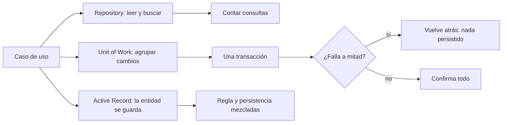
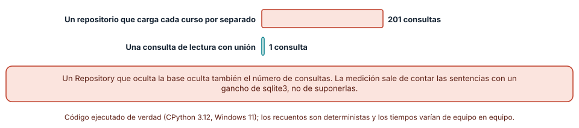

# SE-522 — Repository, Unit of Work y Active Record

[← SE-521 — GRASP y asignación de responsabilidades](https://github.com/vladimiracunadev-create/modern-software-engineering-program/blob/main/classes/part-43-patrones-de-diseno-empresariales-y-de-resiliencia/se-521-grasp-y-asignacion-de-responsabilidades/README.md) · [↑ Parte 43](https://github.com/vladimiracunadev-create/modern-software-engineering-program/blob/main/classes/part-43-patrones-de-diseno-empresariales-y-de-resiliencia/README.md) · [📚 Índice completo](https://github.com/vladimiracunadev-create/modern-software-engineering-program/blob/main/classes/README.md) · [🌐 Portal](https://vladimiracunadev-create.github.io/modern-software-engineering-program/classes/SE-522.html) · [SE-523 — Enterprise Integration Patterns como lenguaje común →](https://github.com/vladimiracunadev-create/modern-software-engineering-program/blob/main/classes/part-43-patrones-de-diseno-empresariales-y-de-resiliencia/se-523-enterprise-integration-patterns-como-lenguaje-comun/README.md)

## Punto profesional y fundamento pedagógico

**Punto profesional.** La clase existe para que decidas **dónde vive la responsabilidad de guardar y de leer** sin esconder lo que cuesta. Repository, Unit of Work y Active Record son tres respuestas del catálogo de Fowler a la pregunta de `SE-521` aplicada a la persistencia: ¿quién sabe guardar? Un Repository presenta una colección de objetos de dominio y oculta la base; una Unit of Work agrupa los cambios de un caso de uso en una transacción; un Active Record hace que cada objeto sepa guardarse. Las tres ocultan algo, y lo que ocultan es justamente lo que falla en producción: el número de consultas y el límite de la transacción.

**Por qué aparece aquí.** Sigue a GRASP (`SE-521`) porque es la asignación de una responsabilidad concreta y precede a los patrones de integración (`SE-523`), donde el cambio de estado cruza un canal en lugar de una base.

**Error conceptual que debe corregir.** Creer que un Repository «abstrae la base de datos» y que por eso el código que lo usa ya no tiene que pensar en consultas. La abstracción oculta la **sintaxis** de SQL pero no su **costo**: un repositorio que carga cada curso por separado al listar 200 entregas ejecuta 201 consultas aunque su interfaz parezca una colección en memoria. El patrón no exime de medir; exige medir en el límite.

**Secuencia de aprendizaje.** Antes de ejecutar, predices cuántas consultas ejecuta un listado de 200 entregas con el nombre de su curso cuando el repositorio carga cada curso por separado, cuántas con una consulta de lectura y cuántos UPDATE se ejecutan si de 100 entregas cargadas se modifican 3 y se guardan todas. Después ejecutas el experimento con una base `sqlite3` en memoria, cuentas las sentencias con un gancho y compruebas qué pasa con una operación de dos pasos que falla a mitad.

**Evidencia de aprendizaje.** Un `persistencia-log.md` con el recuento de consultas de un caso de uso propio, la comprobación de atomicidad con y sin transacción y la decisión entre Repository y Active Record con una alternativa descartada.

**Límite de la conclusión.** La base es `sqlite3` en memoria con dos tablas, 200 filas y un solo proceso; no hay concurrencia, red ni un ORM. La clase **mide** el recuento de consultas, la escritura de filas y la atomicidad en un caso controlado; **no mide** el rendimiento de una base real ni el comportamiento de un ORM concreto. No se invocó ningún modelo de lenguaje.

### Trazabilidad fuente → afirmación

| Fuente primaria u oficial | Afirmación que respalda | Lo que no prueba |
|---|---|---|
| [Fowler, «Repository»](https://martinfowler.com/eaaCatalog/repository.html) | Describe un Repository como un intermediario entre el dominio y el mapeo de datos que actúa como una colección en memoria de objetos de dominio. | No dice cómo evitar consultas repetidas. |
| [Fowler, «Unit of Work»](https://martinfowler.com/eaaCatalog/unitOfWork.html) | Describe una Unit of Work como el mantenimiento de una lista de objetos afectados por una transacción de negocio y la coordinación de la escritura de los cambios. | No fija cómo se detectan los cambios. |
| [Fowler, «Active Record»](https://martinfowler.com/eaaCatalog/activeRecord.html) | Describe un objeto que envuelve una fila de una tabla, encapsula el acceso a la base y añade lógica de dominio. | No dice cuándo deja de convenir. |
| [SQLite, «Transaction»](https://www.sqlite.org/lang_transaction.html) | Documenta que una transacción agrupa operaciones que se confirman o se deshacen juntas. | No dice dónde abrirla en una aplicación. |
| [Python, módulo `sqlite3`](https://docs.python.org/3/library/sqlite3.html) | Documenta el gestor de contexto de la conexión, que confirma o revierte, y `set_trace_callback`, que permite contar las sentencias. | No define el límite de una unidad de trabajo de negocio. |

## Antes de empezar

Recupera lo aprendido en `SE-521`: el diseño se prueba con un cambio. La pregunta activa es: **¿cuántas consultas ejecuta tu pantalla de listado más lenta y cuántas filas escribe tu operación de guardado más usada, y quién en el equipo lo ha medido?**

## Prerrequisitos

- Haber completado `SE-521` y conocer la idea de Experto en información.
- Conocer SQL básico (SELECT, UPDATE, JOIN) y la idea de transacción de la Parte 26 (datos, persistencia y recuperación).
- Python 3.11 o posterior con `sqlite3` y `timeit`.

## Problema auténtico

La pantalla «mis entregas» de *Avisos* tarda tres segundos con 200 entregas. El equipo la revisa: el código parece correcto, usa un `RepositorioDeEntregas` con un método `todas()` que devuelve objetos de dominio, y cada entrega, al pedir `entrega.curso.nombre`, carga su curso. Nadie escribió un bucle de consultas; la interfaz de «colección en memoria» lo escondió. Otro caso: la operación «marcar como entregada y notificar» escribe dos tablas; si la segunda falla, la primera queda escrita y el estudiante ve «entregada» sin que se haya avisado a nadie.

La clase mide ambos problemas con una base real y corrige cada uno con la pieza del catálogo que corresponde.

## Objetivos observables

Al terminar podrás:

1. contar las sentencias SQL de un caso de uso con un gancho de la conexión y detectar el patrón N+1;
2. diseñar un repositorio cuya interfaz exprese lo que cuesta (consultas de lectura con unión, carga explícita);
3. agrupar cambios en una unidad de trabajo con transacción y comprobar que un fallo a mitad deja el estado anterior;
4. reducir las escrituras con seguimiento de cambios y medir cuántas sentencias se evitan;
5. decidir entre Repository y Active Record con una alternativa descartada y una medida.

## Mapa conceptual



Los dos caminos de arriba separan la regla de la persistencia; el de abajo la mezcla a cambio de menos piezas. El mapa no dice cuál elegir: lo dicen las medidas de la clase.

## Temas y por qué importan

| Tema | Por qué cambia una decisión profesional | Evidencia mínima |
|---|---|---|
| Repository como colección | Oculta la base y también su costo | Consultas por caso de uso |
| N+1 y consultas de lectura | El costo crece con los datos y no se ve en la interfaz | 201 frente a 1 consultas |
| Unit of Work y seguimiento de cambios | Evita escribir lo que no cambió | UPDATE ejecutados frente a modificados |
| Transacción y atomicidad | Un fallo a mitad no debe dejar estado intermedio | Estado tras un fallo, con y sin transacción |
| Repository con doble frente a base real | Cambia el costo de las pruebas | Tiempo por caso con cada uno |
| Active Record | Menos piezas, más acoplamiento a la base | Qué regla se puede probar sin conexión |

## Conceptos y decisiones

### 1. Repository: una colección que oculta la base y su costo

Un Repository presenta los objetos de dominio como una colección en memoria: `repositorio.buscar(id)`, `repositorio.agregar(x)`. Su fuerza es que el dominio no conoce SQL y puede probarse con una colección real en memoria. Su riesgo es el que mide el experimento: sobre una base `sqlite3` con 20 cursos y 200 entregas, un listado que carga **cada curso por separado** para mostrar su nombre ejecuta **201 consultas** (1 para las entregas y 200 para los cursos), contadas con `set_trace_callback`. El mismo resultado con una consulta de lectura que une las dos tablas usa **1**. La interfaz «colección» es la misma en ambos casos; lo que cambia es que la segunda permite pedir los datos que se van a usar.



**Cómo leer la figura.** Cada barra es el número de sentencias que la base recibió para producir el mismo listado. **Dónde deja de valer:** la base es `sqlite3` en memoria, sin red; con una base remota cada consulta suma una latencia de red y la diferencia se amplifica, y con un ORM que precarga por defecto el problema aparece en otro lugar. El número 201 es el patrón N+1 en un caso, no una constante.

La corrección habitual no es abandonar el repositorio sino **ampliar su interfaz**: métodos de lectura con la forma que necesita cada pantalla (`entregas_con_curso()`), o una instrucción explícita de qué cargar. La regla de la clase: el repositorio que expone un caso de uso debe permitir **contar** sus consultas en una prueba.

### 2. Unit of Work: agrupar lo que cambia junto

Una Unit of Work mantiene los objetos afectados por una operación de negocio y coordina su escritura. Dos propiedades interesan. La primera es el **seguimiento de cambios**: de 100 entregas cargadas y 3 modificadas, guardar todo ejecuta **100** UPDATE y guardar solo lo que cambió ejecuta **3**; el seguimiento compara el estado cargado con el actual. La segunda es la **atomicidad**: una operación de dos pasos que falla a mitad deja, sin transacción, el primer paso persistido (el estado de la entrega queda «entregada»); dentro de una transacción (`with conexion:` en `sqlite3`), el fallo la revierte y el estado vuelve a «pendiente». La unidad de trabajo es la disciplina de abrir la transacción **en un lugar** (el caso de uso) y no en cada método del repositorio.


**Cómo leer la figura.** A la izquierda está la unidad de trabajo y a la derecha cuatro medidas. Las cajas coral son las que escriben de más o dejan el estado a medias y las turquesa las que escriben solo lo modificado o vuelven atrás ante un fallo. **Dónde deja de valer:** el seguimiento de cambios compara diccionarios simples y la operación de dos pasos es una sola tabla; con concurrencia entran otros problemas (bloqueos, nivel de aislamiento) que la clase no mide. SQLite documenta las transacciones y sus modos; el comportamiento exacto depende del motor.

### 3. Repository con doble frente a base real

Un repositorio con una implementación en memoria (un doble) permite probar la lógica sin base. En el experimento, un caso de uso (marcar una entrega) cuesta unos 11 µs con el doble y unos 600 µs con una base `sqlite3` en memoria que crea el esquema cada vez, una relación de unas 50 veces. Ambas son rápidas: la diferencia importa con miles de pruebas, no con decenas. La decisión no es «siempre el doble»: una prueba con la base real detecta errores de SQL y de esquema que un doble no ve. La disposición habitual es lógica con doble y una **prueba de contrato** del repositorio real que verifica que ambas implementaciones se comportan igual.

### 4. Active Record: menos piezas, más acoplamiento

En un Active Record la entidad sabe guardarse: `entrega.save()`. Es una opción razonable cuando el modelo es casi las tablas y la regla de negocio es poca. El experimento muestra el costo: una entidad con la regla pura `vencida(hora)` se prueba sin base (devuelve `True`), pero la operación `cumplir()`, que cambia el estado **y** llama a `save()`, **falla sin conexión** (`AttributeError`) porque la regla y la persistencia comparten método. A medida que la regla crece, las pruebas de dominio necesitan una base. La salida es separar la regla en métodos puros y dejar `save` en el borde, o pasar a un Repository cuando la regla lo justifique.


**Cómo leer la figura.** A la izquierda están las tres formas de poner el acceso a datos y a la derecha lo que se midió de cada una. Las turquesa son efectos medidos con cifras (el doble de prueba, la transacción) y la dorada una condición, que Active Record mezcla la regla con el guardado. **Dónde deja de valer:** los tiempos son de un equipo y de una base en memoria; el ratio de 50 veces no es transferible a una base remota. La fila de Active Record es una demostración de acoplamiento con una entidad mínima, no una crítica general al patrón.

### 5. Elegir con una pregunta

La pregunta que decide entre los tres es **qué cambia con más frecuencia y qué duele más**. Si la regla de negocio cambia a menudo y se quiere probar sin base, un Repository. Si una operación toca varias tablas y debe ser atómica, una Unit of Work. Si el modelo es casi la tabla y las reglas son pocas, un Active Record. Y en cualquier caso, medir las consultas del caso de uso en una prueba: es la barrera contra el N+1.

## Definiciones de trabajo

- **Repository:** colección de objetos de dominio que oculta el acceso a datos.
- **Unit of Work:** agrupación de los cambios de una operación de negocio en una transacción.
- **Active Record:** objeto que encapsula una fila, el acceso a la base y lógica de dominio.
- **N+1:** patrón en que una consulta inicial desencadena una consulta adicional por cada fila.
- **Seguimiento de cambios:** comparación del estado cargado con el actual para escribir solo lo modificado.
- **Atomicidad:** propiedad de que una operación se confirma completa o no deja efectos.

## Ejemplo mínimo

```python
import sqlite3
con = sqlite3.connect(":memory:")
con.execute("CREATE TABLE entrega(id INTEGER PRIMARY KEY, estado TEXT)")
con.execute("INSERT INTO entrega VALUES (1, 'pendiente')")
try:
    with con:                       # una transacción: confirma o revierte
        con.execute("UPDATE entrega SET estado='entregada' WHERE id=1")
        raise RuntimeError("falla a mitad")
except RuntimeError:
    pass
print(con.execute("SELECT estado FROM entrega").fetchone())   # ('pendiente',)
```

El `with con:` convierte el bloque en una unidad de trabajo: la excepción revierte el UPDATE.

## Ejemplo profesional

*Escenario ilustrativo: las cifras de este ejemplo son supuestos de la narración, no mediciones.*

El equipo de *Avisos* añade a su prueba de integración un contador de sentencias por caso de uso: «el listado de entregas no puede ejecutar más de 3 consultas con 500 filas». La prueba falla en la primera ejecución con 501 consultas. Se añade `entregas_con_curso()` al repositorio con una unión y la prueba pasa con 1. Para «marcar y notificar» abre la transacción en el caso de uso, no en el repositorio, y añade una prueba que fuerza el fallo del segundo paso y comprueba que la primera tabla no cambió. La decisión entre Repository y Active Record para las entregas queda registrada, con la alternativa descartada y la condición de revisarla si la lógica de dominio crece.

## Práctica guiada

1. Escribe tu predicción de consultas con y sin unión y de UPDATE con y sin seguimiento.
2. Ejecuta `python scripts/experiments_part43_a.py 522` y compara.
3. Cambia el experimento a 1000 entregas y 50 cursos y repite el recuento.
4. Añade al experimento una prueba que falle si un caso de uso supera un número de consultas.
5. Convierte `cumplir()` en dos métodos (una regla pura y un guardado) y comprueba qué se puede probar sin conexión.

## Ejercicios

1. **Básico.** Explica por qué un Repository no elimina la necesidad de pensar en consultas.
2. **Intermedio.** Escribe una unidad de trabajo mínima con seguimiento de cambios y comprueba que guarda solo lo modificado.
3. **Avanzado.** Diseña una prueba de contrato que verifique que un repositorio en memoria y uno con `sqlite3` se comportan igual.

## Reto verificable

Entrega `persistencia-log.md` con el recuento de consultas de un caso de uso propio antes y después, la prueba de atomicidad con un fallo forzado y la decisión Repository o Active Record con alternativa. Es válido si otra persona repite el recuento con el mismo gancho y si la prueba de atomicidad falla al quitar la transacción.

## Caso conductor

*Avisos* guarda sus entregas y avisos. Aquí se mide el listado de «mis entregas» y la operación «marcar y notificar»; `SE-523` retoma el segundo caso cuando el aviso se publica como mensaje y debe ser idempotente.

## Preguntas frecuentes

### ¿Un ORM ya es un Repository y una Unit of Work?

Muchos ORM implementan ambos (una sesión que agrupa cambios y un acceso por consulta). El patrón sigue siendo útil como interfaz del dominio que no depende del ORM; y el N+1 sigue pudiendo ocurrir. Mide las consultas de todos modos.

### ¿Dónde se abre la transacción?

En el caso de uso (la capa de aplicación), no en el repositorio ni en la entidad. El caso de uso conoce qué cambia junto; el repositorio solo sabe cómo guardar una cosa.

### ¿Cuándo basta un Active Record?

Cuando el modelo es casi las tablas, hay pocas reglas y el equipo acepta que probar la lógica requiere una base. Si la lógica crece, es el momento de separar.

### ¿Puede un agente escribir el repositorio?

Puede, y suele hacerlo con el N+1 por defecto. Pide que escriba la prueba que cuenta las consultas y revisa que la interfaz permita lecturas con la forma que cada pantalla necesita.

## Fallo controlado y diagnóstico

**Fallo.** La pantalla «mis entregas» pasa de 300 ms a 3 s al crecer la lista de entregas; la base no muestra consultas lentas.

**Diagnóstico paso a paso.** (1) Se cuentan las sentencias de la pantalla con el gancho de la conexión: 201 en lugar de 1. (2) Se identifica la carga individual de cada curso. (3) La causa no es la base sino la interfaz del repositorio, que no permitió pedir los cursos junto con las entregas.

**Corrección.** Se añade una lectura con unión, se cambia la pantalla para usarla, se añade una prueba que limita las consultas del caso de uso y se anota en el log.

## Errores comunes y cómo corregirlos

- **Síntoma: cientos de consultas casi idénticas.** Causa: N+1 oculto por el repositorio. Solución: lecturas con unión o carga anticipada y prueba de conteo.
- **Síntoma: un fallo deja datos a medias.** Causa: pasos sin transacción común. Solución: abrir una unidad de trabajo en el caso de uso.
- **Síntoma: guardar es lento aunque cambió poco.** Causa: se guardan todas las entidades. Solución: seguimiento de cambios.
- **Síntoma: las pruebas de dominio necesitan una base.** Causa: Active Record con reglas mezcladas. Solución: reglas puras y guardado en el borde.
- **Síntoma: el doble y la base real se comportan distinto.** Causa: falta prueba de contrato. Solución: batería común a ambos.

## Entorno y archivos clave

- `scripts/experiments_part43_a.py`: base `sqlite3` en memoria con 20 cursos y 200 entregas, gancho de recuento, seguimiento de cambios, atomicidad y tiempos de doble frente a base; `python scripts/experiments_part43_a.py 522`.
- `content/part-43/figures/`: figuras.
- Sin dependencias fuera de la biblioteca estándar.

## Seguridad, ética y accesibilidad

Un repositorio que arma SQL con cadenas concatenadas abre la puerta a la inyección de SQL; usa parámetros (los experimentos de la clase los usan) y valida lo que llega de fuera. Un seguimiento de cambios que registra valores puede guardar datos personales en un registro de auditoría: decide qué se conserva. Una transacción larga retiene bloqueos y puede degradar el servicio para otras personas. Ética: un fallo a mitad que deja «entregada» sin aviso afecta a una persona real; la atomicidad es una forma de cuidarla. Accesibilidad: las figuras tienen texto alternativo completo y no dependen del color.

## Puente hacia el trabajo con agentes

Un agente de código escribe repositorios correctos y con N+1 por defecto, porque lo más sencillo es cargar cada relación al usarla. La petición útil lo prevé: «escribe el repositorio y una prueba que falle si el listado de 500 entregas ejecuta más de 3 consultas». Para una operación de varios pasos pide «una prueba que fuerce el fallo del segundo paso y compruebe que el primero no persiste». Las dos pruebas son lo que el humano revisa; la implementación es secundaria.

## Transferencia

Cuenta las sentencias de tu caso de uso más lento y escribe una prueba que las limite. La idea se transfiere a cualquier acceso a recursos remotos (APIs, colas), donde «una llamada por elemento» es el mismo defecto con otro nombre.

## Evaluación y evidencia

- El recuento de consultas se obtiene con un gancho de la conexión y se informa por caso de uso.
- La atomicidad se comprueba con un fallo forzado, con y sin transacción.
- La decisión entre Repository y Active Record incluye una alternativa descartada.
- La afirmación final distingue lo medido en `sqlite3` en memoria de lo no medido en una base real.

## Fuentes

- Fowler, M. [«Repository»](https://martinfowler.com/eaaCatalog/repository.html).
- Fowler, M. [«Unit of Work»](https://martinfowler.com/eaaCatalog/unitOfWork.html).
- Fowler, M. [«Active Record»](https://martinfowler.com/eaaCatalog/activeRecord.html).
- SQLite. [«Transaction»](https://www.sqlite.org/lang_transaction.html).
- Python Software Foundation. [«sqlite3 — DB-API 2.0 interface for SQLite databases»](https://docs.python.org/3/library/sqlite3.html).

## Límites y siguiente paso

La base es `sqlite3` en memoria, sin red ni concurrencia, y no se midió ningún ORM; los tiempos son de un equipo. El siguiente paso, `SE-523`, lleva el cambio de estado por un canal de mensajes, donde la atomicidad de una base deja de bastar y la garantía de entrega pasa a ser parte del diseño.

## Glosario

| Término | Definición breve |
|---|---|
| Repository | Colección de objetos de dominio que oculta la base |
| Unit of Work | Cambios de una operación agrupados en una transacción |
| Active Record | Entidad que sabe guardarse |
| N+1 | Una consulta inicial más una por fila |
| Atomicidad | Todo o nada |
| Gancho de seguimiento | Función que recibe cada sentencia ejecutada |
