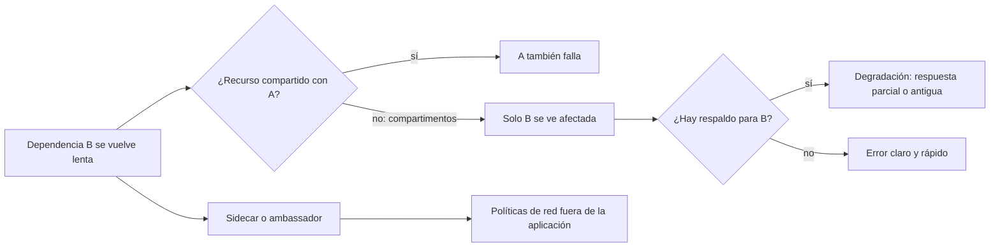
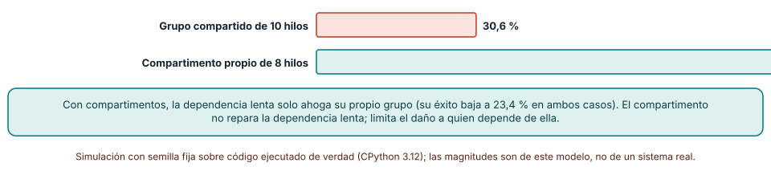
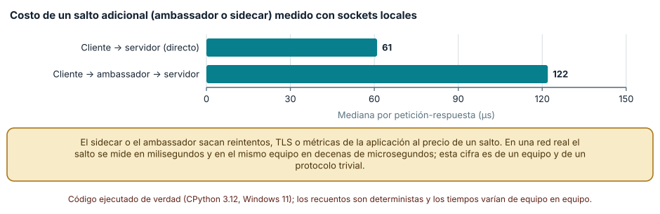

# SE-525 — Resiliencia: bulkhead, sidecar, ambassador y degradación

[← SE-524 — Resiliencia: timeout, retry con jitter y circuit breaker](https://github.com/vladimiracunadev-create/modern-software-engineering-program/blob/main/classes/part-43-patrones-de-diseno-empresariales-y-de-resiliencia/se-524-resiliencia-timeout-retry-con-jitter-y-circuit-breaker/README.md) · [↑ Parte 43](https://github.com/vladimiracunadev-create/modern-software-engineering-program/blob/main/classes/part-43-patrones-de-diseno-empresariales-y-de-resiliencia/README.md) · [📚 Índice completo](https://github.com/vladimiracunadev-create/modern-software-engineering-program/blob/main/classes/README.md) · [🌐 Portal](https://vladimiracunadev-create.github.io/modern-software-engineering-program/classes/SE-525.html) · [SE-526 — Antipatrones y deuda de diseño →](https://github.com/vladimiracunadev-create/modern-software-engineering-program/blob/main/classes/part-43-patrones-de-diseno-empresariales-y-de-resiliencia/se-526-antipatrones-y-deuda-de-diseno/README.md)

## Punto profesional y fundamento pedagógico

**Punto profesional.** La clase existe para que **limites el radio del daño** de una dependencia que falla. Los plazos y los reintentos de `SE-524` acotan una llamada; no impiden que una dependencia lenta consuma los hilos, las conexiones o la memoria que comparte con las sanas. Bulkhead (compartimento), sidecar y ambassador (intermediarios que sacan políticas de red de la aplicación) y degradación (devolver menos en lugar de nada) son cuatro respuestas a la misma pregunta: cuando algo falla, ¿qué más se cae con él, quién decide qué se sacrifica y cuánto cuesta esa protección?

**Por qué aparece aquí.** Sigue a timeout, retry y circuit breaker (`SE-524`) y usa la misma idea de pila de envolturas (`SE-519`): los compartimentos son el siguiente nivel de aislamiento cuando un plazo no basta. Precede al cierre de la parte con antipatrones y deuda (`SE-526`).

**Error conceptual que debe corregir.** Creer que una dependencia lenta solo afecta a las funciones que la usan. Con un recurso compartido (un grupo de hilos, un pool de conexiones), una dependencia lenta retiene recursos por más tiempo, los demás clientes del recurso esperan y **la dependencia sana pierde disponibilidad sin haber fallado**. La falla se propaga por el recurso compartido, no por la llamada.

**Secuencia de aprendizaje.** Antes de ejecutar, predices qué porcentaje de las peticiones de una dependencia sana terminan a tiempo cuando otra dependencia pasa a tardar 3 segundos y ambas comparten diez hilos, y qué porcentaje con compartimentos separados. Después ejecutas una simulación de eventos discretos, mides cuánto más útil es un sistema que degrada con honestidad y cuánto cuesta un salto adicional de un intermediario con una medición real sobre sockets locales.

**Evidencia de aprendizaje.** Un `aislamiento-log.md` con un mapa de recursos compartidos de un servicio propio, el tamaño de cada compartimento con su justificación, la política de degradación (qué se devuelve, con qué antigüedad máxima, cómo se avisa) y el costo medido de los intermediarios.

**Límite de la conclusión.** La simulación usa dos dependencias con tasas de llegada y latencias elegidas por el autor, un grupo fijo de diez hilos y un plazo de 0,5 s; la caché de degradación acierta el 70 % por elección y el salto por sockets se mide con un protocolo trivial en un equipo. La clase **mide** el efecto del aislamiento y de un salto en un modelo y en una medición local; **no mide** un sistema de producción ni una malla de servicios. No se invocó ningún modelo de lenguaje.

### Trazabilidad fuente → afirmación

| Fuente primaria u oficial | Afirmación que respalda | Lo que no prueba |
|---|---|---|
| [Microsoft, «Bulkhead pattern»](https://learn.microsoft.com/azure/architecture/patterns/bulkhead) | Describe aislar elementos de una aplicación en grupos para que el fallo de uno no consuma los recursos de los otros. | No dice cómo dimensionar cada grupo. |
| [Microsoft, «Sidecar pattern»](https://learn.microsoft.com/azure/architecture/patterns/sidecar) | Describe desplegar componentes auxiliares junto a la aplicación como un proceso o contenedor separado. | No mide su sobrecoste. |
| [Microsoft, «Ambassador pattern»](https://learn.microsoft.com/azure/architecture/patterns/ambassador) | Describe un servicio auxiliar que actúa como proxy fuera de proceso y gestiona la conectividad. | No dice cuándo conviene frente a una biblioteca. |
| [Nygard, «Release It!»](https://pragprog.com/titles/mnee2/release-it-second-edition/) | Presenta los compartimentos y la degradación elegante como patrones de estabilidad. | No es una medición. |
| [Google, «Addressing Cascading Failures»](https://sre.google/sre-book/addressing-cascading-failures/) | Describe cómo la sobrecarga se propaga entre componentes y cómo la degradación la contiene. | No fija umbrales. |
| [Python, módulo `socket`](https://docs.python.org/3/library/socket.html) | Documenta la interfaz de sockets con la que se mide el salto adicional. | No dice nada del costo en otras redes. |

## Antes de empezar

Recupera lo aprendido en `SE-524`: un control mal calibrado crea fallos. La pregunta activa es: **si tu dependencia más lenta tardara diez veces más durante cinco minutos, ¿qué otra funcionalidad, que no la usa, dejaría de funcionar y por qué recurso compartido?**

## Prerrequisitos

- Haber completado `SE-519`, `SE-523` y `SE-524`.
- Conocer la idea de grupo de hilos y de saturación (Partes 28 y 35).
- Python 3.11 o posterior con `heapq`, `socket`, `threading` y `statistics`.

## Problema auténtico

*Avisos* atiende en un solo grupo de diez hilos todas sus llamadas: al proveedor de mensajería (rápido y frecuente) y al servicio de reportes de la institución (lento y poco usado). Un jueves el servicio de reportes empieza a tardar tres segundos por llamada. En menos de un minuto, los diez hilos están ocupados esperando a los reportes, las peticiones al proveedor de mensajería esperan un hilo libre y vencen, y *Avisos* deja de enviar recordatorios aunque el proveedor esté perfecto. Ningún plazo o reintento habría ayudado: la falla no estaba en una llamada sino en el recurso que las unía.

La clase simula el jueves con y sin compartimentos y mide la diferencia.

## Objetivos observables

Al terminar podrás:

1. identificar los recursos compartidos de un servicio que pueden propagar una falla (hilos, conexiones, memoria, colas);
2. dimensionar compartimentos por dependencia y medir su efecto con una simulación;
3. decidir cuándo sacar una política de red (reintentos, TLS, métricas) a un sidecar o un ambassador y medir su costo;
4. diseñar una degradación con honestidad: qué se devuelve, con qué antigüedad y cómo se avisa;
5. escribir un mapa de aislamiento con sus límites y las señales que indicarán que dejó de valer.

## Mapa conceptual



El mapa tiene dos mitades. La primera limita el radio del daño con recursos separados y define qué se responde cuando la dependencia afectada no está; la segunda describe un intermediario que mueve políticas fuera de la aplicación y que cuesta un salto.

## Temas y por qué importan

| Tema | Por qué cambia una decisión profesional | Evidencia mínima |
|---|---|---|
| Recurso compartido | Es la vía por la que una falla se propaga | Mapa de grupos, pools y colas |
| Bulkhead | Contiene el daño a la dependencia afectada | Éxito de la dependencia sana con y sin compartimentos |
| Dimensionamiento | Un compartimento pequeño rechaza de más; uno grande no protege | Tamaño justificado con la carga |
| Degradación | Convierte un fallo total en uno parcial | Respuestas útiles con y sin respaldo |
| Sidecar y ambassador | Sacan políticas de la aplicación a cambio de un salto | Latencia directa frente a intermediada |
| Honestidad de la degradación | Un dato viejo sin aviso engaña | Antigüedad y marca visible |

## Conceptos y decisiones

### 1. El recurso compartido es la vía de contagio

Una dependencia lenta retiene un hilo por llamada durante todo el tiempo que tarda. Por la **ley de Little** (concurrencia = tasa de llegadas × tiempo en el sistema), si la dependencia B recibe 8 peticiones por segundo y tarda 3 s por petición, mantiene 24 hilos ocupados en promedio; en un grupo de 10, **satura el grupo entero**. Las peticiones de la dependencia sana A esperan un hilo libre y, si su plazo es de 0,5 s, vencen en la cola. El fallo de B se convierte en el fallo de A aunque A nunca falló. Antes de hablar de patrones conviene hacer el mapa: qué grupos de hilos, conexiones, colas y cachés comparten las dependencias del servicio.

### 2. Bulkhead: compartimentos por dependencia

El nombre viene de los mamparos de un barco: una vía de agua llena un compartimento y no el casco. En software, cada dependencia (o clase de dependencias) tiene su propio grupo de recursos. En la simulación, dos dependencias: A (sana, 40 peticiones por segundo, unos 50 ms por llamada) y B (8 por segundo, se degrada a 3 s entre t = 10 y t = 30 de una ventana de 40 s). Con un **grupo compartido de 10 hilos**, el 30,6 % de las peticiones de A terminan dentro de 0,5 s y el 23,4 % de las de B. Con **compartimentos** (8 hilos para A y 2 para B), el éxito de A es del **100 %** y el de B sigue en 23,4 %: el compartimento no repara B, **limita el daño a B**. Es una decisión explícita: se acepta que B falle para que A viva.



**Cómo leer la figura.** Cada barra es el porcentaje de peticiones de la dependencia sana que vence a tiempo durante toda la ventana de 40 s, incluyendo los 20 s lentos. **Dónde deja de valer:** las tasas de llegada, la latencia de 3 s y los tamaños 8 y 2 son del autor; con 2 hilos para B y 24 hilos necesarios en promedio, B queda saturada en su propio compartimento y esa saturación es el comportamiento esperado, no un defecto. Con otros tamaños, A también podría verse afectada.

El **dimensionamiento** es la parte difícil. Un compartimento pequeño rechaza peticiones sanas en picos; uno grande deja de proteger. Se calcula con la ley de Little sobre la carga normal (peticiones por segundo × latencia habitual), se añade un margen y se verifica con una prueba que simule la lentitud de la dependencia. Y cada compartimento necesita una **política cuando se llena**: rechazar rápido con un error claro, no encolar sin límite.

### 3. Degradación: devolver menos antes que nada

Cuando una dependencia no está, el sistema puede devolver una respuesta **parcial o antigua** en lugar de fallar. El experimento simula 2000 peticiones con una dependencia caída el 40 % del tiempo y una caché con un 70 % de aciertos. Sin degradación, el 60,0 % de las respuestas son útiles; con la caché como respaldo, el **87,5 %**. La degradación convierte la pregunta «¿funciona?» en «¿qué parte del valor se conserva?». Exige tres decisiones que son de producto, no solo técnicas: **cuánta antigüedad** es aceptable (el dato de hace cinco minutos es útil para una lista de cursos y no para un saldo), **cómo se avisa** (una marca visible de «datos de hace 12 minutos») y **qué no se degrada nunca** (un cobro no se responde con un dato antiguo).


**Cómo leer la figura.** La primera barra es la fracción de peticiones que ocurren con la dependencia disponible; la segunda suma las que se salvan con la caché. **Dónde deja de valer:** el 70 % de aciertos es un supuesto, la caída es un único tramo continuo y «útil» se define como «tiene respuesta»; no se midió si la respuesta antigua sirve a la persona usuaria. La figura muestra el mecanismo, no el valor de producto.

### 4. Sidecar y ambassador: políticas fuera de la aplicación

Un **sidecar** es un proceso auxiliar que se despliega junto a la aplicación y le presta servicios (registro, métricas, seguridad); un **ambassador** es un caso concreto: un proxy fuera de proceso que gestiona las conexiones salientes (reintentos, TLS, descubrimiento). La **fuerza** es sacar de la aplicación políticas que se repiten en muchos servicios y lenguajes. El **costo** es un salto de red adicional y una pieza operativa más. En una medición real con sockets locales (un servidor de eco, un proxy intermedio, 2000 repeticiones tras 100 de calentamiento) la mediana de una petición con su respuesta es de **unos 61 µs** directa y de **unos 122 µs** con el intermediario: aproximadamente **el doble**.



**Cómo leer la figura.** Cada barra es un camino entre cliente y servidor y su longitud la mediana de una petición y su respuesta, en microsegundos. Mira que el salto adicional duplica la longitud: del orden de 61 a 122 µs. **Dónde deja de valer:** el protocolo es un eco de un byte, el servidor y el proxy corren en el mismo equipo y los hilos de Python añaden su propia latencia; las cifras absolutas son de un equipo y de ese montaje. En una red real el salto se mide en milisegundos y el sobrecoste relativo cae; el orden de magnitud (un salto, no diez) es lo único que se generaliza.

La decisión entre una **biblioteca** y un **sidecar** tampoco es solo de latencia: la biblioteca es más barata en tiempo y obliga a mantener una versión por lenguaje; el sidecar centraliza la política y añade operación. Se justifica cuando hay varios lenguajes o equipos y la política cambia a menudo.

### 5. Un mapa de aislamiento

Los cuatro patrones son piezas de un **mapa**: una tabla con una fila por dependencia, con los recursos que comparte, su compartimento, su plazo, su política de degradación y la alarma que indica que se saturó. Escribirlo suele descubrir la falla más probable antes de que ocurra: un recurso compartido que nadie había contado, como el grupo de conexiones a la base de datos que usan todas las dependencias.

## Definiciones de trabajo

- **Bulkhead:** aislamiento de recursos por dependencia para contener una falla.
- **Ley de Little:** concurrencia promedio = tasa de llegadas × tiempo promedio en el sistema.
- **Degradación elegante:** respuesta parcial o antigua en lugar de un fallo total.
- **Sidecar:** proceso auxiliar desplegado junto a la aplicación.
- **Ambassador:** proxy fuera de proceso que gestiona las conexiones salientes.
- **Salto:** paso adicional por un componente intermedio en una llamada.

## Ejemplo mínimo

```python
from concurrent.futures import ThreadPoolExecutor

pool_a = ThreadPoolExecutor(max_workers=8, thread_name_prefix="proveedor")
pool_b = ThreadPoolExecutor(max_workers=2, thread_name_prefix="reportes")

def llamar_a(x):  return pool_a.submit(proveedor, x)
def llamar_b(x):  return pool_b.submit(reportes, x)
```

Cada dependencia tiene su grupo. Si `reportes` tarda 3 s, solo se llenan dos hilos; el proveedor conserva los suyos. Falta lo esencial: una política para cuando el grupo de B se llena (rechazar rápido, no encolar sin límite).

## Ejemplo profesional

*Escenario ilustrativo: las cifras de este ejemplo son supuestos de la narración, no mediciones.*

El equipo de *Avisos* escribe su mapa de aislamiento: tres dependencias (proveedor de mensajería, reportes, base de datos), el grupo de hilos de cada una y las conexiones a la base, que **comparten las tres**. Descubre que el recurso compartido real es el pool de conexiones de la base. Reparte el pool por dependencia (6, 2 y 2), calcula cada tamaño con la ley de Little sobre la carga de un día normal más un margen del 50 %, define que reportes degrada con los datos del día anterior y una marca visible, y que el proveedor no degrada (un recordatorio perdido es peor que uno tarde). Añade una prueba que simula reportes a 3 s y comprueba que el envío mantiene su tasa de éxito.

## Práctica guiada

1. Escribe tu predicción de éxito de A con y sin compartimentos.
2. Ejecuta `python scripts/experiments_part43_b.py 525` y compara.
3. Cambia los compartimentos a 5 y 5 y observa qué le pasa a A y a B.
4. Cambia la latencia de B a 10 s y calcula con la ley de Little cuántos hilos haría falta.
5. Dibuja el mapa de recursos compartidos de un servicio propio y marca el que nadie había contado.

## Ejercicios

1. **Básico.** Explica con la ley de Little por qué una dependencia lenta satura un grupo compartido.
2. **Intermedio.** Dimensiona los compartimentos de tres dependencias con su carga y latencia normales y justifica el margen.
3. **Avanzado.** Diseña la política de degradación de una pantalla con tres datos de distinta criticidad: qué se devuelve, con qué antigüedad máxima y cómo se avisa.

## Reto verificable

Entrega `aislamiento-log.md` con el mapa de recursos compartidos de un servicio propio, la simulación con y sin compartimentos con la semilla registrada, la política de degradación con antigüedad máxima y la medición del salto de un intermediario. Es válido si otra persona repite la simulación y obtiene los mismos porcentajes y si la política dice qué nunca se degrada.

## Caso conductor

*Avisos* conserva el proveedor de mensajería, los reportes y la base de datos. Aquí se separan sus recursos y se define qué se degrada; `SE-526` mide qué clases y módulos de *Avisos* se han vuelto difíciles de cambiar.

## Preguntas frecuentes

### ¿Cuántos compartimentos son demasiados?

Cuando cada uno es tan pequeño que se llena con carga normal, o cuando no se puede mantener el mapa. Se agrupa por criticidad y comportamiento (rápidas e importantes, lentas y opcionales) en lugar de por cada llamada.

### ¿Una cola entre servicios es un compartimento?

Separa el tiempo, pero una cola sin límite es un recurso compartido que se llena y propaga la presión hacia atrás o hacia delante. Necesita tamaño máximo y política de descarte.

### ¿Un sidecar sustituye al código de resiliencia de la aplicación?

No del todo: puede aplicar reintentos y plazos de red, pero no conoce qué operación es idempotente ni cómo degradar una respuesta. Esas decisiones siguen en la aplicación.

### ¿Puede un agente proponer el mapa de aislamiento?

Puede listar los recursos que ve en el código, pero no los que crea la infraestructura (límites del balanceador, pool de la base). El mapa debe revisarse con quien opera el sistema.

## Fallo controlado y diagnóstico

**Fallo.** *Avisos* deja de enviar recordatorios mientras el proveedor está sano; el servicio de reportes tarda tres segundos.

**Diagnóstico paso a paso.** (1) Se mira el grupo de hilos: los diez están en llamadas a reportes. (2) Con la ley de Little, 8 por segundo × 3 s = 24 hilos necesarios frente a 10. (3) La causa es un grupo compartido: la falla de una dependencia se propagó por el recurso.

**Corrección.** Se separa el grupo por dependencia, se limita y se rechaza rápido cuando se llena, se añade la degradación de reportes con datos del día anterior y se escribe la prueba que simula la lentitud.

## Errores comunes y cómo corregirlos

- **Síntoma: una función sana deja de responder.** Causa: grupo compartido con una dependencia lenta. Solución: compartimentos por dependencia.
- **Síntoma: el compartimento rechaza peticiones sanas.** Causa: tamaño menor que la carga normal. Solución: dimensionar con la ley de Little y un margen.
- **Síntoma: la cola crece sin límite.** Causa: encolar cuando se llena el grupo. Solución: rechazo rápido con tamaño máximo.
- **Síntoma: datos antiguos sin aviso.** Causa: degradación sin marca. Solución: indicar la antigüedad a la persona usuaria.
- **Síntoma: una latencia inesperada tras añadir un sidecar.** Causa: salto adicional no medido. Solución: medir antes y después.

## Entorno y archivos clave

- `scripts/experiments_part43_b.py`: simulación de eventos discretos con semilla 525, degradación y medición real de un salto por sockets locales; `python scripts/experiments_part43_b.py 525`.
- `content/part-43/figures/`: figuras.
- Los sockets usan solo la dirección de bucle local y puertos efímeros; sin dependencias fuera de la biblioteca estándar.

## Seguridad, ética y accesibilidad

Un compartimento que rechaza peticiones por saturación puede usarse como vector de denegación de servicio selectiva: quien llena el compartimento de una dependencia deja sin servicio a esa funcionalidad; limita la tasa por cliente. Un sidecar con permisos amplios es un punto privilegiado: aplica mínimo privilegio. Una caché de degradación puede servir datos personales a quien ya no tiene acceso: respeta los permisos también en la respuesta degradada. Ética: decidir qué se sacrifica cuando algo falla es una decisión sobre las personas; documentarla permite revisarla. Accesibilidad: la marca de «datos antiguos» debe ser perceptible por lector de pantalla y no depender del color; las figuras tienen texto alternativo completo.

## Puente hacia el trabajo con agentes

Un agente propone un compartimento por servicio o un pool grande «para estar seguros», pero no sabe qué recursos comparte la infraestructura. La petición útil le entrega el mapa de recursos y las latencias reales y pide: tamaños calculados con la ley de Little, política cuando se llena, prueba que simule la dependencia lenta y política de degradación con antigüedad máxima. Un agente también puede escribir la simulación; la revisión humana se centra en qué se degrada y qué nunca.

## Transferencia

Haz el mapa de recursos compartidos de un servicio propio y busca el que nadie había contado. La habilidad se transfiere a cualquier sistema con recursos finitos: bases de datos, colas, límites de una API de un tercero, presupuestos de un modelo de lenguaje.

## Evaluación y evidencia

- El mapa de recursos compartidos está escrito y verificado con la infraestructura.
- Los compartimentos se dimensionan con la ley de Little y se prueban con una dependencia lenta simulada.
- La degradación tiene antigüedad máxima, aviso y lista de lo que nunca se degrada.
- El costo del intermediario se mide en el propio entorno.
- La afirmación final distingue lo simulado de lo medido en producción.

## Fuentes

- Microsoft. [«Bulkhead pattern»](https://learn.microsoft.com/azure/architecture/patterns/bulkhead).
- Microsoft. [«Sidecar pattern»](https://learn.microsoft.com/azure/architecture/patterns/sidecar).
- Microsoft. [«Ambassador pattern»](https://learn.microsoft.com/azure/architecture/patterns/ambassador).
- Nygard, M. [«Release It!, 2.ª edición»](https://pragprog.com/titles/mnee2/release-it-second-edition/).
- Google. [«Addressing Cascading Failures»](https://sre.google/sre-book/addressing-cascading-failures/).
- Python Software Foundation. [«socket — Low-level networking interface»](https://docs.python.org/3/library/socket.html).

## Límites y siguiente paso

La simulación usa tasas y latencias elegidas por el autor y un grupo fijo; la degradación se mide como disponibilidad de una respuesta, no como utilidad; el salto se mide con un protocolo trivial en un equipo. El siguiente paso, `SE-526`, mira el diseño desde el otro lado: cómo reconocer, con medidas, un sistema que ya se ha vuelto difícil de cambiar.

## Glosario

| Término | Definición breve |
|---|---|
| Bulkhead | Recursos separados por dependencia |
| Ley de Little | Concurrencia = llegadas × tiempo en el sistema |
| Degradación elegante | Respuesta parcial en lugar de fallo total |
| Sidecar | Proceso auxiliar junto a la aplicación |
| Ambassador | Proxy fuera de proceso para las conexiones salientes |
| Salto | Componente intermedio adicional en una llamada |
