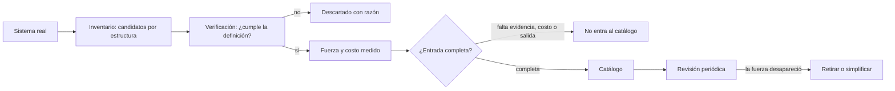
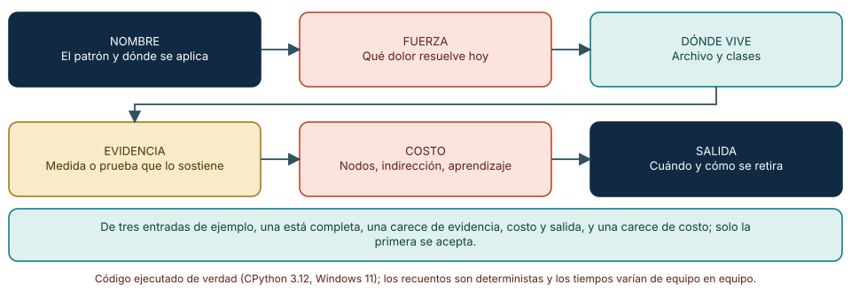

# SE-528 — Proyecto: catálogo de patrones de un sistema real

[← SE-527 — Taller: refactorizar con patrones y medir su costo](https://github.com/vladimiracunadev-create/modern-software-engineering-program/blob/main/classes/part-43-patrones-de-diseno-empresariales-y-de-resiliencia/se-527-taller-refactorizar-con-patrones-y-medir-su-costo/README.md) · [↑ Parte 43](https://github.com/vladimiracunadev-create/modern-software-engineering-program/blob/main/classes/part-43-patrones-de-diseno-empresariales-y-de-resiliencia/README.md) · [📚 Índice completo](https://github.com/vladimiracunadev-create/modern-software-engineering-program/blob/main/classes/README.md) · [🌐 Portal](https://vladimiracunadev-create.github.io/modern-software-engineering-program/classes/SE-528.html) · [SE-529 — Estilos como respuestas a fuerzas de calidad →](https://github.com/vladimiracunadev-create/modern-software-engineering-program/blob/main/classes/part-44-estilos-arquitectonicos/se-529-estilos-como-respuestas-a-fuerzas-de-calidad/README.md)

## Punto profesional y fundamento pedagógico

**Punto profesional.** El proyecto integra la parte en un entregable que un equipo puede mantener: un **catálogo de los patrones de un sistema** donde cada entrada responde por la fuerza que resuelve, dónde vive en el código, qué evidencia la sostiene, cuánto cuesta y bajo qué condición se retira. Un catálogo así sirve a tres personas: a quien llega nuevo y necesita entender por qué el código tiene esa forma, a quien revisa un cambio y quiere saber qué patrón se está tocando, y a quien decide qué simplificar porque conoce el costo de cada pieza. La habilidad profesional es producirlo con medidas y no con impresiones, y saber qué entradas rechazar.

**Por qué aparece aquí.** Cierra la parte: aplica el criterio de `SE-517`, los patrones de `SE-518` a `SE-525`, las métricas de `SE-526` y el ciclo de medida de `SE-527`. Precede a la Parte 44, donde la pregunta de diseño sube de escala (de qué patrón usar en un módulo a qué estilo arquitectónico organiza el sistema).

**Error conceptual que debe corregir.** Creer que identificar patrones en un código es buscar clases cuyo nombre contiene `Strategy`, `Factory` o `Observer`. En el corpus etiquetado de esta clase, un detector por **nombre de clase** acierta con una precisión del 29 % y una exhaustividad del 25 %: encuentra los pocos patrones que anuncian su nombre y cinco clases que lo llevan sin la estructura, y no ve seis patrones reales con otro nombre. Un detector por **estructura** (un árbol de sintaxis que busca la forma, no el nombre) llega al 86 % de precisión y al 75 % de exhaustividad en el mismo corpus, con límites que el propio experimento muestra. Ni uno ni otro sustituye la lectura de una persona.

**Secuencia de aprendizaje.** Antes de ejecutar, predices qué fracción de los 14 fragmentos clasifica bien cada detector. Después ejecutas el experimento, miras qué fragmentos falla cada uno y por qué, y construyes el catálogo de un sistema propio con cuatro pasos: inventario, verificación, fuerza y costo, decisión. Cada entrada se valida con la regla «sin evidencia, costo ni condición de salida, no entra».

**Evidencia de aprendizaje.** Un `catalogo-de-patrones.md` del sistema elegido con entre seis y diez entradas con los seis campos, una lista de candidatos descartados con su razón, el resultado de al menos una medida reproducible por entrada y una decisión de conservar, simplificar o retirar cada patrón.

**Límite de la conclusión.** El corpus de 14 fragmentos lo escribió el autor y el detector estructural se escribió conociendo parte de ese corpus, así que su 86 % es optimista; con código ajeno bajaría. La clase **mide** dos detectores en un corpus pequeño y valida entradas de catálogo con una regla simple; **no mide** la utilidad de un catálogo para un equipo ni su exactitud en un código real. No se invocó ningún modelo de lenguaje.

### Trazabilidad fuente → afirmación

| Fuente primaria u oficial | Afirmación que respalda | Lo que no prueba |
|---|---|---|
| [Gamma, Helm, Johnson y Vlissides, «Design Patterns»](https://www.informit.com/store/design-patterns-elements-of-reusable-object-oriented-9780201633610) | Fija el formato de una entrada de catálogo: nombre, problema, solución y consecuencias. | No dice cómo mantener un catálogo de un sistema. |
| [Fowler, «Catalog of Patterns of Enterprise Application Architecture»](https://martinfowler.com/eaaCatalog/) | Es un modelo de catálogo de patrones de aplicaciones empresariales. | No es un catálogo de tu sistema. |
| [Microsoft, «Cloud Design Patterns»](https://learn.microsoft.com/azure/architecture/patterns/) | Cataloga los patrones de resiliencia, mensajería y datos que se estudiaron en la parte. | No mide su costo en tu sistema. |
| [Nygard, «Documenting Architecture Decisions»](https://cognitect.com/blog/2011/11/15/documenting-architecture-decisions) | Propone registrar las decisiones de arquitectura con contexto, decisión y consecuencias. | No fija el formato de un catálogo de patrones. |
| [Python, módulo `ast`](https://docs.python.org/3/library/ast.html) | Documenta el árbol de sintaxis con el que se detecta la estructura de un patrón. | No define qué estructura corresponde a qué patrón. |

## Antes de empezar

Recupera lo aprendido en la parte: un patrón se justifica con una fuerza, un costo medido y una salida. La pregunta activa es: **si una persona nueva te preguntara por qué tu sistema tiene esa jerarquía de clases o esa cola intermedia, ¿existe un lugar donde esté escrita la respuesta y la condición de retirarlo?**

## Prerrequisitos

- Haber completado `SE-517` a `SE-527`.
- Disponer de un sistema (propio o de código abierto con licencia compatible) del que se pueda leer el código y, si es posible, medir algo.
- Python 3.11 o posterior con `ast`.

## Problema auténtico

*Avisos* lleva cuatro años en producción y la documentación de diseño es una presentación de hace tres. Una persona nueva pregunta por qué existe una jerarquía de siete clases para calcular tarifas y nadie sabe si se justifica todavía; otra pregunta por qué hay una cola intermedia entre el servicio de envío y el de reportes y la respuesta es «así se hizo». Un ejercicio de inventario rápido busca clases con la palabra `Factory` y encuentra cinco, de las cuales una crea objetos y las otras cuatro son utilidades; y no encuentra un Observer real porque su clase se llama `Boletin`.

El proyecto construye el catálogo del sistema con medidas: qué patrones hay (por estructura y no solo por nombre), qué fuerza resuelve cada uno, qué cuesta y bajo qué condición se retira o se simplifica.

## Objetivos observables

Al terminar podrás:

1. inventariar los patrones de un sistema con una regla estructural y reconocer sus falsos positivos y negativos;
2. verificar cada candidato contra la definición del patrón y descartar los que no lo son;
3. escribir una entrada de catálogo con los seis campos y validar que ninguno falte;
4. medir al menos el costo estructural de cada patrón conservado (nodos, complejidad, consultas, intentos) con un comando reproducible;
5. decidir para cada patrón conservar, simplificar o retirar, y escribir la condición de salida o de revisión.

## Mapa conceptual



El filtro de la entrada completa es lo que distingue un catálogo de una lista: lo que no tiene evidencia, costo o salida no se registra como decisión.

## Temas y por qué importan

| Tema | Por qué cambia una decisión profesional | Evidencia mínima |
|---|---|---|
| Inventario por estructura | El nombre de una clase no prueba un patrón | Precisión y exhaustividad de la regla en un corpus |
| Verificación humana | Una regla encuentra candidatos; una persona los confirma | Una lista de candidatos con su veredicto |
| Entrada de catálogo | Convierte un patrón en una decisión revisable | Seis campos completos |
| Medida de costo | Sin costo, el patrón no se compara con su alternativa | Un comando que produce el número |
| Condición de salida | Evita el patrón por costumbre | Una señal medible de retirada |
| Descartes registrados | Evitan que alguien vuelva a proponer lo ya descartado | Una lista con razón |

## Conceptos y decisiones

### 1. El inventario se hace por estructura, no por nombre

El experimento define un corpus de **14 fragmentos** de código escrito por el autor: 8 con un patrón real y 6 sin él. Entre los reales, 4 llevan un nombre ajeno al patrón (`Reglamento`, `Boletin`, `Reintentos`, `Unico`), 2 llevan un nombre que lo anuncia (`DescuentoStrategy`, `ClienteFactory`) y 2 no son reconocibles por ninguna regla del experimento (un Observer con un diccionario de listas y un Strategy con un diccionario de funciones). Entre los 6 sin patrón, 5 tienen un nombre de patrón sin la estructura (`StrategyHelper`, `ObserverUtils`, `LoggerDecorator`, `ConnectionFactory`, `SingletonConfig`) y uno tiene una estructura parecida a un Observer que es un acumulador.

El **detector por nombre** busca las palabras `Strategy`, `Observer`, `Decorator`, `Factory` y `Singleton` en los nombres de clase: obtiene 2 verdaderos positivos, **5 falsos positivos** y 6 falsos negativos, con **29 % de precisión** y **25 % de exhaustividad**. El **detector estructural** busca la forma con `ast`: una clase abstracta con al menos dos subclases, una subclase que guarda una instancia de su propia base, una lista de llamables con métodos que añaden y recorren, un diccionario de clases y un `__new__` que consulta un atributo de clase. Obtiene 6 verdaderos positivos, 1 falso positivo (el acumulador) y 2 falsos negativos (los dos patrones con diccionarios), con **86 % de precisión** y **75 % de exhaustividad**.


**Cómo leer la figura.** Cada grupo es un detector y tiene tres barras: verdaderos positivos (turquesa), falsos positivos (coral) y falsos negativos (dorada), sobre 14 fragmentos con 8 patrones reales. Mira cómo el detector estructural gana verdaderos positivos y casi elimina los falsos positivos. **Dónde deja de valer:** el corpus es pequeño, escrito por el autor, y el detector estructural se escribió conociéndolo; con código real, los patrones tienen más variantes y la precisión y la exhaustividad bajarían. Lo que se generaliza es la dirección: el nombre es una señal débil y la estructura es una señal más fuerte, y ambas necesitan una persona que confirme.

### 2. La verificación convierte candidatos en patrones

Cada candidato que produce la regla se lee contra la **definición** del patrón: ¿qué fuerza resuelve aquí?, ¿qué pasaría si se quitara? El acumulador se descarta porque la lista no se usa para notificar a receptores que no conoce; `ConnectionFactory` se descarta porque no crea nada distinto según una entrada. La verificación es la parte que no se automatiza y la que más enseña: una decisión de «esto no es un Observer» obliga a explicar qué sería. Los **descartes se registran** con su razón, para que otra persona no vuelva a proponer lo mismo.

### 3. Una entrada de catálogo tiene seis campos

La entrada responde a seis preguntas: **nombre** (el patrón y dónde se aplica), **fuerza** (qué dolor resuelve hoy, con un dato), **dónde vive** (archivo y clases), **evidencia** (la medida o la prueba que lo sostiene), **costo** (nodos, indirección, aprendizaje, tiempo) y **salida** (cuándo y cómo se retira). En el experimento se validan tres entradas de ejemplo: la del `Strategy` de tarifas está completa; la del `Singleton` de configuración carece de evidencia, costo y salida; la del circuit breaker carece de costo. La regla del catálogo es de una línea: **una entrada sin evidencia, sin costo o sin salida no se acepta**; se devuelve a su autor con el campo que falta.



**Cómo leer la figura.** Las seis cajas son los campos obligatorios; la nota inferior es la regla de aceptación. **Dónde deja de valer:** la regla comprueba que el campo exista, no que sea verdadero; una entrada con una evidencia inventada pasa el validador. La revisión humana sigue siendo necesaria, y el catálogo debe enlazar a la evidencia reproducible (un comando, una prueba), no solo describirla.

### 4. Del código al catálogo en cuatro pasos

El procedimiento del proyecto tiene cuatro pasos y cada uno se justifica con un hecho de la parte: el **inventario** con una regla estructural (la de nombre da 5 falsos positivos en 14), la **verificación** humana (la regla estructural deja 1 falso positivo y 2 falsos negativos), la **fuerza y el costo** con una medida (Strategy: 44 % más de nodos y complejidad de 15 a 3 en `SE-527`; Repository: 201 consultas frente a 1 en `SE-522`; reintentos: pico de 1000 frente a 537 en `SE-524`) y la **decisión** de conservar, simplificar o retirar con una condición de salida. El resultado es un documento vivo que se revisa con una cadencia (cada trimestre o cuando se toca el módulo).


**Cómo leer la figura.** Léela de izquierda a derecha: cada caja es un paso con lo que se hace y el hecho medido que lo justifica. Las tres primeras, navy, producen la evidencia y la última, turquesa, decide qué entra al catálogo. **Dónde deja de valer:** los hechos son de los experimentos de la parte, sobre código escrito por el autor; en tu sistema, las cifras serán otras. Lo que se transfiere es el procedimiento, no los números.

### 5. Registrar las decisiones de arquitectura junto al catálogo

Un catálogo responde «qué patrones hay y por qué»; un **registro de decisiones de arquitectura** (ADR) responde «qué decidimos en cada momento y con qué contexto». Nygard propone un formato corto (contexto, decisión, consecuencias, estado) para registrar decisiones. Se complementan: una entrada del catálogo enlaza a la decisión que la originó, y una decisión de retirar un patrón enlaza a la entrada que cierra. La Parte 44 retoma el registro de decisiones a escala de estilos arquitectónicos.

### 6. Qué se rechaza y por qué

Un catálogo útil rechaza más de lo que acepta. Se rechazan las entradas sin evidencia (el patrón «se ve bien»), sin costo (nadie midió lo que añade) y sin salida (nadie sabe cuándo quitarlo). Se rechazan también los patrones que son **una moda del equipo**: una arquitectura de eventos donde basta una llamada, una capa de repositorio sobre una tabla de configuración, una fábrica de una sola clase. El rechazo no es un juicio sobre el patrón; es una respuesta a «¿qué dolor resuelve hoy aquí?».

## Definiciones de trabajo

- **Catálogo de patrones de un sistema:** documento que lista los patrones realmente presentes, con su fuerza, evidencia, costo y salida.
- **Detector estructural:** regla que identifica un patrón por la forma del código y no por el nombre.
- **Precisión:** fracción de los candidatos detectados que son patrones reales.
- **Exhaustividad:** fracción de los patrones reales que la regla detecta.
- **Candidato descartado:** patrón propuesto y rechazado, registrado con su razón.
- **ADR:** registro corto de una decisión de arquitectura con su contexto y sus consecuencias.

## Ejemplo mínimo

Una entrada de catálogo completa:

```text
Nombre:       Strategy en tarifas de avisos (tarifas.py: Tarifa, Email, Sms, Push, Voz)
Fuerza:       cada canal nuevo obligaba a editar precio_aviso (CC 15); 3 canales en 6 meses
Dónde vive:   tarifas.py y el registro TARIFAS
Evidencia:    maestro dorado de 5000 entradas con semilla 527 + 384 de frontera; 6 de 6 mutantes detectados
Costo:        +44 % de nodos (149 → 215), +1,2 a 1,5 veces el tiempo por llamada, una indirección
Salida:       si en 12 meses no entra un canal y quedan dos o menos, volver a una función simple
```

Cada línea responde una pregunta; ninguna es una opinión sin dato.

## Ejemplo profesional

*Escenario ilustrativo: las cifras de este ejemplo son supuestos de la narración, no mediciones.*

El equipo de *Avisos* dedica dos tardes al catálogo. Ejecuta el detector estructural sobre sus 140 módulos y obtiene 31 candidatos; en una sesión de revisión de dos horas, tres personas leen cada uno contra la definición: 19 son patrones reales, 9 se descartan con razón (cuatro son utilidades con nombre de patrón, dos son acumuladores, tres son jerarquías con una sola implementación) y 3 quedan en duda. De los 19, 11 tienen medida de costo disponible; los 8 restantes se devuelven con el campo faltante. El catálogo entra al repositorio como `docs/patrones.md`, con una lista de descartes y una revisión trimestral. Dos patrones se marcan «simplificar»: la jerarquía de siete tarifas (la mitad de las variantes no se usa) y una capa de repositorio sobre una tabla de configuración.

## Práctica guiada

1. Escribe tu predicción de precisión y exhaustividad de cada detector.
2. Ejecuta `python scripts/experiments_part43_b.py 528` y compara.
3. Añade tres fragmentos nuevos al corpus (uno que el detector estructural deba fallar) y recalcula.
4. Elige un sistema propio o de código abierto y ejecuta el detector estructural sobre sus módulos principales.
5. Escribe las primeras tres entradas del catálogo con los seis campos y valídalas con la regla.

## Ejercicios

1. **Básico.** Explica por qué un detector por nombre acierta tan poco y qué información usa en su lugar uno estructural.
2. **Intermedio.** Escribe una regla estructural para otro patrón (Adapter, Command, Template Method) y mídela en el corpus.
3. **Avanzado.** Diseña una comprobación de CI que falle si un archivo de catálogo tiene una entrada sin evidencia, costo o salida.

## Reto verificable

Entrega `catalogo-de-patrones.md` de un sistema real con entre seis y diez entradas con los seis campos, la lista de descartes con su razón, la precisión y la exhaustividad de la regla de inventario sobre un corpus mínimo propio y la decisión de conservar, simplificar o retirar cada patrón. Es válido si otra persona puede repetir el inventario con el mismo comando, y si cada entrada tiene un comando o una prueba que reproduce su evidencia.

## Caso conductor

*Avisos* cierra la parte con su propio catálogo: el Strategy de tarifas (`SE-527`), el repositorio y la unidad de trabajo (`SE-522`), la pila de decoradores con timeout, reintento con jitter e interruptor (`SE-519`, `SE-524`), el receptor idempotente de pagos (`SE-523`), los compartimentos por dependencia (`SE-525`), la máquina de estados del aviso (`SE-520`) y los descartes que `SE-526` dejó. Cada uno lleva su condición de salida.

## Preguntas frecuentes

### ¿Un catálogo de patrones es documentación que se desactualiza?

Se desactualiza si no tiene dueño ni cadencia. Se mantiene vivo cuando cada entrada enlaza a una medida reproducible y cuando se revisa al tocar el módulo o cada trimestre.

### ¿Cuántos patrones debería tener un sistema?

Los que tengan una fuerza que los justifique. Un sistema pequeño puede tener tres; uno grande, treinta. El número no mide la calidad; la proporción de entradas con evidencia sí.

### ¿Qué hago con los patrones que nadie documentó y ya están en producción?

Se inventarían, se verifican y se documentan como cualquier otro. Si no hay fuerza ni evidencia, se marca «heredado» y se agenda una revisión; documentar no obliga a conservar.

### ¿Puede un agente construir el catálogo?

Puede producir el inventario inicial y redactar las entradas, pero la verificación, la fuerza y la decisión requieren conocer el contexto. La petición útil le pide el inventario con la regla estructural, los candidatos con su evidencia en el código y un borrador de cada entrada con los campos faltantes marcados; las personas validan y deciden.

## Fallo controlado y diagnóstico

**Fallo.** El catálogo del equipo lista doce patrones y una revisión descubre que cuatro no existen en el código: se documentaron por intención y nunca se implementaron.

**Diagnóstico paso a paso.** (1) Se ejecuta la regla estructural sobre el repositorio y se contrasta con la lista: cuatro entradas sin ninguna estructura que las respalde. (2) Se revisa cómo se escribió el catálogo: de memoria, sin inventario. (3) La causa es una lista elaborada sin evidencia reproducible.

**Corrección.** Cada entrada pasa a requerir un comando o una prueba que reproduzca su evidencia, el inventario estructural se ejecuta antes de cada revisión y las cuatro entradas se mueven a una sección de «propuestos», no de «presentes».

## Errores comunes y cómo corregirlos

- **Síntoma: el catálogo lista patrones que el código no tiene.** Causa: se escribió de memoria. Solución: inventario por estructura antes de cada revisión.
- **Síntoma: todo candidato parece un patrón.** Causa: se identifica por nombre. Solución: verificar contra la definición y registrar descartes.
- **Síntoma: entradas sin costo.** Causa: nadie midió. Solución: una medida reproducible por entrada o no entra.
- **Síntoma: patrones que nadie se atreve a quitar.** Causa: sin condición de salida. Solución: escribirla y revisarla en una fecha.
- **Síntoma: el catálogo no se actualiza.** Causa: sin dueño ni cadencia. Solución: dueño por entrada y revisión trimestral.

## Entorno y archivos clave

- `scripts/experiments_part43_b.py`: corpus etiquetado de 14 fragmentos, los dos detectores y la validación de entradas de catálogo; `python scripts/experiments_part43_b.py 528`.
- `content/part-43/figures/`: figuras.
- Sin dependencias fuera de la biblioteca estándar.

## Seguridad, ética y accesibilidad

Un catálogo puede revelar la arquitectura interna y los puntos débiles de un sistema (qué dependencia no tiene interruptor, qué cola no tiene alarma): si el repositorio es público, decide qué se publica. El análisis con `ast` ejecuta solo el análisis de sintaxis y no ejecuta el código analizado; no ejecutes código de terceros para inventariar patrones. Ética: atribuir un patrón mal diseñado a una persona en el catálogo es un abuso; el catálogo describe decisiones, no culpas. Accesibilidad: las entradas son texto estructurado que un lector de pantalla recorre bien; las figuras tienen texto alternativo completo y no dependen del color.

## Puente hacia el trabajo con agentes

Un agente de código es buen candidato para el inventario inicial, porque lee muchos archivos con rapidez, pero tiende a identificar patrones por nombre y a inventar la fuerza que los justifica. La petición útil define la regla estructural, pide una lista de candidatos con archivo y líneas, exige que marque «sin evidencia» donde no la haya y prohíbe completar campos por conjetura. Después una persona verifica cada candidato y decide. Un catálogo con campos inventados es peor que uno incompleto.

## Transferencia

Construye el catálogo de un sistema que conozcas bien y entrégalo a una persona que no lo conozca: pídele que encuentre un patrón sin leer el código y que explique por qué existe. La prueba del catálogo es que ella pueda responder. El método se transfiere a cualquier decisión técnica con costo: bibliotecas, servicios, capas, herramientas.

## Evaluación y evidencia

- El inventario usa una regla estructural y se informa su precisión y exhaustividad en un corpus mínimo.
- Cada candidato fue verificado contra la definición del patrón y los descartes tienen razón.
- Cada entrada tiene los seis campos y un comando o una prueba que reproduce su evidencia.
- Cada patrón tiene una decisión (conservar, simplificar, retirar) y una condición de salida o de revisión.
- La afirmación final separa lo medido de lo que depende del juicio de quien revisa.

## Fuentes

- Gamma, E., Helm, R., Johnson, R. y Vlissides, J. [«Design Patterns: Elements of Reusable Object-Oriented Software»](https://www.informit.com/store/design-patterns-elements-of-reusable-object-oriented-9780201633610).
- Fowler, M. [«Catalog of Patterns of Enterprise Application Architecture»](https://martinfowler.com/eaaCatalog/).
- Microsoft. [«Cloud Design Patterns»](https://learn.microsoft.com/azure/architecture/patterns/).
- Nygard, M. [«Documenting Architecture Decisions»](https://cognitect.com/blog/2011/11/15/documenting-architecture-decisions).
- Python Software Foundation. [«ast — Abstract Syntax Trees»](https://docs.python.org/3/library/ast.html).

## Límites y siguiente paso

El corpus es de 14 fragmentos escritos por el autor, el detector estructural se escribió conociéndolo y la validación de entradas comprueba que los campos existan, no que sean ciertos; no se midió la utilidad de un catálogo para un equipo. El siguiente paso es la Parte 44, **Estilos arquitectónicos**, que sube la escala de la pregunta: de qué patrón usar en un módulo a qué estilo organiza el sistema entero y con qué escenarios de calidad se defiende.

## Glosario

| Término | Definición breve |
|---|---|
| Catálogo de patrones | Lista de los patrones presentes con fuerza, evidencia, costo y salida |
| Detector estructural | Regla que busca la forma del patrón en el código |
| Precisión | Fracción de candidatos que son reales |
| Exhaustividad | Fracción de patrones reales que se detectan |
| Descarte | Candidato rechazado con su razón |
| ADR | Registro corto de una decisión de arquitectura |

---

[← SE-527 — Taller: refactorizar con patrones y medir su costo](https://github.com/vladimiracunadev-create/modern-software-engineering-program/blob/main/classes/part-43-patrones-de-diseno-empresariales-y-de-resiliencia/se-527-taller-refactorizar-con-patrones-y-medir-su-costo/README.md) · [↑ Parte 43](https://github.com/vladimiracunadev-create/modern-software-engineering-program/blob/main/classes/part-43-patrones-de-diseno-empresariales-y-de-resiliencia/README.md) · [📚 Índice completo](https://github.com/vladimiracunadev-create/modern-software-engineering-program/blob/main/classes/README.md) · [🌐 Portal](https://vladimiracunadev-create.github.io/modern-software-engineering-program/classes/SE-528.html) · [SE-529 — Estilos como respuestas a fuerzas de calidad →](https://github.com/vladimiracunadev-create/modern-software-engineering-program/blob/main/classes/part-44-estilos-arquitectonicos/se-529-estilos-como-respuestas-a-fuerzas-de-calidad/README.md)
