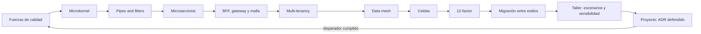

# Parte 44 — Estilos arquitectónicos

La Parte 43 enseñó patrones de diseño, empresariales y de resiliencia a escala de clases y módulos. La pregunta cambia de «¿cómo organizo este código?» a «¿qué unidades se despliegan, cómo se hablan y qué fallo puede cruzar entre ellas?». Esta parte compara once estilos y técnicas de arquitectura (la decisión por fuerzas de calidad, el microkernel, pipes and filters, los microservicios, el BFF con el gateway y la malla, la multi-tenencia, el data mesh, las celdas, los doce factores y la migración entre estilos) por lo que compran, lo que cuestan y la evidencia que permite decidir. Todo se mide sobre un único caso sintético: **el servicio *Avisos***, el que decide qué recordatorio de entrega se envía a cada estudiante, que crece de un módulo escrito por seis personas a una plataforma con doce equipos, ciento cuarenta universidades y un cliente que concentra el 40 % del tráfico.

## Pregunta rectora

> Para este sistema, ¿qué fuerza de calidad exige cambiar la arquitectura, qué estilo la atiende, qué se acepta perder, qué medida vigila la decisión y qué número la reabre?

## Antes del recorrido clase por clase

Esta parte no defiende un estilo ni recomienda una moda. Enseña a leer un estilo como un **paquete de restricciones con un costo medible**: qué propiedad compra, qué se paga y qué supuesto lo invalida. La primera clase construye el método de decisión con escenarios de calidad (`SE-529`). Las seis siguientes miden el costo de cada estilo con código: la extensión por complementos y su contrato (`SE-530`), la memoria y el orden de una cadena de filtros (`SE-531`), el precio de cruzar un proceso y la aritmética de una cadena de servicios (`SE-532`), los bytes y las rondas de una pantalla con un BFF y la confianza en el borde (`SE-533`) y las fugas entre inquilinos con el vecino ruidoso (`SE-534`). Después se trata la propiedad de los datos con una cola y cinco comprobaciones (`SE-535`), el radio de impacto de las celdas (`SE-536`), las propiedades de una aplicación que se puede copiar y reemplazar (`SE-537`) y el viaje de un estilo a otro con un comparador y escalones de tráfico (`SE-538`). La parte termina con un taller que decide con escenarios y sensibilidad (`SE-539`) y un proyecto que convierte la decisión en un registro con su prueba y su disparador (`SE-540`).

El diagrama se lee de izquierda a derecha y no es un orden obligatorio de adopción: es el orden en que se explican los costos. El retorno indica que una decisión registrada se reabre cuando su disparador se cumple, y vuelve a empezar por las fuerzas.

## Resultados acumulativos

Podrás escribir un escenario de calidad con medida, valorar estilos contra atributos, calcular el margen del ganador y la estabilidad del resultado bajo perturbación, y reconocer que con la misma matriz el contexto cambia el ganador; construir un núcleo que descubre complementos, medir las líneas del núcleo que toca una alta, el costo de aislar por excepción y por proceso y las tres políticas ante un cambio de contrato.

Podrás medir el pico de memoria de una cadena de filtros por lotes y en flujo, el efecto del orden de los filtros y de una cola acotada; calcular la disponibilidad y la latencia de cola de una cadena de servicios, medir una llamada entre procesos y contar los servicios que se coordinan ante un cambio incompatible; medir bytes y rondas de una pantalla con y sin BFF, demostrar que confiar solo en el borde acepta una petición falsificada y medir el costo de un salto de proxy.

Podrás probar fugas entre inquilinos sobre una tabla compartida, implementar una barrera que no dependa de cada consulta, medir el costo de una base por inquilino y simular un vecino ruidoso; simular la cola de un equipo central de datos, calcular las personas que necesita cada modelo de propiedad y comprobar un contrato de datos contra ocho derivas; medir cuántos inquilinos se mueven al añadir una celda, el radio de impacto de tres diseños y el costo de capacidad; auditar una aplicación con un linter, probar sesiones con varias instancias, medir el arranque y comparar parada ordenada y corte.

Podrás comparar un módulo heredado con su reemplazo en modo sombra, calcular con qué fracción del tráfico se ve cada divergencia y el daño de cada escalón, modelar tres candidatos contra seis escenarios y encontrar el supuesto que invierte la decisión, y escribir un registro de decisión con alternativas, consecuencias negativas, reversibilidad, disparador numérico y una prueba de arquitectura que lo protege.

## Prerrequisitos enlazados

- [Parte 24 — Diseño, patrones y refactorización](https://github.com/vladimiracunadev-create/modern-software-engineering-program/blob/main/classes/part-24-diseno-patrones-y-refactorizacion/): cohesión, acoplamiento y refactor con red de seguridad.
- [Parte 25 — Arquitectura de software y dominio](https://github.com/vladimiracunadev-create/modern-software-engineering-program/blob/main/classes/part-25-arquitectura-de-software-y-dominio/): drivers y atributos (`SE-301`), monolito y servicios (`SE-303`), fitness functions (`SE-308`), trade-offs y ADR (`SE-309`) y arquitectura socio-técnica (`SE-310`).
- [Parte 30 — Estrategia y técnicas de prueba](https://github.com/vladimiracunadev-create/modern-software-engineering-program/blob/main/classes/part-30-estrategia-y-tecnicas-de-prueba/): pruebas de contrato y de integración (`SE-363`).
- [Parte 31 — Calidad, rendimiento y resiliencia](https://github.com/vladimiracunadev-create/modern-software-engineering-program/blob/main/classes/part-31-calidad-rendimiento-y-resiliencia/): modelos de calidad (`SE-373`), latencia y capacidad (`SE-376`), circuit breakers y bulkheads (`SE-379`) y disponibilidad (`SE-380`).
- [Parte 40 — Metodologías de desarrollo: de TDD a ODD](https://github.com/vladimiracunadev-create/modern-software-engineering-program/blob/main/classes/part-40-metodologias-de-desarrollo-de-tdd-a-odd/): pruebas de contrato como oráculo (`SE-487`) y el caso *Avisos*.
- [Parte 43 — Patrones de diseño, empresariales y de resiliencia](https://github.com/vladimiracunadev-create/modern-software-engineering-program/blob/main/classes/part-43-patrones-de-diseno-empresariales-y-de-resiliencia/): Strategy, Adapter y sidecar como antecedentes de escala menor.
- Python 3.11+ y terminal; los experimentos usan solo la biblioteca estándar. `SE-532` y `SE-533` abren servidores y proxies en `127.0.0.1` y `SE-537` lanza procesos de Python propios.

## Bloques y progresión

1. **Elegir y estructurar:** las clases 529 a 531 fijan el método de decisión por fuerzas de calidad y miden dos estilos de estructura interna: complementos y flujo de filtros.
2. **Separar y proteger:** las clases 532 a 534 miden el costo de separar procesos, de poner capas de entrada delante y de aislar a los clientes entre sí.
3. **Propiedad, fallo y viaje:** las clases 535 a 538 tratan quién responde por los datos, cuánto daña un fallo, qué debe cumplir una aplicación para copiarse y cómo se pasa de un estilo a otro.
4. **Decidir y defender:** las clases 539 y 540 aplican el método a un caso con escenarios y sensibilidad, y lo convierten en un registro con su prueba y su disparador.

## Evidencia medida y límites

Las figuras y los ejemplos de esta parte usan experimentos ejecutados con CPython 3.12.9 en Windows 11; los recuentos y los resultados de las simulaciones con semilla fija se repiten idénticos, y los tiempos de reloj y de arranque varían entre equipos. **No se invocó ningún modelo de lenguaje, no se ejecutó ninguna herramienta de terceros (Envoy, Istio, Kong, Kubernetes, plataformas de datos, herramientas de ADR o de arquitectura) y no se evaluó ningún sistema real.** Lo que se ejecutó es código propio de la parte con la biblioteca estándar. La parte se ejecutó solo en Windows; no se repitió en Linux.

Los experimentos son: una matriz de seis estilos y siete atributos con cuatro perfiles de pesos, 10 000 juegos de pesos al azar y 2 000 perturbaciones de las valoraciones por perfil (`SE-529`); un núcleo que descubre complementos en un directorio temporal, con altas de tres canales, un complemento que falla y otro lento, ejecución por proceso con límite de tiempo y tres políticas ante un cambio de contrato (`SE-530`); una cadena de cuatro filtros sobre 100 000 registros medida con `tracemalloc`, dos órdenes de filtros contados y un productor y un consumidor con y sin cola acotada (`SE-531`); una llamada medida en proceso, serializada y por HTTP local en el mismo equipo, una cadena de uno a ocho servicios simulada con 20 000 peticiones, una espera en paralelo de uno a 16 servicios y dos topologías de ocho servicios (`SE-532`); cuatro servicios con respuestas JSON sintéticas, un modelo de red declarado, una petición interna falsificada contra dos políticas y un proxy TCP de verdad con uno y dos saltos en ocho rondas intercaladas de 500 llamadas (`SE-533`); doce consultas sobre una tabla de SQLite compartida por cinco inquilinos, una barrera con vistas temporales, 200 bases de SQLite en un directorio temporal y una simulación de eventos de un inquilino ruidoso (`SE-534`).

Siguen una simulación de una cola de varios servidores validada con la fórmula de Erlang C, un cálculo de personas por modelo de propiedad y un producto de datos de 1 000 filas con ocho derivas y un cambio legítimo (`SE-535`); una asignación de 100 000 inquilinos a ocho y nueve celdas con dos funciones, tres diseños ante un inquilino venenoso y un cálculo de capacidad con cargas lognormales (`SE-536`); un linter de cuatro señales sobre dos aplicaciones, una simulación de sesiones con tres instancias, el arranque de procesos Python reales, un modelo de parada y un mismo artefacto con tres configuraciones (`SE-537`); dos módulos de avisos sobre 20 000 peticiones, la detección en sombra con 500 repeticiones por fracción y la probabilidad de detectar un defecto por escalón (`SE-538`); un modelo de tres candidatos contra seis escenarios con un barrido de 2 a 30 equipos (`SE-539`); y un analizador de ADR con once criterios, una prueba de capas con árbol sintáctico sobre cuatro variantes de un paquete y una serie de 30 días para un disparador (`SE-540`).

Los parámetros (las valoraciones y los pesos, los complementos, los registros, las latencias lognormales, las topologías, las consultas, las tasas de llegada y de servicio, la penalización de contexto, las derivas, el comportamiento del inquilino venenoso, las aplicaciones de ejemplo, los dos módulos de avisos con sus defectos sembrados, los escenarios y la función de utilidad, los ADR de ejemplo y la serie de mediciones) son construcciones del autor. Ninguna cifra es una medición de un sistema de producción: las mediciones de red, memoria, SQLite y arranque son de una máquina concreta, y las simulaciones son modelos con supuestos declarados. El 100 % de la flota compartida de `SE-536` y el 99,601 % de la cadena de microservicios de `SE-539` son supuestos de peor caso, no hechos.

Lo que **no se hizo**: no se midió ningún equipo, esfuerzo humano, costo económico ni calidad de una organización; no se evaluó ninguna plataforma de microservicios, de malla, de datos ni de celdas; no se comprobó que ningún estilo mejore un atributo en la práctica más allá de los mecanismos ejecutados; y la cifra de 26 equipos de `SE-539` es un resultado del modelo, no una regla. Las afirmaciones sobre estilos se atribuyen a sus fuentes y se tratan como descripciones, no como resultados. Una revisión editorial humana independiente de la parte sigue pendiente.

## Guía razonada clase por clase

*Avisos* crece mientras cambian las fuerzas que lo presionan. Cada clase explica qué fuerza atiende el estilo, qué experimento lo mide, qué no demuestra y qué evidencia permitiría abandonar la conclusión.

### Bloque 1 — Elegir y estructurar

#### SE-529 — Estilos como respuestas a fuerzas de calidad

Una arquitectura es una respuesta a fuerzas de calidad, y cada fuerza necesita una medida. La clase evalúa seis estilos contra siete atributos en cuatro contextos, mide el margen del ganador y prueba cuánto aguanta el resultado si cambian los pesos o las valoraciones.

El estudiante entrega una matriz de fuerzas con escenarios medibles, el ganador, el margen y el supuesto que invierte la decisión. `SE-530` estudia el primer estilo concreto. [Abrir la clase](https://github.com/vladimiracunadev-create/modern-software-engineering-program/blob/main/classes/part-44-estilos-arquitectonicos/se-529-estilos-como-respuestas-a-fuerzas-de-calidad/README.md).

#### SE-530 — Microkernel y arquitecturas de plugins

Extender sin tocar el núcleo es una propiedad que se mide. La clase construye un núcleo que descubre complementos, añade tres canales sin cambiar una línea del núcleo y mide qué cuesta aislar a un complemento que falla o se bloquea y qué ocurre cuando el contrato sube de versión.

El estudiante entrega el contrato de un complemento con su política de versión y su nivel de aislamiento. `SE-531` cambia la pregunta: cómo fluyen los datos. [Abrir la clase](https://github.com/vladimiracunadev-create/modern-software-engineering-program/blob/main/classes/part-44-estilos-arquitectonicos/se-530-microkernel-y-arquitecturas-de-plugins/README.md).

#### SE-531 — Pipes and filters y arquitecturas de flujo

Un flujo de filtros solo escala si cada paso procesa un elemento a la vez. La clase compara por lotes y en flujo sobre 100 000 registros, mide el efecto de un filtro que necesita todo, el orden de los filtros y la contrapresión de una cola acotada.

El estudiante entrega la cadena de filtros de un proceso suyo con la memoria medida y la política de rechazos. `SE-532` pasa a separar procesos. [Abrir la clase](https://github.com/vladimiracunadev-create/modern-software-engineering-program/blob/main/classes/part-44-estilos-arquitectonicos/se-531-pipes-and-filters-y-arquitecturas-de-flujo/README.md).

### Bloque 2 — Separar y proteger

#### SE-532 — Microservicios y sus costes reales

Separar en servicios compra autonomía y se paga con latencia, disponibilidad y acoplamiento de contratos. La clase mide una llamada en proceso, serializada y por HTTP local, simula cadenas de uno a ocho servicios y cuenta cuántos se coordinan ante un cambio incompatible.

El estudiante entrega el costo de separar un módulo suyo con su camino crítico y su criterio. `SE-533` trata lo que se interpone entre clientes y servicios. [Abrir la clase](https://github.com/vladimiracunadev-create/modern-software-engineering-program/blob/main/classes/part-44-estilos-arquitectonicos/se-532-microservicios-y-sus-costes-reales/README.md).

#### SE-533 — BFF, API gateway y service mesh

Gateway, BFF y malla responden preguntas distintas y confundirlos es caro. La clase mide bytes y rondas de una pantalla con cuatro servicios, demuestra que confiar solo en el borde acepta una petición falsificada y mide lo que añade cada salto de proxy.

El estudiante entrega la tabla de responsabilidades por capa y por dueño, con la prueba de la petición que salta el borde. `SE-534` trata la identidad del inquilino. [Abrir la clase](https://github.com/vladimiracunadev-create/modern-software-engineering-program/blob/main/classes/part-44-estilos-arquitectonicos/se-533-bff-api-gateway-y-service-mesh/README.md).

#### SE-534 — Multi-tenancy y aislamiento

El aislamiento entre clientes se prueba y no se supone. La clase ejecuta doce consultas sobre una tabla compartida, prueba una barrera que no depende de cada consulta, mide el costo de una base por inquilino y simula un vecino ruidoso con y sin tope.

El estudiante entrega el modelo de aislamiento con su prueba de dos inquilinos sobre todas las rutas. `SE-535` trata la propiedad de los datos. [Abrir la clase](https://github.com/vladimiracunadev-create/modern-software-engineering-program/blob/main/classes/part-44-estilos-arquitectonicos/se-534-multi-tenancy-y-aislamiento/README.md).

### Bloque 3 — Propiedad, fallo y viaje

#### SE-535 — Data mesh y propiedad de los datos

El data mesh es una decisión sobre quién responde por los datos, no una herramienta. La clase simula la cola del equipo central, calcula las personas que necesita cada modelo y pasa ocho derivas y un cambio legítimo por cinco comprobaciones de un contrato de datos.

El estudiante entrega el contrato de un producto de datos con la matriz de derivas detectadas. `SE-536` convierte la propiedad en frontera de fallo. [Abrir la clase](https://github.com/vladimiracunadev-create/modern-software-engineering-program/blob/main/classes/part-44-estilos-arquitectonicos/se-535-data-mesh-y-propiedad-de-los-datos/README.md).

#### SE-536 — Arquitectura celular y radio de impacto

El radio de impacto es una propiedad que se diseña. La clase mide cuántos inquilinos se mueven al añadir una celda con dos funciones de asignación, compara flota compartida, celdas y fragmentación aleatoria ante un inquilino venenoso y calcula el costo de capacidad.

El estudiante entrega el radio de impacto de su diseño con el costo y la lista de componentes compartidos. `SE-537` baja a la aplicación. [Abrir la clase](https://github.com/vladimiracunadev-create/modern-software-engineering-program/blob/main/classes/part-44-estilos-arquitectonicos/se-536-arquitectura-celular-y-radio-de-impacto/README.md).

#### SE-537 — 12-factor y aplicaciones nativas de la nube

Una aplicación se puede copiar y reemplazar si cumple ciertas propiedades verificables. La clase audita con un linter, simula sesiones en tres instancias, mide el arranque de procesos reales, compara parada ordenada y corte, y ejecuta un mismo artefacto con tres configuraciones.

El estudiante entrega una auditoría de los doce factores con evidencia por fila. `SE-538` trata el cambio de un estilo a otro. [Abrir la clase](https://github.com/vladimiracunadev-create/modern-software-engineering-program/blob/main/classes/part-44-estilos-arquitectonicos/se-537-12-factor-y-aplicaciones-nativas-de-la-nube/README.md).

#### SE-538 — Evolución y migración entre estilos

Una migración incremental sustituye la apuesta única por pasos reversibles y medidos. La clase compara un módulo heredado con su reemplazo sobre 20 000 peticiones, calcula con qué fracción del tráfico se ve cada divergencia y cuántos usuarios afecta un defecto según el escalón.

El estudiante entrega un plan de migración con comparador, escalones y criterio de retiro. `SE-539` aplica todo el método a un caso. [Abrir la clase](https://github.com/vladimiracunadev-create/modern-software-engineering-program/blob/main/classes/part-44-estilos-arquitectonicos/se-538-evolucion-y-migracion-entre-estilos/README.md).

### Bloque 4 — Decidir y defender

#### SE-539 — Taller: seleccionar un estilo con escenarios de calidad

El resultado del taller no es el ganador sino el mapa de qué lo cambia. La clase modela tres candidatos contra seis escenarios, pondera en dos contextos, barre el número de equipos y encuentra que un solo supuesto de disponibilidad invierte la decisión.

El estudiante entrega la decisión con escenarios, modelo, sensibilidad y supuesto de vigilancia. `SE-540` la convierte en un registro defendido. [Abrir la clase](https://github.com/vladimiracunadev-create/modern-software-engineering-program/blob/main/classes/part-44-estilos-arquitectonicos/se-539-taller-seleccionar-un-estilo-con-escenarios-de-calidad/README.md).

#### SE-540 — Proyecto: decisión arquitectónica defendida con ADR

Un ADR bueno es una hipótesis con fecha de revisión. La clase analiza tres registros con once criterios, protege una restricción con una prueba de arquitectura que detecta una violación y un ciclo y no ve una importación dinámica, y evalúa un disparador sobre una serie de 30 días.

El estudiante entrega su ADR con la prueba que lo protege, sus supuestos de vigilancia y su disparador. Con esta clase se cierra la parte. [Abrir la clase](https://github.com/vladimiracunadev-create/modern-software-engineering-program/blob/main/classes/part-44-estilos-arquitectonicos/se-540-proyecto-decision-arquitectonica-defendida-con-adr/README.md).

## Fuentes

- [ISO/IEC 25010:2023](https://www.iso.org/standard/78176.html), [SEI, «ATAM»](https://www.sei.cmu.edu/library/atam-method-for-architecture-evaluation/) y [SEI, «Quality Attribute Workshops»](https://www.sei.cmu.edu/library/quality-attribute-workshops-qaws-third-edition/) — vocabulario de calidad y evaluación por escenarios; autoridad: ISO y el Software Engineering Institute.
- [Lewis y Fowler, «Microservices»](https://martinfowler.com/articles/microservices.html), [Fowler, «MonolithFirst»](https://martinfowler.com/bliki/MonolithFirst.html), [«Microservice Premium»](https://martinfowler.com/bliki/MicroservicePremium.html) y [Conway, «How Do Committees Invent?»](https://www.melconway.com/Home/Conways_Law.html) — descripción y costos de los microservicios y relación entre organización y sistema; autoría de Lewis, Fowler y Conway.
- [PyPA, «Entry points specification»](https://packaging.python.org/en/latest/specifications/entry-points/), [Semantic Versioning 2.0.0](https://semver.org/spec/v2.0.0.html) y [Fowler, «TolerantReader»](https://martinfowler.com/bliki/TolerantReader.html) — complementos, versiones y compatibilidad de contratos; autoridad: PyPA, semver.org y Fowler.
- [Azure Architecture Center, «Pipes and Filters»](https://learn.microsoft.com/en-us/azure/architecture/patterns/pipes-and-filters), [«Backends for Frontends»](https://learn.microsoft.com/en-us/azure/architecture/patterns/backends-for-frontends), [«Gateway Aggregation»](https://learn.microsoft.com/en-us/azure/architecture/patterns/gateway-aggregation) y [«Strangler Fig»](https://learn.microsoft.com/en-us/azure/architecture/patterns/strangler-fig), junto con [Newman, «Backends For Frontends»](https://samnewman.io/patterns/architectural/bff/) y [Istio, «Architecture»](https://istio.io/latest/docs/ops/deployment/architecture/) — patrones de flujo, de entrada y de migración y arquitectura de una malla; autoridad: Microsoft, Newman y el proyecto Istio.
- [Azure Architecture Center, «Architecting multitenant solutions»](https://learn.microsoft.com/en-us/azure/architecture/guide/multitenant/overview), [AWS, «Cell-Based Architecture»](https://docs.aws.amazon.com/wellarchitected/latest/reducing-scope-of-impact-with-cell-based-architecture/reducing-scope-of-impact-with-cell-based-architecture.html) y [Amazon Builders' Library, «Shuffle-sharding»](https://aws.amazon.com/builders-library/workload-isolation-using-shuffle-sharding/) — tenencia, celdas y fragmentación aleatoria; autoridad: Microsoft y AWS.
- [Dehghani, «Data Mesh Principles»](https://martinfowler.com/articles/data-mesh-principles.html) y [«Beyond a Monolithic Data Lake»](https://martinfowler.com/articles/data-monolith-to-mesh.html) — principios y motivación del data mesh; autoría de Dehghani.
- [The Twelve-Factor App](https://12factor.net/) y [Kubernetes, «Pod Lifecycle»](https://kubernetes.io/docs/concepts/workloads/pods/pod-lifecycle/) — factores de una aplicación portable y terminación de procesos; autoridad: Wiggins y la documentación de Kubernetes.
- [Fowler, «StranglerFigApplication»](https://martinfowler.com/bliki/StranglerFigApplication.html), [«BranchByAbstraction»](https://martinfowler.com/bliki/BranchByAbstraction.html) y [«ParallelChange»](https://martinfowler.com/bliki/ParallelChange.html) — migración incremental; autoría de Fowler.
- [Nygard, «Documenting Architecture Decisions»](https://cognitect.com/blog/2011/11/15/documenting-architecture-decisions), [adr.github.io](https://adr.github.io/), [Azure, «Architecture decision record»](https://learn.microsoft.com/en-us/azure/well-architected/architect-role/architecture-decision-record) y [ArchUnit](https://www.archunit.org/) — registros de decisión y pruebas de arquitectura; autoridad: Nygard, la comunidad ADR, Microsoft y TNG.
- [RFC 9110](https://www.rfc-editor.org/rfc/rfc9110), [RFC 2104](https://www.rfc-editor.org/rfc/rfc2104), [OWASP ASVS](https://owasp.org/www-project-application-security-verification-standard/), [SQLite, «CREATE VIEW»](https://www.sqlite.org/lang_createview.html) y la [documentación de Python](https://docs.python.org/3/) (`ast`, `hashlib`, `hmac`, `http.client`, `importlib`, `queue`, `sqlite3`, `subprocess`, `tracemalloc`) — protocolos, seguridad y herramientas usadas por los experimentos; autoridad: IETF, OWASP, SQLite y la Python Software Foundation.

Las fuentes se vinculan también dentro de cada clase. Definen vocabulario y describen prácticas; que un estilo convenga a un equipo se demuestra con el caso, la evidencia medida y la revisión de otra persona, no con la autoridad de la fuente. Varias son documentación de proveedores sobre sus propios patrones y se leen como tales.

## Criterios de aceptación de la parte

- cada clase conecta mecanismo, medida y límite en una conclusión revisable;
- cada medida puede reproducirse desde un checkout limpio con las mismas semillas, salvo las lecturas de reloj, que declaran por qué no;
- ninguna afirmación sobre un equipo, una herramienta de terceros, una plataforma o el efecto real de un estilo se apoya en una simulación o en un modelo de juguete;
- el ADR final se puede aplicar a una decisión nueva por otra persona y declara sus supuestos, su disparador y lo que su prueba no ve.

[Volver al índice de clases](https://github.com/vladimiracunadev-create/modern-software-engineering-program/blob/main/classes/README.md)
