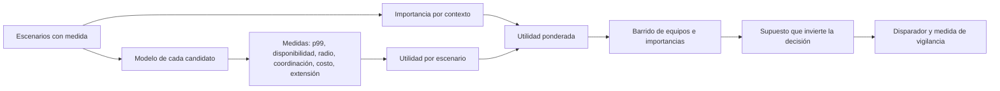
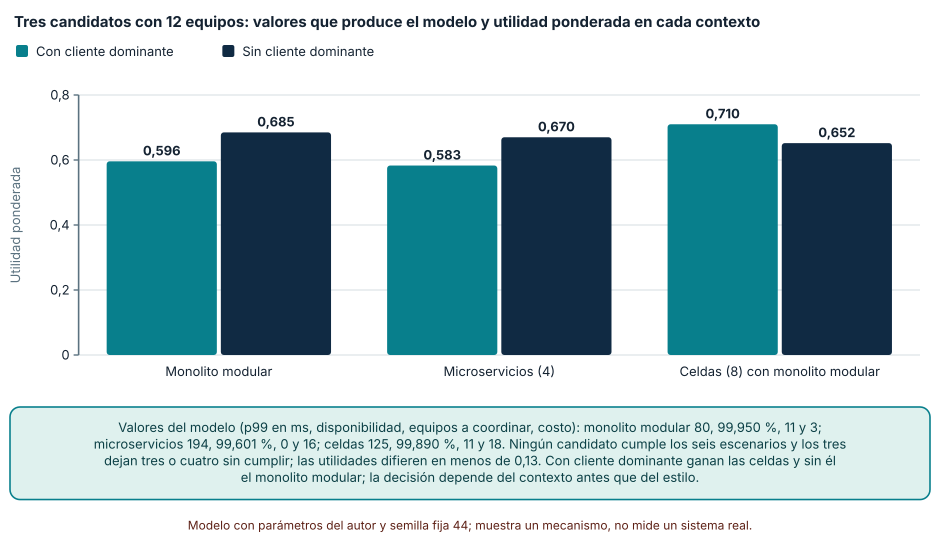

# SE-539 — Taller: seleccionar un estilo con escenarios de calidad

[← SE-538 — Evolución y migración entre estilos](https://github.com/vladimiracunadev-create/modern-software-engineering-program/blob/main/classes/part-44-estilos-arquitectonicos/se-538-evolucion-y-migracion-entre-estilos/README.md) · [↑ Parte 44](https://github.com/vladimiracunadev-create/modern-software-engineering-program/blob/main/classes/part-44-estilos-arquitectonicos/README.md) · [📚 Índice completo](https://github.com/vladimiracunadev-create/modern-software-engineering-program/blob/main/classes/README.md) · [🌐 Portal](https://vladimiracunadev-create.github.io/modern-software-engineering-program/classes/SE-539.html) · [SE-540 — Proyecto: decisión arquitectónica defendida con ADR →](https://github.com/vladimiracunadev-create/modern-software-engineering-program/blob/main/classes/part-44-estilos-arquitectonicos/se-540-proyecto-decision-arquitectonica-defendida-con-adr/README.md)

## Punto profesional y fundamento pedagógico

**Punto profesional.** El taller existe para que practiques de punta a punta el método que la parte fue construyendo: pasar de una discusión de estilos a una decisión con evidencia. Se parte de escenarios de calidad con medida, se evalúan candidatos con un modelo ejecutable (no con una opinión), se calcula una utilidad ponderada, se compara con el número de equipos y con la importancia de cada escenario, y se busca el supuesto que invierte la decisión. La habilidad profesional que entrena es doble: producir una recomendación defendible y, sobre todo, saber decir de qué supuesto depende y cómo se vigilaría.

**Por qué aparece aquí.** Es la integración de `SE-529` a `SE-538`. Usa el método de `SE-529` (escenarios, matriz, sensibilidad), los costos medidos de `SE-532` (cadena de servicios), `SE-534` y `SE-536` (radio de impacto) y el criterio de reversibilidad de `SE-538`. Prepara el proyecto `SE-540`, que convierte la decisión en un registro con disparador y una prueba que la protege.

**Error conceptual que debe corregir.** Creer que el resultado del taller es el ganador. El ganador depende de las importancias y de los supuestos del modelo; lo valioso es el mapa de qué cambia el ganador. En el experimento, el candidato que gana con 12 equipos es distinto según haya o no un cliente dominante, y una sola medida (la disponibilidad de una cadena de microservicios) invierte la decisión en todos los casos. Una recomendación sin ese mapa es un número sin contexto.

**Secuencia de aprendizaje.** Antes de ejecutar, predices qué candidato gana con 4 y con 12 equipos en dos contextos (con y sin un cliente que concentra el riesgo) y qué parámetro, al cambiar, invertiría la decisión. Después ejecutas el modelo, barres el número de equipos de 2 a 30, cambias la importancia del radio de impacto y sustituyes el supuesto de disponibilidad de los microservicios, y escribes la recomendación con sus supuestos.

**Evidencia de aprendizaje.** `decision-con-escenarios.md` con los seis escenarios de tu caso (con las seis partes y una medida), la importancia por contexto, la tabla de candidatos con valores que produce un modelo o una medición, la utilidad ponderada, el barrido de sensibilidad y el supuesto que invierte la decisión con su medida de vigilancia.

**Límite de la conclusión.** El modelo es de juguete: las latencias salen de una distribución lognormal con semilla 44, la disponibilidad de la cadena es un producto con fallos independientes, el costo se cuenta en instancias, la coordinación de despliegue es «equipos menos uno» y la utilidad usa umbrales lineales. Sirve para ejercitar el método, no para decidir ningún sistema real. No se evaluó ninguna arquitectura real ni se invocó ningún modelo de lenguaje.

### Trazabilidad fuente → afirmación

| Fuente primaria u oficial | Afirmación que respalda | Lo que no prueba |
|---|---|---|
| [SEI, «ATAM: Method for Architecture Evaluation»](https://www.sei.cmu.edu/library/atam-method-for-architecture-evaluation/) | Describe evaluar una arquitectura con un árbol de utilidad de escenarios priorizados y señalar puntos de sensibilidad y de compromiso. | No es una medición de ningún sistema. |
| [SEI, «Quality Attribute Workshops»](https://www.sei.cmu.edu/library/quality-attribute-workshops-qaws-third-edition/) | Propone obtener y priorizar los escenarios con las partes interesadas. | No garantiza que los escenarios sean completos. |
| [ISO/IEC 25010:2023](https://www.iso.org/standard/78176.html) | Aporta el vocabulario de características (eficiencia de desempeño, fiabilidad, mantenibilidad, seguridad) con el que clasificar cada escenario. | No fija umbrales. |
| [Fowler, «MonolithFirst»](https://martinfowler.com/bliki/MonolithFirst.html) y [«Microservice Premium»](https://martinfowler.com/bliki/MicroservicePremium.html) | Dan los argumentos, como opinión, a favor de empezar simple y pagar el costo de los servicios solo cuando compensa. | No son datos empíricos. |
| [Conway, «How Do Committees Invent?»](https://www.melconway.com/Home/Conways_Law.html) | Justifica que el número de equipos sea una fuerza del modelo. | No cuantifica la coordinación. |

## Antes de empezar

Recupera lo aprendido en `SE-538`: una decisión arquitectónica se ejecuta en pasos reversibles. La pregunta activa es: **de las decisiones de arquitectura de tu equipo en el último año, ¿cuál tenía un escenario con medida y cuál se tomó por convicción, y qué evidencia tienes hoy de que acertó?**

## Prerrequisitos

- Haber completado `SE-529` a `SE-538` o poder explicar los costos de cada estilo.
- Saber leer un barrido de sensibilidad y una utilidad ponderada.
- Conocer de `SE-311` el formato del taller de revisión de una arquitectura contra escenarios.
- Python 3.11 o posterior; el laboratorio usa solo la biblioteca estándar.

## Problema auténtico

La dirección de *Avisos* pide una recomendación sobre la arquitectura para el próximo año. Hay tres candidatos con partidarios: seguir con el monolito modular, separar en cuatro microservicios o repartir en ocho celdas. Hay doce equipos y un cliente que concentra el 40 % del tráfico, y no está claro cuánto debe pesar eso. Los partidarios de cada opción traen argumentos y ninguno trae un número. La persona que debe decidir pide una sola cosa: que se le diga qué elegir y qué le haría cambiar de opinión.

El taller produce esa respuesta con un método. Se escriben seis escenarios con medida, se asigna una importancia en dos contextos, se modelan los tres candidatos con un programa de unas cien líneas que calcula latencia, disponibilidad, radio de impacto, coordinación de despliegue, costo y extensión, se pondera, se varía el número de equipos y se mira cuándo cambia el ganador.

## Objetivos observables

Al terminar podrás:

1. escribir escenarios de calidad con las seis partes y una medida que un modelo o una prueba pueda calcular;
2. construir un modelo ejecutable que produzca las medidas de cada candidato y declarar sus supuestos;
3. calcular una utilidad ponderada y distinguir los escenarios cumplidos de la utilidad graduada;
4. barrer un parámetro de contexto (equipos) y encontrar el punto donde cambia el ganador;
5. identificar el supuesto más sensible y proponer cómo vigilarlo después de decidir.

## Mapa conceptual



El mapa muestra que el modelo sustituye a las opiniones en la columna de medidas, y que la salida útil no es el ganador sino el supuesto y su vigilancia. Cada flecha es un paso que el estudiante ejecuta y justifica.

## Temas y por qué importan

| Tema | Por qué cambia una decisión profesional | Evidencia mínima |
|---|---|---|
| Escenario con medida | Convierte un adjetivo en algo que se calcula. | Seis partes y medida por escenario |
| Modelo del candidato | Produce medidas en lugar de opiniones. | Código con supuestos declarados |
| Utilidad graduada | Distingue «casi» de «lejos» frente a un umbral. | Utilidad por escenario |
| Importancia por contexto | Cambia el ganador con la misma evidencia. | Dos contextos comparados |
| Barrido de equipos | Localiza dónde cambia la decisión. | Gráfico o tabla de ganador por número de equipos |
| Punto de sensibilidad | Señala qué vigilar. | Supuesto que invierte la decisión |
| Recomendación defendible | Lleva a una decisión con disparador. | Recomendación con supuestos |

## Conceptos y decisiones

### 1. Seis escenarios con medida

Los seis escenarios del caso son: S1, latencia (el p99 de calcular los avisos de un estudiante no supera 200 ms); S2, disponibilidad (al menos 99,9 % mensual); S3, radio de impacto (un inquilino defectuoso afecta como máximo al 15 % de los inquilinos); S4, coordinación de despliegue (un cambio requiere coordinar como máximo a dos equipos); S5, costo (no más de 12 unidades de infraestructura, donde una unidad es una instancia); S6, extensión (añadir un canal sin tocar el núcleo). Cada uno tiene fuente, estímulo, artefacto, entorno, respuesta y una medida que el modelo calcula o que una prueba comprueba. Un escenario sin medida («el sistema debe ser extensible») queda fuera del cálculo, y ese es el motivo de insistir en la medida.

### 2. Modelar cada candidato con supuestos declarados

Cada candidato es una función que produce las seis medidas. El monolito modular tiene un salto de latencia (una llamada en proceso), disponibilidad de 99,95 %, radio de impacto 100 % (un fallo lo afecta todo), coordinación de despliegue igual a los equipos menos uno (comparten un solo despliegue), costo de 3 instancias y sin extensión por terceros. Los cuatro microservicios tienen cuatro saltos en serie, disponibilidad igual al producto de cuatro servicios al 99,9 % (99,601 %), radio 100 % (la capacidad completa depende de la cadena), coordinación 0 (con contratos compatibles), costo de 16 instancias (cuatro servicios de tres instancias, más pasarela y observabilidad) y extensión sí. Las ocho celdas con monolito modular tienen dos saltos (enrutador y celda), disponibilidad 99,890 % (enrutador al 99,99 % por celda al 99,9 %), radio 12,5 %, coordinación como el monolito, costo de 18 instancias (ocho celdas de dos instancias y dos del enrutador) y sin extensión. Los supuestos más discutibles se escriben encima del código y se vuelven los candidatos a variar.

### 3. La latencia se simula, no se supone

Para el p99 se simularon 20 000 peticiones por candidato con latencias lognormales de mediana 20 ms por salto: 80 ms con un salto, 125 ms con dos y 194 ms con cuatro. Que los microservicios queden en 194 ms, apenas por debajo del umbral de 200 ms, es un resultado del modelo y no una propiedad del estilo: con seis saltos habría superado el umbral, como vio `SE-532`. El resultado enseña que un candidato puede cumplir un escenario por un margen que desaparece con un salto más.

### 4. Utilidad graduada, no cumplir o no cumplir

Un recuento de escenarios cumplidos oculta cuánto falta. La utilidad por escenario es 1 si se cumple y baja de forma lineal según lo que falta: para la latencia es 200 dividido por el p99 observado (limitada a 1); para la disponibilidad es 1 si se llega al objetivo y baja a 0 cuando falta una décima de punto; para el radio es 15 dividido por el radio (limitada a 1); para la coordinación es 1 hasta dos equipos y 2 dividido por los equipos coordinados después; para el costo es 12 dividido por el costo (limitada a 1); para la extensión es 1 o 0. La utilidad ponderada es la media de las utilidades según la importancia de cada escenario (alta 5, media 3, baja 1). Los umbrales y las pendientes son una decisión del autor: es una función de utilidad, un instrumento de razonamiento, no una verdad.

### 5. Dos contextos, la misma evidencia

La importancia es una decisión de negocio. En el contexto «con cliente dominante» el radio de impacto es de importancia alta; en «sin cliente dominante» es baja. Con 12 equipos, la utilidad con cliente dominante fue 0,596 para el monolito, 0,583 para los microservicios y 0,710 para las celdas; sin cliente dominante, 0,685, 0,670 y 0,652. Ninguno cumple los seis escenarios: el monolito cumple 3, los microservicios 3 y las celdas 2, y las diferencias entre candidatos son de menos de 0,13. Con cliente dominante gana la celda; sin él, el monolito modular. El único escenario que cambió de importancia entre los dos contextos fue el radio, y bastó para invertir el resultado.

### 6. El barrido de equipos

Para saber cómo depende la decisión del tamaño de la organización se calculó la utilidad de cada candidato con 2 a 30 equipos. Con cliente dominante, la celda gana en todos los tamaños: su utilidad baja de 0,813 con 2 equipos a 0,696 con 30, y sigue por encima del monolito (0,698 y 0,582) y de los microservicios (0,583, que no depende de los equipos porque su coordinación es cero). Sin cliente dominante, el monolito modular gana hasta 25 equipos y los microservicios, desde 26, porque la utilidad del monolito cae con la coordinación (0,807 con 2 equipos, 0,668 con 30) mientras la de los microservicios se mantiene en 0,670. El punto de sensibilidad respecto de los equipos es 26: la regla «separa cuando hay más de unos 25 equipos» sale de este modelo y no de un estudio, y es una cifra que depende de todos los supuestos anteriores.

### 7. El supuesto que invierte la decisión

Lo más informativo del taller no es el número de equipos sino un supuesto del modelo: que cuatro servicios en serie tengan 99,601 % de disponibilidad. Si, mediante degradación, caché y reintentos, la cadena alcanzara 99,95 %, los microservicios ganarían en los dos contextos y con 4 y 12 equipos (utilidad 0,792 con cliente dominante y 0,920 sin él). Una sola medida invierte la recomendación en todos los casos, y por eso es la que debe estar en el registro de decisión: «esta recomendación vale mientras la cadena síncrona no alcance el 99,9 %; si el diseño con degradación la logra, se reconsidera». Vigilarla significa medir la disponibilidad real de la cadena en el camino crítico, no la de cada servicio.

### 8. De la utilidad a la recomendación

La recomendación es una frase con un contexto, un candidato, un margen, un supuesto y un disparador. Por ejemplo: «con cliente dominante y 12 equipos, celdas por 0,114 sobre el monolito; vale mientras el radio de impacto del monolito sea del 100 % y el cliente dominante concentre el riesgo; se reconsidera si los microservicios con degradación demuestran 99,9 % en el camino crítico o si el cliente se aísla por otro medio». Un margen de 0,114 sobre una función de utilidad con pendientes del autor es pequeño, y la recomendación debe decirlo: la decisión es defendible, no obvia.

## Los seis escenarios

La primera figura resume los escenarios con su medida y su importancia en los dos contextos.


**Cómo leer la figura.** Cada fila es un escenario con su medida y cada columna un contexto; cuanto más oscura la celda, más importante es el escenario. Mira primero la fila del radio de impacto, la única que cambia de oscura a clara entre los dos contextos. **Dónde deja de valer:** las importancias son una decisión del autor y de los contextos supuestos; en un caso real las fija quien conoce el negocio, y se obtienen con un taller de partes interesadas, no con una opinión individual.

## Los candidatos con 12 equipos

La segunda figura muestra lo que el modelo produce para cada candidato y su utilidad en los dos contextos.



**Cómo leer la figura.** Cada grupo es un candidato; la barra verde es su utilidad con cliente dominante y la azul oscura sin él. Mira primero qué barra es la más alta en cada color: las celdas con cliente dominante y el monolito modular sin él, y que las diferencias son pequeñas. **Dónde deja de valer:** las medidas salen de un modelo con supuestos declarados (latencia lognormal, fallos independientes, coordinación igual a equipos menos uno); sus diferencias son menores que el error de esos supuestos. La figura es el material para la discusión, no su veredicto.

## Qué cambia el ganador

La tercera figura reúne el efecto del contexto, del número de equipos y del supuesto de disponibilidad.


**Cómo leer la figura.** Cada barra es una situación partida entre los tamaños de equipo (4, 12 y 30) según el candidato que gana: celdas (verde), monolito modular (azul oscuro) o microservicios (rojo). Mira primero que las dos últimas barras son enteramente rojas: cambiar un solo supuesto, la disponibilidad de la cadena, invierte la decisión. **Dónde deja de valer:** el barrido varía un parámetro cada vez; en la realidad varían juntos, y una combinación puede producir otro ganador. La tabla muestra qué supuesto vigilar, no una predicción.

## Definiciones de trabajo

- **Árbol de utilidad:** jerarquía de atributos de calidad refinada en escenarios priorizados por importancia y dificultad.
- **Utilidad graduada:** valor de 0 a 1 que mide cuánto de un escenario se cumple.
- **Punto de sensibilidad:** parámetro cuyo cambio pequeño invierte la decisión o cambia mucho una medida.
- **Punto de compromiso:** decisión que mejora un atributo empeorando otro.
- **Barrido de parámetros:** evaluar la decisión para un rango de valores de un parámetro de contexto.
- **Importancia por contexto:** peso de cada escenario según la situación del negocio.
- **Supuesto de vigilancia:** supuesto del modelo cuya medición real decide si se reconsidera la decisión.

## Ejemplo mínimo

La utilidad de un candidato frente a un solo escenario:

```python
def utilidad_latencia(p99_ms: float, umbral_ms: float = 200) -> float:
    return min(1.0, umbral_ms / p99_ms)

for p99 in (80, 194, 260):
    print(p99, round(utilidad_latencia(p99), 2))   # 1.0, 1.0, 0.77
```

Un p99 de 194 ms cumple el umbral (utilidad 1) y uno de 260 ms tiene una utilidad de 0,77: cumple el 77 % del escenario. La utilidad graduada convierte «no cumple» en «cuánto no cumple», que es lo que permite comparar candidatos.

## Ejemplo profesional

*Escenario ilustrativo: las cifras y los resultados que aparecen en este ejemplo son supuestos de la narración, no mediciones.*

El equipo de *Avisos* hace el taller en una sesión de medio día con la dirección, un representante del cliente grande y las personas de operaciones. Escriben los seis escenarios, discuten la importancia del radio de impacto y acuerdan «alta» porque el cliente grande ya amenazó con irse tras un incidente. Ejecutan el modelo con sus números (12 equipos, tres saltos reales en el camino crítico actual) y obtienen un resultado cercano al del laboratorio: las celdas ganan por poco. La discusión se centra entonces en el supuesto de disponibilidad de la cadena de servicios, que es lo que invertiría el resultado. Operaciones mide durante dos semanas la disponibilidad del camino crítico real y obtiene 99,7 %, por debajo del umbral. La decisión es empezar con una celda dedicada al cliente grande, mantener el monolito modular para el resto y fijar un disparador: si la medición de la cadena síncrona supera el 99,9 % durante un trimestre, se reevalúa separar. La reunión no cerró con un ganador universal; cerró con una decisión pequeña, reversible y medida.

## Práctica guiada

1. Escribe tus seis escenarios con las seis partes y una medida calculable.
2. Define dos contextos con importancias distintas y justifica cada diferencia.
3. Ejecuta `python scripts/experiments_part44_b.py 539`, lee el modelo y sustituye al menos tres parámetros por los de tu sistema.
4. Barre el número de equipos y encuentra el punto donde cambia el ganador en cada contexto.
5. Identifica el supuesto más sensible, cámbialo y anota qué candidato gana ahora y qué medida lo vigilaría.

## Ejercicios

1. **Básico.** Calcula la utilidad de disponibilidad de un candidato con 99,85 % y explica por qué en el modelo es 0,5.
2. **Intermedio.** Añade un candidato (por ejemplo, un monolito modular con una cola para los envíos) con tus propias estimaciones y comprueba si cambia el ganador en alguno de los contextos.
3. **Avanzado.** Sustituye la coordinación de «equipos menos uno» por una función cuadrática (pares de equipos) y comprueba si el punto de sensibilidad se desplaza; explica qué dice eso sobre la robustez de la cifra de 26 equipos.

## Reto verificable

Entrega `decision-con-escenarios.md` con tus seis escenarios, el modelo con sus supuestos, la tabla de candidatos, la utilidad en dos contextos, el barrido de al menos un parámetro y el supuesto que invierte la decisión con su medida. Es válido si otra persona ejecuta tu modelo, obtiene las mismas medidas y puede cambiar el supuesto sensible para ver la inversión.

## Caso conductor

*Avisos* recibe una recomendación con su mapa de sensibilidad: celdas para el cliente grande, monolito modular para el resto y un disparador sobre la disponibilidad de la cadena. `SE-540` convierte esa decisión en un registro (ADR) con disparador, prueba que la protege y revisión programada.

## Preguntas frecuentes

### ¿Cómo sé que mi modelo es suficientemente bueno?

Si sus medidas de la situación actual coinciden con lo que observas. Calibrarlo con una medición de tu sistema (la latencia actual, la disponibilidad real) es más importante que añadir detalle. Un modelo que no reproduce el presente no sirve para comparar futuros.

### ¿Qué hago si los escenarios no son medibles todavía?

Mide primero: instrumenta el camino crítico y recoge dos semanas de datos. Un escenario sin medida entra en la decisión como una incertidumbre declarada, no como un número inventado.

### ¿La utilidad ponderada no es falsa precisión?

Lo es si se lee como una predicción. Se usa para ordenar la discusión, ver el margen y calcular la sensibilidad. La recomendación debe expresar el margen y el supuesto, no solo el ganador.

### ¿Quién fija las importancias?

Quien responde por el negocio, con el equipo presente. Si las fija el equipo técnico solo, el resultado refleja sus preferencias. Un taller con partes interesadas, como los talleres de atributos de calidad del SEI, es la forma de obtenerlas.

## Fallo controlado y diagnóstico

**Fallo.** El taller concluye con los microservicios como ganadores por un margen de 0,09. A los tres meses de empezar la separación, la disponibilidad del camino crítico baja del objetivo y la dirección pide explicaciones.

**Diagnóstico paso a paso.** (1) Se revisa el modelo: suponía fallos independientes y un solo servicio de apoyo compartido. (2) El camino crítico real tenía una base de datos compartida entre dos de los servicios, de modo que sus fallos no eran independientes. (3) Repetido el modelo con un fallo compartido, la disponibilidad de la cadena baja al 99,4 % y el ganador cambia. (4) El margen de 0,09 era menor que el efecto de ese supuesto y nadie lo había declarado.

**Corrección.** Se añade el supuesto de independencia a la lista de supuestos de vigilancia, se modela la base compartida y se repite el barrido. El resultado es otro ganador y una nueva medida de control. La lección es que un margen se mide frente al efecto del supuesto más débil, no frente a cero.

## Errores comunes y cómo corregirlos

- **Escenarios sin medida.** No entran al cálculo. Corrige con una medida o declarándolos incertidumbre.
- **Un modelo que no reproduce el presente.** No sirve para comparar. Corrige calibrando con mediciones.
- **Leer el ganador sin el margen.** Corrige comparando el margen con el efecto del supuesto más débil.
- **Fijar las importancias solo desde el equipo técnico.** Corrige con las partes interesadas.
- **Barrer un parámetro y olvidar los demás.** Corrige variando combinaciones razonables.
- **No escribir el disparador.** Corrige con la medida que reabre la decisión.

## Entorno y archivos clave

- `scripts/experiments_part44_b.py`: función `e539` con los escenarios, el modelo de tres candidatos, la utilidad, el barrido de equipos y la sensibilidad; se ejecuta con `python scripts/experiments_part44_b.py 539`.
- `scripts/figures_part44_b.py`: las tres figuras de la clase.
- Solo la biblioteca estándar de Python 3.11 o posterior. Las simulaciones de latencia usan semilla 44.

## Seguridad, ética y accesibilidad

El taller no maneja datos reales. En un caso real, las importancias deciden quién carga con el riesgo: darle importancia baja al radio de impacto significa aceptar que un fallo afecte a todos, y esa decisión debe ser explícita y de quien responde por ella. Si la recomendación implica reorganizar equipos o apagar servicios, el costo para las personas es parte de las consecuencias. Las figuras son tablas con texto alternativo completo y no dependen solo del color.

## Puente hacia el trabajo con agentes

Un agente puede producir un modelo y una tabla de candidatos con rapidez, y la tabla será convincente. Verifica que cada medida salga de un cálculo o de una medición declarada y no de una valoración del agente; exige que enumere los supuestos del modelo y que haga el barrido de sensibilidad; y no aceptes una recomendación sin el supuesto que la invierte. Un uso sano es pedirle que construya variantes del modelo con supuestos distintos y que señale cuál cambia el ganador; la decisión de qué supuestos son razonables para tu organización es tuya.

## Transferencia

Aplica el taller a una decisión de tu equipo: escribe escenarios, modela dos o tres candidatos con lo que sabes y calibra el modelo con una medición. Barre el parámetro de contexto que más te preocupa y encuentra el supuesto que invierte la decisión. Presenta la recomendación con su margen, su supuesto y su disparador, y pide a alguien que no participó que intente romperla.

## Evaluación y evidencia

| Criterio | Evidencia aceptable | Rechazo |
|---|---|---|
| Escenarios | Seis partes y medida | Adjetivos |
| Modelo | Código con supuestos declarados y calibrado | Valoraciones sin cálculo |
| Utilidad | Función graduada y justificada | Cumple o no cumple |
| Sensibilidad | Barrido y supuesto que invierte | Ganador sin análisis |
| Recomendación | Margen, supuesto y disparador | «Recomendamos X» |

## Fuentes

- Software Engineering Institute. [«ATAM: Method for Architecture Evaluation»](https://www.sei.cmu.edu/library/atam-method-for-architecture-evaluation/) y [«Quality Attribute Workshops (QAWs), Third Edition»](https://www.sei.cmu.edu/library/quality-attribute-workshops-qaws-third-edition/).
- Organización Internacional de Normalización. [ISO/IEC 25010:2023](https://www.iso.org/standard/78176.html).
- Fowler, M. [«MonolithFirst»](https://martinfowler.com/bliki/MonolithFirst.html) y [«Microservice Premium»](https://martinfowler.com/bliki/MicroservicePremium.html).
- Conway, M. E. [«How Do Committees Invent?»](https://www.melconway.com/Home/Conways_Law.html).

## Límites y siguiente paso

El modelo, las importancias, la función de utilidad y los dos contextos son construcciones del autor; el número 26 es un resultado del modelo y no una regla. No se evaluó ninguna arquitectura real ni se midió ninguna organización. El siguiente paso, `SE-540`, es el proyecto de la parte: convertir una decisión en un registro de decisión arquitectónica con alternativas, consecuencias negativas, disparador y una prueba que la protege.

## Glosario

| Término | Definición breve |
|---|---|
| Árbol de utilidad | Escenarios priorizados por atributo de calidad |
| Utilidad graduada | Medida de 0 a 1 de cuánto se cumple un escenario |
| Punto de sensibilidad | Parámetro que invierte la decisión |
| Punto de compromiso | Mejora un atributo empeorando otro |
| Barrido | Evaluación para un rango de valores de un parámetro |
| Supuesto de vigilancia | Supuesto cuya medición reabre la decisión |

---

[← SE-538 — Evolución y migración entre estilos](https://github.com/vladimiracunadev-create/modern-software-engineering-program/blob/main/classes/part-44-estilos-arquitectonicos/se-538-evolucion-y-migracion-entre-estilos/README.md) · [↑ Parte 44](https://github.com/vladimiracunadev-create/modern-software-engineering-program/blob/main/classes/part-44-estilos-arquitectonicos/README.md) · [📚 Índice completo](https://github.com/vladimiracunadev-create/modern-software-engineering-program/blob/main/classes/README.md) · [🌐 Portal](https://vladimiracunadev-create.github.io/modern-software-engineering-program/classes/SE-539.html) · [SE-540 — Proyecto: decisión arquitectónica defendida con ADR →](https://github.com/vladimiracunadev-create/modern-software-engineering-program/blob/main/classes/part-44-estilos-arquitectonicos/se-540-proyecto-decision-arquitectonica-defendida-con-adr/README.md)
