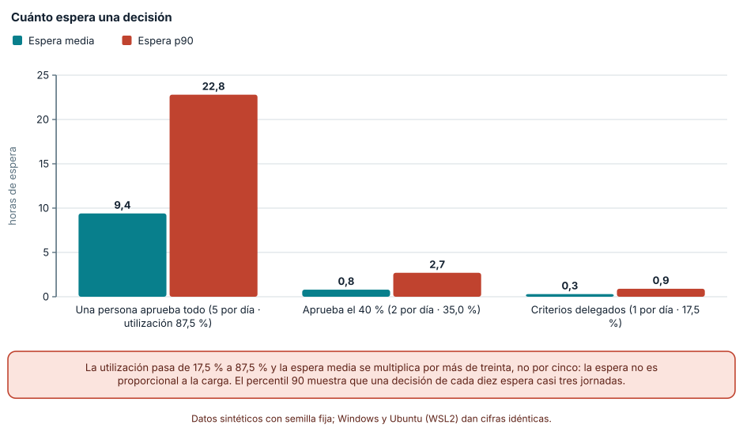
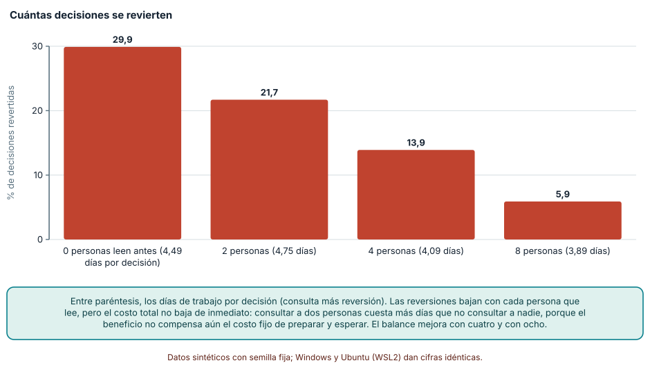

# SE-529 — Liderazgo técnico sin autoridad formal

[← SE-528 — Proyecto: migración incremental reversible](https://github.com/vladimiracunadev-create/modern-software-engineering-program/blob/main/classes/part-43-mantenimiento-y-modernizacion-legacy/se-528-proyecto-migracion-incremental-reversible/README.md) · [↑ Parte 44](https://github.com/vladimiracunadev-create/modern-software-engineering-program/blob/main/classes/part-44-gestion-liderazgo-y-practica-profesional/README.md) · [📚 Índice completo](https://github.com/vladimiracunadev-create/modern-software-engineering-program/blob/main/classes/README.md) · [🌐 Portal](https://vladimiracunadev-create.github.io/modern-software-engineering-program/classes/SE-529.html) · [SE-530 — Diseño de equipos y ownership →](https://github.com/vladimiracunadev-create/modern-software-engineering-program/blob/main/classes/part-44-gestion-liderazgo-y-practica-profesional/se-530-diseno-de-equipos-y-ownership/README.md)

## Punto profesional y fundamento pedagógico

**Punto profesional.** La clase existe para que puedas conseguir que una decisión técnica se adopte sin poder ordenarla. Quien no tiene autoridad formal solo dispone de tres palancas: el contexto que comparte (para que otras personas decidan mejor), las decisiones que deja por escrito (para que se puedan discutir y recordar) y las coaliciones que construye (para que la práctica no dependa de una sola voz). La habilidad profesional no es convencer sino reducir el costo para que otras personas cambien con buenas razones, y medir si eso ocurrió.

**Por qué aparece aquí.** Sigue a **Proyecto: migración incremental reversible** (`SE-528`): una migración de seis fases fracasa o triunfa menos por la técnica que por quién acepta cada fase y cuándo. La [Parte 44](../README.md) toma ahora al equipo, no al código. El caso conductor es **el equipo de plataforma educativa** (ocho personas que mantienen el módulo de calificaciones y otros servicios) y una ingeniera sénior sin cargo de jefatura que quiere que el equipo adopte una práctica concreta: documentar cada decisión de diseño con un registro breve antes de implementarla.

**Error conceptual que debe corregir.** Creer que el liderazgo técnico es tener razón con más insistencia. Una propuesta correcta que nadie adopta no cambia el sistema, y una propuesta adoptada por obediencia se abandona cuando la persona que la empujaba mira a otro lado. Lo que se puede diseñar es la ruta de adopción: a quién se consulta primero, qué se escribe, cuánto trabajo de aprobación se concentra en una sola persona y qué pasa cuando hay desacuerdo.

**Secuencia de aprendizaje.** Antes de mirar los resultados, predices qué porcentaje de redes de treinta personas llega al 80 % de adopción si se siembra a dos personas muy conectadas, a dos al azar o a dos poco conectadas; después simulas esas siembras, mides cuánto espera una decisión cuando una sola persona aprueba todo y cuántas decisiones se revierten según cuántas personas las leyeron por escrito antes. La secuencia usa predicción, explicación propia, contraste y recuperación. [ICAP](https://icap.education.asu.edu/research) distingue participación de construcción de conocimiento; [How People Learn II](https://nap.nationalacademies.org/catalog/24783/how-people-learn-ii-learners-contexts-and-cultures) respalda diseñar la práctica con contextos reales y retroalimentación.

**Evidencia de aprendizaje.** `liderazgo-log.md` con la predicción, las tres figuras reproducidas, un mapa de influencia de un equipo propio o del caso (quién se consulta primero y por qué), una propuesta escrita en formato breve con contexto, opciones, decisión pedida y criterio de revisión, una regla de delegación con los criterios que permiten decidir sin pedir permiso y una nota que separe qué es medido, qué inferido y qué supuesto.

**Límite de la conclusión.** Las redes de treinta personas, los umbrales, la llegada de decisiones, el tiempo de revisión, la probabilidad de que una preocupación grave exista y el costo de revertir son sintéticos, escritos por el autor con semilla fija. No se midió ningún equipo real ni a ninguna persona. Las cifras muestran la forma de un mecanismo, no el valor en tu organización.

### Trazabilidad fuente → afirmación

| Fuente primaria u oficial | Afirmación que respalda | Lo que no prueba |
|---|---|---|
| [Granovetter, «Threshold Models of Collective Behavior»](https://doi.org/10.1086/226707) | Modela la decisión de cada persona como dependiente de cuántas otras ya actuaron, con umbrales distintos. | No dice cuáles son los umbrales de las personas de tu equipo. |
| [Watts, «A simple model of global cascades on random networks»](https://doi.org/10.1073/pnas.082090499) | Muestra que, en una red, la conectividad y la distribución de umbrales deciden si una semilla pequeña produce una cascada. | Las redes simuladas no son redes sociales medidas. |
| [Kingman, «The single server queue in heavy traffic»](https://doi.org/10.1017/S0305004100036094) | Describe cómo crece el tiempo de espera de una cola de un servidor cuando la utilización se acerca a uno. | No describe las llegadas ni los tiempos de servicio de tu equipo. |
| [PEP 1](https://peps.python.org/pep-0001/) | Ejemplo público de un proceso de propuestas con redacción, discusión y decisión. | Es la cultura de un proyecto, no una plantilla universal. |
| [Nygard, «Documenting Architecture Decisions»](https://cognitect.com/blog/2011/11/15/documenting-architecture-decisions) | Propone registrar cada decisión de arquitectura en un documento corto con contexto y consecuencias. | No garantiza que el registro se lea ni que se respete. |
| [Larson, arquetipos de ingeniería de staff](https://staffeng.com/guides/staff-archetypes/) | Describe formas de liderazgo técnico sin gestión de personas. | Es una descripción de práctica, no un estudio sistemático. |

## Antes de empezar

Recupera lo aprendido en `SE-528`: la reversibilidad es una propiedad de cada fase, no del conjunto. La pregunta activa es: **¿qué cambio de tu equipo podrías proponer mañana de modo que, si resulta mala idea, deshacerlo cueste una conversación y no una crisis?**

## Prerrequisitos

- Haber completado `SE-528` o poder explicar por qué una migración se organiza en fases con retroceso.
- Python 3.11 o posterior; los experimentos usan solo la biblioteca estándar (`random`, `math`, `statistics`).
- Haber participado alguna vez en una discusión de diseño por escrito (un registro de decisión, una propuesta o una revisión de código).

## Problema auténtico

La ingeniera sénior propuso en una reunión que cada decisión de diseño quedara por escrito antes de implementarse. El jefe de equipo dijo «me parece bien»; seis semanas después, nadie había escrito nada salvo ella. Reintentó con otra táctica: preparó una plantilla, escribió los tres primeros registros ella misma y pidió a dos compañeros que habían mostrado interés que los usaran en su siguiente cambio. En un mes había once registros y uno evitó una decisión que se iba a revertir: la persona que mantenía la exportación al ministerio leyó el borrador y avisó de una restricción de formato que nadie más conocía. Pero el éxito creó un problema nuevo: todos los registros pasaban por su revisión, y la media de espera subió a casi dos días. La clase enseña a diseñar la ruta de adopción, a escribir para que otras personas puedan decidir sin ti y a repartir la autoridad de revisión antes de que se vuelva un cuello de botella.

## Objetivos observables

Al terminar podrás:

1. distinguir autoridad, influencia y responsabilidad, y nombrar qué palanca usa cada acción de liderazgo;
2. escribir una propuesta que permita a otra persona decidir sin reunión: contexto, opciones, decisión pedida y criterio de revisión;
3. elegir por quién empezar una adopción usando el mapa de vínculos y no la jerarquía;
4. calcular el efecto de concentrar las aprobaciones en una persona y diseñar criterios de delegación;
5. decidir cuándo una discrepancia se resuelve consultando, cuándo se acepta con compromiso y cuándo se escala.

## Mapa conceptual


El mapa separa cuatro palancas: el **contexto** (propuesta y consulta), las **coaliciones** (siembra), la **estructura de decisión** (criterios delegados) y la **revisión**. La flecha de retorno indica que una propuesta que no funciona se retira, no se defiende: la credibilidad se construye con la capacidad de retirar.

## Temas y por qué importan

| Tema | Por qué cambia una decisión profesional | Evidencia mínima |
|---|---|---|
| Autoridad, influencia y responsabilidad | Evita exigir resultados sin disponer de la palanca adecuada. | Mapa de qué decide quién y qué se influye |
| Contexto y decisiones por escrito | Permite que otras personas decidan igual de bien en tu ausencia. | Propuesta breve con criterio de revisión |
| Coaliciones y adopción | Una buena práctica sin vínculos no se propaga. | Plan de siembra con personas y motivos |
| El líder como cuello de botella | Concentrar aprobaciones convierte el éxito en espera. | Regla de delegación con criterios |
| Credibilidad, desacuerdo y escalamiento | Escalar bien conserva la relación y acelera la decisión. | Criterio de cuándo aceptar, consultar o escalar |

## Conceptos y decisiones

### 1. Autoridad, influencia y responsabilidad

La **autoridad formal** es el derecho reconocido a decidir o asignar trabajo; la **influencia** es la capacidad de cambiar lo que otras personas hacen sin ese derecho; la **responsabilidad** es responder por un resultado. El desajuste habitual del liderazgo técnico es tener responsabilidad sin autoridad: a la ingeniera se le pide que «mejore la calidad del diseño» pero no puede asignar tiempo ni vetar un cambio. Eso no es una injusticia a resolver sino una restricción de diseño: sin autoridad, las acciones eficaces son las que bajan el costo de acertar para los demás (preparar la plantilla, escribir el primer ejemplo, ofrecer una revisión rápida) y las que hacen visible el costo de no hacerlo (un incidente anterior, una restricción conocida por una sola persona). Larson describe varios arquetipos de liderazgo técnico (quien guía a un equipo, quien resuelve problemas difíciles, quien acompaña a una dirección, quien fija el rumbo de una arquitectura) que se distinguen precisamente en qué palanca dominan. Ninguno consiste en ordenar.

### 2. Contexto y decisiones por escrito

Una persona decide bien cuando conoce las restricciones, las opciones descartadas y lo que cuesta equivocarse. Una propuesta escrita transfiere ese contexto sin depender de una reunión ni de la memoria de quien la dio. Los procesos de propuestas públicos (como [PEP 1](https://peps.python.org/pep-0001/)) y los registros de decisión de arquitectura de [Nygard](https://cognitect.com/blog/2011/11/15/documenting-architecture-decisions) comparten una estructura: qué problema hay, qué opciones se consideraron, qué se decide, qué consecuencias se aceptan y cuándo se revisará. Dos propiedades hacen que el escrito funcione. Debe ser **corto** (una o dos páginas; un documento largo no se lee y se discute de memoria) y debe tener un **criterio de revisión** («revisar si en seis meses más de dos decisiones se han revertido»), porque una decisión sin fecha de revisión se vuelve dogma. La regla práctica para quien lidera sin autoridad: la propuesta pide una decisión concreta a una persona concreta con un plazo, no «opiniones».

### 3. Coaliciones y adopción

Las prácticas no se adoptan por convencimiento colectivo sino en cascada: cada persona adopta cuando suficientes personas a las que presta atención ya lo hicieron. [Granovetter](https://doi.org/10.1086/226707) formalizó la idea con **umbrales**: el umbral de una persona es la fracción de su entorno que debe haber actuado antes de que ella actúe; algunas personas tienen umbral bajo (prueban primero) y otras alto (esperan a que sea la norma). [Watts](https://doi.org/10.1073/pnas.082090499) mostró en redes que el resultado depende de la estructura: una semilla pequeña puede producir una adopción casi total si está conectada con personas de umbral moderado, y puede no producir nada si está aislada. La consecuencia práctica es contraintuitiva para quien cree que «anunciar a todos» es la forma justa: un anuncio general no pone a nadie en movimiento si todas las personas tienen un umbral mayor que cero, y dos pioneras mal ubicadas se quedan solas. Por eso el primer paso de una adopción es mirar el mapa de vínculos (quién consulta a quién, quién revisa los cambios de quién) y sembrar donde la práctica se vuelve visible para muchas personas a la vez.

### 4. El líder como cuello de botella

El éxito de una práctica suele concentrar su aprobación en quien la propuso. Es una cola de un servidor: las decisiones llegan a un ritmo, la persona las despacha con un tiempo medio, y la espera crece **no linealmente** al acercarse la utilización a uno ([Kingman](https://doi.org/10.1017/S0305004100036094) analizó la forma de ese crecimiento). Con cinco decisiones al día y un tiempo de revisión de 1,4 horas en una jornada de ocho, la persona está ocupada el 87,5 % del tiempo y cada decisión espera de media 9,4 horas; con una de cada cuatro llegadas, la espera media baja a menos de una hora. La salida no es trabajar más rápido sino cambiar la estructura: **delegar criterios, no tareas**. Un criterio es una regla que otra persona puede aplicar sin consultarte («si el cambio no altera el formato de intercambio ni el cálculo de nota, decide el equipo que lo implementa»). Delegar tareas te deja como aprobadora; delegar criterios te quita de la cola.

### 5. Credibilidad, desacuerdo y escalamiento

La credibilidad técnica se acumula con propuestas que resultan correctas, con admitir cuándo no lo fueron y con retirar lo que no funcionó. Se pierde con el primer cambio impuesto que salió mal. Ante un desacuerdo hay tres salidas, y elegir entre ellas es una decisión explícita. **Consultar** cuando la discrepancia es de información («no sabía que la exportación exige ese formato»); **aceptar con compromiso** cuando la decisión legítimamente es de otra persona y la discrepancia es de preferencia, dejando constancia de la objeción y de qué observación la haría reabrir el asunto; y **escalar** cuando la decisión excede el alcance de las personas implicadas, el costo de esperar es alto o el desacuerdo es sobre valores y no sobre hechos. Escalar bien es llevar a la persona que decide el problema, las opciones y lo que cada una cuesta, no una queja; y es una función normal de un equipo, no una derrota.

### Qué siembra produce adopción

Se simulan 2 000 redes de 30 personas, con vínculos al azar (probabilidad 0,12 por par) y umbrales con media del 30 % y desviación del 10 %, con un mínimo del 10 %: una persona adopta cuando al menos esa fracción de sus vecinas ya adoptó. Se comparan cuatro siembras.

| Siembra | Adopción final (mediana) | Redes con 80 % o más | Redes que no pasan del 10 % |
|---|---:|---:|---:|
| Solo un anuncio general | 0,0 % | 0,0 % | 100,0 % |
| 2 personas al azar | 93,3 % | 63,2 % | 14,4 % |
| 2 personas muy conectadas | 96,7 % | 95,7 % | 0,2 % |
| 2 personas poco conectadas | 6,7 % | 11,4 % | 72,7 % |


**Cómo leer la figura.** Cada grupo es una forma de empezar; la barra verde azulada es la adopción final mediana, la dorada las redes que llegan al 80 % o más y la coral las que no pasan del 10 %. Mira la diferencia entre los dos últimos grupos: son dos personas en ambos y el resultado va de casi todo a casi nada según dónde están. **Dónde deja de valer:** los umbrales, la densidad de vínculos y la regla «fracción de vecinas» son supuestos del autor; en un equipo real los vínculos no son simétricos, hay jerarquías formales que pesan más y la gente no actúa por un umbral fijo. La figura no dice que debas buscar «influyentes»: dice que importa dónde se hace visible la práctica.

### Cuánto espera una decisión

Se simulan 40 000 decisiones por escenario con llegadas aleatorias (exponenciales), un tiempo de revisión medio de 1,4 horas y una jornada de 8. La espera es solo la cola, sin contar el tiempo de revisión.

| Quién decide | Utilización | Espera media | Espera p90 |
|---|---:|---:|---:|
| Una persona aprueba todo (5 por día) | 87,5 % | 9,4 h | 22,8 h |
| Aprueba el 40 % (2 por día) | 35,0 % | 0,8 h | 2,7 h |
| Criterios delegados (1 por día) | 17,5 % | 0,3 h | 0,9 h |



**Cómo leer la figura.** Cada grupo es una política de aprobación con su utilización entre paréntesis; la barra verde azulada es la espera media y la coral, el percentil 90. Mira que al subir la utilización de 17,5 % a 87,5 % la barra no crece cinco veces sino más de treinta: la espera no es proporcional a la carga. **Dónde deja de valer:** supone llegadas independientes y un único aprobador sin interrupciones ni vacaciones; en la realidad las llegadas se agrupan (todo antes de un cierre) y el tiempo de revisión varía según la decisión. El cálculo sirve para ver la forma de la curva, no para fijar un plazo.

### Cuántas decisiones se revierten

Se simulan 6 000 decisiones. Cada una tiene un número aleatorio de preocupaciones (media 1,2); el 30 % son graves; cada persona consultada por escrito la ve y la dice con probabilidad 0,2. Una decisión con alguna preocupación grave sin avisar se revierte más tarde y cuesta 15 días de trabajo; consultar a k personas cuesta 1 + 0,25·k días.

| Personas que leen antes | Decisiones revertidas | Días de trabajo por decisión (consulta más reversión) |
|---|---:|---:|
| 0 | 29,9 % | 4,49 |
| 2 | 21,7 % | 4,75 |
| 4 | 13,9 % | 4,09 |
| 8 | 5,9 % | 3,89 |



**Cómo leer la figura.** Cada barra es un número de personas que leen la propuesta antes de decidir, con los días de trabajo por decisión entre paréntesis, y su altura es el porcentaje de decisiones revertidas. Mira que la barra baja con cada persona que lee y que los días entre paréntesis suben con dos personas antes de bajar: consultar tiene un costo fijo. **Dónde deja de valer:** la probabilidad de ver una preocupación (0,2), la fracción de graves (30 %) y el costo de revertir (15 días) son supuestos del autor, y las personas consultadas no son independientes entre sí. La lección es la forma (hay un costo fijo antes de que consultar compense), no el número de personas óptimo.

## Definiciones de trabajo

- **[autoridad formal](../../../glosario/entradas/a/autoridad-formal.md):** derecho reconocido por la organización a decidir, asignar trabajo o vetar un cambio.
- **[influencia](../../../glosario/entradas/i/influencia.md):** capacidad de cambiar lo que otras personas hacen sin apoyarse en autoridad formal.
- **[umbral de adopción](../../../glosario/entradas/u/umbral-de-adopcion.md):** fracción de personas del entorno que debe haber adoptado una práctica antes de que una persona concreta la adopte.
- **[criterio delegado](../../../glosario/entradas/c/criterio-delegado.md):** regla que permite a otra persona decidir sin consultarte y que dice cuándo debe consultar.
- **[escalamiento](../../../glosario/entradas/e/escalamiento.md):** llevar una decisión a quien tiene autoridad sobre ella, con el problema, las opciones y sus costos.

Las definiciones son operativas para el equipo de plataforma educativa. No convierten términos con una historia más amplia (liderazgo, poder, autoridad) en sinónimos y deben contrastarse con las fuentes primarias enlazadas al final.

## Ejemplo mínimo

El fragmento calcula las esperas de cuatro decisiones consecutivas con la recursión de la cola de un servidor. Antes de ejecutarlo, predice qué espera tendrá la cuarta.

```python
espera, servicios, entre = 0.0, [2.0, 3.0, 1.0, 4.0], [1.0, 1.0, 3.0, 1.0]
for servicio, llegada in zip(servicios, entre):
    print(round(espera, 1))
    espera = max(0.0, espera + servicio - llegada)
```

Imprime `0.0`, `1.0`, `3.0` y `1.0`: la segunda decisión espera una hora porque la primera tardó dos y la siguiente llegó tras una; la tercera espera tres. La cuarta espera una hora: la tercera esperó tres y tardó uno, y la cuarta llegó tres horas después. Observa que la espera de cada una depende de las anteriores, no solo de su propio tamaño. Registra versión de Python, comando y salida.

## Ejemplo profesional

Escenario hipotético, construido para la clase y sin datos reales. La ingeniera quiere que el equipo registre sus decisiones de diseño. Mapea los vínculos: dos personas revisan casi todos los cambios de las demás y otra mantiene la exportación al ministerio. Siembra por ahí: pide a las dos revisoras que usen el registro en su siguiente cambio y envía el borrador de una decisión a la responsable de la exportación antes de implementar. Escribe la propuesta en una página con contexto, tres opciones, la decisión pedida al jefe de equipo («autorizar un piloto de seis semanas») y el criterio de revisión (contar decisiones revertidas). Cuando los registros llegan a diez, publica la regla de delegación: «si el cambio no toca el cálculo de nota ni el formato de intercambio, decide quien lo implementa y deja el registro; si toca alguno, consulta a su responsable». A los dos meses revisa con el equipo cuántas decisiones se revirtieron y cuántas consultas evitaron un problema. Compara con el plan de pedir a todo el equipo que escriba registros sin sembrar: la ruta de adopción es la diferencia.

## Práctica guiada

1. Dibuja el mapa de vínculos de un equipo propio o del caso (quién revisa a quién, quién consulta a quién) y marca a quién sembrarías primero y por qué.
2. Predice el porcentaje de redes que llegan al 80 % con dos personas muy conectadas y escribe el número antes de simular.
3. Reproduce las tres tablas con las semillas fijadas en `scripts/experiments_part44_a.py`; cambia la probabilidad de vínculo de 0,12 a 0,06 y observa qué siembra deja de funcionar.
4. Calcula la utilización de tu propio flujo de aprobaciones (decisiones por día por tiempo medio de revisión entre horas disponibles) y la espera aproximada con la tabla.
5. Escribe una propuesta de una página con contexto, opciones, decisión pedida y criterio de revisión sobre un cambio real o hipotético.
6. Redacta una regla de delegación con dos condiciones que obligan a consultar.
7. Entrega `liderazgo-log.md` y pide a otra persona que encuentre una decisión de tu propuesta que ella habría tomado distinto y por qué.

## Ejercicios

1. **Palancas:** clasifica cinco acciones de liderazgo (escribir una plantilla, vetar un cambio, pedir una revisión, asignar una tarea, compartir un incidente) según usen autoridad, influencia o ninguna, y explica cuáles estarían disponibles sin cargo formal.
2. **Siembra:** en una red de seis personas dibujada por ti, elige dos para sembrar y muestra con umbrales que escribes a mano que la adopción llega a todas; luego elige otras dos con las que no llega.
3. **Cola:** una persona recibe 3 decisiones por día y tarda 2 horas en cada una (jornada de 8). Calcula la utilización y explica qué ocurre cuando llegan 4 por día.
4. **Escalar:** redacta el mensaje para escalar un desacuerdo entre dos equipos sobre el formato de un archivo de intercambio: problema, dos opciones, costo de cada una y decisión pedida.

## Reto verificable

Entrega `liderazgo-log.md` con la predicción, las tres tablas, el mapa de influencia con el plan de siembra, la propuesta de una página con criterio de revisión y la regla de delegación. Se aprueba si otra persona ejecuta el código desde un checkout limpio, obtiene los mismos números con las mismas semillas y puede decir, a partir de tu propuesta, qué decisión se le pide, a quién y cuándo se revisará. No se aprueba por afirmar que «el equipo adoptó la práctica» sin decir cuántas personas, desde cuándo y con qué evidencia.

## Caso conductor

El equipo de plataforma educativa es el caso conductor de la [Parte 44](../README.md). Esta clase deja el primer artefacto: una propuesta con ruta de adopción y reglas de delegación. `SE-530` preguntará cómo se organiza el equipo para que esa autoridad repartida no dependa de una persona, y `SE-531` cómo se conversa cuando la propuesta choca con otra. Cambia después un solo dato, la densidad de vínculos de 0,12 a 0,06, y observa cómo se reparte el éxito de cada siembra.

## Preguntas frecuentes

### ¿Y si mi jefe no apoya la propuesta?

Sin su apoyo, la propuesta puede seguir como piloto de alcance pequeño que no necesita permiso (tu propio cambio, tus propias revisiones) mientras acumulas evidencia. Si necesita tiempo del equipo, la decisión pedida cambia: ya no es «adoptar» sino «autorizar seis semanas de prueba con este criterio de revisión». Pedir una decisión pequeña y reversible es más fácil de conceder que una grande.

### ¿Sembrar en personas muy conectadas no es manipular?

Es transparente si lo dices: pides a esas personas que prueben la práctica y explicas por qué te interesa su opinión. La manipulación sería ocultar la intención o presionar a quien se resiste. La lógica de la siembra es la misma que la de un piloto: probar donde el resultado será más visible, con permiso de quienes lo prueban.

### ¿Cuándo debo dejar de insistir?

Cuando el costo de seguir supera lo que la decisión vale, cuando la persona que decide ya escuchó el argumento y eligió otra cosa, o cuando la nueva información no cambia el balance. Registra la objeción, define qué observación te haría reabrir el asunto y sigue. Insistir sin información nueva gasta la credibilidad que necesitas para la próxima propuesta.

### ¿Delegar criterios no pierde control de calidad?

Cambia el tipo de control. En vez de revisar cada decisión, revisas una muestra y las que activan una condición de consulta. La calidad puede subir porque la decisión se toma por quien conoce el detalle, y baja si el criterio es ambiguo; por eso el criterio se prueba con ejemplos y se revisa con cifras (por ejemplo, decisiones revertidas por trimestre).

## Fallo controlado y diagnóstico

Reproduce el fallo clásico de la clase: **una práctica correcta que no se adopta porque se anunció a todo el equipo en una reunión**. Sigue las semanas siguientes y cuenta cuántas personas la usan.

Registra síntoma, entrada mínima, hipótesis, observación que descarta cada hipótesis, causa, corrección y prueba de regresión. **Síntoma:** a las seis semanas solo la persona que lo propuso escribe registros. **Hipótesis rivales:** (a) la práctica es mala; (b) falta tiempo en el equipo; (c) nadie la vio funcionar cerca. **Prueba:** pide a dos personas con vínculos amplios que la usen en su siguiente cambio y mide a las cuatro semanas; si el uso crece más que con el anuncio, la causa es la ruta de adopción. **Conclusión:** con umbrales superiores a cero, un anuncio general no mueve a nadie si no hay primeras personas visibles (0 % de adopción en la simulación). **Regresión:** añade al plan de cada propuesta el nombre de quienes la usarán primero y la fecha de revisión. No cambies a la vez la práctica y la ruta de adopción.

## Errores comunes y cómo corregirlos

| Síntoma | Causa probable | Corrección |
|---|---|---|
| Se aprueba en reunión y no ocurre nada | Anuncio sin siembra ni responsables | Elegir a las primeras personas y fechar la revisión |
| Todo pasa por una persona y se atrasa | Se delegaron tareas y no criterios | Escribir criterios y condiciones de consulta |
| La propuesta genera discusión larga y sin decisión | No pide una decisión concreta a alguien concreto | Cerrar con «se pide X a Y antes de Z» |
| La práctica muere cuando la impulsora se va | Dependía de una voz | Registrar la decisión y repartir la autoridad de revisión |
| Se escala como queja | No se presentan opciones ni costos | Llevar problema, opciones, costo de cada una y decisión pedida |

## Entorno y archivos clave

```text
work/SE-529/
├── README.md
├── liderazgo/
│   ├── siembra.py
│   ├── cola.py
│   └── consulta.py
├── PROPUESTA.md
├── REGLA-DE-DELEGACION.md
├── tests/test_liderazgo.py
└── evidence/liderazgo-log.md
```

El `README` declara plataforma, versión de Python, semillas y comandos. Los experimentos usan solo la biblioteca estándar (`random`, `math`, `statistics`) y se ejecutaron con CPython 3.12.9 en Windows 11 y 3.12.3 en Ubuntu bajo WSL2: las salidas fueron idénticas. Si añades una dependencia, fija procedencia y versión.

## Seguridad, ética y accesibilidad

- las propuestas con nombres de personas pueden exponer a quien objeta: describe las objeciones por su contenido y no por quién las hizo, salvo que haya acuerdo;
- sembrar una práctica no debe usar información privada de las relaciones entre personas: el mapa de vínculos se construye con lo que el equipo acepta compartir (quién revisa a quién) y se guarda con acceso limitado;
- una persona con poca autoridad formal puede estar bajo presión de asumir más trabajo invisible; la propuesta debe incluir quién gana tiempo y quién lo pierde;
- las tablas y figuras deben tener texto alternativo y no depender del color;
- las fuentes citadas son textos de sus autores: cita las ideas y vincula la fuente, no copies sus textos ni diagramas.

## Puente hacia el trabajo con agentes

Un agente al que se le pide «redacta la propuesta para que el equipo adopte registros de decisión» producirá un texto fluido y genérico, sin saber quién revisa a quién ni qué restricción conoce solo la responsable de la exportación. Pídele en cambio que proponga un borrador con las secciones fijas (contexto, opciones, decisión pedida, criterio de revisión), que liste las preguntas que habría que hacer a personas concretas antes de enviarlo y que marque qué partes del contexto no puede conocer. Revisa especialmente cualquier afirmación sobre las preferencias de una persona y cualquier plazo que parezca razonable sin una base de tu equipo. El agente puede ayudar a escribir; el mapa de vínculos y la decisión de a quién consultar siguen siendo tuyos.

## Transferencia

Traslada el análisis a otro dominio (por ejemplo, una asociación de voluntarias que mantiene un sitio web y quiere adoptar revisiones de contenido): cambia las personas, los vínculos y el tipo de decisión y conserva el procedimiento de escribir la propuesta con criterio de revisión, sembrar donde la práctica se ve y delegar criterios cuando las aprobaciones se concentran. La transferencia está lograda cuando puedes decir quién sería la responsable del «formato de intercambio» de tu dominio y qué decisión no debe pasar por ti, no cuando la propuesta se parece a la del equipo de plataforma.

## Evaluación y evidencia

| Criterio | Evidencia para aprobar |
|---|---|
| comprensión | explicación de la diferencia entre autoridad, influencia y responsabilidad con un ejemplo propio |
| corrección | tablas de siembra, de espera y de consulta reproducibles con las mismas semillas |
| diseño | propuesta de una página con decisión pedida, criterio de revisión y regla de delegación con condiciones de consulta |
| diagnóstico | reproducción del fallo «anuncio sin siembra» con regresión |
| incertidumbre | declaración de que los umbrales, la densidad de vínculos y los costos son del autor |
| reproducibilidad | versiones, comandos, salida y límites declarados |

## Fuentes

- [Granovetter, «Threshold Models of Collective Behavior»](https://doi.org/10.1086/226707) — modelo de umbrales de adopción; autoridad: American Journal of Sociology.
- [Watts, «A simple model of global cascades on random networks»](https://doi.org/10.1073/pnas.082090499) — cascadas en redes y papel de la conectividad; autoridad: Proceedings of the National Academy of Sciences.
- [Kingman, «The single server queue in heavy traffic»](https://doi.org/10.1017/S0305004100036094) — espera en una cola de un servidor con alta utilización; autoridad: Mathematical Proceedings of the Cambridge Philosophical Society.
- [PEP 1](https://peps.python.org/pep-0001/) — proceso público de propuestas con decisión; autoridad: Python Software Foundation.
- [Nygard, «Documenting Architecture Decisions»](https://cognitect.com/blog/2011/11/15/documenting-architecture-decisions) — registros de decisión; autoridad: autor del texto.
- [Larson, arquetipos de ingeniería de staff](https://staffeng.com/guides/staff-archetypes/) — formas de liderazgo técnico; autoridad: autor del texto.
- [Software Engineering at Google, capítulo 5 «How to Lead a Team»](https://abseil.io/resources/swe-book/html/ch05.html) — liderazgo de equipos de ingeniería; autoridad: equipo de ingeniería de Google.

Cada fuente respalda el mecanismo indicado; ninguna demuestra que el 96,7 % de adopción con dos personas muy conectadas, la espera media de 9,4 horas o el 29,9 % de reversiones se observen en tu equipo. Esa afirmación depende de los vínculos, de las llegadas y de las personas reales.

## Límites y siguiente paso

Se ejecutaron tres experimentos con datos sintéticos en Windows y Ubuntu (WSL2) con resultados idénticos. No se midió ningún equipo ni se observó a ninguna persona; los umbrales, la densidad de vínculos, la llegada de decisiones y el costo de revertir son construcciones del autor, y el modelo supone una persona aprobadora sin interrupciones y vínculos simétricos. La siguiente clase pregunta cómo se diseña un equipo y su propiedad del código para que esa autoridad repartida sobreviva a las salidas de personas.

## Glosario

- **[autoridad formal](../../../glosario/entradas/a/autoridad-formal.md):** derecho reconocido por la organización a decidir, asignar trabajo o vetar un cambio.
- **[influencia](../../../glosario/entradas/i/influencia.md):** capacidad de cambiar lo que otras personas hacen sin apoyarse en autoridad formal.
- **[umbral de adopción](../../../glosario/entradas/u/umbral-de-adopcion.md):** fracción de personas del entorno que debe haber adoptado una práctica antes de que una persona concreta la adopte.
- **[criterio delegado](../../../glosario/entradas/c/criterio-delegado.md):** regla que permite a otra persona decidir sin consultarte y que dice cuándo debe consultar.
- **[escalamiento](../../../glosario/entradas/e/escalamiento.md):** llevar una decisión a quien tiene autoridad sobre ella, con el problema, las opciones y sus costos.

Conceptos de esta clase en el [glosario del programa](../../../glosario/README.md): [Autoridad formal](../../../glosario/entradas/a/autoridad-formal.md) · [Criterio delegado](../../../glosario/entradas/c/criterio-delegado.md) · [Escalamiento](../../../glosario/entradas/e/escalamiento.md) · [Influencia](../../../glosario/entradas/i/influencia.md) · [Umbral de adopción](../../../glosario/entradas/u/umbral-de-adopcion.md).

---

[← SE-528 — Proyecto: migración incremental reversible](https://github.com/vladimiracunadev-create/modern-software-engineering-program/blob/main/classes/part-43-mantenimiento-y-modernizacion-legacy/se-528-proyecto-migracion-incremental-reversible/README.md) · [↑ Parte 44](https://github.com/vladimiracunadev-create/modern-software-engineering-program/blob/main/classes/part-44-gestion-liderazgo-y-practica-profesional/README.md) · [📚 Índice completo](https://github.com/vladimiracunadev-create/modern-software-engineering-program/blob/main/classes/README.md) · [🌐 Portal](https://vladimiracunadev-create.github.io/modern-software-engineering-program/classes/SE-529.html) · [SE-530 — Diseño de equipos y ownership →](https://github.com/vladimiracunadev-create/modern-software-engineering-program/blob/main/classes/part-44-gestion-liderazgo-y-practica-profesional/se-530-diseno-de-equipos-y-ownership/README.md)
