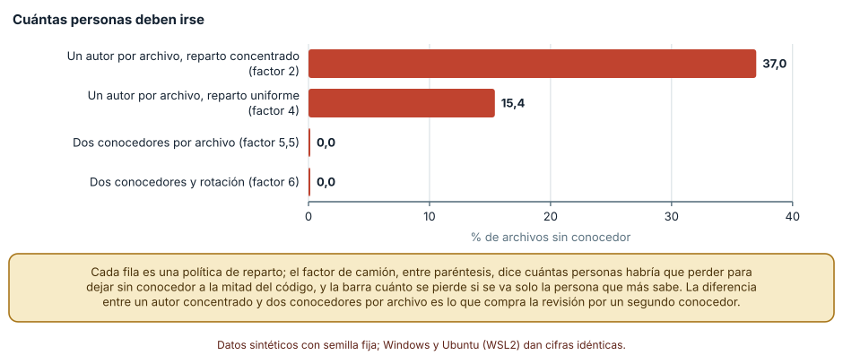
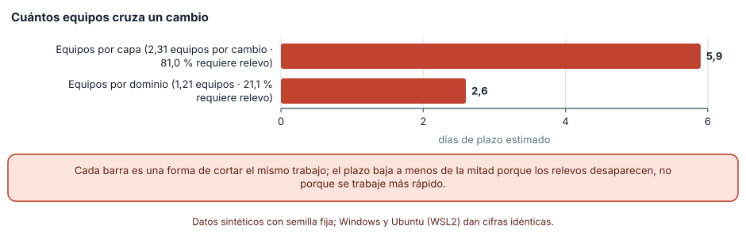
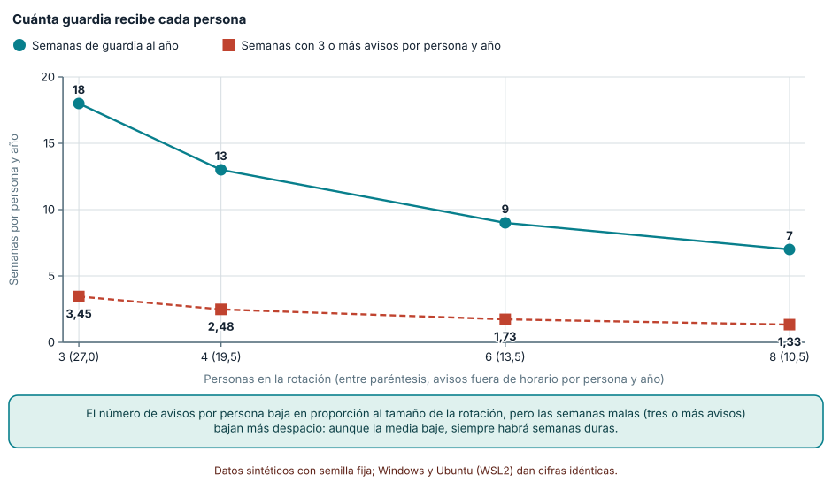

# SE-530 — Diseño de equipos y ownership

[← SE-529 — Liderazgo técnico sin autoridad formal](https://github.com/vladimiracunadev-create/modern-software-engineering-program/blob/main/classes/part-44-gestion-liderazgo-y-practica-profesional/se-529-liderazgo-tecnico-sin-autoridad-formal/README.md) · [↑ Parte 44](https://github.com/vladimiracunadev-create/modern-software-engineering-program/blob/main/classes/part-44-gestion-liderazgo-y-practica-profesional/README.md) · [📚 Índice completo](https://github.com/vladimiracunadev-create/modern-software-engineering-program/blob/main/classes/README.md) · [🌐 Portal](https://vladimiracunadev-create.github.io/modern-software-engineering-program/classes/SE-530.html) · [SE-531 — Comunicación, facilitación y conflicto →](https://github.com/vladimiracunadev-create/modern-software-engineering-program/blob/main/classes/part-44-gestion-liderazgo-y-practica-profesional/se-531-comunicacion-facilitacion-y-conflicto/README.md)

## Punto profesional y fundamento pedagógico

**Punto profesional.** La clase existe para que diseñes cómo se reparte la responsabilidad sobre el software de modo que el conocimiento no viva en una sola cabeza ni la carga en una sola espalda. Tres decisiones estructurales dominan el resultado: dónde se traza la frontera de cada equipo (que determina cuántos cambios cruzan equipos), quién sabe qué (que determina qué pasa cuando alguien se va) y quién responde cuando algo falla fuera de horario (que determina quién se agota). La habilidad profesional es verlas como una sola pregunta de diseño y medir cada una antes de reorganizar.

**Por qué aparece aquí.** Sigue a **Liderazgo técnico sin autoridad formal** (`SE-529`): la ingeniera repartió la autoridad de revisión con criterios; ahora hace falta que esa repartición se refleje en la propiedad del código y en la guardia. El caso conductor es **el equipo de plataforma educativa** de ocho personas, con módulos de calificaciones, actas, exportación al ministerio y portal, y una rotación de guardia semanal.

**Error conceptual que debe corregir.** Creer que «ownership» significa que una persona es dueña de un archivo y nadie más lo toca. La propiedad útil es responsabilidad de decidir, mantener y responder, no exclusividad; la exclusividad crea el riesgo que se quería evitar (si esa persona se va, el archivo queda huérfano). Y creer que reorganizar equipos es una decisión de organigrama: la forma del equipo fija qué cambios son baratos y cuáles requieren relevos.

**Secuencia de aprendizaje.** Antes de mirar los resultados, predices cuántas personas deben irse para dejar sin conocedor a más de la mitad de 300 archivos con cuatro formas de repartir el conocimiento; después simulas cuántos equipos cruza un cambio con equipos por capa y por dominio y cuántos avisos fuera de horario recibe cada persona con rotaciones de 3 a 8. La secuencia usa predicción, explicación propia, contraste y recuperación. [ICAP](https://icap.education.asu.edu/research) distingue participación de construcción de conocimiento; [How People Learn II](https://nap.nationalacademies.org/catalog/24783/how-people-learn-ii-learners-contexts-and-cultures) respalda diseñar la práctica con contextos reales y retroalimentación.

**Evidencia de aprendizaje.** `ownership-log.md` con la predicción, las tres figuras reproducidas, un mapa de propiedad del caso (módulo, responsable, segundo conocedor, vía de relevo), el cálculo del factor de camión con su definición, una propuesta de fronteras con el número de cambios que cruzarían equipos y una regla de guardia con su tamaño mínimo y su límite de avisos, y una nota que separe qué es medido, qué inferido y qué supuesto.

**Límite de la conclusión.** La distribución del conocimiento, los cambios, las capas, los dominios, las llegadas de avisos y los plazos son sintéticos, escritos por el autor con semilla fija. No se analizó ningún repositorio, equipo ni guardia reales. Las cifras muestran la forma de cada mecanismo, no el valor en tu organización.

### Trazabilidad fuente → afirmación

| Fuente primaria u oficial | Afirmación que respalda | Lo que no prueba |
|---|---|---|
| [Conway, «How Do Committees Invent?»](http://www.melconway.com/Home/Committees_Paper.html) | Las organizaciones que diseñan sistemas producen diseños que copian su estructura de comunicación. | No dice qué estructura es adecuada para tu sistema. |
| [Fowler, «Conway's Law»](https://martinfowler.com/bliki/ConwaysLaw.html) | Resume la ley y su uso para alinear equipos y arquitectura. | Es una síntesis; no aporta mediciones. |
| [Team Topologies, conceptos clave](https://teamtopologies.com/key-concepts) | Describe tipos de equipo, modos de interacción y la carga cognitiva como criterio de diseño. | Es un marco, no una evidencia de que mejore resultados en cada caso. |
| [Avelino et al., «A novel approach for estimating Truck Factors»](https://doi.org/10.1109/ICPC.2016.7503718) | Define el factor de camión como el número mínimo de personas cuya salida deja abandonada a más de la mitad de los archivos. | La estimación depende de cómo se atribuye la autoría y no mide el conocimiento real. |
| [Fowler, «Code Ownership»](https://martinfowler.com/bliki/CodeOwnership.html) | Distingue propiedad fuerte, débil y colectiva del código con sus compromisos. | No elige la forma adecuada para tu equipo. |
| [Google SRE, «Being On-Call»](https://sre.google/sre-book/being-on-call/) | Fija criterios de carga de guardia: mínimo de personas por rotación y límite de incidentes por turno. | Son criterios de una organización concreta, no leyes. |
| [GitHub, «About code owners»](https://docs.github.com/en/repositories/managing-your-repositorys-settings-and-features/customizing-your-repository/about-code-owners) | Documenta el archivo `CODEOWNERS` que pide revisión a las personas responsables de una ruta. | No garantiza que quienes revisan conozcan el código. |

## Antes de empezar

Recupera lo aprendido en `SE-529`: delegar criterios, no tareas, quita a una persona de la cola. La pregunta activa es: **si la persona que más sabe de un módulo de tu equipo no volviera mañana, ¿qué cambios de este mes no podrían hacerse y quién los reconocería como bloqueados?**

## Prerrequisitos

- Haber completado `SE-529` o poder explicar por qué concentrar aprobaciones crea espera.
- Python 3.11 o posterior; los experimentos usan solo la biblioteca estándar (`random`, `itertools`, `statistics`).
- Saber qué es una revisión de código y qué es una guardia (turno de respuesta a incidentes).

## Problema auténtico

Tras la propuesta de `SE-529`, el equipo de ocho personas pasó a registrar decisiones, pero una revisión de las últimas 300 modificaciones mostró que el 37 % de los archivos del módulo de actas había sido tocado por una sola persona. Cuando esa persona tomó dos semanas de licencia, una corrección urgente del formato al ministerio esperó nueve días porque nadie se atrevía a modificarla. En paralelo, el equipo estaba organizado por capas (interfaz, lógica, datos) y un cambio típico, como añadir un campo al acta, requería tres relevos y casi seis días aunque el trabajo real eran horas. Y la guardia, de tres personas, caía cada tercera semana a cada una. La clase enseña a medir esas tres fragilidades con números y a diseñar fronteras, conocimiento compartido y guardias con un criterio escrito.

## Objetivos observables

Al terminar podrás:

1. distinguir propiedad fuerte, débil y colectiva y elegir una forma para cada módulo con una razón;
2. calcular el factor de camión de un repositorio con una definición explícita y explicar sus límites;
3. predecir cuántos equipos cruza un cambio típico según se divida por capa o por dominio;
4. calcular la carga de una guardia según el tamaño de la rotación y aplicar un criterio de límite;
5. diseñar un mapa de propiedad con segundo conocedor, vía de relevo y condición de revisión.

## Mapa conceptual


El mapa separa tres lugares donde la estructura decide: la **frontera** (cuántos relevos), el **conocimiento** (quién sabe) y la **guardia** (quién responde). La flecha de retorno indica que un archivo huérfano no se corrige con un aviso: se corrige repartiendo el conocimiento antes de la próxima salida.

## Temas y por qué importan

| Tema | Por qué cambia una decisión profesional | Evidencia mínima |
|---|---|---|
| Formas de propiedad del código | Decide si la responsabilidad protege o aísla. | Mapa de módulos con forma de propiedad |
| Ley de Conway y fronteras de equipo | La estructura fija cuántos cambios cruzan equipos. | Estimación de relevos por tipo de cambio |
| Factor de camión | Mide cuánto depende el conocimiento de pocas personas. | Cálculo con definición y límite declarado |
| Guardia y carga | Protege a las personas y la calidad de la respuesta. | Regla de tamaño de rotación y de avisos |
| Contratos entre equipos | Reduce relevos sin mezclar responsabilidades. | Interfaz documentada con quién responde |

## Conceptos y decisiones

### 1. Formas de propiedad del código

[Fowler](https://martinfowler.com/bliki/CodeOwnership.html) distingue tres formas. En la **propiedad fuerte**, solo la persona o el equipo dueño modifica el código y los demás piden cambios; da coherencia y claridad de responsable, y crea cuellos de botella y archivos huérfanos. En la **propiedad débil**, hay dueños, pero otras personas pueden modificar el código con su revisión; es el equilibrio más usado y la base de `CODEOWNERS` en las plataformas de alojamiento de repositorios, que solicitan automáticamente la revisión de las personas dueñas de una ruta. En la **propiedad colectiva**, cualquiera modifica cualquier parte; maximiza el flujo y exige disciplina de pruebas y de convenciones. Ninguna es mejor en abstracto. Un módulo con reglas legales cambiantes (el formato al ministerio) justifica propiedad débil con revisión obligatoria; uno de bajo riesgo puede ser colectivo. Lo que no tiene justificación en ningún caso es una propiedad implícita: un archivo cuyo «dueño» es el último que lo tocó.

### 2. La ley de Conway y las fronteras

[Conway](http://www.melconway.com/Home/Committees_Paper.html) observó en 1968 que el diseño de un sistema copia la estructura de comunicación de quien lo diseña. La consecuencia operativa es inversa: si el equipo está dividido por capa, cada funcionalidad nueva atraviesa varios equipos; si está dividido por dominio, la mayoría de los cambios se completan dentro de uno. Eso es lo que [Team Topologies](https://teamtopologies.com/key-concepts) llama equipos alineados al flujo de valor. El criterio no es la elegancia del organigrama sino cuántos cambios reales cruzan una frontera y qué cuesta cada cruce: coordinar agendas, esperar una revisión, cambiar de contexto. Los marcos añaden una segunda idea, la **carga cognitiva**: el equipo debe poder entender todo lo que tiene a su cargo. Si un equipo posee más de lo que cabe en la cabeza de sus integrantes, el resultado se parece a un equipo sin dueño.

### 3. Factor de camión

El **factor de camión** (bus factor) es el número mínimo de personas cuya salida deja sin conocedor a una parte significativa del sistema. [Avelino et al.](https://doi.org/10.1109/ICPC.2016.7503718) lo definen sobre los archivos de un repositorio: el mínimo de autoras cuya salida deja abandonados a más de la mitad de los archivos, con el abandono medido por la autoría. Es una definición operativa con límites claros: la autoría en el historial no equivale a conocimiento (alguien pudo escribir un archivo y olvidarlo; otra persona pudo aprenderlo leyéndolo), y no distingue archivos críticos de triviales. Aun así, es útil como alarma: si el factor es uno o dos, la pregunta es qué hacer. Las palancas son tres: **revisión por una segunda persona** que conozca el código (no una aprobación de trámite), **rotación** de quién trabaja dónde y **documentación operable** (qué hace el módulo y cómo se diagnostica, escrita para quien responde de madrugada).

### 4. Guardia y carga

Una guardia es una forma de propiedad que se activa en el peor momento: el tamaño de la rotación decide cuánto le cuesta a cada persona. El libro de [SRE de Google](https://sre.google/sre-book/being-on-call/) recomienda, con turnos de una semana y dos personas de guardia (principal y secundaria), un mínimo de ocho ingenieras para un solo sitio y seis por sitio si hay dos, y limita los incidentes por turno de doce horas para que cada uno reciba la atención que merece. Son criterios de una organización concreta, útiles porque dan una forma de razonar: la carga por persona es (turnos al año) × (avisos por turno), y la calidad de la respuesta depende de dormir. Con una rotación de tres, cada persona está de guardia cada tercera semana y un par de bajas dejan a las demás sin recuperación. Aumentar la rotación sin aumentar el conocimiento es un error: ocho personas de guardia sobre un sistema que solo dos entienden son ocho personas que escalan a esas dos.

### 5. Contratos entre equipos

Cuando una frontera inevitable existe (la exportación al ministerio la necesitan varios equipos), lo que baja el costo de cruzarla es el **contrato**: una interfaz documentada, versiones, un propietario claro y un acuerdo sobre cómo se solicitan cambios (por qué canal, con qué plazo, con qué información). Un contrato es mejor que una reunión porque no depende de quién esté disponible. Sin contrato, la frontera se negocia en cada cambio. Con un contrato demasiado rígido, el equipo que usa la interfaz espera semanas por una modificación trivial. Por eso el contrato incluye una vía de autoservicio: qué puede cambiar una persona de otro equipo en este módulo con la revisión de las dueñas, sin esperar su iteración.

### Cuántas personas deben irse

Se simulan 200 repositorios de 300 archivos con 8 personas y cuatro formas de repartir el conocimiento. El factor es el mínimo de personas cuya salida deja a más de 150 archivos sin conocedor, calculado probando todas las combinaciones.

| Reparto del conocimiento | Factor de camión (mediana) | Archivos sin conocedor al irse la persona más cargada |
|---|---:|---:|
| Un autor por archivo, reparto concentrado | 2 | 37,0 % |
| Un autor por archivo, reparto uniforme | 4 | 15,4 % |
| Dos conocedores por archivo | 5,5 | 0,0 % |
| Dos conocedores y rotación | 6 | 0,0 % |



**Cómo leer la figura.** Cada barra es una política de reparto del conocimiento con su factor de camión entre paréntesis y su longitud es el porcentaje de archivos que se quedan sin conocedor si se va la persona que más sabe. Mira cómo la barra desaparece al tener dos conocedores por archivo: eso compra la revisión por un segundo conocedor. **Dónde deja de valer:** la distribución concentrada (pesos 1/k), el hecho de que haya exactamente uno o dos conocedores y la independencia entre archivos son supuestos del autor; en un repositorio real el conocimiento se agrupa por módulos y la autoría del historial no mide quién entiende el código.

### Cuántos equipos cruza un cambio

Se simulan 5 000 cambios sobre cuatro dominios y tres capas. Un cambio toca de una a tres capas (probabilidades 20 %, 30 % y 50 %) de su dominio y, con un 20 % de probabilidad, también un segundo dominio. Con equipos por capa, cada capa tocada es un equipo; con equipos por dominio, cada dominio tocado es un equipo. El plazo suma 2 días de trabajo y 3 días por cada equipo adicional.

| Organización | Equipos por cambio | Cambios que requieren relevo | Plazo estimado |
|---|---:|---:|---:|
| Equipos por capa | 2,31 | 81,0 % | 5,9 días |
| Equipos por dominio | 1,21 | 21,1 % | 2,6 días |



**Cómo leer la figura.** Cada barra es una forma de cortar el mismo trabajo, con los equipos por cambio y los relevos en la etiqueta, y su longitud el plazo estimado. Mira que el plazo baja a menos de la mitad cuando desaparecen los relevos, no porque se trabaje más rápido. **Dónde deja de valer:** los porcentajes de capas tocadas, el 20 % de cambios entre dominios y el costo de 3 días por relevo son supuestos del autor; no se modela el costo de que cada equipo por dominio necesite conocimiento de todas las capas, ni los cambios que atraviesan muchos dominios, que son la razón por la que algunas organizaciones mantienen equipos de plataforma.

### Cuánta guardia recibe cada persona

Se simulan 3 000 años con una guardia semanal de una persona por vez, con una media de 1,5 avisos fuera de horario por semana. Se cuenta cuántas semanas al año está de guardia cada persona, cuántos avisos recibe y cuántas semanas tienen tres o más.

| Tamaño de la rotación | Semanas de guardia al año | Avisos fuera de horario por persona y año | Semanas con 3 o más avisos por persona y año |
|---|---:|---:|---:|
| 3 personas | 18 | 27,0 | 3,45 |
| 4 personas | 13 | 19,5 | 2,48 |
| 6 personas | 9 | 13,5 | 1,73 |
| 8 personas | 7 | 10,5 | 1,33 |



**Cómo leer la figura.** El eje horizontal es el tamaño de la rotación, con los avisos fuera de horario por persona y año entre paréntesis, y el vertical las semanas por persona y año; la línea verde azulada son las semanas de guardia y la coral, las semanas con tres o más avisos. Mira que la segunda baja más despacio: aunque la media baje, siempre habrá semanas duras. **Dónde deja de valer:** los avisos siguen una distribución de Poisson independiente, supuesto que falla cuando los incidentes se agrupan (una falla grande genera decenas de avisos); se cuenta una persona de guardia por semana, no la pareja principal y secundaria del libro de SRE; no se mide el sueño ni el cansancio.

## Definiciones de trabajo

- **[propiedad del código](../../../glosario/entradas/p/propiedad-del-codigo.md):** asignación de la responsabilidad de decidir, mantener y responder sobre una parte del software.
- **[factor de camión](../../../glosario/entradas/f/factor-de-camion.md):** número mínimo de personas cuya salida deja sin conocedor a más de la mitad de los archivos según la autoría registrada.
- **[frontera de equipo](../../../glosario/entradas/f/frontera-de-equipo.md):** línea que separa lo que un equipo puede cambiar completo de lo que requiere relevo con otro.
- **[carga cognitiva](../../../glosario/entradas/c/carga-cognitiva.md):** cantidad de contexto que un equipo debe mantener para operar y cambiar lo que posee.
- **[contrato entre equipos](../../../glosario/entradas/c/contrato-entre-equipos.md):** interfaz documentada con propietario, versiones y vía de solicitud de cambios.

Las definiciones son operativas para el equipo de plataforma educativa. No convierten términos con una historia más amplia en sinónimos y deben contrastarse con las fuentes primarias enlazadas al final.

## Ejemplo mínimo

El fragmento calcula el factor de camión de un repositorio pequeño probando combinaciones de salidas. Antes de ejecutarlo, predice qué devuelve.

```python
from itertools import combinations
conocen = [{"ana"}, {"ana"}, {"ana", "beto"}, {"beto"}, {"cami"}, {"cami", "ana"}]
for k in range(1, 4):
    if any(sum(1 for c in conocen if not (c - set(s))) > len(conocen) / 2 for s in combinations(["ana", "beto", "cami"], k)):
        print(k); break
```

Imprime `2`: si se va una sola persona, el peor caso es `ana`, que deja sin conocedor a 2 de 6 archivos (los que solo ella conoce), y 2 no supera la mitad; si se van `ana` y `beto`, quedan sin conocedor 4 de 6. Observa que `ana` participa en cuatro archivos y aun así no basta para llegar al factor 1: lo que cuenta es cuántos archivos dependen solo de ella. Registra versión de Python, comando y salida.

## Ejemplo profesional

Escenario hipotético, construido para la clase y sin datos reales. El equipo calcula el factor de camión de los cuatro módulos y encuentra que actas tiene factor 1. Acuerdan una política en tres pasos. Primero, un mapa de propiedad con responsable y segundo conocedor para cada módulo, y propiedad débil con `CODEOWNERS` para los dos módulos con reglas externas. Segundo, una rotación trimestral de quien responde de cada módulo en la guardia, de modo que cada persona sea principal en uno y secundaria en otro. Tercero, un contrato escrito para la exportación al ministerio: quién responde, qué cambia sin preguntar y cómo se solicita un cambio. Miden de nuevo a los tres meses: el factor de actas pasa de 1 a 3 y el tiempo de una corrección urgente en licencia de la responsable baja de nueve días a dos. Pero hay un costo que registran: el 15 % del tiempo de dos personas en documentación y acompañamiento. Compara con el plan alternativo de contratar a una persona más: sirve, pero no reparte el conocimiento por sí solo.

## Práctica guiada

1. Dibuja el mapa de propiedad del equipo del caso o de uno propio: módulo, responsable, segundo conocedor y forma de propiedad.
2. Predice el factor de camión de cada reparto de la tabla y escribe el número antes de simular.
3. Reproduce las tres tablas con las semillas fijadas en `scripts/experiments_part44_a.py`; cambia el número de personas de 8 a 5 y observa cómo cambia el factor.
4. Lista cinco cambios recientes de tu equipo y cuenta cuántos equipos tocó cada uno; compara con la tabla de fronteras.
5. Calcula la carga de tu guardia (semanas al año por persona y avisos por semana) y compárala con los criterios de la fuente.
6. Redacta un contrato de una interfaz con propietario, qué cambia sin preguntar y cómo se pide un cambio.
7. Entrega `ownership-log.md` y pide a otra persona que identifique un módulo cuyo factor de camión tu definición sobreestima.

## Ejercicios

1. **Propiedad:** para tres módulos (cálculo de nota, exportación al ministerio, portal de consulta) elige la forma de propiedad y justifica con riesgo y frecuencia de cambio.
2. **Factor:** diseña un repositorio de diez archivos con factor 1 y modifica la propiedad de dos archivos para que pase a 2; muestra la cuenta.
3. **Fronteras:** propone una organización alternativa para un cambio que cruza tres dominios y explica qué equipo adicional (de plataforma) lo evitaría y qué costo introduce.
4. **Guardia:** con 1,5 avisos por semana y una rotación de cuatro, calcula cuántas semanas al año tiene cada persona y explica qué cambiarías si una de las cuatro se va.

## Reto verificable

Entrega `ownership-log.md` con la predicción, las tres tablas, el mapa de propiedad, el cálculo del factor de camión con su definición y sus límites, la propuesta de fronteras con el número de relevos y la regla de guardia. Se aprueba si otra persona ejecuta el código desde un checkout limpio, obtiene los mismos números con las mismas semillas y puede decir, a partir de tu mapa, quién respondería de cada módulo si la persona responsable se fuera mañana. No se aprueba por afirmar que «el conocimiento está compartido» sin decir cuántas personas conocen cada módulo ni cómo se comprobó.

## Caso conductor

El equipo de plataforma educativa es el caso conductor de la [Parte 44](../README.md). Esta clase deja el segundo artefacto: un mapa de propiedad, un criterio de fronteras y una regla de guardia. `SE-531` preguntará cómo se conversan los desacuerdos que aparecen en las fronteras, y `SE-532` cómo se transfiere el conocimiento de una persona a otra. Cambia después un solo dato, el tamaño del equipo de ocho a cinco, y observa cómo cambia el factor de camión del reparto con dos conocedores.

## Preguntas frecuentes

### ¿Los equipos por dominio eliminan la necesidad de especialistas?

No. Eliminan los relevos por capa, pero cada equipo necesita competencia en todas las capas que toca. Una solución habitual es mantener comunidades de práctica o un equipo de plataforma que ofrece capacidades (despliegue, observabilidad) como servicio, de modo que los equipos de dominio no reconstruyan lo mismo.

### ¿Cómo mido el factor de camión sin repositorio?

Pregunta a cada persona qué módulos podría modificar y operar hoy sin ayuda, y cuéntalo. Es más fiable que la autoría para el conocimiento actual y más costoso. La autoría del historial sirve para detectar candidatos y la encuesta para confirmarlos.

### ¿La propiedad colectiva no genera archivos sin dueño?

Puede, si «todos» significa «nadie». La propiedad colectiva funciona con convenciones fuertes, pruebas que protegen el comportamiento y revisión cruzada; sin esas condiciones, nadie responde por la calidad. Una buena señal es que, ante un fallo, se sepa a quién avisar primero.

### ¿Cuántas personas debe tener una guardia?

Depende del volumen de avisos y de la cobertura de horario; los criterios de la fuente (ocho para un solo sitio con principal y secundaria) son un punto de partida con las condiciones de esa organización. Mide avisos por semana y por persona, y ajusta; si la media es baja, un equipo pequeño puede sostener una rotación más corta.

## Fallo controlado y diagnóstico

Reproduce el fallo clásico de la clase: **una corrección urgente bloqueada porque solo una persona entiende el módulo**. Simula en el reparto concentrado que esa persona sale por dos semanas y cuenta cuántos archivos quedan sin conocedor.

Registra síntoma, entrada mínima, hipótesis, observación que descarta cada hipótesis, causa, corrección y prueba de regresión. **Síntoma:** una corrección de formato espera nueve días. **Hipótesis rivales:** (a) la corrección era difícil; (b) nadie tenía prioridad para hacerla; (c) nadie conocía el módulo. **Prueba:** pide a otra persona que lea el módulo y estime cuánto le tomaría; si la estimación es de horas pero se resistió a hacerlo por miedo a romperlo, la causa es el conocimiento. **Conclusión:** con un autor por archivo y reparto concentrado, la salida de la persona más cargada deja sin conocedor al 37 % de los archivos. **Regresión:** exige para cada módulo un segundo conocedor que haya hecho un cambio real, y repite el cálculo del factor tras cada cambio de equipo. No cambies a la vez la propiedad y la guardia.

## Errores comunes y cómo corregirlos

| Síntoma | Causa probable | Corrección |
|---|---|---|
| Un archivo espera semanas por una persona | Propiedad fuerte sin segundo conocedor | Revisión obligatoria por una segunda persona y rotación |
| Todo cambio requiere tres equipos | Fronteras por capa | Reorganizar por dominio o abrir vía de autoservicio |
| La guardia agota a pocas personas | Rotación pequeña o conocimiento concentrado | Ampliar la rotación y distribuir el conocimiento |
| La revisión es un trámite | El revisor no conoce el módulo | Elegir revisoras por conocimiento y rotarlas |
| El contrato no se usa | No hay vía de autoservicio ni propietario | Documentar qué cambia sin preguntar y quién responde |

## Entorno y archivos clave

```text
work/SE-530/
├── README.md
├── ownership/
│   ├── factor_camion.py
│   ├── fronteras.py
│   └── guardia.py
├── MAPA-DE-PROPIEDAD.md
├── CONTRATO-EXPORTACION.md
├── tests/test_ownership.py
└── evidence/ownership-log.md
```

El `README` declara plataforma, versión de Python, semillas y comandos. Los experimentos usan solo la biblioteca estándar (`random`, `itertools`, `statistics`) y se ejecutaron con CPython 3.12.9 en Windows 11 y 3.12.3 en Ubuntu bajo WSL2: las salidas fueron idénticas. Si añades una dependencia, fija procedencia y versión.

## Seguridad, ética y accesibilidad

- el análisis de autoría de un repositorio mide el trabajo de personas: úsalo para decidir cómo repartir conocimiento, no para evaluar el desempeño individual ni para clasificar a nadie;
- la documentación operable de un módulo crítico puede contener credenciales o datos personales: guárdalos en un gestor de secretos y no en el texto;
- una guardia mal repartida afecta la salud y el descanso; el límite de carga es una decisión de equidad, no de comodidad;
- las tablas y figuras deben tener texto alternativo y no depender del color;
- las fuentes citadas son textos de sus autores: cita las ideas y vincula la fuente, no copies sus textos ni diagramas.

## Puente hacia el trabajo con agentes

Un agente al que se le pide «calcula el factor de camión de este repositorio» devolverá un número a partir del historial, con una definición implícita y sin decir que la autoría no es conocimiento. Pídele en cambio que declare la definición que usa, que liste los archivos que dependen de una sola persona y que marque cuáles son generados o triviales. Revisa especialmente cualquier recomendación de «quién debería ser el segundo conocedor» (es una decisión sobre personas y tiempo que no le corresponde al agente) y cualquier afirmación de que un módulo «está documentado» sin que se haya probado que alguien lo opere con esa documentación.

## Transferencia

Traslada el análisis a otro dominio (por ejemplo, una cooperativa que mantiene un sistema de pedidos con tres personas de tecnología): cambia el número de personas, los módulos y el volumen de avisos y conserva el procedimiento de calcular el factor con una definición explícita, contar relevos por tipo de cambio y medir la carga de guardia. La transferencia está lograda cuando puedes decir qué conocimiento de tu dominio no puede quedar en una sola persona, no cuando el mapa se parece al del equipo de plataforma.

## Evaluación y evidencia

| Criterio | Evidencia para aprobar |
|---|---|
| comprensión | explicación de las tres formas de propiedad y de qué mide el factor de camión |
| corrección | tablas de factor, de relevos y de guardia reproducibles con las mismas semillas |
| diseño | mapa de propiedad con segundo conocedor, contrato de interfaz y regla de guardia con tamaño y límite |
| diagnóstico | reproducción del fallo «corrección bloqueada» con regresión |
| incertidumbre | declaración de que el reparto, los porcentajes de capas y los avisos son del autor |
| reproducibilidad | versiones, comandos, salida y límites declarados |

## Fuentes

- [Conway, «How Do Committees Invent?»](http://www.melconway.com/Home/Committees_Paper.html) — ley de Conway; autoridad: artículo original del autor.
- [Fowler, «Conway's Law»](https://martinfowler.com/bliki/ConwaysLaw.html) — síntesis de la ley y su uso; autoridad: autor del texto.
- [Team Topologies, conceptos clave](https://teamtopologies.com/key-concepts) — tipos de equipo, interacción y carga cognitiva; autoridad: autores del marco.
- [Avelino et al., «A novel approach for estimating Truck Factors»](https://doi.org/10.1109/ICPC.2016.7503718) — definición y estimación del factor de camión; autoridad: ICPC 2016.
- [Fowler, «Code Ownership»](https://martinfowler.com/bliki/CodeOwnership.html) — propiedad fuerte, débil y colectiva; autoridad: autor del texto.
- [Google SRE, «Being On-Call»](https://sre.google/sre-book/being-on-call/) — criterios de carga y tamaño de guardia; autoridad: equipo de SRE de Google.
- [GitHub, «About code owners»](https://docs.github.com/en/repositories/managing-your-repositorys-settings-and-features/customizing-your-repository/about-code-owners) — archivo `CODEOWNERS`; autoridad: documentación de GitHub.

Cada fuente respalda el mecanismo indicado; ninguna demuestra que el factor 2 del reparto concentrado, el 81 % de cambios con relevo o las 3,45 semanas malas de una rotación de tres se observen en tu equipo. Esa afirmación depende del repositorio, de los cambios y de las personas reales.

## Límites y siguiente paso

Se ejecutaron tres experimentos con datos sintéticos en Windows y Ubuntu (WSL2) con resultados idénticos. No se analizó ningún repositorio, equipo ni guardia reales; el reparto del conocimiento, las capas tocadas, el costo por relevo y la llegada de avisos son construcciones del autor, y el modelo supone archivos independientes y avisos sin agrupamiento. La siguiente clase pregunta cómo se conversa, se facilita y se resuelve un conflicto cuando dos personas o dos equipos no coinciden sobre una frontera.

## Glosario

- **[propiedad del código](../../../glosario/entradas/p/propiedad-del-codigo.md):** asignación de la responsabilidad de decidir, mantener y responder sobre una parte del software.
- **[factor de camión](../../../glosario/entradas/f/factor-de-camion.md):** número mínimo de personas cuya salida deja sin conocedor a más de la mitad de los archivos según la autoría registrada.
- **[frontera de equipo](../../../glosario/entradas/f/frontera-de-equipo.md):** línea que separa lo que un equipo puede cambiar completo de lo que requiere relevo con otro.
- **[carga cognitiva](../../../glosario/entradas/c/carga-cognitiva.md):** cantidad de contexto que un equipo debe mantener para operar y cambiar lo que posee.
- **[contrato entre equipos](../../../glosario/entradas/c/contrato-entre-equipos.md):** interfaz documentada con propietario, versiones y vía de solicitud de cambios.

Conceptos de esta clase en el [glosario del programa](../../../glosario/README.md): [Carga cognitiva](../../../glosario/entradas/c/carga-cognitiva.md) · [Contrato entre equipos](../../../glosario/entradas/c/contrato-entre-equipos.md) · [Factor de camión](../../../glosario/entradas/f/factor-de-camion.md) · [Frontera de equipo](../../../glosario/entradas/f/frontera-de-equipo.md) · [Propiedad del código](../../../glosario/entradas/p/propiedad-del-codigo.md).

---

[← SE-529 — Liderazgo técnico sin autoridad formal](https://github.com/vladimiracunadev-create/modern-software-engineering-program/blob/main/classes/part-44-gestion-liderazgo-y-practica-profesional/se-529-liderazgo-tecnico-sin-autoridad-formal/README.md) · [↑ Parte 44](https://github.com/vladimiracunadev-create/modern-software-engineering-program/blob/main/classes/part-44-gestion-liderazgo-y-practica-profesional/README.md) · [📚 Índice completo](https://github.com/vladimiracunadev-create/modern-software-engineering-program/blob/main/classes/README.md) · [🌐 Portal](https://vladimiracunadev-create.github.io/modern-software-engineering-program/classes/SE-530.html) · [SE-531 — Comunicación, facilitación y conflicto →](https://github.com/vladimiracunadev-create/modern-software-engineering-program/blob/main/classes/part-44-gestion-liderazgo-y-practica-profesional/se-531-comunicacion-facilitacion-y-conflicto/README.md)
