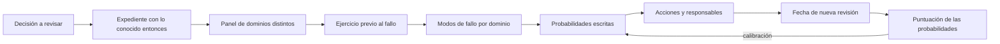
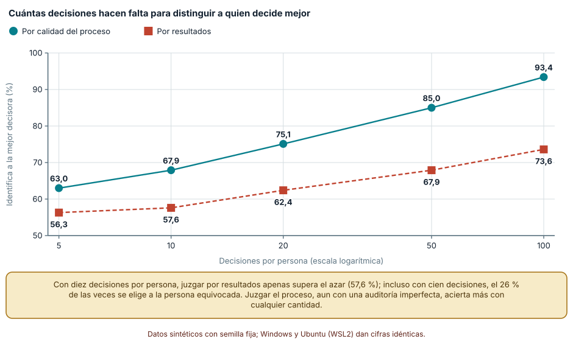
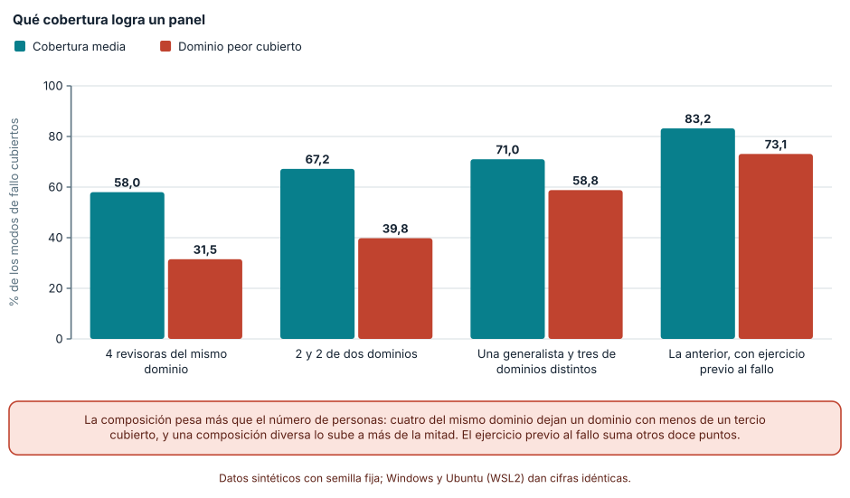
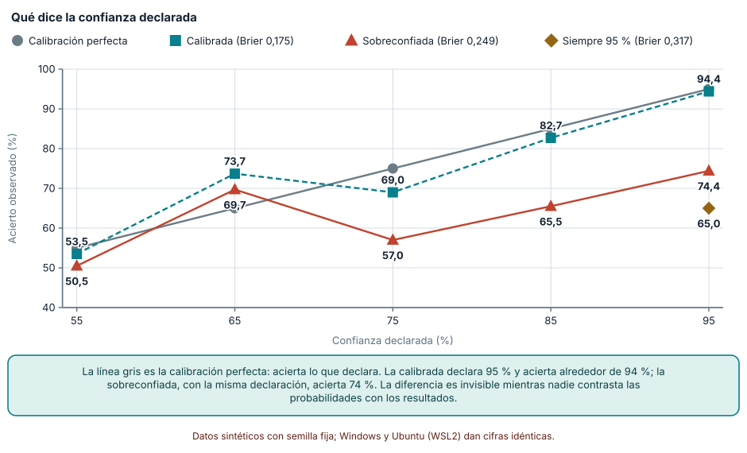

# SE-539 — Taller: conducir una revisión de decisión difícil

[← SE-538 — Portafolio, entrevistas y defensa profesional](https://github.com/vladimiracunadev-create/modern-software-engineering-program/blob/main/classes/part-44-gestion-liderazgo-y-practica-profesional/se-538-portafolio-entrevistas-y-defensa-profesional/README.md) · [↑ Parte 44](https://github.com/vladimiracunadev-create/modern-software-engineering-program/blob/main/classes/part-44-gestion-liderazgo-y-practica-profesional/README.md) · [📚 Índice completo](https://github.com/vladimiracunadev-create/modern-software-engineering-program/blob/main/classes/README.md) · [🌐 Portal](https://vladimiracunadev-create.github.io/modern-software-engineering-program/classes/SE-539.html) · [SE-540 — Proyecto: dossier profesional defendible →](https://github.com/vladimiracunadev-create/modern-software-engineering-program/blob/main/classes/part-44-gestion-liderazgo-y-practica-profesional/se-540-proyecto-dossier-profesional-defendible/README.md)

## Punto profesional y fundamento pedagógico

**Punto profesional.** El taller existe para que conduzcas una revisión adversarial de una decisión difícil de modo que mejore la decisión y no solo valide a quien la tomó o la castigue. Una revisión útil responde tres preguntas que la intuición mezcla: si la decisión fue buena (independientemente de cómo salió), qué se le pudo escapar al grupo (qué modos de fallo nadie miró) y cuánta confianza merece cada afirmación (si quien la hace está calibrada). La habilidad profesional es juzgar el proceso y no solo el resultado, componer el panel para cubrir lo que un solo punto de vista no ve y exigir probabilidades que luego se puedan contrastar con lo ocurrido.

**Por qué aparece aquí.** Sigue a **Portafolio, entrevistas y defensa profesional** (`SE-538`): la defensa individual por profundidad se vuelve ahora un ejercicio colectivo. Es una clase de taller, sin clases nuevas de contenido: aplica lo que se aprendió de decisiones (`SE-534`), de comunicación (`SE-531`), de compromisos (`SE-533`) y de proveedores (`SE-535`) a una revisión concreta. El caso conductor es **el equipo de plataforma educativa**, que revisa la decisión de contratar un servicio de almacenamiento para las actas, tomada hace un año, tras un incidente de pérdida parcial de datos.

**Error conceptual que debe corregir.** Creer que una decisión fue mala porque el resultado fue malo, o buena porque salió bien. El resultado mezcla la calidad de la decisión con la suerte; en la simulación de la clase, con diez decisiones por persona, juzgar por resultados identifica a la mejor decisora el 58 % de las veces, y juzgar por la calidad del proceso, el 68 %. Y creer que una revisión con cuatro expertas cubre cuatro veces más: si las cuatro vienen del mismo dominio, ven los mismos modos de fallo y dejan sin mirar los de otros.

**Secuencia de aprendizaje.** Antes de mirar los resultados, predices con cuántas decisiones por persona un juicio por resultados identifica a la mejor decisora con un 90 % de aciertos; después simulas qué cobertura de modos de fallo logra un panel según su composición, con y sin un ejercicio previo al fallo, y qué calibración y qué puntuación obtienen quien declara confianzas calibradas, quien es sobreconfiada y quien dice 95 % siempre. La secuencia usa predicción, explicación propia, contraste y recuperación. [ICAP](https://icap.education.asu.edu/research) distingue participación de construcción de conocimiento; [How People Learn II](https://nap.nationalacademies.org/catalog/24783/how-people-learn-ii-learners-contexts-and-cultures) respalda diseñar la práctica con contextos reales y retroalimentación.

**Evidencia de aprendizaje.** `revision-log.md` con la predicción, las tres figuras reproducidas, el expediente de la decisión revisada (contexto, información disponible en su momento, opciones, razonamiento), la composición del panel con la razón de cada persona, la lista de modos de fallo generada con un ejercicio previo al fallo, las probabilidades declaradas por el panel con su puntuación posterior y las acciones acordadas, y una nota que separe qué es medido, qué inferido y qué supuesto.

**Límite de la conclusión.** Las probabilidades de decisión buena y de éxito, la calidad del proceso visible, los treinta modos de fallo en tres dominios, las probabilidades de detección de cada revisora, el aumento por el ejercicio previo al fallo y las confianzas son sintéticos, escritos por el autor con semilla fija. No se revisó ninguna decisión ni persona reales. Las cifras muestran la forma de cada mecanismo, no el valor en tu organización.

### Trazabilidad fuente → afirmación

| Fuente primaria u oficial | Afirmación que respalda | Lo que no prueba |
|---|---|---|
| [Baron y Hershey, «Outcome bias in decision evaluation»](https://doi.org/10.1037/0022-3514.54.4.569) | Muestra que las personas juzgan la calidad de una decisión por su resultado aunque la información disponible fuera la misma. | Son escenarios de laboratorio, no revisiones técnicas de equipos. |
| [Mitchell, Russo y Pennington, «Back to the future»](https://doi.org/10.1002/bdm.3960020103) | Encuentra que imaginar un hecho como ya ocurrido aumenta la cantidad de razones que se generan para explicarlo. | No mide el efecto en una revisión de software. |
| [Klein, «Performing a Project Premortem»](https://hbr.org/2007/09/performing-a-project-premortem) | Describe el ejercicio previo al fallo: imaginar que el proyecto fracasó y escribir por qué. | Es un artículo de práctica, sin estudio comparativo. |
| [Brier, «Verification of forecasts expressed in terms of probability»](https://doi.org/10.1175/1520-0493(1950)078%3C0001:VOFEIT%3E2.0.CO;2) | Introduce la puntuación que mide el error cuadrático entre una probabilidad pronosticada y el resultado. | No dice qué probabilidad es razonable en tu caso. |
| [Tetlock y Gardner, *Superforecasting*](https://openlibrary.org/isbn/9780804136716) | Documenta prácticas de pronóstico probabilístico calibrado y la medición con puntuaciones. | Es un libro divulgativo basado en un torneo concreto. |
| [Google SRE, «Postmortem Culture»](https://sre.google/sre-book/postmortem-culture/) | Describe el análisis posterior sin culpa como práctica de aprendizaje. | No garantiza que el análisis resulte en acciones. |
| [Nygard, «Documenting Architecture Decisions»](https://cognitect.com/blog/2011/11/15/documenting-architecture-decisions) | Propone registrar la decisión con su contexto y consecuencias en el momento de tomarla. | No impide el sesgo de recuerdo si se escribe después. |

## Antes de empezar

Recupera lo aprendido en `SE-538`: una defensa honesta declara dónde termina lo que se sabe. La pregunta activa es: **¿cuál fue la última decisión de tu equipo que juzgaste por cómo salió y no por lo que se sabía cuando se tomó?**

## Prerrequisitos

- Haber completado `SE-538` o poder explicar por qué declarar un límite es mejor que defender todo.
- Python 3.11 o posterior; los experimentos usan solo la biblioteca estándar (`random`, `statistics`).
- Haber participado en un análisis posterior a un incidente o en una revisión de diseño.

## Problema auténtico

Un año antes, el equipo contrató el servicio de almacenamiento para las actas. Hubo una pérdida parcial de datos el mes anterior y la dirección pidió una revisión de aquella decisión. La primera versión de la revisión fue una conversación de una hora entre las personas que la habían tomado: concluyeron que la decisión «fue razonable dadas las circunstancias» y que el incidente fue «mala suerte». La segunda fue una revisión de otro estilo: el panel incluyó a una persona de operaciones, otra de seguridad y otra ajena al equipo; el expediente describía lo que se sabía entonces; hicieron un ejercicio previo al fallo para el próximo año; y cada integrante anotó probabilidades por escrito. Encontraron tres modos de fallo que nadie había considerado: la restauración nunca se había probado, el contrato no cubría la corrupción silenciosa y la cuenta de respaldo compartía credenciales con la principal. La decisión original resultó razonable y mal verificada: las dos cosas a la vez. El taller enseña a conducir esa revisión.

## Objetivos observables

Al terminar podrás:

1. separar la calidad de una decisión de su resultado y construir un expediente con la información disponible en su momento;
2. componer un panel que cubra dominios distintos y justificar cada persona;
3. conducir un ejercicio previo al fallo y obtener una lista de modos de fallo por dominio;
4. pedir probabilidades por escrito, puntuarlas con una regla propia y devolver la puntuación;
5. cerrar la revisión con acciones, responsables y una fecha de nueva revisión.

## Mapa conceptual



El mapa separa cuatro actos: **reconstruir** (expediente), **ampliar** (panel y ejercicio previo al fallo), **comprometer** (probabilidades escritas) y **aprender** (puntuación posterior). La flecha de retorno indica que las probabilidades se contrastan con lo ocurrido y mejoran la siguiente revisión.

## Temas y por qué importan

| Tema | Por qué cambia una decisión profesional | Evidencia mínima |
|---|---|---|
| Sesgo del resultado | Castiga buenas decisiones y premia suerte. | Juicio del proceso con información de entonces |
| Expediente de la decisión | Evita reescribir el pasado con el conocimiento actual. | Documento fechado de contexto y razonamiento |
| Composición del panel | La diversidad de dominios cubre lo que uno solo no ve. | Panel con razón de cada integrante |
| Ejercicio previo al fallo | Libera la crítica antes de que ocurra. | Lista de modos de fallo por dominio |
| Probabilidades y calibración | Permiten aprender de la confianza declarada. | Puntuación de las predicciones |

## Conceptos y decisiones

### 1. Juzgar el proceso, no solo el resultado

El **sesgo del resultado** ([Baron y Hershey](https://doi.org/10.1037/0022-3514.54.4.569)) es la tendencia a evaluar una decisión por cómo salió, aun cuando la información disponible al decidir era la misma. Una buena decisión puede salir mal (con una probabilidad conocida) y una mala salir bien. Si se evalúa solo por resultados, se aprende poco: la persona que tuvo suerte repite su método y la que tuvo mala suerte lo abandona. Juzgar el proceso significa preguntar con lo que se sabía entonces: ¿se consideraron las opciones razonables? ¿se buscó la información que era barata de conseguir? ¿se estimaron las probabilidades de los resultados y el costo de equivocarse? ¿se consultó a quien conocía las restricciones? Eso no exime al resultado: un resultado muy malo es motivo de revisión y puede revelar un fallo de proceso. Pero distingue dos conclusiones muy distintas: «la decisión fue mala» y «la decisión fue razonable y tuvo un resultado malo».

### 2. El expediente de la decisión

La revisión parte de un **expediente** escrito con la información disponible en el momento de decidir, no con la que se tiene hoy. Si el equipo registró la decisión cuando la tomó (un registro de decisión, [Nygard](https://cognitect.com/blog/2011/11/15/documenting-architecture-decisions)), el expediente existe; si no, hay que reconstruirlo con documentos fechados (correos, tableros, matriz de proveedores) y no de memoria, porque la memoria reordena los hechos para que el resultado parezca previsible (el sesgo de retrospectiva). El expediente tiene cinco partes: el problema y el plazo, las opciones consideradas, la información disponible (y la que se descartó buscar), el razonamiento y las probabilidades que se asumieron explícita o implícitamente. Quien dirige la revisión comprueba que el expediente no contenga hechos posteriores a la decisión.

### 3. La composición del panel

Un panel revisa mejor si cubre lo que un solo punto de vista no ve. Los modos de fallo de una decisión técnica se agrupan en dominios: técnico (el servicio falla, no escala), operativo (nadie sabe restaurar, la guardia no responde) y humano o legal (se incumple una ley, el proveedor cambia las condiciones). Cada persona detecta con facilidad los modos de su dominio y con dificultad los de otros. Por eso una revisión con cuatro personas del mismo dominio duplica hallazgos y deja dominios enteros sin mirar. Conviene incluir a alguien ajeno a la decisión (sin interés en defenderla), a quien opere lo decidido y a quien represente a las personas afectadas. Si el panel debe ser pequeño, se prefiere diversidad de dominios a seniority.

### 4. El ejercicio previo al fallo

En un **ejercicio previo al fallo** ([Klein](https://hbr.org/2007/09/performing-a-project-premortem)) se pide al panel que imagine que ha pasado un año y que la decisión fracasó, y que escriba individualmente por qué. [Mitchell et al.](https://doi.org/10.1002/bdm.3960020103) encontraron que imaginar un hecho como ya ocurrido aumenta las razones que las personas generan para explicarlo; el ejercicio aprovecha ese efecto para liberar la crítica sin que suene a oposición, porque el fallo es ficticio y la tarea es colaborar en imaginarlo. Se hace por escrito y en simultáneo (para evitar el anclaje de `SE-531`), se agrupan las razones por dominio y se pide a cada persona que marque cuáles considera más probables y cuáles más costosas. El resultado es una lista de modos de fallo con una prioridad, que alimenta el registro de riesgos (`SE-534`).

### 5. Probabilidades, calibración y acuerdo de cierre

Una revisión que concluye con adjetivos («razonable», «arriesgada») no deja nada contrastable. Pedir **probabilidades escritas** («la restauración fallará en el próximo intento: 30 %») permite medir después qué tan bien se prevé. La **puntuación de Brier** ([Brier](https://doi.org/10.1175/1520-0493(1950)078%3C0001:VOFEIT%3E2.0.CO;2)) es el error cuadrático medio entre la probabilidad declarada y el resultado (0 o 1); cuanto menor, mejor. Una persona **calibrada** acierta en la frecuencia que declara (de las veces que dice 80 %, ocurre el 80 %); una **sobreconfiada** declara más certeza de la que respalda su frecuencia de acierto. La práctica descrita en [Superforecasting](https://openlibrary.org/isbn/9780804136716) combina probabilidades explícitas, actualización con nueva información y puntuación posterior. El cierre de la revisión incluye acciones con responsable y fecha, qué se haría distinto la próxima vez y cuándo se revisará la decisión de nuevo; el análisis sin culpa ([Google SRE](https://sre.google/sre-book/postmortem-culture/)) pone el foco en las condiciones, no en las personas.

### Cuántas decisiones hacen falta para distinguir a quien decide mejor

Dos personas toman decisiones; la primera acierta en calidad en el 65 % de los casos y la segunda en el 50 %. Una decisión de calidad buena tiene un 75 % de éxito y una mala un 45 %. Se compara dos formas de juzgar quién decide mejor: contar éxitos, o contar decisiones cuyo proceso fue calificado como bueno por una auditoría que acierta el 85 % de las veces. Se repite 4 000 veces por tamaño.

| Decisiones por persona | Identifica a la mejor decisora por resultados | Por calidad del proceso |
|---|---:|---:|
| 5 | 56,3 % | 63,0 % |
| 10 | 57,6 % | 67,9 % |
| 20 | 62,4 % | 75,1 % |
| 50 | 67,9 % | 85,0 % |
| 100 | 73,6 % | 93,4 % |



**Cómo leer la figura.** El eje horizontal son las decisiones por persona, en escala logarítmica, y el vertical el porcentaje de aciertos al identificar a la mejor; la línea verde azulada juzga por la calidad del proceso y la coral, por resultados. Mira que la coral apenas supera el azar con diez decisiones y que la verde azulada la supera con cualquier cantidad. **Dónde deja de valer:** las probabilidades de calidad (65 y 50 %), de éxito (75 y 45 %) y la precisión de la auditoría (85 %) son supuestos del autor; evaluar el proceso exige una auditoría que no está libre del sesgo de retrospectiva, y en una organización real una persona toma pocas decisiones comparables. La figura enseña por qué un año de resultados dice poco, no cuánto.

### Qué cobertura logra un panel

Treinta modos de fallo repartidos en tres dominios (diez por dominio). Cada revisora detecta cada modo de su dominio con probabilidad 0,5 y de otros con 0,12; una generalista detecta cualquiera con 0,25. Con el ejercicio previo al fallo, todas las probabilidades se multiplican por 1,3. Se simulan 5 000 revisiones por composición.

| Composición del panel | Cobertura media | Dominio peor cubierto |
|---|---:|---:|
| 4 revisoras del mismo dominio | 58,0 % | 31,5 % |
| 2 y 2 de dos dominios | 67,2 % | 39,8 % |
| Una generalista y tres de dominios distintos | 71,0 % | 58,8 % |
| La anterior, con ejercicio previo al fallo | 83,2 % | 73,1 % |



**Cómo leer la figura.** Cada grupo es una composición del panel; la barra verde azulada es la cobertura media y la coral, la del dominio peor cubierto. Mira cómo la distancia entre las dos barras se cierra al diversificar: el peor dominio es el que decide. **Dónde deja de valer:** las probabilidades de detección, el factor 1,3 (inspirado en el hallazgo de la fuente, no en una medida en revisiones de software) y la independencia entre revisoras son supuestos del autor; un modo de fallo en la intersección de dominios es más difícil de ver que el modelo supone. La figura muestra el mecanismo de la cobertura, no cuánto cubre tu panel.

### Qué dice la confianza declarada

Tres personas hacen 500 pronósticos cada una. La calibrada tiene probabilidad real de acierto 0,5 + (c − 0,5) donde c es su confianza (0,55 a 0,95); la sobreconfiada, 0,5 + 0,5·(c − 0,5); la tercera declara siempre 95 % y acierta el 62 %. La puntuación de Brier va de 0 (perfecta) a 1.

| Persona | Brier | Acierto cuando declara 55 · 65 · 75 · 85 · 95 % |
|---|---:|---|
| Calibrada | 0,175 | 53,5 · 73,7 · 69,0 · 82,7 · 94,4 % |
| Sobreconfiada | 0,249 | 50,5 · 69,7 · 57,0 · 65,5 · 74,4 % |
| Siempre 95 % | 0,317 | solo 95 %: 65,0 % |



**Cómo leer la figura.** El eje horizontal es la confianza declarada y el vertical el acierto observado; la línea gris es la calibración perfecta. Mira cuánto se aleja cada línea de la diagonal: la sobreconfiada cae por debajo cuanto más alto declara y el punto aislado, de quien declara siempre 95 %, está 30 puntos por debajo. **Dónde deja de valer:** las probabilidades verdaderas son supuestos del autor, los porcentajes de cada confianza se basan en unos cien pronósticos (variaciones de varios puntos son ruido, como el 73,7 % de la calibrada en 65 %), y una puntuación sobre pocas predicciones no distingue habilidad de suerte.

## Definiciones de trabajo

- **sesgo del resultado:** tendencia a juzgar una decisión por su resultado en lugar de por la información y el razonamiento disponibles al decidir.
- **expediente de la decisión:** documento fechado con el problema, las opciones, la información disponible y el razonamiento en el momento de decidir.
- **ejercicio previo al fallo:** ejercicio en que se imagina que la decisión ya fracasó y se escribe por qué.
- **calibración:** correspondencia entre la probabilidad declarada y la frecuencia con que lo declarado ocurre.
- **puntuación de Brier:** error cuadrático medio entre las probabilidades pronosticadas y los resultados observados (0 o 1).

Las definiciones son operativas para el equipo de plataforma educativa. No convierten términos con una historia más amplia en sinónimos y deben contrastarse con las fuentes primarias enlazadas al final.

## Ejemplo mínimo

El fragmento calcula la puntuación de Brier de dos pronósticos de tres eventos. Antes de ejecutarlo, predice cuál es menor.

```python
resultados = [1, 0, 1]
brier = lambda p: round(sum((x - y) ** 2 for x, y in zip(p, resultados)) / len(p), 3)
print(brier([0.9, 0.2, 0.7]), brier([0.99, 0.99, 0.99]))
```

Imprime `0.047` y `0.327`: la primera persona declara probabilidades moderadas que coinciden con lo ocurrido; la segunda dice 99 % a todo y paga el error del evento que no ocurrió. Observa que acertar dos de tres con 99 % es peor que acertar con probabilidades moderadas: la puntuación castiga la certeza injustificada. Registra versión de Python, comando y salida.

## Ejemplo profesional

Escenario hipotético, construido para la clase y sin datos reales. La facilitadora reúne un expediente fechado de la decisión de contratar el almacenamiento: la matriz de proveedores, el correo de autorización y el plan de ese momento; excluye el informe del incidente. Compone el panel con una persona de operaciones, una de seguridad, una ajena al equipo y la autora de la decisión como observadora. Cada integrante escribe en 10 minutos, por separado, razones por las que la decisión habría fracasado un año después; se agrupan en doce modos de fallo (cuatro técnicos, cuatro operativos, cuatro humanos o legales) y tres aparecen solo en el dominio operativo: nadie probó la restauración, el contrato no cubre corrupción silenciosa y el respaldo comparte credenciales. El panel declara probabilidades por escrito para el próximo año («restauración que falla: 30 %; pérdida parcial de datos: 10 %») y se comprometen a puntuarlas en doce meses. La revisión concluye que la decisión fue razonable con la información de entonces y que hubo un fallo de verificación posterior; acuerdan tres acciones con responsable y fecha (prueba mensual de restauración, credenciales separadas, revisión del contrato) y fijan la fecha de la nueva revisión. Compara con la primera versión de una hora entre las personas que decidieron: la diferencia es lo que se descubrió.

## Práctica guiada

1. Elige una decisión pasada de tu equipo o del caso y construye su expediente solo con documentos fechados; marca lo que no encuentras.
2. Predice con cuántas decisiones por persona un juicio por resultados identifica a la mejor decisora el 90 % de las veces y escribe el número antes de simular.
3. Reproduce las tres tablas con las semillas fijadas en `scripts/experiments_part44_b.py`; cambia la precisión de la auditoría de 85 % a 65 % y observa cuándo deja de compensar juzgar el proceso.
4. Compón un panel de cuatro personas para la decisión con la razón de cada una y los dominios que cubre.
5. Dirige un ejercicio previo al fallo de 15 minutos con escritura individual y agrupa las razones por dominio.
6. Pide probabilidades por escrito a tres personas, guárdalas con fecha y define cuándo las puntuarás.
7. Entrega `revision-log.md` y pide a otra persona que encuentre en tu expediente un hecho posterior a la decisión que contamina el juicio.

## Ejercicios

1. **Resultado:** una decisión con 80 % de éxito esperado salió mal. Redacta tres preguntas que ayudan a decidir si fue mala o mala suerte.
2. **Expediente:** lista cinco documentos que usarías para reconstruir el expediente y por qué cada uno es fiable.
3. **Panel:** el panel actual tiene tres ingenieras del mismo equipo. Propón dos cambios y explica el modo de fallo que esperas descubrir con cada uno.
4. **Brier:** calcula la puntuación de quien pronostica 0,8, 0,8, 0,8 y 0,8 cuando ocurren tres de los cuatro eventos, y compárala con la de quien dice 0,5 siempre.

## Reto verificable

Entrega `revision-log.md` con la predicción, las tres tablas, el expediente fechado, la composición del panel con su razón, la lista de modos de fallo del ejercicio previo al fallo, las probabilidades escritas, las acciones con responsable y fecha, y la fecha de nueva revisión. Se aprueba si otra persona ejecuta el código desde un checkout limpio, obtiene los mismos números con las mismas semillas y puede decir, a partir de tu cuaderno, si la decisión fue razonable con lo que se sabía, qué se le escapó al grupo y cuándo se contrastarán las probabilidades. No se aprueba por afirmar «la decisión fue mala» o «fue buena» sin decir con qué información se juzgó.

## Caso conductor

El equipo de plataforma educativa es el caso conductor de la [Parte 44](../README.md). Este taller deja el undécimo artefacto: una revisión adversarial de una decisión con expediente, panel, modos de fallo y probabilidades. `SE-540` reunirá los artefactos de la parte en un dossier defendible. Cambia después un solo dato, la precisión de la auditoría de 85 % a 65 %, y observa a partir de cuántas decisiones por persona juzgar el proceso deja de ser mejor que juzgar los resultados.

## Preguntas frecuentes

### ¿Quién debe dirigir la revisión?

Alguien sin interés en el resultado y con respeto del equipo: una persona de otro equipo, la responsable de un área vecina o una facilitadora externa. Quien tomó la decisión participa aportando contexto pero no dirige, porque su interés en defenderla distorsiona las preguntas.

### ¿Cómo evito que la revisión busque culpables?

Declarando el propósito al inicio (mejorar el proceso, no evaluar a las personas), usando el expediente de entonces y centrando las preguntas en las condiciones. Si una persona tuvo conductas que merecen otro tratamiento, eso se trata por otro canal; mezclarlo mata la franqueza de las revisiones siguientes.

### ¿Y si no hay expediente de la decisión?

Reconstrúyelo con documentos fechados, marca qué no se pudo reconstruir y trata las memorias como hipótesis a contrastar. La carencia es un hallazgo: en adelante las decisiones difíciles se registran en el momento. Un expediente imperfecto es mejor que juzgar de memoria.

### ¿Las probabilidades no son falsa precisión?

Lo son si se presentan como exactas. Se usan como compromisos revisables: «30 %» significa «creemos que es más probable que no, pero no despreciable», y permite contrastar después. Con pocas predicciones la puntuación es ruidosa, pero el hábito de declararlas mejora la conversación inmediatamente.

## Fallo controlado y diagnóstico

Reproduce el fallo clásico de la clase: **una revisión que concluye «fue mala suerte» sin mirar el proceso**. Simula dos personas con calidad de decisión distinta y juzga cuál es mejor con diez decisiones cada una, por resultados y por proceso.

Registra síntoma, entrada mínima, hipótesis, observación que descarta cada hipótesis, causa, corrección y prueba de regresión. **Síntoma:** la revisión concluye que el incidente fue mala suerte y tres meses después ocurre otro del mismo tipo. **Hipótesis rivales:** (a) fue realmente mala suerte; (b) el proceso tenía un fallo que no se examinó; (c) el panel no veía el dominio del fallo. **Prueba:** reconstruye el expediente y haz el ejercicio previo al fallo con un panel diverso; si aparece el modo de fallo que ocurrió, la causa es el proceso y el panel. **Conclusión:** con diez decisiones por persona, juzgar por resultados acierta el 57,6 % y por proceso, el 67,9 %; con un panel de un solo dominio, el dominio peor cubierto llega al 31,5 %. **Regresión:** exige un expediente fechado y un panel con al menos tres dominios para toda revisión de decisión irreversible. No cambies a la vez el panel y el método del ejercicio.

## Errores comunes y cómo corregirlos

| Síntoma | Causa probable | Corrección |
|---|---|---|
| Se castiga una decisión razonable que salió mal | Sesgo del resultado | Juzgar con el expediente de entonces |
| La revisión repite los hallazgos de siempre | Panel de un solo dominio | Componer con dominios y una persona ajena |
| Nadie critica la decisión | La crítica suena a oposición | Ejercicio previo al fallo por escrito y simultáneo |
| Se habla de «mucho riesgo» sin poder contrastar | Adjetivos en vez de probabilidades | Probabilidades escritas y puntuación posterior |
| Las acciones no se cumplen | Sin responsable ni fecha | Registrar responsable, fecha y revisión |

## Entorno y archivos clave

```text
work/SE-539/
├── README.md
├── revision/
│   ├── resultado_vs_proceso.py
│   ├── cobertura.py
│   └── calibracion.py
├── EXPEDIENTE.md
├── MODOS-DE-FALLO.md
├── PROBABILIDADES.csv
├── tests/test_revision.py
└── evidence/revision-log.md
```

El `README` declara plataforma, versión de Python, semillas y comandos. Los experimentos usan solo la biblioteca estándar (`random`, `statistics`) y se ejecutaron con CPython 3.12.9 en Windows 11 y 3.12.3 en Ubuntu bajo WSL2: las salidas fueron idénticas. Si añades una dependencia, fija procedencia y versión.

## Seguridad, ética y accesibilidad

- el expediente y los modos de fallo pueden revelar vulnerabilidades o decisiones sensibles: limita el acceso y no los publiques sin revisión;
- una revisión no debe usarse para evaluar el desempeño de las personas ni para sancionar: separa el aprendizaje del proceso disciplinario y dilo al inicio;
- la participación debe ser accesible: ofrece la escritura previa para quien no habla en vivo y canales alternativos para quien lo necesite;
- las tablas y figuras deben tener texto alternativo y no depender del color;
- las fuentes citadas son textos de sus autores: cita las ideas y vincula la fuente, no copies sus textos ni diagramas.

## Puente hacia el trabajo con agentes

Un agente al que se le pide «revisa esta decisión» producirá una crítica fluida y plausible, probablemente sesgada por el resultado que ya conoce, y puede inventar modos de fallo sin relación con el expediente. Pídele en cambio que trabaje solo con el expediente fechado, que liste modos de fallo por dominio con la evidencia del expediente en que se apoya cada uno y que marque los que no tienen respaldo, y que no emita un veredicto. Revisa especialmente cualquier juicio sobre una persona y cualquier hecho posterior a la decisión que el agente haya incorporado. El agente puede ampliar la lista de modos de fallo y calcular puntuaciones; juzgar la decisión y acordar las acciones es del panel.

## Transferencia

Traslada el taller a otro dominio (por ejemplo, la decisión de una asociación de contratar un seguro para un evento al aire libre): cambia el expediente, el panel y los modos de fallo y conserva el procedimiento de juzgar con la información de entonces, componer un panel diverso, hacer un ejercicio previo al fallo y registrar probabilidades para puntuarlas. La transferencia está lograda cuando puedes decir qué dominio de tu decisión nadie del panel habría visto, no cuando el expediente se parece al del equipo de plataforma.

## Evaluación y evidencia

| Criterio | Evidencia para aprobar |
|---|---|
| comprensión | explicación de la diferencia entre calidad de decisión y resultado y de qué mide una puntuación de Brier |
| corrección | tablas de resultado frente a proceso, de cobertura y de calibración reproducibles con las mismas semillas |
| diseño | expediente fechado, panel con razón, modos de fallo por dominio, probabilidades escritas y acciones con fecha |
| diagnóstico | reproducción del fallo «fue mala suerte» con regresión |
| incertidumbre | declaración de que las probabilidades, la auditoría y la detección son del autor |
| reproducibilidad | versiones, comandos, salida y límites declarados |

## Fuentes

- [Baron y Hershey, «Outcome bias in decision evaluation»](https://doi.org/10.1037/0022-3514.54.4.569) — sesgo del resultado; autoridad: Journal of Personality and Social Psychology.
- [Mitchell, Russo y Pennington, «Back to the future: Temporal perspective in the explanation of events»](https://doi.org/10.1002/bdm.3960020103) — perspectiva temporal y razones generadas; autoridad: Journal of Behavioral Decision Making.
- [Klein, «Performing a Project Premortem»](https://hbr.org/2007/09/performing-a-project-premortem) — ejercicio previo al fallo; autoridad: Harvard Business Review.
- [Brier, «Verification of forecasts expressed in terms of probability»](https://doi.org/10.1175/1520-0493(1950)078%3C0001:VOFEIT%3E2.0.CO;2) — puntuación de pronósticos; autoridad: Monthly Weather Review.
- [Tetlock y Gardner, *Superforecasting*](https://openlibrary.org/isbn/9780804136716) — pronóstico probabilístico; autoridad: libro con ISBN 978-0-8041-3671-6.
- [Google SRE, «Postmortem Culture»](https://sre.google/sre-book/postmortem-culture/) — análisis posterior sin culpa; autoridad: equipo de SRE de Google.
- [Nygard, «Documenting Architecture Decisions»](https://cognitect.com/blog/2011/11/15/documenting-architecture-decisions) — registro de decisiones; autoridad: autor del texto.

Cada fuente respalda el mecanismo indicado; ninguna demuestra que el 57,6 % de acierto por resultados con diez decisiones, la cobertura del 83,2 % del panel diverso o la puntuación de 0,175 de la persona calibrada se observen en una revisión real. Esa afirmación depende del expediente, del panel y de las personas.

## Límites y siguiente paso

Se ejecutaron tres experimentos con datos sintéticos en Windows y Ubuntu (WSL2) con resultados idénticos. No se revisó ninguna decisión ni persona reales; las probabilidades de calidad y de éxito, la precisión de la auditoría, la detección por dominio, el factor del ejercicio previo al fallo y las confianzas son construcciones del autor, y el modelo supone decisiones y revisoras independientes. La siguiente clase reúne los artefactos de la parte en un proyecto: un dossier profesional defendible.

## Glosario

- **sesgo del resultado:** tendencia a juzgar una decisión por su resultado en lugar de por la información y el razonamiento disponibles al decidir.
- **expediente de la decisión:** documento fechado con el problema, las opciones, la información disponible y el razonamiento en el momento de decidir.
- **ejercicio previo al fallo:** ejercicio en que se imagina que la decisión ya fracasó y se escribe por qué.
- **calibración:** correspondencia entre la probabilidad declarada y la frecuencia con que lo declarado ocurre.
- **puntuación de Brier:** error cuadrático medio entre las probabilidades pronosticadas y los resultados observados (0 o 1).

---

[← SE-538 — Portafolio, entrevistas y defensa profesional](https://github.com/vladimiracunadev-create/modern-software-engineering-program/blob/main/classes/part-44-gestion-liderazgo-y-practica-profesional/se-538-portafolio-entrevistas-y-defensa-profesional/README.md) · [↑ Parte 44](https://github.com/vladimiracunadev-create/modern-software-engineering-program/blob/main/classes/part-44-gestion-liderazgo-y-practica-profesional/README.md) · [📚 Índice completo](https://github.com/vladimiracunadev-create/modern-software-engineering-program/blob/main/classes/README.md) · [🌐 Portal](https://vladimiracunadev-create.github.io/modern-software-engineering-program/classes/SE-539.html) · [SE-540 — Proyecto: dossier profesional defendible →](https://github.com/vladimiracunadev-create/modern-software-engineering-program/blob/main/classes/part-44-gestion-liderazgo-y-practica-profesional/se-540-proyecto-dossier-profesional-defendible/README.md)
