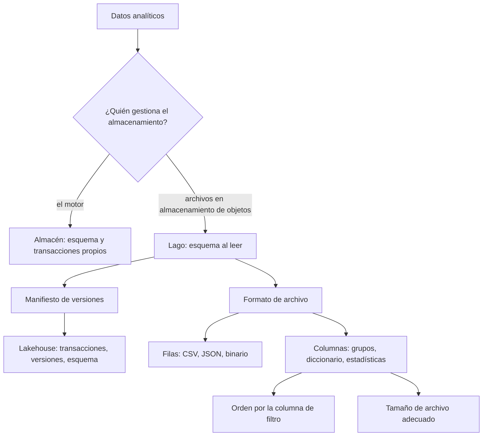
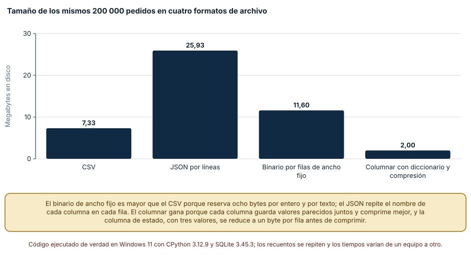

# SE-548 — Warehouse, lake, lakehouse y formatos columnares

[← SE-547 — Linaje, catálogo y metadatos](https://github.com/vladimiracunadev-create/modern-software-engineering-program/blob/main/classes/part-45-ingenieria-de-datos-y-plataformas-de-datos/se-547-linaje-catalogo-y-metadatos/README.md) · [↑ Parte 45](https://github.com/vladimiracunadev-create/modern-software-engineering-program/blob/main/classes/part-45-ingenieria-de-datos-y-plataformas-de-datos/README.md) · [📚 Índice completo](https://github.com/vladimiracunadev-create/modern-software-engineering-program/blob/main/classes/README.md) · [🌐 Portal](https://vladimiracunadev-create.github.io/modern-software-engineering-program/classes/SE-548.html) · [SE-549 — Gobierno, privacidad y retención de datos →](https://github.com/vladimiracunadev-create/modern-software-engineering-program/blob/main/classes/part-45-ingenieria-de-datos-y-plataformas-de-datos/se-549-gobierno-privacidad-y-retencion-de-datos/README.md)

## Punto profesional y fundamento pedagógico

**Punto profesional.** La clase existe para que elijas dónde y cómo se guardan los datos analíticos sabiendo qué hace cada formato con los bytes, y no por el nombre de la categoría. «Warehouse», «lake» y «lakehouse» son etiquetas de arquitectura: el almacén gestiona sus propios datos con esquema y transacciones, el lago guarda archivos baratos en almacenamiento de objetos con esquema al leer, y el lakehouse intenta dar garantías de almacén (transacciones, versiones, esquema) sobre archivos de lago mediante un manifiesto. Debajo de las etiquetas están las decisiones que cambian la factura y la velocidad: orientación por filas o por columnas, compresión, codificación por diccionario, estadísticas por grupo de filas, tamaño de archivo y orden de los datos. La clase construye un formato columnar mínimo con la biblioteca estándar, lo compara con CSV, JSON y un binario por filas sobre 200 000 pedidos y mide tamaño, bytes leídos y efecto de archivos pequeños.

**Por qué aparece aquí.** Sigue a `SE-547` porque el catálogo describe activos que viven en algún formato y lugar. Reutiliza las consultas e índices de [SE-317](https://github.com/vladimiracunadev-create/modern-software-engineering-program/blob/main/classes/part-26-datos-persistencia-y-recuperacion/se-317-consultas-indices-y-patrones-de-acceso/README.md), la replicación y partición de [SE-319](https://github.com/vladimiracunadev-create/modern-software-engineering-program/blob/main/classes/part-26-datos-persistencia-y-recuperacion/se-319-replicacion-particion-y-distribucion/README.md) y las medidas de capacidad de [SE-376](https://github.com/vladimiracunadev-create/modern-software-engineering-program/blob/main/classes/part-31-calidad-rendimiento-y-resiliencia/se-376-latencia-throughput-saturacion-y-capacidad/README.md). Prepara `SE-550`, donde los bytes leídos se convierten en dinero.

**Error conceptual que debe corregir.** Creer que «columnar» es una marca de velocidad. El formato columnar gana por dos mecanismos separados (leer solo las columnas necesarias y saltar grupos de filas con estadísticas) y el segundo solo funciona si los datos están agrupados por la columna que se filtra. La segunda corrección: un lakehouse no es «un lago mejor» sino un lago con un manifiesto de versiones; sin que todos lean y escriban por el manifiesto, vuelve a ser una carpeta.

**Secuencia de aprendizaje.** Antes de ejecutar, predices cuánto ocupa el mismo dato en cuatro formatos y cuántos megabytes lee cada uno para sumar el importe de 10 días de 365. Después construyes un archivo columnar con grupos de filas, columnas comprimidas y mínimos y máximos, mides con y sin orden por día, lees dos columnas frente a seis, comparas mil archivos pequeños con uno compactado y publicas una compactación con un manifiesto.

**Evidencia de aprendizaje.** `almacenamiento-analitico.md` con el formato, el orden y el tamaño de archivo elegidos para una tabla tuya, la consulta representativa con los bytes que lee, y el criterio con el que decides entre almacén, lago y lakehouse.

**Límite de la conclusión.** El formato es un archivo columnar didáctico (grupos de 10 000 filas, `zlib` nivel 6, diccionario para texto); no es Parquet ni lo reemplaza, aunque usa las mismas ideas. Los tiempos de lectura dependen del equipo (el CSV tardó entre 200 y 480 ms, el JSON entre 2 y 3 s y el columnar unos 10 ms en tres ejecuciones) y el efecto de archivos pequeños se midió sobre un disco local, no sobre almacenamiento de objetos. No se ejecutó ningún almacén ni ninguna librería de formatos. No se invocó ningún modelo de lenguaje.

### Trazabilidad fuente → afirmación

| Fuente primaria u oficial | Afirmación que respalda | Lo que no prueba |
|---|---|---|
| [Apache Parquet, documentación](https://parquet.apache.org/docs/) | Describe un formato columnar con grupos de filas, páginas, codificaciones y estadísticas por columna. | No mide cuánto ahorra en tu caso. |
| [Apache Arrow, «Columnar Format»](https://arrow.apache.org/docs/format/Columnar.html) | Especifica la disposición de columnas en memoria y sus ventajas para recorridos analíticos. | Es una especificación de memoria, no de archivo. |
| [Armbrust et al., «Lakehouse» (CIDR 2021)](https://www.cidrdb.org/cidr2021/papers/cidr2021_paper17.pdf) | Propone el lakehouse como lago con capa de metadatos transaccional y analiza sus ventajas y límites. | Es una propuesta de sus autores. |
| [Apache Iceberg, especificación](https://iceberg.apache.org/spec/) y [Delta Lake, protocolo](https://github.com/delta-io/delta/blob/master/PROTOCOL.md) | Describen tablas como una lista versionada de archivos en un manifiesto con instantáneas. | Son dos formatos concretos entre varios. |
| [Python: `zlib`](https://docs.python.org/3/library/zlib.html) y [`array`](https://docs.python.org/3/library/array.html) | Documentan la compresión y los arreglos tipados del laboratorio. | No validan el formato. |

## Antes de empezar

Recupera lo aprendido en `SE-541`: una agregación recorría 14,1 MB para usar 3,2. La pregunta activa es: **¿en qué formato viven tus tablas más grandes, cuántas columnas usa la consulta típica y cuántos archivos tiene cada tabla?**

## Prerrequisitos

- Haber completado `SE-541` y `SE-547`.
- Conocer índices y particiones ([SE-317](https://github.com/vladimiracunadev-create/modern-software-engineering-program/blob/main/classes/part-26-datos-persistencia-y-recuperacion/se-317-consultas-indices-y-patrones-de-acceso/README.md), [SE-319](https://github.com/vladimiracunadev-create/modern-software-engineering-program/blob/main/classes/part-26-datos-persistencia-y-recuperacion/se-319-replicacion-particion-y-distribucion/README.md)).
- Nociones de compresión y de codificación de valores repetidos.
- Python 3.11 o posterior; el laboratorio usa `array`, `zlib`, `struct` y `json`.

## Problema auténtico

La tabla de lecturas de *Avisos* creció a 400 millones de filas y vive como archivos CSV en un almacenamiento de objetos. Cada informe de la última semana tarda minutos y cuesta lo que cuesta leer los 400 millones de filas con sus ocho columnas aunque el informe use dos. Alguien propone «pasar a Parquet», otro «comprar un almacén» y otro «hacer un lakehouse». Cada propuesta resuelve algo distinto y ninguna se ha medido.

El equipo también tiene un segundo problema que nadie ve como problema de formato: la carga de cada hora escribe un archivo pequeño, y en un mes la tabla tiene 700 archivos por partición. Cada consulta abre miles de archivos antes de leer el primer dato.

## Objetivos observables

Al terminar podrás:

1. distinguir almacén, lago y lakehouse por quién gestiona los datos, cómo se garantiza la consistencia y qué cuesta cada uno;
2. medir el tamaño de los mismos datos en CSV, JSON, binario por filas y un formato columnar, y explicar por qué difieren;
3. separar los dos mecanismos de ahorro columnar (leer menos columnas, saltar grupos) y medir cada uno con y sin orden en los datos;
4. medir el costo de muchos archivos pequeños y el efecto de compactarlos;
5. explicar cómo un manifiesto de versiones da lecturas consistentes mientras se compacta.

## Mapa conceptual



El mapa separa la arquitectura (arriba) del formato (abajo). La elección de arquitectura define las garantías; la de formato, orden y tamaño de archivo define los bytes que se leen.

## Temas y por qué importan

| Tema | Por qué cambia una decisión profesional | Evidencia mínima |
|---|---|---|
| Almacén, lago y lakehouse | Definen garantías y quién opera el almacenamiento. | Tabla de garantías por opción |
| Tamaño por formato | La misma tabla cambia 13 veces de tamaño. | Megabytes por formato |
| Poda de columnas | Leer solo lo necesario. | Bytes de dos columnas frente a seis |
| Estadísticas por grupo | Saltar grupos sin leerlos. | Grupos leídos de los totales |
| Orden de los datos | Sin orden, las estadísticas no descartan. | Grupos leídos con y sin orden |
| Archivos pequeños | Cada archivo cuesta una apertura. | Tiempo con mil archivos frente a uno |
| Manifiesto | Lecturas consistentes durante cambios. | Versiones y archivos por lector |

## Conceptos y decisiones

### 1. Tres arquitecturas, tres garantías

Un almacén (warehouse) gestiona los datos internamente: esquema, transacciones, concurrencia y optimizador son suyos, y el costo es depender de su formato y de su motor. Un lago (lake) guarda archivos en almacenamiento barato y deja el esquema para la lectura: máxima flexibilidad y almacenamiento económico a cambio de que nadie garantice atomicidad, versiones ni calidad. Un lakehouse añade al lago una capa de metadatos (la lista de archivos de cada versión de una tabla) que da transacciones, instantáneas y evolución de esquema; propuestas como Apache Iceberg y Delta Lake definen esa capa. Ninguna es «la correcta»: cambian el equilibrio entre garantías, costo y control. [Fowler advierte](https://martinfowler.com/bliki/DataLake.html) que un lago sin curaduría se vuelve un pantano de datos que nadie sabe leer.

### 2. El mismo dato, cuatro tamaños

Doscientos mil pedidos con ocho columnas ocuparon 7,33 MB en CSV, 25,93 MB en JSON por líneas (el nombre de cada columna se repite en cada fila), 11,60 MB en un binario por filas de ancho fijo (ocho bytes por entero y por texto reservados aunque sobren) y 2,00 MB en el formato columnar con compresión, un 27 % del CSV. La diferencia no viene de «ser binario» sino de tres decisiones: guardar los valores de una columna juntos (se parecen y se comprimen mejor), codificar el texto repetido con un diccionario de índices de un byte y comprimir cada bloque. La columna de estado, con tres valores distintos, ocupa 1 080 493 bytes como texto sin comprimir y unos 45 000 como índices de un byte comprimidos.

### 3. Dos mecanismos de ahorro: columnas y grupos

Sumar el importe de 10 días de 365 necesita dos columnas (`day`, `amount`) y el 3 % de las filas. El CSV, el JSON y el binario leen el archivo entero: 7,33, 25,93 y 11,60 MB. El columnar leyendo solo dos columnas de todo el rango leyó 0,59 MB (menos de la tercera parte de lo que ocupa el archivo, 2,00 MB, pero no 0): ese es el primer mecanismo, la poda de columnas. Con el archivo ordenado por día, además, el segundo mecanismo descartó 18 de 20 grupos de filas con las estadísticas de mínimo y máximo y la lectura bajó a 0,059 MB, un 3 % del archivo. Son ahorros multiplicativos y de naturaleza distinta.

### 4. El orden de los datos decide si las estadísticas sirven

Las estadísticas por grupo (el mínimo y el máximo de `day` de cada grupo de 10 000 filas) permiten saltar grupos que no pueden contener el rango pedido. Funcionan cuando cada grupo cubre un intervalo estrecho de la columna filtrada. Con los mismos datos mezclados al azar, cada grupo cubre casi todo el año, la consulta leyó los 20 grupos de 20 y 0,945 MB: el archivo era más grande (2,35 MB frente a 2,00) porque el orden también favorecía la compresión. La decisión de diseño es elegir la columna por la que se ordena (o se particiona) según los filtros más frecuentes; no es gratis, porque ordenar por una columna perjudica a las consultas que filtran por otra.

### 5. Archivos pequeños: el costo oculto de abrir

Cada archivo exige una apertura, una lectura de su metadato y una operación de listado; en almacenamiento de objetos, cada una es una petición con latencia propia. En el laboratorio, la misma consulta sobre 1 000 archivos de 200 filas cada uno tardó entre 600 y 2 800 ms; sobre un archivo compactado con grupos de 10 000 filas, entre 8 y 11 ms. El factor depende del equipo y del disco, y el mecanismo es siempre el mismo: la apertura domina cuando el dato por archivo es poco. La solución es la compactación periódica: reescribir muchos archivos pequeños en pocos grandes, con un tamaño objetivo (decenas a cientos de megabytes en sistemas reales, según el motor).

### 6. El manifiesto: de carpeta a tabla

Una tabla de un lakehouse no es una carpeta de archivos: es la lista de archivos de una versión, guardada en un manifiesto. Una escritura (insertar, compactar, borrar) añade archivos nuevos y publica una versión nueva del manifiesto con un único renombrado atómico. Un lector que abrió la versión 1 sigue viendo sus 10 archivos mientras la compactación prepara el único archivo de la versión 2; un lector nuevo ve la versión 2. Los archivos viejos se borran más tarde, cuando nadie los lee. Es la misma idea de publicar con una operación atómica de `SE-544`, aplicada a la tabla entera, y da además viaje en el tiempo (leer una versión anterior) mientras no se limpien sus archivos.

### 7. Qué se pierde con el manifiesto

El manifiesto da garantías solo a quien lo usa. Un proceso que lee la carpeta directamente puede ver archivos a medias o duplicados durante una compactación. Hay costos adicionales: operar la limpieza de versiones antiguas, resolver conflictos entre escritores concurrentes y mantener el manifiesto pequeño (con millones de archivos, hay que partirlo en niveles). El experimento no mide ninguno de ellos: muestra la idea de la instantánea, no la complejidad de un producto.

### 8. Cuándo cada arquitectura

Un almacén gestionado conviene cuando el equipo es pequeño, el volumen es moderado o grande, las consultas son SQL con muchos usuarios y se valora que alguien más opere el almacenamiento y el rendimiento. Un lago conviene para volumen enorme y barato, datos no tabulares (textos, imágenes) y cargas de procesamiento por lotes. Un lakehouse conviene cuando se quiere el almacenamiento abierto y barato del lago con las garantías de tabla del almacén, y se acepta operar la capa de metadatos. En la práctica se combinan: un lago como zona cruda, tablas con manifiesto para la zona de trabajo y un almacén para el consumo.

### 9. Cuándo no cambiar de formato

Con tablas de pocos millones de filas, el formato casi no importa: un CSV compacto en un solo archivo se lee en segundos. Cambiar de formato cuesta reescribir los datos, cambiar las herramientas y revisar los contratos (`SE-546`). La señal para cambiar es una consulta frecuente que lee mucho más de lo que usa, medida con los bytes leídos frente a los necesarios, y no la moda de una categoría.

## Tamaño de los mismos datos

La primera medida compara cuatro formatos.



**Cómo leer la figura.** Cada barra es un formato y su altura los megabytes en disco. Mira primero que el binario por filas es mayor que el CSV: ser binario no basta, el ancho fijo reserva espacio. **Dónde deja de valer:** los datos son sintéticos, con identificadores crecientes y valores aleatorios en rangos fijos; datos reales con más repetición comprimen mejor y datos con textos largos o únicos comprimen peor. El formato columnar del laboratorio es didáctico y no reemplaza a Parquet.

## Bytes leídos por consulta

La segunda medida cuenta cuánto lee cada formato para una consulta de 10 días.


**Cómo leer la figura.** Cada barra es una forma de leer, en escala logarítmica; mira primero la distancia entre las barras columnares: la poda de columnas y el salto de grupos son ahorros distintos. **Dónde deja de valer:** el salto de grupos exige orden por la columna filtrada, y ordenar por otra columna lo pierde; la lectura es de un disco local y no cuenta la latencia por petición de un almacenamiento de objetos, que penaliza todavía más a los formatos con muchas lecturas pequeñas.

## Un manifiesto con versiones

La tercera figura muestra cómo una compactación no rompe a un lector.


**Cómo leer la figura.** Cada caja es un paso; los lectores A y B ven versiones distintas al mismo tiempo. Mira primero que el único paso que cambia lo visible es el renombrado atómico. **Dónde deja de valer:** el manifiesto del laboratorio es un archivo JSON por versión y un solo escritor; con varios escritores concurrentes hay que resolver conflictos, y con muchos archivos el manifiesto mismo se parte. La figura enseña la idea, no un protocolo.

## Definiciones de trabajo

- **Almacén (warehouse):** sistema que gestiona el almacenamiento, el esquema y las transacciones de datos analíticos.
- **Lago (lake):** archivos en almacenamiento de objetos con esquema al leer.
- **Lakehouse:** lago con una capa de metadatos que da transacciones, versiones y esquema.
- **Formato columnar:** archivo que guarda cada columna por separado, en grupos de filas.
- **Estadísticas por grupo:** mínimo y máximo de cada columna en un grupo de filas.
- **Codificación por diccionario:** sustituir valores repetidos por índices.
- **Compactación:** reescribir muchos archivos pequeños en pocos grandes.

## Ejemplo mínimo

Escribir una columna comprimida y leerla de vuelta:

```python
import array
import zlib

importes = [100, 250, 250, 900, 100, 100, 250, 900]
bruto = array.array("q", importes).tobytes()      # 8 bytes por valor
bloque = zlib.compress(bruto, 6)
print(len(bruto), len(bloque))                    # 64 y un poco menos de 64 con pocos datos

recuperado = array.array("q")
recuperado.frombytes(zlib.decompress(bloque))
print(list(recuperado) == importes, min(importes), max(importes))   # True 100 900
```

El mínimo y el máximo del bloque son lo que guardaría un formato columnar como estadística: una consulta por `importe > 1000` podría saltar este bloque sin descomprimirlo. Con ocho valores la compresión casi no ahorra; el efecto aparece con miles de valores parecidos.

## Ejemplo profesional

*Escenario ilustrativo: las cifras y los resultados que aparecen en este ejemplo son supuestos de la narración, no mediciones.*

El equipo de *Avisos* toma las diez consultas más frecuentes sobre la tabla de lecturas y mide, para cada una, columnas usadas, rango de fechas y bytes leídos. Siete filtran por fecha y usan tres columnas o menos. Con esa evidencia propone un piloto: escribir la tabla en un formato columnar, particionada por mes y ordenada por fecha dentro de cada archivo, con archivos objetivo de 256 MB y una compactación nocturna. Registra la medida de salida: bytes leídos por consulta frente a la línea base y número de archivos por partición. A las cuatro semanas, la mediana de bytes leídos baja de 100 a 9 unidades relativas, pero dos consultas que filtran por curso, no por fecha, no mejoran; el equipo documenta esa excepción en lugar de reordenar toda la tabla, y decide si merece una segunda copia ordenada por curso.

## Práctica guiada

1. Lista las diez consultas más frecuentes sobre una tabla grande tuya con columnas usadas y filtros.
2. Ejecuta `python scripts/experiments_part45_b.py 548` y reproduce la tabla de tamaños y de bytes leídos.
3. Cambia el tamaño del grupo de filas (de 10 000 a 1 000 y a 100 000) y observa el efecto en tamaño y en grupos saltados.
4. Cuenta los archivos de una tabla tuya por partición y calcula cuántos tendrías con una compactación a un tamaño objetivo.
5. Escribe qué columna usarías para ordenar y qué consulta frecuente perjudicaría esa decisión.

## Ejercicios

1. **Básico.** Explica por qué el binario por filas de ancho fijo ocupa más que el CSV en este experimento.
2. **Intermedio.** Calcula la proporción de grupos que se saltan para una consulta de 30 días y para una de un año sobre el archivo ordenado por día.
3. **Avanzado.** Diseña la política de compactación y de limpieza de versiones de una tabla con una carga horaria y lectores que pueden tardar hasta una hora, y di qué pasa si limpias demasiado pronto.

## Reto verificable

Entrega `almacenamiento-analitico.md` con el formato, la partición, el orden y el tamaño de archivo elegidos para una tabla tuya, la consulta representativa con sus bytes leídos antes y después, y el criterio con el que decides entre almacén, lago y lakehouse. Es válido si otra persona repite tu medida de bytes leídos con tus datos y llega a un resultado del mismo orden.

## Caso conductor

*Avisos* guarda la tabla de lecturas en un formato columnar, ordenada por fecha y compactada, con un manifiesto de versiones. `SE-549` trata lo que esos archivos contienen sobre personas y durante cuánto tiempo pueden conservarse.

## Preguntas frecuentes

### ¿Parquet es el mejor formato?

Es un formato columnar muy extendido que implementa estas ideas con mucho más detalle (páginas, múltiples codificaciones, tipos anidados). «Mejor» depende de las herramientas que lo lean y de tus consultas. Lo que enseña la clase es qué medir para decidir.

### ¿Cuál es el tamaño ideal de archivo?

El que haga que la apertura sea una fracción pequeña del tiempo de lectura y que un grupo de filas quepa en memoria. En sistemas reales suele hablarse de decenas a cientos de megabytes, y se ajusta midiendo con tus consultas.

### ¿El lakehouse reemplaza al almacén?

Depende del volumen, del equipo y del nivel de operación que se acepte. Un lakehouse reduce copias entre lago y almacén pero exige operar la capa de metadatos y la compactación. Un almacén gestionado delega esa operación.

### ¿Por qué no particionar por todo?

Cada partición crea archivos; con muchas particiones por dato, aparecen archivos pequeños. Particiona por la columna de filtro de menor cardinalidad y mayor uso (a menudo la fecha) y ordena dentro del archivo por la siguiente.

## Fallo controlado y diagnóstico

**Fallo.** Tras migrar la tabla de lecturas a un formato columnar, las consultas por rango de fechas no mejoran y el costo mensual no baja.

**Diagnóstico paso a paso.** (1) Se mide la consulta: lee 100 % de los grupos. (2) Se revisan las estadísticas de la columna de fecha: cada grupo cubre casi todo el año. (3) Se descubre que la migración leyó la tabla antigua en el orden del identificador y escribió los grupos en ese orden. (4) Se reproduce el efecto en el laboratorio: sin orden por día, 20 de 20 grupos.

**Corrección.** Se reescribe la tabla ordenada por fecha dentro de cada partición mensual, se añade una comprobación que reporta el porcentaje de grupos saltados por una consulta de ejemplo y se incluye el orden en el contrato de la tabla. La lección es que el formato por sí solo no ahorra: el ahorro lo da el formato combinado con el orden que usan los filtros.

## Errores comunes y cómo corregirlos

- **Migrar a columnar sin ordenar.** Corrige ordenando por la columna de filtro.
- **Dejar que cada carga cree un archivo pequeño.** Corrige con compactación periódica.
- **Confundir lakehouse con carpeta.** Corrige haciendo que todos lean y escriban por el manifiesto.
- **Medir solo el tiempo.** Corrige midiendo bytes leídos y archivos abiertos.
- **Particionar por demasiadas columnas.** Corrige con una partición y un orden.
- **Cambiar de formato sin medir las consultas.** Corrige con la línea base de bytes leídos.

## Entorno y archivos clave

- `scripts/experiments_part45_b.py`: función `e548` con el formato columnar, la comparación de cuatro formatos, el efecto del orden, los archivos pequeños y el manifiesto; se ejecuta con `python scripts/experiments_part45_b.py 548` y escribe en un directorio temporal.
- `scripts/figures_part45_b.py`: las tres figuras de la clase.
- Solo la biblioteca estándar de Python 3.11 o posterior; semilla 45; tarda varios segundos por los archivos de texto.

## Seguridad, ética y accesibilidad

Los datos del laboratorio son sintéticos. Un lago con archivos sin control de acceso por columna expone todo a quien lea el archivo; la clasificación de columnas sensibles (`SE-549`) debe decidirse antes de elegir el formato y la partición. Las versiones antiguas de un manifiesto conservan datos que ya se borraron de la versión actual: el borrado debe incluir la limpieza de versiones. Las figuras llevan texto alternativo completo y no dependen solo del color.

## Puente hacia el trabajo con agentes

Un agente que recomienda un formato o una partición debe aportar los bytes leídos de las consultas reales, no una regla general. Exige que ejecute la medida sobre una muestra y declare el orden y el tamaño de archivo. Si un agente propone reescribir una tabla, verifica la idempotencia (`SE-544`) y que el manifiesto se actualice con una publicación atómica.

## Transferencia

Elige tu tabla más grande. Mide cuántos archivos tiene por partición, qué columnas usan sus diez consultas más frecuentes y cuántos bytes lee cada una. Con esas tres cifras decide si el problema es el formato, el orden, el tamaño de archivo o ninguno.

## Evaluación y evidencia

| Criterio | Evidencia aceptable | Rechazo |
|---|---|---|
| Arquitectura | Garantías y operación por opción | Elegir por nombre |
| Formato | Megabytes por formato y bytes leídos por consulta | «Es más rápido» |
| Orden | Grupos saltados con y sin orden | Suponer que las estadísticas sirven |
| Archivos | Archivos por partición y compactación | Ignorarlos |
| Manifiesto | Lector por versión durante un cambio | Leer la carpeta |

## Fuentes

- Apache Parquet. [Documentación](https://parquet.apache.org/docs/).
- Apache Arrow. [«Columnar Format»](https://arrow.apache.org/docs/format/Columnar.html).
- Armbrust, M. et al. [«Lakehouse»](https://www.cidrdb.org/cidr2021/papers/cidr2021_paper17.pdf), CIDR 2021.
- Apache Iceberg. [Especificación](https://iceberg.apache.org/spec/); Delta Lake. [Protocolo](https://github.com/delta-io/delta/blob/master/PROTOCOL.md).
- Fowler, M. [«Data Lake»](https://martinfowler.com/bliki/DataLake.html).
- Python Software Foundation. [`zlib`](https://docs.python.org/3/library/zlib.html) y [`array`](https://docs.python.org/3/library/array.html).

## Límites y siguiente paso

El formato columnar es un archivo didáctico, los datos son sintéticos y los tiempos de lectura varían entre ejecuciones y equipos; el efecto de los archivos pequeños se midió en un disco local y no en un almacenamiento de objetos, y el manifiesto es un archivo JSON con un solo escritor. No se midió ningún almacén, Parquet, Iceberg ni Delta. El siguiente paso, `SE-549`, trata qué datos personales viven en esos archivos, cómo se protegen, cuánto se conservan y cómo se borran.

## Glosario

| Término | Definición breve |
|---|---|
| Almacén | Sistema que gestiona los datos analíticos |
| Lago | Archivos con esquema al leer |
| Lakehouse | Lago con manifiesto transaccional |
| Poda de columnas | Leer solo las columnas usadas |
| Estadísticas por grupo | Mínimo y máximo por grupo de filas |
| Compactación | Reescribir muchos archivos en pocos |

---

[← SE-547 — Linaje, catálogo y metadatos](https://github.com/vladimiracunadev-create/modern-software-engineering-program/blob/main/classes/part-45-ingenieria-de-datos-y-plataformas-de-datos/se-547-linaje-catalogo-y-metadatos/README.md) · [↑ Parte 45](https://github.com/vladimiracunadev-create/modern-software-engineering-program/blob/main/classes/part-45-ingenieria-de-datos-y-plataformas-de-datos/README.md) · [📚 Índice completo](https://github.com/vladimiracunadev-create/modern-software-engineering-program/blob/main/classes/README.md) · [🌐 Portal](https://vladimiracunadev-create.github.io/modern-software-engineering-program/classes/SE-548.html) · [SE-549 — Gobierno, privacidad y retención de datos →](https://github.com/vladimiracunadev-create/modern-software-engineering-program/blob/main/classes/part-45-ingenieria-de-datos-y-plataformas-de-datos/se-549-gobierno-privacidad-y-retencion-de-datos/README.md)
