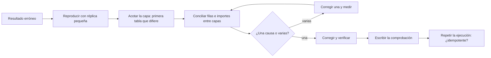

# SE-551 — Taller: reparar un pipeline defectuoso

[← SE-550 — Costos y operación de plataformas de datos](https://github.com/vladimiracunadev-create/modern-software-engineering-program/blob/main/classes/part-45-ingenieria-de-datos-y-plataformas-de-datos/se-550-costos-y-operacion-de-plataformas-de-datos/README.md) · [↑ Parte 45](https://github.com/vladimiracunadev-create/modern-software-engineering-program/blob/main/classes/part-45-ingenieria-de-datos-y-plataformas-de-datos/README.md) · [📚 Índice completo](https://github.com/vladimiracunadev-create/modern-software-engineering-program/blob/main/classes/README.md) · [🌐 Portal](https://vladimiracunadev-create.github.io/modern-software-engineering-program/classes/SE-551.html) · [SE-552 — Proyecto: plataforma de datos mínima gobernada →](https://github.com/vladimiracunadev-create/modern-software-engineering-program/blob/main/classes/part-45-ingenieria-de-datos-y-plataformas-de-datos/se-552-proyecto-plataforma-de-datos-minima-gobernada/README.md)

## Punto profesional y fundamento pedagógico

**Punto profesional.** El taller existe para que practiques lo que hace valiosa a una persona de datos en una emergencia: encontrar por qué un número está mal y arreglarlo sin romper otra cosa. Un pipeline con ocho defectos sembrados (carga que duplica al reintentar, día calculado en la zona horaria equivocada, unión que multiplica filas, datos tardíos descartados, unión que pierde claves nulas, suma en coma flotante, columna renombrada que se rellena con cero y archivo truncado) produce un informe que se ve plausible. El taller te da el pipeline, la verdad de referencia y ocho comprobaciones, y te pide un método: reproducir, acotar la capa, conciliar, formular una causa, corregir una cosa y medir. El resultado más instructivo no es la lista de defectos sino lo que ocurre al corregirlos uno a uno: los defectos se enmascaran entre sí y el error no baja de forma monótona.

**Por qué aparece aquí.** Cierra el bloque técnico de la parte. Pone a trabajar juntas la idempotencia de `SE-544`, las comprobaciones de `SE-545`, los contratos de `SE-546`, el linaje de `SE-547` y la privacidad de `SE-549`, con el método de diagnóstico que ya conoces de [SE-431](https://github.com/vladimiracunadev-create/modern-software-engineering-program/blob/main/classes/part-35-observabilidad-sre-e-incidentes/se-431-taller-diagnosticar-con-telemetria-incompleta/README.md) y de [SE-323](https://github.com/vladimiracunadev-create/modern-software-engineering-program/blob/main/classes/part-26-datos-persistencia-y-recuperacion/se-323-taller-corregir-una-migracion-peligrosa/README.md). Prepara `SE-552`, donde se construye la plataforma que debería haber detenido estos defectos.

**Error conceptual que debe corregir.** Creer que cada defecto deja una huella separada y que la suma de las huellas es el error total. Los defectos interactúan: uno descarta filas y otro las duplica, y al corregir el primero el error empeora. La segunda corrección: una comprobación que no falla no demuestra que no hay defecto; en el taller, dos de las ocho comprobaciones no vieron ninguno de los ocho defectos, y están bien: sirven para otros.

**Secuencia de aprendizaje.** Antes de ejecutar, predices qué comprobaciones ven cada defecto y cuál de los ocho es el más difícil de ver. Después ejecutas cada defecto aislado, observas filas e importe de más o de menos, pasas la matriz de comprobaciones, activas los ocho a la vez y los corriges en un orden fijo midiendo tras cada paso.

**Evidencia de aprendizaje.** `diagnostico-del-pipeline.md` con, por cada defecto, el síntoma, la comprobación que lo ve, la causa y la corrección con la medida antes y después; la matriz defecto por comprobación; y la comprobación nueva que añadirías para el defecto que más tarda en verse.

**Límite de la conclusión.** Son 20 000 pedidos sintéticos en 14 días con 400 clientes, ocho defectos escritos por el autor y ocho comprobaciones. La verdad de referencia existe porque el autor la calculó; en un caso real no existe y hay que conciliar contra una fuente independiente. El orden de corrección elegido es uno de varios posibles. No se evaluó ninguna herramienta ni se midió la frecuencia de ninguno de estos defectos en la práctica. No se invocó ningún modelo de lenguaje.

### Trazabilidad fuente → afirmación

| Fuente primaria u oficial | Afirmación que respalda | Lo que no prueba |
|---|---|---|
| [Apache Airflow, «DAG Runs»](https://airflow.apache.org/docs/apache-airflow/stable/core-concepts/dag-run.html) | Documenta las ejecuciones por intervalo de datos, base de la idempotencia y los reprocesos del taller. | No dice cómo diagnosticar. |
| [Great Expectations, documentación](https://docs.greatexpectations.io/docs/) | Describe expectativas verificables (unicidad, nulos, rangos) como las comprobaciones del taller. | Es una herramienta concreta. |
| [SQLite, «Datatypes»](https://www.sqlite.org/datatype3.html) | Documenta la afinidad de tipos que hizo visibles los enteros y los reales en el laboratorio. | No analiza el defecto. |
| [Python: `datetime`](https://docs.python.org/3/library/datetime.html) | Documenta las fechas con zona horaria, origen del defecto de día. | No dice cuál es la zona correcta del negocio. |
| [Kleppmann, «Designing Data-Intensive Applications»](https://dataintensive.net/) | Explica los fallos parciales y la derivación de datos que alimentan el método. | No prescribe un procedimiento. |

## Antes de empezar

Recupera lo aprendido en `SE-545`: cada comprobación ve una familia de defectos. La pregunta activa es: **si el informe de ayer está mal y no sabes por qué, ¿cuál es tu primer paso y qué número comparas primero con cuál?**

## Prerrequisitos

- Haber completado `SE-544` a `SE-550`.
- Conocer el diagnóstico con evidencia incompleta de [SE-431](https://github.com/vladimiracunadev-create/modern-software-engineering-program/blob/main/classes/part-35-observabilidad-sre-e-incidentes/se-431-taller-diagnosticar-con-telemetria-incompleta/README.md).
- SQL con uniones y agregaciones.
- Python 3.11 o posterior; el laboratorio usa `sqlite3`.

## Problema auténtico

Es lunes y el informe de ventas por día de *Avisos* tiene números que nadie sabe si creer. Finanzas dice que faltan pedidos; el equipo de producto dice que sobran. Un analista encuentra que el total por día no coincide con el del sistema de facturación; otro, que los pedidos de medianoche aparecen en el día equivocado. El pipeline pasó todas sus tareas en verde.

Tienes el pipeline, una versión de referencia del dato correcto y ocho comprobaciones. No sabes cuántos defectos hay. Tu tarea es encontrarlos, explicar cada uno con evidencia, corregirlos y dejar comprobaciones que los habrían detenido.

## Objetivos observables

Al terminar podrás:

1. reproducir un resultado erróneo y acotar la capa donde empieza a diferir de la referencia;
2. clasificar cada defecto por su síntoma (filas de más, filas de menos, importe, días afectados) y por la comprobación que lo ve;
3. distinguir defectos que aparecen en una ejecución de los que solo aparecen al reintentar;
4. corregir los defectos uno a uno y medir tras cada paso, explicando por qué el error no baja de forma monótona;
5. escribir la comprobación que habría detenido el defecto más difícil de ver.

## Mapa conceptual



El mapa hace explícito el bucle: tras cada corrección se vuelve a conciliar, porque la corrección de un defecto revela o altera otro. La repetición de la ejecución es una prueba aparte que sale del bucle.

## Temas y por qué importan

| Tema | Por qué cambia una decisión profesional | Evidencia mínima |
|---|---|---|
| Reproducir | Sin reproducción no hay prueba de la corrección. | Réplica con el mismo resultado |
| Acotar la capa | Evita buscar en todo el pipeline. | Primera tabla que difiere |
| Conciliación | Ve lo que se pierde o se duplica. | Filas e importes por capa |
| Defectos que solo aparecen al repetir | La ejecución limpia no los muestra. | Resultado tras dos ejecuciones |
| Enmascaramiento | Los defectos se compensan. | Error tras cada corrección |
| Comprobaciones ciegas | Una comprobación verde no descarta un defecto. | Matriz defecto por comprobación |
| Verdad de referencia | Sin ella no hay diagnóstico. | Fuente independiente |

## Conceptos y decisiones

### 1. El pipeline y la verdad de referencia

El pipeline lee 20 000 pedidos (identificador, cliente, marca de tiempo en UTC, importe y día de llegada), los carga en un hecho, los une con una dimensión de clientes con historia y calcula, por día local (UTC−3), el número de pedidos y el importe. La referencia calcula lo mismo directamente sobre los pedidos: 20 000 filas, un importe total de 912 729 905 y 15 días (de −1 a 13, por el desfase horario). Cualquier diferencia contra esa referencia es un defecto. La referencia es un lujo del taller; en un caso real se sustituye por una fuente independiente: facturación, un informe del origen, un conteo del sistema operacional.

### 2. Los ocho defectos y su síntoma aislado

Cada defecto se activó solo. **D1** (carga por añadir): una ejecución da el resultado correcto; tras un reintento, +20 000 filas. **D2** (día calculado en UTC): cero filas de diferencia y 15 de 15 días con resultado distinto, porque los pedidos cercanos a medianoche caen en el día equivocado. **D3** (unión con la dimensión histórica sin filtrar por vigencia): +19 787 filas y +903 millones de importe, casi el doble, porque cada cliente tiene dos versiones. **D4** (datos tardíos descartados por la fecha de carga): −3 048 filas. **D5** (unión interna que pierde lo que no tiene pareja): −413 filas, de las cuales 213 son pedidos sin cliente y 200 son pedidos del día −1, anteriores a la primera vigencia de la dimensión. **D6** (importes sumados como reales): cero filas y −2 de importe, 2 de 15 días distintos: pierde dos centavos en 912 millones. **D7** (columna renombrada en el origen que el pipeline rellena con cero): −912 729 905, todo el importe. **D8** (archivo truncado al 93 %): −1 400 filas.

### 3. Qué comprobación ve cada defecto

Con ocho comprobaciones (conciliar filas con el origen, conciliar importe, unicidad, frescura, repetir la ejecución, prueba de frontera de día, esquema de entrada, importe medio por día en banda), D1 solo lo ve repetir la ejecución. D2 lo ven la prueba de frontera y el importe medio. D3, las dos conciliaciones. D4 y D5, las conciliaciones y el importe medio. D6, solo la conciliación exacta de importe. D7, la conciliación de importe, el esquema de entrada y el importe medio. D8, las dos conciliaciones. La conciliación del importe ve siete de los ocho; la unicidad y la frescura no ven ninguno, y es correcto: no corresponden a estos defectos, y un fallo de otra clase (un duplicado de clave, una carga atrasada) sí las dispararía.

### 4. D1 y los defectos que esperan al reintento

D1 es el más traicionero porque el resultado de la primera ejecución es perfecto. Se manifiesta cuando alguien reintenta tras un fallo o ejecuta el trabajo dos veces por error, y entonces el hecho tiene el doble de filas. La única comprobación que lo ve es repetir la ejecución y comparar. Es un defecto del diseño del trabajo, no del dato, y la corrección es la que enseña `SE-544`: borrar e insertar la partición o fusionar por clave.

### 5. D2: la frontera del día

Un pedido a las 23:30 hora local es de ese día; en UTC ya es el día siguiente. Agrupar por día UTC desplaza cada pedido de las tres últimas horas del día local. No cambia el número de filas ni el total, así que las conciliaciones globales no lo ven; cambia el reparto por día, y por eso afecta a los 15 días. La prueba de frontera (un pedido a las 23:30 hora local debe caer en su día) lo ve con un solo registro de ejemplo. La lección es probar con casos en los bordes.

### 6. D3 y D5: dos formas de que una unión mienta

D3 duplica filas porque la dimensión tiene varias versiones por cliente y la unión no filtra por la vigencia de cada pedido: es el abanico de `SE-543` aplicado a una dimensión con historia. D5 elimina filas porque una unión interna descarta todo lo que no tiene pareja: los 213 pedidos con cliente nulo y los 200 pedidos del día −1, que quedan antes de la primera vigencia de la dimensión. Los dos se ven por conciliación: las filas del hecho no coinciden con las del origen. Las corrigen una condición de vigencia y una unión izquierda con un cliente «desconocido».

### 7. D4 y D8: lo que no llegó

D4 descarta los pedidos que llegan después de su día porque filtra por la fecha de carga; D8 trabaja con un archivo cortado al 93 %. Ambos dan filas de menos y se ven por conciliación con el origen. La diferencia está en el origen del error: D4 es una regla del pipeline y se corrige con una ventana de reproceso (`SE-544`); D8 es una falla de la entrega y se corrige comprobando el número de filas esperado contra el recibido antes de cargar y deteniéndose si no coincide. Una carga que acepta cualquier tamaño acepta el archivo roto.

### 8. D6 y D7: los más pequeños y el más grande

D7 hace que todo el importe sea cero: una conciliación lo ve a la primera y la comprobación de esquema lo explica (la columna se llama distinto). D6 es el opuesto: sumar importes como números de coma flotante y convertir a centavos truncando pierde dos centavos en 912 millones y afecta a 2 de 15 días. Ninguna banda de distribución lo ve; solo una conciliación exacta, entera, del importe. Se corrige guardando importes como enteros en la unidad mínima. Es un defecto real y frecuente que produce diferencias de centavos que «aparecen y desaparecen» con el orden de las filas.

### 9. Corregir uno a uno: el error no baja de forma monótona

Con los ocho activos y un reintento, el resultado tiene 42 384 filas de más y los 15 días mal. Se corrigieron en este orden: D1 (quedan +11 192), D8 (+13 558), D5 (+13 731), D4 (+19 787), D3 (+0), D2 (+0), D7 (+0, y 2 días mal) y D6 (0 días mal). El error de filas sube al corregir D8, D5 y D4, porque cada uno recupera filas que antes se perdían y que otro defecto (D3, el abanico) duplica; solo al corregir D3 las filas coinciden. Los días con resultado distinto son 15 hasta corregir D7 y bajan a 2 y a 0. Moraleja: tras cada corrección se mide; un error que sube no prueba que la corrección sea mala, sino que había otro defecto compensando.

## Cada defecto y qué comprobación lo ve

La primera medida es la matriz de defectos por comprobaciones.


**Cómo leer la figura.** Cada fila es un defecto y cada columna una comprobación; una «x» dice que esa comprobación falla. Mira primero la columna de la conciliación del importe, con siete marcas, y la de repetir la ejecución, con una sola pero insustituible. **Dónde deja de valer:** los defectos se activan de uno en uno y afectan a una fracción grande de las filas; un defecto que toque 0,1 % de las filas pasaría varias comprobaciones, y cuando se activan juntos los síntomas se mezclan y la matriz ya no se lee de manera directa.

## Corregir uno a uno

La segunda medida muestra el error tras cada corrección.


**Cómo leer la figura.** El eje horizontal son los defectos corregidos de izquierda a derecha y el vertical las filas de más. Mira primero que la línea sube entre D8 y D4: cada corrección recupera filas que otro defecto estaba duplicando. **Dónde deja de valer:** el orden es uno entre muchos; otro orden da otra curva con el mismo punto final. Lo que se traslada es el hábito de medir tras cada paso y la sospecha de que un error que sube indica un defecto compensado.

## El método de diagnóstico

La tercera figura es el procedimiento.


**Cómo leer la figura.** Cada caja es un paso y la lectura va de izquierda a derecha y de arriba abajo. Mira primero el paso 5: es el que obliga a corregir una causa a la vez. **Dónde deja de valer:** el método supone que puedes reproducir; ante un fallo intermitente o sin acceso a los datos, el primer paso es conseguir observabilidad, y eso es otro problema ([SE-431](https://github.com/vladimiracunadev-create/modern-software-engineering-program/blob/main/classes/part-35-observabilidad-sre-e-incidentes/se-431-taller-diagnosticar-con-telemetria-incompleta/README.md)).

## Definiciones de trabajo

- **Verdad de referencia:** resultado correcto calculado de forma independiente.
- **Conciliación:** comparar totales (filas, importes) entre dos capas o fuentes.
- **Réplica pequeña:** muestra que reproduce el defecto con poco costo.
- **Defecto enmascarado:** defecto cuyo efecto lo compensa otro.
- **Prueba de frontera:** caso de ejemplo en el borde de una regla (medianoche, límites de rango).
- **Importe en unidad mínima:** entero en centavos, sin coma flotante.
- **Acotar:** reducir el lugar donde puede estar el defecto.

## Ejemplo mínimo

La prueba de frontera que habría atrapado el defecto D2:

```python
UTC_MENOS_3 = -3 * 3600

def dia_local(ts):
    return (ts + UTC_MENOS_3) // 86400

def dia_utc_defectuoso(ts):
    return ts // 86400

# un pedido a las 23:30 hora local del día 5 = 02:30 UTC del día 6
ts = 6 * 86400 + 2 * 3600 + 30 * 60
print(dia_local(ts), dia_utc_defectuoso(ts))          # 5 6
assert dia_local(ts) == 5
```

El mismo instante cae en el día 5 en hora local y en el 6 en UTC. Una prueba con ese único registro detecta el defecto, mientras las conciliaciones de totales no.

## Ejemplo profesional

*Escenario ilustrativo: las cifras y los resultados que aparecen en este ejemplo son supuestos de la narración, no mediciones.*

El equipo de *Avisos* recibe la queja de finanzas y sigue el método. Reproduce con un día de datos y una réplica pequeña. Concilia filas y importe de cada capa contra el origen: las filas del hecho son un 2 % menos que las del origen, y el importe, un 3 % menos. Las filas faltantes son pedidos sin cliente (unión interna). Corrige solo eso y vuelve a medir: ahora sobran filas el lunes, por una dimensión sin vigencia. Corrige la unión y la diferencia baja a cero filas pero el importe por día sigue sin coincidir: los pedidos de medianoche están en el día equivocado. Cada paso lo registra con el antes y el después. Al final añade tres comprobaciones al repositorio: conciliación de filas e importe contra el origen, repetir la ejecución y una prueba de frontera de medianoche. La siguiente vez que alguien toca la unión, la conciliación falla en la misma tarde.

## Práctica guiada

1. Ejecuta `python scripts/experiments_part45_c.py 551` y reproduce la tabla de los ocho defectos aislados.
2. Elige tres defectos y, sin mirar la matriz, predice qué comprobación los ve; compara.
3. Corrige los defectos en un orden distinto al del experimento y anota el error tras cada paso.
4. Escribe la comprobación que añadirías para D6 y explica por qué la banda de distribución no lo ve.
5. Para un pipeline tuyo, escribe la verdad de referencia que usarías y quién la mantiene.

## Ejercicios

1. **Básico.** Explica por qué D1 pasa todas las comprobaciones salvo una en una ejecución limpia y por qué es el más peligroso con reintentos automáticos.
2. **Intermedio.** Reproduce con una consulta el abanico de D3 y escribe la unión corregida con la vigencia.
3. **Avanzado.** Diseña un conjunto de ocho defectos nuevos de tu dominio y la matriz de comprobaciones que los vería; indica cuál quedaría sin ver.

## Reto verificable

Entrega `diagnostico-del-pipeline.md` con la tabla de cada defecto (síntoma, comprobación, causa, corrección y medida antes y después), la matriz defecto por comprobación y la curva del error al corregir en tu orden. Es válido si otra persona repite tu secuencia de correcciones y obtiene las mismas cifras en cada paso.

## Caso conductor

*Avisos* tiene ahora el método y las comprobaciones que habrían detenido cada defecto. `SE-552` las integra en una plataforma mínima donde ninguna publicación ocurre sin ellas.

## Preguntas frecuentes

### ¿Por qué no corregir todo de una vez?

Porque si el resultado mejora no sabes qué lo hizo, y si empeora no sabes cuál lo empeoró. Un cambio por paso, con medida, es lo que hace reproducible el diagnóstico.

### ¿Cómo sé que encontré todos los defectos?

No lo sabes. Sabes que el resultado coincide con la referencia y con las comprobaciones que tienes. Por eso se añaden comprobaciones nuevas por cada defecto y se sigue sembrando incidentes.

### ¿Y si no tengo una verdad de referencia?

Construye una conciliación con una fuente independiente (facturación, conteos del origen, un cálculo manual sobre una muestra). Sin ninguna, el diagnóstico se limita a coherencia interna, y debe declararse.

### ¿Los importes siempre deben ser enteros?

En unidad mínima (centavos o la unidad más pequeña de la moneda) sí, para sumas exactas. Los decimales de coma flotante son aceptables en estadística aproximada, nunca en dinero que debe cuadrar.

## Fallo controlado y diagnóstico

**Fallo.** Tras corregir tres defectos, el total de filas del hecho sigue siendo mayor que el del origen y el informe no coincide con facturación.

**Diagnóstico paso a paso.** (1) Se mide el cociente filas del hecho entre filas del origen: 1,99. (2) Se cuenta cuántas veces aparece cada identificador de pedido en el hecho: dos. (3) Se revisa la unión con la dimensión de clientes: el cliente tiene dos versiones y no se filtra por vigencia. (4) Se prueba la unión corregida sobre la réplica pequeña: las filas coinciden.

**Corrección.** Se añade la condición de vigencia a la unión, se agrega la prueba de unicidad del identificador de pedido al hecho y se registra la medida antes y después. La lección es que un error de filas de más tras corregir otros defectos no es un fallo de la corrección anterior sino un defecto enmascarado hasta entonces.

## Errores comunes y cómo corregirlos

- **Corregir varias causas a la vez.** Corrige un cambio por paso con medida.
- **Confiar en la primera ejecución.** Corrige repitiendo la ejecución y comparando.
- **Dar por hecho que el total coincide.** Corrige conciliando también por día y por clave.
- **Usar coma flotante para dinero.** Corrige con enteros en la unidad mínima.
- **No probar bordes.** Corrige con casos de medianoche y de rangos.
- **No dejar una comprobación por defecto.** Corrige convirtiendo cada diagnóstico en una prueba.

## Entorno y archivos clave

- `scripts/experiments_part45_c.py`: función `e551` con el pipeline, los ocho defectos, la matriz de comprobaciones y la secuencia de correcciones; se ejecuta con `python scripts/experiments_part45_c.py 551`.
- `scripts/figures_part45_b.py`: las tres figuras de la clase.
- Solo la biblioteca estándar de Python 3.11 o posterior; semilla 45.

## Seguridad, ética y accesibilidad

Los datos del taller son sintéticos. En un diagnóstico real, la réplica pequeña no debe copiar datos personales a un portátil o a un cuaderno: usa datos sintéticos que reproduzcan el defecto o una muestra seudonimizada (`SE-549`). Una corrección masiva sobre producción necesita aprobación y registro. Ética: un informe que lleva semanas mal puede haber informado decisiones; comunica el alcance de lo afectado con honestidad. Las figuras llevan texto alternativo completo y no dependen solo del color.

## Puente hacia el trabajo con agentes

Un agente que diagnostica un pipeline puede proponer varias correcciones a la vez y declarar «arreglado» al ver una cifra plausible. Exige que corrija una causa por paso, que muestre la medida antes y después y que ejecute la repetición de la ejecución. No aceptes un diagnóstico que no contraste con una fuente independiente, y no permitas que el agente modifique las comprobaciones que lo evalúan.

## Transferencia

Toma un informe de tu organización cuyo número alguien haya puesto en duda. Escribe su verdad de referencia, concilia por capa hasta encontrar la primera diferencia y registra cada paso con su medida. Deja al final la comprobación que lo habría detectado el primer día.

## Evaluación y evidencia

| Criterio | Evidencia aceptable | Rechazo |
|---|---|---|
| Reproducción | Réplica pequeña con el mismo resultado | «Lo vi en producción» |
| Acotar | Primera tabla que difiere | Revisar todo |
| Medida | Antes y después por corrección | Solo el final |
| Comprobación | Una por defecto | Solo la corrección |
| Referencia | Fuente independiente declarada | Coherencia interna sin declararla |

## Fuentes

- Apache Airflow. [«DAG Runs»](https://airflow.apache.org/docs/apache-airflow/stable/core-concepts/dag-run.html).
- Great Expectations. [Documentación](https://docs.greatexpectations.io/docs/).
- SQLite. [«Datatypes»](https://www.sqlite.org/datatype3.html).
- Python Software Foundation. [`datetime`](https://docs.python.org/3/library/datetime.html).
- Kleppmann, M. [«Designing Data-Intensive Applications»](https://dataintensive.net/).

## Límites y siguiente paso

Los pedidos, los defectos, las comprobaciones y el orden de corrección son construcciones del autor; los ocho defectos se probaron aislados y en conjunto con un único reintento. No se midió la frecuencia de ninguno de ellos en la práctica ni se evaluó ninguna herramienta. El siguiente paso, `SE-552`, integra comprobaciones, contratos, linaje, privacidad y costo en una plataforma mínima con un control que decide si algo se publica.

## Glosario

| Término | Definición breve |
|---|---|
| Verdad de referencia | Resultado correcto calculado aparte |
| Conciliación | Comparar totales entre dos capas |
| Defecto enmascarado | Compensado por otro defecto |
| Prueba de frontera | Caso en el borde de una regla |
| Réplica pequeña | Muestra que reproduce el defecto |
| Unidad mínima | Entero en centavos |

---

[← SE-550 — Costos y operación de plataformas de datos](https://github.com/vladimiracunadev-create/modern-software-engineering-program/blob/main/classes/part-45-ingenieria-de-datos-y-plataformas-de-datos/se-550-costos-y-operacion-de-plataformas-de-datos/README.md) · [↑ Parte 45](https://github.com/vladimiracunadev-create/modern-software-engineering-program/blob/main/classes/part-45-ingenieria-de-datos-y-plataformas-de-datos/README.md) · [📚 Índice completo](https://github.com/vladimiracunadev-create/modern-software-engineering-program/blob/main/classes/README.md) · [🌐 Portal](https://vladimiracunadev-create.github.io/modern-software-engineering-program/classes/SE-551.html) · [SE-552 — Proyecto: plataforma de datos mínima gobernada →](https://github.com/vladimiracunadev-create/modern-software-engineering-program/blob/main/classes/part-45-ingenieria-de-datos-y-plataformas-de-datos/se-552-proyecto-plataforma-de-datos-minima-gobernada/README.md)
