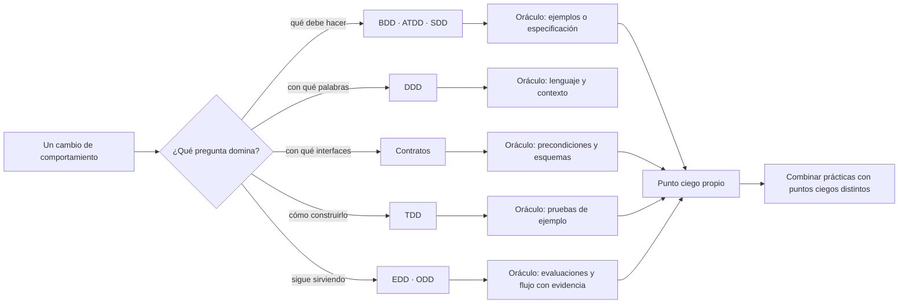

# SE-541 — Mapa de metodologías: qué decide cada una y cómo elegir

[← SE-540 — Proyecto: dossier profesional defendible](https://github.com/vladimiracunadev-create/modern-software-engineering-program/blob/main/classes/part-44-gestion-liderazgo-y-practica-profesional/se-540-proyecto-dossier-profesional-defendible/README.md) · [↑ Parte 45](https://github.com/vladimiracunadev-create/modern-software-engineering-program/blob/main/classes/part-45-metodologias-de-desarrollo-de-tdd-a-odd/README.md) · [📚 Índice completo](https://github.com/vladimiracunadev-create/modern-software-engineering-program/blob/main/classes/README.md) · [🌐 Portal](https://vladimiracunadev-create.github.io/modern-software-engineering-program/classes/SE-541.html) · [SE-542 — TDD: ciclo rojo-verde-refactor y diseño emergente →](https://github.com/vladimiracunadev-create/modern-software-engineering-program/blob/main/classes/part-45-metodologias-de-desarrollo-de-tdd-a-odd/se-542-tdd-ciclo-rojo-verde-refactor-y-diseno-emergente/README.md)

## Punto profesional y fundamento pedagógico

**Punto profesional.** La clase existe para que dejes de elegir una metodología por su nombre y empieces a elegirla por lo que produce. TDD, BDD, ATDD, DDD, el diseño por contrato, SDD, EDD y ODD circulan como etiquetas de identidad («somos un equipo TDD»), y las etiquetas no se pueden discutir con evidencia. Lo que sí se puede discutir es qué pregunta ordena cada una, qué oráculo (qué cosa decide si el resultado es correcto) deja detrás, cuánto cuesta producirlo y qué clase de error no ve. Un ingeniero que sabe eso puede combinar prácticas, abandonar una que no rinde y explicar su decisión a quien paga el trabajo. Un ingeniero que solo conoce las etiquetas repite rituales.

**Por qué aparece aquí.** Abre la **[Parte 45](../README.md)** después de **SPEC, agentes y ciclo de vida agentic**: la [Parte 47](../../part-47-spec-agentes-y-ciclo-de-vida-agentic/README.md) enseñó a especificar, delegar y detener a un agente. Ahora el objeto de estudio son las prácticas con que un equipo organiza el desarrollo alrededor de un oráculo, y la razón de colocarlas después de los agentes es práctica: cuando quien escribe el código es una persona o un agente, el oráculo es lo único que no cambia de manos. La [Parte 35](../../part-35-estrategia-y-tecnicas-de-prueba/README.md) ya trató la estrategia y las técnicas de prueba; esta parte trata las **metodologías** que deciden cuándo y en qué orden se produce cada evidencia.

**Error conceptual que debe corregir.** Creer que las metodologías compiten entre sí y que hay una correcta. Compiten por atención y por presupuesto, pero responden preguntas distintas: qué debe hacer el sistema (BDD, ATDD, SDD), con qué palabras se dice (DDD), con qué interfaces se conecta (contratos), cómo se construye paso a paso (TDD) y cómo se sabe que sigue sirviendo cuando el resultado es probabilístico u opera en producción (EDD, ODD). En el laboratorio de esta clase, ningún oráculo basta solo y los pares de naturaleza distinta cubren lo que ninguno ve.

**Secuencia de aprendizaje.** Antes de ver los resultados, predices cuántos de 18 defectos sembrados en una función de veinte líneas mata cada uno de cinco oráculos; después ejecutas los cinco, comparas qué defectos deja vivos cada uno y calculas qué pareja cubre todo. Con eso construyes el mapa que usarás en el resto de la parte.

**Evidencia de aprendizaje.** `mapa-metodologias.md` con tu predicción, la tabla de defectos vivos por oráculo, una pareja de oráculos justificada para un cambio real de tu proyecto, y una nota que separe qué parte de cada conclusión fue medida, cuál inferida y cuál supuesta.

**Límite de la conclusión.** Los 18 defectos sembrados (mutantes) los escribió el autor; no son una muestra de los defectos reales de ningún proyecto. La función es pequeña y determinista. No se midió ningún equipo ni ninguna productividad, y no se invocó ningún modelo de lenguaje: los experimentos muestran cómo se comporta cada tipo de oráculo en un caso construido, no con qué frecuencia ocurre eso en la práctica.

### Trazabilidad fuente → afirmación

| Fuente primaria u oficial | Afirmación que respalda | Lo que no prueba |
|---|---|---|
| [Beck, «Canon TDD»](https://tidyfirst.substack.com/p/canon-tdd) | Define TDD como un flujo de trabajo con una lista de escenarios de prueba, una prueba concreta a la vez, cambio de código hasta que pasen todas y refactor opcional; advierte contra críticas a una versión distinta de la práctica. | No mide el efecto de TDD en la calidad ni en la productividad. |
| [Cucumber, «Behaviour-Driven Development»](https://cucumber.io/docs/bdd/) | Describe BDD como una forma de trabajar que cierra la brecha entre personas de negocio y técnicas, con tres prácticas: descubrimiento, formulación y automatización. | No demuestra que un equipo que usa Gherkin practique BDD. |
| [Evans, «Domain-Driven Design Reference»](https://www.domainlanguage.com/wp-content/uploads/2016/05/DDD_Reference_2015-03.pdf) | Resume DDD como un lenguaje compartido y un modelo que se delimita en contextos. | No dice cuándo compensa su costo. |
| [Meyer, «Applying Design by Contract»](https://doi.org/10.1109/2.161279) | Presenta precondiciones, poscondiciones e invariantes como contrato entre quien llama y quien implementa. | No garantiza que el contrato esté bien elegido. |
| [Böckeler, «Understanding Spec-Driven-Development»](https://martinfowler.com/articles/exploring-gen-ai/sdd-3-tools.html) | Distingue tres niveles (spec-first, spec-anchored, spec-as-source) y señala que la estrategia de mantenimiento de la especificación suele quedar sin definir. | Es un análisis de tres herramientas en un momento concreto, no una evaluación de resultados. |
| [Anthropic, «Demystifying evals for AI agents»](https://www.anthropic.com/engineering/demystifying-evals-for-ai-agents) | Explica la estructura de una evaluación, su no determinismo y métricas como pass@k. | No fija cuántos casos hacen falta en un producto concreto. |
| [Gentle AI, «Intended Usage»](https://github.com/Gentleman-Programming/gentle-ai/blob/main/docs/intended-usage.md) | Describe el flujo ODD de ese proyecto: autorización primero, documento de tarea, rojo-verde-refactor por defecto y commits de unas 400 líneas. | Es documentación del propio proyecto, no un estudio independiente. |
| [DeMillo, Lipton y Sayward, «Hints on Test Data Selection»](https://doi.org/10.1109/C-M.1978.218136) y [Jia y Harman, «An Analysis and Survey of the Development of Mutation Testing»](https://doi.org/10.1109/TSE.2010.62) | Fundamentan el análisis de mutantes como forma de medir qué defectos detecta un conjunto de pruebas. | No dicen que los mutantes imiten los defectos de un proyecto concreto. |

## Antes de empezar

Recupera lo aprendido en la [Parte 47](../../part-47-spec-agentes-y-ciclo-de-vida-agentic/README.md): un agente hace lo más plausible donde la especificación calla, y lo único que lo contiene es un oráculo que no haya producido él. La pregunta activa es: **¿qué práctica de las que usas hoy (pruebas de ejemplo, revisión por pares, un contrato, una validación manual) te avisaría primero si el último cambio que hiciste rompió algo, y qué clase de error no vería?**

## Prerrequisitos

- Haber completado `SE-576` o poder explicar cómo se entrega un producto validado por el sistema y no por autodeclaración.
- Haber visto en la [Parte 35](../../part-35-estrategia-y-tecnicas-de-prueba/README.md) qué es una prueba de mutación y por qué la cobertura de líneas no mide la capacidad de detección.
- Python 3.11 o posterior; los experimentos usan solo la biblioteca estándar (`random`, `itertools`, `time`).
- Saber leer una tabla de resultados con una semilla fija.

## Problema auténtico

La plataforma educativa necesita cambiar una regla de *Avisos*, el servicio que recuerda a los estudiantes las entregas pendientes: los avisos se envían cuando faltan 72, 24 y 1 horas, nunca a quien ya entregó, nunca tras el vencimiento, y si el servicio estuvo caído solo se envía el más urgente. Tres personas del equipo opinan cómo trabajar. Una exige escribir primero las pruebas. Otra quiere partir de ejemplos acordados con las docentes. Una tercera dice que lo importante es escribir la especificación y que el agente de código la implemente. Las tres tienen razón en algo y ninguna puede responder una pregunta simple: **¿qué defectos dejaría pasar cada enfoque?** Sin esa respuesta la discusión es de gusto, y el equipo termina haciendo lo que hace el más insistente.

La clase responde la pregunta con una medida. Se toma el núcleo de *Avisos* (veinte líneas), se siembran 18 defectos plausibles (más dos variantes equivalentes que no cambian el comportamiento) y se ejecutan cinco oráculos de distinta naturaleza: un caso feliz, ocho pruebas de ejemplo, escenarios de aceptación con reloj, un contrato sobre 400 estados al azar y un modelo de referencia ejecutable. El resultado no designa una metodología ganadora: muestra que cada oráculo tiene un punto ciego distinto y que dos oráculos de naturaleza distinta, y no los más parecidos, cubren el conjunto.

## Objetivos observables

Al terminar podrás:

1. distinguir las ocho metodologías de la parte por la pregunta que ordena cada una y por el oráculo que deja detrás;
2. calcular qué defectos deja vivos un oráculo con un análisis de mutantes y reconocer los mutantes equivalentes, que ningún oráculo puede matar;
3. explicar por qué dos oráculos parecidos comparten el mismo punto ciego y por qué una pareja de naturaleza distinta lo cubre;
4. elegir, para un cambio concreto, una combinación de prácticas justificada por el defecto que se quiere evitar y por su costo;
5. separar en una conclusión lo medido, lo inferido y lo supuesto.

## Mapa conceptual



El mapa muestra que cada metodología nace de una pregunta, deja un oráculo y trae un punto ciego. La decisión profesional no es elegir una rama sino combinar ramas cuyos puntos ciegos no coincidan, al costo que el cambio justifique.

## Temas y por qué importan

| Tema | Por qué cambia una decisión profesional | Evidencia mínima |
|---|---|---|
| Metodología, práctica y oráculo | Sin separar el nombre de lo que produce, la elección es de gusto. | Una tabla pregunta → práctica → oráculo para tus ocho metodologías |
| Análisis de mutantes | Convierte «¿esta prueba sirve?» en una cifra que se puede discutir. | 18 mutantes y su matriz de muertes por oráculo |
| Mutantes equivalentes | Un mutante que no cambia el comportamiento no se puede matar; perseguirlo cuesta tiempo sin valor. | Los dos equivalentes y el argumento de por qué lo son |
| Puntos ciegos y parejas | El valor de combinar prácticas depende de que sus puntos ciegos no coincidan. | La pareja que cubre los 18 y la que comparte un punto ciego |
| Costo de cada oráculo | Un oráculo caro que se ejecuta poco no protege. | Tiempo de ejecución y tamaño del artefacto por oráculo |
| Qué decide cuándo | Una política metodológica de equipo se parece más a una tabla de decisión que a una identidad. | Una regla escrita para tu proyecto, con una excepción |

## Conceptos y decisiones

### 1. Metodología, práctica y oráculo

Una **metodología de desarrollo** es un conjunto de prácticas con un orden y una razón. Una **práctica** es una actividad concreta («escribir una prueba que falla antes de escribir el código»). Un **oráculo** es el mecanismo que decide si un resultado es correcto: una aserción, un ejemplo acordado, un esquema, un contrato, una especificación ejecutable, una evaluación con umbral. Casi toda disputa metodológica es una disputa de oráculo disfrazada de disputa de proceso: ¿quién decide que esto está bien, cuándo y con qué información? Poner el oráculo en el centro permite comparar lo comparable. No se compara «TDD frente a BDD» como si fueran equipos rivales; se compara qué oráculo deja cada una, qué cuesta mantenerlo y qué defectos no ve.

Hay dos propiedades de un oráculo que importan más que su nombre. La primera es su **independencia**: un oráculo escrito por quien implementó, a partir de lo que implementó, tiende a repetir los mismos supuestos. La segunda es su **resolución**: cuántas variantes del comportamiento distingue. Una prueba que comprueba que «se envía un aviso» no distingue entre enviar el de 72 horas o el de 24.

### 2. Qué pregunta ordena cada metodología

**TDD** ordena cómo se construye: según la descripción de Beck, se parte de una lista de escenarios, se convierte uno en prueba concreta, se cambia el código hasta que pasan todas las pruebas y se refactoriza. La pregunta es «¿qué es lo siguiente que debe cumplirse?». **BDD** ordena qué debe hacer el sistema desde el lenguaje del negocio; su documentación oficial la resume en descubrir ejemplos, formularlos y automatizarlos. **ATDD** y **Specification by Example** concretan eso con ejemplos de aceptación acordados antes de construir. **DDD** ordena con qué palabras se habla y dónde cada palabra vale. **El diseño por contrato** y las **pruebas de contrato** ordenan qué se promete en cada frontera. **SDD** ordena qué fuente manda cuando el sistema lo construye un agente. **EDD** ordena cómo se aceptan cambios cuando el comportamiento es probabilístico. **ODD**, en la definición del proyecto que lo usa, ordena el flujo con que un agente cambia el código: autorización, documento de tarea, rojo-verde-refactor y commits pequeños.

Las clases siguientes tratan cada una con su mecanismo. Aquí solo se fija la regla de lectura: si no puedes decir qué pregunta ordena una práctica, probablemente la estás aplicando como ritual.

### 3. Análisis de mutantes como regla de medir

Para comparar oráculos sin opinar se necesita una medida común. El **análisis de mutantes** la da: se toma el código correcto, se produce una copia con un cambio mínimo (un operador, un umbral, una condición) y se ejecuta el oráculo; si falla, el mutante «muere», y si pasa, «sobrevive». La proporción de mutantes muertos mide la capacidad del oráculo para detectar ese tipo de cambios. La técnica se remonta al trabajo de DeMillo, Lipton y Sayward y tiene una revisión extensa de Jia y Harman. Su supuesto central, la **hipótesis del programador competente**, dice que los defectos reales se parecen a pequeñas desviaciones de lo correcto; es una hipótesis, no un hecho, y esta clase la usa con los 18 mutantes escritos por el autor.

Hay una trampa conocida: los **mutantes equivalentes**. Cambiar `offset != 1` por `offset > 1` no altera el comportamiento cuando los únicos umbrales posibles son 72, 24 y 1; ningún oráculo puede matarlo porque no hay diferencia observable. Los dos equivalentes del laboratorio (M19 y M20) sobreviven a los cinco oráculos, y eso es lo correcto. Cualquier cifra de mutantes muertos debe calcularse sobre los no equivalentes.

### 4. Puntos ciegos y por qué las parejas importan

Cada oráculo mira una parte del comportamiento. Las pruebas de ejemplo miran los casos que alguien imaginó; el contrato mira propiedades generales y no valores concretos; los escenarios con reloj miran secuencias en el tiempo pero eligen horas concretas; el modelo de referencia compara contra una segunda escritura de la regla y comparte con la primera cualquier malentendido de la especificación. Dos oráculos que miran lo mismo desde el mismo ángulo comparten el punto ciego: en el laboratorio, las ocho pruebas y los escenarios dejan vivo el mismo mutante, que avisa en el instante exacto del vencimiento, porque ninguno prueba esa hora exacta. Dos oráculos que miran de ángulos distintos se complementan: el contrato deja vivos cinco mutantes que las ocho pruebas matan, y las ocho pruebas dejan vivos tres que el contrato mata.

### 5. Costo, frecuencia y lugar de cada oráculo

Un oráculo se paga tres veces: se escribe, se ejecuta y se mantiene. Un oráculo barato de ejecutar corre en cada guardado; uno caro corre en la integración continua o de noche. La medida de tiempo del laboratorio (menos de una décima de milisegundo para las ocho pruebas, medio milisegundo para los escenarios, unos 4,5 ms para el contrato y el modelo) es irrelevante a esta escala, pero la jerarquía es la normal: lo que ejecuta muchos casos o simula el tiempo cuesta más. En un sistema real los números se multiplican, y la pregunta práctica es **en qué momento del flujo debe correr cada oráculo**, no cuál es mejor.

### 6. Una política metodológica es una tabla de decisión

La elección no se toma una vez para todo el proyecto. Un cambio de bajo riesgo en una función pura se protege bien con pruebas de ejemplo. Un cambio que cruza una frontera entre servicios necesita un contrato. Un cambio cuyo comportamiento acordó negocio necesita ejemplos con el vocabulario de negocio. Un cambio en un componente con salida probabilística necesita una evaluación con umbral. La política del equipo es la tabla que asigna prácticas a clases de cambio, con sus excepciones y con una fecha de revisión. La clase `SE-552` construye una.

## Cinco oráculos sobre el mismo núcleo

El núcleo de *Avisos* es la función `due_reminders`, que recibe las entregas, la hora actual, los cursos silenciados y los avisos ya enviados, y devuelve los avisos que corresponden. Tiene veinte líneas y cinco reglas: avisar a 72, 24 y 1 horas, no avisar a quien ya entregó, no avisar tras el vencimiento, enviar solo el aviso más urgente si hubo una caída y respetar el silencio de un curso salvo en la última hora. Se escribieron 20 variantes con un cambio mínimo cada una: 18 que alteran el comportamiento (por ejemplo, avisar a quien ya entregó, repetir un aviso, invertir una comparación, avisar una hora antes de lo debido) y 2 equivalentes.

Se ejecutaron cinco oráculos. El **caso feliz** comprueba un único caso. Las **ocho pruebas de ejemplo** son las que se escriben en `SE-542` siguiendo el ciclo de TDD. Los **escenarios de aceptación** hacen correr el reloj hora a hora, como lo haría un cron, y comprueban qué avisos salen y cuándo, incluidos una caída del servicio y un curso silenciado. El **contrato** comprueba, sobre 400 estados al azar con semilla fija, propiedades como «nunca hay dos avisos para la misma entrega», «nunca se avisa a quien ya entregó» o «un curso silenciado solo recibe el aviso de la última hora»; no calcula la respuesta esperada. El **modelo de referencia** es una segunda escritura de la regla, con una estructura distinta, y se compara con la función sobre los mismos 400 estados.


**Cómo leer la figura.** Cada barra es un oráculo (una forma de decidir si el comportamiento es correcto) y su largo cuenta los mutantes que mata, de los 18 no equivalentes; la línea discontinua es el total. Un caso feliz único mata 7; ocho pruebas de ejemplo, 15; los escenarios con reloj, 17; el contrato con 400 estados al azar, 13, y solo el modelo de referencia ejecutable alcanza los 18. Cuáles mutantes deja vivos cada oráculo y cuánto tarda cada uno quedan en la tabla. **Dónde deja de valer:** las 20 variantes las escribió el autor sabiendo qué tocan los oráculos; con defectos reales, que suelen ser más sutiles o más groseros, las cifras serían otras. El tiempo de ejecución es de un proceso en dos equipos distintos y no se extrapola.

El resultado que importa no es el ranking sino la forma de los fallos. El contrato no mata el mutante que envía el aviso más antiguo en vez del más urgente (`max` en lugar de `min`), porque la propiedad «el umbral es válido» se cumple con ambos. Las ocho pruebas no matan el mutante que avisa una hora antes de lo debido, porque ningún ejemplo prueba el par de horas que separa 72 de 73. Los escenarios no matan el que avisa en el instante exacto del vencimiento. Cada punto ciego es una decisión de qué se escribió, no una debilidad del método: una prueba más lo mataría, como se muestra en `SE-542`.

## Qué cubre cada pareja

Con 5 oráculos hay 10 parejas. La comparación de las cinco con mejor rendimiento muestra una regularidad. Las ocho pruebas junto con los escenarios matan 17 de 18, porque comparten el mismo punto ciego: el instante exacto del vencimiento. Las ocho pruebas junto con el contrato matan los 18, y lo mismo los escenarios junto con el contrato. La pareja que cubre es la de naturaleza distinta: ejemplos concretos más propiedades generales.


**Cómo leer la figura.** Las cinco primeras barras son oráculos solos; las tres últimas, parejas. Las barras verdes alcanzan los 18 mutantes; las doradas dejan alguno vivo; la roja es el caso feliz. **Dónde deja de valer:** con 18 mutantes y una sola función, la diferencia entre 17 y 18 es un mutante y no permite ordenar nada con generalidad. La regularidad (naturaleza distinta cubre más que naturaleza parecida) es lo que se puede defender; las cifras exactas, no.

## De la pregunta a la metodología

El mapa de la clase es un orden de preguntas, no un proceso obligatorio. Se parte de qué debe hacer el cambio, se acuerda con qué palabras se dice, se decide con qué interfaces se conecta, se construye paso a paso y se vigila que siga sirviendo. Una persona puede entrar en cualquier punto: quien recibe un defecto en producción empieza por «sigue sirviendo» y retrocede hasta la pregunta que no se respondió.


**Cómo leer la figura.** Cada caja es una pregunta con la metodología que la ordena; las flechas indican un orden razonable, no un requisito. **Dónde deja de valer:** el diagrama no dice qué metodología conviene a cada proyecto, solo qué pregunta ordena cada una. En un componente que no tiene salida probabilística, EDD no aporta; en uno sin fronteras entre sistemas, las pruebas de contrato son un costo sin retorno.

## Definiciones de trabajo

- **Oráculo:** mecanismo que decide si un resultado es correcto.
- **Mutante:** copia del código con un cambio mínimo; **muere** si algún oráculo falla con él y **sobrevive** si todos pasan.
- **Mutante equivalente:** mutante cuyo comportamiento observable no difiere del original; no se puede matar.
- **Punto ciego:** clase de defecto que un oráculo no puede ver.
- **Resolución de un oráculo:** número de variantes del comportamiento que distingue.
- **Política metodológica:** tabla que asigna prácticas a clases de cambio, con excepciones y revisión.

## Ejemplo mínimo

Se tiene la función `due_reminders` y un único caso feliz: una entrega que vence en la hora 100 y un reloj en la hora 76 devuelven el aviso de 24 horas. Se siembra el defecto de avisar a quien ya entregó (`M03`): el caso feliz sigue pasando, porque la entrega del caso no estaba entregada. El defecto sobrevive. Se añade un segundo caso con una entrega ya entregada; ahora el defecto muere. La lección es mínima y es la base del resto: una prueba protege exactamente contra los defectos que cambian su resultado.

```python
from experiments_part45_lab import load, SOURCE, delivery
fn = load(SOURCE.replace('if d["submitted"]:\n            continue', 'if False:\n            continue'))
print(fn([delivery("a", 100)], 76, frozenset(), set()))                      # [('a', 24)]  el mutante sobrevive
print(fn([delivery("a", 100, submitted=True)], 76, frozenset(), set()))      # [('a', 24)]  ahora se ve el defecto
```

## Ejemplo profesional

*Escenario ilustrativo: las cifras y los resultados que aparecen en este ejemplo son supuestos de la narración, no mediciones.*

El equipo de *Avisos* decide el cambio «silenciar un curso». Antes de escribir código rellena una tabla con una fila por práctica candidata: pregunta que responde, oráculo que deja, defectos que no ve y costo de ejecución. Para este cambio, la regla («un curso silenciado conserva solo el aviso de 1 hora») está acordada con las docentes; el riesgo es medio, porque un aviso omitido hace perder una entrega; no hay frontera entre servicios y no hay salida probabilística. La tabla recomienda ocho pruebas de ejemplo con un par de casos en los límites, más un contrato de propiedades sobre estados al azar. Descarta EDD (no aplica), descarta un contrato entre servicios (no hay frontera) y deja los escenarios de aceptación para el cambio siguiente, que sí cruza la interfaz con las docentes. La decisión se registra con su fecha de revisión.

## Práctica guiada

1. Escribe tu predicción: de los 18 mutantes, ¿cuántos mata cada uno de los cinco oráculos? Anota por qué.
2. Ejecuta `python scripts/experiments_part45_a.py 481` y compara con tu predicción; anota la mayor diferencia.
3. Para cada oráculo, elige un mutante que le sobreviva y explica en una frase por qué esa prueba no lo ve.
4. Escribe una sexta prueba que mate los mutantes que sobreviven a las ocho (`SE-542` te guía) y comprueba que sigue pasando con el original.
5. Elige un cambio real de tu proyecto, lista tres prácticas candidatas y rellena la tabla pregunta, oráculo, punto ciego, costo.

## Ejercicios

1. **Básico.** Explica por qué `offset != 1` frente a `offset > 1` es un mutante equivalente en `due_reminders` y qué cambiaría si los umbrales pudieran ser 0.
2. **Intermedio.** Escribe tres mutantes nuevos de `due_reminders` que el caso feliz no mate y comprueba cuántos mata el contrato de 400 estados.
3. **Avanzado.** Diseña una política de equipo con tres filas (bajo, medio y alto riesgo) y justifica con el experimento qué defecto previene cada fila.

## Reto verificable

Entrega `mapa-metodologias.md` con: tu predicción y los resultados reales; una tabla de ocho metodologías con pregunta, oráculo y punto ciego; la pareja de oráculos que elegirías para un cambio de tu proyecto con una razón basada en la matriz; y una frase por conclusión que diga si fue medida, inferida o supuesta. Es válida si otra persona puede reproducir la matriz con tu semilla y llegar a la misma tabla.

## Caso conductor

*Avisos* sigue siendo el servicio de recordatorios de la plataforma educativa. En esta clase es solo el sujeto de un laboratorio: la regla de avisos, sus mutantes y los cinco oráculos se reutilizan en las clases siguientes, de modo que cada metodología se mide sobre el mismo código y puede compararse con las demás.

## Preguntas frecuentes

### ¿Cuál es la mejor metodología?

La pregunta no tiene respuesta porque mezcla preguntas distintas. En el laboratorio ninguna mata todos los mutantes por sí sola salvo el modelo de referencia, y este comparte con la implementación cualquier malentendido de la especificación. Lo defendible es una combinación con puntos ciegos distintos y un costo proporcional al riesgo.

### ¿Un conjunto de pruebas que mata todos los mutantes demuestra que el código es correcto?

No. Demuestra que esas variantes concretas se distinguen del original con ese oráculo. Un defecto que no se parece a ningún mutante sembrado puede sobrevivir. El análisis de mutantes mide la capacidad de detectar cambios pequeños, no la corrección.

### ¿Por qué comparar metodologías con una función de veinte líneas?

Porque permite ejecutar, medir y reproducir. La regularidad que muestra (los oráculos de naturaleza distinta se complementan) es el tipo de afirmación que se puede defender con un ejemplo pequeño; las cifras no se pueden extrapolar a un sistema real.

### ¿Hay que usar todas las metodologías de la parte?

No. La parte las enseña para que elijas con criterio. Un equipo que aplica todas a todo paga el costo completo (en la simulación de `SE-552`, la política «todo en todo» es la más cara y la que evita menos impacto por hora invertida).

## Fallo controlado y diagnóstico

**Fallo.** El equipo confía en el caso feliz: «hay una prueba y pasa». El experimento lo reproduce: el caso feliz mata 7 de 18 mutantes y deja vivos los que repiten avisos, ignoran el silencio o invierten comparaciones.

**Diagnóstico paso a paso.** (1) Se lista el comportamiento esperado como reglas, no como ejemplos. (2) Para cada regla se escribe un mutante que la viole. (3) Se ejecuta el oráculo sobre los mutantes. (4) Los que sobreviven apuntan a las reglas sin protección. (5) Se añade el oráculo más barato que mate cada sobreviviente y se vuelve a ejecutar.

**Corrección.** Pasar de un caso feliz a ocho pruebas sube de 7 a 15 mutantes muertos; añadir un contrato sobre estados al azar sube a los 18. La corrección no es «escribir más pruebas» sino escribir las que cubren lo que las anteriores no ven.

## Errores comunes y cómo corregirlos

- **Elegir por identidad.** «Somos un equipo BDD» no responde qué defecto se previene. Corrige con una tabla pregunta, oráculo y punto ciego.
- **Contar mutantes equivalentes como supervivientes.** Infla la cifra de defectos no detectados. Corrige revisando cada sobreviviente y marcando los equivalentes con su argumento.
- **Combinar oráculos parecidos.** Dos suites de ejemplos comparten el punto ciego. Corrige añadiendo un oráculo de otra naturaleza.
- **Medir solo cobertura de líneas.** Una línea ejecutada no es una línea comprobada. Corrige midiendo con mutantes o con una evidencia equivalente.
- **Extrapolar el experimento.** Las cifras valen para el laboratorio. Corrige repitiendo la medida con defectos reales de tu proyecto.

## Entorno y archivos clave

- `scripts/experiments_part45_lab.py`: núcleo de *Avisos*, los 20 mutantes y los cinco oráculos.
- `scripts/experiments_part45_a.py`: experimentos de `SE-541` a `SE-546`; se ejecuta con `python scripts/experiments_part45_a.py 481`.
- `content/part-45/figures/`: las figuras de esta clase, generadas por `scripts/figures_part45_a.py`.
- Sin dependencias fuera de la biblioteca estándar; no se necesita red ni ningún modelo.

## Seguridad, ética y accesibilidad

El laboratorio evalúa código propio con `exec` sobre fuentes escritas en el mismo archivo; no ejecuta código de terceros ni de un agente. Si aplicas el análisis de mutantes a un repositorio ajeno, hazlo en un entorno aislado y sin credenciales. La ética aparece en el uso de las cifras: un porcentaje de mutantes muertos no debe usarse para evaluar a personas, porque mide una suite y no un desempeño. Las figuras de la clase son tablas, barras y diagramas con texto alternativo completo y no dependen del color: cada categoría se nombra en el texto.

## Puente hacia el trabajo con agentes

Un agente de código que recibe «cambia esta regla» elige el oráculo que le queda más a mano: las pruebas existentes. Si esas pruebas son el caso feliz, el agente cambia el código, las pruebas siguen pasando y el cambio parece correcto. La lección de esta clase se aplica directamente: lo que se delega es la escritura del cambio; lo que debe quedar fuera de su control es el oráculo, y conviene que sea de naturaleza distinta de las pruebas que el propio agente escribe. Pide al agente que proponga mutantes de su cambio y mide cuáles mueren con la suite existente; los sobrevivientes son el orden del día de la revisión.

## Transferencia

Aplica el mapa a un cambio real: escribe la pregunta dominante, la práctica que elegirías, el oráculo que deja y el defecto que no vería. Repite el experimento con una función de tu proyecto: siembra diez mutantes, ejecuta tu suite y mira cuáles sobreviven. Si tu suite mata menos de la mitad, el problema no es la metodología: es la cantidad de comportamiento que ningún oráculo observa.

## Evaluación y evidencia

| Criterio | Evidencia aceptable | Rechazo |
|---|---|---|
| Predicción honesta | Predicción anotada antes de ejecutar | Predicción redactada después |
| Matriz reproducible | Misma tabla con la semilla indicada | Cifras sin comando |
| Puntos ciegos explicados | Un sobreviviente por oráculo con su razón | Solo porcentajes |
| Pareja elegida | Razón basada en la matriz y en el costo | «Porque es lo habitual» |
| Separación medido, inferido, supuesto | Una etiqueta por conclusión | Todo presentado como medido |

## Fuentes

- Beck, K. [«Canon TDD»](https://tidyfirst.substack.com/p/canon-tdd): definición del flujo de TDD.
- Cucumber. [«Behaviour-Driven Development»](https://cucumber.io/docs/bdd/): descubrimiento, formulación y automatización.
- Evans, E. [«Domain-Driven Design Reference»](https://www.domainlanguage.com/wp-content/uploads/2016/05/DDD_Reference_2015-03.pdf): lenguaje y contextos.
- Meyer, B. [«Applying Design by Contract»](https://doi.org/10.1109/2.161279): contratos.
- Böckeler, B. [«Understanding Spec-Driven-Development»](https://martinfowler.com/articles/exploring-gen-ai/sdd-3-tools.html): tres niveles de SDD.
- Anthropic. [«Demystifying evals for AI agents»](https://www.anthropic.com/engineering/demystifying-evals-for-ai-agents): evaluaciones y no determinismo.
- Gentle AI. [«Intended Usage»](https://github.com/Gentleman-Programming/gentle-ai/blob/main/docs/intended-usage.md): flujo ODD del proyecto.
- DeMillo, R., Lipton, R. y Sayward, F. [«Hints on Test Data Selection»](https://doi.org/10.1109/C-M.1978.218136) y Jia, Y. y Harman, M. [«An Analysis and Survey of the Development of Mutation Testing»](https://doi.org/10.1109/TSE.2010.62).

## Límites y siguiente paso

Esta clase mide cinco oráculos sobre una función y 18 mutantes escritos por el autor; no mide equipos, productividad ni defectos reales. El siguiente paso, `SE-542`, toma el ciclo de TDD y muestra cómo ocho pruebas escritas una a una producen la curva de mutantes muertos y cómo los sobrevivientes guían las pruebas que faltan.

## Glosario

| Término | Definición breve |
|---|---|
| Oráculo | Mecanismo que decide si un resultado es correcto |
| Mutante | Variante del código con un cambio mínimo |
| Mutante equivalente | Variante sin diferencia observable |
| Punto ciego | Clase de defecto que un oráculo no ve |
| Pareja de oráculos | Dos oráculos de naturaleza distinta usados juntos |
| Política metodológica | Tabla que asigna prácticas a clases de cambio |

---

[← SE-540 — Proyecto: dossier profesional defendible](https://github.com/vladimiracunadev-create/modern-software-engineering-program/blob/main/classes/part-44-gestion-liderazgo-y-practica-profesional/se-540-proyecto-dossier-profesional-defendible/README.md) · [↑ Parte 45](https://github.com/vladimiracunadev-create/modern-software-engineering-program/blob/main/classes/part-45-metodologias-de-desarrollo-de-tdd-a-odd/README.md) · [📚 Índice completo](https://github.com/vladimiracunadev-create/modern-software-engineering-program/blob/main/classes/README.md) · [🌐 Portal](https://vladimiracunadev-create.github.io/modern-software-engineering-program/classes/SE-541.html) · [SE-542 — TDD: ciclo rojo-verde-refactor y diseño emergente →](https://github.com/vladimiracunadev-create/modern-software-engineering-program/blob/main/classes/part-45-metodologias-de-desarrollo-de-tdd-a-odd/se-542-tdd-ciclo-rojo-verde-refactor-y-diseno-emergente/README.md)
