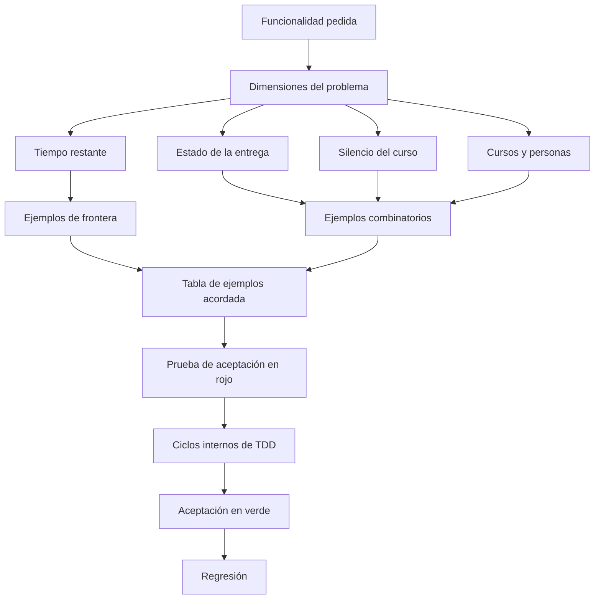

# SE-545 — ATDD y Specification by Example: aceptación ejecutable

[← SE-544 — BDD: ejemplos, conversación y lenguaje compartido](https://github.com/vladimiracunadev-create/modern-software-engineering-program/blob/main/classes/part-45-metodologias-de-desarrollo-de-tdd-a-odd/se-544-bdd-ejemplos-conversacion-y-lenguaje-compartido/README.md) · [↑ Parte 45](https://github.com/vladimiracunadev-create/modern-software-engineering-program/blob/main/classes/part-45-metodologias-de-desarrollo-de-tdd-a-odd/README.md) · [📚 Índice completo](https://github.com/vladimiracunadev-create/modern-software-engineering-program/blob/main/classes/README.md) · [🌐 Portal](https://vladimiracunadev-create.github.io/modern-software-engineering-program/classes/SE-545.html) · [SE-546 — DDD como lenguaje ubicuo y contexto para agentes →](https://github.com/vladimiracunadev-create/modern-software-engineering-program/blob/main/classes/part-45-metodologias-de-desarrollo-de-tdd-a-odd/se-546-ddd-como-lenguaje-ubicuo-y-contexto-para-agentes/README.md)

## Punto profesional y fundamento pedagógico

**Punto profesional.** La clase existe para que elijas los **ejemplos de aceptación** con el mismo cuidado con que eliges el diseño. Un ejemplo de aceptación es un caso concreto que quien encarga el trabajo acepta como prueba de que el cambio hace lo que pidió. Lo que decide si esos ejemplos protegen es qué dimensiones del problema varían y cuáles no, no cuántos son. Un equipo que escribe veinte ejemplos «típicos» cree tener una suite de aceptación y tiene una colección de casos que comparten los mismos supuestos. La habilidad profesional es reconocer qué dimensiones faltan.

**Por qué aparece aquí.** Sigue a **BDD** porque la formulación en escenarios deja abierta la pregunta que esta clase responde: qué ejemplos elegir. ATDD (desarrollo guiado por pruebas de aceptación) y Specification by Example (especificar con ejemplos) son el mismo movimiento visto desde dos lados: los ejemplos acordados con negocio son a la vez la especificación y la prueba. La [Parte 35](../../part-35-estrategia-y-tecnicas-de-prueba/README.md) trató el análisis de valores límite y la partición de equivalencia; aquí se miden sus efectos sobre un conjunto de ejemplos de aceptación.

**Error conceptual que debe corregir.** Creer que más ejemplos protegen más. En el laboratorio, veinte ejemplos al azar matan menos mutantes que doce ejemplos elegidos en los límites del tiempo, y 144 ejemplos combinatorios no matan un mutante que un solo ejemplo bien elegido mataría. El número de ejemplos no dice nada; las dimensiones que varían, sí.

**Secuencia de aprendizaje.** Antes de ejecutar, predices cuántos de los 18 mutantes mata cada uno de cuatro conjuntos de ejemplos (cinco típicos, doce de frontera, veinte al azar y 144 combinatorios) y cuál deja vivo un mutante que parece fácil. Después ejecutas los cuatro, miras qué dimensiones varía cada uno y decides qué ejemplo añadir.

**Evidencia de aprendizaje.** `ejemplos-log.md` con tu predicción, la tabla de los cuatro conjuntos, la tabla de dimensiones que varía cada uno, un ejemplo nuevo que mate el mutante que sobrevive al conjunto más grande y una nota que separe qué es medido y qué depende de que los resultados esperados los escriba una persona.

**Límite de la conclusión.** Los cuatro conjuntos y los 18 mutantes son del autor. Los **resultados esperados** de cada ejemplo salen de un modelo de referencia escrito aparte; en un proyecto real los redacta una persona de negocio, y esa es precisamente la parte que aquí no se mide. No se evaluó ningún proceso de acuerdo con personas ni la mantención de los ejemplos en el tiempo. No se invocó ningún modelo de lenguaje.

### Trazabilidad fuente → afirmación

| Fuente primaria u oficial | Afirmación que respalda | Lo que no prueba |
|---|---|---|
| [Adzic, «Specification by Example»](https://gojko.net/books/specification-by-example/) | Presenta la práctica de especificar con ejemplos concretos acordados y mantenerlos como documentación ejecutable. | No cuantifica el efecto sobre defectos. |
| [Cucumber, «Behaviour-Driven Development»](https://cucumber.io/docs/bdd/) | Sostiene que los ejemplos documentados se convierten en un activo que permite cambiar el sistema con confianza. | No dice cuántos ejemplos bastan. |
| [Agile Alliance, «Three Amigos»](https://www.agilealliance.org/glossary/three-amigos/) | Recoge la convención de acordar los ejemplos entre negocio, desarrollo y prueba. | No mide su efecto. |
| [Beck, «Canon TDD»](https://tidyfirst.substack.com/p/canon-tdd) | Fundamenta el ciclo interno de TDD dentro del ciclo externo de aceptación. | No trata la aceptación. |
| [DeMillo, Lipton y Sayward](https://doi.org/10.1109/C-M.1978.218136) | Fundamenta medir los conjuntos de ejemplos con mutantes. | No dice que los mutantes imiten defectos reales. |

## Antes de empezar

Recupera lo aprendido en `SE-544`: un escenario protege por su «Entonces». La pregunta activa es: **si alguien te diera hoy diez ejemplos de aceptación de una funcionalidad de tu proyecto, ¿qué dimensiones del problema crees que varían y cuáles no, y cómo lo averiguarías sin ejecutarlos?**

## Prerrequisitos

- Haber completado `SE-544` o poder explicar qué es un escenario y qué lo hace decorativo.
- Haber visto en la [Parte 35](../../part-35-estrategia-y-tecnicas-de-prueba/README.md) qué son la partición en clases de equivalencia y el análisis de valores límite.
- Python 3.11 o posterior; los experimentos usan solo la biblioteca estándar.

## Problema auténtico

Para aceptar el silencio de un curso, las docentes piden ejemplos. El equipo prepara una tabla de cinco casos típicos: un aviso a las 72 horas, otro a las 24, uno de la última hora, una entrega ya entregada y un curso silenciado. Las docentes los aprueban. Con esa tabla, el servicio pasa la aceptación y sale a producción. Dos semanas después, una estudiante recibe un aviso de la última hora de un curso que había silenciado hacía un mes y otra deja de recibir los de su otro curso, que no había silenciado. Ningún ejemplo de la tabla tenía a una persona con dos cursos ni distinguía entre silenciar a la persona y silenciar el curso.

La clase mide qué le pasó a esa tabla. Se comparan cuatro conjuntos de ejemplos sobre los mismos 18 mutantes y se mira qué dimensiones varía cada uno: el tiempo restante, si la entrega está entregada, si el curso está silenciado y si hay varios cursos o personas. El resultado muestra que la aceptación no mejora con el número de ejemplos sino con la variación de las dimensiones relevantes, y que la que se olvida suele ser la que la persona de negocio da por obvia.

## Objetivos observables

Al terminar podrás:

1. distinguir ATDD (aceptación primero, con ciclos internos de TDD) de Specification by Example (los ejemplos como especificación viva);
2. listar las dimensiones de un problema y comprobar cuáles varía un conjunto de ejemplos;
3. construir un conjunto de ejemplos de frontera y otro combinatorio y comparar su capacidad de detección;
4. explicar por qué un conjunto combinatorio puede dejar vivo un mutante que depende de una dimensión que no varía;
5. decidir cuántos ejemplos y de qué clase se acuerdan con negocio y cuáles se dejan a pruebas técnicas.

## Mapa conceptual



El mapa muestra que los ejemplos nacen de las dimensiones del problema y no de la intuición del momento. La tabla acordada alimenta una prueba de aceptación que guía el desarrollo.

## Temas y por qué importan

| Tema | Por qué cambia una decisión profesional | Evidencia mínima |
|---|---|---|
| ATDD y ciclo doble | La aceptación guía; el TDD interno la cumple paso a paso. | Una prueba de aceptación en rojo antes del código |
| Specification by Example | Los ejemplos son la especificación y la prueba. | Una tabla de ejemplos con un solo origen |
| Dimensiones del problema | Un ejemplo que no varía una dimensión no la protege. | Tabla de dimensiones por conjunto |
| Valores de frontera | Los errores se concentran donde cambia la regla. | Ejemplos en los límites del tiempo |
| Combinaciones | Cubren interacciones que los ejemplos sueltos no ven. | Conjunto combinatorio y su costo |
| Resultado esperado | Quien lo escribe define qué es correcto. | Autoría de cada resultado |

## Conceptos y decisiones

### 1. ATDD: dos ciclos anidados

ATDD añade a TDD un ciclo externo. Los ejemplos de aceptación se acuerdan primero, se convierten en una prueba de aceptación que falla y, mientras esa prueba está en rojo, se desarrolla el código con ciclos pequeños de rojo-verde-refactor (`SE-542`). Cuando la prueba de aceptación pasa, la funcionalidad cumple lo acordado. El ciclo externo responde «¿hicimos lo que se pidió?» y el interno, «¿cómo lo construimos?». Si solo existe el interno, el equipo puede construir con rigor algo que nadie pidió; si solo existe el externo, la construcción pierde la guía de pasos pequeños.

### 2. Specification by Example: el ejemplo como especificación

La práctica que Adzic describe sustituye la especificación en prosa por ejemplos concretos acordados, que se mantienen como documentación ejecutable. La idea de fondo coincide con la de `SE-565`: una frase ambigua admite muchas lecturas y un ejemplo con datos admite una. Con un ejemplo («curso silenciado, faltan 24 horas: no hay aviso») no se puede debatir qué quiso decir la frase. El costo es que los ejemplos deben mantenerse: un ejemplo que deja de ser cierto pero sigue en la suite es peor que ninguno.

### 3. Las dimensiones del problema

Un problema se describe con dimensiones: variables que pueden tomar valores distintos y cuya combinación define casos. En la regla de avisos son cuatro: el **tiempo restante** (continuo, con límites en 72, 24, 1 y 0 horas), el **estado de la entrega** (pendiente o entregada), el **silencio** del curso (sí o no) y la **identidad** (personas y cursos distintos). Los avisos ya enviados son una quinta que condiciona qué umbral toca. Para saber si un conjunto de ejemplos protege hay que preguntar, dimensión por dimensión, qué valores toma. Es una pregunta barata que casi nadie hace.

### 4. Valores de frontera: dónde se esconden los errores

Las reglas con umbrales fallan en el umbral: `<` en vez de `<=`, una hora de más o de menos. Un ejemplo de frontera elige los valores justo en el límite y a un lado y otro: 73, 72 y 71 horas restantes; 25, 24 y 23; 2, 1 y 0,5; 0 y −1. Doce ejemplos de frontera sobre el tiempo matan los mutantes de comparación que cinco ejemplos típicos no ven (el de avisar una hora antes, el de invertir `<=`), pero no varían las demás dimensiones.

### 5. Combinaciones: lo que ven y lo que no

Combinar todos los valores de varias dimensiones cubre interacciones: una entrega entregada **y** silenciada, un aviso ya enviado **y** un curso silenciado. El conjunto combinatorio del laboratorio tiene 144 ejemplos (doce valores de tiempo por dos estados de entrega, dos de silencio y tres de avisos previos) y mata 17 de 18 mutantes. El que no mata es el que silencia a la persona en todos sus cursos, porque el conjunto usa siempre una persona y un curso: **una dimensión que no varía no se puede comprobar, por muchas combinaciones que haya de las demás**.

### 6. El resultado esperado es lo más caro

Un ejemplo es una entrada y un resultado esperado. La entrada se genera; el resultado lo decide alguien. En el laboratorio, los resultados salen de un modelo de referencia escrito aparte, lo que es una simplificación: en un proyecto real los redacta una persona de negocio y ahí está el valor de la práctica. Un conjunto grande de ejemplos con resultados generados por el propio código no acuerda nada: confirma el código. Por eso se acuerdan pocos ejemplos con negocio y muchos se dejan a técnicas generativas con propiedades (`SE-547`).

## Cuatro conjuntos de ejemplos

Se construyeron cuatro conjuntos sobre la regla de avisos. Los **cinco típicos** son los que aprobó la docente: tres horas arbitrarias (100, 48 y 10 horas restantes), una entrega ya entregada y un curso silenciado. Los **doce de frontera** son doce valores del tiempo restante en los límites (100, 73, 72, 71, 25, 24, 23, 2, 1, 0,5, 0 y −1) con la entrega pendiente y el curso sin silenciar. Los **veinte al azar** son valores aleatorios con semilla fija de todas las dimensiones. Los **144 combinatorios** son los doce valores de tiempo por entregada o no, silenciado o no y tres estados de avisos previos. Todos pasan con la implementación original.


**Cómo leer la figura.** Cada barra es un conjunto de ejemplos de aceptación y su largo los mutantes que mata, de los 18 no equivalentes; la línea discontinua es el total. Más ejemplos no es necesariamente mejor: 20 al azar matan menos (8) que 12 de frontera del tiempo (11), y el conjunto combinatorio de 144 llega a 17 pero deja vivo M08. Qué mutantes deja vivos cada conjunto queda en la tabla. **Dónde deja de valer:** los cuatro conjuntos y los resultados esperados (de un modelo aparte) son del autor; el azar usa una semilla fija y otra semilla daría otras cifras. La figura muestra el mecanismo de que el número de ejemplos no ordena la capacidad de detección.

Un hallazgo que merece atención: unir frontera con típicos (17 ejemplos) mata 14, bastante menos que los 144 combinatorios (17) y solo tres más que los doce de frontera solos (11). Quedan vivos cuatro mutantes (repetir un aviso, silenciar por persona, mirar los envíos de otras entregas e invertir una comparación de avisos previos), porque ningún ejemplo de esos conjuntos varía los avisos previos ni la identidad. La unión de dos conjuntos que miran el tiempo no compensa que ninguno mire lo demás.

## El ciclo externo de aceptación

El ciclo de ATDD empieza con la tabla de ejemplos redactada con negocio, la convierte en una prueba de aceptación que falla, y mientras falla se desarrolla con TDD. Cuando pasa, se muestra a quien aceptó los ejemplos y los ejemplos pasan a la suite de regresión.


**Cómo leer la figura.** Las tres primeras cajas son el ciclo de construcción; las dos últimas, el cierre. **Dónde deja de valer:** el diagrama supone que existe una persona que acepta los ejemplos y que los ejemplos son estables. Si los ejemplos cambian cada semana, el ciclo externo se vuelve costoso, y si la persona que acepta no puede leer la tabla, el acuerdo es una formalidad.

## Qué dimensiones varía cada conjunto

La forma más barata de saber qué protege un conjunto no es ejecutarlo: es mirar cuántos valores toma cada dimensión. Los cinco típicos toman tres valores del tiempo y una vez cada uno de los demás; los doce de frontera cubren el tiempo y nada más; los veinte al azar varían todo, pero con pocos valores por dimensión; los 144 varían tiempo, estado de la entrega, silencio y avisos previos, y no varían la identidad.


**Cómo leer la figura.** Cada fila es un conjunto de ejemplos y cada columna una dimensión del problema; el color y el texto de la celda dicen si el conjunto la varía (sí, oscuro), la varía solo en parte (parcial) o no la varía (no, claro). Ningún conjunto varía a la vez el curso y la persona, y por eso ningún ejemplo distingue silenciar a una persona de silenciar un curso: esa es la razón de que los 144 combinatorios dejen vivo M08. **Dónde deja de valer:** la tabla es una descripción de cómo se construyeron los conjuntos; la lista de dimensiones también es una decisión del autor. Un problema real tiene dimensiones que nadie ha nombrado, y descubrirlas es parte del trabajo de acordar ejemplos.

## Definiciones de trabajo

- **Ejemplo de aceptación:** caso concreto con entrada y resultado esperado acordado con negocio.
- **ATDD:** desarrollo guiado por pruebas de aceptación; ciclo externo sobre TDD.
- **Specification by Example:** práctica de especificar con ejemplos concretos acordados.
- **Dimensión:** variable del problema cuyos valores definen casos.
- **Valor de frontera:** valor en el límite donde cambia la regla.
- **Conjunto combinatorio:** ejemplos con todas las combinaciones de valores de varias dimensiones.

## Ejemplo mínimo

Un ejemplo de frontera para el silencio:

```text
Dado un curso silenciado y una entrega que vence en la hora 100
Cuando el reloj marca la hora 75        (faltan 25 horas)
Entonces no se envía ningún aviso
Cuando el reloj marca la hora 76        (faltan 24 horas)
Entonces no se envía ningún aviso      (el silencio bloquea el de 24 horas)
Cuando el reloj marca la hora 99        (falta 1 hora)
Entonces se envía el aviso de 1 horas   (el de la última hora se conserva)
```

Tres ejemplos de la misma dimensión (tiempo) con el silencio activo. Si los tres pasan, el silencio protege los límites del tiempo; no protege nada sobre qué curso o qué persona se silencia.

## Ejemplo profesional

*Escenario ilustrativo: las cifras y los resultados que aparecen en este ejemplo son supuestos de la narración, no mediciones.*

Antes de construir el silencio, el equipo y la docente hacen una lista de dimensiones: tiempo, estado de la entrega, silencio, avisos previos, curso, persona y canal. Para cada una deciden cuántos valores acordar: el tiempo, doce valores de frontera; el estado y el silencio, dos cada uno; los avisos previos, tres; el curso y la persona, dos de cada una con una condición explícita («una persona con dos cursos, uno silenciado»). Acuerdan veintiocho ejemplos, no 144, y los reparten: los de negocio (la regla del silencio por curso, el de la última hora) como escenarios legibles; los de límites del tiempo como una tabla que la docente revisa sin necesidad de leerla. El resto lo genera una propiedad sobre estados al azar. La prueba de aceptación completa tarda menos de un segundo. Antes de aceptar, el equipo siembra ocho mutantes y comprueba que mueren todos.

## Práctica guiada

1. Lista las dimensiones de una regla de tu proyecto y anota cuántos valores toma cada una en tu suite actual.
2. Predice cuántos mutantes mata cada uno de los cuatro conjuntos de la clase.
3. Ejecuta `python scripts/experiments_part45_a.py 485` y compara.
4. Añade un ejemplo con dos personas en el mismo curso y comprueba que mata el mutante que sobrevive a los 144.
5. Redacta con una persona de negocio los resultados esperados de cinco ejemplos y anota en cuántos discrepaba con el modelo.

## Ejercicios

1. **Básico.** Explica por qué veinte ejemplos al azar matan menos que doce de frontera.
2. **Intermedio.** Reduce el conjunto combinatorio a la menor cantidad de ejemplos que sigue matando 17 de 18 y justifica cuáles quitas.
3. **Avanzado.** Añade la dimensión «canal» (correo o mensajería) a la regla y construye el conjunto mínimo que la varíe sin multiplicar los ejemplos.

## Reto verificable

Entrega `ejemplos-log.md` con la tabla de dimensiones de una regla de tu proyecto, un conjunto de ejemplos de frontera y otro combinatorio, la medida con al menos seis mutantes y el ejemplo que mata el sobreviviente. Es válido si la medida se puede reproducir y si cada ejemplo tiene resultado esperado con autoría declarada.

## Caso conductor

*Avisos* es el servicio de recordatorios y el silencio de un curso es el cambio. Los conjuntos de esta clase se vuelven a usar en `SE-551`, donde la tabla de ejemplos de ATDD se compara con las otras metodologías sobre el mismo cambio.

## Preguntas frecuentes

### ¿ATDD y BDD son lo mismo?

Se solapan mucho. ATDD pone el acento en que la prueba de aceptación guía el desarrollo; BDD, en el lenguaje compartido y la conversación. Un equipo puede hacer ATDD sin Gherkin y BDD sin una prueba de aceptación automatizada.

### ¿Cuántos ejemplos debo acordar?

Los que varíen las dimensiones relevantes con los valores que importan, y no más. Es mejor acordar poco con negocio y generar el resto con propiedades.

### ¿Quién escribe el resultado esperado?

Quien conoce el negocio. Si lo escribe el programador a partir del código, el ejemplo confirma el código.

### ¿Puede un agente generar los ejemplos?

Puede proponerlos y variar las dimensiones; pero el acuerdo sobre qué es correcto es humano. Un agente que genera entradas y resultados a la vez produce documentación circular.

## Fallo controlado y diagnóstico

**Fallo.** Una persona con dos cursos, uno silenciado, deja de recibir avisos del otro. El conjunto de aceptación pasaba.

**Diagnóstico paso a paso.** (1) Se reproduce con un ejemplo de dos cursos y falla. (2) Se mira la tabla de dimensiones del conjunto: ningún ejemplo tenía dos cursos. (3) Se clasifica el defecto como dimensión no variada. (4) Se localiza la regla que silencia por persona.

**Corrección.** Se añade el ejemplo (una persona, dos cursos, uno silenciado), se ve fallar, se corrige a clave por curso y se añade una columna «varios cursos» a la tabla de dimensiones para la próxima funcionalidad.

## Errores comunes y cómo corregirlos

- **Contar ejemplos en vez de dimensiones.** Corrige con la tabla de dimensiones.
- **Ejemplos todos felices.** Corrige añadiendo bordes y estados raros.
- **Resultados esperados generados por el código.** Corrige con un modelo independiente o una persona.
- **Multiplicar combinaciones sin límite.** Corrige con propiedades para el exceso.
- **Mantener ejemplos obsoletos.** Corrige revisando la suite cuando cambia la regla.
- **Olvidar la identidad.** Corrige añadiendo casos con varias personas y varios cursos.

## Entorno y archivos clave

- `scripts/experiments_part45_a.py`: construcción de los cuatro conjuntos; `python scripts/experiments_part45_a.py 485`.
- `scripts/experiments_part45_lab.py`: núcleo, mutantes y modelo de referencia.
- `content/part-45/figures/`: figuras.

## Seguridad, ética y accesibilidad

Los ejemplos con datos reales de estudiantes son datos personales; usa datos sintéticos o anonimizados y no los subas a un repositorio público. Ética: la persona de negocio que acuerda los ejemplos decide qué es correcto para quienes recibirán los avisos; invitar a quien los recibe, o a quien lo representa, es parte del método. Accesibilidad: una tabla de ejemplos legible por lector de pantalla es una ventaja de la práctica; las figuras de la clase tienen texto alternativo completo.

## Puente hacia el trabajo con agentes

Pedir a un agente que «implemente esta tabla de ejemplos» es una buena delegación si los ejemplos son un oráculo independiente: el agente no puede cambiarlos. Dos prácticas la refuerzan. La primera es entregarle además las dimensiones del problema y pedirle que señale las que la tabla no varía, no que añada ejemplos por su cuenta. La segunda es medir el conjunto con mutantes que él mismo proponga: los que sobreviven indican qué ejemplo falta, y quien decide el resultado esperado es una persona.

## Transferencia

Elige una regla con tres o más dimensiones en tu proyecto y haz la tabla de dimensiones de su suite actual. Marca las que no varían y escribe un ejemplo para cada una. Si la suite tiene cien ejemplos y una dimensión no varía, el problema no es de cantidad.

## Evaluación y evidencia

| Criterio | Evidencia aceptable | Rechazo |
|---|---|---|
| Dimensiones listadas | Tabla con valores por dimensión | Lista de ejemplos sueltos |
| Medida con mutantes | Reproducible con semilla | Sin comando |
| Mutante vivo explicado | Dimensión que no varía | «Faltan más ejemplos» |
| Autoría del resultado | Persona o modelo declarado | Resultado sin autoría |
| Límite | Distingue lo medido de lo acordado | Presenta una tasa general |

## Fuentes

- Adzic, G. [«Specification by Example»](https://gojko.net/books/specification-by-example/).
- Cucumber. [«Behaviour-Driven Development»](https://cucumber.io/docs/bdd/).
- Agile Alliance. [«Three Amigos»](https://www.agilealliance.org/glossary/three-amigos/).
- Beck, K. [«Canon TDD»](https://tidyfirst.substack.com/p/canon-tdd).
- DeMillo, R., Lipton, R. y Sayward, F. [«Hints on Test Data Selection»](https://doi.org/10.1109/C-M.1978.218136).

## Límites y siguiente paso

Los conjuntos y los mutantes son del autor y los resultados esperados vienen de un modelo; no se midió un proceso de acuerdo con personas. El siguiente paso, `SE-546`, trata las palabras de esos ejemplos: DDD ordena el lenguaje y los contextos donde cada palabra vale, porque «entrega» no significa lo mismo en todas partes.

## Glosario

| Término | Definición breve |
|---|---|
| ATDD | Desarrollo guiado por pruebas de aceptación |
| Specification by Example | Especificar con ejemplos concretos acordados |
| Dimensión | Variable del problema cuyos valores definen casos |
| Valor de frontera | Valor en el límite de una regla |
| Conjunto combinatorio | Ejemplos con todas las combinaciones de valores |
| Resultado esperado | Salida que alguien acordó como correcta |

---

[← SE-544 — BDD: ejemplos, conversación y lenguaje compartido](https://github.com/vladimiracunadev-create/modern-software-engineering-program/blob/main/classes/part-45-metodologias-de-desarrollo-de-tdd-a-odd/se-544-bdd-ejemplos-conversacion-y-lenguaje-compartido/README.md) · [↑ Parte 45](https://github.com/vladimiracunadev-create/modern-software-engineering-program/blob/main/classes/part-45-metodologias-de-desarrollo-de-tdd-a-odd/README.md) · [📚 Índice completo](https://github.com/vladimiracunadev-create/modern-software-engineering-program/blob/main/classes/README.md) · [🌐 Portal](https://vladimiracunadev-create.github.io/modern-software-engineering-program/classes/SE-545.html) · [SE-546 — DDD como lenguaje ubicuo y contexto para agentes →](https://github.com/vladimiracunadev-create/modern-software-engineering-program/blob/main/classes/part-45-metodologias-de-desarrollo-de-tdd-a-odd/se-546-ddd-como-lenguaje-ubicuo-y-contexto-para-agentes/README.md)
