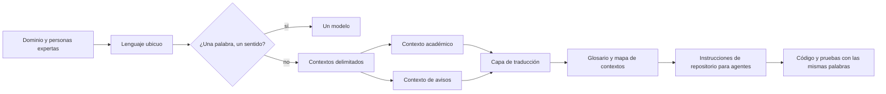

# SE-546 — DDD como lenguaje ubicuo y contexto para agentes

[← SE-545 — ATDD y Specification by Example: aceptación ejecutable](https://github.com/vladimiracunadev-create/modern-software-engineering-program/blob/main/classes/part-45-metodologias-de-desarrollo-de-tdd-a-odd/se-545-atdd-y-specification-by-example-aceptacion-ejecutable/README.md) · [↑ Parte 45](https://github.com/vladimiracunadev-create/modern-software-engineering-program/blob/main/classes/part-45-metodologias-de-desarrollo-de-tdd-a-odd/README.md) · [📚 Índice completo](https://github.com/vladimiracunadev-create/modern-software-engineering-program/blob/main/classes/README.md) · [🌐 Portal](https://vladimiracunadev-create.github.io/modern-software-engineering-program/classes/SE-546.html) · [SE-547 — Diseño por contrato y pruebas de contrato como oráculo →](https://github.com/vladimiracunadev-create/modern-software-engineering-program/blob/main/classes/part-45-metodologias-de-desarrollo-de-tdd-a-odd/se-547-diseno-por-contrato-y-pruebas-de-contrato-como-oraculo/README.md)

## Punto profesional y fundamento pedagógico

**Punto profesional.** La clase existe para que trates el vocabulario del dominio como una pieza de ingeniería con límites, no como decoración. La misma palabra significa cosas distintas según quién la usa y dónde: en esta plataforma, «entrega» es el trabajo que una persona estudiante sube, una liberación de software y el hecho de que un mensaje llegue. Cuando esos sentidos conviven sin frontera, el código acumula traducciones implícitas y los errores que producen no lanzan excepciones: el sistema funciona y hace otra cosa. Con agentes de código el problema se agrava, porque el agente lee las palabras como las lee un modelo de lenguaje: por su contexto más probable, no por el significado que le dio tu equipo.

**Por qué aparece aquí.** Sigue a **ATDD y Specification by Example** porque los ejemplos de aceptación se escriben con palabras y esas palabras deben significar lo mismo para quien las acuerda y para quien programa. Retoma `SE-329` (DDD estratégico y táctico) desde el ángulo de las metodologías: aquí no se enseña a modelar un dominio sino cómo el **lenguaje ubicuo** y los **contextos delimitados** sirven de contrato entre personas y agentes.

**Error conceptual que debe corregir.** Creer que DDD consiste en bloques tácticos (entidades, agregados, repositorios). Eric Evans insiste en que el valor está primero en el lenguaje compartido y en delimitar dónde cada modelo vale. Un equipo con agregados y repositorios pero con tres significados de «entrega» en el mismo módulo no practica DDD; uno con un glosario claro y fronteras explícitas, sí, aunque su código sea sencillo.

**Secuencia de aprendizaje.** Antes de ejecutar, predices cuántos sentidos distintos tiene «entrega» en las clases de este programa; después cuentas las frases por sentido con reglas léxicas, traduces entre dos contextos con una capa que protege al modelo de avisos y mides qué ocurre cuando falta la traducción.

**Evidencia de aprendizaje.** `lenguaje-log.md` con tu predicción, el glosario de tu proyecto con una palabra de varios sentidos, un mapa de contextos con una frontera y su traducción y una nota que separe lo medido (recuento y traducción) de lo no medido (el efecto de DDD en un equipo).

**Límite de la conclusión.** El recuento usa reglas léxicas burdas sobre el corpus de este programa (las Partes [00](../../part-00-ingenieria-de-software-como-profesion/README.md)–[22](../../part-22-embedded-iot-y-tiempo-real/README.md), [24](../../part-24-software-especializado-y-dominios/README.md)–[25](../../part-25-diseno-patrones-y-refactorizacion/README.md), [27](../../part-27-arquitectura-de-software-y-dominio/README.md), [29](../../part-29-datos-persistencia-y-recuperacion/README.md), [31](../../part-31-integracion-eventos-y-mensajeria/README.md)–[33](../../part-33-cloud-plataforma-e-infraestructura/README.md), [35](../../part-35-estrategia-y-tecnicas-de-prueba/README.md)–[36](../../part-36-calidad-rendimiento-y-resiliencia/README.md), [38](../../part-38-seguridad-privacidad-y-cumplimiento/README.md)–[41](../../part-41-observabilidad-sre-e-incidentes/README.md), [43](../../part-43-mantenimiento-y-modernizacion-legacy/README.md)–[44](../../part-44-gestion-liderazgo-y-practica-profesional/README.md) y [46](../../part-46-desarrollo-de-software-asistido-por-ia/README.md)–[47](../../part-47-spec-agentes-y-ciclo-de-vida-agentic/README.md)): clasifica 713 de 4 249 frases y no reconoce sentido en 3 536. La traducción se probó con ocho entregas sintéticas. La clase **no mide** que DDD mejore la calidad ni la comunicación de un equipo; mide dos mecanismos concretos: la polisemia de un término y el error silencioso de no traducir entre contextos. No se invocó ningún modelo de lenguaje.

### Trazabilidad fuente → afirmación

| Fuente primaria u oficial | Afirmación que respalda | Lo que no prueba |
|---|---|---|
| [Evans, «Domain-Driven Design Reference»](https://www.domainlanguage.com/wp-content/uploads/2016/05/DDD_Reference_2015-03.pdf) | Resume el lenguaje ubicuo, el contexto delimitado y los patrones de relación entre contextos, entre ellos la capa anticorrupción. | No dice cuándo compensa el esfuerzo de modelar. |
| [Domain Language, «Domain-Driven Design»](https://www.domainlanguage.com/ddd/) | Sitúa DDD como una forma de enfocar el desarrollo en el modelo del dominio. | No mide resultados. |
| [Cucumber, «Behaviour-Driven Development»](https://cucumber.io/docs/bdd/) | Sostiene que el código refleja la documentación y la documentación el entendimiento compartido del dominio. | No define el lenguaje. |
| [Python: `re`](https://docs.python.org/3/library/re.html) | Documenta las expresiones regulares del recuento léxico. | No valida las reglas elegidas. |

## Antes de empezar

Recupera lo aprendido en `SE-545`: una dimensión que no varía no se puede comprobar. La pregunta activa es: **¿qué palabra de tu proyecto significa cosas distintas en dos equipos o en dos módulos, y cuál fue el último error que causó esa diferencia?**

## Prerrequisitos

- Haber completado `SE-545` o poder explicar qué es un ejemplo de aceptación y qué dimensiones varía.
- Haber visto `SE-329` sobre DDD estratégico y táctico.
- Python 3.11 o posterior; los experimentos usan solo `re` y `pathlib`.

## Problema auténtico

El equipo de *Avisos* recibe de la plataforma un objeto `entrega` con los campos `entrega_id`, `estudiante`, `vence_en` y `estado`, donde `estado` vale «pendiente» o «recibida». El servicio de avisos modela su propia `delivery` con un campo booleano `submitted`. Alguien conecta los dos pasando el objeto de la plataforma tal cual: el campo `estado` llega a `submitted` como texto. En Python, `"pendiente"` y `"recibida"` son verdaderos los dos. El servicio no lanza ninguna excepción, las pruebas con datos de ejemplo (que ya traían booleanos) pasan, y en producción ningún estudiante recibe un aviso porque todas sus entregas «ya fueron entregadas».

La clase reproduce la falla. Primero mide cuántos sentidos tiene «entrega» en las clases de este programa, que usa la palabra para trabajo, liberación de software y llegada de mensajes. Después traduce ocho entregas del contexto académico al de avisos con una capa que conoce los dos vocabularios y compara el resultado con pasarlas sin traducir. Muestra que el error silencioso viene de un nombre compartido sin traducción explícita, no de un defecto de código.

## Objetivos observables

Al terminar podrás:

1. definir lenguaje ubicuo, contexto delimitado y capa anticorrupción y distinguirlos de los patrones tácticos;
2. detectar con un recuento léxico los términos polisémicos de un corpus y clasificar sus sentidos;
3. dibujar un mapa de dos contextos con la traducción entre ellos y señalar dónde se conocen ambos vocabularios;
4. reproducir un error silencioso de traducción y escribir la prueba que lo detecta;
5. escribir un glosario y una instrucción de repositorio que un agente pueda usar sin adivinar el sentido.

## Mapa conceptual



El mapa muestra que la decisión central es si una palabra tiene un sentido o varios. Si tiene varios, cada sentido vive en un contexto y entre contextos hay una traducción explícita; el glosario y las instrucciones del repositorio comunican esa decisión a quien lee el código, incluidos los agentes.

## Temas y por qué importan

| Tema | Por qué cambia una decisión profesional | Evidencia mínima |
|---|---|---|
| Lenguaje ubicuo | Si el código y la conversación usan palabras distintas, cada traducción mental es un riesgo. | Glosario con una palabra por concepto |
| Contexto delimitado | Dice dónde vale un modelo; fuera de él, la palabra puede significar otra cosa. | Mapa con al menos dos contextos |
| Polisemia | Una palabra con varios sentidos sin fronteras produce errores silenciosos. | Recuento de sentidos de un término |
| Capa anticorrupción | Evita que el modelo de otro contexto contamine el propio. | Capa con una prueba que falle sin ella |
| Glosario e instrucciones | Es lo único que ve un agente antes de decidir qué significa una palabra. | Glosario enlazado desde las instrucciones del repositorio |
| Patrones tácticos | Son útiles dentro de un contexto, no sustituyen la delimitación. | Un agregado justificado por una invariante |

## Conceptos y decisiones

### 1. Lenguaje ubicuo

El **lenguaje ubicuo** es el vocabulario que comparten las personas expertas del dominio y el equipo de desarrollo, y que se usa en la conversación, en la documentación y en el código. La palabra «ubicuo» es una exigencia: no puede haber un vocabulario de negocio y otro de código con una traducción mental entre ambos. Evans lo describe como el modelo hecho lenguaje. En la práctica significa que los nombres de clases, funciones y campos salen del glosario y que, cuando una palabra del negocio cambia, cambia en el código. No es un diccionario escrito una vez: es un acuerdo que se revisa con cada ejemplo de aceptación (`SE-545`).

### 2. Contexto delimitado

Un **contexto delimitado** es el límite dentro del cual un modelo y su lenguaje son consistentes. Dentro del contexto académico, «entrega» es el trabajo de una persona estudiante, con un estado «pendiente» o «recibida». Dentro del contexto de avisos, «entrega» es un elemento con vencimiento y un indicador de si ya se entregó. Los dos contextos no necesitan acordar una definición única; necesitan una **traducción explícita** en su frontera. El error de pretender un modelo único para todo el sistema produce un objeto con campos para todos los usos que nadie entiende por completo.

### 3. La palabra con varios sentidos

La polisemia es normal en un dominio y se vuelve peligrosa cuando los sentidos conviven sin frontera. El recuento del experimento lo muestra con un corpus real: en las 4 249 frases de las Partes [00](../../part-00-ingenieria-de-software-como-profesion/README.md)–[22](../../part-22-embedded-iot-y-tiempo-real/README.md), [24](../../part-24-software-especializado-y-dominios/README.md)–[25](../../part-25-diseno-patrones-y-refactorizacion/README.md), [27](../../part-27-arquitectura-de-software-y-dominio/README.md), [29](../../part-29-datos-persistencia-y-recuperacion/README.md), [31](../../part-31-integracion-eventos-y-mensajeria/README.md)–[33](../../part-33-cloud-plataforma-e-infraestructura/README.md), [35](../../part-35-estrategia-y-tecnicas-de-prueba/README.md)–[36](../../part-36-calidad-rendimiento-y-resiliencia/README.md), [38](../../part-38-seguridad-privacidad-y-cumplimiento/README.md)–[41](../../part-41-observabilidad-sre-e-incidentes/README.md), [43](../../part-43-mantenimiento-y-modernizacion-legacy/README.md)–[44](../../part-44-gestion-liderazgo-y-practica-profesional/README.md) y [46](../../part-46-desarrollo-de-software-asistido-por-ia/README.md)–[47](../../part-47-spec-agentes-y-ciclo-de-vida-agentic/README.md) que contienen «entrega», unas 487 se refieren al trabajo de una persona estudiante (en 29 partes), 89 a liberar o desplegar software (en 16 partes) y 122 a hacer llegar un mensaje o un resultado (en 19 partes); 15 mezclan sentidos en la misma frase. No es un defecto del texto: es el tipo de ambigüedad que un glosario con contexto resuelve.

### 4. Capa anticorrupción

La **capa anticorrupción** es la traducción entre contextos que impide que el modelo de uno contamine al otro. En el laboratorio es una función de seis líneas que convierte `entrega_id` en `id`, `estudiante` en `student`, `vence_en` en `due` y, lo más importante, el estado textual en un booleano: «recibida» pasa a verdadero y «pendiente» a falso. La función es el único lugar donde se conocen ambos vocabularios. Si mañana la plataforma añade un estado «en revisión», se decide en un solo lugar si cuenta como entregada.

### 5. Qué pasa cuando falta la traducción

Sin traducción, el campo de texto llega al servicio como si fuera un booleano. Python evalúa los textos no vacíos como verdaderos, de modo que las ocho entregas se consideran entregadas y el servicio no envía ningún aviso. No hay excepción, ningún registro de error y las pruebas con datos ya traducidos siguen pasando. Es el tipo de fallo que solo se ve comparando el comportamiento con lo esperado: una prueba de contrato en la frontera lo habría detectado.

### 6. Glosario y agentes

Un agente de código no conoce tu dominio: lo infiere de los nombres. Si el glosario dice que «entrega» en el contexto de avisos es un elemento con vencimiento y que `submitted` es un booleano, y las instrucciones del repositorio lo enlazan, el agente puede usar la palabra con el sentido correcto. Si no existe, usa el sentido más probable en su entrenamiento, que para «entrega» podría ser el de logística. El costo de un glosario es pequeño y su valor crece con cada persona (o agente) nueva que lee el código.

## La palabra «entrega» en este programa

El recuento léxico usa tres expresiones regulares, una por sentido, aplicadas a cada frase que contiene «entreg…» en las clases de las Partes [00](../../part-00-ingenieria-de-software-como-profesion/README.md)–[22](../../part-22-embedded-iot-y-tiempo-real/README.md), [24](../../part-24-software-especializado-y-dominios/README.md)–[25](../../part-25-diseno-patrones-y-refactorizacion/README.md), [27](../../part-27-arquitectura-de-software-y-dominio/README.md), [29](../../part-29-datos-persistencia-y-recuperacion/README.md), [31](../../part-31-integracion-eventos-y-mensajeria/README.md)–[33](../../part-33-cloud-plataforma-e-infraestructura/README.md), [35](../../part-35-estrategia-y-tecnicas-de-prueba/README.md)–[36](../../part-36-calidad-rendimiento-y-resiliencia/README.md), [38](../../part-38-seguridad-privacidad-y-cumplimiento/README.md)–[41](../../part-41-observabilidad-sre-e-incidentes/README.md), [43](../../part-43-mantenimiento-y-modernizacion-legacy/README.md)–[44](../../part-44-gestion-liderazgo-y-practica-profesional/README.md) y [46](../../part-46-desarrollo-de-software-asistido-por-ia/README.md)–[47](../../part-47-spec-agentes-y-ciclo-de-vida-agentic/README.md). Una frase se asigna a un sentido si encaja con una sola regla; si encaja con varias, se cuenta como ambigua; si con ninguna, queda sin clasificar. Los resultados son 487 frases del sentido de trabajo de una persona estudiante, 89 del de liberación de software y 122 del de hacer llegar un mensaje o resultado, 15 ambiguas y 3 536 sin sentido reconocible por las reglas.


**Cómo leer la figura.** Cada barra es un sentido de la palabra «entrega» y su largo las frases de las Partes [00](../../part-00-ingenieria-de-software-como-profesion/README.md)–[22](../../part-22-embedded-iot-y-tiempo-real/README.md), [24](../../part-24-software-especializado-y-dominios/README.md)–[25](../../part-25-diseno-patrones-y-refactorizacion/README.md), [27](../../part-27-arquitectura-de-software-y-dominio/README.md), [29](../../part-29-datos-persistencia-y-recuperacion/README.md), [31](../../part-31-integracion-eventos-y-mensajeria/README.md)–[33](../../part-33-cloud-plataforma-e-infraestructura/README.md), [35](../../part-35-estrategia-y-tecnicas-de-prueba/README.md)–[36](../../part-36-calidad-rendimiento-y-resiliencia/README.md), [38](../../part-38-seguridad-privacidad-y-cumplimiento/README.md)–[41](../../part-41-observabilidad-sre-e-incidentes/README.md), [43](../../part-43-mantenimiento-y-modernizacion-legacy/README.md)–[44](../../part-44-gestion-liderazgo-y-practica-profesional/README.md) y [46](../../part-46-desarrollo-de-software-asistido-por-ia/README.md)–[47](../../part-47-spec-agentes-y-ciclo-de-vida-agentic/README.md) que lo usan, en escala logarítmica (cada marca es diez veces la anterior); entre paréntesis va el número de partes en que aparece. Los tres sentidos reconocidos coexisten en el programa; las 15 frases con más de un sentido y las 3 536 que las reglas léxicas no clasifican se muestran aparte porque son un límite de la regla, no un sentido. **Dónde deja de valer:** las reglas léxicas son burdas; las 3 536 frases sin clasificar incluyen sentidos que las reglas no ven, de modo que las proporciones entre sentidos no son estimaciones del corpus completo. El corpus es el de este programa, y el recuento solo muestra que una palabra del dominio tiene al menos tres sentidos en un documento escrito por una sola persona con el mismo caso conductor.

## Dos contextos y una traducción

El diagrama del modelo tiene dos contextos. El académico es el que sabe de personas estudiantes, cursos y estados de trabajo. El de avisos sabe de vencimientos y de indicadores booleanos. Entre ambos hay una capa de traducción. La capa es el único lugar que conoce los dos vocabularios y aplica una regla explícita: «recibida» pasa a entregada.


**Cómo leer la figura.** Cada grupo es un contexto con su definición de «entrega» y su lenguaje; la caja central es la traducción; la caja de abajo resume la lección. **Dónde deja de valer:** el diagrama muestra una relación de cliente y proveedor con traducción; DDD describe otras relaciones (núcleo compartido, conformista, socios) que aquí no se tratan. Una capa de traducción también tiene un costo: es código que mantener cuando cambian los modelos.

## Con y sin traducción

Se tomaron ocho entregas sintéticas del contexto académico, dos de ellas con estado «recibida». Con la capa de traducción, el servicio las convierte, reconoce dos como entregadas y envía seis avisos. Sin traducción, pasa el estado como texto: las ocho se cuentan como entregadas porque cualquier texto no vacío es verdadero, y no envía ningún aviso.


**Cómo leer la figura.** Cada grupo de barras es un camino por el que el contexto de avisos lee ocho entregas del contexto académico; la barra dorada son las entregas que cuenta como entregadas y la teal los avisos que envía. Con la capa de traducción cuenta 2 como entregadas y envía 6 avisos; sin traducir, el estado pasa como texto, las 8 se cuentan como entregadas y no se avisa a nadie, sin ningún error visible. **Dónde deja de valer:** son ocho entregas sintéticas y la regla de verdad de Python es particular del lenguaje (en otros, un texto no vacío no es un booleano y el error aparecería antes). El mecanismo (nombre compartido sin traducción, error silencioso) es general; la magnitud no.

El hallazgo práctico es que ninguna de las dos rutas lanza una excepción. La diferencia está en el comportamiento: seis avisos frente a ninguno. Un sistema que falla sin ruido solo se detecta con una prueba que compare el comportamiento con lo esperado en la frontera, por ejemplo un ejemplo de aceptación con una entrega «pendiente» del contexto académico que exija el aviso.

## Definiciones de trabajo

- **Lenguaje ubicuo:** vocabulario compartido por negocio y desarrollo, usado en conversación, documentación y código.
- **Contexto delimitado:** frontera dentro de la cual un modelo y su lenguaje son consistentes.
- **Polisemia:** una palabra con varios sentidos.
- **Capa anticorrupción:** traducción entre contextos que protege al modelo propio.
- **Glosario:** lista de términos del dominio con su sentido en cada contexto.
- **Mapa de contextos:** diagrama de contextos y relaciones entre ellos.

## Ejemplo mínimo

La traducción en seis líneas:

```python
def traducir(item):
    return {"id": item["entrega_id"], "student": item["estudiante"], "due": item["vence_en"],
            "submitted": item["estado"] == "recibida", "course": "c1"}
```

Con `{"estado": "pendiente"}` devuelve `submitted: False`; con `{"estado": "recibida"}`, `True`. Sin la función, el texto se usa como booleano y las ocho entregas se tratan como entregadas. Una prueba de dos líneas en la frontera lo habría evitado: «una entrega pendiente del contexto académico debe producir un aviso».

## Ejemplo profesional

*Escenario ilustrativo: las cifras y los resultados que aparecen en este ejemplo son supuestos de la narración, no mediciones.*

Al empezar el silencio, el equipo hace un glosario de siete términos con la persona experta: entrega, silencio, curso, aviso, umbral, vencimiento y estudiante. Para cada uno anota su sentido, en qué contexto vale y cuál es su nombre en el código. Descubren que «silencio» significa dos cosas: para la docente es «no molestar por este curso» y para el servicio de mensajería es «el canal rechazó el envío». Deciden nombrar al segundo «rechazo del canal» y reservar «silencio» para el primero. Cambian dos nombres en el código, añaden el glosario al repositorio y enlazan en las instrucciones («los términos del dominio se definen en `docs/glosario.md`; si dudas del sentido de una palabra, pregunta antes de nombrar»). El agente que implementa el silencio usa los nombres del glosario sin que nadie se lo recuerde.

## Práctica guiada

1. Elige una palabra de tu proyecto con más de un sentido y escribe los sentidos que ves.
2. Cuenta con una expresión regular en tu código y en tu documentación cuántas veces aparece en cada sentido.
3. Ejecuta `python scripts/experiments_part45_a.py 486` y compara con tu predicción.
4. Dibuja el mapa de dos contextos de tu proyecto con la traducción entre ellos.
5. Escribe la prueba que fallaría si la traducción no existiera.

## Ejercicios

1. **Básico.** Explica por qué un objeto con campos para todos los usos de «entrega» es peor que dos objetos con una traducción.
2. **Intermedio.** Añade el estado «en revisión» y decide en un solo lugar si cuenta como entregada; escribe el ejemplo de aceptación.
3. **Avanzado.** Diseña un glosario de diez términos para tu proyecto y mide cuántos identificadores del código ya usan esos nombres.

## Reto verificable

Entrega `lenguaje-log.md` con el glosario, el recuento de sentidos de una palabra, el mapa de dos contextos con su traducción y una prueba que falle sin ella. Es válido si otra persona puede reproducir el recuento y la prueba.

## Caso conductor

*Avisos* recibe objetos de la plataforma académica y los traduce a su modelo. La palabra «entrega» es el caso conductor del lenguaje: tiene tres sentidos en este programa y dos modelos en el sistema. `SE-547` examina el siguiente tipo de frontera: los contratos entre servicios.

## Preguntas frecuentes

### ¿DDD es solo para sistemas grandes?

El lenguaje ubicuo vale en cualquier tamaño: un glosario de diez términos ya reduce errores. Los contextos delimitados importan cuando hay dos o más modelos con la misma palabra; en un sistema con un solo modelo no hacen falta.

### ¿Hay que usar entidades y agregados?

No necesariamente. Son patrones tácticos útiles cuando hay invariantes que proteger; no son el núcleo de DDD según su propia referencia.

### ¿Un agente puede construir el glosario?

Puede proponer candidatos a partir del código y la documentación, y detectar términos con varios sentidos con un recuento como el de la clase. El sentido correcto lo decide quien conoce el dominio.

### ¿Cómo se prueba el lenguaje?

Con ejemplos de aceptación que usan las palabras del glosario y con pruebas de la frontera entre contextos que comprueban la traducción.

## Fallo controlado y diagnóstico

**Fallo.** En producción nadie recibe avisos. El servicio no registra errores y sus pruebas pasan.

**Diagnóstico paso a paso.** (1) Se ejecuta el servicio con una entrega conocida pendiente y devuelve cero avisos. (2) Se imprime el campo `submitted` de la entrega: es el texto «pendiente». (3) Se identifica que el contexto académico entrega un texto donde el servicio espera un booleano. (4) Se reproduce con ocho entregas en una prueba.

**Corrección.** Se introduce la capa de traducción, se añade la prueba en la frontera y se registra en el glosario que `estado` y `submitted` son conceptos distintos. Se añade una restricción de tipo (rechazar un `submitted` que no sea booleano) para que un error equivalente falle de forma ruidosa.

## Errores comunes y cómo corregirlos

- **Un modelo único para todo.** Corrige delimitando contextos.
- **Pasar objetos de otro contexto sin traducir.** Corrige con una capa explícita.
- **Glosario que nadie lee.** Corrige enlazándolo desde las instrucciones y usándolo en los ejemplos.
- **Nombres distintos en negocio y código.** Corrige renombrando el código.
- **Aplicar patrones tácticos sin lenguaje.** Corrige empezando por el glosario.
- **Confiar en que Python (u otro lenguaje) fallará.** Corrige con validación de tipos en las fronteras.

## Entorno y archivos clave

- `scripts/experiments_part45_a.py`: recuento léxico del corpus y traducción entre contextos; `python scripts/experiments_part45_a.py 486`.
- `content/part-*/SE-*.md`: corpus de las Partes [00](../../part-00-ingenieria-de-software-como-profesion/README.md)–[22](../../part-22-embedded-iot-y-tiempo-real/README.md), [24](../../part-24-software-especializado-y-dominios/README.md)–[25](../../part-25-diseno-patrones-y-refactorizacion/README.md), [27](../../part-27-arquitectura-de-software-y-dominio/README.md), [29](../../part-29-datos-persistencia-y-recuperacion/README.md), [31](../../part-31-integracion-eventos-y-mensajeria/README.md)–[33](../../part-33-cloud-plataforma-e-infraestructura/README.md), [35](../../part-35-estrategia-y-tecnicas-de-prueba/README.md)–[36](../../part-36-calidad-rendimiento-y-resiliencia/README.md), [38](../../part-38-seguridad-privacidad-y-cumplimiento/README.md)–[41](../../part-41-observabilidad-sre-e-incidentes/README.md), [43](../../part-43-mantenimiento-y-modernizacion-legacy/README.md)–[44](../../part-44-gestion-liderazgo-y-practica-profesional/README.md) y [46](../../part-46-desarrollo-de-software-asistido-por-ia/README.md)–[47](../../part-47-spec-agentes-y-ciclo-de-vida-agentic/README.md) usado para el recuento.
- `content/part-45/figures/`: figuras.
- Biblioteca estándar solamente.

## Seguridad, ética y accesibilidad

Una capa de traducción es también un lugar donde validar entradas: un campo inesperado debe rechazarse con un error claro. Los datos que cruzan una frontera pueden ser personales (estudiante, curso); la traducción debe transformar solo lo necesario. Ética: un glosario decide cómo se nombra a las personas usuarias; evita términos que las reduzcan o que su comunidad rechace. Accesibilidad: un glosario escrito es una ayuda para quien se incorpora y para quien lee con lector de pantalla; las figuras de la clase tienen texto alternativo completo.

## Puente hacia el trabajo con agentes

Un agente decide el sentido de una palabra por su contexto más probable. Tres instrucciones de repositorio lo encauzan: un glosario enlazado desde el archivo de instrucciones, una regla («no uses un nombre del dominio que no esté en el glosario sin preguntar») y una prueba de frontera por cada traducción. El agente es también un buen detector de polisemia: pídele que liste las palabras del código que aparecen con más de un sentido y revisa la lista. Lo que no debe hacer es decidir por su cuenta que dos sentidos son «lo mismo» y unificarlos.

## Transferencia

Elige el término más usado de tu dominio y haz el recuento de sentidos en tu código y documentación. Si encuentras dos o más, dibuja los contextos, escribe la traducción y la prueba. Si trabajas con un agente, mide si respeta el glosario: pídele una funcionalidad que use el término y comprueba qué nombres elige.

## Evaluación y evidencia

| Criterio | Evidencia aceptable | Rechazo |
|---|---|---|
| Glosario | Términos con sentido y contexto | Lista de palabras |
| Recuento reproducible | Expresiones y comando | «Se ve que varía» |
| Mapa de contextos | Dos contextos y traducción | Un diagrama sin frontera |
| Prueba de frontera | Falla sin la traducción | Sin prueba |
| Límite | Dice qué reglas son burdas | Presenta proporciones como medidas |

## Fuentes

- Evans, E. [«Domain-Driven Design Reference»](https://www.domainlanguage.com/wp-content/uploads/2016/05/DDD_Reference_2015-03.pdf).
- Domain Language. [«Domain-Driven Design»](https://www.domainlanguage.com/ddd/).
- Cucumber. [«Behaviour-Driven Development»](https://cucumber.io/docs/bdd/).
- Python Software Foundation. [`re`](https://docs.python.org/3/library/re.html).

## Límites y siguiente paso

El recuento usa reglas burdas sobre un corpus de este programa y la traducción se probó con ocho entregas sintéticas; no se midió el efecto de DDD en un equipo. El siguiente paso, `SE-547`, formaliza lo que se promete en cada frontera: el diseño por contrato y las pruebas de contrato.

## Glosario

| Término | Definición breve |
|---|---|
| Lenguaje ubicuo | Vocabulario compartido entre negocio, código y documentación |
| Contexto delimitado | Frontera donde un modelo es consistente |
| Polisemia | Una palabra con varios sentidos |
| Capa anticorrupción | Traducción que protege el modelo propio |
| Glosario | Términos del dominio con su sentido por contexto |
| Mapa de contextos | Diagrama de contextos y sus relaciones |

---

[← SE-545 — ATDD y Specification by Example: aceptación ejecutable](https://github.com/vladimiracunadev-create/modern-software-engineering-program/blob/main/classes/part-45-metodologias-de-desarrollo-de-tdd-a-odd/se-545-atdd-y-specification-by-example-aceptacion-ejecutable/README.md) · [↑ Parte 45](https://github.com/vladimiracunadev-create/modern-software-engineering-program/blob/main/classes/part-45-metodologias-de-desarrollo-de-tdd-a-odd/README.md) · [📚 Índice completo](https://github.com/vladimiracunadev-create/modern-software-engineering-program/blob/main/classes/README.md) · [🌐 Portal](https://vladimiracunadev-create.github.io/modern-software-engineering-program/classes/SE-546.html) · [SE-547 — Diseño por contrato y pruebas de contrato como oráculo →](https://github.com/vladimiracunadev-create/modern-software-engineering-program/blob/main/classes/part-45-metodologias-de-desarrollo-de-tdd-a-odd/se-547-diseno-por-contrato-y-pruebas-de-contrato-como-oraculo/README.md)
