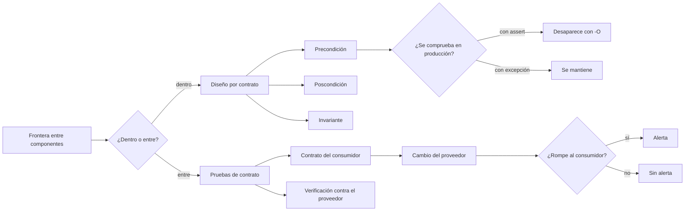
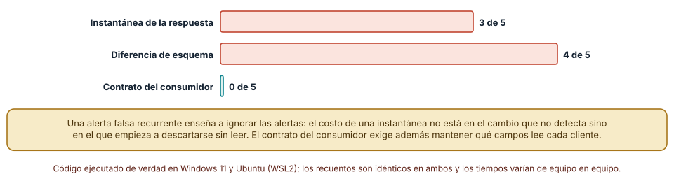

# SE-547 — Diseño por contrato y pruebas de contrato como oráculo

[← SE-546 — DDD como lenguaje ubicuo y contexto para agentes](https://github.com/vladimiracunadev-create/modern-software-engineering-program/blob/main/classes/part-45-metodologias-de-desarrollo-de-tdd-a-odd/se-546-ddd-como-lenguaje-ubicuo-y-contexto-para-agentes/README.md) · [↑ Parte 45](https://github.com/vladimiracunadev-create/modern-software-engineering-program/blob/main/classes/part-45-metodologias-de-desarrollo-de-tdd-a-odd/README.md) · [📚 Índice completo](https://github.com/vladimiracunadev-create/modern-software-engineering-program/blob/main/classes/README.md) · [🌐 Portal](https://vladimiracunadev-create.github.io/modern-software-engineering-program/classes/SE-547.html) · [SE-548 — SDD: spec-first, spec-anchored y spec-as-source →](https://github.com/vladimiracunadev-create/modern-software-engineering-program/blob/main/classes/part-45-metodologias-de-desarrollo-de-tdd-a-odd/se-548-sdd-spec-first-spec-anchored-y-spec-as-source/README.md)

## Punto profesional y fundamento pedagógico

**Punto profesional.** La clase existe para que escribas **lo que prometes en cada frontera** de forma que una máquina lo pueda comprobar, y para que sepas qué clase de contrato comprueba cada técnica. Hay dos escalas. Dentro de un componente, el **diseño por contrato** expresa precondiciones, poscondiciones e invariantes que el propio código verifica al ejecutarse. Entre componentes, las **pruebas de contrato** comprueban que lo que un proveedor entrega es lo que un consumidor necesita. Las dos son oráculos que no dependen de que alguien haya imaginado el caso concreto, y por eso son el contrapeso natural de los ejemplos. También tienen puntos ciegos propios que importan: una aserción puede desaparecer en producción, y un contrato demasiado estricto genera alertas que se aprenden a ignorar.

**Por qué aparece aquí.** Sigue a **DDD como lenguaje ubicuo** porque la frontera entre contextos de `SE-546` es exactamente donde un contrato debe vivir: la traducción convierte un modelo en otro y el contrato dice qué entra y qué sale. La Parte 13 trató especificaciones y contratos de API; la Parte 35, las pruebas de contrato dentro de la estrategia. Aquí se miden sus propiedades como metodología.

**Error conceptual que debe corregir.** Creer que una precondición escrita con `assert` es un contrato que protege en producción. En Python, la opción de optimización (`-O`) elimina las aserciones; un programa que verifica sus precondiciones solo con `assert` las pierde cuando se ejecuta optimizado. Es un fallo de despliegue, no de código, y es silencioso: el programa sigue funcionando y deja de comprobar.

**Secuencia de aprendizaje.** Antes de ejecutar, predices qué pasa con una precondición `assert` bajo `python -O` y cuántos de doce cambios de un proveedor rompen a su cliente; después ejecutas el mismo código con y sin la opción de optimización, comparas tres detectores de cambios de proveedor (instantánea, diferencia de esquema y contrato del consumidor) y cuentas aciertos y falsas alarmas.

**Evidencia de aprendizaje.** `contratos-log.md` con tu predicción, la salida real de la ejecución con y sin `-O`, el contrato del consumidor de un servicio de tu proyecto, la tabla de doce cambios con lo que detecta cada detector y una nota que separe lo medido de lo supuesto.

**Límite de la conclusión.** Los doce cambios del proveedor y el cliente de cuatro campos son del autor; un cliente real lee más campos y un proveedor real cambia de formas que aquí no aparecen. La ejecución con `-O` se hizo con dos procesos reales de Python. No se probó ninguna herramienta concreta de pruebas de contrato (Pact aparece como fuente de definiciones, no como ejecución). No se invocó ningún modelo de lenguaje.

### Trazabilidad fuente → afirmación

| Fuente primaria u oficial | Afirmación que respalda | Lo que no prueba |
|---|---|---|
| [Meyer, «Applying Design by Contract»](https://doi.org/10.1109/2.161279) | Presenta las precondiciones, poscondiciones e invariantes como un contrato entre quien llama y quien implementa. | No garantiza que el contrato esté bien elegido. |
| [Python: la sentencia `assert`](https://docs.python.org/3/reference/simple_stmts.html#the-assert-statement) | Documenta que las aserciones se evalúan según la constante de depuración del intérprete. | No dice cómo expresar un contrato que valga en producción. |
| [Python: opciones de línea de comandos](https://docs.python.org/3/using/cmdline.html) | Documenta la opción `-O` y la variable `PYTHONOPTIMIZE`, que eliminan las aserciones. | No trata el diseño por contrato. |
| [Pact, «Introduction»](https://docs.pact.io/) | Define contrato entre consumidor y proveedor y las pruebas de contrato dirigidas por el consumidor. | No mide su capacidad de detección. |
| [JSON Schema, «Understanding JSON Schema»](https://json-schema.org/understanding-json-schema/) | Documenta la descripción de la forma de un documento, base de la diferencia de esquema. | No dice qué cambios rompen a qué cliente. |
| [DeMillo, Lipton y Sayward](https://doi.org/10.1109/C-M.1978.218136) | Fundamenta medir oráculos con mutantes (usado en `SE-541`). | No trata contratos. |

## Antes de empezar

Recupera lo aprendido en `SE-546`: una frontera entre contextos necesita una traducción explícita y una prueba. La pregunta activa es: **¿qué promete hoy tu servicio a quien lo llama, dónde está escrito y cuándo fue la última vez que una prueba lo comprobó contra un cliente real?**

## Prerrequisitos

- Haber completado `SE-546` o poder explicar qué es una capa anticorrupción.
- Haber visto en la Parte 13 qué es un contrato de API.
- Python 3.11 o posterior; los experimentos usan solo la biblioteca estándar (`json`, `subprocess`).

## Problema auténtico

La plataforma académica cambia su API: la lista de entregas pasa a incluir un campo nuevo `priority` y, tres semanas después, renombra `due` a `due_at`. El primer cambio no afecta a nadie; el segundo deja a *Avisos* sin vencimientos y, sin ruido, sin avisos. El equipo de la plataforma tenía una prueba que comparaba la respuesta con una instantánea y avisaba de cualquier diferencia; llevaba semanas fallando por cambios inocuos y el equipo había aprendido a actualizar la instantánea sin leerla. Cuando el cambio dañino llegó, se actualizó con el resto.

La clase compara tres maneras de detectar cambios en un proveedor y las evalúa sobre doce cambios, siete de los cuales rompen realmente a un cliente de cuatro campos. Muestra además por qué una precondición con `assert` no basta en producción. Son dos mecanismos distintos con una misma lección: un contrato solo protege si dice exactamente lo que el cliente necesita y si se comprueba en el entorno donde importa.

## Objetivos observables

Al terminar podrás:

1. enunciar el contrato de una función (precondición, poscondición, invariante) y el contrato entre un consumidor y un proveedor;
2. demostrar con una ejecución real que una aserción desaparece bajo la opción de optimización de Python y escribir la comprobación que no desaparece;
3. clasificar un cambio de proveedor como compatible o incompatible para un consumidor concreto;
4. comparar instantánea, diferencia de esquema y contrato del consumidor por aciertos y falsas alarmas;
5. escribir el contrato mínimo de un consumidor con los campos y tipos que realmente lee.

## Mapa conceptual



El mapa separa dos escalas con la misma idea. Dentro de un componente importa dónde se comprueba la promesa; entre componentes importa que la promesa sea la que el consumidor necesita y no más.

## Temas y por qué importan

| Tema | Por qué cambia una decisión profesional | Evidencia mínima |
|---|---|---|
| Precondición, poscondición, invariante | Convierten una promesa vaga en algo que se comprueba. | Las tres de una función de tu proyecto |
| `assert` frente a excepción explícita | La aserción puede no ejecutarse en producción. | Ejecución con y sin `-O` |
| Contrato del consumidor | Declara solo lo que el cliente lee; evita alertas por cambios inocuos. | Campos y tipos que lee tu cliente |
| Instantánea y diferencia de esquema | Detectan todo, pero producen falsas alarmas. | Falsas alarmas por detector |
| Cambio compatible e incompatible | Depende del cliente, no del proveedor. | Clasificación de doce cambios |
| Dónde se ejecuta cada comprobación | Un contrato que no corre no protege. | Etapa del flujo donde corre cada una |

## Conceptos y decisiones

### 1. Contrato dentro de un componente

Bertrand Meyer propone ver la relación entre una rutina y quien la llama como un contrato: el que llama garantiza la **precondición**, la rutina garantiza la **poscondición** y ambos respetan la **invariante** del objeto. En la función de avisos, una precondición razonable es «la lista de entregas tiene identificadores únicos»; una poscondición, «nunca se devuelve más de un aviso por entrega»; una invariante del servicio, «lo registrado como enviado nunca retrocede». La utilidad del enfoque es que el reparto de responsabilidad queda explícito: si la precondición no se cumple, el error es de quien llama, y la rutina no necesita defenderse de todo.

### 2. La aserción que desaparece

En Python, `assert condición, mensaje` se evalúa solo cuando el intérprete no está en modo optimizado. Con `python -O` (o con la variable de entorno `PYTHONOPTIMIZE`) las aserciones se eliminan. El experimento de la clase ejecuta el mismo archivo en dos procesos: en modo normal, la llamada con una entrega ya vencida informa «contrato violado: precondición: la entrega no ha vencido»; con `-O`, la función devuelve −10. Es un número sin sentido que el resto del programa usará sin protesta. La conclusión de diseño es que `assert` sirve para comprobar el propio código en desarrollo (invariantes internas que «no pueden fallar»), y que una precondición que debe valer en producción se escribe como una comprobación explícita que lanza una excepción.


**Cómo leer la figura.** Cada fila es una ejecución real de la misma función con una entrega ya vencida, de izquierda a derecha: cómo se lanzó Python, qué salida se observó y qué ocurrió. En modo normal la aserción de la precondición se evalúa y detiene el cálculo; con la opción de optimización desaparece y la función devuelve un valor sin sentido, sin error alguno. **Dónde deja de valer:** el comportamiento es el de CPython documentado; otros intérpretes pueden diferir. Además, muchos despliegues no usan `-O`, de modo que la desaparición no siempre ocurre, pero depende de una variable de entorno que alguien puede cambiar sin tocar el código.

### 3. Contrato entre consumidor y proveedor

Un **contrato entre servicios** describe lo que un consumidor espera recibir de un proveedor. En las **pruebas de contrato dirigidas por el consumidor**, que es el modelo que describe Pact, el consumidor declara los campos, tipos y comportamientos que usa; esa declaración se ejecuta contra el proveedor; si el proveedor cambia de modo que el contrato falla, la prueba lo señala antes del despliegue. Lo central es que el contrato es **del consumidor**: dice lo que él necesita y no todo lo que el proveedor ofrece. Por eso un proveedor puede añadir campos o reordenarlos sin romper ningún contrato.

### 4. Tres maneras de detectar un cambio

La **instantánea** compara la respuesta completa con una copia guardada: cualquier diferencia es una alerta. La **diferencia de esquema** compara la forma del documento (qué campos, de qué tipo) con un esquema guardado. El **contrato del consumidor** comprueba solo los campos y tipos que el cliente lee. Las tres detectan todos los cambios que rompen; difieren en las falsas alarmas, que son cambios que no rompen pero producen alerta.

### 5. Compatible o incompatible: depende del cliente

Un cambio es compatible si el cliente sigue haciendo lo mismo. Añadir un campo, reordenarlos o ensanchar un número de entero a decimal no rompe al cliente de avisos, que lee cuatro campos y los compara. Eliminar un campo que lee, renombrarlo, cambiar su tipo o envolver la lista en otro objeto sí lo rompe. Un caso sutil: cambiar `id` de texto a entero rompe porque el servicio guarda los avisos enviados por identificador y las entregas ya registradas con el identificador de texto dejan de coincidir; el programa no lanza una excepción, pero cambia de comportamiento. La clasificación se verificó ejecutando al cliente sobre cada respuesta y comparando con lo esperado, no por opinión.

### 6. Costo de una alerta falsa

Una alerta falsa tiene un costo que no se ve en la tasa de detección: enseña a ignorar. Una instantánea que falla por un campo nuevo cada semana acaba actualizándose sin leer, y el cambio dañino pasa con el resto. El contrato del consumidor paga ese costo en otro lugar: alguien debe mantener la declaración de qué campos lee cada cliente. El equilibrio depende de cuántos clientes hay y de quién puede coordinarlos.

## Doce cambios del proveedor

El cliente de *Avisos* lee cuatro campos de cada entrega: `id` (texto), `student` (texto), `due` (número de horas) y `submitted` (booleano). Se aplicaron doce cambios a una respuesta de dos entregas: añadir `priority`, renombrar `due` a `due_at`, pasar `due` a texto ISO, eliminar `student`, pasar `submitted` a «yes» o «no», añadir `course`, reordenar los campos, pasar `due` de entero a decimal, pasar `id` a entero, añadir `status` con un valor nuevo, eliminar `submitted` y envolver la lista en `data`. Para cada cambio se ejecutó el cliente y se comparó con el resultado sobre la respuesta original. Siete cambios lo rompen y cinco no.


**Cómo leer la figura.** Cada fila es un cambio del proveedor de entregas (entre paréntesis, si rompe al cliente de avisos o es inocuo) y cada columna una forma de detectarlo; la celda oscura dice alerta. Las tres detectan los siete cambios que rompen; la diferencia está en las falsas alarmas sobre los cinco inocuos: la instantánea da 3, la diferencia de esquema 4 y el contrato del consumidor, que solo declara los campos y tipos que lee el cliente, ninguna. **Dónde deja de valer:** el cliente de cuatro campos y los doce cambios son del autor; un cliente real lee más campos y un proveedor real cambia de formas más variadas (semántica, valores, orden de eventos). La figura muestra el mecanismo de las falsas alarmas, no su frecuencia.

El resultado es nítido. La instantánea alerta en 10 cambios (los 7 que rompen y 3 que no); la diferencia de esquema, en 11 (los 7 y 4 inocuos); el contrato del consumidor, en los 7 que rompen y en ninguno de los 5 inocuos. La instantánea no alerta del reordenamiento ni del paso de entero a decimal porque Python compara ambos como iguales; la diferencia de esquema sí alerta del paso a decimal porque cambia el tipo.

## Qué cuesta una alerta que no sirve

Las falsas alarmas son la cara oculta de la detección. Con una instantánea, tres de cada cinco cambios inocuos producen alerta; con la diferencia de esquema, cuatro de cinco; con el contrato del consumidor, ninguno. El costo en horas de revisión de esas alertas suele ser pequeño; el costo real es que una de ellas, la que sí rompe, se atiende con la misma desgana que las demás.



**Cómo leer la figura.** Cada barra cuenta las falsas alarmas sobre los cinco cambios inocuos. **Dónde deja de valer:** son cinco cambios; con otro conjunto, la proporción cambiaría.

## Definiciones de trabajo

- **Precondición:** lo que debe cumplirse al llamar a una rutina; responsabilidad de quien llama.
- **Poscondición:** lo que la rutina garantiza al terminar.
- **Invariante:** propiedad que se mantiene entre llamadas.
- **Contrato del consumidor:** declaración de los campos y comportamientos que un cliente usa de un proveedor.
- **Instantánea:** copia guardada de una respuesta completa que se compara con la actual.
- **Falsa alarma:** alerta ante un cambio que no rompe al cliente.

## Ejemplo mínimo

La precondición escrita de dos maneras:

```python
def horas_restantes(due, now):
    assert due > now, "precondición: la entrega no ha vencido"   # desaparece con -O
    return due - now

def horas_restantes_firme(due, now):
    if due <= now:
        raise ValueError("precondición: la entrega no ha vencido")  # se mantiene
    return due - now
```

La primera es una comprobación de desarrollo; la segunda es un contrato que vale en producción. La diferencia solo se ve al ejecutar con `python -O`.

## Ejemplo profesional

*Escenario ilustrativo: las cifras y los resultados que aparecen en este ejemplo son supuestos de la narración, no mediciones.*

El equipo de *Avisos* escribe el contrato de su consumidor para la API de la plataforma: la respuesta es un objeto con `items`, y cada elemento tiene `id` (texto), `student` (texto), `due` (número) y `submitted` (booleano). El contrato se guarda en el repositorio de *Avisos* y se publica al repositorio de la plataforma, que lo ejecuta contra su API en cada cambio, antes de desplegar. El equipo de la plataforma añade campos con libertad; cuando alguien propone renombrar `due`, el contrato falla en su integración continua y se abre una conversación: o se mantiene un alias durante una versión o se coordina el cambio. Dentro del servicio, las tres precondiciones que importan se escriben como excepciones y no como aserciones, y una prueba ejecuta el servicio con `PYTHONOPTIMIZE=1` en la integración continua para verificar que siguen vigentes.

## Práctica guiada

1. Escribe tu predicción: ¿qué imprime el fragmento con y sin `-O`? Ejecútalo.
2. Reescribe tres aserciones de tu proyecto como excepciones explícitas o justifica por qué son comprobaciones de desarrollo.
3. Escribe el contrato mínimo del consumidor de una API que uses.
4. Ejecuta `python scripts/experiments_part45_b.py 487` y compara con tu clasificación de los doce cambios.
5. Inventa tres cambios más del proveedor y clasifícalos; ejecuta al cliente para confirmar.

## Ejercicios

1. **Básico.** Explica por qué `assert` no es adecuado para validar entradas de un usuario.
2. **Intermedio.** Escribe el contrato de un segundo consumidor que lea `course` y decide qué cambios del proveedor lo rompen y cuáles no.
3. **Avanzado.** Diseña la política de versiones de un proveedor con tres clientes y justifica cuándo basta un contrato del consumidor y cuándo hace falta una versión nueva.

## Reto verificable

Entrega `contratos-log.md` con la ejecución con y sin `-O`, el contrato del consumidor de un servicio tuyo, la tabla de doce cambios con la ejecución del cliente y el resultado de tres detectores. Es válido si otra persona puede ejecutar el cliente sobre cada cambio y reproducir la clasificación.

## Caso conductor

*Avisos* consume la API de la plataforma y la traduce con la capa de `SE-546`. El contrato del consumidor es lo que la plataforma debe respetar para no romperlo; las precondiciones del servicio son lo que *Avisos* promete a su vez. `SE-548` pasa de las fronteras entre sistemas a la frontera entre una especificación y el código.

## Preguntas frecuentes

### ¿El diseño por contrato exige un lenguaje especial?

No. Meyer lo introdujo con el lenguaje Eiffel, que lo trae integrado, pero la idea se aplica con excepciones explícitas, tipos y pruebas en cualquier lenguaje.

### ¿Las pruebas de contrato reemplazan las pruebas de integración?

No. Comprueban que las dos partes están de acuerdo sobre la forma de la interacción; no comprueban que el proveedor haga lo correcto. Se complementan con pruebas de integración de pocos caminos.

### ¿Quién escribe el contrato?

El consumidor, porque él sabe qué lee. El proveedor lo ejecuta. Si el proveedor escribe el contrato de lo que ofrece, es un esquema, no un contrato dirigido por el consumidor.

### ¿Qué hace un agente con un contrato?

Es un buen insumo: «cambia este endpoint sin romper estos contratos». El agente no debe poder modificar el contrato del consumidor para que su cambio pase.

## Fallo controlado y diagnóstico

**Fallo.** El proveedor renombra `due` a `due_at`. La instantánea falla, el equipo la actualiza con el resto de diferencias y el servicio deja de avisar.

**Diagnóstico paso a paso.** (1) Se ejecuta el cliente sobre la respuesta nueva y falla con un error de clave. (2) Se compara con la respuesta anterior y aparece el renombre. (3) Se comprueba el contrato del consumidor: habría fallado. (4) Se mide cuántas alertas de la instantánea en el último mes eran inocuas: tres de cinco.

**Corrección.** Se sustituye la instantánea por el contrato del consumidor para ese cliente, se mantiene la diferencia de esquema como aviso informativo y se pide al proveedor un periodo de convivencia con ambos nombres.

## Errores comunes y cómo corregirlos

- **Precondiciones con `assert` en producción.** Corrige con excepciones explícitas.
- **Contrato que dice más de lo que el cliente usa.** Corrige reduciéndolo a lo que se lee.
- **Instantáneas que se actualizan sin leer.** Corrige sustituyéndolas o leyendo cada diferencia.
- **Un contrato que nadie ejecuta.** Corrige llevándolo a la integración continua del proveedor.
- **Clasificar cambios por opinión.** Corrige ejecutando al cliente.
- **Dejar que el agente edite el contrato.** Corrige protegiéndolo como parte del oráculo.

## Entorno y archivos clave

- `scripts/experiments_part45_b.py`: ejecución con y sin `-O`, doce cambios y tres detectores; `python scripts/experiments_part45_b.py 487`.
- `subprocess` y `json` de la biblioteca estándar.
- `content/part-45/figures/`: figuras.

## Seguridad, ética y accesibilidad

Un contrato es también una superficie de seguridad: lo que se acepta en la frontera debe validarse (tipos, rangos, tamaños) y lo que sobra no debe propagarse. Una precondición que desaparece en producción es una validación que desaparece. Los contratos no deben contener datos reales; los ejemplos usan datos sintéticos. Ética: cambiar un contrato afecta a otros equipos; avisar y dar un periodo de convivencia es parte de la responsabilidad. Accesibilidad: un contrato escrito es una documentación que cualquier persona nueva puede leer; las figuras tienen texto alternativo completo.

## Puente hacia el trabajo con agentes

Un agente de código que modifica un servicio puede romper a sus clientes sin saberlo: ve el servicio, no los consumidores. El contrato del consumidor es el modo de comunicarle esa información: se ejecuta en el repositorio del proveedor y falla si el cambio rompe a alguien. Dos reglas lo protegen. La primera: los contratos son de solo lectura para el agente. La segunda: cuando el agente propone un cambio que rompe un contrato, no se le pide que lo arregle cambiando el contrato, sino que justifique la incompatibilidad y proponga una migración. Y para las precondiciones dentro del servicio, una regla de revisión: «ninguna validación de entrada va en `assert`».

## Transferencia

Elige una API que tu proyecto consuma. Escribe el contrato mínimo: campos, tipos y comportamiento. Ejecútalo contra una respuesta real (anonimizada) y contra tres respuestas modificadas. Mide cuántas alertas daría tu mecanismo actual sobre cambios que no rompen. Revisa las aserciones de tu código y marca cuáles deben seguir vigentes con `-O`.

## Evaluación y evidencia

| Criterio | Evidencia aceptable | Rechazo |
|---|---|---|
| Ejecución con y sin `-O` | Salida real de ambos procesos | Solo explicación |
| Contrato del consumidor | Campos y tipos que lee el cliente | Todo el esquema del proveedor |
| Clasificación verificada | Ejecución del cliente por cambio | Opinión |
| Falsas alarmas contadas | Por detector | Solo detecciones |
| Límite | Dice que los cambios son del autor | Presenta una tasa general |

## Fuentes

- Meyer, B. [«Applying Design by Contract»](https://doi.org/10.1109/2.161279).
- Python Software Foundation. [La sentencia `assert`](https://docs.python.org/3/reference/simple_stmts.html#the-assert-statement) y [opciones de línea de comandos](https://docs.python.org/3/using/cmdline.html).
- Pact. [«Introduction»](https://docs.pact.io/).
- JSON Schema. [«Understanding JSON Schema»](https://json-schema.org/understanding-json-schema/).
- DeMillo, R., Lipton, R. y Sayward, F. [«Hints on Test Data Selection»](https://doi.org/10.1109/C-M.1978.218136).

## Límites y siguiente paso

El cliente de cuatro campos y los doce cambios son del autor y no se ejecutó ninguna herramienta de pruebas de contrato. El siguiente paso, `SE-548`, lleva la idea de contrato a su escala mayor: la especificación como fuente, en tres niveles, y la deriva entre ella y el código.

## Glosario

| Término | Definición breve |
|---|---|
| Precondición | Lo que debe cumplirse al llamar |
| Poscondición | Lo que la rutina garantiza al terminar |
| Invariante | Propiedad que se mantiene entre llamadas |
| Contrato del consumidor | Declaración de lo que un cliente lee de un proveedor |
| Instantánea | Copia guardada de una respuesta |
| Falsa alarma | Alerta ante un cambio que no rompe |

---

[← SE-546 — DDD como lenguaje ubicuo y contexto para agentes](https://github.com/vladimiracunadev-create/modern-software-engineering-program/blob/main/classes/part-45-metodologias-de-desarrollo-de-tdd-a-odd/se-546-ddd-como-lenguaje-ubicuo-y-contexto-para-agentes/README.md) · [↑ Parte 45](https://github.com/vladimiracunadev-create/modern-software-engineering-program/blob/main/classes/part-45-metodologias-de-desarrollo-de-tdd-a-odd/README.md) · [📚 Índice completo](https://github.com/vladimiracunadev-create/modern-software-engineering-program/blob/main/classes/README.md) · [🌐 Portal](https://vladimiracunadev-create.github.io/modern-software-engineering-program/classes/SE-547.html) · [SE-548 — SDD: spec-first, spec-anchored y spec-as-source →](https://github.com/vladimiracunadev-create/modern-software-engineering-program/blob/main/classes/part-45-metodologias-de-desarrollo-de-tdd-a-odd/se-548-sdd-spec-first-spec-anchored-y-spec-as-source/README.md)
