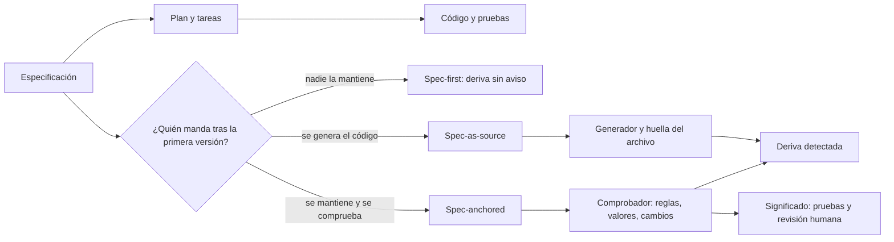

# SE-548 — SDD: spec-first, spec-anchored y spec-as-source

[← SE-547 — Diseño por contrato y pruebas de contrato como oráculo](https://github.com/vladimiracunadev-create/modern-software-engineering-program/blob/main/classes/part-45-metodologias-de-desarrollo-de-tdd-a-odd/se-547-diseno-por-contrato-y-pruebas-de-contrato-como-oraculo/README.md) · [↑ Parte 45](https://github.com/vladimiracunadev-create/modern-software-engineering-program/blob/main/classes/part-45-metodologias-de-desarrollo-de-tdd-a-odd/README.md) · [📚 Índice completo](https://github.com/vladimiracunadev-create/modern-software-engineering-program/blob/main/classes/README.md) · [🌐 Portal](https://vladimiracunadev-create.github.io/modern-software-engineering-program/classes/SE-548.html) · [SE-549 — EDD: evaluaciones como especificación y puerta de release →](https://github.com/vladimiracunadev-create/modern-software-engineering-program/blob/main/classes/part-45-metodologias-de-desarrollo-de-tdd-a-odd/se-549-edd-evaluaciones-como-especificacion-y-puerta-de-release/README.md)

## Punto profesional y fundamento pedagógico

**Punto profesional.** La clase existe para que decidas **cuánto compromiso** asume tu equipo con mantener una especificación, porque de esa decisión depende qué ocurre cuando el código cambia. El desarrollo guiado por especificaciones (SDD) se presenta a menudo como una sola cosa; sus propias descripciones distinguen tres niveles. En el primero la especificación guía la primera construcción y después puede quedar atrás. En el segundo se mantiene viva y se liga mecánicamente al código y a las pruebas. En el tercero es la fuente y el código se genera. Cada nivel compra más control a cambio de más rigidez, y ninguno elimina la deriva: la desplaza hacia lo que la máquina no sabe comprobar.

**Por qué aparece aquí.** Sigue a **Diseño por contrato y pruebas de contrato** porque una especificación es un contrato con el futuro del sistema. Retoma `SE-565` a `SE-568` de la Parte 47, donde se aprendió a escribir una especificación durable y a encadenarla con plan y tareas; aquí se estudia qué pasa con ella después de la primera construcción.

**Error conceptual que debe corregir.** Creer que tener una especificación evita la deriva. Birgitta Böckeler, al analizar tres herramientas de SDD, señala que todas las definiciones que encontró son spec-first y que no todas aspiran a ser spec-anchored o spec-as-source; y que a menudo queda vago o abierto cuál es la estrategia para mantener la especificación en el tiempo. Una especificación que nadie mantiene es documentación vieja con otro nombre.

**Secuencia de aprendizaje.** Antes de ejecutar, predices cuántas de diez derivas inyectadas entre especificación, código y pruebas detecta un comprobador mecánico y cuál no; después construyes un generador que produce el código desde la especificación, ejecutas el comprobador sobre las diez derivas, miras qué ve y qué no, y decides en qué nivel trabajaría tu equipo.

**Evidencia de aprendizaje.** `sdd-log.md` con tu predicción, la especificación mínima de una regla con identificadores y valores legibles por máquina, el resultado de las diez derivas, la lista de lo que el comprobador no ve y la decisión de nivel con su razón.

**Límite de la conclusión.** El generador es una plantilla de veinte líneas, no una herramienta de SDD; las diez derivas y el comprobador los escribió el autor. **No se ejecutó** Spec Kit, Kiro, OpenSpec ni Tessl, y las afirmaciones sobre ellas se atribuyen a las fuentes. La clase mide qué puede comprobar una máquina entre una especificación y su código, no la productividad de ningún nivel. No se invocó ningún modelo de lenguaje.

### Trazabilidad fuente → afirmación

| Fuente primaria u oficial | Afirmación que respalda | Lo que no prueba |
|---|---|---|
| [Böckeler, «Understanding Spec-Driven-Development: Kiro, spec-kit, and Tessl»](https://martinfowler.com/articles/exploring-gen-ai/sdd-3-tools.html) | Distingue spec-first, spec-anchored y spec-as-source; afirma que todas las definiciones que halló son spec-first y que la estrategia de mantenimiento suele quedar abierta; describe que Tessl marca el código generado con un comentario «GENERATED FROM SPEC - DO NOT EDIT». | Es un análisis de tres herramientas en un momento (las herramientas cambian), no una evaluación de resultados. |
| [GitHub, Spec Kit](https://github.com/github/spec-kit) | Describe un proceso en que la especificación se convierte en plan, tareas e implementación (usado en `SE-566`). | No mide resultados. |
| [OpenSpec](https://github.com/Fission-AI/OpenSpec) | Es una de las herramientas que aspiran a mantener la especificación en el tiempo (nivel anclado). | No se ejecutó aquí. |
| [RFC 2119](https://www.rfc-editor.org/rfc/rfc2119) | Fija el significado de DEBE y NO DEBE en una especificación. | No hace comprobable una frase. |
| [Python: `ast`](https://docs.python.org/3/library/ast.html) | Documenta el árbol sintáctico que lee el comprobador para extraer los umbrales. | No valida la elección de qué comparar. |
| [Meyer, «Applying Design by Contract»](https://doi.org/10.1109/2.161279) | Aporta la idea de contrato que la especificación generaliza. | No trata la deriva. |

## Antes de empezar

Recupera lo aprendido en `SE-547`: un contrato solo protege si se ejecuta donde importa y lo escribe quien lo necesita. La pregunta activa es: **¿cuándo fue la última vez que cambiaste el comportamiento de un sistema sin tocar la especificación o el documento que lo describía, y quién se enteró?**

## Prerrequisitos

- Haber completado `SE-547` y `SE-565` a `SE-568`, o poder explicar qué es una especificación durable y cómo se encadena con plan y tareas.
- Python 3.11 o posterior con `ast`, `json` y `hashlib`.
- Saber leer un archivo de especificación con identificadores de regla.

## Problema auténtico

El equipo de *Avisos* empieza el silencio con una especificación de cinco reglas (RF-01 a RF-05) y la implementa con ayuda de un agente. Tres meses después, un cambio de producto sube el último aviso de 1 hora a 2 horas. Quien lo hace edita el código y una prueba; no toca la especificación, que sigue diciendo «1 hora». Medio año después, una persona nueva lee la especificación, la usa para entender el servicio y escribe una funcionalidad que asume una hora. La especificación fue escrita con cuidado y la deriva ocurrió igual: nadie la actualizó porque nada la exigía.

La clase construye lo que habría detectado esa deriva y mide sus límites. Se define una especificación mínima en formato legible por máquina (reglas con identificador y umbrales), un generador que produce el código desde ella y un comprobador que busca diez tipos de deriva. El resultado distingue lo que una máquina puede ver (estructura, valores declarados, cambios sin especificación, archivos generados editados) y lo que no (el significado de una condición dentro del código).

## Objetivos observables

Al terminar podrás:

1. distinguir spec-first, spec-anchored y spec-as-source por el papel que conserva la especificación después de la primera construcción;
2. escribir una especificación con identificadores y valores legibles por máquina y generar de ella un código ejecutable;
3. escribir un comprobador de deriva y medir cuántas derivas inyectadas detecta;
4. enunciar qué clases de deriva no ve ningún comprobador mecánico y qué evidencia las cubre;
5. decidir en qué nivel trabajar según el costo de mantener la especificación y el costo de la deriva.

## Mapa conceptual



El mapa muestra que la pregunta es quién manda después de la primera versión. Los dos niveles superiores añaden comprobaciones mecánicas; el significado de una expresión sigue necesitando pruebas o una persona.

## Temas y por qué importan

| Tema | Por qué cambia una decisión profesional | Evidencia mínima |
|---|---|---|
| Tres niveles de SDD | Cada uno tiene un costo de mantenimiento y un riesgo distinto. | Nivel elegido y su razón |
| Especificación legible por máquina | Lo que no se puede leer por máquina no se puede comprobar. | Identificadores y valores en formato estructurado |
| Generación de código | Elimina la deriva entre especificación y código a costa de rigidez. | Código generado y su huella |
| Comprobador de deriva | Convierte «la especificación está al día» en una afirmación comprobable. | Diez derivas inyectadas y su detección |
| Límite del comprobador | La semántica de una expresión no se ve sin una prueba. | Una deriva no detectada y su remedio |
| Archivo generado editado a mano | Sin una marca y una huella, se pierde en la siguiente regeneración. | Detección de edición manual |

## Conceptos y decisiones

### 1. Spec-first

En el primer nivel, la especificación se escribe antes y guía la construcción. Es la parte de SDD que más se practica y la que describen las herramientas como Spec Kit: de la especificación salen un plan, tareas y la implementación. Lo que ocurre después es la pregunta que queda abierta. Böckeler anota que, en los ejemplos que encontró de una herramienta, la especificación se usa para una tarea o una historia y no se explica cómo mantenerla a lo largo de varias tareas. En términos prácticos, spec-first sin más produce una especificación que envejece: valiosa el día uno y engañosa el día cien.

### 2. Spec-anchored

En el segundo nivel la especificación se **mantiene** y se **ancla** al código y a las pruebas con comprobaciones: cada regla tiene un identificador que el código y las pruebas citan; los valores que la especificación declara (umbrales, límites) se comparan con los del código; un cambio en el código sin cambio en la especificación se señala. La especificación es una fuente que se revisa con cada cambio, como una prueba. El costo es disciplina y herramientas: alguien debe escribir el comprobador y alguien debe atender sus alertas.

### 3. Spec-as-source

En el tercer nivel la especificación es la fuente y el código se **genera**. Se edita la especificación y se regenera; editar el código a mano está desaconsejado y se marca con un comentario («GENERADO; no editar»). Böckeler describe a Tessl como la herramienta que explora este nivel, con una correspondencia de uno a uno entre un archivo de especificación y un archivo de código, y la califica de beta en el momento del análisis. La ventaja es que la deriva desaparece por construcción; el costo es que lo que la especificación no puede expresar no se puede construir, y que el generador es ahora una pieza que hay que confiar.

### 4. Qué se puede comprobar mecánicamente

Hay cuatro familias de comprobación posibles. La **estructura**: cada regla de la especificación tiene código y prueba que la citan, y nadie cita una regla que no existe. Los **valores declarados**: si la especificación dice que los umbrales son 72, 24 y 1, el código tiene exactamente esos valores. La **procedencia del cambio**: si el código cambió y la especificación no, alguien debe explicarlo. Y la **frescura de lo generado**: el archivo generado coincide con lo que produce hoy la especificación. Las cuatro son baratas y exactas, y no hablan del significado.

### 5. Lo que no se puede comprobar mecánicamente

El significado de una expresión dentro del código no se comprueba sin una prueba que lo ejercite. Cambiar `remaining <= o` por `remaining < o` mantiene los identificadores, los valores y los archivos; solo una prueba con el valor de frontera lo detecta. Tampoco se comprueba que el texto de una regla haya cambiado de significado: el comprobador ve que el archivo generado quedó viejo (porque la huella cambió) pero no que la regla dice ahora lo contrario. Es el límite de la comprobación mecánica y la razón por la que la especificación debe tener ejemplos ejecutables (`SE-545`).

### 6. Cuánto mantenimiento paga

Un nivel de compromiso alto cuesta más y evita más. Si la especificación es la fuente de un contrato con terceros o de una función con reglas que cambian por ley, el nivel anclado o el generado paga: la deriva tiene un costo alto. Si es la guía de un prototipo que se va a descartar, el primero basta. La decisión depende de la vida esperada del sistema y de cuánto cuesta un malentendido. Y es una decisión de equipo que se revisa: un proyecto puede empezar spec-first y subir de nivel cuando su especificación empiece a importar a otros.

## Un generador y un comprobador de deriva

Se escribió una especificación mínima en JSON: cinco reglas con identificador (RF-01 a RF-05) y la lista de umbrales `[72, 24, 1]`. Una plantilla de veinte líneas genera `due_reminders` desde ella, con una cabecera que incluye una huella de la especificación y el aviso «GENERADO; no editar a mano». El código generado se comparó con el modelo de referencia sobre 300 estados al azar y coincide en todos.

El comprobador de deriva hace cinco cosas: compara los identificadores de la especificación con los que cita el código y los que cubren las pruebas, lee con el árbol sintáctico la lista de umbrales del código y la compara con la especificación, mira qué archivos cambió el cambio, comprueba que el archivo generado coincida con lo que produce la especificación y falla si no. Se inyectaron diez derivas y se midió cuántas detecta.


**Cómo leer la figura.** La barra son las diez derivas inyectadas entre especificación, código y pruebas: el tramo teal son las que el comprobador mecánico detecta por completo, el dorado la que detecta solo de lado y el coral la que no detecta. Detecta ocho; la décima (un cambio de significado) aparece solo como «archivo generado desactualizado», y no ve el cambio de una comparación de menor o igual a menor estricto dentro del código. La lista de las diez derivas queda en la tabla. **Dónde deja de valer:** las diez derivas y el comprobador los escribió el autor; un proyecto real tiene derivas de otras formas. La lectura general es qué familias de deriva ve una máquina, no cuántas ve.

El resultado es ordenado. Las derivas de identificadores y valores se detectan con certeza. Las de procedencia (D7) se detectan siempre que se disponga de la lista de archivos del cambio; es una comprobación sobre el flujo de trabajo, no sobre el código. La de significado (D9) no se detecta, y la D10 se detecta solo como «el archivo generado quedó viejo», porque la huella de la especificación cambió: la máquina vio que algo cambió, no qué significa.

## Tres niveles y cuánto compromiso

Los tres niveles se pueden ordenar por el papel que conserva la especificación. En el primero la especificación guía y después puede quedar atrás, lo que produce una deriva sin aviso. En el segundo se mantiene viva y comprobaciones mecánicas la ligan al código y a las pruebas. En el tercero es la fuente y el código se genera, y editarlo a mano se detecta.


**Cómo leer la figura.** Cada fila es un nivel con dos cajas: qué se hace y qué consecuencia tiene. **Dónde deja de valer:** los tres niveles son una gradación y no tres productos; una herramienta puede cubrir más de uno y un equipo puede usar niveles distintos para componentes distintos. La clasificación procede de la fuente citada y las herramientas cambian rápido.

## Qué ve la máquina y qué no

Las cuatro familias de comprobación mecánica (estructura, valores declarados, procedencia del cambio y frescura de lo generado) tienen en común que operan sobre objetos que se pueden comparar. El significado de una condición, no. La tabla resume cada familia con su límite.


**Cómo leer la figura.** Cada fila va de una familia de comprobación (izquierda) a si la máquina la ve (centro: teal si la ve, coral si no) y a su límite (derecha). La máquina ve lo que puede enunciarse como estructura o como valor comparable; el significado de una condición distinta no lo ve y exige una prueba que el cambio rompa o la lectura de una persona. **Dónde deja de valer:** la tabla describe el comprobador de esta clase; un comprobador más sofisticado (análisis simbólico, ejecución de ejemplos) vería más, con costo mayor. Para el significado, la respuesta más barata sigue siendo una prueba con valores de frontera.

## Definiciones de trabajo

- **SDD (desarrollo guiado por especificaciones):** forma de trabajar donde la especificación es el artefacto principal.
- **Spec-first, spec-anchored, spec-as-source:** los tres niveles de compromiso con mantener la especificación.
- **Deriva:** separación entre lo que la especificación dice y lo que el sistema hace.
- **Anclaje:** comprobación mecánica que liga especificación, código y pruebas.
- **Archivo generado:** código producido desde la especificación que no se edita a mano.
- **Huella:** resumen criptográfico de la especificación incluido en el archivo generado.

## Ejemplo mínimo

La especificación como datos:

```json
{"rules": {"RF-01": "avisos a 72, 24 y 1 horas", "RF-02": "no avisar a quien ya entregó"}, "offsets": [72, 24, 1]}
```

y la comprobación de valores declarados:

```python
tree = ast.parse(codigo)
for node in ast.walk(tree):
    if isinstance(node, ast.Assign) and getattr(node.targets[0], "id", "") == "OFFSETS":
        assert list(ast.literal_eval(node.value)) == spec["offsets"]
```

Si alguien cambia el umbral del código a `(72, 24, 2)`, la comprobación falla con la diferencia exacta; si cambia la condición `<=` dentro de la función, no.

## Ejemplo profesional

*Escenario ilustrativo: las cifras y los resultados que aparecen en este ejemplo son supuestos de la narración, no mediciones.*

El equipo elige el nivel por componente. Para las reglas de avisos, que fija un acuerdo con la plataforma y cambia poco, opta por spec-anchored: cada regla tiene identificador, el código y las pruebas lo citan, los umbrales viven en la especificación y se leen de ella, y la integración continua ejecuta el comprobador. Para el cliente web, que cambia cada semana, se queda en spec-first: una especificación breve por funcionalidad que se archiva al terminar. Para una tabla de textos traducidos, usa spec-as-source: un archivo de especificación y un generador, con la regla de que el archivo generado no se edita. Registra la decisión por componente y la revisa cada trimestre con los casos de deriva que encontró.

## Práctica guiada

1. Escribe tu predicción: de las diez derivas, ¿cuántas detectará el comprobador?
2. Escribe una especificación mínima con tres reglas y una lista de valores.
3. Escribe el comprobador de identificadores y valores para tu especificación.
4. Ejecuta `python scripts/experiments_part45_b.py 488` y compara con tu predicción.
5. Inyecta una deriva semántica en tu código y escribe la prueba que la detecta.

## Ejercicios

1. **Básico.** Explica por qué D9 (`<=` a `<`) no la ve el comprobador y qué prueba la detectaría.
2. **Intermedio.** Añade una comprobación para que cada regla de la especificación tenga al menos un ejemplo ejecutable y mide qué derivas nuevas ve.
3. **Avanzado.** Diseña una política de niveles de SDD para cinco componentes de tu proyecto y justifícala con el costo de la deriva de cada uno.

## Reto verificable

Entrega `sdd-log.md` con la especificación, el generador o el anclaje, la tabla de diez derivas con el resultado de tu comprobador y una nota que diga qué clase de deriva no ve y con qué evidencia la cubres. Es válido si otra persona puede inyectar las mismas derivas y obtener el mismo resultado.

## Caso conductor

*Avisos* tiene cinco reglas con identificador. El cambio del último aviso de 1 a 2 horas es el caso de deriva que abre la clase; el comprobador lo habría señalado en el cambio y habría obligado a actualizar la especificación, o a explicar por qué no. La Parte 47 lo trató en el flujo `specify → plan → tasks`; aquí se trata el mantenimiento posterior.

## Preguntas frecuentes

### ¿Spec-as-source significa que ya no se escribe código?

Significa que el código se genera de la especificación y no se edita. Lo que antes era código se vuelve especificación, y su precisión sigue siendo trabajo de ingeniería. Hay que confiar en el generador y probar lo generado.

### ¿Quién mantiene la especificación?

Quien cambia el comportamiento, en el mismo cambio y con la misma revisión. Es la regla de `SE-565`: ningún cambio de comportamiento se fusiona sin el cambio correspondiente en la especificación.

### ¿Un agente puede mantener la especificación?

Puede proponer la actualización cuando cambia el código; la decisión de si el cambio es intencional es de una persona. Un agente que actualiza la especificación para que coincida con lo que hizo borra la señal de deriva.

### ¿Qué herramienta de SDD debo usar?

Las fuentes de la clase describen tres en un momento concreto y señalan que cambian rápido. La elección no es parte de esta clase: lo que se enseña es qué debe cumplir cualquier herramienta (identificadores, valores legibles, comprobación, huella).

## Fallo controlado y diagnóstico

**Fallo.** El último aviso pasa de 1 a 2 horas en el código y la especificación sigue diciendo 1 hora. Una persona nueva usa la especificación y construye sobre una hora.

**Diagnóstico paso a paso.** (1) Se comparan los umbrales del código y los de la especificación: difieren. (2) Se consulta el historial: el cambio tocó el código y una prueba, no la especificación. (3) Se comprueba que el comprobador lo habría señalado (D5 y D7). (4) Se mide cuántos cambios de los últimos seis meses tocaron código sin tocar la especificación.

**Corrección.** Se actualiza la especificación, se añade el comprobador a la integración continua con el cambio fallando, y se acuerda que un cambio de comportamiento sin cambio de especificación necesita una justificación en la revisión.

## Errores comunes y cómo corregirlos

- **Una especificación sin identificadores.** No se puede citar ni comprobar; corrige con identificadores estables.
- **Valores solo en prosa.** Una máquina no los lee; corrige con una sección estructurada.
- **Editar el archivo generado.** Se pierde en la siguiente regeneración; corrige con huella y marca.
- **Confiar en el comprobador para el significado.** Corrige con ejemplos ejecutables.
- **Permitir al agente actualizar la especificación para que coincida con el código.** Borra la señal; corrige exigiendo revisión humana.
- **Elegir un nivel por moda.** Corrige midiendo el costo de la deriva.

## Entorno y archivos clave

- `scripts/experiments_part45_b.py`: especificación, generador, comprobador y diez derivas; `python scripts/experiments_part45_b.py 488`.
- `ast`, `json` y `hashlib` de la biblioteca estándar.
- `content/part-45/figures/`: figuras.

## Seguridad, ética y accesibilidad

Un generador que escribe código desde una especificación es una cadena de suministro: quien edita la especificación decide qué se ejecuta. La especificación debe tener revisión y control de acceso como el código, y el archivo generado debe marcarse y verificarse. No se ejecuta código de terceros en el laboratorio: `exec` solo corre código generado por la propia plantilla. Ética: una especificación que describe cómo se trata a las personas usuarias (a quién se avisa, cuándo) es un compromiso con ellas; mantenerla al día es una forma de honrarlo. Accesibilidad: una especificación estructurada y legible es una ventaja para quien lee con lector de pantalla; las figuras tienen texto alternativo completo.

## Puente hacia el trabajo con agentes

El SDD con agentes es el escenario típico: el agente lee la especificación, la convierte en plan y tareas y escribe el código. Tres controles lo hacen seguro. Primero, que la especificación tenga identificadores y valores que una máquina pueda comparar con el código que el agente produce. Segundo, que el comprobador corra en la integración continua y bloquee el cambio, no que el agente lo ejecute y lo interprete. Tercero, que ni la especificación ni el comprobador sean editables por el agente dentro del mismo cambio que valida. Cuando el agente propone cambiar la especificación porque «el código tiene razón», es una decisión de producto: se detiene y se pregunta a quien la mantiene.

## Transferencia

Elige una especificación de tu proyecto (un contrato, un documento de requisitos). Añade identificadores a sus reglas y una sección estructurada con los valores que importan. Escribe un comprobador de cinco líneas que compare esos valores con el código. Inyecta tres derivas y mide cuántas detecta. Escribe una por una la lista de lo que no detecta y qué prueba la cubriría.

## Evaluación y evidencia

| Criterio | Evidencia aceptable | Rechazo |
|---|---|---|
| Especificación legible por máquina | Identificadores y valores estructurados | Solo prosa |
| Comprobador | Reproducible con derivas inyectadas | Descrito sin ejecutar |
| Límites | Una deriva no detectada y su remedio | «Detecta todo» |
| Nivel elegido | Razón basada en costo de la deriva | «Es lo recomendado» |
| Frontera con herramientas | Atribuye lo que dicen las fuentes | Presenta una herramienta como validada |

## Fuentes

- Böckeler, B. [«Understanding Spec-Driven-Development: Kiro, spec-kit, and Tessl»](https://martinfowler.com/articles/exploring-gen-ai/sdd-3-tools.html).
- GitHub. [Spec Kit](https://github.com/github/spec-kit).
- Fission AI. [OpenSpec](https://github.com/Fission-AI/OpenSpec).
- Bradner, S. [RFC 2119](https://www.rfc-editor.org/rfc/rfc2119).
- Python Software Foundation. [`ast`](https://docs.python.org/3/library/ast.html).
- Meyer, B. [«Applying Design by Contract»](https://doi.org/10.1109/2.161279).

## Límites y siguiente paso

El generador es una plantilla y el comprobador y las diez derivas son del autor; no se ejecutó ninguna herramienta de SDD ni se midió productividad. El siguiente paso, `SE-549`, pasa a los componentes cuya salida es probabilística, donde una especificación no puede dictar un resultado único y el oráculo es una evaluación con umbral.

## Glosario

| Término | Definición breve |
|---|---|
| SDD | Desarrollo guiado por especificaciones |
| Spec-first | La especificación guía la primera construcción |
| Spec-anchored | La especificación se mantiene y se comprueba contra el código |
| Spec-as-source | El código se genera de la especificación |
| Deriva | Separación entre la especificación y el sistema |
| Huella | Resumen que detecta que lo generado quedó viejo |

---

[← SE-547 — Diseño por contrato y pruebas de contrato como oráculo](https://github.com/vladimiracunadev-create/modern-software-engineering-program/blob/main/classes/part-45-metodologias-de-desarrollo-de-tdd-a-odd/se-547-diseno-por-contrato-y-pruebas-de-contrato-como-oraculo/README.md) · [↑ Parte 45](https://github.com/vladimiracunadev-create/modern-software-engineering-program/blob/main/classes/part-45-metodologias-de-desarrollo-de-tdd-a-odd/README.md) · [📚 Índice completo](https://github.com/vladimiracunadev-create/modern-software-engineering-program/blob/main/classes/README.md) · [🌐 Portal](https://vladimiracunadev-create.github.io/modern-software-engineering-program/classes/SE-548.html) · [SE-549 — EDD: evaluaciones como especificación y puerta de release →](https://github.com/vladimiracunadev-create/modern-software-engineering-program/blob/main/classes/part-45-metodologias-de-desarrollo-de-tdd-a-odd/se-549-edd-evaluaciones-como-especificacion-y-puerta-de-release/README.md)
