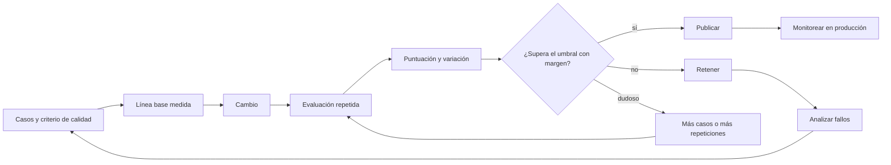
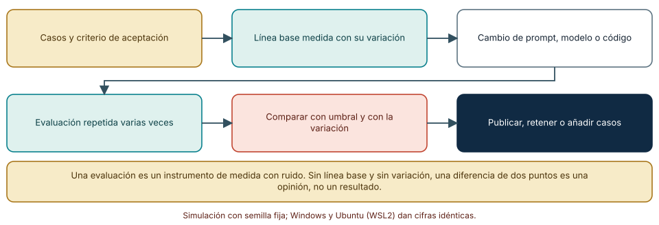

# SE-549 — EDD: evaluaciones como especificación y puerta de release

[← SE-548 — SDD: spec-first, spec-anchored y spec-as-source](https://github.com/vladimiracunadev-create/modern-software-engineering-program/blob/main/classes/part-45-metodologias-de-desarrollo-de-tdd-a-odd/se-548-sdd-spec-first-spec-anchored-y-spec-as-source/README.md) · [↑ Parte 45](https://github.com/vladimiracunadev-create/modern-software-engineering-program/blob/main/classes/part-45-metodologias-de-desarrollo-de-tdd-a-odd/README.md) · [📚 Índice completo](https://github.com/vladimiracunadev-create/modern-software-engineering-program/blob/main/classes/README.md) · [🌐 Portal](https://vladimiracunadev-create.github.io/modern-software-engineering-program/classes/SE-549.html) · [SE-550 — ODD: desarrollo orgánico y su contraste con SDD →](https://github.com/vladimiracunadev-create/modern-software-engineering-program/blob/main/classes/part-45-metodologias-de-desarrollo-de-tdd-a-odd/se-550-odd-desarrollo-organico-y-su-contraste-con-sdd/README.md)

## Punto profesional y fundamento pedagógico

**Punto profesional.** La clase existe para que trates una evaluación como lo que es, un **instrumento de medida con ruido**, y no como una prueba determinista con otro nombre. En los componentes cuya salida es probabilística (un clasificador, un asistente basado en un modelo de lenguaje, un agente) no hay un resultado único que una aserción pueda exigir. El desarrollo guiado por evaluaciones (EDD) propone que un conjunto de casos con criterios de calidad cumpla dos funciones a la vez: **especificación** de lo que se espera y **puerta** que decide si un cambio se publica. Funciona si quien la usa sabe cuánto ruido tiene la medida y cuántos casos hacen falta para que la puerta distinga una regresión de una fluctuación.

**Por qué aparece aquí.** Sigue a **SDD** porque una especificación no puede dictar una salida única cuando el sistema es probabilístico; lo que sí puede dictar es una distribución de calidad aceptable. Retoma la [Parte 46](../../part-46-desarrollo-de-software-asistido-por-ia/README.md) (evaluaciones de exactitud, utilidad, costo y latencia) y la [Parte 36](../../part-36-calidad-rendimiento-y-resiliencia/README.md) (calidad y resiliencia) desde el ángulo del proceso: no cómo se mide un modelo, sino cómo se decide con la medida.

**Error conceptual que debe corregir.** Creer que EDD es TDD con evaluaciones. Las evaluaciones son más lentas, más costosas y, sobre todo, **no deterministas**: la misma versión puede dar resultados distintos en dos corridas. Anthropic lo dice sobre agentes: lo que pasó en una corrida puede fallar en la siguiente, y por eso se miden proporciones de éxito y métricas como pass@k (probabilidad de al menos un acierto en k intentos). Una puerta que compara dos puntuaciones de una sola corrida toma decisiones con el ruido.

**Secuencia de aprendizaje.** Antes de simular, predices con qué frecuencia una puerta de release con 100 casos deja pasar una versión que perdió 5 puntos de precisión y con qué frecuencia rechaza una versión sana; después simulas con semilla fija cinco tamaños de conjunto, una y tres repeticiones por caso, una regresión concentrada en los casos difíciles y la variación de una misma versión entre corridas.

**Evidencia de aprendizaje.** `edd-log.md` con tu predicción, la tabla de falsos pases y falsos rechazos por tamaño, una puerta propuesta para un componente de tu proyecto (casos, umbral, repeticiones, variación aceptada) y una nota que separe lo simulado de lo supuesto.

**Límite de la conclusión.** Es una **simulación** con semilla fija: los casos son lanzamientos de moneda con una probabilidad de acierto supuesta (0,85 la versión sana, 0,80 la regresada) y un umbral de 0,825. No se evaluó ningún modelo ni ningún producto real, y no se invocó ningún modelo de lenguaje. Las cifras ilustran cómo se comporta una puerta ante el ruido; los números de un sistema real los fija su propia variación, que hay que medir.

### Trazabilidad fuente → afirmación

| Fuente primaria u oficial | Afirmación que respalda | Lo que no prueba |
|---|---|---|
| [Anthropic, «Demystifying evals for AI agents»](https://www.anthropic.com/engineering/demystifying-evals-for-ai-agents) | Describe la estructura de una evaluación, la no determinación de los agentes (lo que pasa en una corrida puede fallar en otra) y las métricas pass@k y pass^k. | No fija cuántos casos necesita un producto concreto. |
| [Husain, «Your AI Product Needs Evals»](https://hamel.dev/blog/posts/evals/) | Propone niveles de evaluación (pruebas unitarias de comportamiento, revisión humana y de modelos, pruebas A/B) y la práctica de registrar trazas. | Es la experiencia de un autor, no una medición. |
| [Braintrust, «Eval-driven development»](https://braintrust.dev/articles/eval-driven-development) | Presenta las evaluaciones como parte del ciclo de desarrollo. | Es material de un proveedor de herramientas. |
| [DeepEval, «Eval-driven development»](https://deepeval.com/blog/eval-driven-development) | Presenta la misma práctica desde otro marco de evaluación. | Es material de un proveedor de herramientas. |
| [Xia et al., preprint](https://arxiv.org/abs/2411.13768) | Es una fuente académica de partida sobre evaluación guiada del desarrollo de agentes. | Es un preprint; su revisión y vigencia deben comprobarse. |
| [Python: `random`](https://docs.python.org/3/library/random.html) | Documenta el generador pseudoaleatorio con semilla usado en la simulación. | No valida el modelo de acierto elegido. |

## Antes de empezar

Recupera lo aprendido en `SE-548`: una especificación no basta si nada comprueba que se cumple. La pregunta activa es: **¿cuántas veces has decidido publicar o retener un cambio de un componente probabilístico mirando una sola cifra de una sola corrida, y cuánto habría variado esa cifra si la repites?**

## Prerrequisitos

- Haber completado `SE-548` o poder explicar qué es una especificación y su deriva.
- Haber visto en la [Parte 46](../../part-46-desarrollo-de-software-asistido-por-ia/README.md) qué se mide en una evaluación de un asistente.
- Python 3.11 o posterior con `random`; el experimento no usa ningún modelo.

## Problema auténtico

El equipo de la plataforma añade a *Avisos* un asistente que redacta el texto de cada aviso según el estilo del curso. El comportamiento no es determinista: la misma entrada produce redacciones distintas. El equipo no puede escribir una prueba de ejemplo con un resultado exacto. Define 100 casos con un criterio de calidad (el aviso menciona la entrega, la hora y no suena amenazante) y una puerta: si el 82,5 % o más de los casos cumple el criterio, el cambio se publica. Un cambio en las instrucciones del asistente baja la calidad real cinco puntos. La puerta lo deja pasar. Dos semanas después, otro cambio sin efecto sobre la calidad es rechazado.

La clase mide cuánto de eso es mala suerte y cuánto es diseño de la puerta. Se simula, con semilla fija, cuántas veces una puerta con 20, 50, 100, 400 y 1 600 casos deja pasar una regresión y cuántas rechaza una versión sana; qué ocurre con tres repeticiones por caso; qué pasa si la regresión está concentrada en un subconjunto difícil; y cuánto varía una misma versión entre corridas. Es una lección de estadística aplicada al proceso de release.

## Objetivos observables

Al terminar podrás:

1. distinguir una prueba determinista de una evaluación y explicar por qué una puerta basada en una sola cifra puede equivocarse;
2. calcular con una simulación la tasa de falsos pases y de falsos rechazos de una puerta según el número de casos y de repeticiones;
3. explicar por qué un conjunto curado en lo difícil detecta regresiones que una muestra al azar no ve;
4. medir la variación de una misma versión entre corridas y fijar con ella el margen de la puerta;
5. diseñar una puerta de release para un componente probabilístico y escribir sus límites.

## Mapa conceptual



El mapa pone la variación en el centro. Una puerta con tres salidas (publicar, retener y «dudoso: medir más») es honesta sobre el ruido; una con dos salidas esconde la zona de duda en los falsos pases y los falsos rechazos.

## Temas y por qué importan

| Tema | Por qué cambia una decisión profesional | Evidencia mínima |
|---|---|---|
| Evaluación frente a prueba determinista | La primera mide una proporción con ruido; la segunda, un hecho. | Variación de una versión entre corridas |
| Falso pase y falso rechazo | Son los dos errores de la puerta y tienen costos distintos. | Tabla por tamaño de conjunto |
| Tamaño del conjunto | Más casos reducen el ruido, con costo creciente. | Tasa de error con 20 a 1 600 casos |
| Repeticiones | Reducen el ruido de la salida no determinista, no el de la muestra de casos. | Efecto de tres repeticiones |
| Casos difíciles | Concentran la señal de las regresiones. | Detección con un conjunto curado |
| Umbral y margen | Un umbral sin margen para el ruido es una opinión. | Umbral justificado con la variación |

## Conceptos y decisiones

### 1. La evaluación como especificación

Una evaluación bien hecha tiene tres partes: un conjunto de **casos** (entradas representativas, incluidas las difíciles), un **criterio** que decide si una salida es aceptable (una aserción de código, una rúbrica aplicada por una persona o por un modelo evaluador) y una **regla de decisión** (umbral y margen). Juntas funcionan como especificación: dicen qué se espera, con ejemplos, sin exigir una salida única. Husain las ordena por costo: primero pruebas de comportamiento que se pueden comprobar con código, luego revisión humana y de modelos sobre trazas registradas, por último experimentos A/B en producción. La base barata es la más frecuente, y cada nivel se justifica por lo que el anterior no ve.

### 2. Una evaluación no es una prueba

Una prueba determinista da el mismo resultado cada vez; si falla, algo cambió. Una evaluación de un sistema probabilístico da una proporción que varía entre corridas aunque nada cambie. Anthropic lo recoge en su descripción de las evaluaciones de agentes: una tarea que pasó en una corrida puede fallar en la siguiente, y por eso se habla de pass@k, la probabilidad de al menos un acierto en k intentos, y de pass^k, la de acertar en los k. Elegir entre las dos depende del uso: si basta una buena solución entre varias (pass@k) o si el usuario necesita que funcione cada vez (pass^k).

### 3. La puerta de release y sus dos errores

Una puerta decide con una cifra. Puede equivocarse de dos maneras: dejar pasar una versión peor (**falso pase**) o rechazar una versión sana (**falso rechazo**). El costo no es simétrico: un falso pase publica una regresión; un falso rechazo retrasa un cambio y cuesta una investigación. Un umbral de 0,825 entre una versión sana de 0,85 y una regresada de 0,80 está justo en medio, así que los dos errores son igual de probables con cualquier ruido. Mover el umbral cambia uno a costa del otro; reducir el ruido mejora ambos.

### 4. Más casos y más repeticiones: dos cosas distintas

Hay dos fuentes de ruido. La **muestra de casos** (los 100 casos elegidos no son todos los posibles) se reduce con más casos. La **no determinación de la salida** (el mismo caso puede dar resultados distintos) se reduce con repeticiones. La simulación de la clase lo muestra: con 400 casos y una corrida, una regresión de cinco puntos pasa el 12,0 % de las veces; con tres repeticiones de cada caso, el 1,5 %. Las repeticiones ayudan, pero no sustituyen a la muestra: la mayor reducción viene de más casos, y las repeticiones cuestan lo mismo que más casos en cuanto a ejecuciones.

### 5. Casos difíciles: dónde está la señal

Una regresión rara vez afecta por igual a todos los casos. Un cambio en las instrucciones de un asistente suele deteriorar la manera de resolver casos difíciles y dejar igual los fáciles. Una muestra al azar diluye esa señal con casos que no cambian. Un conjunto **curado** con casos difíciles (los que han fallado antes, los de borde, los que importan al negocio) la concentra. Por eso conviene partir de pocos casos bien elegidos y añadir más a medida que aparecen fallos reales; la fuente de Anthropic dedica una sección a cómo ir de cero a una primera evaluación útil.

### 6. Variación aceptable y márgenes

Una puerta responsable declara la variación de su medida: se evalúa varias veces la misma versión, se mide la desviación y el umbral se pone con un margen que la tenga en cuenta. En la simulación, la misma versión evaluada 1 000 veces sobre los mismos 100 casos da una media de 0,850 y una desviación de 0,037, con un rango de 0,72 a 0,95. Un cambio que «baja de 0,85 a 0,82» está dentro del ruido de una sola corrida. La puerta debe tener una zona de duda y una acción para ella: medir más.

## Una puerta de release con ruido

Se simuló una versión sana con probabilidad de acierto de 0,85 por caso y una versión con regresión de 0,80. La puerta publica si la proporción observada es al menos 0,825. Para cada tamaño de conjunto (20, 50, 100, 400 y 1 600 casos) y para una y tres repeticiones por caso se hicieron 4 000 simulaciones con semilla fija y se contó con qué frecuencia la puerta deja pasar la regresión y rechaza la versión sana.


**Cómo leer la figura.** El eje horizontal es el número de casos del conjunto de evaluación, en escala logarítmica, y el vertical el porcentaje de las 4 000 simulaciones en que ocurre cada cosa: la puerta deja pasar la regresión de 5 puntos (coral y azul) o rechaza la versión sana (dorada y teal); las líneas con una sola corrida son las de arriba. Todas bajan con los casos y las de tres corridas bajan más rápido, pero la reducción grande viene de más casos: con 100 casos y una corrida, 28,0 por ciento de las regresiones pasa; con 1 600, 0,6. **Dónde deja de valer:** los casos se modelan como lanzamientos independientes con la misma probabilidad de acierto; en un producto real los casos tienen dificultades distintas y están correlacionados (varios fallan por la misma causa). Las precisiones y el umbral son supuestos del autor.

La lectura no es «usa 1 600 casos». Es que el tamaño del conjunto determina qué tamaño de regresión se puede detectar. Con 100 casos, una regresión de 5 puntos es difícil de distinguir del ruido; una de 15 se vería sin problema. La pregunta correcta antes de fijar una puerta es: **¿qué regresión mínima debo detectar y con qué confianza?**, y de la respuesta sale el número de casos.

## El bucle de desarrollo guiado por evaluaciones

El flujo de EDD tiene seis pasos: definir los casos y el criterio, medir una línea base con su variación, hacer un cambio (de instrucciones, de modelo, de código), ejecutar la evaluación varias veces, comparar con el umbral y con la variación, y decidir entre publicar, retener o añadir casos. La parte que más se omite es la línea base con variación: sin ella, no se sabe qué diferencia es ruido.



**Cómo leer la figura.** Las seis cajas son el ciclo en dos filas; la última decide entre tres salidas. **Dónde deja de valer:** el diagrama supone que una evaluación se puede ejecutar con rapidez y con un costo razonable; con modelos grandes cada corrida puede costar dinero y tiempo, y la frecuencia de las evaluaciones se vuelve una decisión económica.

## Regresiones concentradas y ruido de la misma versión

Dos experimentos más. En el primero, el 10 % de los casos son difíciles y bajan de 0,60 a 0,20 de acierto con la regresión, mientras que el resto no cambia; con una muestra al azar de 100 casos y un umbral de 0,8, la puerta deja pasar la regresión el 72,8 % de las veces; con 100 casos difíciles curados y un umbral de 0,4, no la deja pasar nunca. En el segundo, la misma versión se evalúa 1 000 veces sobre los mismos 100 casos con una probabilidad de acierto de 0,85.


**Cómo leer la figura.** Cada grupo de barras es un conjunto de 100 casos; la barra coral es el porcentaje de veces que la puerta deja pasar la regresión y la dorada el de veces que rechaza la versión sana. Una muestra al azar, con solo 10 por ciento de casos difíciles, deja pasar la regresión concentrada en esos casos 72,8 por ciento de las veces; un conjunto de casos solo difíciles no la deja pasar nunca. El ruido de la misma versión sobre los mismos 100 casos (desviación 0,037, rango de 0,72 a 0,95) queda en la tabla. **Dónde deja de valer:** la regresión concentrada y las probabilidades son supuestos; la curación perfecta (cien casos difíciles y nada más) tampoco es realista. Lo que se puede defender es el mecanismo: concentrar casos donde ocurre la señal aumenta la capacidad de detección sin aumentar el costo.

Hay una consecuencia de diseño. La misma versión puede dar 0,72 o 0,95 con 100 casos. Una decisión de publicar o retener tomada con una sola corrida está dentro de ese rango de ruido. Una puerta que lo reconoce usa varias corridas o más casos, declara su margen y tiene la zona de duda.

## Definiciones de trabajo

- **Evaluación (eval):** conjunto de casos con un criterio que mide la calidad de un componente.
- **Puerta de release:** regla de decisión que usa una evaluación para publicar o retener.
- **Falso pase:** la puerta publica una versión peor.
- **Falso rechazo:** la puerta retiene una versión sana.
- **pass@k y pass^k:** probabilidad de al menos un acierto en k intentos y de k aciertos en k intentos.
- **Conjunto curado:** casos elegidos por su dificultad o importancia, no al azar.

## Ejemplo mínimo

Una puerta con 100 casos y un umbral de 0,825:

```python
rng = random.Random(489)
observado = sum(rng.random() < 0.80 for _ in range(100)) / 100   # una versión con regresión
publicar = observado >= 0.825
```

Con una semilla, la regresión puede pasar o no. Repetida 4 000 veces, pasa cerca del 28 % de las veces. La decisión de una sola corrida no dice nada sobre la versión sino sobre la suerte de esa corrida.

## Ejemplo profesional

*Escenario ilustrativo: las cifras y los resultados que aparecen en este ejemplo son supuestos de la narración, no mediciones.*

El equipo diseña la puerta del asistente de redacción. Parte de treinta casos curados: veinte que han fallado antes o que el negocio considera críticos (avisos para una entrega con una hora de adelanto, textos en un tono que no alarma) y diez de un registro de producción. Mide la línea base ocho veces y obtiene una media de 0,86 y una desviación de 0,03. Fija el umbral en 0,80 (dos desviaciones por debajo) y una zona de duda entre 0,80 y 0,83 en la que se repite la evaluación con cinco corridas por caso. Añade una regla: cada fallo real en producción se convierte en un caso nuevo en menos de una semana. La puerta tiene tres salidas, una acción para cada una y una revisión trimestral de la línea base. Un cambio que baja a 0,82 entra en la zona de duda y se evalúa de nuevo; el resultado de 0,84 con las cinco corridas permite publicar.

## Práctica guiada

1. Predice: con 100 casos y una corrida, ¿qué fracción de regresiones de 5 puntos pasa la puerta?
2. Ejecuta `python scripts/experiments_part45_b.py 489` y compara.
3. Mide la variación de una evaluación real o simulada de un componente tuyo: ocho corridas de la misma versión.
4. Fija un umbral con un margen de dos desviaciones y una zona de duda.
5. Añade tres casos difíciles a tu conjunto y mide si la sensibilidad cambia.

## Ejercicios

1. **Básico.** Explica la diferencia entre un falso pase y un falso rechazo con un ejemplo de tu proyecto.
2. **Intermedio.** Calcula con la simulación cuántos casos necesitas para que una regresión de 3 puntos pase menos del 5 % de las veces.
3. **Avanzado.** Diseña una puerta con tres salidas para un componente con salida probabilística y justifica el umbral, el margen y la acción de la zona de duda.

## Reto verificable

Entrega `edd-log.md` con la medida de variación de tu línea base, la puerta de tres salidas, su justificación con la simulación y una nota de límites. Es válido si otra persona puede reproducir la simulación y obtener las mismas tasas.

## Caso conductor

El asistente que redacta los avisos de *Avisos* es el componente probabilístico del caso. La puerta que se diseña aquí es la que decide si un cambio de instrucciones o de modelo se publica. `SE-552` la incorpora a la política de equipo como la práctica para los cambios sin reglas deterministas.

## Preguntas frecuentes

### ¿EDD sustituye a las pruebas?

No. Las pruebas deterministas siguen siendo el oráculo de las partes deterministas. EDD es la práctica para las que no lo son, y las dos conviven en el mismo servicio.

### ¿Cuántos casos necesito?

Los que permitan detectar la regresión mínima que te importa con la confianza que quieres. La simulación de la clase da un orden de magnitud; la cifra de tu componente sale de medir su variación.

### ¿Puede un modelo evaluar a otro modelo?

Puede aplicar una rúbrica con rapidez; la fuente de Anthropic lo cuenta entre los métodos y señala que requiere calibración con evaluación humana. Introduce una segunda fuente de variación que hay que medir.

### ¿Qué hace un agente con una puerta de evaluación?

Puede ejecutar la evaluación y reportar. No debe poder modificar los casos ni el umbral dentro del mismo cambio que valida, porque dejaría de ser un oráculo independiente.

## Fallo controlado y diagnóstico

*Escenario ilustrativo: las cifras de este fallo son supuestos de la narración, no mediciones.*

**Fallo.** Un cambio de instrucciones baja la calidad real cinco puntos. La puerta de 100 casos y una corrida lo deja pasar con 0,84. Una semana después, usuarias reportan avisos con tono incorrecto.

**Diagnóstico paso a paso.** (1) Se vuelve a evaluar la versión anterior y la nueva con tres corridas cada una: 0,86 y 0,81. (2) Se calcula la variación de la línea base: 0,03; el cambio es de casi dos desviaciones. (3) Se revisan los fallos de la nueva versión: concentrados en los casos de tono. (4) Se constata que esos casos eran 8 de los 100 del conjunto.

**Corrección.** Se añade una puerta separada para los casos de tono, con un conjunto curado y una zona de duda; se registra el fallo real como caso nuevo; y se pasa a tres repeticiones por caso en el conjunto completo.

## Errores comunes y cómo corregirlos

- **Decidir con una sola corrida.** Corrige midiendo la variación y repitiendo.
- **Un umbral sin margen.** Corrige fijándolo con la desviación medida.
- **Conjunto al azar sin casos difíciles.** Corrige curando los casos que han fallado.
- **Dejar que el agente edite los casos.** Corrige protegiendo conjunto y umbral.
- **Tratar la evaluación como determinista.** Corrige hablando de proporciones y de variación.
- **No convertir los fallos reales en casos.** Corrige con una regla de incorporación.

## Entorno y archivos clave

- `scripts/experiments_part45_b.py`: simulación de la puerta; `python scripts/experiments_part45_b.py 489`.
- `random` de la biblioteca estándar; sin modelos ni red.
- `content/part-45/figures/`: figuras.

## Seguridad, ética y accesibilidad

Los casos de una evaluación suelen proceder de datos reales; deben anonimizarse y no incluir datos personales. Una evaluación que mide solo la calidad media puede ocultar daños a un grupo concreto: conviene segmentar por tipo de usuaria y de caso. Ética: una puerta con muchos falsos pases traslada el costo a las personas usuarias; con muchos falsos rechazos, al equipo. Decidir el equilibrio es una decisión de producto, no estadística. Accesibilidad: incluir casos de lectura con tecnologías de apoyo y de varios idiomas es parte del conjunto; las figuras tienen texto alternativo completo.

## Puente hacia el trabajo con agentes

Un agente de código que cambia las instrucciones de un asistente produce un cambio cuyo efecto solo se ve con una evaluación. Tres reglas lo contienen. La puerta corre en la integración continua con los casos y el umbral protegidos. El agente recibe el resultado completo (puntuación, variación y casos que fallan) y no solo «pasó o falló». Y los casos fallidos se convierten en casos de la próxima versión por una persona. Cuando el agente propone «bajar el umbral porque el ruido es alto», es una decisión de producto que se detiene y se registra.

## Transferencia

Elige un componente probabilístico de tu proyecto (un clasificador, un asistente, una búsqueda). Reúne treinta casos curados, mide la línea base ocho veces y calcula la desviación. Fija un umbral con margen y una zona de duda. Simula con tu desviación cuántos casos necesitas para detectar una regresión de cinco puntos.

## Evaluación y evidencia

| Criterio | Evidencia aceptable | Rechazo |
|---|---|---|
| Variación medida | Varias corridas de la misma versión | Una cifra |
| Puerta con margen | Umbral justificado con la desviación | Umbral redondo |
| Casos curados | Casos difíciles con su origen | Casos al azar sin criterio |
| Simulación reproducible | Semilla y comando | Cifras sin origen |
| Límite | Dice que el modelo de acierto es supuesto | Presenta tasas como del producto |

## Fuentes

- Anthropic. [«Demystifying evals for AI agents»](https://www.anthropic.com/engineering/demystifying-evals-for-ai-agents).
- Husain, H. [«Your AI Product Needs Evals»](https://hamel.dev/blog/posts/evals/).
- Braintrust. [«Eval-driven development»](https://braintrust.dev/articles/eval-driven-development).
- DeepEval. [«Eval-driven development»](https://deepeval.com/blog/eval-driven-development).
- Xia, B. et al. [Preprint sobre evaluación del desarrollo de agentes](https://arxiv.org/abs/2411.13768).
- Python Software Foundation. [`random`](https://docs.python.org/3/library/random.html).

## Límites y siguiente paso

La simulación modela casos como lanzamientos independientes con probabilidades supuestas; no se evaluó ningún modelo ni producto real. El siguiente paso, `SE-550`, trata un flujo de trabajo concreto para agentes de código, ODD, con su evidencia declarada y los límites de su documentación.

## Glosario

| Término | Definición breve |
|---|---|
| Evaluación | Conjunto de casos con criterio de calidad |
| Puerta de release | Regla que decide publicar o retener con una evaluación |
| Falso pase | Se publica una versión peor |
| Falso rechazo | Se retiene una versión sana |
| pass@k | Probabilidad de al menos un acierto en k intentos |
| Conjunto curado | Casos elegidos por dificultad o importancia |

---

[← SE-548 — SDD: spec-first, spec-anchored y spec-as-source](https://github.com/vladimiracunadev-create/modern-software-engineering-program/blob/main/classes/part-45-metodologias-de-desarrollo-de-tdd-a-odd/se-548-sdd-spec-first-spec-anchored-y-spec-as-source/README.md) · [↑ Parte 45](https://github.com/vladimiracunadev-create/modern-software-engineering-program/blob/main/classes/part-45-metodologias-de-desarrollo-de-tdd-a-odd/README.md) · [📚 Índice completo](https://github.com/vladimiracunadev-create/modern-software-engineering-program/blob/main/classes/README.md) · [🌐 Portal](https://vladimiracunadev-create.github.io/modern-software-engineering-program/classes/SE-549.html) · [SE-550 — ODD: desarrollo orgánico y su contraste con SDD →](https://github.com/vladimiracunadev-create/modern-software-engineering-program/blob/main/classes/part-45-metodologias-de-desarrollo-de-tdd-a-odd/se-550-odd-desarrollo-organico-y-su-contraste-con-sdd/README.md)
