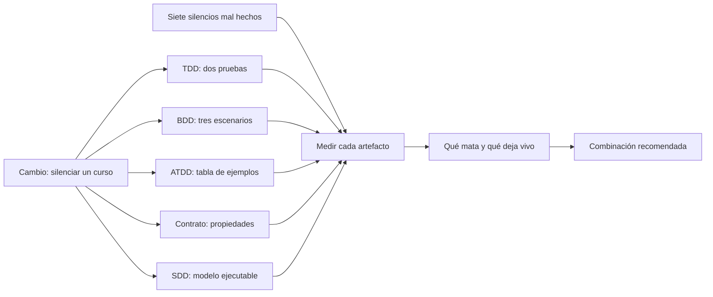
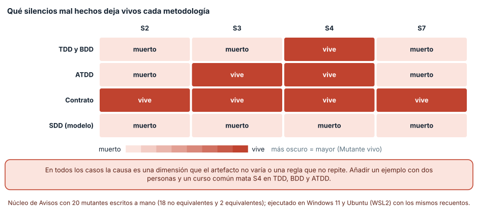

# SE-551 — Taller: un mismo cambio con cinco metodologías

[← SE-550 — ODD: desarrollo orgánico y su contraste con SDD](https://github.com/vladimiracunadev-create/modern-software-engineering-program/blob/main/classes/part-45-metodologias-de-desarrollo-de-tdd-a-odd/se-550-odd-desarrollo-organico-y-su-contraste-con-sdd/README.md) · [↑ Parte 45](https://github.com/vladimiracunadev-create/modern-software-engineering-program/blob/main/classes/part-45-metodologias-de-desarrollo-de-tdd-a-odd/README.md) · [📚 Índice completo](https://github.com/vladimiracunadev-create/modern-software-engineering-program/blob/main/classes/README.md) · [🌐 Portal](https://vladimiracunadev-create.github.io/modern-software-engineering-program/classes/SE-551.html) · [SE-552 — Proyecto: política metodológica de equipo con evidencia →](https://github.com/vladimiracunadev-create/modern-software-engineering-program/blob/main/classes/part-45-metodologias-de-desarrollo-de-tdd-a-odd/se-552-proyecto-politica-metodologica-de-equipo-con-evidencia/README.md)

## Punto profesional y fundamento pedagógico

**Punto profesional.** El taller existe para que compares metodologías de la única manera que no es una discusión de gusto: aplicándolas **al mismo cambio** y midiendo lo mismo. El cambio es el silencio de un curso en *Avisos*. Cada metodología produce un artefacto distinto (dos pruebas, tres escenarios, una tabla de ejemplos, un contrato, un modelo ejecutable) y la medida común son siete silencios mal hechos que pueden colarse. Lo que cada una mata, lo que deja vivo y lo que cuesta producirla es la evidencia con la que se decide, y es la que falta en la mayoría de las discusiones.

**Por qué aparece aquí.** Es el taller de la parte: reúne `SE-542` (TDD), `SE-544` (BDD), `SE-545` (ejemplos de aceptación), `SE-547` (contratos) y `SE-548` (modelo ejecutable como especificación) sobre un cambio común. EDD (`SE-549`) y ODD (`SE-550`) no entran en la comparación numérica: la primera es para salidas probabilísticas y la segunda es un flujo, no un oráculo; se discuten al final.

**Error conceptual que debe corregir.** Creer que la metodología que mata más mutantes es «la mejor». El modelo ejecutable mata los siete y el contrato solo tres, y aun así el contrato es insustituible para lo que el modelo no hace: comprobar propiedades sobre estados que nadie imaginó, sin repetir la regla. Una barra corta indica **qué clase de error deja ver**, no que la práctica sea inferior.

**Secuencia de aprendizaje.** Antes de ejecutar, predices cuántos de siete silencios mal hechos mata cada una de las cinco metodologías y cuál mata los siete; después ejecutas la comparación sobre el mismo núcleo, miras qué deja vivo cada una, añades el ejemplo que mata el sobreviviente más común y escribes una recomendación de combinación para este cambio.

**Evidencia de aprendizaje.** `taller-log.md` con tu predicción, los cinco artefactos (el tamaño de cada uno), la tabla de silencios muertos y vivos por metodología, el ejemplo que mata al sobreviviente común y una combinación recomendada con su justificación.

**Límite de la conclusión.** Los siete mutantes del silencio y los artefactos los escribió el autor; los cinco artefactos tienen tamaños distintos (9, 15, 17, 15 y 17 líneas) y el esfuerzo humano de producirlos **no se midió**. Con siete mutantes, la diferencia entre 6 y 7 es uno. El experimento compara capacidad de detección sobre un cambio, no productividad ni calidad de diseño. No se invocó ningún modelo de lenguaje.

### Trazabilidad fuente → afirmación

| Fuente primaria u oficial | Afirmación que respalda | Lo que no prueba |
|---|---|---|
| [Beck, «Canon TDD»](https://tidyfirst.substack.com/p/canon-tdd) | Define el flujo TDD de las dos pruebas del taller. | No compara metodologías. |
| [Cucumber, «Behaviour-Driven Development»](https://cucumber.io/docs/bdd/) | Define los escenarios del taller como ejemplos ejecutables acordados. | No mide su capacidad de detección. |
| [Adzic, «Specification by Example»](https://gojko.net/books/specification-by-example/) | Fundamenta la tabla de ejemplos de aceptación. | No cuantifica. |
| [Meyer, «Applying Design by Contract»](https://doi.org/10.1109/2.161279) | Fundamenta el contrato como oráculo de propiedades. | No mide su alcance. |
| [Böckeler, «Understanding Spec-Driven-Development»](https://martinfowler.com/articles/exploring-gen-ai/sdd-3-tools.html) | Fundamenta el modelo ejecutable como especificación mantenida. | No evalúa resultados. |
| [DeMillo, Lipton y Sayward](https://doi.org/10.1109/C-M.1978.218136) | Fundamenta medir con mutantes. | No dice que sean defectos reales. |

## Antes de empezar

Recupera lo aprendido en `SE-550`: cada práctica deja un artefacto y un punto ciego. La pregunta activa es: **si tuvieras que cambiar hoy una regla de tu proyecto y solo pudieras producir un artefacto de verificación, ¿cuál sería y qué dejaría pasar?**

## Prerrequisitos

- Haber completado `SE-541` a `SE-550`, o poder explicar qué oráculo deja cada metodología.
- Haber ejecutado al menos un experimento de la parte.
- Python 3.11 o posterior; los experimentos usan la biblioteca estándar.

## Problema auténtico

Las docentes piden a *Avisos* una función: «que una estudiante pueda silenciar un curso, salvo el aviso de la última hora». El equipo tiene cinco personas con cinco costumbres. Una escribe dos pruebas y el código. Otra redacta escenarios con una docente. Otra prepara una tabla de ejemplos. Otra escribe propiedades que deben cumplirse en cualquier estado. Otra reescribe la regla como un modelo ejecutable aparte y compara. Las cinco cumplen el mismo requisito y quedan convencidas de que su método es el suficiente. El equipo decide medirlo: siembra siete silencios mal hechos y comprueba cuáles detecta cada artefacto.

El taller es esa medición. Los siete silencios son variantes de la regla del silencio: ignorarlo, silenciar también la última hora, silenciar a la persona en todos sus cursos, silenciar el curso para todas las personas, dejar pasar el aviso de 24 horas, silenciar solo el de 72 y combinar dos criterios mal. Los cinco artefactos se evalúan sobre ellos y se cuenta qué deja vivo cada uno.

## Objetivos observables

Al terminar podrás:

1. aplicar cinco metodologías al mismo cambio y obtener cinco artefactos comparables;
2. medir la capacidad de detección de cada artefacto con los mismos mutantes y registrar el tamaño de cada uno;
3. identificar el sobreviviente común a varias metodologías y diseñar el ejemplo que lo mata;
4. recomendar una combinación de prácticas para un cambio con su justificación y sus límites;
5. explicar qué comparación no se hizo (esfuerzo humano, diseño, mantenimiento) y por qué importa.

## Mapa conceptual



El mapa muestra el diseño del taller: cinco artefactos y una misma medida. La salida no es un ganador sino una combinación justificada.

## Temas y por qué importan

| Tema | Por qué cambia una decisión profesional | Evidencia mínima |
|---|---|---|
| Comparar con la misma medida | Sin medida común, la comparación es de gusto. | Siete mutantes para los cinco artefactos |
| Tamaño del artefacto | Es una aproximación del costo de producirlo y mantenerlo. | Líneas por artefacto |
| Sobrevivientes comunes | Indican una dimensión que ningún artefacto varía. | El mutante que sobrevive a varios |
| Naturaleza del oráculo | Ejemplos, propiedades y modelos ven cosas distintas. | Tabla de lo que mata cada uno |
| Combinación | Dos prácticas de naturaleza distinta cubren más. | Combinación elegida y justificada |
| Lo no medido | Esfuerzo humano y mantenimiento pesan en la decisión. | Lista explícita de lo que falta |

## Conceptos y decisiones

### 1. El cambio y su regla

El silencio de un curso tiene una regla corta con tres detalles que se confunden con facilidad. Primero, el silencio es **por curso** y **por persona**: silenciar un curso para una persona no afecta a otra persona del mismo curso ni a la misma persona en otro curso. Segundo, **no bloquea el aviso de la última hora**, que se conserva. Tercero, se aplica sobre el aviso **más urgente** pendiente, no sobre todos. Cada detalle es una dimensión distinta que un artefacto puede o no variar; la confusión entre persona y curso es la más frecuente.

### 2. Siete silencios mal hechos

Los siete mutantes del silencio son: S1 ignora el silencio; S2 lo aplica también a la última hora; S3 silencia a la persona en todos sus cursos; S4 silencia el curso para todas las personas; S5 deja pasar el aviso de 24 horas; S6 solo silencia el de 72 horas; S7 silencia por curso o por persona (la combinación mal hecha). Se producen con un cambio mínimo en la línea que decide el silencio, y se comprobó que todos difieren del original en al menos un caso.

### 3. Cinco artefactos

El de **TDD** son dos pruebas del ciclo (el silencio deja pasar la última hora; el silencio es por curso), nueve líneas. El de **BDD** son tres escenarios en lenguaje de negocio (conserva la última hora, no recibe el de 24 horas, no afecta a otro curso), quince líneas. El de **ATDD** es una tabla de 17 ejemplos con el silencio activo (tres típicos y catorce de frontera), diecisiete líneas. El del **contrato** es una función de comprobación de propiedades sobre 400 estados al azar, quince líneas. El de **SDD** es un modelo de referencia ejecutable que reescribe la regla con otra estructura, diecisiete líneas. Los tamaños son los reales de los artefactos del laboratorio y miden el texto, no el esfuerzo.

### 4. Qué mata cada uno

Dos pruebas de TDD matan seis de siete; tres escenarios de BDD, seis; la tabla de ATDD, cinco; el contrato, tres; el modelo ejecutable, siete. El resultado se parece a lo que mostró `SE-541` a escala de la función entera, con una diferencia: ahora el artefacto es mínimo y está dirigido al cambio. Las dos pruebas de TDD, escritas con la regla en la cabeza, cubren casi todo lo que cubre una tabla más grande.

### 5. Qué deja vivo cada uno

Las dos pruebas y los escenarios dejan vivo S4, el que silencia el curso para todas las personas, porque ningún ejemplo tiene dos personas en el mismo curso. La tabla de ATDD deja vivos S3 y S4, porque no varía ni la persona ni el curso. El contrato deja vivos S2, S3, S4 y S7, porque su propiedad general («un curso silenciado solo recibe el aviso de la última hora») se cumple con cualquiera de esas variantes. El modelo no deja ninguno, porque reescribe la regla completa. **La causa es siempre la misma:** una dimensión que el artefacto no varía o una regla que no repite.

### 6. Combinar prácticas con puntos ciegos distintos

El sobreviviente común (S4) se mata con un solo ejemplo: dos personas en el mismo curso, una con el curso silenciado, y se espera el aviso de la otra. Ese ejemplo cabe en cualquiera de los tres artefactos de ejemplos. Con él, TDD y BDD igualan al modelo en los siete; la tabla de ATDD sigue necesitando una persona con dos cursos para matar S3, que silencia a la persona en todos sus cursos. El contrato, en cambio, necesita una propiedad nueva —«silenciar un par persona-curso no cambia los avisos de ninguna otra entrega»— que, ejecutada con la misma semilla sobre 400 estados, mata S3, S4 y S7 y pasa con el original. La combinación razonable para este cambio, entonces, son pocos ejemplos acordados (que sirven de documentación y de aceptación) más un contrato (que cubre lo que nadie imaginó) y no un modelo completo, que duplica la regla.

## Cinco metodologías, un cambio

Cada artefacto se evaluó contra los siete mutantes y se comprobó que pasa con la implementación original. Se registró el tamaño del artefacto en líneas no vacías, cuántos de los siete mata y el tiempo de ejecución del artefacto sobre el original.


**Cómo leer la figura.** Cada barra es una metodología aplicada al mismo cambio, silenciar un curso (entre paréntesis, las líneas de su artefacto), y su largo los silencios mal hechos que mata de los siete posibles; la línea discontinua es el total. Solo el modelo ejecutable de SDD mata los siete; TDD y BDD matan 6, ATDD 5 y el contrato con 400 estados solo 3. El tiempo de cada una queda en la tabla. **Dónde deja de valer:** los mutantes son del autor y con siete, la diferencia entre seis y siete es uno. El tamaño del artefacto no es el esfuerzo de producirlo: escribir un modelo de referencia exige entender la regla dos veces, y eso no se midió. Los tiempos varían entre equipos.

El orden de las filas no es un ranking de calidad. Una tabla de ejemplos negociada con las docentes tiene un valor (el acuerdo) que no aparece en la columna de mutantes, y un contrato protege contra estados que nadie imaginó, que tampoco se refleja. Lo que la medida sí dice es qué clase de silencio mal hecho deja pasar cada artefacto.

## Cuánto mata cada uno

La comparación se resume mejor visualmente. Las barras muestran los siete mutantes posibles y cuántos mata cada metodología.


**Cómo leer la figura.** Cada barra es una metodología; el largo es el número de silencios mal hechos que mata, de siete. La del contrato es la más corta y la del modelo ejecutable llega a siete. **Dónde deja de valer:** la barra corta no indica la peor práctica: el contrato comprueba propiedades sobre estados que nadie imaginó, un valor que esta medida no captura. Con siete mutantes, las barras de seis y siete difieren en uno.

## Por qué sobreviven

La causa de cada sobrevivencia se puede nombrar. Para los ejemplos (TDD, BDD, ATDD) es una dimensión que no varía: ningún ejemplo tiene dos personas en un mismo curso. Para el contrato es la generalidad de la propiedad: dice qué no debe pasar, no qué debe pasar. Para el modelo no hay sobreviviente, pero hay un riesgo propio: si quien escribe el modelo comparte el malentendido de quien escribió el código, ambos fallan igual y no se ve.



**Cómo leer la figura.** Cada fila es una metodología y cada columna un mutante del silencio; la celda oscura dice que sobrevive («vive») y la clara que muere. Los mutantes que ninguna metodología deja vivos no se muestran. TDD y BDD dejan vivo solo S4, ATDD deja S3 y S4, el contrato deja los cuatro y el modelo ejecutable ninguno; la causa de cada supervivencia queda en la nota y en la tabla. **Dónde deja de valer:** las razones son las del laboratorio; un conjunto de ejemplos mejor diseñado habría matado S4. La figura muestra por qué el punto ciego existe, no que sea inevitable.

Un resultado práctico: añadir un solo ejemplo de dos personas en el mismo curso (una con el curso silenciado, la otra no) mata S4 en los tres conjuntos de ejemplos. El costo de cerrar el punto ciego común es una línea; S3, que solo sobrevive a la tabla de ATDD y al contrato, pide otra línea con una persona y dos cursos.

## Definiciones de trabajo

- **Artefacto de verificación:** lo que produce una metodología para comprobar un cambio.
- **Mutante del silencio:** variante de la regla del silencio con un cambio mínimo.
- **Sobreviviente común:** mutante que sobrevive a varias metodologías.
- **Combinación de prácticas:** conjunto de artefactos de naturaleza distinta aplicados al mismo cambio.
- **Dimensión no variada:** valor del problema que ningún ejemplo toma.

## Ejemplo mínimo

El ejemplo que mata S4:

```python
d = [delivery("a", 100, student="e2", course="c1")]   # otra persona, el mismo curso
sil = frozenset({("e1", "c1")})                        # solo e1 silenció c1
assert fn(d, 76, sil, set()) == [("a", 24)]            # e2 sigue recibiendo el de 24 horas
```

Con la implementación original pasa; con S4 (silencia el curso para todas las personas), falla. Una línea de datos y una aserción cierran el punto ciego común a TDD, BDD y ATDD.

## Ejemplo profesional

*Escenario ilustrativo: las cifras y los resultados que aparecen en este ejemplo son supuestos de la narración, no mediciones.*

El equipo decide la combinación para el silencio. Descarta el modelo ejecutable completo (duplicaría la regla y un solo malentendido los afectaría a ambos) y conserva tres cosas: los tres escenarios de BDD con las docentes, como acuerdo y documentación; las dos pruebas de TDD, como protección de los bordes; y el contrato de propiedades, que añade la propiedad de aislamiento (silenciar un par persona-curso no cambia los avisos de otras entregas). Añade el ejemplo de dos personas en un curso. Antes de aceptar el cambio siembra los siete mutantes y comprueba que mueren todos. Registra el tamaño de cada artefacto y una nota: «no medimos el esfuerzo de escribirlos; lo estimamos en media hora para las pruebas, una hora para los escenarios con la docente y una hora para el contrato». Son estimaciones del equipo, no mediciones.

## Práctica guiada

1. Escribe tu predicción de muertes por metodología.
2. Ejecuta `python scripts/experiments_part45_b.py 491` y compara.
3. Escribe el ejemplo que mata S4 y comprueba que pasa con el original.
4. Escribe una propiedad para el contrato que mate S3 y S4.
5. Elige una combinación de dos artefactos para un cambio de tu proyecto y justifica con la tabla.

## Ejercicios

1. **Básico.** Explica por qué el contrato deja vivo S2 aunque su propiedad lo menciona.
2. **Intermedio.** Reduce los tres escenarios a uno que mate la mayor cantidad de silencios mal hechos y mide la pérdida.
3. **Avanzado.** Diseña un octavo mutante del silencio que sobreviva a los cinco artefactos y el artefacto mínimo que lo mataría.

## Reto verificable

Entrega `taller-log.md` con los cinco artefactos y su tamaño, la tabla de muertes y supervivencias, el ejemplo que mata el sobreviviente común y una combinación recomendada con su justificación. Es válido si otra persona reproduce la tabla y si la recomendación separa lo medido de lo estimado.

## Caso conductor

El silencio de un curso es el cambio del caso conductor de *Avisos* desde `SE-541`. Este taller es el momento en que las cinco prácticas se miden sobre ese cambio, y el resultado alimenta el proyecto `SE-552`, donde se escribe la política metodológica del equipo.

## Preguntas frecuentes

### ¿Por qué no se incluyen EDD y ODD en la comparación?

Porque no son oráculos del mismo tipo. EDD mide salidas probabilísticas con una puerta estadística; ODD es un flujo de trabajo. La regla del silencio es determinista y se compara bien con oráculos deterministas.

### ¿Un modelo ejecutable no es mejor que todo lo demás?

Mata más mutantes, pero exige escribir la regla dos veces y comparte los malentendidos de quien la escribe. En la práctica se usa en reglas de alto riesgo y con un autor distinto del de la implementación.

### ¿Y el esfuerzo?

No se midió y es el dato que más falta. Un equipo que quiera decidir con él debe medir el tiempo de producir y mantener cada artefacto en su propio contexto.

### ¿Qué hace un agente en este taller?

Puede proponer mutantes, escribir los artefactos y ejecutar la medida. No debe poder cambiar los mutantes ni los umbrales de su propia evaluación.

## Fallo controlado y diagnóstico

**Fallo.** El equipo acepta el cambio con los tres escenarios y las dos pruebas porque «pasan». En producción, una persona que no silenció el curso deja de recibir el aviso de 24 horas porque su compañera silenció el mismo curso.

**Diagnóstico paso a paso.** (1) Se reproduce con dos personas en el mismo curso. (2) Se siembra S4 y se comprueba que los artefactos del equipo lo dejan vivo. (3) Se identifica la dimensión no variada: la identidad. (4) Se escribe el ejemplo que lo mata.

**Corrección.** Se añade el ejemplo, se corrige la clave del silencio a persona más curso y se añade al contrato la propiedad de que el silencio de una persona no afecta a otra. El tamaño total de los artefactos crece en tres líneas.

## Errores comunes y cómo corregirlos

- **Comparar sin medida común.** Corrige con los mismos mutantes para todos.
- **Equiparar tamaño con esfuerzo.** Corrige midiendo tiempo real o declarando que no se midió.
- **Elegir por la cifra más alta.** Corrige mirando qué deja vivo cada uno.
- **Usar un modelo escrito por la misma persona.** Corrige con otra persona o con otra técnica.
- **Cerrar el taller sin recomendación.** Corrige con una combinación justificada.
- **Extrapolar siete mutantes.** Corrige repitiendo con los defectos reales de tu proyecto.

## Entorno y archivos clave

- `scripts/experiments_part45_b.py`: comparación de las cinco metodologías; `python scripts/experiments_part45_b.py 491`.
- `scripts/experiments_part45_lab.py` y `scripts/experiments_part45_a.py`: núcleo, escenarios y conjuntos de ejemplos.
- `content/part-45/figures/`: figuras.

## Seguridad, ética y accesibilidad

Los mutantes se evalúan con `exec` sobre texto del propio laboratorio. No ejecutes mutantes generados por un agente sin aislarlos. Ética: una comparación que se usa para evaluar a personas (quién escribe mejores pruebas) es un mal uso; mide artefactos. Accesibilidad: los escenarios y las tablas son texto legible con cualquier tecnología de apoyo; las figuras tienen texto alternativo completo.

## Puente hacia el trabajo con agentes

El taller es el protocolo de revisión de un cambio hecho por un agente: se pide los artefactos (pruebas, escenarios, ejemplos, propiedades), se siembran mutantes del cambio y se mide cuántos mueren. Los que sobreviven son el orden del día de la revisión humana. Dos reglas lo protegen: los mutantes los propone una fuente distinta de la que escribió los artefactos (otra sesión, otra persona o una herramienta), y ningún artefacto se acepta sin haber visto fallar al menos un mutante. Pedirle al agente que explique por qué cada sobreviviente sobrevive es una buena práctica: la explicación suele nombrar la dimensión que falta.

## Transferencia

Elige un cambio pequeño de tu proyecto con una regla clara. Escribe tres artefactos de naturalezas distintas (ejemplos, escenario, propiedad). Siembra cinco mutantes del cambio y mide. Añade el ejemplo que mate el sobreviviente más común. Registra cuánto tardó cada artefacto: esa es la medida que a esta clase le falta.

## Evaluación y evidencia

| Criterio | Evidencia aceptable | Rechazo |
|---|---|---|
| Misma medida | Mismos mutantes para todos | Medidas distintas |
| Sobrevivientes explicados | Dimensión o regla no cubierta | «Falta cobertura» |
| Ejemplo que cierra | Pasa con el original y mata al sobreviviente | Ejemplo sin comprobar |
| Combinación | Justificada con la tabla y el costo | «Todo lo anterior» |
| Límite | Dice qué no se midió | Afirma productividad |

## Fuentes

- Beck, K. [«Canon TDD»](https://tidyfirst.substack.com/p/canon-tdd).
- Cucumber. [«Behaviour-Driven Development»](https://cucumber.io/docs/bdd/).
- Adzic, G. [«Specification by Example»](https://gojko.net/books/specification-by-example/).
- Meyer, B. [«Applying Design by Contract»](https://doi.org/10.1109/2.161279).
- Böckeler, B. [«Understanding Spec-Driven-Development»](https://martinfowler.com/articles/exploring-gen-ai/sdd-3-tools.html).
- DeMillo, R., Lipton, R. y Sayward, F. [«Hints on Test Data Selection»](https://doi.org/10.1109/C-M.1978.218136).

## Límites y siguiente paso

Los siete mutantes y los cinco artefactos son del autor; no se midió esfuerzo humano ni mantenimiento. El siguiente paso, `SE-552`, convierte lo aprendido en una política de equipo: reglas que asignan prácticas a clases de cambio, con costo, riesgo y revisión.

## Glosario

| Término | Definición breve |
|---|---|
| Artefacto de verificación | Lo que una metodología produce para comprobar un cambio |
| Mutante del silencio | Variante de la regla del silencio |
| Sobreviviente común | Mutante que sobrevive a varias metodologías |
| Dimensión no variada | Valor del problema que ningún ejemplo toma |
| Combinación | Artefactos de naturaleza distinta sobre el mismo cambio |
| Modelo ejecutable | Segunda escritura de la regla usada como oráculo |

---

[← SE-550 — ODD: desarrollo orgánico y su contraste con SDD](https://github.com/vladimiracunadev-create/modern-software-engineering-program/blob/main/classes/part-45-metodologias-de-desarrollo-de-tdd-a-odd/se-550-odd-desarrollo-organico-y-su-contraste-con-sdd/README.md) · [↑ Parte 45](https://github.com/vladimiracunadev-create/modern-software-engineering-program/blob/main/classes/part-45-metodologias-de-desarrollo-de-tdd-a-odd/README.md) · [📚 Índice completo](https://github.com/vladimiracunadev-create/modern-software-engineering-program/blob/main/classes/README.md) · [🌐 Portal](https://vladimiracunadev-create.github.io/modern-software-engineering-program/classes/SE-551.html) · [SE-552 — Proyecto: política metodológica de equipo con evidencia →](https://github.com/vladimiracunadev-create/modern-software-engineering-program/blob/main/classes/part-45-metodologias-de-desarrollo-de-tdd-a-odd/se-552-proyecto-politica-metodologica-de-equipo-con-evidencia/README.md)
