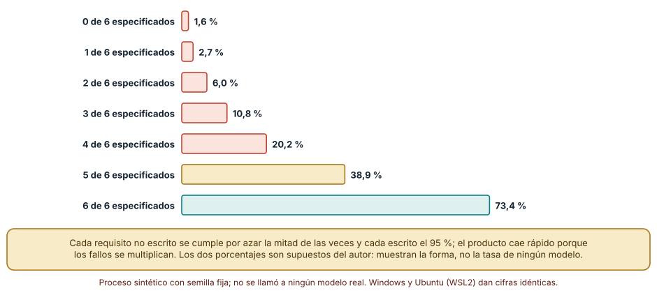
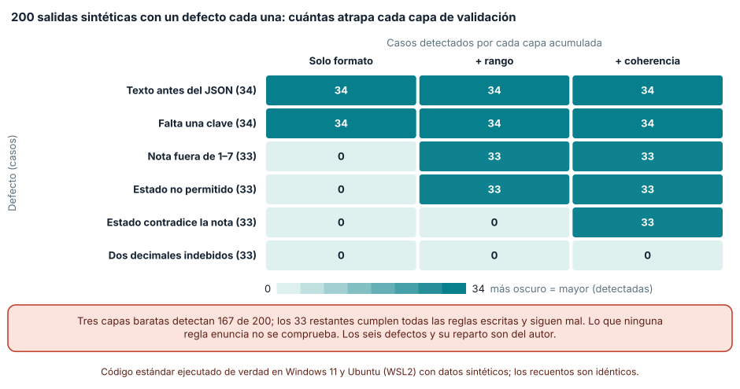

# SE-554 — Prompting, instrucciones y criterios de salida

[← SE-553 — Capacidades y límites de los modelos generativos](https://github.com/vladimiracunadev-create/modern-software-engineering-program/blob/main/classes/part-46-desarrollo-de-software-asistido-por-ia/se-553-capacidades-y-limites-de-los-modelos-generativos/README.md) · [↑ Parte 46](https://github.com/vladimiracunadev-create/modern-software-engineering-program/blob/main/classes/part-46-desarrollo-de-software-asistido-por-ia/README.md) · [📚 Índice completo](https://github.com/vladimiracunadev-create/modern-software-engineering-program/blob/main/classes/README.md) · [🌐 Portal](https://vladimiracunadev-create.github.io/modern-software-engineering-program/classes/SE-554.html) · [SE-555 — Contexto, archivos, memoria y recuperación →](https://github.com/vladimiracunadev-create/modern-software-engineering-program/blob/main/classes/part-46-desarrollo-de-software-asistido-por-ia/se-555-contexto-archivos-memoria-y-recuperacion/README.md)

## Punto profesional y fundamento pedagógico

**Punto profesional.** La clase existe para que dejes de ver el prompt como una frase ingeniosa y lo trates como una especificación que otra parte debe poder cumplir y tú debes poder comprobar. Un equipo que pide al asistente «calcula la nota final» recibe algo que parece razonable y que puede incumplir cinco requisitos que nadie escribió. La habilidad es redactar el encargo de modo que declare el objetivo, las restricciones, el formato y los criterios de aceptación, y construir las comprobaciones que dicen si la salida los cumple.

**Por qué aparece aquí.** Sigue a **Capacidades y límites de los modelos generativos**: `SE-553` estableció que la calidad de una respuesta no puede inferirse de su tono y que lo delegable es lo comprobable; ahora hay que decir qué se pide y cómo se comprueba. El caso conductor es el **módulo de calificaciones de la plataforma educativa** con un asistente incorporado al equipo. Es un caso sintético; no se llamó a ningún modelo real ni se midió ninguna herramienta.

**Error conceptual que debe corregir.** Creer que un buen prompt es uno largo y elocuente. Lo que lo hace bueno es que haga comprobable la salida: que cada requisito relevante esté dicho y que exista una comprobación de lo dicho. Una instrucción que nadie puede verificar no es un criterio de salida; es un deseo.

**Secuencia de aprendizaje.** Antes de ver los resultados, predices la probabilidad de que una salida cumpla seis requisitos si solo escribes dos de ellos; después simulas esa probabilidad, aplicas tres capas de validación a 200 salidas defectuosas y calculas la probabilidad de que un conjunto de instrucciones no se contradiga según su tamaño. La secuencia usa predicción, explicación propia, contraste y recuperación. [ICAP](https://icap.education.asu.edu/research) distingue participación de construcción de conocimiento; [How People Learn II](https://nap.nationalacademies.org/catalog/24783/how-people-learn-ii-learners-contexts-and-cultures) respalda diseñar la práctica con contextos reales y retroalimentación.

**Evidencia de aprendizaje.** `encargo.md` con el encargo para una tarea del módulo (objetivo, restricciones, formato, ejemplos y criterios), un validador ejecutable de la salida con sus casos de prueba, la medición de qué defectos atrapa cada capa y una nota que separe qué es medido, qué inferido y qué supuesto.

**Límite de la conclusión.** Las probabilidades de cumplir un requisito con y sin instrucción, los seis tipos de defecto y la probabilidad de choque entre instrucciones son construcciones del autor con semilla fija. No se evaluó ningún modelo real: las simulaciones muestran cómo se componen los fallos y qué comprueba cada capa, no cuánto mejora un prompt a una herramienta concreta.

### Trazabilidad fuente → afirmación

| Fuente primaria u oficial | Afirmación que respalda | Lo que no prueba |
|---|---|---|
| [Anthropic: prompt engineering](https://docs.anthropic.com/en/docs/build-with-claude/prompt-engineering/overview) | Recomienda ser claro y directo, aportar ejemplos, estructurar el encargo y definir criterios de éxito y formas de probarlos antes de iterar sobre el prompt. | Es guía de un proveedor para sus modelos; no garantiza el mismo efecto en otros ni mide su magnitud. |
| [JSON Schema](https://json-schema.org/specification) | Define un vocabulario para describir y validar la estructura de documentos JSON: tipos, campos obligatorios, rangos y enumeraciones. | Valida forma, no verdad: un documento puede cumplir el esquema y ser incorrecto. |
| [Wallace et al., «The Instruction Hierarchy»](https://arxiv.org/abs/2404.13208) | Plantea que los modelos deben distinguir instrucciones de distinto nivel de privilegio (sistema, usuario, contenido de herramientas) y propone entrenarlos para priorizar las de mayor nivel. | No asegura que un modelo concreto respete la jerarquía en todos los casos. |
| [Chen et al., «Evaluating Large Language Models Trained on Code»](https://arxiv.org/abs/2107.03374) | Evalúa código generado ejecutando pruebas unitarias contra la especificación, no por parecido con una solución. | No dice cómo escribir buenas pruebas para tu módulo. |
| [Python: json](https://docs.python.org/3/library/json.html) | Documenta el análisis de JSON usado por el validador de las simulaciones. | No define reglas de negocio. |
| [Python: random](https://docs.python.org/3/library/random.html) | Documenta el generador con semilla que hace reproducibles las simulaciones. | No valida los parámetros elegidos. |

## Antes de empezar

Recupera lo aprendido en `SE-553`: lo delegable es lo que se puede comprobar. La pregunta activa es: **¿cuántos de los requisitos de la última tarea que le pediste a un asistente estaban escritos en tu mensaje, y cuántos esperabas que el modelo adivinara?**

## Prerrequisitos

- Haber completado `SE-553` o poder explicar qué es la verificabilidad de una tarea y por qué el tono no mide la corrección.
- Python 3.11 o posterior; los experimentos usan solo la biblioteca estándar (`random`, `json`, `math`).
- Saber leer un documento JSON y una condición booleana.

## Problema auténtico

Una persona del equipo pidió al asistente: «Calcula la nota final de un alumno con sus trabajos y su examen». Obtuvo una función que promediaba todo por igual, devolvía un decimal sin redondear, aceptaba notas fuera de 1 a 7 y no decía qué hacer con un trabajo ausente. La función era correcta bajo un conjunto de supuestos que nadie había escrito. Cuando el promedio de un alumno cayó en 3,95, el asistente aprobó o reprobó según cómo el redondeo interpretara la frontera. Revisando la conversación, el equipo comprobó que ninguno de los seis requisitos reales (ponderación 40/60, escala 1–7, un decimal, redondeo hacia arriba en la mitad, aprobación a 4,0, error ante nota ausente) figuraba en la petición. Más tarde, un intento de arreglarlo añadió 25 reglas «por si acaso» y las instrucciones empezaron a contradecirse. La clase enseña a redactar un encargo completo sin inflarlo, a comprobar la salida por capas y a saber qué queda sin comprobar.

## Objetivos observables

Al terminar podrás:

1. descomponer un encargo en objetivo, contexto, restricciones, formato de salida, ejemplos y criterios de aceptación;
2. estimar cómo cae la probabilidad de cumplir todos los requisitos cuando algunos no se escriben y por qué los fallos se multiplican;
3. construir un validador por capas (formato, rango, coherencia) y medir qué defectos atrapa cada una y cuáles quedan fuera;
4. detectar contradicciones entre instrucciones y entender por qué crecen con el número de reglas;
5. distinguir lo que un esquema puede validar de lo que solo una prueba de comportamiento puede validar.

## Mapa conceptual


El mapa separa la **redacción** del encargo de su **comprobación**. Los criterios de aceptación alimentan las capas de validación: un criterio que no desemboca en una comprobación queda como esperanza.

## Temas y por qué importan

| Tema | Por qué cambia una decisión profesional | Evidencia mínima |
|---|---|---|
| El prompt como especificación | Convierte el encargo en algo contrastable, no en una conversación | encargo con seis componentes |
| Requisitos escritos y no escritos | Cuantifica el riesgo de dejar supuestos implícitos | tabla de probabilidad de cumplimiento |
| Formato y contratos de salida | Permite que la salida entre en un proceso automático | esquema de salida y validador |
| Ejemplos | Aclaran lo que las palabras dejan ambiguo, con el riesgo de sobreajuste al ejemplo | ejemplos con casos frontera |
| Instrucciones en conflicto | Evita que el modelo elija arbitrariamente entre reglas contradictorias | detección de pares en conflicto |
| Criterios de aceptación | Fija cuándo la salida se acepta, se rechaza o se repite | validador por capas con medición |

## Conceptos y decisiones

### 1. El prompt como especificación

Un encargo útil responde, aunque sea de forma breve, a seis preguntas. Qué se quiere (el objetivo, en una frase verificable). En qué contexto (qué sistema, qué versión, qué archivos, qué decisiones previas). Con qué restricciones (lo que no debe hacer: no tocar la base de datos, no añadir dependencias). En qué formato se devuelve (un parche, un JSON con campos concretos, una lista). Con qué ejemplos (entradas y salidas esperadas, incluidos los casos frontera). Y con qué criterios se acepta (qué prueba debe pasar, qué debe cumplirse). Nada de esto es específico de los modelos de lenguaje: es lo que se exige a cualquier especificación entre personas. La diferencia es que un colega se detiene y pregunta cuando falta algo; el modelo, por su mecanismo (`SE-553`), produce una respuesta plausible y sigue. Por eso lo que no está escrito se rellena con la opción más probable, que no tiene por qué ser la de tu sistema. La guía de ingeniería de prompts de Anthropic recomienda precisamente fijar criterios de éxito y formas de probarlos antes de iterar sobre el texto.

### 2. Requisitos escritos y requisitos supuestos

La suposición implícita es el origen más frecuente de salidas «casi correctas». Si una tarea tiene seis requisitos y cada uno no escrito se cumple por azar con probabilidad *q*, la probabilidad de cumplir todos es el producto de seis factores, y los factores bajos pesan mucho. No hace falta un modelo preciso de la herramienta para ver la forma: cada requisito explícito sube el factor correspondiente y la probabilidad conjunta crece de manera no lineal, con muy poco efecto de los primeros requisitos y mucho de los últimos. Esto tiene una consecuencia de trabajo. No sirve añadir adjetivos («hazlo bien», «sé cuidadoso»), que no son requisitos. Sirve enumerar las decisiones de diseño que el sistema ya tomó: escala, redondeo, qué hacer con lo ausente. Conviene además distinguir los requisitos de **comportamiento** (el qué) de los de **proceso** (no modifiques otros archivos): ambos se escriben, y ambos se comprueban de forma distinta.

### 3. Formato de salida y contrato verificable

Un formato estructurado convierte la salida en algo que un programa puede validar. JSON Schema permite declarar tipos, campos obligatorios, rangos y enumeraciones; un validador que lo aplique rechaza lo que no cumple sin intervención humana. Hay dos precauciones. La primera: el formato es una restricción sobre la forma, no sobre la verdad, y un documento perfectamente válido puede contener una nota equivocada. La segunda: pedir «solo JSON» no garantiza que el modelo no antepondrá una frase explicativa; el validador debe rechazar esa salida y la rutina debe decidir si reintenta, extrae el JSON o escala. Por eso el contrato de salida se redacta en el encargo y se **comprueba fuera del modelo**: un esquema declarativo y un script que lo aplica. Cuando la herramienta ofrece salidas estructuradas forzadas, reducen los fallos de forma, pero no eliminan los de fondo.

### 4. Ejemplos: aclaran y sesgan

Un ejemplo bien elegido elimina ambigüedades que una descripción no resuelve: muestra qué es una nota de frontera, cómo se escribe una fecha, qué forma tiene el mensaje de error. También sesga: el modelo tiende a reproducir los rasgos incidentales del ejemplo (su longitud, su orden, su vocabulario). Dos reglas prácticas. Incluye casos frontera y casos negativos, no solo el caso feliz, porque son los que desambiguan. Y varía los ejemplos de modo que los rasgos incidentales no sean sistemáticos. Los ejemplos del encargo y las pruebas del validador no deberían ser los mismos: si el validador solo comprueba los casos que mostraste, mides que el modelo copió, no que entendió.

### 5. Instrucciones en conflicto y jerarquía

Cuando un encargo contiene instrucciones que se contradicen («responde siempre en JSON» y «explica tu razonamiento paso a paso»), el modelo no avisa: elige una según su mecanismo, y la elección puede variar entre ejecuciones. El número de pares posibles crece con el cuadrado del número de instrucciones, y con él la probabilidad de que alguno choque. Hay además un problema de **precedencia**: cuando el contexto incluye contenido de terceros (un documento, el resultado de una herramienta), las instrucciones que contenga no deben competir con las del encargo. El trabajo de Wallace y coautores propone entrenar a los modelos con una jerarquía de instrucciones; mientras no se pueda asumir que un modelo concreto la respeta, el diseño debe ser defensivo: separar con claridad el encargo del material, declarar que el material son datos y comprobar la salida. `SE-562` retoma el riesgo de seguridad.

### Seis requisitos, dos escritos: la caída del producto

Una tarea tiene seis requisitos ocultos. Cada requisito no especificado se cumple con probabilidad 0,5; cada uno escrito, con 0,95. Para cada número *k* de requisitos escritos se simulan 20 000 salidas y se cuenta la proporción que cumple los seis.

```python
cumplidos = sum(rng.random() < (0.95 if i < k else 0.5) for i in range(6))
todos += cumplidos == 6
```

| Requisitos escritos | Cumplen los seis | Media de requisitos cumplidos |
|---:|---:|---:|
| 0 | 1,6 % | 2,99 |
| 1 | 2,7 % | 3,46 |
| 2 | 6,0 % | 3,92 |
| 3 | 10,8 % | 4,35 |
| 4 | 20,2 % | 4,80 |
| 5 | 38,9 % | 5,25 |
| 6 | 73,4 % | 5,70 |

Sin escribir ninguno, solo el 1,6 % de las salidas cumple todo, aunque en promedio se cumplen tres de seis, de modo que la salida «parece medio bien». Con tres escritos el cumplimiento total es del 10,8 %; con cinco, del 38,9 %; con seis, del 73,4 %. La media sube de forma casi lineal, pero el cumplimiento conjunto lo hace de manera acelerada: el último requisito escrito añade casi 35 puntos. Esto explica por qué una salida con «cinco de seis bien» es la experiencia más frecuente y por qué revisar a ojo no la detecta: falla justo el requisito que no se comprobó.



**Cómo leer la figura.** Cada barra es la proporción de 20 000 salidas que cumplen los seis requisitos; la altura creciente es el beneficio de escribir uno más. **Dónde deja de valer:** el 0,5 y el 0,95 son supuestos del autor y suponen requisitos independientes; con un modelo real, algunos requisitos no escritos se cumplen casi siempre (los comunes) y otros casi nunca (los propios de tu sistema). La figura muestra la forma del efecto, no la tasa de ninguna herramienta.

### Doscientas salidas defectuosas: qué atrapa cada capa

Se generan 200 salidas sintéticas con un defecto cada una, repartidas entre seis tipos: texto antes del JSON (34), falta una clave (34), nota fuera de 1–7 (33), estado no permitido (33), estado que contradice la nota (33) y nota con dos decimales indebidos (33). Se aplican tres capas acumuladas: formato (JSON con las claves y tipos esperados), rango (nota entre 1,0 y 7,0 y estado en {A, R}) y coherencia (estado A si y solo si la nota es al menos 4,0).

```python
def valida_formato(o): d = json.loads(o); return isinstance(d, dict) and set(d) >= {"nota", "estado"}
def valida_rango(o):   d = json.loads(o); return 1.0 <= d["nota"] <= 7.0 and d["estado"] in {"A", "R"}
def valida_coherencia(o): d = json.loads(o); return (d["estado"] == "A") == (d["nota"] >= 4.0)
```

| Defecto | Casos | Solo formato | + rango | + coherencia |
|---|---:|---:|---:|---:|
| Texto antes del JSON | 34 | 34 | 34 | 34 |
| Falta una clave | 34 | 34 | 34 | 34 |
| Nota fuera de 1–7 | 33 | 0 | 33 | 33 |
| Estado no permitido | 33 | 0 | 33 | 33 |
| Estado contradice la nota | 33 | 0 | 0 | 33 |
| Dos decimales indebidos | 33 | 0 | 0 | 0 |
| **Total** | 200 | 68 | 134 | 167 |

La capa de formato atrapa 68 de 200 (34 %); sumar el rango llega a 134 (67 %); sumar la coherencia, a 167 (83,5 %). Quedan 33 salidas, todas con dos decimales indebidos: cumplen todas las reglas escritas y siguen mal, porque ninguna regla enunciaba «un decimal». Cada capa aporta un tipo de defecto distinto y la última lección es estructural: lo que ninguna regla enuncia no se comprueba, y la forma de enunciarlo es añadir la regla (o una prueba de comportamiento) en cuanto se descubre.



**Cómo leer la figura.** Cada fila es un tipo de defecto, con sus casos entre paréntesis, y cada columna una capa de validación acumulada; el color más oscuro es más casos detectados. Mira cómo se llena el mapa hacia la derecha y que la última fila, los dos decimales indebidos, queda clara en todas las capas. **Dónde deja de valer:** los seis defectos y su reparto uniforme son del autor, y un modelo real fallaría con otra distribución; la proporción atrapada por cada capa depende de la frecuencia de cada defecto, que se mide sobre salidas reales.

### Cuántas instrucciones aguanta un encargo

Si cada par de instrucciones entra en conflicto con probabilidad *q*, la probabilidad de que un conjunto de *n* instrucciones no tenga ningún par en conflicto es (1 − *q*) elevado al número de pares, *n*(*n* − 1)/2. Se calcula para *q* de 0,5 % y de 2 %.

| Instrucciones | Pares posibles | Sin conflicto (0,5 % por par) | Sin conflicto (2 % por par) |
|---:|---:|---:|---:|
| 3 | 3 | 98,5 % | 94,1 % |
| 5 | 10 | 95,1 % | 81,7 % |
| 8 | 28 | 86,9 % | 56,8 % |
| 12 | 66 | 71,8 % | 26,4 % |
| 20 | 190 | 38,6 % | 2,2 % |

Con una probabilidad de conflicto del 2 % por par, un encargo de 12 instrucciones queda libre de choques solo el 26,4 % de las veces y uno de 20 el 2,2 %. La lección práctica es que añadir reglas «por si acaso» no es gratuito: cada una añade *n* − 1 pares nuevos. Conviene que cada instrucción cubra un requisito real, que se agrupen por tema y que existan pruebas que detecten cuando dos reglas dan salidas incompatibles.


**Cómo leer la figura.** El eje horizontal es el número de instrucciones y el vertical la probabilidad de que no haya ningún par en conflicto; cada línea es una probabilidad de choque por par. Mira cómo caen las dos líneas aunque cada par casi nunca choque: los pares crecen con el cuadrado de las instrucciones. **Dónde deja de valer:** *q* es un supuesto del autor, los pares se suponen independientes (en la realidad los conflictos se agrupan por tema) y no hay modelo detrás: es un cálculo exacto. Sirve para razonar sobre el orden de magnitud, no para predecir una herramienta.

## Definiciones de trabajo

- **[encargo](../../../glosario/entradas/e/encargo.md):** especificación de lo que se pide al modelo, con objetivo, contexto, restricciones, formato, ejemplos y criterios.
- **[criterio de aceptación](../../../glosario/entradas/c/criterio-de-aceptacion.md):** condición verificable que la salida debe cumplir para aceptarse.
- **[contrato de salida](../../../glosario/entradas/c/contrato-de-salida.md):** descripción de la forma y los valores válidos de la respuesta, comprobable por un programa.
- **[validación por capas](../../../glosario/entradas/v/validacion-por-capas.md):** secuencia de comprobaciones de coste creciente (forma, rango, coherencia, comportamiento).
- **[instrucciones en conflicto](../../../glosario/entradas/i/instrucciones-en-conflicto.md):** pares de reglas del encargo cuyo cumplimiento simultáneo es imposible.

Las definiciones son operativas para el módulo de calificaciones. No convierten términos con una historia más amplia en sinónimos y deben contrastarse con la documentación primaria enlazada al final.

## Ejemplo mínimo

El fragmento valida una salida con las tres capas. Antes de ejecutarlo, predice qué capa rechaza cada una de las tres salidas.

```python
import json
def valida(o):
    d = json.loads(o)
    if not {"nota", "estado"} <= set(d): return "formato"
    if not (1.0 <= d["nota"] <= 7.0) or d["estado"] not in {"A", "R"}: return "rango"
    if (d["estado"] == "A") != (d["nota"] >= 4.0): return "coherencia"
    return "ok"
for s in ('{"nota": 3.9, "estado": "A"}', '{"nota": 8.2, "estado": "A"}', '{"nota": 5.5}'):
    print(s, valida(s))
```

La primera cae en coherencia, la segunda en rango y la tercera en formato. Una cuarta salida, `{"nota": 4.04, "estado": "A"}`, pasa todas las capas y es incorrecta si el sistema exige un decimal. Registra versión de Python, comando y salida; añade la capa que la atrape.

## Ejemplo profesional

Escenario hipotético, construido para la clase y sin datos reales. El equipo reescribe el encargo para «calcular la nota final» con los seis componentes. Objetivo: función `nota_final(trabajos, examen)` que devuelve nota y estado. Contexto: módulo de calificaciones, Python 3.12, sin dependencias. Restricciones: no modificar otras funciones; lanzar `ValueError` ante lista vacía de trabajos. Formato: un parche unificado más un archivo de pruebas. Ejemplos: cinco casos, entre ellos la frontera 4,0 y un promedio con medio punto de redondeo. Criterios: todas las pruebas pasan, ninguna prueba existente falla, la función tiene docstring con un ejemplo ejecutable. A continuación el equipo escribe el validador de la salida: aplica el parche en una copia, ejecuta pruebas y comprueba que solo cambiaron los archivos esperados. El primer intento del asistente pasa las cinco pruebas y falla una sexta que el equipo escribió desde la especificación (la que distingue promedio de máximo). Se descubre así que el encargo no decía «ponderado»; se corrige y se registra la decisión. Compara con el estado inicial: antes el criterio de aceptación era «parece correcto».

## Práctica guiada

1. Toma una tarea del módulo y escribe el encargo con los seis componentes; marca cuáles añaden información que el modelo no podría adivinar.
2. Predice la probabilidad de cumplir todos los requisitos si escribes la mitad y anota el número antes de simular.
3. Reproduce la tabla de los requisitos con la semilla fijada y cambia el 0,5 a 0,8; observa cuánto cambia la conclusión.
4. Escribe las tres capas de validación para tu tarea y pruébalas con diez salidas que introduzcan un defecto cada una.
5. Identifica el defecto que ninguna capa atrapa y añade la regla o la prueba de comportamiento que lo haría.
6. Cuenta las instrucciones de un archivo de reglas real o sintético, calcula los pares y revisa las que se solapan.
7. Entrega `encargo.md` y pide a otra persona que escriba un defecto que tu validador no atrape.

## Ejercicios

1. **Requisitos:** una tarea tiene cuatro requisitos; escribes dos. Calcula la probabilidad de cumplir los cuatro con los factores 0,95 y 0,5 y compárala con escribir los cuatro.
2. **Capas:** da un defecto que una validación de rango no atrape y otro que solo una prueba de comportamiento atrape.
3. **Conflicto:** dos instrucciones del encargo dicen «responde en una línea» y «justifica cada decisión». Reescribe el encargo para que no choquen, indicando dónde va la justificación.
4. **Ejemplos:** el validador usa los mismos cinco ejemplos que el encargo. Explica por qué eso no prueba comprensión y cómo lo corregirías.

## Reto verificable

Entrega `encargo.md` con los seis componentes para una tarea del módulo, un validador ejecutable con sus casos de prueba, la medición de qué defectos atrapa cada capa sobre al menos veinte salidas defectuosas y la lista de defectos que quedan sin atrapar. Se aprueba si otra persona ejecuta el validador desde un checkout limpio, obtiene los mismos recuentos y puede decir qué requisito del encargo no está comprobado. No se aprueba por un encargo largo sin criterios verificables ni por declarar que el validador «cubre todo».

## Caso conductor

El módulo de calificaciones es el caso conductor. Esta clase deja el segundo artefacto: el encargo con su validador. `SE-555` preguntará qué información del módulo debe llevar el contexto para que el encargo se cumpla sin adivinar, y `SE-556` cómo cambia el trabajo cuando el asistente propone cambios sobre el código mientras escribes. Cambia después un solo dato, la probabilidad de cumplir un requisito no escrito, y observa a partir de qué valor escribirlo deja de merecer la pena.

## Preguntas frecuentes

### ¿Un prompt más largo es mejor?

No por ser largo. Es mejor si añade requisitos reales que el modelo no podría adivinar y si cada uno se comprueba. Texto de relleno o reglas redundantes aumentan los pares que pueden chocar sin aumentar el cumplimiento.

### ¿Debo pedir «piensa paso a paso»?

Puede ayudar en tareas de razonamiento y eso depende del modelo y de la tarea: se prueba con tus casos, no se asume. En cualquier caso la respuesta final debe comprobarse igual; un razonamiento fluido no sustituye a una prueba.

### ¿Los ejemplos del prompt pueden hacer que el modelo copie en vez de entender?

Sí. Por eso conviene variar los ejemplos, incluir casos frontera y negativos y evaluar con casos distintos de los mostrados.

### ¿Qué hago si el modelo ignora una instrucción?

Primero comprueba que no contradice otra del encargo y que está donde el modelo la ve. Después añade una comprobación fuera del modelo que detecte el incumplimiento y decide qué hace el proceso: reintentar, corregir o escalar. No confíes en repetir la instrucción en mayúsculas.

## Fallo controlado y diagnóstico

Reproduce el fallo clásico de la clase: **una salida que cumple el formato y es incorrecta**. Genera las 33 salidas con dos decimales indebidos y aplícales las tres capas.

Registra síntoma, entrada mínima, hipótesis, observación que descarta cada hipótesis, causa, corrección y prueba de regresión. **Síntoma:** todas las validaciones pasan y el informe del ministerio sale con décimas distintas. **Hipótesis rivales:** (a) el validador está mal implementado; (b) el modelo no entiende la escala; (c) el requisito «un decimal» nunca estuvo escrito ni comprobado. **Prueba:** añade la regla de un decimal y mide cuántas de las 33 salidas caen; si caen todas, la causa es el requisito no comprobado. **Conclusión:** el validador solo comprueba lo que se le enseñó. **Regresión:** añade un caso a la suite que falle con dos decimales y registra la regla en el encargo y en el validador a la vez. No cambies a la vez el encargo y el validador sin dejar constancia de cuál arregló el fallo.

## Errores comunes y cómo corregirlos

| Síntoma | Causa probable | Corrección |
|---|---|---|
| La salida «casi» cumple siempre | Hay requisitos implícitos | Enumerar las decisiones del sistema y escribirlas |
| El JSON llega con texto delante | El contrato de salida no se comprueba | Validar fuera del modelo y rechazar o extraer con regla |
| El asistente alterna entre dos estilos | Instrucciones en conflicto | Detectar pares y reescribir con una precedencia |
| Las pruebas pasan y el resultado es incorrecto | Las pruebas solo repiten los ejemplos | Escribir casos desde la especificación, con fronteras |
| El encargo crece sin mejorar la salida | Se añaden reglas sin requisito real | Podar cada instrucción a un requisito comprobable |

## Entorno y archivos clave

```text
work/SE-554/
├── README.md
├── encargo/
│   ├── encargo.md
│   ├── validador.py
│   └── casos_defectuosos.json
├── tests/test_validador.py
└── evidence/encargo-medicion.md
```

El `README` declara plataforma, versión de Python, semillas y comandos. Los experimentos usan solo la biblioteca estándar (`random`, `json`, `math`) y se ejecutaron con CPython 3.12.9 en Windows 11 y 3.12.3 en Ubuntu bajo WSL2: las salidas fueron idénticas. Los experimentos están en `scripts/experiments_part46_a.py`. Si añades una dependencia, fija procedencia y versión.

## Seguridad, ética y accesibilidad

- el encargo y los ejemplos no deben contener datos reales de estudiantes ni secretos: usa datos sintéticos o anonimizados;
- el contenido de terceros que entra en el contexto puede incluir instrucciones; trátalo como dato y valida la salida (`SE-562` desarrolla el riesgo);
- un criterio de aceptación que solo mide lo que el modelo copió puede dar falsa seguridad a quien depende del resultado; incluye casos de grupos y escalas distintos;
- la salida estructurada debe poder leerse con lector de pantalla; no dependas del color para indicar errores;
- las guías y estándares citados tienen derechos de autor: cita su estructura y vincula la fuente, no copies su texto.

## Puente hacia el trabajo con agentes

Un agente ejecuta muchos encargos encadenados, de modo que un requisito no escrito falla en cada paso y los fallos se componen. Convierte el encargo en un contrato que el agente pueda comprobar por sí mismo: pídele que ejecute el validador antes de entregar, que informe de qué requisitos comprobó y de cuáles no pudo comprobar, y que no declare terminada la tarea mientras haya una capa fallando. Revisa especialmente los casos en que el agente «arregla» el validador en vez de la salida, y compara su informe con la ejecución independiente de las mismas pruebas.

## Transferencia

Traslada el análisis a otro dominio (por ejemplo, un asistente que prepara facturas para un taller mecánico): cambia los requisitos y las capas de validación y conserva el procedimiento de enumerar las decisiones implícitas, validar por capas fuera del modelo y declarar qué queda sin comprobar. La transferencia está lograda cuando puedes decir qué requisito de ese dominio sería el último en escribirse y qué prueba lo detectaría, no cuando la tabla se parece a la del módulo de calificaciones.

## Evaluación y evidencia

| Criterio | Evidencia para aprobar |
|---|---|
| comprensión | explicación de por qué los requisitos no escritos se componen y de lo que una validación puede y no puede decir |
| corrección | tablas de requisitos, capas y conflictos reproducibles con las mismas semillas |
| diseño | encargo con seis componentes y validador por capas con casos |
| diagnóstico | reproducción del fallo «cumple el formato y es incorrecto» con regresión |
| incertidumbre | declaración de que probabilidades y defectos son del autor |
| reproducibilidad | versiones, comandos, salida y límites declarados |

## Fuentes

- [Anthropic: prompt engineering](https://docs.anthropic.com/en/docs/build-with-claude/prompt-engineering/overview) — claridad, ejemplos y criterios de éxito antes de iterar; autoridad: documentación de Anthropic.
- [JSON Schema](https://json-schema.org/specification) — validación de la estructura de documentos JSON; autoridad: especificación del proyecto JSON Schema.
- [Wallace et al., «The Instruction Hierarchy»](https://arxiv.org/abs/2404.13208) — jerarquía de instrucciones por nivel de privilegio; autoridad: preprint de OpenAI.
- [Chen et al., «Evaluating Large Language Models Trained on Code»](https://arxiv.org/abs/2107.03374) — evaluación de código por pruebas; autoridad: preprint de OpenAI.
- [Python: json](https://docs.python.org/3/library/json.html) — análisis de JSON; autoridad: documentación de Python.
- [Python: random](https://docs.python.org/3/library/random.html) — generador con semilla; autoridad: documentación de Python.

Cada fuente respalda el mecanismo indicado; ninguna demuestra que el 73,4 % de cumplimiento con seis requisitos escritos, los 167 defectos atrapados de 200 o el 26,4 % sin conflicto se observen en una herramienta real. Esa afirmación depende del modelo, de la tarea y de cómo se mida.

## Límites y siguiente paso

Se ejecutaron tres experimentos en Windows y Ubuntu (WSL2) con resultados idénticos: una simulación de requisitos con semilla fija, un validador real aplicado a salidas sintéticas y un cálculo exacto de conflictos. No se llamó a ningún modelo real; las probabilidades de cumplimiento, los seis tipos de defecto, su reparto uniforme y la tasa de conflicto son construcciones del autor, y el validador se escribió sabiendo qué defectos se inyectaban. La siguiente clase pregunta qué información del sistema debe llevar el contexto para que el encargo se cumpla sin adivinar.

## Glosario

- **[encargo](../../../glosario/entradas/e/encargo.md):** especificación de lo que se pide al modelo, con objetivo, contexto, restricciones, formato, ejemplos y criterios.
- **[criterio de aceptación](../../../glosario/entradas/c/criterio-de-aceptacion.md):** condición verificable que la salida debe cumplir para aceptarse.
- **[contrato de salida](../../../glosario/entradas/c/contrato-de-salida.md):** descripción de la forma y los valores válidos de la respuesta, comprobable por un programa.
- **[validación por capas](../../../glosario/entradas/v/validacion-por-capas.md):** secuencia de comprobaciones de coste creciente (forma, rango, coherencia, comportamiento).
- **[instrucciones en conflicto](../../../glosario/entradas/i/instrucciones-en-conflicto.md):** pares de reglas del encargo cuyo cumplimiento simultáneo es imposible.

Conceptos de esta clase en el [glosario del programa](../../../glosario/README.md): [Contrato de salida](../../../glosario/entradas/c/contrato-de-salida.md) · [Criterio de aceptación](../../../glosario/entradas/c/criterio-de-aceptacion.md) · [Encargo](../../../glosario/entradas/e/encargo.md) · [Instrucciones en conflicto](../../../glosario/entradas/i/instrucciones-en-conflicto.md) · [Validación por capas](../../../glosario/entradas/v/validacion-por-capas.md).

---

[← SE-553 — Capacidades y límites de los modelos generativos](https://github.com/vladimiracunadev-create/modern-software-engineering-program/blob/main/classes/part-46-desarrollo-de-software-asistido-por-ia/se-553-capacidades-y-limites-de-los-modelos-generativos/README.md) · [↑ Parte 46](https://github.com/vladimiracunadev-create/modern-software-engineering-program/blob/main/classes/part-46-desarrollo-de-software-asistido-por-ia/README.md) · [📚 Índice completo](https://github.com/vladimiracunadev-create/modern-software-engineering-program/blob/main/classes/README.md) · [🌐 Portal](https://vladimiracunadev-create.github.io/modern-software-engineering-program/classes/SE-554.html) · [SE-555 — Contexto, archivos, memoria y recuperación →](https://github.com/vladimiracunadev-create/modern-software-engineering-program/blob/main/classes/part-46-desarrollo-de-software-asistido-por-ia/se-555-contexto-archivos-memoria-y-recuperacion/README.md)
