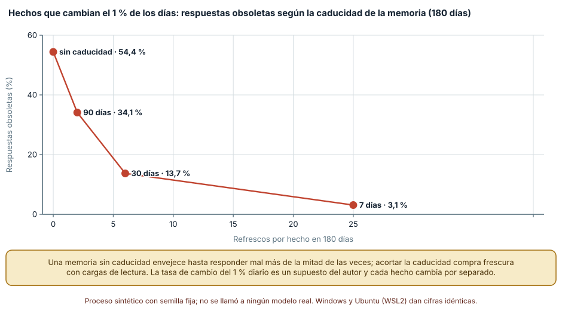
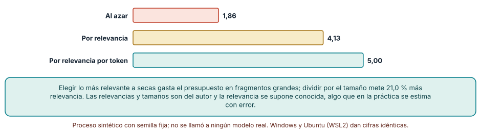

# SE-555 — Contexto, archivos, memoria y recuperación

[← SE-554 — Prompting, instrucciones y criterios de salida](https://github.com/vladimiracunadev-create/modern-software-engineering-program/blob/main/classes/part-46-desarrollo-de-software-asistido-por-ia/se-554-prompting-instrucciones-y-criterios-de-salida/README.md) · [↑ Parte 46](https://github.com/vladimiracunadev-create/modern-software-engineering-program/blob/main/classes/part-46-desarrollo-de-software-asistido-por-ia/README.md) · [📚 Índice completo](https://github.com/vladimiracunadev-create/modern-software-engineering-program/blob/main/classes/README.md) · [🌐 Portal](https://vladimiracunadev-create.github.io/modern-software-engineering-program/classes/SE-555.html) · [SE-556 — Autocompletado, chat, edición y generación →](https://github.com/vladimiracunadev-create/modern-software-engineering-program/blob/main/classes/part-46-desarrollo-de-software-asistido-por-ia/se-556-autocompletado-chat-edicion-y-generacion/README.md)

## Punto profesional y fundamento pedagógico

**Punto profesional.** La clase existe para que dejes de pensar que «el asistente conoce el proyecto» y entiendas que solo conoce lo que en este momento hay en su ventana: los archivos que alguien o algo decidió incluir, lo que una memoria guardó y lo que una búsqueda devolvió. Un equipo que no gestiona esa entrada obtiene respuestas coherentes con un proyecto que no es el suyo. La habilidad es decidir qué información entra, en qué fragmentos, con qué caducidad y con qué presupuesto, y comprobar que lo recuperado es lo que importaba.

**Por qué aparece aquí.** Sigue a **Prompting, instrucciones y criterios de salida**: `SE-554` mostró que el encargo debe enumerar las decisiones que el modelo no puede adivinar; ahora la pregunta es de dónde sale esa información cuando es demasiado grande para pegarla. El caso conductor es el **módulo de calificaciones de la plataforma educativa**, ahora con cientos de documentos de decisiones, actas y reglas. Es un caso sintético; no se usó ningún sistema de recuperación comercial ni ningún modelo real.

**Error conceptual que debe corregir.** Creer que una memoria o una recuperación «automática» es una fuente de verdad. Es una copia selectiva y envejecida de lo que alguien escribió: puede traer un fragmento partido por la frontera, un hecho que ya cambió o un documento equivocado con vocabulario parecido, y el modelo lo usará con la misma seguridad que usa lo correcto.

**Secuencia de aprendizaje.** Antes de ver los resultados, predices qué tamaño de fragmento recupera mejor un hecho escondido en un documento largo y cuánto contexto cuesta; después ejecutas una recuperación BM25 real sobre 240 documentos, simulas una memoria cuyos hechos cambian el 1 % de los días con cuatro políticas de caducidad y empaquetas fragmentos en un presupuesto de tokens por dos criterios. La secuencia usa predicción, explicación propia, contraste y recuperación. [ICAP](https://icap.education.asu.edu/research) distingue participación de construcción de conocimiento; [How People Learn II](https://nap.nationalacademies.org/catalog/24783/how-people-learn-ii-learners-contexts-and-cultures) respalda diseñar la práctica con contextos reales y retroalimentación.

**Evidencia de aprendizaje.** `contexto-politica.md` con la predicción, las tres figuras reproducidas, el diseño de contexto para tres tareas del módulo (qué entra, cómo se fragmenta, cuándo caduca), la medición de recuperación sobre un conjunto propio de al menos veinte preguntas y una nota que separe qué es medido, inferido y supuesto.

**Límite de la conclusión.** El corpus, el vocabulario, la clave única de cada hecho, la tasa de cambio del 1 % diario y las relevancias de los fragmentos son construcciones del autor con semilla fija. La recuperación BM25 es código real, pero se ejecutó sobre texto sintético con el caso más favorable (una consulta con clave única); no representa el rendimiento sobre documentos reales ni de recuperación semántica con vectores.

### Trazabilidad fuente → afirmación

| Fuente primaria u oficial | Afirmación que respalda | Lo que no prueba |
|---|---|---|
| [Lewis et al., «Retrieval-Augmented Generation for Knowledge-Intensive NLP Tasks»](https://arxiv.org/abs/2005.11401) | Propone combinar un generador con una memoria externa recuperable para aportar conocimiento específico y actualizable sin reentrenar. | No dice cómo fragmentar ni cuánto recuperar en un repositorio de código. |
| [Robertson y Zaragoza, «The Probabilistic Relevance Framework: BM25 and Beyond»](https://doi.org/10.1561/1500000019) | Describe BM25, la función de puntuación léxica usada en el experimento: frecuencia del término saturada, frecuencia inversa en documentos y normalización por longitud. | No compara BM25 con la recuperación por vectores en tus datos. |
| [Anthropic: effective context engineering for AI agents](https://www.anthropic.com/engineering/effective-context-engineering-for-ai-agents) | Trata el contexto como un recurso finito que hay que seleccionar, recuperar «justo a tiempo» y mantener, y señala que más contexto no siempre mejora. | Es guía de un proveedor; no mide el efecto en tu proyecto. |
| [Liu et al., «Lost in the Middle»](https://arxiv.org/abs/2307.03172) | Observa que los modelos evaluados usan peor lo que está en medio de un contexto largo. | No generaliza a todos los modelos ni a todas las versiones. |
| [Model Context Protocol](https://modelcontextprotocol.io) | Especifica un protocolo abierto para que las aplicaciones expongan datos y herramientas a un modelo de forma uniforme. | No decide qué datos conviene exponer ni garantiza su seguridad. |
| [Python: random](https://docs.python.org/3/library/random.html) | Documenta el generador con semilla que hace reproducibles las simulaciones. | No valida los parámetros elegidos. |

## Antes de empezar

Recupera lo aprendido en `SE-554`: un requisito no escrito se rellena con lo más probable. La pregunta activa es: **¿qué decisiones del módulo de calificaciones viven solo en la cabeza de alguien, en un acta o en una conversación, y cómo llegarían a la ventana del asistente?**

## Prerrequisitos

- Haber completado `SE-554` o poder explicar por qué un encargo debe incluir las decisiones que el modelo no puede adivinar.
- Python 3.11 o posterior; los experimentos usan solo la biblioteca estándar (`random`, `math`, `collections`).
- Saber leer una tabla de resultados y qué significa recuperar los k mejores elementos.

## Problema auténtico

El equipo había acumulado 240 documentos sobre el módulo: decisiones de diseño, actas de reuniones, notas de migración. Para que el asistente los usara, alguien los dividió en fragmentos de tamaño fijo y los indexó. Una pregunta sobre la regla de redondeo devolvió un fragmento que empezaba a mitad de una frase y no incluía la excepción de la frontera; otra devolvió un acta de hace tres años que decía lo contrario de la decisión vigente. Además, el asistente tenía una «memoria» donde guardaba lo aprendido en conversaciones, y seis meses después seguía afirmando una convención que el equipo había cambiado. Cuando se intentó arreglarlo metiendo más fragmentos, la respuesta se volvió más lenta, más cara y, a veces, peor. La clase explica los cuatro mecanismos (qué entra, cómo se parte, qué se recuerda, qué cabe) y cómo medir cada uno.

## Objetivos observables

Al terminar podrás:

1. distinguir contexto inmediato, archivos aportados, memoria persistente y recuperación, y decir qué fallo característico tiene cada uno;
2. implementar y medir una recuperación léxica BM25 y leer el compromiso entre tamaño de fragmento, acierto y costo de contexto;
3. diseñar una política de caducidad de memoria según la velocidad con que cambian los hechos;
4. empaquetar fragmentos en un presupuesto de tokens comparando relevancia bruta y relevancia por token;
5. decidir cuándo conviene recuperar «justo a tiempo» en lugar de precargar contexto.

## Mapa conceptual


El mapa muestra tres fuentes (recuperación, memoria, archivos) que desembocan en un cuello de botella, el presupuesto. Cada flecha es una decisión de ingeniería con su fallo: fragmentos mal partidos, hechos vencidos, candidatos que no caben.

## Temas y por qué importan

| Tema | Por qué cambia una decisión profesional | Evidencia mínima |
|---|---|---|
| Contexto inmediato y archivos | Define lo que el modelo ve sin buscar | lista de lo que entra para tres tareas |
| Fragmentación | El tamaño condiciona qué se encuentra y cuánto cuesta | tabla de acierto y palabras por tamaño |
| Recuperación léxica y semántica | Cada una falla en casos distintos | medición sobre preguntas propias |
| Memoria persistente | Se desactualiza sin que nadie lo note | tabla de respuestas obsoletas por caducidad |
| Presupuesto de contexto | Obliga a elegir y a medir qué se sacrifica | comparación de dos criterios de empaquetado |
| Procedencia y citas | Permiten comprobar que lo recuperado es lo que se afirma | respuesta con fuente y verificación |

## Conceptos y decisiones

### 1. Cuatro maneras de que la información llegue al modelo

El modelo solo usa lo que está en su ventana en el momento de responder, y esa información llega por cuatro vías. El **contexto inmediato** es lo que escribes y lo que la herramienta añade (la conversación, el archivo abierto). Los **archivos aportados** son documentos que decides incluir completos. La **memoria persistente** es un almacén que la herramienta alimenta entre sesiones, ya sean notas que el modelo guardó o archivos de convenciones que el equipo mantiene. Y la **recuperación** es una búsqueda que, ante una pregunta, trae fragmentos de un índice. Cada vía falla de un modo propio: el contexto inmediato se llena, los archivos completos desbordan, la memoria envejece y la recuperación trae lo parecido en vez de lo correcto. Una buena política no elige una sola, combina varias y declara, para cada tipo de pregunta, de dónde debe venir la respuesta.

### 2. Fragmentar es decidir qué se puede encontrar

Un índice trabaja con unidades, y la unidad se elige al fragmentar. Un fragmento pequeño es barato y preciso pero puede partir un hecho por la mitad o quedarse sin el contexto que le da sentido; uno grande conserva el entorno pero consume presupuesto y diluye la puntuación con texto irrelevante. La solapación entre fragmentos reduce el riesgo de partir un hecho a costa de duplicar texto. Conviene fragmentar por estructura (secciones, funciones, párrafos) y no por un número fijo de caracteres siempre que el formato lo permita: una función entera es una unidad de significado, una mitad de función no lo es. Y cada fragmento debe conservar sus **metadatos** (archivo, versión, fecha, sección), porque sin ellos no se puede citar ni filtrar.

### 3. Recuperación léxica y recuperación por vectores

La recuperación léxica puntúa por coincidencia de términos. BM25, la función estándar, pondera la frecuencia del término en el fragmento (con saturación), su rareza en el corpus y la longitud del fragmento. Funciona muy bien cuando la consulta contiene palabras que el documento también usa, como identificadores, nombres de funciones o códigos de error, y mal cuando la consulta es una paráfrasis. La recuperación por vectores compara representaciones numéricas del significado y tolera paráfrasis, pero puede traer algo parecido en tema y distinto en detalle (otra versión de la misma regla). Ninguna sustituye a la otra: sobre código, donde los identificadores importan, la léxica suele ser un buen punto de partida, y combinar ambas es habitual. La conclusión que importa es metodológica: se mide con preguntas del propio proyecto, con la respuesta correcta conocida, y se compara.

### 4. La memoria persistente se desactualiza

Una memoria que guarda lo que se aprendió ayer responde hoy con ayer. Si un hecho cambia con probabilidad *c* por día, la probabilidad de que un hecho guardado hace *t* días ya no valga es 1 − (1 − *c*)^t. Eso se agrava porque el modelo no distingue lo vigente de lo vencido: ambos aparecen como texto en el contexto. Las defensas son técnicas y organizativas. Técnicas: fechar cada entrada, asignar una caducidad y refrescar o descartar al vencer, y preferir las fuentes primarias (el código, el esquema) sobre las notas sobre ellas. Organizativas: que las convenciones del equipo vivan en archivos versionados con dueño, no solo en la memoria de una herramienta, para que un cambio pase por revisión. El coste de refrescar existe, y la política consiste en equilibrarlo con el costo de responder con un dato vencido.

### 5. El presupuesto es el cuello de botella

Aunque la ventana sea grande, lo que se envía cuesta (dinero, latencia) y compite por la atención del modelo. Si cada fragmento candidato tiene una relevancia estimada *r* y un tamaño *t*, empaquetar en un presupuesto es un problema de mochila: maximizar la relevancia total sin exceder el presupuesto. Una heurística simple, ordenar por relevancia por token, suele superar a ordenar por relevancia bruta, que gasta el presupuesto en un par de fragmentos grandes. Dos matices importan en la práctica. La relevancia se estima con error, y un fragmento pequeño que la sobreestima desplaza a otro mejor. Y el orden dentro de la ventana también influye, porque lo situado al principio o al final se usa mejor que lo del medio. Por eso la recomendación de la industria es recuperar de forma «justa a tiempo» lo necesario para el paso actual y no precargar todo.

### Doscientos cuarenta documentos: el tamaño del fragmento

Se generan 240 documentos de 900 palabras sobre seis temas; en cada uno se oculta, en una posición aleatoria, un hecho de tres palabras con una clave única (`clave017 valor v017`). Se fragmenta con cuatro tamaños (50, 150, 300 y 900 palabras, con solapamiento del 20 % salvo el documento entero), se construye un índice BM25 completo y se consulta con la clave y la palabra «valor» para 120 documentos. Se mide cuántas veces el primer fragmento contiene el hecho completo, cuántas veces el documento correcto está entre los tres primeros y cuántas palabras se envían al modelo al devolver tres fragmentos.

```python
bm = BM25(chunks)                      # índice real: tf, idf y normalización por longitud
top = bm.top([clave, "valor"], 3)      # tres fragmentos mejor puntuados
exacto = any(dueno[j][0] == i and dueno[j][1] <= pos and pos + 3 <= dueno[j][2] for j in top[:1])
```

| Palabras por fragmento | Fragmentos | Hecho completo en el 1.º | Documento correcto en los 3 primeros | Palabras enviadas |
|---:|---:|---:|---:|---:|
| 50 | 5.520 | 96,7 % | 100,0 % | 150 |
| 150 | 1.920 | 99,2 % | 100,0 % | 450 |
| 300 | 960 | 100,0 % | 100,0 % | 900 |
| 900 | 240 | 100,0 % | 100,0 % | 2.700 |

Con una clave única, BM25 encuentra el documento correcto el 100 % de las veces en cualquier tamaño: el término raro domina la puntuación. La diferencia está en dos costos. Con fragmentos de 50 palabras el 3,3 % de los hechos queda partido por una frontera y el primer fragmento no lo contiene entero; con fragmentos de 900 palabras se envían 2.700 palabras, dieciocho veces más que con 150, para el mismo acierto. El tamaño intermedio (150 a 300) es el que equilibra. Pero este es el caso más favorable.


**Cómo leer la figura.** El eje horizontal son las palabras que se envían por consulta (escala logarítmica) y el vertical el porcentaje de veces que el primer fragmento trae el hecho completo; cada punto es un tamaño de fragmento. Mira que a partir de 300 palabras la precisión ya es del 100 % y enviar 2 700 palabras no mejora nada. El eje vertical empieza en 95. **Dónde deja de valer:** la consulta contiene una clave única que está literalmente en el documento, el corpus es texto sintético con vocabulario limitado y los hechos no dependen de su entorno. Con paráfrasis, con documentos reales o con hechos que requieren las frases vecinas, los fragmentos pequeños fallarían mucho más.

### Una memoria cuyos hechos cambian: la caducidad

Se simulan 400 hechos durante 180 días. Cada hecho cambia con probabilidad 0,01 por día. Cada día se consultan 50 hechos al azar y una consulta es obsoleta con probabilidad 1 − 0,99^antigüedad, donde la antigüedad son los días desde el último refresco. Se comparan cuatro políticas: sin caducidad y refresco forzado cada 90, 30 o 7 días.

| Caducidad | Respuestas obsoletas | Refrescos por hecho |
|---|---:|---:|
| Sin caducidad | 54,4 % | 0,0 |
| 90 días | 34,1 % | 2,0 |
| 30 días | 13,7 % | 6,0 |
| 7 días | 3,1 % | 25,0 |

Sin caducidad, a los seis meses más de la mitad de las respuestas son obsoletas (54,4 %). Refrescar cada 30 días las baja a 13,7 % a cambio de seis refrescos por hecho; cada 7 días, a 3,1 % con 25. La relación no es lineal: pasar de 90 a 30 días ahorra 20 puntos, pasar de 30 a 7 ahorra 10 más por cuatro veces más refrescos. La política se elige según el costo de la respuesta obsoleta: una convención de estilo tolera 90 días, una regla de aprobación de notas no tolera ninguno y debe leerse de su fuente.



**Cómo leer la figura.** El eje horizontal son los refrescos por hecho en 180 días y el vertical el porcentaje de respuestas obsoletas; cada punto es una caducidad. Mira la curva de compromiso: acortar la caducidad baja las respuestas obsoletas de 54,4 % a 3,1 % a cambio de pasar de 0 a 25 refrescos por hecho. **Dónde deja de valer:** el 1 % diario es un supuesto del autor, todos los hechos cambian a la misma tasa y de forma independiente, y la obsolescencia se muestrea con esa probabilidad en vez de comparar con cambios reales registrados. En un sistema real unos hechos casi no cambian y otros cambian cada semana.

### Treinta fragmentos y tres mil tokens: qué criterio empaqueta mejor

Se generan 300 casos con 30 fragmentos candidatos: la relevancia es el cuadrado de un número uniforme (pocos fragmentos muy relevantes y muchos poco) y el tamaño es 200, 400, 800 o 1.600 tokens. El presupuesto es de 3.000 tokens. Se comparan tres criterios: orden aleatorio, orden por relevancia y orden por relevancia por token, llenando el presupuesto en ese orden con los fragmentos que caben.

| Criterio | Relevancia total media |
|---|---:|
| Al azar | 1,86 |
| Por relevancia | 4,13 |
| Por relevancia por token | 5,00 |

Ordenar por relevancia triplica el azar y ordenar por relevancia por token mete un 21,0 % más de relevancia que la ordenación bruta con el mismo presupuesto. La explicación es mecánica: los fragmentos más relevantes suelen ser grandes y uno de 1.600 tokens deja fuera cuatro pequeños de 400 que sumaban más.



**Cómo leer la figura.** Cada barra es la relevancia media recogida por un criterio; la distancia entre la segunda y la tercera es el efecto de tener en cuenta el tamaño. **Dónde deja de valer:** la relevancia se supone conocida cuando en la práctica la estima un recuperador con error; relevancias y tamaños son del autor; y el empaquetado ignora que dos fragmentos pueden ser redundantes entre sí.

## Definiciones de trabajo

- **recuperación:** búsqueda que devuelve fragmentos de un índice relevantes para una consulta.
- **fragmentación:** división de documentos en unidades indexables, con un tamaño y una solapación.
- **BM25:** función de puntuación léxica que combina frecuencia saturada del término, rareza y longitud.
- **memoria persistente:** información guardada entre sesiones que la herramienta incorpora al contexto.
- **presupuesto de contexto:** número de tokens que se decide enviar al modelo para una tarea.

Las definiciones son operativas para el módulo de calificaciones. No convierten términos con una historia más amplia en sinónimos y deben contrastarse con la documentación primaria enlazada al final.

## Ejemplo mínimo

El fragmento puntúa dos fragmentos con BM25 simplificado. Antes de ejecutarlo, predice cuál puntúa más alto para la consulta «redondeo frontera».

```python
import math
from collections import Counter
docs = [["redondeo", "frontera", "nota"], ["exportacion", "archivo", "formato", "redondeo"]]
tf = [Counter(d) for d in docs]
df = Counter(w for d in docs for w in set(d))
def puntaje(q, i, k1=1.5, b=0.75):
    avg = sum(map(len, docs)) / len(docs)
    s = 0.0
    for w in q:
        f = tf[i][w]
        if f:
            idf = math.log(1 + (len(docs) - df[w] + 0.5) / (df[w] + 0.5))
            s += idf * f * (k1 + 1) / (f + k1 * (1 - b + b * len(docs[i]) / avg))
    return s
print([round(puntaje(["redondeo", "frontera"], i), 2) for i in range(2)])
```

El primer fragmento puntúa más porque contiene el término raro «frontera». Registra versión de Python, comando y salida; después añade «frontera» al segundo fragmento y observa cómo cambia.

## Ejemplo profesional

Escenario hipotético, construido para la clase y sin datos reales. El equipo diseña el contexto para tres tareas. Para «explicar la regla de redondeo» no recupera nada: aporta la función entera y la sección de decisiones fechada, y exige que la respuesta cite líneas. Para «¿qué decidimos sobre las notas ausentes?» recupera por BM25 con fragmentos de 200 palabras y filtro de versión vigente; la respuesta debe incluir la fecha de la decisión. Para «convenciones de estilo» usa un archivo versionado con dueño, no la memoria de la herramienta. Fija una caducidad de 30 días para las notas guardadas por el asistente y una revisión mensual del archivo de convenciones. Mide la recuperación con veinte preguntas propias con respuesta conocida: 17 de 20 devuelven el fragmento correcto en el primer lugar; investiga las tres que no y descubre que dos son paráfrasis y una es un acta antigua que el filtro de versión no etiquetaba. Escribe la decisión con dueño y condición de revisión: si el acierto baja del 85 % tras un cambio de estructura, se revisa la fragmentación.

## Práctica guiada

1. Predice qué tamaño de fragmento equilibra acierto y costo y escribe el número antes de ejecutar.
2. Implementa BM25 con la biblioteca estándar y reproduce la tabla de tamaños con la semilla fijada.
3. Cambia la consulta a una paráfrasis (sustituye la clave por un sinónimo) y mide cuánto cae el acierto en cada tamaño.
4. Simula la memoria con cuatro caducidades y decide cuál elegirías para una regla de aprobación y cuál para una convención de estilo.
5. Empaqueta los treinta fragmentos con los dos criterios y comprueba la diferencia de 21 %.
6. Diseña la política de contexto para tres tareas del módulo: qué entra, cómo se fragmenta, cuándo caduca y cómo se cita.
7. Entrega `contexto-politica.md` y pide a otra persona que formule diez preguntas que tu recuperación no encuentre.

## Ejercicios

1. **Fragmentos:** un hecho ocupa 30 palabras y los fragmentos son de 40 con solapamiento de 8. ¿Qué fracción de posiciones iniciales lo parte? Calcúlalo y compruébalo contando.
2. **Memoria:** con cambio diario del 0,5 %, calcula la probabilidad de que un hecho guardado hace 60 días siga vigente y compárala con 1 %.
3. **Presupuesto:** con presupuesto de 1.000 tokens y fragmentos (relevancia, tamaño) de (5, 900), (3, 400), (3, 400), (2, 200), ¿qué criterio elige mejor y cuánto suma cada uno?
4. **Procedencia:** una respuesta cita un fragmento que no contiene la afirmación. Describe cómo lo detectarías automáticamente y qué haría el proceso.

## Reto verificable

Entrega `contexto-politica.md` con la predicción, las tres tablas, el diseño de contexto para tres tareas, la medición de recuperación con al menos veinte preguntas propias (acierto en el primer lugar y en los tres primeros) y la lista de preguntas que fallan con su causa. Se aprueba si otra persona ejecuta el código desde un checkout limpio, obtiene los mismos números con las mismas semillas y puede decir qué política de caducidad aplicaría a una regla nueva y por qué. No se aprueba por afirmar que «la recuperación funciona» sin preguntas con respuesta conocida, ni por una memoria sin caducidad.

## Caso conductor

El módulo de calificaciones es el caso conductor. Esta clase deja el tercer artefacto: la política de contexto con su medición. `SE-556` preguntará cómo cambia el trabajo cuando el asistente propone código mientras escribes, y `SE-560` volverá sobre el contexto desde la reducción de ambigüedad. Cambia después un solo dato, el tipo de consulta (clave única frente a paráfrasis), y observa en qué tamaño de fragmento el acierto empieza a caer.

## Preguntas frecuentes

### ¿Cuántos fragmentos debo recuperar?

Los que el paso actual necesita y caben en el presupuesto. Más fragmentos mejoran la cobertura y empeoran el costo y la atención; el número se calibra midiendo el acierto con k distintos sobre preguntas propias, no se fija de antemano.

### ¿Los vectores son siempre mejores que BM25?

No. Los vectores toleran paráfrasis y pueden confundir versiones o detalles; BM25 acierta con identificadores y términos raros y falla con sinónimos. Con frecuencia se combinan, y la decisión se toma midiendo.

### ¿Debo confiar en la memoria que el asistente guarda por su cuenta?

Trátala como una nota sin revisar: fechada, con caducidad y con la fuente primaria como árbitro. Lo importante del equipo vive en archivos versionados.

### ¿Cómo sé que el asistente usó el fragmento que le di?

Pide que cite el fragmento y comprueba la cita con un script; si la afirmación no aparece en el fragmento citado, la respuesta se rechaza.

## Fallo controlado y diagnóstico

Reproduce el fallo clásico de la clase: **una memoria sin caducidad que responde con una convención vencida**. Simula 180 días sin refresco y cuenta las respuestas obsoletas.

Registra síntoma, entrada mínima, hipótesis, observación que descarta cada hipótesis, causa, corrección y prueba de regresión. **Síntoma:** el asistente afirma una convención que el equipo cambió hace meses. **Hipótesis rivales:** (a) el modelo alucina; (b) la recuperación trajo el documento equivocado; (c) la memoria conserva un dato vencido. **Prueba:** busca la entrada en la memoria y compara su fecha con la del cambio; si la entrada es anterior al cambio y la respuesta la reproduce, la causa es la memoria sin caducidad. **Conclusión:** una memoria sin fecha ni vencimiento convierte lo aprendido en una fuente que nadie audita. **Regresión:** añade una prueba que cargue la memoria, fije la fecha actual y falle si hay entradas con más de 30 días sin refrescar. No cambies a la vez la caducidad y el contenido de la memoria.

## Errores comunes y cómo corregirlos

| Síntoma | Causa probable | Corrección |
|---|---|---|
| El fragmento recuperado empieza a mitad de frase | Fragmentación por número fijo de caracteres | Fragmentar por estructura y con solapamiento |
| Se recupera un documento de una versión anterior | Falta el filtro por versión o fecha | Conservar metadatos y filtrar por vigente |
| El asistente repite una convención vencida | Memoria sin caducidad | Fechar, caducar y refrescar desde la fuente primaria |
| Más contexto produce peores respuestas | Se diluye la atención y crece la contradicción | Recuperar lo necesario y medir con k distintos |
| La recuperación acierta en pruebas y falla en uso | Las pruebas usan consultas con clave única | Probar con paráfrasis y preguntas reales |

## Entorno y archivos clave

```text
work/SE-555/
├── README.md
├── contexto/
│   ├── fragmentos.py
│   ├── bm25.py
│   └── memoria.py
├── data/preguntas_con_respuesta.json
├── tests/test_contexto.py
└── evidence/contexto-politica.md
```

El `README` declara plataforma, versión de Python, semillas y comandos. Los experimentos usan solo la biblioteca estándar (`random`, `math`, `collections`) y se ejecutaron con CPython 3.12.9 en Windows 11 y 3.12.3 en Ubuntu bajo WSL2: las salidas fueron idénticas. Los experimentos están en `scripts/experiments_part46_a.py`. Si añades una dependencia, fija procedencia y versión.

## Seguridad, ética y accesibilidad

- los documentos indexados pueden contener datos personales o secretos; filtra antes de indexar y no recuperes lo que la persona que pregunta no debería ver (permisos en la recuperación, no solo en la fuente);
- el contenido recuperado puede incluir instrucciones: trátalo como dato y no como orden (`SE-562` lo desarrolla);
- una memoria que guarda información sobre personas debe poder auditarse y borrarse;
- las respuestas con citas deben ofrecer el enlace como texto, no solo como icono, para que un lector de pantalla las anuncie;
- los artículos y estándares citados tienen derechos de autor: cita su estructura y vincula la fuente, no copies su texto.

## Puente hacia el trabajo con agentes

Un agente decide por sí mismo qué leer y qué recordar, de modo que los cuatro mecanismos de la clase operan sin que lo veas. Pídele que registre qué archivos leyó, qué recuperó y qué memoria usó en cada paso, que cite fuente y fecha, y que declare qué no encontró en lugar de rellenar. Revisa especialmente las afirmaciones que se apoyan en memoria (comprueba su fecha) y las que cubren «todo el proyecto» (comprueba la lista de archivos). Compara su recuperación con la tuya sobre las mismas preguntas: la diferencia es la medida de cuánto contexto puedes dejarle gestionar.

## Transferencia

Traslada el análisis a otro dominio (por ejemplo, un asistente que consulta manuales de un taller mecánico): cambia el corpus y las consultas y conserva el procedimiento de fragmentar por estructura, recuperar con preguntas de respuesta conocida, fechar la memoria y empaquetar por relevancia por token. La transferencia está lograda cuando puedes decir qué hechos de ese dominio caducan en semanas y cuáles en años, no cuando la tabla se parece a la del módulo de calificaciones.

## Evaluación y evidencia

| Criterio | Evidencia para aprobar |
|---|---|
| comprensión | explicación de las cuatro vías de contexto y de su fallo característico |
| corrección | tablas de fragmentos, memoria y presupuesto reproducibles con las mismas semillas |
| diseño | política de contexto para tres tareas con fragmentación, caducidad y citas |
| diagnóstico | reproducción del fallo «memoria vencida» con regresión |
| incertidumbre | declaración de que corpus, tasas y relevancias son del autor |
| reproducibilidad | versiones, comandos, salida y límites declarados |

## Fuentes

- [Lewis et al., «Retrieval-Augmented Generation for Knowledge-Intensive NLP Tasks»](https://arxiv.org/abs/2005.11401) — generación con recuperación de memoria externa; autoridad: NeurIPS 2020.
- [Robertson y Zaragoza, «The Probabilistic Relevance Framework: BM25 and Beyond»](https://doi.org/10.1561/1500000019) — la función de puntuación BM25; autoridad: Foundations and Trends in Information Retrieval.
- [Anthropic: effective context engineering for AI agents](https://www.anthropic.com/engineering/effective-context-engineering-for-ai-agents) — el contexto como recurso finito y la recuperación justo a tiempo; autoridad: Anthropic.
- [Liu et al., «Lost in the Middle»](https://arxiv.org/abs/2307.03172) — uso de la información según su posición; autoridad: Transactions of the ACL.
- [Model Context Protocol](https://modelcontextprotocol.io) — protocolo abierto para exponer datos y herramientas a un modelo; autoridad: especificación del proyecto.
- [Python: random](https://docs.python.org/3/library/random.html) — generador con semilla; autoridad: documentación de Python.

Cada fuente respalda el mecanismo indicado; ninguna demuestra que el 100 % de acierto con clave única, el 54,4 % de respuestas obsoletas sin caducidad o el 21,0 % de mejora por relevancia por token se observen en un sistema real. Esa afirmación depende del corpus, de las consultas y de cómo se mida.

## Límites y siguiente paso

Se ejecutaron tres experimentos en Windows y Ubuntu (WSL2) con resultados idénticos: una recuperación BM25 real sobre texto sintético, una simulación de caducidad de memoria y un empaquetado con relevancias del autor. No se usó ningún sistema de recuperación comercial, ningún modelo de vectores ni documentos reales; las consultas con clave única son el caso más favorable y los resultados con paráfrasis o corpus reales serían peores. La siguiente clase pregunta cómo cambia el trabajo cuando el asistente propone código mientras escribes.

## Glosario

- **recuperación:** búsqueda que devuelve fragmentos de un índice relevantes para una consulta.
- **fragmentación:** división de documentos en unidades indexables, con un tamaño y una solapación.
- **BM25:** función de puntuación léxica que combina frecuencia saturada del término, rareza y longitud.
- **memoria persistente:** información guardada entre sesiones que la herramienta incorpora al contexto.
- **presupuesto de contexto:** número de tokens que se decide enviar al modelo para una tarea.

---

[← SE-554 — Prompting, instrucciones y criterios de salida](https://github.com/vladimiracunadev-create/modern-software-engineering-program/blob/main/classes/part-46-desarrollo-de-software-asistido-por-ia/se-554-prompting-instrucciones-y-criterios-de-salida/README.md) · [↑ Parte 46](https://github.com/vladimiracunadev-create/modern-software-engineering-program/blob/main/classes/part-46-desarrollo-de-software-asistido-por-ia/README.md) · [📚 Índice completo](https://github.com/vladimiracunadev-create/modern-software-engineering-program/blob/main/classes/README.md) · [🌐 Portal](https://vladimiracunadev-create.github.io/modern-software-engineering-program/classes/SE-555.html) · [SE-556 — Autocompletado, chat, edición y generación →](https://github.com/vladimiracunadev-create/modern-software-engineering-program/blob/main/classes/part-46-desarrollo-de-software-asistido-por-ia/se-556-autocompletado-chat-edicion-y-generacion/README.md)
