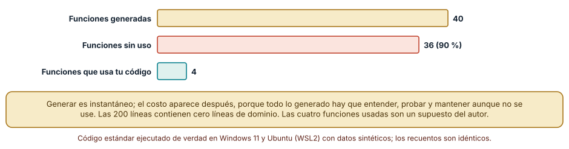
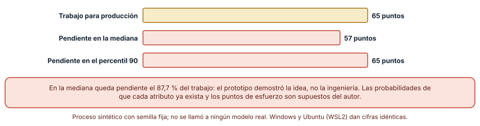

# SE-557 — Prototipado, scaffolding y exploración de alternativas

[← SE-556 — Autocompletado, chat, edición y generación](https://github.com/vladimiracunadev-create/modern-software-engineering-program/blob/main/classes/part-46-desarrollo-de-software-asistido-por-ia/se-556-autocompletado-chat-edicion-y-generacion/README.md) · [↑ Parte 46](https://github.com/vladimiracunadev-create/modern-software-engineering-program/blob/main/classes/part-46-desarrollo-de-software-asistido-por-ia/README.md) · [📚 Índice completo](https://github.com/vladimiracunadev-create/modern-software-engineering-program/blob/main/classes/README.md) · [🌐 Portal](https://vladimiracunadev-create.github.io/modern-software-engineering-program/classes/SE-557.html) · [SE-558 — Generación de pruebas, documentación y migraciones →](https://github.com/vladimiracunadev-create/modern-software-engineering-program/blob/main/classes/part-46-desarrollo-de-software-asistido-por-ia/se-558-generacion-de-pruebas-documentacion-y-migraciones/README.md)

## Punto profesional y fundamento pedagógico

**Punto profesional.** La clase existe para que aproveches lo que un asistente hace mejor y más barato, generar muchas variantes de algo desechable, sin confundir esa abundancia con progreso. Un equipo que obtiene en diez minutos tres prototipos funcionales siente que avanzó, y a menudo solo adquirió tres piezas de código por entender, un andamiaje de cuarenta funciones de las que usará cuatro y la tentación de convertir el prototipo en producto. La habilidad es usar la generación para explorar, decidir con criterios declarados cuál alternativa merece seguir, y marcar con claridad qué es desechable y qué es la base de lo que se construye.

**Por qué aparece aquí.** Sigue a **Autocompletado, chat, edición y generación**: `SE-556` trató de cómo la salida del modelo entra al código línea a línea o cambio a cambio; ahora la pregunta es qué hacer cuando lo que se genera es abundante y exploratorio. El caso conductor es el **módulo de calificaciones de la plataforma educativa**, que necesita una exportación nueva y se explorarán varias formas de construirla. Es un caso sintético; no se evaluó ningún generador real.

**Error conceptual que debe corregir.** Creer que elegir la mejor de varias alternativas generadas garantiza llevar la mejor. Quien elige la que mejor puntúa en una medición con ruido suele quedarse con la que el ruido favoreció; la ganadora parece mejor de lo que es, y esa distancia crece con el número de alternativas y con el ruido del evaluador.

**Secuencia de aprendizaje.** Antes de ver los resultados, predices cuánto mejora la mejor de 20 alternativas sobre la de una y cuánto de esa mejora es real si el evaluador es ruidoso; después simulas la selección con tres niveles de ruido, generas el andamiaje de ocho entidades y cuentas con `ast` cuántas funciones usa tu código y estimas cuánto trabajo queda para llevar un prototipo a producción. La secuencia usa predicción, explicación propia, contraste y recuperación. [ICAP](https://icap.education.asu.edu/research) distingue participación de construcción de conocimiento; [How People Learn II](https://nap.nationalacademies.org/catalog/24783/how-people-learn-ii-learners-contexts-and-cultures) respalda diseñar la práctica con contextos reales y retroalimentación.

**Evidencia de aprendizaje.** `exploracion.md` con la predicción, las tres figuras reproducidas, el registro de una exploración real o sintética (alternativas, criterios, elegida, descartadas y por qué), la lista de atributos que faltan para producción y una nota que separe qué es medido, inferido y supuesto.

**Límite de la conclusión.** La calidad como distribución normal, el ruido del evaluador, la plantilla del andamiaje, las cuatro funciones usadas y las probabilidades de que un prototipo ya tenga cada atributo son construcciones del autor con semilla fija. El recuento de funciones sin uso es una ejecución real de `ast` sobre un andamiaje generado por una plantilla del autor, no sobre el de ninguna herramienta.

### Trazabilidad fuente → afirmación

| Fuente primaria u oficial | Afirmación que respalda | Lo que no prueba |
|---|---|---|
| [Brooks, «No Silver Bullet»](https://doi.org/10.1109/MC.1987.1663532) | Distingue la complejidad esencial del software (decidir qué construir) de la accidental (expresarlo) y sostiene que las herramientas atacan sobre todo la segunda. | No se escribió sobre modelos generativos; es un marco para razonar qué parte del trabajo cambia. |
| [Smith y Winkler, «The Optimizer's Curse»](https://doi.org/10.1287/mnsc.1050.0451) | Demuestra que elegir la alternativa de mejor valor estimado produce, en promedio, un resultado peor que el estimado cuando las estimaciones tienen error. | No cuantifica el sesgo en una selección de código generado. |
| [Chen et al., «Evaluating Large Language Models Trained on Code»](https://arxiv.org/abs/2107.03374) | Muestra que muestrear varias soluciones y filtrarlas con pruebas aumenta la probabilidad de encontrar una correcta (pass@k). | Depende de que existan pruebas buenas; no indica cuántas alternativas pedir. |
| [Fowler, «Exploring Generative AI»](https://martinfowler.com/articles/exploring-gen-ai.html) | Recoge experiencias de uso de asistentes en el desarrollo, entre ellas la utilidad de generar andamiaje y alternativas y la necesidad de revisar lo generado. | Es una colección de experiencias de un equipo, no un estudio controlado. |
| [Nygard, «Documenting Architecture Decisions»](https://www.cognitect.com/blog/2011/11/15/documenting-architecture-decisions) | Propone registrar cada decisión de arquitectura con su contexto, decisión y consecuencias en un documento corto. | No dice cómo elegir entre alternativas. |
| [Python: ast](https://docs.python.org/3/library/ast.html) | Documenta el módulo que analiza el árbol sintáctico y permite contar definiciones. | No determina qué código es «inútil»: la decisión es del equipo. |

## Antes de empezar

Recupera lo aprendido en `SE-556`: el tamaño y la forma del cambio condicionan la revisión. La pregunta activa es: **¿cuántas de las últimas alternativas que generaste con un asistente descartaste con una razón escrita, y cuántas simplemente dejaste de mirar?**

## Prerrequisitos

- Haber completado `SE-556` o poder explicar por qué una edición dirigida es más revisable que una regenerada.
- Python 3.11 o posterior; los experimentos usan solo la biblioteca estándar (`random`, `ast`, `statistics`).
- Saber leer un árbol sintáctico a nivel básico y qué es una distribución normal.

## Problema auténtico

El módulo de calificaciones necesitaba exportar notas en un formato nuevo. En una tarde el equipo pidió al asistente cinco variantes: un script lineal, una clase con configuración, una versión con plantillas, una con una biblioteca de tablas y una con generación de esquema. Las cinco «funcionaban» con la entrada de ejemplo. Alguien las comparó por la longitud y la legibilidad y eligió la que le pareció más limpia; semanas después falló con una nota ausente que ninguna alternativa había considerado. Para otro módulo se generó un andamiaje completo con servicios, controladores y utilidades; el equipo usó cuatro funciones y mantuvo cuarenta durante meses. Y el prototipo de exportación, escrito como experimento, acabó en producción porque «ya funcionaba». Los tres episodios tienen una raíz común: se trató la abundancia como si fuera valor. La clase enseña a explorar con criterios declarados, a medir lo que realmente se adquiere y a separar con una decisión explícita lo desechable de lo que se queda.

## Objetivos observables

Al terminar podrás:

1. distinguir prototipo desechable, prototipo evolutivo y producto, y declarar cuál es cada pieza que generas;
2. diseñar una exploración con criterios previos, varias alternativas y una elección registrada;
3. explicar y medir por qué la mejor alternativa de varias parece mejor de lo que es cuando el evaluador es ruidoso;
4. medir cuánto de un andamiaje generado usa tu código y qué costo de mantenimiento adquieres;
5. listar los atributos que separan un prototipo de producción y estimar el trabajo que falta.

## Mapa conceptual


El mapa separa la **exploración** (generar y evaluar) de la **adopción** (endurecer o tirar). La decisión de destino se toma al elegir, no después de que el prototipo ya sea indispensable.

## Temas y por qué importan

| Tema | Por qué cambia una decisión profesional | Evidencia mínima |
|---|---|---|
| Prototipos: desechable, evolutivo, producto | Evita que un experimento herede obligaciones de un producto | declaración de destino de cada pieza |
| Exploración de alternativas | Reduce el riesgo de quedarse con la primera idea | criterios previos y registro de alternativas |
| Selección con ruido | Explica por qué la ganadora decepciona | tabla de calidad medida y real |
| Andamiaje generado | Mide cuánto código se adquiere sin necesitarlo | recuento de funciones usadas y sin uso |
| Brecha a producción | Convierte «ya funciona» en una lista de trabajo | atributos pendientes y esfuerzo estimado |
| Registro de decisiones | Conserva por qué se eligió y qué se descartó | nota de decisión con consecuencias |

## Conceptos y decisiones

### 1. Tres clases de prototipo y una decisión de destino

Un prototipo **desechable** existe para aprender: se escribe rápido, sin pretensiones de calidad, y se tira cuando respondió su pregunta. Uno **evolutivo** se construye con la intención de endurecerlo y convertirlo en producto, y por eso desde el inicio lleva estructura, pruebas y estándares. El **producto** cumple las obligaciones de mantenimiento, seguridad y soporte. La generación con asistentes facilita el primero hasta el punto de abaratar tanto el experimento que los equipos generan más, y por eso la decisión de destino importa más que antes. El fallo clásico es el prototipo desechable que no se tira: funciona, alguien depende de él y el equipo hereda una pieza sin pruebas, sin manejo de errores y con supuestos que nadie recuerda. La defensa es declarar el destino por escrito en el momento de generarlo (en el nombre del directorio, en el encabezado, en la nota de decisión) y fijar una fecha de revisión.

### 2. Explorar con criterios previos

Generar varias alternativas ayuda cuando se evalúan contra criterios definidos antes de mirarlas. Los criterios de una exportación, por ejemplo: maneja nota ausente con un error claro, produce una salida idéntica byte a byte para la misma entrada, se prueba sin la base de datos, cabe en doscientas líneas. Sin criterios previos, la elección se hace por impresión (la más corta, la más familiar) y se racionaliza después. Con criterios, se pueden descartar alternativas por una razón anotable. Es útil además pedir alternativas **realmente distintas**, no variaciones de la misma idea con otros nombres, y pedir al asistente que declare los supuestos y las desventajas de cada una. Brooks distingue entre la complejidad esencial, que consiste en decidir qué debe hacer el sistema, y la accidental, que consiste en expresarlo; la generación abarata la segunda y deja intacta la primera, de modo que la exploración útil es sobre qué decidir, no solo sobre cómo escribir.

### 3. La maldición del optimizador: la ganadora decepciona

Si estimas la calidad de cada alternativa con error y eliges la de mayor valor estimado, el valor real de la elegida es, en promedio, menor que su estimación. Smith y Winkler lo llaman la maldición del optimizador: la selección favorece a quien el error benefició. Cuantas más alternativas y más ruido, mayor es la distancia entre lo medido y lo real. No es un defecto de la herramienta sino de la estadística de elegir el máximo. Las consecuencias prácticas son tres. Hay que medir con el menor ruido posible (pruebas ejecutables sobre casos reales, no impresión visual). Hay que desconfiar de la ventaja de una ganadora que gana por poco. Y vale reservar un conjunto de comprobación distinto del que se usó para elegir, de modo que la estimación final no sea la misma que produjo la selección.

### 4. El andamiaje es código que se adquiere

El andamiaje (scaffolding) es la estructura repetitiva que rodea al código de dominio: servicios con operaciones de crear, leer, actualizar y borrar, configuración, registros. Un generador lo produce en segundos para todas las entidades del sistema, y es una ayuda real cuando se usa todo lo producido. Cuando no, se adquiere un costo: cada función generada hay que leerla, probarla, actualizarla con el resto del sistema y entender cuando falla. Hay también un costo de comprensión: el código que no escribiste no lo conoces, y la estructura sugerida condiciona el diseño que sigue. La medida sencilla es el cociente entre lo generado y lo usado. No hace falta evitar el andamiaje; hace falta generar lo que se va a usar y borrar el resto antes de integrarlo.

### 5. De «funciona» a producción

Un prototipo demuestra que una idea es posible en el caso feliz. Producción exige atributos que el caso feliz no necesita: validación de entradas, manejo de errores, autenticación y autorización, pruebas, registro y métricas, migración de datos, accesibilidad, límites de tamaño y tiempo. Cada uno es trabajo, y la suma suele ser mayor que el prototipo. Sirve hacer la lista explícitamente y estimarla en puntos o días: convierte «ya casi está» en una decisión de inversión. Si el trabajo restante es la mayor parte del total, el prototipo era lo que se llamaba: una demostración; tomarlo como base solo conviene si la estructura es sólida, y esa es una decisión de diseño que alguien debe tomar y firmar.

### La mejor de N: la calidad medida y la real

Cada alternativa tiene una calidad verdadera con distribución normal estándar. El evaluador mide la calidad con ruido gaussiano de desviación σ; se elige la alternativa de mayor medida y se registra tanto su medida como su calidad real. Se simulan 2 000 selecciones por celda con σ = 0, 1 y 2 y N = 1, 3, 5, 10 y 20.

```python
q = [rng.gauss(0, 1) for _ in range(n)]          # calidad verdadera
m = [x + rng.gauss(0, sigma) for x in q]         # lo que mide el evaluador
i = max(range(n), key=lambda j: m[j])            # se elige por la medida
real += q[i]; medida += m[i]
```

| N | Evaluador exacto (real) | Ruido 1: medida → real | Ruido 2: medida → real |
|---:|---:|---:|---:|
| 1 | 0,03 | −0,02 → 0,01 | 0,06 → 0,01 |
| 3 | 0,86 | 1,22 → 0,61 | 1,91 → 0,35 |
| 5 | 1,18 | 1,66 → 0,84 | 2,63 → 0,49 |
| 10 | 1,52 | 2,19 → 1,10 | 3,42 → 0,64 |
| 20 | 1,87 | 2,63 → 1,29 | 4,17 → 0,84 |

Con un evaluador exacto, la mejor de 20 vale 1,87 desviaciones por encima de la media. Con ruido 1, la ganadora de 20 se mide en 2,63 y vale 1,29: la mitad de lo que parecía. Con ruido 2, se mide en 4,17 y vale 0,84. Con ruido 2 pasar de 3 a 20 alternativas sube la calidad real de 0,35 a 0,84, es decir, más alternativas siguen ayudando, pero mucho menos de lo que sugiere la medida (de 1,91 a 4,17), y la brecha entre medida y realidad crece de 1,56 a 3,33. La lección no es no explorar, sino medir mejor y no tomar la puntuación de la ganadora como su valor.


**Cómo leer la figura.** El eje horizontal es entre cuántas alternativas se elige y el vertical la calidad de la ganadora, en desviaciones. Las líneas continuas oscuras son la calidad real con evaluador exacto y las discontinuas pares de medida y valor real con ruido 1 y 2. Mira que la distancia entre una línea medida y su línea real crece con N y con el ruido: la ganadora suele ser la que el ruido favoreció. **Dónde deja de valer:** calidad normal estándar y ruido gaussiano independiente son supuestos del autor; las alternativas generadas por un modelo no son independientes (se parecen entre sí) y el ruido de un evaluador humano no es gaussiano. La figura muestra el mecanismo y su orden de magnitud, no la brecha de una herramienta.

### Ocho entidades: cuánto del andamiaje se usa

Una plantilla del autor genera para cada una de ocho entidades un servicio con cuatro operaciones (crear, leer, actualizar, borrar), una función auxiliar privada, registro y una constante de configuración. `ast` cuenta las definiciones. El código propio del equipo solo llama a `crear_nota`, `leer_nota`, `crear_alumno` y `leer_curso`.

```python
arbol = ast.parse(fuente)
funciones = [f.name for f in arbol.body if isinstance(f, ast.FunctionDef)]
sin_uso = [f for f in funciones if f not in uso]
```

| Medida | Valor |
|---|---:|
| Entidades | 8 |
| Líneas generadas | 200 |
| Funciones generadas | 40 |
| Funciones que usa el código propio | 4 |
| Funciones sin uso | 36 (90 %) |
| Líneas de lógica de dominio | 0 |

El andamiaje suma 200 líneas, 40 funciones y ninguna línea de dominio: ninguna decide cómo se calcula una nota. De las 40 funciones, el código usa 4 y 36 quedan sin uso (90 %). El costo de esas 36 es de mantenimiento y de comprensión, y no es proporcional a su uso. El recuento es una ejecución real de `ast` sobre un andamiaje que genera una plantilla; los números dependen de esa plantilla y de elegir cuatro funciones usadas.



**Cómo leer la figura.** La primera barra es lo adquirido, la última lo usado y la intermedia la diferencia que hay que mantener o borrar. **Dónde deja de valer:** la plantilla es del autor, las cuatro funciones usadas se eligieron para el ejemplo y un generador real podría producir más o menos código por entidad. La medida (generado frente a usado) sí se transfiere a cualquier andamiaje.

### Ocho atributos: cuánto falta para producción

Un prototipo sintético tiene cada uno de ocho atributos con una probabilidad (entre el 5 % y el 30 %) y cada atributo ausente cuesta entre 5 y 13 puntos de esfuerzo. El trabajo total para tener los ocho es de 65 puntos. Se simulan 5 000 prototipos y se mide el trabajo pendiente.

| Medida | Valor |
|---|---:|
| Trabajo para tener los ocho atributos | 65 puntos |
| Pendiente en la mediana | 57 puntos (87,7 %) |
| Pendiente en el percentil 90 | 65 puntos |

En la mediana quedan pendientes 57 de los 65 puntos (87,7 %); en el percentil 90 los atributos que faltan suman todo. El prototipo típico demostró la idea y apenas tiene lo que producción exige. Las probabilidades bajas son un supuesto razonable para un prototipo hecho rápido y deliberadamente incompleto; si el equipo escribe el prototipo con pruebas y manejo de errores desde el principio (evolutivo), las probabilidades suben y el trabajo pendiente baja.



**Cómo leer la figura.** La primera barra es el total; las otras dos, lo que queda según la mediana y el percentil 90 de los prototipos simulados. **Dónde deja de valer:** los ocho atributos, sus probabilidades y sus puntos son del autor; la lista real depende del sistema y los atributos no son independientes (quien añade autenticación suele añadir registro). Sirve para ver que el prototipo suele ser una fracción pequeña del producto.

## Definiciones de trabajo

- **[prototipo desechable](../../../glosario/entradas/p/prototipo-desechable.md):** pieza escrita para aprender que se descarta al responder su pregunta.
- **[prototipo evolutivo](../../../glosario/entradas/p/prototipo-evolutivo.md):** pieza construida con intención de endurecerse hasta convertirse en producto.
- **[andamiaje (scaffolding)](../../../glosario/entradas/a/andamiaje.md):** estructura repetitiva generada alrededor del código de dominio.
- **[maldición del optimizador](../../../glosario/entradas/m/maldicion-del-optimizador.md):** sesgo por el cual la alternativa elegida por su mejor estimación vale en promedio menos que esa estimación.
- **[brecha a producción](../../../glosario/entradas/b/brecha-a-produccion.md):** conjunto de atributos que un prototipo no tiene y producción exige.

Las definiciones son operativas para el módulo de calificaciones. No convierten términos con una historia más amplia en sinónimos y deben contrastarse con la documentación primaria enlazada al final.

## Ejemplo mínimo

El fragmento muestra la maldición del optimizador con cinco alternativas. Antes de ejecutarlo, predice si la media de lo medido en la ganadora es mayor o menor que la de su calidad real.

```python
import random
rng = random.Random(461)
medidas, reales = [], []
for _ in range(5000):
    q = [rng.gauss(0, 1) for _ in range(5)]
    m = [x + rng.gauss(0, 1) for x in q]
    i = max(range(5), key=lambda j: m[j])
    medidas.append(m[i]); reales.append(q[i])
print(round(sum(medidas) / 5000, 2), round(sum(reales) / 5000, 2))
```

La media de lo medido es claramente mayor que la real, porque seleccionar por la medida favorece a las alternativas con error positivo. Registra versión de Python, comando y salida; después sube el ruido a 2,0 y observa cómo se separan.

## Ejemplo profesional

Escenario hipotético, construido para la clase y sin datos reales. El equipo del módulo de calificaciones necesita una exportación. Antes de generar nada escribe cuatro criterios: error claro ante nota ausente, salida idéntica para la misma entrada, pruebas sin base de datos y menos de 200 líneas. Pide al asistente cuatro alternativas realmente distintas, cada una con supuestos y desventajas. Las evalúa ejecutando el mismo conjunto de 12 casos reales anonimizados, incluidos tres de nota ausente. Dos fallan en la nota ausente, una pasa pero requiere la base de datos y una pasa todo. Elige esta, la declara **evolutiva** y anota las tres descartadas con su razón. Calcula la brecha a producción: faltan validación de entradas, registro y límites de tamaño, 18 puntos. Reserva un segundo conjunto de 12 casos que no usó para elegir y comprueba que la elegida los pasa. Escribe la decisión con dueño y fecha de revisión; el script de prueba lineal que sirvió para explorar se borra. Compara con el estado inicial: antes se eligió «la más limpia» y se descubrió el fallo en producción.

## Práctica guiada

1. Predice cuánto vale la mejor de 20 alternativas con ruido 1 respecto de lo que mide el evaluador y anota el número.
2. Ejecuta la simulación con la semilla fijada, reproduce la tabla y calcula la brecha para cada N.
3. Cambia el ruido a 0,5 y a 3 y comprueba cómo se mueven la medida y la realidad.
4. Genera con una plantilla propia un andamiaje de tu dominio y cuenta con `ast` cuántas funciones usa tu código.
5. Haz la lista de atributos de producción de un prototipo tuyo y estima el trabajo pendiente en puntos.
6. Redacta los criterios previos para una exploración y declara el destino de lo que generes.
7. Entrega `exploracion.md` y pide a otra persona que proponga una alternativa que tus criterios no habrían distinguido.

## Ejercicios

1. **Selección:** con ruido 1 y N = 10, la ganadora mide 2,19 y vale 1,10. Calcula la brecha y explica por qué sube con N.
2. **Criterios:** escribe tres criterios verificables para elegir entre dos implementaciones de una exportación y un caso de prueba para cada uno.
3. **Andamiaje:** tu código usa 6 de 60 funciones generadas. ¿Qué haces antes de integrar y qué registras?
4. **Destino:** un prototipo desechable lleva tres semanas en uso. Describe cómo decidirías si se endurece o se reescribe, con qué datos.

## Reto verificable

Entrega `exploracion.md` con la predicción, las tres tablas, una exploración con criterios previos y al menos tres alternativas evaluadas con un conjunto de casos y comprobadas con otro distinto, el destino declarado de lo elegido, el recuento de lo generado y lo usado y la brecha a producción. Se aprueba si otra persona ejecuta el código desde un checkout limpio, obtiene los mismos números con las mismas semillas y puede decir por qué se descartaron las demás alternativas. No se aprueba por elegir «la mejor» sin criterios previos ni por integrar un andamiaje sin contar lo que se usa.

## Caso conductor

El módulo de calificaciones es el caso conductor. Esta clase deja el quinto artefacto: la exploración con su registro de decisión. `SE-558` preguntará qué ocurre cuando lo que se genera son pruebas, documentación y migraciones, y `SE-563` comparará flujos con mediciones. Cambia después un solo dato, el ruido del evaluador, y observa a partir de qué valor más alternativas dejan de compensar.

## Preguntas frecuentes

### ¿Cuántas alternativas debo pedir?

Las que puedas evaluar con criterios y casos. La simulación muestra rendimientos decrecientes y una brecha creciente entre lo medido y lo real; tres a cinco alternativas distintas, evaluadas con un buen conjunto de casos, suelen dar la mayor parte de la ventaja.

### ¿Un prototipo desechable puede tener pruebas?

Puede, pero no debe tener obligaciones de producto. Si merece pruebas, quizá es evolutivo, y conviene declararlo; lo importante es que el destino sea una decisión escrita.

### ¿El andamiaje generado siempre es un problema?

No. Es una ayuda cuando se usa lo producido. El problema es adquirir 40 funciones para usar 4 sin haberlo decidido. Se mide el cociente y se borra lo que no se usa antes de integrar.

### ¿Cómo evito quedarme con una alternativa que solo parece buena?

Evalúa con casos ejecutables, no con impresión, y comprueba la elegida con un conjunto distinto del que usaste para elegir. Si la ventaja es pequeña, no la tomes como real.

## Fallo controlado y diagnóstico

Reproduce el fallo clásico de la clase: **la ganadora decepciona**. Simula 20 alternativas con ruido 1 y compara la medida con la calidad real.

Registra síntoma, entrada mínima, hipótesis, observación que descarta cada hipótesis, causa, corrección y prueba de regresión. **Síntoma:** la alternativa elegida rinde en producción mucho peor que en la evaluación. **Hipótesis rivales:** (a) la producción tiene casos distintos; (b) la evaluación estaba mal hecha; (c) la selección favoreció el ruido. **Prueba:** repite la selección con un segundo conjunto independiente; si la medida baja de 2,63 a 1,29 en promedio solo por usar el conjunto nuevo, la causa es la selección sobre el ruido. **Conclusión:** la puntuación de la ganadora estima por exceso su valor. **Regresión:** añade al proceso un conjunto de comprobación reservado y exige que la alternativa lo pase por separado. No cambies a la vez el número de alternativas y el conjunto de evaluación.

## Errores comunes y cómo corregirlos

| Síntoma | Causa probable | Corrección |
|---|---|---|
| El prototipo acaba en producción sin pruebas | No se declaró su destino | Declarar destino y fecha de revisión al generarlo |
| Se elige la alternativa «más limpia» y falla | No hay criterios previos | Escribir criterios verificables antes de generar |
| La ganadora rinde menos de lo esperado | Selección sobre una medida con ruido | Conjunto de comprobación independiente |
| Se mantienen decenas de funciones sin uso | Andamiaje integrado completo | Borrar lo no usado antes de integrar |
| «Ya casi está» durante meses | No se listó la brecha a producción | Enumerar atributos pendientes y estimarlos |

## Entorno y archivos clave

```text
work/SE-557/
├── README.md
├── exploracion/
│   ├── mejor_de_n.py
│   ├── andamiaje.py
│   └── brecha.py
├── decisiones/0001-exportacion.md
├── tests/test_exploracion.py
└── evidence/exploracion.md
```

El `README` declara plataforma, versión de Python, semillas y comandos. Los experimentos usan solo la biblioteca estándar (`random`, `ast`, `statistics`) y se ejecutaron con CPython 3.12.9 en Windows 11 y 3.12.3 en Ubuntu bajo WSL2: las salidas fueron idénticas. Los experimentos están en `scripts/experiments_part46_a.py`. Si añades una dependencia, fija procedencia y versión.

## Seguridad, ética y accesibilidad

- el código de un prototipo suele omitir validación y autenticación; no lo expongas ni lo conectes a datos reales mientras no pase por el trabajo de producción;
- el andamiaje puede traer dependencias o plantillas con licencia propia: registra su procedencia antes de integrarlo (`SE-562`);
- elegir una alternativa sin criterios puede ocultar sesgos de quien evalúa; deja los criterios por escrito para que otra persona pueda cuestionarlos;
- las tablas y figuras deben tener texto alternativo y no depender del color; las categorías se distinguen por texto;
- los artículos y estándares citados tienen derechos de autor: cita su estructura y vincula la fuente, no copies su texto.

## Puente hacia el trabajo con agentes

Un agente puede generar y ejecutar muchas alternativas sin cansarse, lo que amplifica tanto la utilidad como la maldición del optimizador: elegirá la que mejor pase las pruebas que él mismo pueda ver. Mantén un conjunto de casos que el agente no vea para la comprobación final, pídele que declare los supuestos y las desventajas de cada alternativa y que no integre andamiaje que no se use. Revisa especialmente las pruebas que el agente escribió o modificó para la alternativa elegida, y compara su recuento de lo generado y lo usado con el tuyo.

## Transferencia

Traslada el análisis a otro dominio (por ejemplo, el módulo de presupuestos de un taller mecánico): cambia los criterios y las alternativas y conserva el procedimiento de fijar criterios previos, comprobar la elegida con un conjunto aparte, contar generado y usado y listar la brecha a producción. La transferencia está lograda cuando puedes decir qué alternativas de ese dominio descartarías y con qué dato, no cuando la tabla se parece a la del módulo de calificaciones.

## Evaluación y evidencia

| Criterio | Evidencia para aprobar |
|---|---|
| comprensión | explicación de los tres destinos de un prototipo y de la maldición del optimizador |
| corrección | tablas de selección, andamiaje y brecha reproducibles con las mismas semillas |
| diseño | exploración con criterios previos, destino declarado y conjunto de comprobación aparte |
| diagnóstico | reproducción del fallo «la ganadora decepciona» con regresión |
| incertidumbre | declaración de que distribuciones, plantilla y probabilidades son del autor |
| reproducibilidad | versiones, comandos, salida y límites declarados |

## Fuentes

- [Brooks, «No Silver Bullet»](https://doi.org/10.1109/MC.1987.1663532) — complejidad esencial y accidental; autoridad: IEEE Computer, 1987.
- [Smith y Winkler, «The Optimizer's Curse»](https://doi.org/10.1287/mnsc.1050.0451) — sesgo al elegir por la mejor estimación; autoridad: Management Science.
- [Chen et al., «Evaluating Large Language Models Trained on Code»](https://arxiv.org/abs/2107.03374) — muestreo de varias soluciones filtradas por pruebas; autoridad: preprint de OpenAI.
- [Fowler, «Exploring Generative AI»](https://martinfowler.com/articles/exploring-gen-ai.html) — experiencias de uso en el desarrollo; autoridad: autor del texto.
- [Nygard, «Documenting Architecture Decisions»](https://www.cognitect.com/blog/2011/11/15/documenting-architecture-decisions) — registro de decisiones; autoridad: autor del texto.
- [Python: ast](https://docs.python.org/3/library/ast.html) — análisis del árbol sintáctico; autoridad: documentación de Python.

Cada fuente respalda el mecanismo indicado; ninguna demuestra que la brecha de 2,63 a 1,29, el 90 % de funciones sin uso o el 87,7 % de trabajo pendiente se observen en un equipo real. Esa afirmación depende de las alternativas, del evaluador y del sistema.

## Límites y siguiente paso

Se ejecutaron tres experimentos en Windows y Ubuntu (WSL2) con resultados idénticos: una simulación de selección con ruido, un análisis real con `ast` sobre un andamiaje de plantilla y una simulación de brecha a producción. No se evaluó ningún generador, ningún asistente ni ningún equipo; las distribuciones de calidad y ruido, la plantilla, las cuatro funciones usadas y las probabilidades de los atributos son construcciones del autor. La siguiente clase pregunta qué ocurre cuando lo que se genera son pruebas, documentación y migraciones.

## Glosario

- **[prototipo desechable](../../../glosario/entradas/p/prototipo-desechable.md):** pieza escrita para aprender que se descarta al responder su pregunta.
- **[prototipo evolutivo](../../../glosario/entradas/p/prototipo-evolutivo.md):** pieza construida con intención de endurecerse hasta convertirse en producto.
- **[andamiaje (scaffolding)](../../../glosario/entradas/a/andamiaje.md):** estructura repetitiva generada alrededor del código de dominio.
- **[maldición del optimizador](../../../glosario/entradas/m/maldicion-del-optimizador.md):** sesgo por el cual la alternativa elegida por su mejor estimación vale en promedio menos que esa estimación.
- **[brecha a producción](../../../glosario/entradas/b/brecha-a-produccion.md):** conjunto de atributos que un prototipo no tiene y producción exige.

Conceptos de esta clase en el [glosario del programa](../../../glosario/README.md): [Andamiaje](../../../glosario/entradas/a/andamiaje.md) · [Brecha a producción](../../../glosario/entradas/b/brecha-a-produccion.md) · [Maldición del optimizador](../../../glosario/entradas/m/maldicion-del-optimizador.md) · [Prototipo desechable](../../../glosario/entradas/p/prototipo-desechable.md) · [Prototipo evolutivo](../../../glosario/entradas/p/prototipo-evolutivo.md) · [Registro de decisiones](../../../glosario/entradas/r/registro-de-decisiones.md).

---

[← SE-556 — Autocompletado, chat, edición y generación](https://github.com/vladimiracunadev-create/modern-software-engineering-program/blob/main/classes/part-46-desarrollo-de-software-asistido-por-ia/se-556-autocompletado-chat-edicion-y-generacion/README.md) · [↑ Parte 46](https://github.com/vladimiracunadev-create/modern-software-engineering-program/blob/main/classes/part-46-desarrollo-de-software-asistido-por-ia/README.md) · [📚 Índice completo](https://github.com/vladimiracunadev-create/modern-software-engineering-program/blob/main/classes/README.md) · [🌐 Portal](https://vladimiracunadev-create.github.io/modern-software-engineering-program/classes/SE-557.html) · [SE-558 — Generación de pruebas, documentación y migraciones →](https://github.com/vladimiracunadev-create/modern-software-engineering-program/blob/main/classes/part-46-desarrollo-de-software-asistido-por-ia/se-558-generacion-de-pruebas-documentacion-y-migraciones/README.md)
