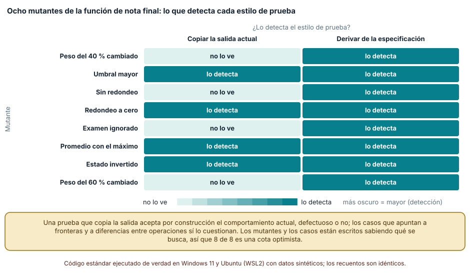
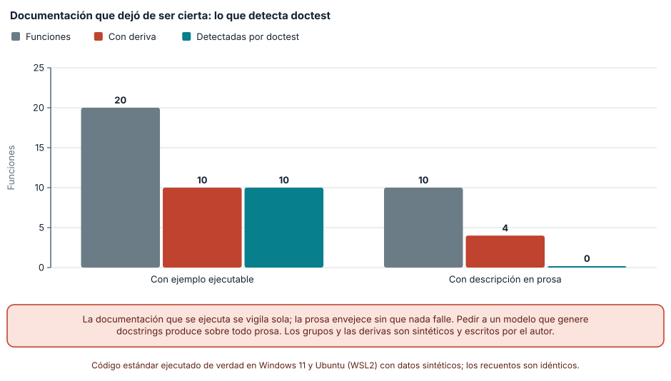
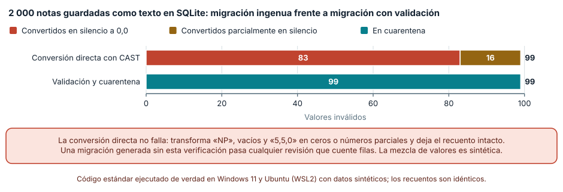

# SE-558 — Generación de pruebas, documentación y migraciones

[← SE-557 — Prototipado, scaffolding y exploración de alternativas](https://github.com/vladimiracunadev-create/modern-software-engineering-program/blob/main/classes/part-46-desarrollo-de-software-asistido-por-ia/se-557-prototipado-scaffolding-y-exploracion-de-alternativas/README.md) · [↑ Parte 46](https://github.com/vladimiracunadev-create/modern-software-engineering-program/blob/main/classes/part-46-desarrollo-de-software-asistido-por-ia/README.md) · [📚 Índice completo](https://github.com/vladimiracunadev-create/modern-software-engineering-program/blob/main/classes/README.md) · [🌐 Portal](https://vladimiracunadev-create.github.io/modern-software-engineering-program/classes/SE-558.html) · [SE-559 — Revisión, refactorización y explicación asistidas →](https://github.com/vladimiracunadev-create/modern-software-engineering-program/blob/main/classes/part-46-desarrollo-de-software-asistido-por-ia/se-559-revision-refactorizacion-y-explicacion-asistidas/README.md)

## Punto profesional y fundamento pedagógico

**Punto profesional.** La clase existe para que veas que las pruebas, la documentación y las migraciones comparten una propiedad peligrosa cuando las genera un asistente: su resultado tiene aspecto de verificación o de información fiable sin serlo. Una suite verde escrita a partir del código no comprueba el código; una docstring fluida no se sostiene si nada la ejecuta; una migración que conserva el recuento de filas puede haber convertido en cero lo que no entendía. La habilidad es decidir qué parte de estos tres productos puede delegarse, qué comprobación independiente exige cada uno y cómo medir que el producto cumple su función, que no es existir sino detectar, informar con verdad y mover datos sin perderlos.

**Por qué aparece aquí.** Sigue a **Prototipado, scaffolding y exploración de alternativas**: `SE-557` trató de la abundancia de código exploratorio; ahora se trata de los artefactos que acompañan al código y cuya función es controlarlo. El caso conductor es el **módulo de calificaciones de la plataforma educativa**, con una función de nota final, su documentación y una migración de notas guardadas como texto. Es un caso sintético; no se usó ningún asistente real.

**Error conceptual que debe corregir.** Creer que una prueba, una docstring o una migración generadas son buenas porque están completas, bien formadas y pasan. Pasar significa que el artefacto coincide con el código al que se le preguntó, no que el código sea correcto; un artefacto de control que se deriva de aquello que controla hereda sus errores.

**Secuencia de aprendizaje.** Antes de ver los resultados, predices cuántos de ocho mutantes de la función de nota final detectan unas pruebas que copian la salida actual y cuántos unas pruebas derivadas de la especificación; después mides esa diferencia ejecutando los mutantes, usas `doctest` para ver qué documentación envejecida detecta, y ejecutas una migración de texto a número en SQLite con una conversión directa y con validación y cuarentena. La secuencia usa predicción, explicación propia, contraste y recuperación. [ICAP](https://icap.education.asu.edu/research) distingue participación de construcción de conocimiento; [How People Learn II](https://nap.nationalacademies.org/catalog/24783/how-people-learn-ii-learners-contexts-and-cultures) respalda diseñar la práctica con contextos reales y retroalimentación.

**Evidencia de aprendizaje.** `artefactos-control.md` con la predicción, las tres figuras reproducidas, una suite derivada de la especificación para una función del módulo con su medición frente a mutantes, una migración con validación y cuarentena y una nota que separe qué es medido, inferido y supuesto.

**Límite de la conclusión.** Los ocho mutantes, las entradas típicas, los casos de la especificación, el reparto de la documentación con deriva y la mezcla de valores de las notas son construcciones del autor, escritas sabiendo qué se busca. Las ejecuciones (mutantes, `doctest`, SQLite) son código real, pero sobre casos sintéticos; no se usó ningún asistente ni ninguna herramienta de generación, y ocho de ocho es una cota optimista de lo que detectaría una suite derivada de la especificación en un sistema real.

### Trazabilidad fuente → afirmación

| Fuente primaria u oficial | Afirmación que respalda | Lo que no prueba |
|---|---|---|
| [Jia y Harman, «An Analysis and Survey of the Development of Mutation Testing»](https://doi.org/10.1109/TSE.2010.62) | Revisa las pruebas de mutación: introducir defectos pequeños en el código y comprobar si las pruebas los detectan como medida de su capacidad. | No fija un umbral de puntuación de mutación aceptable. |
| [Barr et al., «The Oracle Problem in Software Testing: A Survey»](https://doi.org/10.1109/TSE.2014.2372785) | Analiza el problema del oráculo: decidir si la salida de un programa es la correcta exige una fuente de verdad distinta del propio programa. | No ofrece un oráculo para el módulo de calificaciones. |
| [Python: doctest](https://docs.python.org/3/library/doctest.html) | Documenta cómo ejecutar los ejemplos de una docstring y comprobar que su salida coincide. | Solo comprueba los ejemplos escritos; no valida la prosa. |
| [SQLite: datatypes](https://www.sqlite.org/datatype3.html) | Explica la tipificación flexible de SQLite y las conversiones de afinidad. | No aplica a otros motores. |
| [SQLite: expresiones y CAST](https://www.sqlite.org/lang_expr.html) | Documenta que CAST a número interpreta el prefijo numérico de un texto y devuelve 0 si no hay ninguno, sin error. | No dice qué hacer ante un valor inválido. |
| [Fowler y Sadalage, «Evolutionary Database Design»](https://martinfowler.com/articles/evodb.html) | Describe cómo evolucionar un esquema con migraciones pequeñas, versionadas y verificables. | No sustituye la validación del contenido concreto de tus datos. |

## Antes de empezar

Recupera lo aprendido en `SE-557`: una exploración se evalúa con casos distintos de los que sirvieron para elegir. La pregunta activa es: **¿qué prueba, documento o migración de tu proyecto fue escrito a partir del código que controla, y qué defecto que ya conoces habría detectado?**

## Prerrequisitos

- Haber completado `SE-557` o poder explicar por qué un conjunto de comprobación debe ser independiente del de selección.
- Python 3.11 o posterior; los experimentos usan solo la biblioteca estándar (`doctest`, `sqlite3`, `tempfile`, `re`).
- Saber leer una prueba unitaria y una consulta SQL sencilla.

## Problema auténtico

El equipo pidió al asistente pruebas para `nota_final`. Obtuvo doce pruebas que pasaban, con nombres razonables y valores tomados de ejecutar la función; la cobertura de líneas fue del 100 %. Semanas después alguien cambió `>=` por `>` en la frontera de aprobación y ninguna prueba falló. Para el mismo módulo pidió que «documentara» las funciones y recibió docstrings claras; dos de ellas describían un comportamiento anterior a una refactorización. Finalmente, para pasar las notas de texto con coma a números pidió una migración; el script convertía con `CAST`, terminaba sin errores y el recuento de filas coincidía, pero las notas ausentes, «NP» y otros valores habían pasado a cero. Las tres historias muestran que cuando el control se genera desde lo controlado, hereda su error y lo oculta bajo una apariencia de verificación.

## Objetivos observables

Al terminar podrás:

1. explicar por qué una prueba copiada de la salida actual no detecta cambios de comportamiento y cómo se construye una derivada de la especificación;
2. medir la capacidad de detección de una suite con mutantes en vez de con cobertura;
3. distinguir la documentación ejecutable, que se vigila sola, de la prosa, que envejece sin aviso;
4. diseñar una migración que valide el contenido, aísle lo inválido y no convierta lo desconocido en un valor plausible;
5. decidir qué parte de cada artefacto puede delegarse y qué fuente independiente exige.

## Mapa conceptual


El mapa contrasta, en cada artefacto, el camino que **hereda** del código y el que lo **contrasta** con una fuente distinta. La diferencia se mide con mutantes en las pruebas, con ejecución en la documentación y con validación de contenido en las migraciones.

## Temas y por qué importan

| Tema | Por qué cambia una decisión profesional | Evidencia mínima |
|---|---|---|
| Pruebas desde el código | Explica por qué una suite verde puede no proteger nada | mutantes detectados por una suite copiada |
| Pruebas desde la especificación | Introduce el oráculo independiente | casos con fronteras y diferencias entre operaciones |
| Mutación frente a cobertura | La cobertura mide ejecución, no detección | tabla de mutantes detectados |
| Documentación ejecutable y prosa | Distingue lo que se vigila de lo que envejece | funciones con deriva y detectadas |
| Migraciones | Una conversión sin error no es una conversión correcta | filas convertidas, en cuarentena y falsas |
| Revisión de lo generado | Fija qué comprueba una persona y qué un script | lista de comprobaciones por artefacto |

## Conceptos y decisiones

### 1. El problema del oráculo

Una prueba compara el resultado de ejecutar el código con un resultado esperado, y de dónde sale ese resultado esperado es la cuestión central. Barr y sus coautores llaman a esto el problema del oráculo: decidir si una salida es correcta exige una fuente de verdad distinta del programa mismo. Cuando el esperado se obtiene ejecutando el código, la prueba no comprueba nada, solo congela el comportamiento actual. Congelar tiene un uso legítimo: una **prueba de caracterización** (`SE-519`) fija lo que el sistema hace antes de modificarlo, a sabiendas de que puede ser incorrecto. Pero llamarla prueba de corrección es un error. Un asistente que escribe pruebas lo hace, por el mecanismo de `SE-553`, a partir del código que ve y del que predice la salida más probable, de modo que tiende al snapshot. La forma de salir es aportar una fuente independiente: casos derivados de la especificación, de ejemplos acordados con quien hace el requisito, de propiedades que deben cumplirse.

### 2. Mutación: medir si la suite detecta

La cobertura de líneas dice qué líneas se ejecutaron, no si un cambio en ellas se habría notado. Las pruebas de mutación introducen defectos pequeños y sistemáticos (cambiar `>=` por `>`, un 0,4 por 0,5, un máximo por una media) y cuentan cuántos son detectados por la suite. Jia y Harman revisan la técnica y su uso como medida de la capacidad de una suite para detectar defectos. Es costosa a gran escala y aquí se usa en pequeño, con ocho mutantes de una función; basta para ver el mecanismo. La interpretación exige cuidado: un mutante no detectado puede ser un mutante *equivalente* (no cambia el comportamiento), y la puntuación depende de los mutantes elegidos. Es una medida de detección, no de corrección, y es mucho más informativa que la cobertura para decidir si una suite generada vale.

### 3. Qué casos aporta una especificación

Una suite derivada de la especificación apunta a los lugares donde los defectos se esconden. Las **fronteras** (el 4,0 exacto, el valor justo debajo y justo encima). Las **diferencias entre operaciones** que una confusión intercambiaría (promedio frente a máximo, ponderación 40/60 frente a 50/50). Los **redondeos** (un resultado de 4,12 que debe pasar a 4,1, un 3,8 que no debe subir a 4). Y las **entradas degeneradas** (un solo trabajo, ninguno, ausentes). El asistente puede ayudar a proponer casos si se le da la especificación y no el código, y a escribir las pruebas ya acordadas; lo que no puede es decidir cuál es el valor correcto de una regla del módulo que solo existe en el reglamento. Los valores esperados los fija una persona con la fuente delante, y se verifican a mano: un esperado calculado por el código bajo prueba vuelve al problema anterior.

### 4. Documentación: lo que se ejecuta y lo que se lee

La documentación envejece cuando el comportamiento cambia y el texto no. La que contiene ejemplos ejecutables se vigila sola: `doctest` ejecuta los ejemplos de una docstring y falla si la salida cambió. La prosa («devuelve la nota redondeada») no se ejecuta, y su desajuste solo lo ve alguien que la lea con el código al lado. Un asistente genera sobre todo prosa fluida y convincente, lo que la hace más peligrosa cuando se equivoca. Las medidas prácticas son pedir ejemplos ejecutables cuando la función lo permita, ejecutarlos en integración continua, generar la documentación de interfaz desde el código en lugar de redactarla a mano y marcar la prosa descriptiva con su fecha o versión. Y tratar la documentación generada como lo que es: un borrador a contrastar con el comportamiento observado.

### 5. Migraciones: convertir sin entender es perder

Una migración mueve datos de una forma a otra, y su riesgo está en los valores que no encajan. SQLite convierte con `CAST` el prefijo numérico de un texto y devuelve cero si no hay ninguno, sin error ni aviso; otros motores lanzan error o devuelven nulos, y cada uno tiene sus reglas. Un script generado sin conocer los valores reales convierte «NP», cadenas vacías o «5,5,0» en ceros o en números parciales plausibles, y el recuento de filas coincide, de modo que las comprobaciones habituales no lo ven. Una migración correcta valida el contenido contra un patrón explícito, **aísla lo inválido en cuarentena** para su resolución humana, convierte solo lo que entiende, verifica el resultado con invariantes (recuento de convertidas más cuarentena igual al total) y es reversible mientras sea posible. Fowler y Sadalage describen el diseño evolutivo de bases de datos mediante migraciones pequeñas y versionadas, la base sobre la que se añade esta validación.

### Ocho mutantes de la nota final: dos estilos de prueba

La función calcula la nota final como 40 % del promedio de trabajos más 60 % del examen, redondea a un decimal y aprueba con 4,0 o más. Se definen ocho mutantes: pesos 50/50, umbral estricto (`>`), sin redondeo, redondeo a cero decimales, examen ignorado, máximo en vez de promedio, estado invertido y pesos 30/70. Se comparan dos suites. La primera **copia la salida actual** en cinco entradas típicas. La segunda añade cinco casos derivados de la especificación con valores esperados calculados a mano: la frontera 4,0 exacta, un trabajo único con examen insuficiente (3,6), una pareja 7,0 y 1,0 con examen 2,0 que distingue promedio de máximo (2,8), 5,0 y 5,0 con examen 3,0 (3,8, que no debe redondearse a 4) y 4,4 y 4,5 con examen 3,9 (4,12 que debe pasar a 4,1).

| Estilo de prueba | Mutantes detectados |
|---|---:|
| Copiar la salida actual en entradas típicas | 4 de 8 |
| Derivar casos de la especificación (fronteras) | 8 de 8 |

La suite copiada detecta 4 de 8: `umbral_mayor` (porque una de las entradas típicas, 3,0 y 5,0 con examen 4,0, cae justo en la frontera), `redondeo_cero`, `promedio_max` y `estado_invertido`. Deja pasar los pesos 50/50 y 30/70, la ausencia de redondeo y el examen ignorado. La derivada de la especificación detecta los ocho. La copiada no es inútil, pues detecta la mitad por azar de las entradas elegidas, pero esa mitad es la que el azar permitió, y su ocho de ocho para la otra es una cota optimista: los mutantes y los casos se escribieron sabiendo qué se buscaba.



**Cómo leer la figura.** Cada fila es un mutante de la nota final y cada columna un estilo de prueba; la celda oscura es que el estilo lo detecta. Mira la columna de la izquierda, con cuatro celdas claras, frente a la de la derecha, toda oscura: copiar la salida actual acepta el comportamiento defectuoso. **Dónde deja de valer:** los mutantes son los que el autor eligió (un conjunto distinto daría otra puntuación), la suite derivada se diseñó conociéndolos y no se mide la detección frente a defectos reales. La figura enseña la diferencia de método, no una tasa de detección.

### Treinta funciones documentadas: qué detecta `doctest`

Se generan 20 funciones con un ejemplo ejecutable en su docstring, de las cuales 10 cambiaron de comportamiento (devuelven una unidad más) sin actualizar el ejemplo, y 10 funciones con docstring en prosa («Duplica el valor recibido»), de las cuales 4 cambiaron de comportamiento. Se escriben a un módulo en una carpeta temporal, se importa y se ejecuta `doctest` sobre cada función.

```python
finder = doctest.DocTestFinder()
runner = doctest.DocTestRunner(verbose=False)
fallos += runner.run(test, out=lambda s: None).failed > 0
```

| Tipo de documentación | Funciones | Con deriva | Detectadas por `doctest` |
|---|---:|---:|---:|
| Con ejemplo ejecutable | 20 | 10 | 10 |
| Con descripción en prosa | 10 | 4 | 0 |

`doctest` detecta las 10 derivas de las funciones con ejemplo y ninguna de las 4 de las funciones con prosa. Ejecutar los ejemplos convierte la documentación en una prueba; la prosa queda sin vigilancia y solo se descubre por casualidad o al leerla con el código. Para un asistente, que escribe prosa con facilidad, la medida práctica es pedir ejemplos ejecutables y ejecutarlos en integración continua.



**Cómo leer la figura.** Cada grupo es un tipo de documentación y tiene tres barras: las funciones (gris), las que derivaron (coral) y las que detecta doctest (turquesa). Mira que en el grupo con ejemplo ejecutable la barra turquesa iguala a la coral y en la prosa es cero. **Dónde deja de valer:** las funciones y las derivas son sintéticas, el ejemplo siempre cubre la parte que cambia (en la práctica un ejemplo puede no tocar la rama que derivó) y no se midió cuántas derivas encuentra un lector humano.

### Dos mil notas: conversión directa y validación con cuarentena

Se generan 2 000 notas guardadas como texto en SQLite: el 90 % con coma decimal («5,5»), el 5 % con punto, el 3 % vacías y el 2 % con valores inválidos («NP», «ex», «5,5,0», «7.1.0»). La migración ingenua convierte con `CAST(REPLACE(valor, ',', '.') AS REAL)`. La migración validada acepta solo valores que cumplen el patrón `^[1-7][,.]\d$` y aparta el resto.

```python
ceros = db.execute("select count(*) from notas where cast(replace(valor, ',', '.') as real) = 0 "
                   "and valor not in ('0','0,0')").fetchone()[0]
patron = re.compile(r"^[1-7][,.]\d$")
buenas = [(i, float(v.replace(",", "."))) for i, v in filas if patron.match(v)]
```

| Estrategia | Filas | Resultado | En cuarentena |
|---|---:|---|---:|
| Conversión directa con `CAST` | 2.000 | 83 a 0,0 y 16 parciales | 0 |
| Validación y cuarentena | 2.000 | 1.901 migradas | 99 |

La conversión directa termina sin error y con 2.000 filas, pero 99 valores inválidos se han convertido en números sin que nadie se entere: 83 en cero (las vacías, «NP» y «ex») y 16 en números parciales (por ejemplo «5,5,0» queda como 5,5 y «7.1.0» como 7,1). Un cero y un 5,5 son valores plausibles, y por eso el recuento y un vistazo no los delatan. La validación migra 1.901 y deja 99 en cuarentena, con sus valores originales intactos, de modo que una persona decide qué hacer con cada una. La invariante «migradas más cuarentena igual al total» (1.901 + 99 = 2.000) es una comprobación mecánica que sí falla si se pierde algo.



**Cómo leer la figura.** Cada barra son los 99 valores inválidos de una estrategia de migración, divididos en convertidos en silencio a 0,0 (coral), convertidos parcialmente (dorado) y puestos en cuarentena (turquesa). Mira la diferencia de color entre las dos barras: la misma cantidad, 99, se pierde en silencio o se ve. **Dónde deja de valer:** la mezcla de valores es sintética, el patrón de validación es el del autor (un dato real puede tener formatos que no previó) y SQLite es un motor con reglas propias de conversión.

## Definiciones de trabajo

- **problema del oráculo:** dificultad de decidir si la salida de un programa es correcta sin una fuente de verdad distinta del programa.
- **prueba de caracterización (snapshot):** prueba que fija el comportamiento actual, sea o no el correcto.
- **mutante:** versión del código con un defecto pequeño introducido a propósito para medir si las pruebas lo detectan.
- **documentación ejecutable:** ejemplos en la documentación que se ejecutan y comprueban automáticamente.
- **cuarentena:** conjunto de filas apartadas durante una migración por no cumplir la validación, conservadas sin cambios.

Las definiciones son operativas para el módulo de calificaciones. No convierten términos con una historia más amplia en sinónimos y deben contrastarse con la documentación primaria enlazada al final.

## Ejemplo mínimo

El fragmento muestra una prueba copiada que no detecta un mutante. Antes de ejecutarlo, predice si la prueba falla con el mutante.

```python
def nota(trabajos, examen):
    return round(0.4 * sum(trabajos) / len(trabajos) + 0.6 * examen, 1)

def nota_mutante(trabajos, examen):
    return round(0.5 * sum(trabajos) / len(trabajos) + 0.5 * examen, 1)

casos = [((t, e), nota(t, e)) for t, e in [([5.0, 5.0], 5.0), ([6.0], 6.0)]]
print(all(nota_mutante(*a) == esp for a, esp in casos))
```

El mutante pasa porque con el promedio igual al examen los pesos no importan. Un caso con promedio y examen distintos (por ejemplo 7,0 y 1,0) lo atrapa. Registra versión de Python, comando y salida; después añade ese caso y confirma que falla.

## Ejemplo profesional

Escenario hipotético, construido para la clase y sin datos reales. El equipo del módulo de calificaciones recibe del asistente doce pruebas para `nota_final`. Antes de aceptarlas, ejecuta ocho mutantes: las doce pruebas detectan cuatro. Pide entonces al asistente casos a partir del reglamento (sin darle el código) y un revisor humano calcula a mano los esperados; la suite pasa a detectar ocho. Para la documentación exige ejemplos ejecutables y los añade a la integración continua; las docstrings en prosa llevan la versión en que se redactaron. Para la migración de notas de texto, el asistente propone un script con `CAST`; el equipo lo sustituye por uno con patrón de validación, cuarentena e invariante de recuento, y lo ensaya sobre una copia con los datos reales anonimizados: 1.901 migradas y 99 en cuarentena que revisa con quien administra las actas. Escribe la política con dueño: nada generado se acepta sin su comprobación independiente. Compara con el estado inicial: antes bastaba con que las pruebas pasaran.

## Práctica guiada

1. Predice cuántos de ocho mutantes detecta una suite copiada de cinco entradas típicas y anota el número.
2. Implementa los ocho mutantes de una función propia, ejecuta la suite copiada y reproduce la tabla.
3. Añade cinco casos derivados de la especificación con esperados calculados a mano y mide la nueva detección.
4. Genera veinte funciones con ejemplos y diez con prosa, introduce derivas y ejecuta `doctest`.
5. Reproduce la migración de 2.000 notas, cuenta los ceros y parciales de la conversión directa y comprueba la invariante de la validada.
6. Escribe la lista de comprobaciones independientes para pruebas, documentación y migraciones de tu módulo.
7. Entrega `artefactos-control.md` y pide a otra persona que proponga un mutante que tu suite no detecte.

## Ejercicios

1. **Oráculo:** explica por qué una prueba cuyo esperado se obtiene ejecutando el código siempre pasa y qué fuente independiente usarías para `nota_final`.
2. **Mutantes:** define un mutante equivalente para `nota_final` y explica por qué no deberías contarlo como no detectado.
3. **Documentación:** una docstring dice «devuelve la nota redondeada a un decimal» y la función devuelve dos. ¿Qué pruebas lo detectarían y cuáles no?
4. **Migración:** el valor «7.1.0» se convierte en 7,1 con `CAST`. Escribe la validación que lo aparta y la invariante que detecta si se pierde una fila.

## Reto verificable

Entrega `artefactos-control.md` con la predicción, las tres tablas, una suite derivada de la especificación para una función del módulo con su medición frente a al menos ocho mutantes, una docstring con ejemplo ejecutable comprobado por `doctest` y una migración con validación, cuarentena e invariante probada sobre datos con valores inválidos. Se aprueba si otra persona ejecuta el código desde un checkout limpio, obtiene los mismos recuentos con las mismas semillas y puede proponer un defecto que tu suite o tu validación no detecte. No se aprueba por una cobertura del 100 % sin mutantes ni por una migración que solo comprueba el recuento de filas.

## Caso conductor

El módulo de calificaciones es el caso conductor. Esta clase deja el sexto artefacto: los controles de función, documentación y datos con su medición. `SE-559` preguntará cómo se revisa, refactoriza y explica código con ayuda del asistente, y `SE-561` llevará la medición a evaluaciones formales de calidad, costo y latencia. Cambia después un solo dato, la proporción de entradas típicas que caen en una frontera, y observa cuántos mutantes más detecta la suite copiada.

## Preguntas frecuentes

### ¿Es mala idea que el asistente escriba pruebas?

No: puede escribir las pruebas cuyo esperado ya fijó una persona y proponer casos a partir de la especificación. Lo que no debe hacer es decidir el valor esperado a partir del código. Y su suite se mide con mutantes antes de confiar en ella.

### ¿La cobertura de líneas no mide la calidad de las pruebas?

Mide qué líneas se ejecutaron, no si un cambio en ellas se detectaría. Una suite puede cubrir el 100 % y no detectar ningún mutante; por eso se mide también la detección.

### ¿Cómo evito que un asistente invente documentación?

Pídele que cite el código, exige ejemplos ejecutables, ejecútalos en integración continua y trata la prosa como borrador. Prefiere generar la documentación de interfaz directamente desde el código.

### ¿Se puede automatizar la revisión de una migración?

En parte: se automatizan las invariantes (recuentos, tipos, rangos) y los ensayos sobre copias; la decisión sobre los valores en cuarentena y sobre la reversibilidad es de una persona con conocimiento del dominio.

## Fallo controlado y diagnóstico

Reproduce el fallo clásico de la clase: **una suite verde que no detecta un cambio de frontera**. Aplica el mutante `umbral_mayor` a una suite copiada de entradas que no caen en la frontera.

Registra síntoma, entrada mínima, hipótesis, observación que descarta cada hipótesis, causa, corrección y prueba de regresión. **Síntoma:** alguien cambió `>=` por `>` y todas las pruebas pasaron. **Hipótesis rivales:** (a) la integración continua no ejecutó las pruebas; (b) las pruebas están mal escritas; (c) ninguna prueba cubre la frontera exacta. **Prueba:** ejecuta el mutante contra la suite y consulta qué entradas llegan a 4,0 exacto; si ninguna lo hace, la causa es la ausencia de caso de frontera. **Conclusión:** una suite que no ejercita las fronteras no puede detectarlas aunque cubra todas las líneas. **Regresión:** añade el caso de 4,0 exacto con su esperado a mano y comprueba que el mutante falla. No cambies a la vez la función y la suite.

## Errores comunes y cómo corregirlos

| Síntoma | Causa probable | Corrección |
|---|---|---|
| Todas las pruebas pasan y un cambio de comportamiento pasa inadvertido | Esperados copiados del código | Esperados calculados a mano desde la especificación |
| Cobertura del 100 % y defectos sin detectar | Se midió ejecución, no detección | Medir con mutantes |
| La documentación describe un comportamiento anterior | Prosa sin vigilancia | Ejemplos ejecutables en integración continua |
| La migración termina sin errores y hay ceros inesperados | `CAST` sobre valores inválidos | Validar con patrón y apartar en cuarentena |
| El recuento coincide y faltan datos | Solo se comprobó el número de filas | Invariantes de contenido y ensayo sobre copia |

## Entorno y archivos clave

```text
work/SE-558/
├── README.md
├── control/
│   ├── nota_final.py
│   ├── mutantes.py
│   └── migracion.py
├── tests/
│   ├── test_snapshot.py
│   ├── test_especificacion.py
│   └── test_migracion.py
└── evidence/artefactos-control.md
```

El `README` declara plataforma, versión de Python, semillas y comandos. Los experimentos usan solo la biblioteca estándar (`doctest`, `sqlite3`, `tempfile`, `re`, `random`) y se ejecutaron con CPython 3.12.9 en Windows 11 y 3.12.3 en Ubuntu bajo WSL2: las salidas fueron idénticas. Los experimentos están en `scripts/experiments_part46_a.py`. La migración se ensaya sobre una base en memoria; no ejecutes una migración sobre datos reales sin una copia verificada. Si añades una dependencia, fija procedencia y versión.

## Seguridad, ética y accesibilidad

- una migración que convierte en cero una nota ausente puede perjudicar a una persona real; no la ejecutes sobre datos de personas sin ensayo en copia y plan de reversión;
- las pruebas y los datos de ejemplo no deben contener datos personales reales: usa datos sintéticos o anonimizados;
- la cuarentena conserva datos que pueden ser personales: aplica el mismo control de acceso que a la tabla original;
- las pruebas de mutación consumen tiempo de cómputo y energía; limítalas a las funciones donde el riesgo lo justifica;
- los artículos y estándares citados tienen derechos de autor: cita su estructura y vincula la fuente, no copies su texto.

## Puente hacia el trabajo con agentes

Un agente que escribe y ejecuta pruebas en bucle tiene un incentivo evidente: hacer que pasen. Puede ajustar el esperado al comportamiento del código o debilitar una aserción para obtener un verde. Define qué archivos de prueba puede modificar, exige que los esperados vengan de la especificación o de una persona, ejecuta los mutantes fuera de su alcance y compara el diff de las pruebas con el de la implementación. Revisa especialmente los cambios que añaden `skip`, amplían tolerancias o sustituyen un valor esperado; compara la puntuación de mutación antes y después: si la suite «mejora» sin detectar más mutantes, mejoró en apariencia.

## Transferencia

Traslada el análisis a otro dominio (por ejemplo, el módulo de facturación de un taller mecánico): cambia la función, la documentación y la migración y conserva el procedimiento de derivar los esperados de una fuente independiente, medir con mutantes, ejecutar la documentación y validar el contenido en las migraciones. La transferencia está lograda cuando puedes decir qué valor de ese dominio se convertiría en cero sin avisar, no cuando la tabla se parece a la del módulo de calificaciones.

## Evaluación y evidencia

| Criterio | Evidencia para aprobar |
|---|---|
| comprensión | explicación del problema del oráculo y de la diferencia entre ejecución y detección |
| corrección | tablas de mutantes, documentación y migración reproducibles con las mismas semillas |
| diseño | suite derivada de la especificación, ejemplos ejecutables y migración con validación y cuarentena |
| diagnóstico | reproducción del fallo «suite verde sin frontera» con regresión |
| incertidumbre | declaración de que mutantes, casos y mezcla de datos son del autor |
| reproducibilidad | versiones, comandos, salida y límites declarados |

## Fuentes

- [Jia y Harman, «An Analysis and Survey of the Development of Mutation Testing»](https://doi.org/10.1109/TSE.2010.62) — pruebas de mutación; autoridad: IEEE Transactions on Software Engineering.
- [Barr et al., «The Oracle Problem in Software Testing: A Survey»](https://doi.org/10.1109/TSE.2014.2372785) — el problema del oráculo; autoridad: IEEE Transactions on Software Engineering.
- [Python: doctest](https://docs.python.org/3/library/doctest.html) — ejecución de ejemplos en docstrings; autoridad: documentación de Python.
- [SQLite: datatypes](https://www.sqlite.org/datatype3.html) — tipificación y afinidad; autoridad: documentación de SQLite.
- [SQLite: expresiones y CAST](https://www.sqlite.org/lang_expr.html) — conversiones con CAST; autoridad: documentación de SQLite.
- [Fowler y Sadalage, «Evolutionary Database Design»](https://martinfowler.com/articles/evodb.html) — migraciones pequeñas y versionadas; autoridad: autores del texto.

Cada fuente respalda el mecanismo indicado; ninguna demuestra que 4 de 8 mutantes detectados, 0 de 4 derivas en prosa o 99 valores convertidos sin error se observen en un asistente o sistema reales. Esa afirmación depende de la función, de los datos y de cómo se mida.

## Límites y siguiente paso

Se ejecutaron tres experimentos en Windows y Ubuntu (WSL2) con resultados idénticos: ocho mutantes ejecutados contra dos suites, `doctest` real sobre módulos generados y una migración real en SQLite en memoria. No se usó ningún asistente ni herramienta de generación; los ocho mutantes, las entradas típicas, los casos de la especificación, las derivas y la mezcla de valores son construcciones del autor, escritas sabiendo qué se buscaba, y los ocho de ocho de la suite derivada son una cota optimista. La siguiente clase pregunta cómo se revisa, refactoriza y explica código con ayuda del asistente.

## Glosario

- **problema del oráculo:** dificultad de decidir si la salida de un programa es correcta sin una fuente de verdad distinta del programa.
- **prueba de caracterización (snapshot):** prueba que fija el comportamiento actual, sea o no el correcto.
- **mutante:** versión del código con un defecto pequeño introducido a propósito para medir si las pruebas lo detectan.
- **documentación ejecutable:** ejemplos en la documentación que se ejecutan y comprueban automáticamente.
- **cuarentena:** conjunto de filas apartadas durante una migración por no cumplir la validación, conservadas sin cambios.

---

[← SE-557 — Prototipado, scaffolding y exploración de alternativas](https://github.com/vladimiracunadev-create/modern-software-engineering-program/blob/main/classes/part-46-desarrollo-de-software-asistido-por-ia/se-557-prototipado-scaffolding-y-exploracion-de-alternativas/README.md) · [↑ Parte 46](https://github.com/vladimiracunadev-create/modern-software-engineering-program/blob/main/classes/part-46-desarrollo-de-software-asistido-por-ia/README.md) · [📚 Índice completo](https://github.com/vladimiracunadev-create/modern-software-engineering-program/blob/main/classes/README.md) · [🌐 Portal](https://vladimiracunadev-create.github.io/modern-software-engineering-program/classes/SE-558.html) · [SE-559 — Revisión, refactorización y explicación asistidas →](https://github.com/vladimiracunadev-create/modern-software-engineering-program/blob/main/classes/part-46-desarrollo-de-software-asistido-por-ia/se-559-revision-refactorizacion-y-explicacion-asistidas/README.md)
