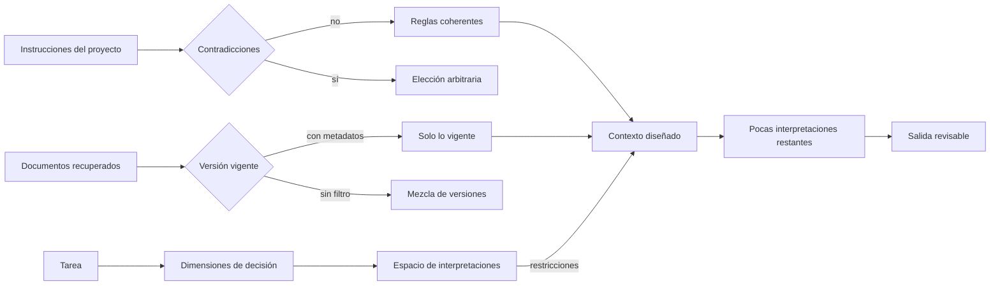
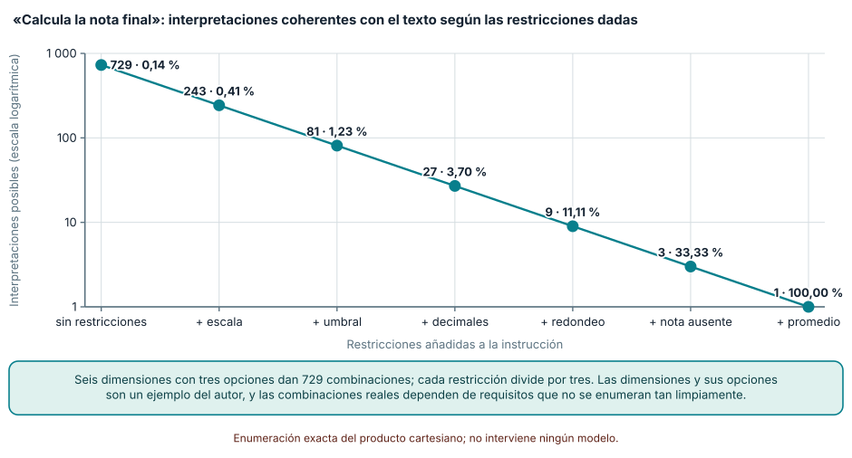
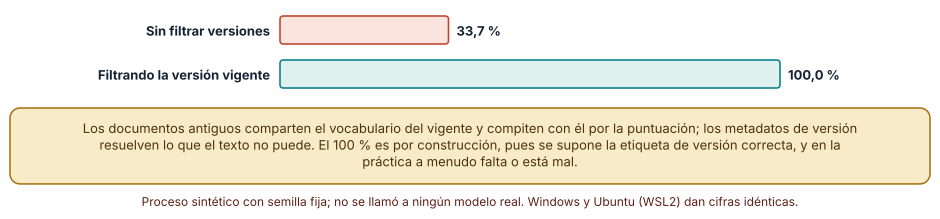
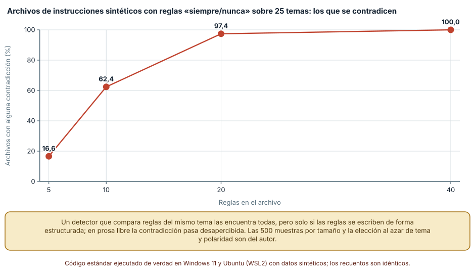

# SE-560 — Context engineering y reducción de ambigüedad

[← SE-559 — Revisión, refactorización y explicación asistidas](https://github.com/vladimiracunadev-create/modern-software-engineering-program/blob/main/classes/part-46-desarrollo-de-software-asistido-por-ia/se-559-revision-refactorizacion-y-explicacion-asistidas/README.md) · [↑ Parte 46](https://github.com/vladimiracunadev-create/modern-software-engineering-program/blob/main/classes/part-46-desarrollo-de-software-asistido-por-ia/README.md) · [📚 Índice completo](https://github.com/vladimiracunadev-create/modern-software-engineering-program/blob/main/classes/README.md) · [🌐 Portal](https://vladimiracunadev-create.github.io/modern-software-engineering-program/classes/SE-560.html) · [SE-561 — Evals de exactitud, utilidad, costo y latencia →](https://github.com/vladimiracunadev-create/modern-software-engineering-program/blob/main/classes/part-46-desarrollo-de-software-asistido-por-ia/se-561-evals-de-exactitud-utilidad-costo-y-latencia/README.md)

## Punto profesional y fundamento pedagógico

**Punto profesional.** La clase existe para que dejes de ajustar el texto de las peticiones y empieces a diseñar el conjunto de información con el que el modelo trabaja. *Context engineering* es la disciplina de decidir qué instrucciones, hechos, ejemplos, herramientas y restricciones entran en la ventana, en qué forma, con qué precedencia y con qué metadatos, de modo que el espacio de respuestas razonables se reduzca a las que el equipo aceptaría. Quien no la practica recibe respuestas que son una de muchas interpretaciones legítimas de una petición ambigua. La habilidad es contar las interpretaciones, eliminar las que el contexto debería descartar y comprobar que lo que se aporta es vigente, coherente y no contradictorio.

**Por qué aparece aquí.** Sigue a **Revisión, refactorización y explicación asistidas**: `SE-559` mostró que el asistente puede revisar y explicar con errores que vienen de información desactualizada; ahora se trata de gobernar esa información en la entrada. Retoma `SE-555` (qué entra en la ventana) con la pregunta de cuántas lecturas válidas deja la información que entra. El caso conductor es el **módulo de calificaciones de la plataforma educativa**, con instrucciones de proyecto y documentos de varias versiones. Es un caso sintético; no se usó ningún asistente real.

**Error conceptual que debe corregir.** Creer que la ambigüedad es una propiedad del modelo («no entendió») y no del encargo. Una instrucción con seis decisiones sin fijar admite cientos de interpretaciones coherentes, y el modelo elige una; si no coincide con la tuya, no se equivocó en sentido estricto, tú no la excluiste.

**Secuencia de aprendizaje.** Antes de ver los resultados, predices cuántas interpretaciones admite «calcula la nota final» con seis dimensiones de tres opciones y cuánto baja cada restricción; después enumeras ese espacio, mides con qué frecuencia una recuperación trae un documento antiguo en lugar del vigente y calculas cuántos archivos de instrucciones de distinto tamaño contienen una contradicción. La secuencia usa predicción, explicación propia, contraste y recuperación. [ICAP](https://icap.education.asu.edu/research) distingue participación de construcción de conocimiento; [How People Learn II](https://nap.nationalacademies.org/catalog/24783/how-people-learn-ii-learners-contexts-and-cultures) respalda diseñar la práctica con contextos reales y retroalimentación.

**Evidencia de aprendizaje.** `contexto-diseno.md` con la predicción, las tres figuras reproducidas, el archivo de instrucciones del módulo con reglas por tema y un detector de contradicciones, la lista de decisiones de una tarea con las que quedan fijas, abiertas o a preguntar, y una nota que separe qué es medido, inferido y supuesto.

**Límite de la conclusión.** Las seis dimensiones, sus opciones, el vocabulario de la recuperación, la puntuación con ruido y la elección al azar de temas y polaridades de las reglas son construcciones del autor con semilla fija. La enumeración y el detector son código real, pero no se evaluó ningún modelo: las simulaciones demuestran cómo se reduce el espacio de interpretaciones y cómo se contaminan las fuentes, no cómo se comporta una herramienta.

### Trazabilidad fuente → afirmación

| Fuente primaria u oficial | Afirmación que respalda | Lo que no prueba |
|---|---|---|
| [Anthropic: effective context engineering for AI agents](https://www.anthropic.com/engineering/effective-context-engineering-for-ai-agents) | Presenta el diseño del contexto como seleccionar y mantener el conjunto mínimo de información de alta señal, con instrucciones claras y herramientas bien definidas. | Es guía de un proveedor; no mide el efecto en tu proyecto. |
| [Anthropic: context windows](https://docs.anthropic.com/en/docs/build-with-claude/context-windows) | Documenta que la ventana es un recurso finito compartido por instrucciones, historial, contenido aportado y respuesta. | Las cifras dependen del modelo y cambian con las versiones. |
| [AGENTS.md](https://agents.md) | Propone un archivo de texto en la raíz del repositorio con instrucciones para agentes de programación, como un README dirigido a ellos. | No define qué reglas escribir ni garantiza que cada herramienta las respete. |
| [RFC 2119](https://www.rfc-editor.org/rfc/rfc2119) | Establece el uso de MUST, SHOULD y MAY para expresar obligatoriedad de forma precisa en una especificación. | No dice qué reglas son necesarias en un proyecto. |
| [Wallace et al., «The Instruction Hierarchy»](https://arxiv.org/abs/2404.13208) | Plantea distinguir instrucciones por nivel de privilegio para resolver conflictos entre ellas. | No asegura que un modelo concreto la respete. |
| [Liu et al., «Lost in the Middle»](https://arxiv.org/abs/2307.03172) | Observa que la información en medio de un contexto largo se usa peor. | No generaliza a todos los modelos ni versiones. |

## Antes de empezar

Recupera lo aprendido en `SE-559`: una explicación es tan fiel como su fuente. La pregunta activa es: **¿cuántas decisiones tomó el asistente por ti en tu última petición sin que te enteraras, y cuántas habrías tomado de otra manera?**

## Prerrequisitos

- Haber completado `SE-559` o poder explicar por qué una explicación puede heredar un comentario desactualizado.
- Python 3.11 o posterior; los experimentos usan solo la biblioteca estándar (`itertools`, `random`).
- Saber leer una tabla de combinaciones y qué es un producto cartesiano.

## Problema auténtico

El equipo escribió un archivo de instrucciones para el asistente con veinte reglas acumuladas durante meses: «siempre usa tipos estrictos», «nunca añadas dependencias», «prefiere funciones puras», «usa clases cuando haya estado». Dos de ellas se contradecían y el asistente alternaba entre ambas según la tarea. Además, la recuperación traía a veces el acta de hace dos años que decía lo contrario de la decisión vigente, y una petición tan simple como «calcula la nota final» producía en cada ejecución una función distinta: promedio simple una vez, ponderado otra, con redondeo a dos decimales o a uno, con una nota ausente tratada como cero o ignorada. Cada versión era razonable; ninguna era la que el reglamento exigía. El problema no era la capacidad del modelo sino la cantidad de interpretaciones que el contexto dejaba abiertas.

## Objetivos observables

Al terminar podrás:

1. enumerar las dimensiones de decisión de una tarea y contar las interpretaciones que admite;
2. clasificar cada decisión como fijada, abierta con valor por defecto o a preguntar, y decidir cuándo el asistente debe preguntar;
3. medir y reducir la contaminación del contexto por documentos de versiones anteriores mediante metadatos;
4. detectar contradicciones en un archivo de instrucciones y explicar por qué crecen con el número de reglas;
5. redactar un archivo de instrucciones breve, con precedencia explícita y reglas verificables.

## Mapa conceptual



El mapa muestra tres entradas al contexto (decisiones fijadas, reglas coherentes, documentos vigentes) y una salida: el número de interpretaciones que sobreviven. Cada flecha es una forma de reducirlo y cada nodo de decisión es un lugar donde el contexto puede degradarse.

## Temas y por qué importan

| Tema | Por qué cambia una decisión profesional | Evidencia mínima |
|---|---|---|
| Dimensiones de decisión | Hacen visible cuántas elecciones deja abiertas una petición | lista de dimensiones con opciones |
| Espacio de interpretaciones | Convierte «ambiguo» en un número | tabla de interpretaciones por restricción |
| Preguntar o asumir | Decide cuándo el asistente debe detenerse | clasificación de decisiones |
| Versiones y metadatos | Evitan que lo vigente compita con lo antiguo | acierto con y sin filtro |
| Archivos de instrucciones | Concentran las reglas del proyecto en un lugar versionado | archivo con precedencia y reglas verificables |
| Contradicciones | Provocan elecciones arbitrarias entre reglas | detector y tabla por tamaño |

## Conceptos y decisiones

### 1. Context engineering: diseñar el espacio de respuestas

Escribir una buena petición es una parte del problema; el resto es todo lo que acompaña a la petición. El contexto de una llamada incluye instrucciones del sistema, convenciones del proyecto, el historial de la conversación, archivos, resultados de herramientas y documentos recuperados, y compite por una ventana finita (`SE-553`). La guía de Anthropic lo plantea como la tarea de encontrar el conjunto más pequeño posible de información de alta señal que haga probable el resultado deseado. «Más pequeño» no significa «incompleto»: significa que cada elemento debe justificar su lugar, porque cada elemento extra consume presupuesto, puede contradecir a otro y diluye la atención. Pensar así cambia el trabajo cotidiano: en lugar de añadir una frase cuando algo falla, se pregunta qué información faltaba, sobraba o se contradecía.

### 2. La ambigüedad se cuenta

Una petición define un conjunto de salidas aceptables, y la ambigüedad es el tamaño de ese conjunto. Una forma de verla es enumerar las **dimensiones de decisión** de la tarea: en «calcula la nota final» están el tipo de promedio, el redondeo, los decimales, la escala, el tratamiento de la nota ausente y el umbral de aprobación. Con tres opciones por dimensión, seis dimensiones dan 3^6 = 729 combinaciones coherentes con la frase. Elegir al azar una de ellas acierta con una probabilidad de 0,14 %. Cada restricción que el contexto fija divide el espacio por el número de opciones de esa dimensión. La enumeración no necesita ser exacta para ser útil: lo importante es hacer visibles las decisiones que el asistente toma por ti. Y hay dimensiones que no son del asistente: si la escala es 1–7 por reglamento, no debe quedar abierta.

### 3. Fijar, dejar con valor por defecto o preguntar

Para cada dimensión hay tres tratamientos. **Fijarla** en el contexto cuando existe una respuesta correcta conocida (la escala, el umbral). **Dejarla abierta con un valor por defecto declarado** cuando la elección es indiferente o fácil de cambiar (el nombre de una variable), y pedir al asistente que declare qué supuso. Y **preguntar** cuando la elección es consecuente y la respuesta no está en el contexto (qué hacer con una nota ausente). Que el asistente pregunte no es automático: su mecanismo tiende a completar, de modo que se debe pedir de forma explícita («si falta una decisión de esta lista, pregunta antes de escribir código») y comprobar que lo hace. El criterio de qué se pregunta se basa en el costo de equivocarse: una decisión cuyo error pasa inadvertida y afecta a personas (el redondeo de una nota) merece una pregunta o una fijación, no un valor por defecto.

### 4. Versiones, metadatos y procedencia

Una recuperación basada en similitud no distingue entre una decisión vigente y una antigua que habla de lo mismo; ambas comparten vocabulario y, si la antigua es más larga o está más repetida, puede puntuar mejor. La defensa son los **metadatos**: versión, fecha, estado (vigente, sustituida, borrador) y dueño, guardados con cada fragmento y usados como filtro antes o después de puntuar. Los metadatos exigen disciplina de escritura (que cada documento declare su estado y qué sustituye) y de mantenimiento (que al sustituirlo se marque como tal). Sin ella el filtro no tiene qué filtrar. Y cuando el asistente cita una fuente, la cita debe incluir su versión y fecha, para que quien revisa compruebe en un vistazo si es la vigente.

### 5. Archivos de instrucciones: pocas reglas, con precedencia

Los archivos de instrucciones del proyecto (la propuesta de `AGENTS.md`, por ejemplo) concentran convenciones y restricciones en un archivo versionado que el asistente lee en cada sesión. Son una buena idea y tienen tres riesgos. El primero, la **acumulación**: se añade una regla por cada incidente hasta que son decenas. El segundo, la **contradicción**: con *n* reglas hay *n*(*n* − 1)/2 pares que podrían chocar, y las contradicciones crecen más rápido que las reglas. El tercero, la **imprecisión**: «intenta ser claro» no se puede comprobar. Conviene escribir pocas reglas, cada una verificable, con un vocabulario de obligatoriedad preciso (MUST, SHOULD, MAY según RFC 2119), agrupadas por tema y con una regla de precedencia explícita (qué gana si dos chocan). Y revisarlas como se revisa el código: un cambio al archivo es un cambio al comportamiento de toda la herramienta.

### 729 interpretaciones: cuánto baja cada restricción

Se definen seis dimensiones de decisión con tres opciones cada una: promedio (aritmético, ponderado, mediana), redondeo (mitad hacia arriba, mitad al par, truncar), decimales (0, 1, 2), escala (1–7, 0–100, 1–10), nota ausente (cero, ignorar, error) y umbral (≥4,0; >4,0; ≥50 %). Se enumera el producto cartesiano y se aplican restricciones una a una.

```python
todas = list(itertools.product(*dims.values()))          # 3^6 combinaciones
sobreviven = [t for t in todas if all(t[names.index(k)] == v for k, v in restricciones.items())]
```

| Restricciones añadidas | Interpretaciones posibles | Acierto al elegir una al azar |
|---|---:|---:|
| Sin restricciones | 729 | 0,14 % |
| + escala | 243 | 0,41 % |
| + umbral | 81 | 1,23 % |
| + decimales | 27 | 3,70 % |
| + redondeo | 9 | 11,11 % |
| + nota ausente | 3 | 33,33 % |
| + promedio | 1 | 100,00 % |

Cada restricción divide el espacio por tres. Con tres restricciones aún quedan 27 interpretaciones y una probabilidad de 3,7 % de acertar al azar; con cinco quedan 3, y recién con seis la petición es inequívoca. La conclusión práctica es que «casi especificado» está lejos de «especificado»: las últimas decisiones valen tanto como las primeras. Y no todas valen lo mismo, porque algunas se resuelven con un valor por defecto sensato (los decimales) y otras no (la nota ausente).



**Cómo leer la figura.** El eje horizontal son las restricciones añadidas a la instrucción y el vertical, en escala logarítmica, las interpretaciones coherentes; cada etiqueta añade la probabilidad de acertar al azar. Mira la recta descendente: cada restricción divide las interpretaciones por tres, y solo con todas queda una. **Dónde deja de valer:** las dimensiones y sus tres opciones son un ejemplo del autor; en un problema real las opciones no son tres ni independientes (fijar el redondeo cambia lo que significa un decimal) y algunas combinaciones no son coherentes. Los números enseñan la forma geométrica de la reducción, no la ambigüedad de una tarea concreta.

### Documentos de versiones anteriores: la recuperación sin y con filtro

Se simulan 300 consultas. Para cada una existe un documento vigente y uno, dos o cuatro documentos antiguos que comparten el vocabulario del tema; la puntuación es el número de términos de la consulta presentes más un pequeño ruido. Se mide cuántas veces el primer documento es el vigente, sin filtrar y filtrando por la etiqueta de versión vigente.

| Estrategia | Primer documento vigente |
|---|---:|
| Sin filtrar versiones | 33,7 % |
| Filtrando la versión vigente | 100,0 % |

Sin filtro, el documento vigente es el primero solo una de cada tres veces (33,7 %): los antiguos, con el mismo vocabulario, compiten en igualdad. Con el filtro el acierto es del 100 %, pero ese número es por construcción: la etiqueta de versión es correcta en todos los documentos. En la práctica la etiqueta falta, está mal o se actualiza con retraso, y el filtro hereda esa calidad. El experimento enseña lo que el filtro permite si los metadatos existen, no lo que los metadatos garantizan.



**Cómo leer la figura.** Cada barra es la fracción de 300 consultas en que lo primero recuperado es lo vigente; la diferencia es lo que compra un metadato correcto. **Dónde deja de valer:** el vocabulario, la puntuación con ruido y el número de documentos antiguos (1, 2 o 4) son del autor; la etiqueta es perfecta por supuesto y la puntuación no es BM25 ni vectores. Con etiquetas reales imperfectas, el filtro daría un valor intermedio.

### Archivos de instrucciones: la contradicción crece con las reglas

Se generan archivos sintéticos con *n* reglas del tipo «siempre» o «nunca» sobre 25 temas elegidos al azar, y un detector real compara las reglas del mismo tema y marca el archivo si encuentra un «siempre» y un «nunca» sobre el mismo tema. Se generan 500 archivos por tamaño.

```python
if k in vistos and vistos[k] != v: hay = True
vistos[k] = vistos.get(k, v)
```

| Reglas en el archivo | Archivos con alguna contradicción |
|---:|---:|
| 5 | 16,6 % |
| 10 | 62,4 % |
| 20 | 97,4 % |
| 40 | 100,0 % |

Con 5 reglas, una de cada seis veces el archivo se contradice; con 10, casi dos de cada tres; con 20, casi siempre. El crecimiento no es lineal porque con *n* reglas hay *n*(*n* − 1)/2 pares, y el número de temas es limitado (25), lo que hace inevitable que las reglas se solapen. Un detector estructural los encuentra todos, pero solo si las reglas se escriben de forma estructurada (tema y polaridad). En prosa libre, la contradicción pasa desapercibida para el detector y para el asistente, que elegirá una en cada ocasión.



**Cómo leer la figura.** El eje horizontal es el número de reglas del archivo y el vertical el porcentaje de archivos con alguna contradicción. Mira que la curva pasa de 16,6 % con 5 reglas a 97,4 % con 20: añadir reglas "por si acaso" vuelve casi seguro algún choque. **Dónde deja de valer:** los temas y las polaridades se eligen al azar con probabilidad uniforme; en un proyecto real los temas tienen un reparto desigual y las reglas se escriben con intención, de modo que habría menos contradicciones al azar y más sutiles (condicionales, excepciones). El detector solo ve contradicciones literales.

## Definiciones de trabajo

- **context engineering:** diseño del conjunto de información, su forma y su precedencia que se aporta al modelo en cada llamada.
- **dimensión de decisión:** aspecto de una tarea con varias opciones razonables que la petición puede dejar abiertas.
- **interpretación:** combinación coherente de opciones que satisface la petición tal como está escrita.
- **metadato de versión:** dato asociado a un documento que indica su vigencia, fecha y relación con otras versiones.
- **precedencia:** regla que establece cuál de dos instrucciones en conflicto prevalece.

Las definiciones son operativas para el módulo de calificaciones. No convierten términos con una historia más amplia en sinónimos y deben contrastarse con la documentación primaria enlazada al final.

## Ejemplo mínimo

El fragmento cuenta interpretaciones de una petición con tres dimensiones. Antes de ejecutarlo, predice cuántas quedan al fijar una.

```python
import itertools
dims = {"promedio": ["simple", "ponderado"], "redondeo": ["arriba", "par"], "ausente": ["cero", "error"]}
todas = list(itertools.product(*dims.values()))
fijas = [t for t in todas if t[2] == "error"]
print(len(todas), len(fijas))
```

Con tres dimensiones de dos opciones hay 8 interpretaciones, y fijar la nota ausente deja 4. Registra versión de Python, comando y salida; después añade una dimensión de tres opciones y comprueba que el espacio se multiplica por tres.

## Ejemplo profesional

Escenario hipotético, construido para la clase y sin datos reales. El equipo del módulo de calificaciones rediseña el contexto de sus asistentes. Primero enumera las seis dimensiones de «calcular la nota final» y clasifica cada una: escala, umbral, decimales y promedio ponderado quedan fijadas en el archivo de instrucciones con su fuente (el reglamento y su fecha); el redondeo queda fijado con un ejemplo de frontera; la nota ausente se marca «preguntar»: el asistente no escribe código sin que una persona decida. Después poda el archivo de instrucciones de veinte a ocho reglas, cada una verificable y con RFC 2119 (MUST, SHOULD), agrupadas por tema, con una regla de precedencia («el reglamento prevalece sobre las convenciones de estilo»); un script del repositorio detecta contradicciones literales y se ejecuta en integración continua. Los documentos de decisiones llevan encabezado con versión, estado y «sustituye a», y la recuperación filtra por vigente. Mide con quince preguntas: 14 de 15 respuestas citan la decisión vigente, la que falla cita un documento sin estado. Escribe la política con dueño y revisión trimestral. Compara con el estado inicial: antes se corregía cada falla añadiendo una regla.

## Práctica guiada

1. Predice cuántas interpretaciones admite una tarea de tu proyecto con cinco dimensiones de tres opciones y anota el número.
2. Enumera las dimensiones de una tarea real, cuenta las interpretaciones y reproduce la tabla de reducción.
3. Clasifica cada dimensión como fijada, por defecto o a preguntar, con una razón por escrito.
4. Reproduce la simulación de versiones y mide qué ocurre si la etiqueta de versión está mal en el 10 % de los documentos.
5. Revisa un archivo de instrucciones propio: cuenta las reglas, busca contradicciones literales y reescribe tres reglas imprecisas con MUST o SHOULD.
6. Añade una regla de precedencia y comprueba que resuelve un conflicto real entre dos reglas.
7. Entrega `contexto-diseno.md` y pide a otra persona que encuentre una contradicción que tu detector no vea.

## Ejercicios

1. **Espacio:** una tarea tiene dimensiones con 2, 3, 3 y 4 opciones. Calcula las interpretaciones y cuántas quedan al fijar la de 4 y una de 3.
2. **Preguntar:** clasifica «formato de fecha del archivo de exportación» y «nombre de la variable auxiliar» como fijar, valor por defecto o preguntar, y justifica.
3. **Metadatos:** diseña el encabezado de un documento de decisión con los cuatro campos mínimos y explica cuál evita cada fallo.
4. **Contradicción:** escribe dos reglas que no son contradictorias literalmente pero chocan en un caso y di cómo lo detectarías.

## Reto verificable

Entrega `contexto-diseno.md` con la predicción, las tres tablas, la enumeración de dimensiones de una tarea real con la clasificación fijar/defecto/preguntar, un archivo de instrucciones podado con precedencia y su detector de contradicciones ejecutado, y una medición con al menos diez preguntas del efecto del filtro de versión. Se aprueba si otra persona ejecuta el código desde un checkout limpio, obtiene los mismos números con las mismas semillas y puede decir qué decisión de la tarea queda sin fijar y por qué. No se aprueba por un archivo de instrucciones largo ni por afirmar que el contexto «es claro» sin contar interpretaciones.

## Caso conductor

El módulo de calificaciones es el caso conductor. Esta clase deja el octavo artefacto: el contexto diseñado con su archivo de instrucciones, sus metadatos y su detector. `SE-561` preguntará cómo se mide si ese diseño mejora la exactitud, la utilidad, el costo y la latencia, y `SE-562` cómo se protege la información que se envía. Cambia después un solo dato, el número de temas del archivo de reglas, y observa cuántas reglas aguanta antes de que la contradicción sea casi segura.

## Preguntas frecuentes

### ¿Cuántas reglas debe tener un archivo de instrucciones?

Las que se puedan mantener coherentes y verificar; la simulación muestra que con 20 reglas sobre 25 temas casi siempre hay una contradicción. Empieza con pocas, cada una ligada a un incidente real, y poda con regularidad.

### ¿Es mejor que el asistente pregunte o que decida con un valor por defecto?

Depende del costo de equivocarse y de lo fácil que sea cambiarlo. Una decisión cuyo error es invisible y afecta a personas merece pregunta o fijación; una que se corrige en una línea admite un valor por defecto declarado.

### ¿Los metadatos de versión no son trabajo extra?

Lo son, y es trabajo que se paga en cada consulta: sin ellos, una recuperación por similitud trata una decisión sustituida como vigente. El costo es un encabezado en cada documento y la disciplina de marcar lo que se sustituye.

### ¿El orden de las reglas importa?

Puede importar (`SE-553`: lo del medio se usa peor), y no se debe confiar en que el orden resuelva un conflicto. La precedencia se escribe, no se deduce del lugar.

## Fallo controlado y diagnóstico

Reproduce el fallo clásico de la clase: **una petición ambigua que produce una función distinta en cada ejecución**. Enumera las interpretaciones de «calcula la nota final» y toma una al azar tres veces.

Registra síntoma, entrada mínima, hipótesis, observación que descarta cada hipótesis, causa, corrección y prueba de regresión. **Síntoma:** tres ejecuciones, tres funciones distintas, todas razonables. **Hipótesis rivales:** (a) el modelo es inestable; (b) la temperatura es demasiado alta; (c) la petición admite cientos de interpretaciones. **Prueba:** cuenta las interpretaciones; si son 729 y la probabilidad de repetir la misma dos veces seguidas es del 0,14 %, la variación no necesita ninguna inestabilidad del modelo para producirse. **Conclusión:** el contexto no excluía interpretaciones. **Regresión:** añade al encargo las decisiones fijadas y una prueba que verifique cada una (escala, umbral, redondeo) y falle si la salida se aparta. No cambies a la vez la temperatura y el encargo.

## Errores comunes y cómo corregirlos

| Síntoma | Causa probable | Corrección |
|---|---|---|
| Cada ejecución produce una variante distinta | Muchas dimensiones abiertas | Enumerar dimensiones y fijar las consecuentes |
| El asistente alterna entre dos estilos | Reglas contradictorias | Detectar pares y escribir una precedencia |
| Se cita una decisión sustituida | Documentos sin estado ni versión | Metadatos de versión y filtro por vigente |
| El archivo de instrucciones crece sin mejorar nada | Una regla por incidente | Podar a reglas verificables agrupadas por tema |
| Se escribe «intenta ser claro» | Regla no comprobable | Reformular con MUST/SHOULD y un criterio medible |

## Entorno y archivos clave

```text
work/SE-560/
├── README.md
├── contexto/
│   ├── dimensiones.py
│   ├── detector_reglas.py
│   └── metadatos.md
├── instrucciones/AGENTS.md
├── tests/test_contexto.py
└── evidence/contexto-diseno.md
```

El `README` declara plataforma, versión de Python, semillas y comandos. Los experimentos usan solo la biblioteca estándar (`itertools`, `random`) y se ejecutaron con CPython 3.12.9 en Windows 11 y 3.12.3 en Ubuntu bajo WSL2: las salidas fueron idénticas. Los experimentos están en `scripts/experiments_part46_b.py`. Si añades una dependencia, fija procedencia y versión.

## Seguridad, ética y accesibilidad

- un archivo de instrucciones es una superficie de ataque: quien pueda modificarlo cambia el comportamiento del asistente; trátalo como código, con revisión y dueño (`SE-562`);
- las instrucciones que impiden revelar información sensible deben comprobarse con pruebas, no solo declararse;
- las reglas ambiguas se aplican de forma desigual y pueden afectar más a unas personas que a otras; las decisiones que afectan a estudiantes deben estar fijadas y auditables;
- los archivos de instrucciones deben escribirse en lenguaje claro y estructurado para que cualquier integrante del equipo, incluidas las personas que usan lectores de pantalla, pueda revisarlos;
- las guías y estándares citados tienen derechos de autor: cita su estructura y vincula la fuente, no copies su texto.

## Puente hacia el trabajo con agentes

Un agente lee el archivo de instrucciones al empezar y toma cientos de decisiones sin consultarte, de modo que cada dimensión abierta se resuelve en cada paso y las contradicciones se resuelven de forma distinta cada vez. Convierte las decisiones consecuentes en fijas o en preguntas obligatorias, exige que el agente declare los supuestos que hizo, limita las reglas a las verificables y comprueba mecánicamente su cumplimiento. Revisa especialmente las decisiones que el agente tomó sin avisar y compáralas con la lista de dimensiones: lo que no estaba fijado y aun así se resolvió sin preguntar es la medida de la autonomía que le diste sin querer.

## Transferencia

Traslada el análisis a otro dominio (por ejemplo, un asistente que redacta presupuestos para un taller mecánico): enumera sus dimensiones de decisión, clasifica cuáles fijas, cuáles por defecto y cuáles a preguntar, y conserva el procedimiento de contar interpretaciones, etiquetar versiones y detectar contradicciones. La transferencia está lograda cuando puedes decir qué decisión de ese dominio sería la última en fijarse y qué consecuencia tendría dejarla abierta, no cuando la tabla se parece a la del módulo de calificaciones.

## Evaluación y evidencia

| Criterio | Evidencia para aprobar |
|---|---|
| comprensión | explicación de la ambigüedad como espacio de interpretaciones y de las tres formas de tratar una decisión |
| corrección | tablas de interpretaciones, versiones y contradicciones reproducibles con las mismas semillas |
| diseño | contexto con decisiones clasificadas, metadatos de versión y archivo de reglas con precedencia |
| diagnóstico | reproducción del fallo «una variante distinta en cada ejecución» con regresión |
| incertidumbre | declaración de que dimensiones, vocabulario y reglas son del autor |
| reproducibilidad | versiones, comandos, salida y límites declarados |

## Fuentes

- [Anthropic: effective context engineering for AI agents](https://www.anthropic.com/engineering/effective-context-engineering-for-ai-agents) — conjunto mínimo de información de alta señal; autoridad: Anthropic.
- [Anthropic: context windows](https://docs.anthropic.com/en/docs/build-with-claude/context-windows) — la ventana como recurso finito; autoridad: documentación de Anthropic.
- [AGENTS.md](https://agents.md) — archivo de instrucciones para agentes de programación; autoridad: especificación abierta del proyecto.
- [RFC 2119](https://www.rfc-editor.org/rfc/rfc2119) — palabras clave de obligatoriedad; autoridad: IETF.
- [Wallace et al., «The Instruction Hierarchy»](https://arxiv.org/abs/2404.13208) — jerarquía de instrucciones; autoridad: preprint de OpenAI.
- [Liu et al., «Lost in the Middle»](https://arxiv.org/abs/2307.03172) — uso de la información según su posición; autoridad: Transactions of the ACL.

Cada fuente respalda el mecanismo indicado; ninguna demuestra que las 729 interpretaciones, el 33,7 % de acierto sin filtro o el 97,4 % de archivos con contradicción se observen en un proyecto real. Esa afirmación depende de la tarea, de los documentos y de las reglas.

## Límites y siguiente paso

Se ejecutaron tres experimentos en Windows y Ubuntu (WSL2) con resultados idénticos: una enumeración exacta de interpretaciones, una simulación de recuperación con versiones y un detector real de contradicciones sobre archivos sintéticos. No se evaluó ningún asistente; las seis dimensiones, el vocabulario, la puntuación con ruido, el número de documentos antiguos, los 25 temas y la elección al azar de polaridades son construcciones del autor, y la etiqueta de versión se supone perfecta. La siguiente clase pregunta cómo se mide si el diseño del contexto mejora la exactitud, la utilidad, el costo y la latencia.

## Glosario

- **context engineering:** diseño del conjunto de información, su forma y su precedencia que se aporta al modelo en cada llamada.
- **dimensión de decisión:** aspecto de una tarea con varias opciones razonables que la petición puede dejar abiertas.
- **interpretación:** combinación coherente de opciones que satisface la petición tal como está escrita.
- **metadato de versión:** dato asociado a un documento que indica su vigencia, fecha y relación con otras versiones.
- **precedencia:** regla que establece cuál de dos instrucciones en conflicto prevalece.

---

[← SE-559 — Revisión, refactorización y explicación asistidas](https://github.com/vladimiracunadev-create/modern-software-engineering-program/blob/main/classes/part-46-desarrollo-de-software-asistido-por-ia/se-559-revision-refactorizacion-y-explicacion-asistidas/README.md) · [↑ Parte 46](https://github.com/vladimiracunadev-create/modern-software-engineering-program/blob/main/classes/part-46-desarrollo-de-software-asistido-por-ia/README.md) · [📚 Índice completo](https://github.com/vladimiracunadev-create/modern-software-engineering-program/blob/main/classes/README.md) · [🌐 Portal](https://vladimiracunadev-create.github.io/modern-software-engineering-program/classes/SE-560.html) · [SE-561 — Evals de exactitud, utilidad, costo y latencia →](https://github.com/vladimiracunadev-create/modern-software-engineering-program/blob/main/classes/part-46-desarrollo-de-software-asistido-por-ia/se-561-evals-de-exactitud-utilidad-costo-y-latencia/README.md)
