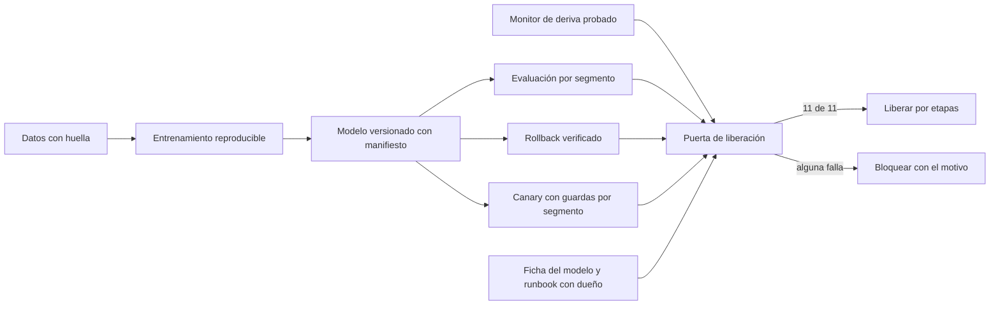
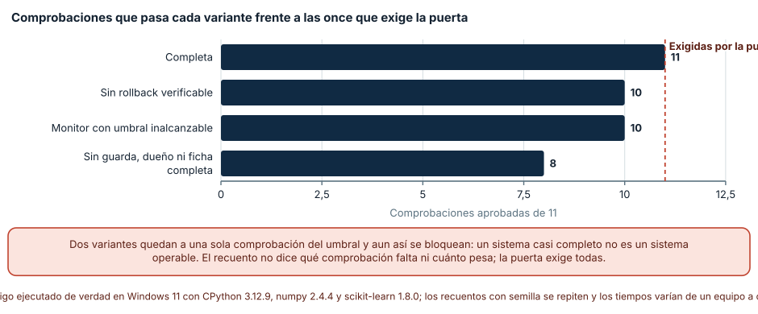

# SE-564 — Proyecto: sistema de ML operable con evidencia

[← SE-563 — Taller: degradar y recuperar un modelo](https://github.com/vladimiracunadev-create/modern-software-engineering-program/blob/main/classes/part-46-machine-learning-en-produccion-y-mlops/se-563-taller-degradar-y-recuperar-un-modelo/README.md) · [↑ Parte 46](https://github.com/vladimiracunadev-create/modern-software-engineering-program/blob/main/classes/part-46-machine-learning-en-produccion-y-mlops/README.md) · [📚 Índice completo](https://github.com/vladimiracunadev-create/modern-software-engineering-program/blob/main/classes/README.md) · [🌐 Portal](https://vladimiracunadev-create.github.io/modern-software-engineering-program/classes/SE-564.html) · [SE-577 — WebAssembly y WASI →](https://github.com/vladimiracunadev-create/modern-software-engineering-program/blob/main/classes/part-48-runtimes-y-plataformas-modernas/se-577-webassembly-y-wasi/README.md)

## Punto profesional y fundamento pedagógico

**Punto profesional.** El proyecto existe para que entregues un sistema de aprendizaje automático que otra persona pueda operar, y para que lo demuestres con evidencia que se comprueba sola y no con un documento que se lee. Un modelo operable no es el que tiene mejor métrica sino el que puede reproducirse, evaluarse por grupos, desplegarse por etapas, volver atrás con exactitud, vigilarse con alertas probadas, defenderse de abusos básicos y explicarse a quien lo audite. El proyecto reúne lo medido en la parte en un paquete con un manifiesto, una ficha, un runbook, una configuración de canary y una puerta de liberación que ejecuta once comprobaciones sobre los archivos reales. Se prueba con cuatro variantes de un mismo proyecto: una completa y tres con un defecto cada una (sin rollback verificable, con un monitor de deriva que no puede disparar, sin guarda por segmento ni dueño ni ficha completa), y la puerta debe aprobar la primera y bloquear las otras con el motivo exacto.

**Por qué aparece aquí.** Cierra la Parte 46: cada comprobación de la puerta corresponde a una clase (`SE-554` a `SE-563`). Reutiliza el proyecto de operación observable y recuperable de `SE-432`, el camino a producción con rollback de `SE-420` y el proyecto de evaluación de sistemas con LLM de `SE-516`. Prepara el trabajo con sistemas críticos (Parte 47) y con aceleradores y aislamiento (Parte 48), donde los mismos principios se aplican con requisitos más duros.

**Error conceptual que debe corregir.** Creer que operabilidad es una lista de buenas intenciones o que se demuestra con una captura de un tablero. Una afirmación como «el rollback funciona» solo vale si existe una comprobación que la ejecuta; una como «el monitor de deriva alerta» solo vale si se probó inyectando una deriva y se probó también que no alerta cuando no hay. En el proyecto, el defecto «monitor con umbral inalcanzable» pasa cualquier revisión documental (existe el monitor, existe el umbral) y solo lo delata la prueba que lo dispara. La segunda corrección: una puerta que se ejecuta pero que nadie ha visto fallar es otra hipótesis; por eso se prueba con variantes defectuosas.

**Secuencia de aprendizaje.** Antes de ejecutar, escribes las once comprobaciones de tu puerta y predices cuál de las cuatro variantes pasaría cuál. Después construyes tu propio proyecto, produces la evidencia con comprobaciones reales, pasas la puerta y la pruebas con al menos tres variantes defectuosas.

**Evidencia de aprendizaje.** El repositorio o carpeta del proyecto con: modelo versionado y su huella; `manifest.json` con huellas de datos, semilla, versiones y métricas por segmento; ficha del modelo; `runbook.md` con dueño; configuración del canary con guardas; modelo anterior y prueba de rollback; monitor de deriva con prueba; el script de la puerta; y el resultado de la puerta sobre tu versión completa y sobre tres variantes defectuosas.

**Límite de la conclusión.** El proyecto de laboratorio usa datos sintéticos, un boosting de gradiente y una regresión logística como modelo anterior, once comprobaciones elegidas por el autor y umbrales fijos (AUC de al menos 0,80, brecha entre segmentos de 0,05 o menos, umbral de PSI declarado en el manifiesto); la ficha y el runbook son marcadores con los campos y el dueño, no documentos escritos. No es una auditoría ni una garantía de operación de ningún sistema real, no se evaluó ninguna plataforma de MLOps y no se invocó ningún modelo de lenguaje. Aprobar la puerta no significa que el sistema sea seguro, justo o conforme con una regulación.

### Trazabilidad fuente → afirmación

| Fuente primaria u oficial | Afirmación que respalda | Lo que no prueba |
|---|---|---|
| [Breck et al., «The ML Test Score»](https://research.google/pubs/the-ml-test-score-a-rubric-for-ml-production-readiness-and-technical-debt-reduction/) | Propone una rúbrica de comprobaciones de datos, modelo, infraestructura y monitoreo para valorar la preparación para producción. | No demuestra que una puntuación alta evite fallas. |
| [Google Cloud, «MLOps: continuous delivery and automation pipelines»](https://cloud.google.com/architecture/mlops-continuous-delivery-and-automation-pipelines-in-machine-learning) | Describe niveles de automatización de la tubería de aprendizaje automático con validación y despliegue continuos. | Es una arquitectura de referencia de un proveedor. |
| [Mitchell et al., «Model Cards for Model Reporting»](https://arxiv.org/abs/1810.03993) | Propone documentar uso previsto, evaluación por grupos y limitaciones de un modelo. | No exige ni garantiza el contenido. |
| [MLflow, «Model Registry»](https://mlflow.org/docs/latest/model-registry/) | Describe un registro con versiones y alias que liga cada modelo con su corrida. | No prueba que el registro evite errores. |
| [NIST AI RMF](https://www.nist.gov/itl/ai-risk-management-framework) | Organiza la gestión del riesgo en Gobernar, Mapear, Medir y Gestionar, y sirve para ordenar la evidencia. | No es una certificación. |
| [Google SRE Workbook, «Canarying Releases»](https://sre.google/workbook/canarying-releases/) | Describe el despliegue parcial con criterios de parada y la elección de métricas de canary. | No fija umbrales para un modelo. |

## Antes de empezar

Recupera lo aprendido en `SE-563`: un monitor que nunca se ha disparado en una prueba es una hipótesis. La pregunta activa es: **¿qué afirmaciones sobre tu sistema de ML existen hoy solo como texto y cuántas tienen una comprobación que se ejecuta y puede fallar?**

## Prerrequisitos

- Haber completado `SE-553` a `SE-563`.
- Saber escribir una prueba automatizada y ejecutarla desde la línea de comandos (`SE-362`, `SE-411`).
- Tener un modelo propio o usar el de `scripts/experiments_part46_lab.py`.
- Python 3.11 o posterior, numpy 2.4.4 y scikit-learn 1.8.0; el proyecto no necesita GPU.

## Problema auténtico

*Avisos-ML* se entrega a otro equipo: el que lo operará durante el próximo año. El equipo receptor pide cinco cosas: reproducir el modelo, saber cómo se evaluó, poder desplegar una versión nueva sin miedo, volver a la anterior en minutos y enterarse si algo se degrada. El equipo emisor tiene todo eso repartido en cuadernos, mensajes y la memoria de dos personas. Un auditor interno añade una sexta petición: demostrar que no se entrega un modelo sin que alguien haya comprobado esas cinco cosas.

El problema no es técnico sino de evidencia: cada petición necesita un artefacto, cada artefacto una comprobación, y las comprobaciones una puerta que impida liberar cuando falla alguna. Y la puerta misma debe demostrarse, porque una puerta que siempre abre es peor que ninguna: da una falsa seguridad.

## Objetivos observables

Al terminar podrás:

1. construir un paquete de un sistema de aprendizaje automático con manifiesto, huellas, ficha, runbook, configuración de despliegue, modelo anterior y monitor de deriva;
2. escribir once comprobaciones que lean los archivos reales y devuelvan un resultado verificable, sin constantes declaradas;
3. probar la puerta con variantes defectuosas y demostrar que bloquea cada una con el motivo exacto;
4. justificar los umbrales de la puerta (métrica mínima, brecha entre segmentos, ficha, dueño) y decir qué defecto no detecta;
5. entregar el paquete a una persona ajena y comprobar que reproduce los resultados.

## Mapa conceptual



El mapa converge en la puerta: cada flecha es una evidencia que se produce con una comprobación. La puerta tiene dos salidas y ninguna es ambigua: libera o bloquea con un motivo escrito.

## Temas y por qué importan

| Tema | Por qué cambia una decisión profesional | Evidencia mínima |
|---|---|---|
| Manifiesto del modelo | Es la identidad reproducible del modelo. | Huellas de datos y modelo, semilla, versiones |
| Evidencia que se ejecuta | Una afirmación sin comprobación no es evidencia. | Comprobación que puede fallar |
| Puerta de liberación | Convierte las comprobaciones en una decisión. | Resultado con motivo |
| Variantes defectuosas | Prueban que la puerta sabe bloquear. | Una variante por defecto |
| Rollback verificado | Es la salida de seguridad del despliegue. | Huella y predicciones idénticas |
| Monitor probado | Una alerta no probada es una hipótesis. | Alerta con deriva y silencio sin ella |
| Ficha y dueño | Hacen operable y auditable al modelo. | Campos presentes y dueño nombrado |

## Conceptos y decisiones

### 1. El paquete

El paquete es una carpeta con siete archivos: el modelo vigente (`model-v1.pkl`), el modelo anterior (`model-v0.pkl`), `manifest.json`, `model-card.md`, `runbook.md`, `canary.json` y el script de la puerta. El manifiesto guarda la huella de cada modelo, la huella de los datos de entrenamiento, la huella de las predicciones del modelo anterior sobre 500 filas de referencia, la semilla, las versiones de las bibliotecas, el AUC, el AUC por segmento, el puntero al modelo vigente, el objetivo del rollback y el umbral y la ventana del monitor de deriva. En el laboratorio, el manifiesto ocupó 431 bytes y el modelo 276 KB. Todo lo que el receptor necesita para saber qué recibió cabe en un archivo pequeño, y todo lo que no cabe se referencia con una huella.

### 2. Once comprobaciones que leen el paquete

Cada comprobación abre archivos y calcula; ninguna lee un indicador que alguien escribió. (1) La huella del modelo vigente coincide con la del manifiesto. (2) El entrenamiento es reproducible bit a bit: reentrenar con los mismos datos y la misma semilla da predicciones idénticas a las del modelo guardado. (3) El AUC es de al menos 0,80. (4) La brecha de AUC entre los dos segmentos no supera 0,05. (5) El rollback es exacto: el modelo anterior existe, su huella coincide y sus predicciones sobre 500 filas coinciden con la huella registrada. (6) La alerta de deriva está probada: con una deriva de carga de +1,5 el PSI de alguna característica supera el umbral del manifiesto. (7) No hay falsa alarma: con datos de la misma distribución, el PSI no supera el umbral. (8) La validación de entrada bloquea la unidad errónea: con una tasa de lectura multiplicada por 100, más del 90 % de las filas queda fuera de rango. (9) La configuración del canary incluye la guarda de tasa de marcados por segmento. (10) La ficha del modelo tiene los diez campos. (11) El runbook nombra un dueño. Con ellas, la puerta responde a las cinco peticiones del equipo receptor y a la del auditor.

### 3. La puerta y las cuatro variantes

La puerta calcula las once comprobaciones y devuelve «aprobada» solo si pasan todas; si no, devuelve «bloqueada» con la lista de las que fallan. Se probó con cuatro variantes del mismo proyecto. La completa pasó 11 de 11 y fue aprobada. La variante sin rollback verificable (se borró el objetivo del rollback del manifiesto) pasó 10 de 11 y fue bloqueada por «rollback exacto». La variante con un monitor de deriva cuyo umbral era 5,0 (inalcanzable) pasó 10 de 11 y fue bloqueada por «alerta de deriva probada»: existía el monitor, existía el umbral y nunca podría disparar. La variante sin guarda de canary por segmento, sin dueño en el runbook y con una ficha de 6 campos pasó 8 de 11 y fue bloqueada por tres motivos a la vez. La puerta no decidió con un puntaje sino con una conjunción: un sistema operable cumple todas las comprobaciones, no la mayoría.

### 4. Por qué el defecto del monitor es el instructivo

Una revisión documental del monitor con umbral 5,0 lo habría aprobado: tiene monitor, tiene umbral, tiene ventana. Lo que lo delató fue la comprobación que lo dispara con una deriva conocida. Es el patrón de toda la parte: la evidencia es lo que el sistema hace cuando se le prueba, no lo que dice la documentación. El mismo criterio vale para el rollback (se ejecuta y se comparan huellas), para la validación (se le da una unidad errónea) y para la reproducibilidad (se reentrena y se comparan bits).

### 5. Los umbrales de la puerta se justifican

El AUC de 0,80, la brecha de 0,05 y los diez campos de la ficha son decisiones, no leyes. El AUC mínimo sale de la línea base de reglas y de la ganancia que justifica el modelo (`SE-553`, `SE-557`); la brecha entre segmentos, del informe de evaluación y de la definición de equidad elegida (`SE-556`, `SE-562`); los campos, de lo que el equipo receptor necesita para operar y el auditor para revisar. Cada umbral lleva su motivo escrito y su dueño, y cambiarlo exige revisión: una puerta con umbrales que cualquiera modifica sin dejar rastro no es una puerta.

### 6. Lo que la puerta no ve

La puerta no detecta una fuga de información que se mantenga idéntica en entrenamiento y en la prueba (`SE-554`), ni una deriva de concepto (`SE-560`), ni la puerta trasera de `SE-561`, ni una regresión en un segmento no definido en el manifiesto, ni un riesgo de uso que cambie el nivel regulatorio (`SE-562`). Tampoco evalúa la calidad de la ficha, solo que tenga los campos, ni si el dueño nombrado está disponible. La puerta reduce la probabilidad de liberar un sistema defectuoso por descuido; no prueba que el sistema sea correcto. El proyecto exige declarar esa lista de límites en el propio paquete.

### 7. Entregar y verificar con otra persona

La prueba final del proyecto es que una persona ajena clone el paquete, ejecute la puerta y obtenga el mismo resultado en la variante completa y en las defectuosas. Si no puede (falta una dependencia, una ruta absoluta, una semilla no registrada), la reproducibilidad es una promesa. En el laboratorio, la puerta se ejecuta sobre directorios temporales y no depende de rutas del equipo del autor. El resultado de la entrega queda como la evidencia más fuerte del proyecto.

### 8. Cuándo no

Para un modelo de prueba que vive una semana, esta puerta es desproporcionada: basta con huella, métrica y un plan de retirada. Para un modelo con decisiones sobre personas, once comprobaciones son el mínimo y hacen falta además la revisión humana, el expediente de gobierno de `SE-562` y las pruebas de robustez de `SE-561`. La proporcionalidad se decide con el impacto, no con el entusiasmo.

## Las cuatro variantes frente a la puerta

La primera medida muestra qué comprobación bloquea cada variante.


**Cómo leer la figura.** Cada fila es una comprobación y cada columna una variante; una celda oscura es una comprobación que pasa y una clara una que falla, que es la que bloquea. Mira primero que cada variante defectuosa falla exactamente donde se sembró su defecto y que la columna completa es toda oscura. **Dónde deja de valer:** son cuatro variantes escritas por el autor, cada una con defectos conocidos; la puerta no demuestra que detecte defectos que nadie sembró. Un defecto nuevo exige una comprobación nueva y una variante nueva que lo pruebe.

## Cuántas comprobaciones pasa cada variante

La segunda medida resume el resultado frente al límite de la puerta.



**Cómo leer la figura.** Cada barra es una variante y su longitud las comprobaciones que pasa; la línea de referencia marca las once que exige la puerta. Mira primero que dos variantes quedan a una sola comprobación del umbral y aun así se bloquean. **Dónde deja de valer:** la puerta exige todas; un porcentaje de comprobaciones aprobadas no es una medida de calidad, y la longitud de la barra no dice qué comprobación falta ni cuánto pesa. Se muestra el recuento solo para ver que un sistema casi completo no es un sistema operable.

## El camino de la evidencia

La tercera figura muestra qué artefacto alimenta qué comprobación.


**Cómo leer la figura.** La primera fila son los artefactos del paquete, la segunda las comprobaciones que los leen y la nota la regla de decisión. Mira primero que ninguna comprobación depende de un indicador declarado: cada una abre un archivo y calcula. **Dónde deja de valer:** es el paquete mínimo del laboratorio; un sistema real tiene más artefactos (pruebas de datos, resultados de robustez, registro de decisiones) y más comprobaciones, y cada una se añade con una variante defectuosa que la pruebe.

## Definiciones de trabajo

- **Paquete operable:** conjunto de artefactos con los que otra persona puede reproducir, evaluar, desplegar, revertir y vigilar un modelo.
- **Manifiesto:** archivo con las huellas, la semilla, las versiones y las métricas de un modelo.
- **Puerta de liberación:** conjunto de comprobaciones que decide si un modelo puede desplegarse.
- **Variante defectuosa:** copia del proyecto con un defecto sembrado para probar que la puerta lo detecta.
- **Evidencia ejecutable:** afirmación respaldada por una comprobación que puede fallar.
- **Brecha entre segmentos:** diferencia de una métrica entre el mejor y el peor segmento.

## Ejemplo mínimo

Una comprobación de la puerta en siete líneas:

```python
import hashlib, json, os

def huella_coincide(carpeta):
    man = json.load(open(os.path.join(carpeta, "manifest.json"), encoding="utf-8"))
    datos = open(os.path.join(carpeta, man["pointer"]), "rb").read()
    return hashlib.sha256(datos).hexdigest()[:12] == man["model_sha"]
```

Lee el manifiesto, abre el modelo al que apunta el puntero y compara huellas. Si alguien reemplaza el archivo del modelo sin actualizar el manifiesto, falla. No dice que el modelo sea bueno: dice que es el que se evaluó.

## Ejemplo profesional

*Escenario ilustrativo: las cifras y los resultados que aparecen en este ejemplo son supuestos de la narración, no mediciones.*

El equipo de *Avisos-ML* entrega el paquete al equipo de operaciones. La puerta se ejecuta en la integración continua en cada cambio del paquete y bloquea la fusión si falla. En la primera semana, la puerta bloquea un cambio que actualizaba el modelo sin regenerar el manifiesto: «huella del modelo coincide» falla y la persona descubre que había olvidado ejecutar el script de empaquetado. En el segundo mes bloquea otro cambio: la brecha entre segmentos pasó de 0,001 a 0,07 tras añadir datos de una universidad con otra composición; el equipo no corrige el umbral, investiga y descubre que un cambio de proceso de etiquetado afectó a un segmento. En el tercer mes alguien propone subir el umbral de la brecha a 0,10 «para poder liberar»; la revisión lo rechaza porque no hay un motivo escrito. La puerta no garantiza que el sistema sea correcto: garantiza que lo que se libera pasó las comprobaciones acordadas y que cambiarlas deja rastro.

## Práctica guiada

1. Ejecuta `python scripts/experiments_part46_b.py 564` y reproduce las cuatro variantes; lee el código de cada comprobación.
2. Elige un modelo propio y escribe su manifiesto con huellas, semilla, versiones y métricas por segmento.
3. Escribe las comprobaciones de tu puerta y, para cada una, la variante defectuosa que la prueba.
4. Pasa la puerta sobre tu versión completa y sobre tres variantes defectuosas, y comprueba que cada una se bloquea con el motivo correcto.
5. Entrega el paquete a otra persona y pídele que ejecute la puerta en su equipo; anota qué falló.

## Ejercicios

1. **Básico.** Explica por qué la variante con el monitor de umbral 5,0 pasa una revisión documental y no pasa la puerta.
2. **Intermedio.** Añade una duodécima comprobación (por ejemplo, que el modelo rechace una entrada con cinco columnas) y escribe la variante defectuosa que la prueba.
3. **Avanzado.** Diseña la comprobación de una fuga de información que se mantiene idéntica en entrenamiento y prueba, y explica por qué la puerta del laboratorio no la ve y cuánto costaría detectarla.

## Reto verificable

Entrega el paquete de un sistema de aprendizaje automático propio con manifiesto, ficha, runbook con dueño, configuración de canary con guardas, modelo anterior, monitor de deriva con su prueba y una puerta de al menos diez comprobaciones que lean archivos reales, junto con tres variantes defectuosas y los resultados de la puerta sobre cada una. Es válido si otra persona ejecuta la puerta en su equipo, obtiene los mismos resultados y puede nombrar un defecto que tu puerta no detecta y que tu paquete declare como límite.

## Caso conductor

*Avisos-ML* se libera con una puerta de once comprobaciones que bloqueó tres cambios en los primeros tres meses y con la lista declarada de lo que no ve. Con esto termina la Parte 46: el modelo ya es un artefacto operado con evidencia. Las partes siguientes aplican esa lógica a sistemas críticos (Parte 47) y a plataformas de ejecución aisladas (Parte 48).

## Preguntas frecuentes

### ¿Once comprobaciones son demasiadas o pocas?

Las que correspondan al riesgo de tu sistema. Empieza con las que cubren las fallas que has sufrido o que no puedes permitir, y añade una comprobación con cada incidente nuevo, junto con la variante defectuosa que la prueba.

### ¿La puerta debe bloquear siempre o puede avisar?

Lo que protege contra una falla que no puedes permitir bloquea; lo informativo avisa. Una puerta con demasiados avisos se ignora y una con demasiados bloqueos se elude: calibra con el costo de cada error.

### ¿Quién puede cambiar los umbrales de la puerta?

Alguien distinto de quien libera, con un motivo escrito y registro del cambio. Cambiar un umbral para poder liberar es la forma más común de estropear una puerta.

### ¿Esto sirve para modelos de lenguaje?

El principio sí: manifiesto, evaluación, rollback, monitoreo y puerta. Las comprobaciones cambian (evaluaciones de exactitud, utilidad, costo y seguridad de `SE-465`, `SE-513` y `SE-514`) y el manifiesto incluye el modelo base, el *prompt* y los datos de recuperación.

## Fallo controlado y diagnóstico

**Fallo.** Una persona del equipo libera un modelo nuevo saltándose la puerta «por urgencia» y dos días después el segmento móvil y nocturno recibe un 60 % menos de recordatorios.

**Diagnóstico paso a paso.** (1) Se ejecuta la puerta sobre el paquete liberado: falla «guarda de canary por segmento» y «brecha entre segmentos». (2) Se revisa el historial de integración: se liberó con permiso de administración, no por la tubería. (3) Se aplica el rollback por puntero, que funciona, y se verifica que las predicciones son idénticas a las del modelo anterior. (4) Se confirma que la brecha del segmento era visible en el manifiesto.

**Corrección.** Se elimina el permiso de liberar fuera de la tubería, se registra el incidente con la cronología y se añade al runbook un procedimiento de liberación de emergencia con dos aprobaciones que ejecuta la puerta de todos modos. La lección es que una puerta que se puede saltar es una sugerencia, y que el rollback ensayado limitó el daño a dos días.

## Errores comunes y cómo corregirlos

- **Comprobaciones que leen indicadores declarados.** Corrige leyendo archivos y calculando.
- **Una puerta que nunca ha fallado.** Corrige probándola con variantes defectuosas.
- **Umbrales sin motivo.** Corrige escribiendo el motivo y exigiendo revisión para cambiarlos.
- **Rutas absolutas y dependencias del equipo del autor.** Corrige con directorios relativos y versiones fijadas.
- **Declarar que el monitor existe sin dispararlo.** Corrige con una prueba que inyecta la deriva y otra sin ella.
- **Una puerta que se puede eludir.** Corrige cerrando la ruta de liberación fuera de la tubería.

## Entorno y archivos clave

- `scripts/experiments_part46_b.py`: funciones `escribir_proyecto`, `comprobar_proyecto`, `puerta` y `e564`, que construyen cuatro variantes en directorios temporales y las pasan por la puerta; se ejecuta con `python scripts/experiments_part46_b.py 564`.
- `scripts/experiments_part46_lab.py`: generador sintético, huellas y versiones fijadas.
- `scripts/figures_part46_b.py`: las tres figuras de la clase.
- numpy 2.4.4 y scikit-learn 1.8.0 (ver `scripts/requirements-part46.txt`). Tarda de uno a dos minutos y no usa GPU; escribe solo en directorios temporales.

## Seguridad, ética y accesibilidad

Los datos son sintéticos. El paquete contiene un modelo serializado con `pickle`: el receptor debe verificar la huella antes de cargarlo y no cargar paquetes de origen desconocido (`SE-558`, `SE-561`). Una ficha de modelo incompleta o un dueño ausente son fallas de responsabilidad, no de forma: sin dueño nadie responde ante una persona afectada. La puerta no sustituye la revisión humana ni el expediente de gobierno de `SE-562`. Las figuras tienen texto alternativo completo y no dependen solo del color.

## Puente hacia el trabajo con agentes

Un agente puede construir el paquete, escribir las comprobaciones y proponer variantes defectuosas, y tiene un incentivo evidente: hacer que la puerta apruebe. Exige que el agente no pueda modificar la puerta, los umbrales ni las variantes defectuosas que la prueban; que las comprobaciones lean archivos y calculen; que cada cambio de umbral lleve un motivo revisado por una persona; y que la liberación pase por la tubería. Un agente que «arregla» una comprobación que falla cambiando la comprobación en lugar del sistema es el defecto central de esta clase, y la puerta de la puerta (las variantes defectuosas versionadas) es el control. Usa el proyecto como evaluación del agente: dale una variante defectuosa y mide si encuentra y corrige el defecto sin tocar la puerta.

## Transferencia

Elige un modelo de tu organización y construye su manifiesto. Escribe tres comprobaciones que lean archivos reales y la variante defectuosa de cada una. Ejecuta la puerta sobre las cuatro versiones y anota cuál se te escapó. Entrégalo a otra persona y comprueba que reproduce.

## Evaluación y evidencia

| Criterio | Evidencia aceptable | Rechazo |
|---|---|---|
| Paquete | Manifiesto, huellas, ficha, runbook, canary, modelo anterior y monitor | Solo el modelo |
| Comprobaciones | Leen archivos y calculan; pueden fallar | Indicadores declarados |
| Puerta | Aprueba la completa y bloquea cada defectuosa con su motivo | «Pasa en mi equipo» |
| Variantes | Una por defecto, versionadas | Sin variantes |
| Umbrales | Motivo escrito, dueño y revisión para cambiarlos | Números sin origen |
| Reproducción | Otra persona obtiene los mismos resultados | Solo el autor lo ejecutó |
| Límites | Lista de lo que la puerta no ve | «Cubre todo» |

## Fuentes

- Breck, E. et al. [«The ML Test Score: A Rubric for ML Production Readiness and Technical Debt Reduction»](https://research.google/pubs/the-ml-test-score-a-rubric-for-ml-production-readiness-and-technical-debt-reduction/).
- Google Cloud. [«MLOps: Continuous delivery and automation pipelines in machine learning»](https://cloud.google.com/architecture/mlops-continuous-delivery-and-automation-pipelines-in-machine-learning).
- Mitchell, M. et al. [«Model Cards for Model Reporting»](https://arxiv.org/abs/1810.03993).
- MLflow. [«MLflow Model Registry»](https://mlflow.org/docs/latest/model-registry/).
- NIST. [«AI Risk Management Framework»](https://www.nist.gov/itl/ai-risk-management-framework).
- Google. [«The Site Reliability Workbook: Canarying Releases»](https://sre.google/workbook/canarying-releases/).

## Límites y siguiente paso

El proyecto, las once comprobaciones, las cuatro variantes y los umbrales son construcciones del autor sobre datos sintéticos; la ficha y el runbook del laboratorio son marcadores. La puerta detecta los defectos sembrados y no los que nadie previó. No se evaluó ninguna plataforma de MLOps. La Parte 46 termina aquí; la Parte 47 aplica la misma disciplina de evidencia a sistemas críticos, tiempo real y normas de seguridad, con riesgos y requisitos más estrictos.

## Glosario

| Término | Definición breve |
|---|---|
| Paquete operable | Artefactos para reproducir, evaluar, desplegar, revertir y vigilar |
| Manifiesto | Huellas, semilla, versiones y métricas de un modelo |
| Puerta de liberación | Comprobaciones que deciden si se despliega |
| Variante defectuosa | Copia con un defecto sembrado para probar la puerta |
| Evidencia ejecutable | Afirmación respaldada por una comprobación que puede fallar |
| Brecha entre segmentos | Diferencia de una métrica entre mejor y peor segmento |

---

[← SE-563 — Taller: degradar y recuperar un modelo](https://github.com/vladimiracunadev-create/modern-software-engineering-program/blob/main/classes/part-46-machine-learning-en-produccion-y-mlops/se-563-taller-degradar-y-recuperar-un-modelo/README.md) · [↑ Parte 46](https://github.com/vladimiracunadev-create/modern-software-engineering-program/blob/main/classes/part-46-machine-learning-en-produccion-y-mlops/README.md) · [📚 Índice completo](https://github.com/vladimiracunadev-create/modern-software-engineering-program/blob/main/classes/README.md) · [🌐 Portal](https://vladimiracunadev-create.github.io/modern-software-engineering-program/classes/SE-564.html) · [SE-577 — WebAssembly y WASI →](https://github.com/vladimiracunadev-create/modern-software-engineering-program/blob/main/classes/part-48-runtimes-y-plataformas-modernas/se-577-webassembly-y-wasi/README.md)
