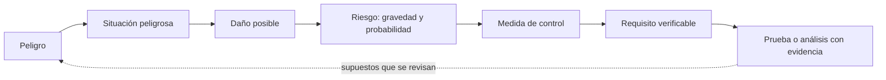
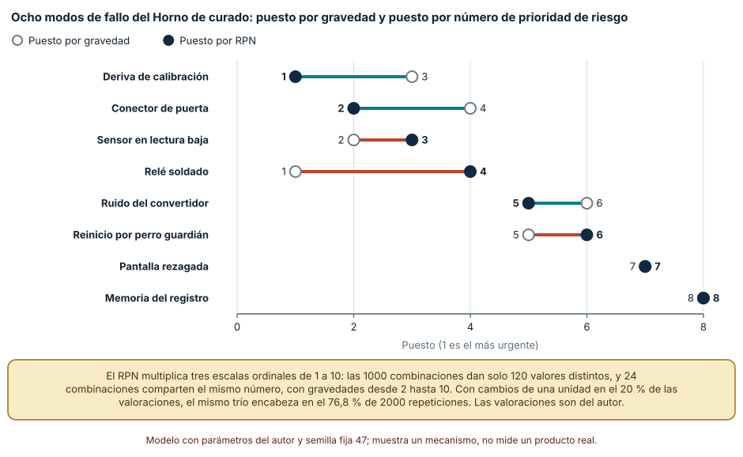

# SE-565 — Riesgo, peligro y seguridad funcional: HARA, FMEA, FTA y STPA

[← SE-564 — Proyecto: sistema de ML operable con evidencia](https://github.com/vladimiracunadev-create/modern-software-engineering-program/blob/main/classes/part-46-machine-learning-en-produccion-y-mlops/se-564-proyecto-sistema-de-ml-operable-con-evidencia/README.md) · [↑ Parte 47](https://github.com/vladimiracunadev-create/modern-software-engineering-program/blob/main/classes/part-47-sistemas-criticos-tiempo-real-y-normas-de-seguridad/README.md) · [📚 Índice completo](https://github.com/vladimiracunadev-create/modern-software-engineering-program/blob/main/classes/README.md) · [🌐 Portal](https://vladimiracunadev-create.github.io/modern-software-engineering-program/classes/SE-565.html) · [SE-566 — IEC 61508 y niveles de integridad de seguridad →](https://github.com/vladimiracunadev-create/modern-software-engineering-program/blob/main/classes/part-47-sistemas-criticos-tiempo-real-y-normas-de-seguridad/se-566-iec-61508-y-niveles-de-integridad-de-seguridad/README.md)

## Punto profesional y fundamento pedagógico

**Punto profesional.** La clase existe para que distingas tres cosas que en un proyecto suelen mezclarse: un **peligro** (una condición del sistema que puede llevar a daño), un **riesgo** (la combinación estimada de gravedad y probabilidad de ese daño) y una **medida de control** (algo que baja uno de los dos y que se puede verificar). Quien trabaja en un sistema donde un fallo puede lastimar a alguien no empieza escribiendo código: empieza preguntando qué puede salir mal, cuán grave sería, qué lo evitaría y cómo se sabrá que lo evita. Las cuatro técnicas de la clase (HARA, FMEA, FTA y STPA) responden a esa pregunta desde ángulos distintos y se equivocan de maneras distintas; saber en qué se equivoca cada una es lo que separa usarlas de rellenar plantillas.

**Por qué aparece aquí.** Abre la **Parte 47** después de la Parte 46. Las partes de pruebas (`SE-361` a `SE-372`) y de calidad y resiliencia (`SE-373` a `SE-384`) trataron fallos como defectos que se detectan y se toleran; aquí el fallo se trata como un evento con consecuencias para personas y se razona **antes** de que ocurra. Las clases siguientes toman normas concretas (`SE-566` a `SE-569`) que organizan este razonamiento en un proceso con evidencia.

**Error conceptual que debe corregir.** Creer que analizar fallos de componentes basta para demostrar seguridad. Un sistema puede causar daño sin que ningún componente falle: cada pieza cumple su especificación y la especificación es incompleta o contradictoria con el entorno. En el laboratorio, un controlador que cumple su especificación («calentar mientras la temperatura sea menor que la consigna») lleva el horno a 300,1 °C con la puerta abierta durante 684 segundos sin que falle nada; el análisis de fallos de componentes no lo ve y el análisis de acciones de control no seguras sí.

**Secuencia de aprendizaje.** Antes de ejecutar, predices si dos controles independientes hacen que el evento tope sea tan raro como el producto de sus probabilidades y si el producto RPN ordena bien los riesgos. Después construyes un árbol de fallos con sus cortes mínimos, añades una causa común, ordenas ocho modos de fallo por RPN y por gravedad, enumeras acciones de control no seguras y corres una planta simulada sin ningún fallo de componente.

**Evidencia de aprendizaje.** `analisis-de-peligros.md` con la lista de peligros del Horno de curado, el árbol de fallos con sus cortes mínimos y el efecto de una causa común, la tabla de modos de fallo con el criterio de priorización elegido y la lista de acciones de control no seguras con la medida que cubre cada una.

**Límite de la conclusión.** Las probabilidades, las valoraciones de gravedad, ocurrencia y detección y los parámetros de la planta los fijó el autor; no son datos de un horno real. La planta es un modelo de primer orden con 1 segundo de paso. No se cita ni se reproduce el texto de ninguna norma de pago, no hay revisión humana externa de los análisis ni se invocó ningún modelo de lenguaje en las mediciones.

### Trazabilidad fuente → afirmación

| Fuente primaria u oficial | Afirmación que respalda | Lo que no prueba |
|---|---|---|
| [Leveson y Turner, «An Investigation of the Therac-25 Accidents», IEEE Computer, 1993](https://doi.org/10.1109/MC.1993.274940) | Describe un caso en el que el daño provino de interacciones entre software, hardware y operadores y de la ausencia de un análisis de seguridad del software. | No ofrece probabilidades de fallo del software ni un método general. |
| [Informe de la comisión de investigación del vuelo 501 de Ariane 5 (ESA)](https://esamultimedia.esa.int/docs/esa-x-1819eng.pdf) | Documenta un fallo por causa común: el mismo software en dos unidades redundantes falló de la misma forma. | No permite estimar la tasa de fallo de otras redundancias. |
| [Norma IEC 61508-1 en la tienda de IEC (ficha pública)](https://webstore.iec.ch/en/publication/5515) | Identifica la norma genérica de seguridad funcional cuya lógica de análisis de peligros y riesgo siguen las normas sectoriales. | La ficha no contiene el texto de la norma, que es de pago. |
| [Comunidad GSN del Safety Critical Systems Club (SCSC)](https://scsc.uk/gsn) | Reúne la notación y la práctica de estructurar el razonamiento sobre peligros y controles. | No dice qué análisis de peligros usar en un dominio. |
| [Python: `itertools`](https://docs.python.org/3/library/itertools.html) | Documenta el producto cartesiano y las combinaciones que usa el laboratorio para enumerar estados. | No valida el modelo de fallos. |

## Antes de empezar

Recupera lo aprendido sobre pruebas de propiedades y de mutación (`SE-365`, `SE-366`): un oráculo solo detecta lo que sabe preguntar. La pregunta activa es: **¿qué fue lo último que fallaste en un sistema que «funcionó según la especificación», y quién habría tenido que escribir la línea de la especificación que faltaba?**

## Prerrequisitos

- Haber completado las partes de pruebas y de calidad (`SE-361` a `SE-384`), en particular [SE-380 — Disponibilidad, durabilidad y recuperación](https://github.com/vladimiracunadev-create/modern-software-engineering-program/blob/main/classes/part-31-calidad-rendimiento-y-resiliencia/se-380-disponibilidad-durabilidad-y-recuperacion/README.md).
- Haber visto [SE-160 — Modelos estructurales, conductuales y de información](https://github.com/vladimiracunadev-create/modern-software-engineering-program/blob/main/classes/part-13-especificaciones-contratos-y-modelos/se-160-modelos-estructurales-conductuales-y-de-informacion/README.md), [SE-274 — Safety, seguridad y vida útil prolongada](https://github.com/vladimiracunadev-create/modern-software-engineering-program/blob/main/classes/part-22-embedded-iot-y-tiempo-real/se-274-safety-seguridad-y-vida-util-prolongada/README.md) y [SE-283 — Salud, datos sensibles y sistemas regulados](https://github.com/vladimiracunadev-create/modern-software-engineering-program/blob/main/classes/part-23-software-especializado-y-dominios/se-283-salud-datos-sensibles-y-sistemas-regulados/README.md).
- Saber leer una probabilidad como frecuencia y multiplicar probabilidades de eventos independientes.
- Python 3.11 o posterior; el laboratorio usa solo la biblioteca estándar.

## Problema auténtico

El *Horno de curado* es el caso conductor de toda la parte: un horno de laboratorio donde un lazo de control mantiene una temperatura de consigna y un limitador independiente corta la potencia si se supera 250 °C o si la puerta se abre. Un cliente pide «demostrar que es seguro» antes de ponerlo en un laboratorio universitario. El equipo tiene un árbol de fallos dibujado a mano, una hoja de FMEA con números que nadie recuerda cómo salieron y la creencia de que, como el limitador es independiente, el riesgo de sobretemperatura es el producto de las probabilidades de los dos canales.

La clase reconstruye el análisis con cuatro técnicas y mide qué dice cada una. Se calcula el árbol de fallos con y sin una calibración compartida por el lazo y el limitador, se ordenan ocho modos de fallo por RPN y por gravedad, se estudia cuánto cambia el orden si las valoraciones varían en una unidad, se enumeran las acciones de control no seguras y se corre una planta simulada en la que ningún componente falla.

## Objetivos observables

Al terminar podrás:

1. separar peligro, situación peligrosa, daño, riesgo y medida de control, y escribir un peligro con su contexto operativo;
2. calcular los cortes mínimos de un árbol de fallos y la probabilidad de su evento tope, y mostrar cómo una causa común lo cambia;
3. explicar por qué el producto de gravedad, ocurrencia y detección ordena mal los riesgos y qué criterio alternativo usar;
4. enumerar acciones de control no seguras de un controlador por tipo y por contexto y convertir cada una en un requisito;
5. elegir qué técnica aplicar a qué pregunta y declarar lo que cada una no ve.

## Mapa conceptual



El recorrido va del peligro a la evidencia, y la flecha punteada es la que más se olvida: los supuestos con los que se estimó el riesgo se vuelven a mirar cuando el sistema, el entorno o el uso cambian.

## Temas y por qué importan

| Tema | Por qué cambia una decisión profesional | Evidencia mínima |
|---|---|---|
| Peligro, riesgo y control | Fija el vocabulario con el que se discute qué es aceptable. | Lista de peligros con su contexto |
| HARA | Estima gravedad, exposición y controlabilidad de cada peligro. | Tabla de peligros con su criterio |
| FMEA | Recorre componentes y modos de fallo hacia arriba. | Modos de fallo con efecto y detección |
| FTA | Recorre un evento tope hacia abajo y revela combinaciones. | Cortes mínimos y su probabilidad |
| STPA | Busca acciones de control no seguras sin que nada falle. | Lista de acciones de control no seguras |
| Causa común | Rompe el producto de probabilidades. | Árbol con y sin causa común |
| Límites de cada técnica | Evita creer que una sola técnica cubre todo. | Qué ve y qué no ve cada una |

## Conceptos y decisiones

### 1. Peligro, riesgo y control no son lo mismo

Un peligro es una condición o un estado: «calentador conectado con la puerta abierta». Un riesgo añade cuánto daño y con qué frecuencia: «una quemadura grave, una vez cada cien mil usos, si el operador no reacciona». Un control es lo que cambia uno de los dos factores y se puede verificar: «el contacto de la puerta corta la potencia por hardware». Confundirlos produce documentos donde el control aparece como si fuera el peligro («falta un limitador») o donde el riesgo se declara aceptable sin decir quién lo acepta ni con qué supuestos. La disciplina mínima es escribir cada peligro con su contexto operativo (en qué fase de uso, con qué usuario, con qué entorno) y cada control con su método de verificación.

### 2. HARA: gravedad, exposición y controlabilidad

El análisis de peligros y evaluación de riesgos (en inglés, *hazard analysis and risk assessment*) enumera situaciones de operación, identifica qué fallo del sistema las vuelve peligrosas y las clasifica con tres ejes: cuán grave sería el daño, con qué frecuencia el sistema está en esa situación y cuánto puede una persona evitar el daño si el sistema falla. De la combinación sale el nivel de rigor que pide el resto del desarrollo (en la clase `SE-567` se verá cómo lo hace el sector automotor). La idea es general: no todos los fallos merecen el mismo esfuerzo, y la clasificación debe poder auditarse. Su punto débil es que las tres valoraciones son juicios; dos equipos distintos pueden clasificar el mismo peligro de manera distinta, y la corrección es escribir la razón de cada valoración, no ocultar el juicio en un número.

### 3. FMEA: del componente hacia el efecto, y por qué el RPN engaña

El análisis de modos de fallo y efectos recorre cada componente, enumera cómo puede fallar, qué efecto tiene y cómo se detectaría. La práctica clásica multiplica tres valoraciones de 1 a 10 (gravedad, ocurrencia, detección) y llama al producto *número de prioridad de riesgo* (RPN). En el laboratorio, el relé del limitador soldado tiene gravedad 10, la máxima, y queda en el cuarto puesto por RPN (160); la deriva de calibración, de gravedad 8, queda primera (280). Además, las 1000 combinaciones posibles de las tres valoraciones producen solo 120 valores distintos de RPN y 24 combinaciones comparten el mismo número, con gravedades desde 2 hasta 10: dos modos de fallo con el mismo RPN pueden ser uno trivial y otro letal. Si cada valoración cambia en una unidad en el 20 % de los casos, el mismo trío encabeza en el 76,8 % de 2000 repeticiones: el orden es medianamente estable, no firme. La literatura del sector propone por eso sustituir el producto por una tabla de prioridad de acción que ponga primero la gravedad; en cualquier caso, un FMEA que ordena solo por RPN esconde el peligro de gravedad máxima.

### 4. FTA: del evento tope hacia las causas, y los cortes mínimos

El análisis por árbol de fallos parte de un evento tope («horno sobrecalentado sin corte») y lo descompone con puertas Y y O hasta eventos básicos. Un **corte mínimo** es un conjunto mínimo de eventos básicos cuya ocurrencia conjunta produce el tope. En el laboratorio, el tope exige que falle el control (sensor en lectura baja, fallo del software o triac en cortocircuito) y a la vez la protección (relé soldado, sensor del limitador o lógica del limitador): nueve cortes de orden dos, con una probabilidad anual exacta de 2,07 × 10⁻⁵ frente a 2,08 × 10⁻⁵ por la aproximación de suceso raro (la suma de los productos de cada corte). El número de cortes de orden uno, que no necesitan ningún otro fallo, es lo primero que se mira. Su punto débil es que el árbol representa solo lo que alguien pensó: un fallo que no está en el árbol no se calcula.

### 5. Causa común: la independencia que no existe

Las probabilidades se multiplican solo si los eventos son independientes. Si el lazo de control y el limitador usan el mismo modelo de sensor, la misma calibración o la misma alimentación, un único evento puede degradar los dos. Añadir al árbol una calibración común con probabilidad de solo 3,0 × 10⁻⁴ por año crea un corte de orden uno y eleva la probabilidad del tope a 3,21 × 10⁻⁴: unas 15,5 veces más, y el 93,5 % de esa probabilidad lo aporta el corte nuevo. Es el mismo mecanismo del vuelo 501 de Ariane 5, donde dos unidades inerciales redundantes ejecutaban el mismo software y fallaron igual por la misma conversión numérica. Las defensas son la diversidad (otro principio de medición, otro equipo, otro lenguaje), la separación física y el análisis explícito de causas comunes; ninguna se supone: se argumenta y se verifica.

### 6. STPA: cuando nada falla pero el sistema es inseguro

El análisis de procesos teórico-sistémico (STPA) modela el sistema como un lazo de control (controlador, acción de control, proceso controlado, retroalimentación) y pregunta, para cada acción de control, cuándo sería insegura: si no se da, si se da, si se da tarde o pronto o si se corta antes o dura de más. El resultado son acciones de control no seguras (UCA) y, para cada una, escenarios que explican cómo podría ocurrir, no solo con fallos de componente sino con modelos de proceso erróneos del controlador. En el laboratorio, 3 acciones de control por 4 tipos por 6 contextos dan 72 combinaciones y 22 son peligrosas. La corrida sin fallos lo confirma: con una consigna de 300 °C (nadie impide teclearla) y sin limitador la temperatura máxima es 300,1 °C y hay 684 segundos con calentador y puerta abierta; con un limitador independiente en 250 °C, el máximo es 185,4 °C porque además corta con la puerta abierta. Es un modelo y las cifras son suyas, pero la lección es general: la especificación incompleta es una fuente de peligros que ningún FMEA enumera.

### 7. Qué técnica para qué pregunta

HARA responde cuánto rigor merece cada peligro; FMEA, qué hace cada componente cuando falla y si se detecta; FTA, qué combinaciones de fallos producen un evento tope concreto y cuán probable es; STPA, qué acciones de control del sistema completo son inseguras aun sin fallos. Se complementan y se pisan: un análisis serio suele usar HARA para fijar el nivel, STPA temprano para encontrar requisitos que faltan, FTA para cuantificar los eventos tope que importan y FMEA para detalle de componentes. Ninguna reemplaza la experiencia de quien opera el sistema, y cada una exige que los analistas escriban sus supuestos; los supuestos son lo que se desafía en una revisión.

## Causa común y evento tope

La primera medida compara el mismo árbol de fallos sin y con una calibración compartida.


**Cómo leer la figura.** Cada barra es la probabilidad del evento tope por año, en escala logarítmica: la distancia entre ellas es un factor de unas 15,5. Mira primero qué cambió entre los dos árboles: un solo evento básico nuevo, que aparece en las dos ramas. **Dónde deja de valer:** las probabilidades de los eventos básicos las fijó el autor; la simulación Monte Carlo (400 000 corridas con las probabilidades multiplicadas por 20, semilla 47) dio 1,40 × 10⁻² frente a 1,38 × 10⁻² exacto, y eso valida el cálculo, no las tasas. Una causa común real no tiene una probabilidad que alguien conozca.

## El orden de los modos de fallo

La segunda medida compara dos formas de ordenar los mismos ocho modos de fallo.



**Cómo leer la figura.** Cada fila es un modo de fallo; el punto hueco es su puesto por gravedad y el lleno su puesto por RPN, y la línea entre ambos es lo que cambia. Mira primero el relé soldado: la gravedad máxima baja de puesto porque su ocurrencia es baja y su detección mala, y el producto lo diluye. **Dónde deja de valer:** las valoraciones de las ocho filas son del autor y se perturbaron con una regla simple; un FMEA real tiene cientos de filas y valoraciones discutidas en equipo. La lección es la forma del problema (el producto de escalas ordinales pierde información), no el orden concreto.

## Una corrida sin ningún fallo

La tercera medida corre una planta simulada con el controlador cumpliendo su especificación.


**Cómo leer la figura.** Las barras coral son la temperatura máxima en grados y las azules los segundos con calentador y puerta abierta; la línea punteada es el límite de 250 °C. Mira primero que ninguna barra representa un fallo: el controlador hizo lo que decía su especificación. **Dónde deja de valer:** la planta es un modelo de primer orden con parámetros del autor; no predice la temperatura de un horno real. Lo que prueba es que un análisis solo de fallos de componentes no habría enumerado este peligro.

## Definiciones de trabajo

- **Peligro:** condición o estado del sistema que, con ciertas circunstancias, puede llevar a daño.
- **Riesgo:** combinación de la gravedad de un daño posible y la probabilidad de que ocurra.
- **Corte mínimo:** conjunto mínimo de eventos básicos que, juntos, producen el evento tope.
- **Causa común:** un solo evento o condición que degrada varios canales que se suponían independientes.
- **RPN:** producto de las valoraciones de gravedad, ocurrencia y detección de un modo de fallo.
- **Acción de control no segura (UCA):** una acción de control que, en cierto contexto, lleva a un peligro.
- **Evento tope:** el suceso no deseado que un árbol de fallos descompone.

## Ejemplo mínimo

Un árbol de dos canales y la comprobación del efecto de una causa común, con solo la biblioteca estándar:

```python
p_control, p_limitador, p_comun = 5e-3, 2e-3, 3e-4

independiente = p_control * p_limitador
con_comun = 1 - (1 - p_control * p_limitador) * (1 - p_comun)

print(f"sin causa común: {independiente:.2e}")
print(f"con causa común: {con_comun:.2e}")
```

La primera cifra es 1,00 × 10⁻⁵ y la segunda 3,10 × 10⁻⁴: una causa común con una probabilidad menor que la de cualquiera de los dos canales multiplica por treinta el riesgo del conjunto. Es el mecanismo de la primera figura en seis líneas.

## Ejemplo profesional

*Escenario ilustrativo: las cifras y los resultados que aparecen en este ejemplo son supuestos de la narración, no mediciones.*

El equipo del *Horno de curado* hace un análisis de peligros antes de un piloto de tres meses en un laboratorio. El árbol de fallos muestra una probabilidad de sobretemperatura aceptable y el FMEA tiene pocas filas con RPN alto. Al repasar el árbol con el técnico que calibra los equipos aparece algo que nadie había escrito: el mismo técnico ajusta, el mismo día y con el mismo patrón, el sensor del lazo y el del limitador. El equipo añade el evento «calibración compartida», recalcula y la probabilidad del tope sube de golpe. La decisión no es cambiar el árbol, es cambiar el proceso: calibrar con patrones distintos y registrar quién y cuándo, y añadir al requisito del limitador un sensor de otro principio de medición. El hallazgo no vino de una herramienta sino de preguntarle a quien conoce cómo se usa el sistema.

## Práctica guiada

1. Escribe tres peligros del *Horno de curado* con su contexto operativo, sin mencionar todavía ninguna solución.
2. Dibuja el árbol de fallos del evento «sobretemperatura sin corte» y calcula sus cortes mínimos a mano; compara con `python scripts/experiments_part47_a.py 565`.
3. Añade una causa común que consideres plausible en tu propio sistema y recalcula; anota quién tendría que saberlo.
4. Ordena tus modos de fallo por RPN y por gravedad y marca los que cambian de puesto en más de dos lugares.
5. Enumera las acciones de control no seguras de un controlador real o simulado tuyo y convierte tres en requisitos con su prueba.

## Ejercicios

1. **Básico.** Explica por qué un árbol con nueve cortes de orden dos no es «nueve veces más seguro» que uno con uno solo, y qué dato lo diría.
2. **Intermedio.** Modifica el experimento para que el limitador use un sensor de otro principio con una causa común distinta y mide cuánto baja la probabilidad del tope; explica qué supuesto nuevo introduces.
3. **Avanzado.** Propón una regla de prioridad de acción que ponga primero la gravedad y use la detección y la ocurrencia solo para desempatar; aplícala a las ocho filas y compara con el RPN.

## Reto verificable

Entrega `analisis-de-peligros.md` y el código de un árbol de fallos de al menos seis eventos básicos con su cálculo de cortes mínimos. Es válido si otra persona reproduce el número de cortes, la probabilidad exacta del tope con y sin una causa común, el orden por RPN y por gravedad de al menos cinco modos de fallo y la lista de acciones de control no seguras con su contexto.

## Caso conductor

El *Horno de curado* inicia aquí su recorrido: un controlador con un limitador independiente cuyo análisis se refina clase a clase. Esta clase fija el vocabulario y las cuatro técnicas; `SE-566` introduce el marco general de seguridad funcional que traduce el análisis en niveles de integridad y en arquitecturas.

## Preguntas frecuentes

### ¿Hace falta hacer las cuatro técnicas?

No siempre. Hace falta hacer la que responde la pregunta que importa: si el riesgo es del sistema y no de un componente, STPA o HARA; si hay un evento tope cuantificable, FTA; si hay una lista de componentes y se quiere saber cómo se detectan, FMEA. Lo que no se admite es usar una sola y declarar que cubre todo.

### ¿Un RPN alto es siempre peor que uno bajo?

No: dos modos de fallo con el mismo RPN pueden tener gravedades de 2 y de 10. Un RPN solo ordena si las tres escalas son comparables entre sí, y no lo son. Mira primero la gravedad, después la combinación.

### ¿La probabilidad de un fallo de software se puede calcular?

De los defectos sistemáticos de diseño, no con el mismo sentido que el desgaste de un componente: el software no se desgasta, falla por errores de especificación o de implementación que están desde el principio. Por eso las normas piden argumentar el proceso y la verificación en lugar de asignar una tasa a una línea de código.

### ¿Puede una IA hacer el análisis de peligros?

Puede proponer peligros, causas y controles en un borrador, y a menudo propone cosas que el equipo no pensó. No puede conocer cómo se usa el sistema en el lugar ni responder por la aceptación del riesgo. Su salida es una lista de hipótesis que una persona con experiencia del dominio revisa.

## Fallo controlado y diagnóstico

**Fallo.** Tras el piloto, un horno supera 250 °C una tarde. El limitador corta, pero la pieza que estaba dentro se dañó. Nadie recibió daño y el informe dice «el limitador funcionó».

**Diagnóstico paso a paso.** (1) El registro muestra que el lazo de control mantuvo el calentador conectado durante 11 minutos con una consigna de 310 °C que un usuario tecleó. (2) El limitador cortó a 250 °C, como estaba diseñado; no hubo fallo de ningún componente. (3) El análisis de peligros solo había considerado fallos de componentes del lazo y no la acción de control «ajustar consigna» con un valor superior al límite del limitador. (4) El requisito faltante («el sistema rechaza consignas superiores al límite») no estaba en la especificación porque nadie imaginó que alguien la tecleara.

**Corrección.** Se añade la acción de control «ajustar consigna» al análisis de acciones de control no seguras, se escribe el requisito de rechazo con su prueba y se revisa si el limitador debe avisar y registrar cuando corta, porque cada corte es un caso casi accidente. La lección es que un control que funciona no demuestra que el peligro estuviera bien analizado: demuestra que hubo una última defensa.

## Errores comunes y cómo corregirlos

- **Confundir peligro con control.** Corrige escribiendo cada peligro como una condición del sistema, no como la ausencia de una medida.
- **Multiplicar probabilidades sin comprobar independencia.** Corrige con un análisis explícito de causas comunes.
- **Ordenar solo por RPN.** Corrige poniendo primero la gravedad o usando una tabla de prioridad de acción.
- **Analizar solo fallos de componentes.** Corrige añadiendo el análisis de acciones de control no seguras.
- **Valoraciones sin razón escrita.** Corrige guardando el motivo de cada gravedad, ocurrencia y detección para poder auditarlas.
- **Un análisis que se hace una vez.** Corrige enlazando cada supuesto a un disparador de revisión (un cambio de proveedor, de uso o de entorno).

## Entorno y archivos clave

- `scripts/experiments_part47_a.py`: función `e565` con el árbol de fallos, el FMEA, la enumeración de acciones de control no seguras y la planta; se ejecuta con `python scripts/experiments_part47_a.py 565`.
- `scripts/experiments_part47_lab.py`: cortes mínimos (`mocus`) y probabilidad exacta (`exact_probability`).
- Las semillas son 47; el Monte Carlo y la perturbación del FMEA son reproducibles con ella.
- `scripts/figures_part47_a.py`: las tres figuras de la clase.
- Solo la biblioteca estándar de Python 3.11 o posterior.

## Seguridad, ética y accesibilidad

Un análisis de peligros es un documento con consecuencias para personas: quien lo firma asume que lo revisó. La presión de calendario para declarar «aceptable» un riesgo es una amenaza de la integridad del análisis, y la defensa es que la aceptación la haga alguien con autoridad distinta de quien lo elaboró y que quede escrita con sus supuestos. Los casos reales de daño, como el del Therac-25, se tratan con el respeto debido a las personas afectadas: se describen mecanismos, no culpables. Las figuras llevan texto alternativo completo y no dependen solo del color.

## Puente hacia el trabajo con agentes

Un agente de código que modifica un controlador necesita saber qué peligros cubre cada requisito, para no borrar una verificación que parezca redundante. Pídele que, antes de tocar el código de un limitador, liste los peligros y controles que lo mencionan y que declare qué análisis quedan invalidados por su cambio. Un agente que propone «simplificar» una comprobación duplicada está proponiendo, sin decirlo, eliminar una defensa en profundidad: la lista de controles con su peligro es lo que se lo hace visible. La revisión de un cambio así es siempre de una persona.

## Transferencia

Elige un sistema tuyo donde un fallo pueda causar daño físico, económico o a datos de personas. Escribe tres peligros con contexto, construye un árbol de fallos de uno de ellos y busca al menos una causa común. Ordena tus modos de fallo por gravedad antes de calcular nada y enumera las acciones de control no seguras de un componente. Anota qué supuesto, si cambiara, haría que el análisis dejara de valer, y quién debería enterarse.

## Evaluación y evidencia

| Criterio | Evidencia aceptable | Rechazo |
|---|---|---|
| Peligros bien escritos | Condición, contexto y daño posible | «El sistema podría fallar» |
| Árbol de fallos | Cortes mínimos y probabilidad con y sin causa común | Un dibujo sin cálculo |
| Priorización | Gravedad primero, razón de cada valoración | Orden solo por RPN |
| Acciones de control no seguras | Tipo, contexto y requisito derivado | Lista de fallos de componentes |
| Supuestos | Cada uno con su disparador de revisión | Análisis sin fecha ni dueño |

## Fuentes

- Leveson, N. G. y Turner, C. S. [«An Investigation of the Therac-25 Accidents»](https://doi.org/10.1109/MC.1993.274940). IEEE Computer, 26(7), 1993.
- Comisión de investigación. [Informe sobre el fallo del vuelo 501 de Ariane 5](https://esamultimedia.esa.int/docs/esa-x-1819eng.pdf). Agencia Espacial Europea, 1996.
- IEC. [IEC 61508-1, ficha de la norma](https://webstore.iec.ch/en/publication/5515) (norma de pago; no se reproduce su texto).
- Safety Critical Systems Club. [Comunidad GSN y argumentos de seguridad](https://scsc.uk/gsn).
- Python Software Foundation. [`itertools`](https://docs.python.org/3/library/itertools.html).

## Límites y siguiente paso

Las tasas de fallo, las valoraciones y los parámetros de la planta son del autor, no hay un producto real analizado y el texto de las normas de pago no se reproduce ni se cita. El siguiente paso, `SE-566`, toma el análisis y lo expresa en el marco genérico de la seguridad funcional: niveles de integridad, probabilidad de fallo bajo demanda y arquitecturas redundantes.

## Glosario

| Término | Definición breve |
|---|---|
| Peligro | Condición del sistema que puede llevar a daño |
| Riesgo | Gravedad y probabilidad combinadas de un daño posible |
| Corte mínimo | Conjunto mínimo de fallos que produce el evento tope |
| Causa común | Un evento que degrada varios canales independientes |
| RPN | Producto de gravedad, ocurrencia y detección |
| UCA | Acción de control que en cierto contexto es insegura |

---

[← SE-564 — Proyecto: sistema de ML operable con evidencia](https://github.com/vladimiracunadev-create/modern-software-engineering-program/blob/main/classes/part-46-machine-learning-en-produccion-y-mlops/se-564-proyecto-sistema-de-ml-operable-con-evidencia/README.md) · [↑ Parte 47](https://github.com/vladimiracunadev-create/modern-software-engineering-program/blob/main/classes/part-47-sistemas-criticos-tiempo-real-y-normas-de-seguridad/README.md) · [📚 Índice completo](https://github.com/vladimiracunadev-create/modern-software-engineering-program/blob/main/classes/README.md) · [🌐 Portal](https://vladimiracunadev-create.github.io/modern-software-engineering-program/classes/SE-565.html) · [SE-566 — IEC 61508 y niveles de integridad de seguridad →](https://github.com/vladimiracunadev-create/modern-software-engineering-program/blob/main/classes/part-47-sistemas-criticos-tiempo-real-y-normas-de-seguridad/se-566-iec-61508-y-niveles-de-integridad-de-seguridad/README.md)
