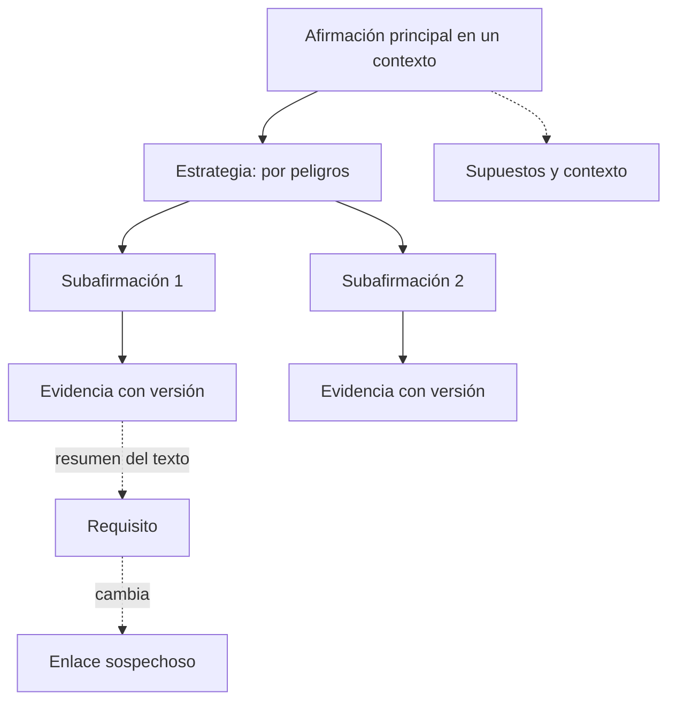
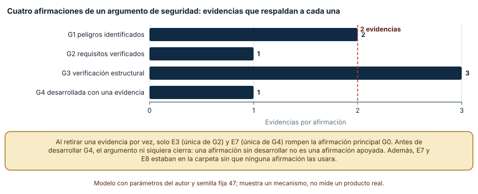
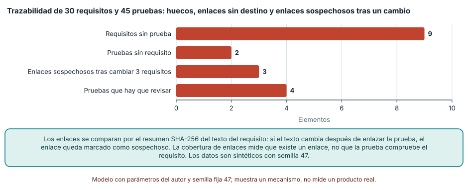
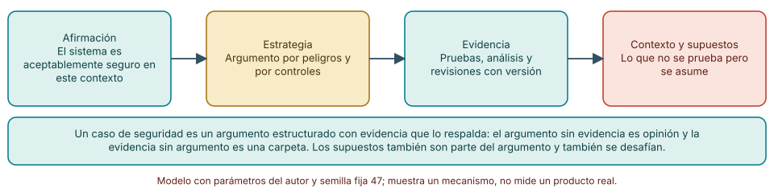

# SE-570 — Casos de seguridad y trazabilidad

[← SE-569 — Dispositivos médicos: IEC 62304](https://github.com/vladimiracunadev-create/modern-software-engineering-program/blob/main/classes/part-47-sistemas-criticos-tiempo-real-y-normas-de-seguridad/se-569-dispositivos-medicos-iec-62304/README.md) · [↑ Parte 47](https://github.com/vladimiracunadev-create/modern-software-engineering-program/blob/main/classes/part-47-sistemas-criticos-tiempo-real-y-normas-de-seguridad/README.md) · [📚 Índice completo](https://github.com/vladimiracunadev-create/modern-software-engineering-program/blob/main/classes/README.md) · [🌐 Portal](https://vladimiracunadev-create.github.io/modern-software-engineering-program/classes/SE-570.html) · [SE-571 — RTOS y planificación de tiempo real →](https://github.com/vladimiracunadev-create/modern-software-engineering-program/blob/main/classes/part-47-sistemas-criticos-tiempo-real-y-normas-de-seguridad/se-571-rtos-y-planificacion-de-tiempo-real/README.md)

## Punto profesional y fundamento pedagógico

**Punto profesional.** La clase existe para que sepas armar y desafiar un **caso de seguridad**: un argumento estructurado, respaldado por evidencia, de que un sistema es aceptablemente seguro para un uso en un contexto dado. Las clases anteriores produjeron piezas (análisis de peligros, cálculos de integridad, coberturas, clasificaciones); un caso de seguridad es lo que las ordena para que otra persona las pueda leer, objetar y auditar. También cubre la **trazabilidad**: el hilo que permite saber de qué peligro viene cada requisito, qué prueba lo verifica y qué cambia si un requisito cambia. Quien entrega un sistema crítico a un regulador, a un cliente o a su propio comité de seguridad entrega, en el fondo, esto.

**Por qué aparece aquí.** Sigue a `SE-569` porque cierra el bloque de las normas con la forma común de su evidencia, y prepara `SE-575` (el análisis de un fallo real) y `SE-576` (el paquete de un controlador). Retoma de [SE-168 — Proyecto: paquete de especificaciones trazables](https://github.com/vladimiracunadev-create/modern-software-engineering-program/blob/main/classes/part-13-especificaciones-contratos-y-modelos/se-168-proyecto-paquete-de-especificaciones-trazables/README.md) la idea de trazabilidad y le añade un argumento sobre ella.

**Error conceptual que debe corregir.** Creer que una carpeta con todos los informes es un caso de seguridad. Un caso es un argumento: afirmaciones, estrategias que las descomponen, evidencias que las sostienen, contexto y supuestos que las acotan. Sin argumento, la evidencia es una pila; sin evidencia, el argumento es opinión. En el laboratorio, un argumento de cuatro subafirmaciones con ocho evidencias disponibles tiene dos evidencias que ninguna afirmación usa, una subafirmación sin desarrollar y dos evidencias únicas cuya retirada rompe la afirmación principal.

**Secuencia de aprendizaje.** Antes de ejecutar, predices qué le pasa al argumento cuando se retira una evidencia y cuántos huecos tiene una trazabilidad de 30 requisitos y 45 pruebas construida a mano. Después construyes el argumento como datos, buscas afirmaciones sin desarrollar, evidencia huérfana y evidencias únicas, generas la trazabilidad con una semilla, cambias el texto de tres requisitos y cuentas los enlaces que quedan sospechosos.

**Evidencia de aprendizaje.** `caso-de-seguridad.md` con la afirmación principal del *Horno de curado*, la estrategia por peligros, las subafirmaciones con sus evidencias, el contexto y los supuestos, la lista de huecos y la matriz de trazabilidad con su política de enlaces sospechosos.

**Límite de la conclusión.** El argumento y la trazabilidad son datos sintéticos del autor con semilla 47; el comprobador solo verifica estructura (que haya afirmaciones desarrolladas, evidencia enlazada y enlaces vigentes) y no si el argumento es convincente. Un caso de seguridad real exige revisión independiente de su contenido, que aquí no existe, y las normas de pago que lo piden no se reproducen. No se afirma que el *Horno de curado* sea seguro.

### Trazabilidad fuente → afirmación

| Fuente primaria u oficial | Afirmación que respalda | Lo que no prueba |
|---|---|---|
| [GSN Community Standard y comunidad GSN (Safety Critical Systems Club)](https://scsc.uk/gsn) | Define la notación de estructuración de metas (afirmaciones, estrategias, evidencias, contexto, supuestos y justificaciones) usada para argumentos de seguridad. | No dice qué evidencia basta para un sistema. |
| [Ficha del estándar GSN, versión 3 (SCSC)](https://scsc.uk/r141C:1) | Identifica la edición vigente de la notación. | No es un tutorial. |
| [Leveson y Turner, Therac-25, IEEE Computer, 1993](https://doi.org/10.1109/MC.1993.274940) | Documenta un sistema desplegado sin un argumento de seguridad sobre el software ni verificación independiente. | No analiza argumentos estructurados. |
| [Informe conjunto de las autoridades (JATR) sobre el Boeing 737 MAX](https://www.faa.gov/sites/faa.gov/files/2022-08/Final_JATR_Submittal_to_FAA_Oct_2019.pdf) | Examina los supuestos de respuesta de la tripulación en la evaluación de peligros de un sistema de control de vuelo y recomienda desafiar y validar los supuestos de diseño. | No es un caso de seguridad ni este documento lo evalúa en su totalidad. |
| [Python: `hashlib`](https://docs.python.org/3/library/hashlib.html) | Documenta el resumen SHA-256 que usa el laboratorio para detectar enlaces sospechosos. | Un resumen detecta un cambio, no su significado. |

## Antes de empezar

Recupera lo aprendido en `SE-568`: una cobertura se interpreta, no se acepta como número. La pregunta activa es: **¿qué afirmación de seguridad de tu sistema se sostiene únicamente porque «alguien lo revisó una vez», y dónde está esa revisión?**

## Prerrequisitos

- Haber completado `SE-565` a `SE-569`.
- Haber visto [SE-166 — Especificaciones ejecutables y pruebas contractuales](https://github.com/vladimiracunadev-create/modern-software-engineering-program/blob/main/classes/part-13-especificaciones-contratos-y-modelos/se-166-especificaciones-ejecutables-y-pruebas-contractuales/README.md) y [SE-168 — Proyecto: paquete de especificaciones trazables](https://github.com/vladimiracunadev-create/modern-software-engineering-program/blob/main/classes/part-13-especificaciones-contratos-y-modelos/se-168-proyecto-paquete-de-especificaciones-trazables/README.md).
- Saber leer un árbol de afirmaciones y manejar diccionarios y conjuntos en Python.
- Python 3.11 o posterior.

## Problema auténtico

El equipo del *Horno de curado* ya tiene un análisis de peligros, una función de seguridad con su probabilidad, una cobertura del limitador y una clasificación de módulos. Un comité de seguridad del laboratorio universitario pide «la evidencia de que el horno es seguro». El equipo entrega una carpeta de treinta documentos. El comité tarda dos días en responder una sola pregunta: ¿qué documento respalda que la puerta abierta corta la potencia?

La clase organiza esa evidencia como un argumento, mide cuán frágil es (qué pasa si una evidencia se retira o está desactualizada), y construye una trazabilidad de requisitos y pruebas con una política para detectar enlaces que dejaron de valer cuando el requisito cambió.

## Objetivos observables

Al terminar podrás:

1. descomponer una afirmación de seguridad en subafirmaciones, estrategias, evidencias, contexto y supuestos;
2. detectar afirmaciones sin desarrollar, evidencia sin afirmación y evidencias únicas;
3. construir una matriz de trazabilidad bidireccional y medir sus huecos;
4. detectar enlaces sospechosos tras un cambio con resúmenes del texto del requisito;
5. explicar qué hace que un caso de seguridad sea convincente y por qué se desafía (confirmación y supuestos).

## Mapa conceptual



Las líneas continuas son el argumento; las punteadas son lo que lo vuelve auditable: los supuestos explícitos y el vínculo entre la evidencia y la versión del requisito que verificó.

## Temas y por qué importan

| Tema | Por qué cambia una decisión profesional | Evidencia mínima |
|---|---|---|
| Caso de seguridad | Ordena la evidencia como un argumento desafiable. | Estructura de metas |
| Afirmación y estrategia | Fija qué se afirma y cómo se descompone. | Árbol de afirmaciones |
| Evidencia | Debe ser concreta, versionada y suficiente. | Evidencia con versión |
| Supuestos y contexto | Acotan lo afirmado y se desafían. | Lista con dueño |
| Trazabilidad | Permite saber qué cambia si algo cambia. | Matriz bidireccional |
| Enlaces sospechosos | Detectan evidencia que ya no vale. | Política de invalidación |
| Desafío y confirmación | Evita el sesgo de buscar solo lo que apoya. | Revisión independiente |

## Conceptos y decisiones

### 1. Un caso de seguridad es un argumento

El caso responde tres preguntas: qué se afirma («el *Horno de curado* es aceptablemente seguro para curar muestras en un laboratorio con operadores formados, sobre una mesa, a menos de 250 °C»), por qué se cree (estrategia de argumento: se argumenta por cada peligro identificado, que tiene un control verificado) y con qué evidencia (resultados de pruebas, análisis, revisiones). Lo que lo distingue de un informe es que cada eslabón es visible y desafiable: quien lee puede preguntar «¿y si falla el sensor?» y encontrar qué rama responde. La notación gráfica más usada es la de estructuración de metas (GSN), con nodos de meta, estrategia, solución (evidencia), contexto, supuesto y justificación.

### 2. Desarrollar una afirmación: ni sin hijos ni con evidencia irrelevante

Una afirmación **sin desarrollar** es una promesa: se declara que se justificará pero no hay nada debajo. Un argumento con un hueco no cierra. La comprobación estructural más simple es recorrer el árbol y marcar las hojas que no son evidencia. En el laboratorio, con cinco afirmaciones y ocho evidencias, la afirmación G4 está sin desarrollar y por eso la principal G0 no queda apoyada; al desarrollarla con una evidencia, G0 queda apoyada. La estructura no dice si la evidencia es buena, solo si existe.

### 3. Evidencia: concreta, versionada y suficiente

La evidencia sostiene una afirmación cuando es una observación o un análisis concreto («los 12 casos de la prueba de puerta pasaron en la versión 1.4, con este registro») y no una declaración («se probó»). Debe llevar la versión del sistema y de los requisitos que verificó. En el laboratorio hay dos evidencias que no usa ninguna afirmación (un informe de una herramienta y un acta de revisión antigua): son ruido o son un hueco del argumento (una afirmación que debería existir). Preguntar a qué afirmación apoya cada documento es la forma más rápida de limpiar una carpeta.

### 4. Fragilidad: evidencias únicas

Si una afirmación depende de una sola evidencia, retirarla (porque está obsoleta, porque la herramienta que la produjo no es confiable, porque el revisor se equivocó) rompe el argumento hacia arriba. El laboratorio retira una evidencia por vez: solo dos, E3 (la única de G2) y E7 (la única de G4), rompen la afirmación principal; las afirmaciones con dos o tres evidencias aguantan. No significa que toda afirmación necesite tres evidencias; significa que el equipo debe saber cuáles son las únicas y decidir si basta, y que una evidencia única de una afirmación crítica merece una segunda de otro tipo (diversidad de la evidencia).

### 5. Contexto y supuestos: lo que se afirma bajo condiciones

Todo caso de seguridad vale en un contexto (el uso previsto, el entorno, las personas formadas) y con supuestos (el sensor se calibra con patrones distintos, la tensión de red está en rango). Los supuestos son parte del argumento y se desafían igual que la evidencia: cada uno tiene un dueño y un disparador de revisión. Un caso real que afirmó seguridad bajo un supuesto que no se cumplió en la práctica es el ejemplo recurrente de los informes de investigación; el informe conjunto de las autoridades sobre el Boeing 737 MAX examina, entre otras cosas, los supuestos de respuesta de la tripulación usados en la evaluación de peligros funcionales del sistema de control de vuelo y recomienda que los supuestos de diseño se desafíen y se validen, un ejemplo público de por qué los supuestos se auditan.

### 6. Trazabilidad: bidireccional y con política de cambio

La trazabilidad hacia adelante responde «¿qué prueba verifica este requisito?» y hacia atrás «¿de qué requisito o peligro viene esta prueba?». Con 30 requisitos y 45 pruebas generados con semilla 47, 9 requisitos quedan sin ninguna prueba y 2 pruebas sin requisito: son hallazgos antes de que cualquier regulador los pregunte. Una trazabilidad que solo se construye al final suele fallar; una que se mantiene junto al código, con un comprobador en la integración continua, cuesta menos. La cobertura de enlaces mide que hay un enlace, no que la prueba compruebe el requisito: eso lo decide la revisión.

### 7. Enlaces sospechosos: cuando el requisito cambia

Un enlace de una prueba a un requisito supone que el requisito era el que se verificó. Si el texto del requisito cambia después, el enlace deja de ser confiable aunque exista. Guardar un resumen SHA-256 del texto en el momento del enlace permite detectar el cambio: tras cambiar 3 requisitos, el comprobador marca 3 enlaces sospechosos y obliga a revisar 4 pruebas. El resumen no sabe si el cambio fue una errata o un cambio de fondo; sabe que ya no es el mismo texto, y decide una persona. Es la versión mínima de la idea de «evidencia obsoleta» que `SE-576` reutiliza para todo el paquete.

## Fragilidad del argumento

La primera medida cuenta las evidencias por afirmación.



**Cómo leer la figura.** Cada barra es una afirmación y su longitud el número de evidencias que la respaldan; la línea marca dos evidencias. Mira primero las dos barras que no la alcanzan: son los puntos únicos de fallo del argumento. **Dónde deja de valer:** el argumento es del autor, con evidencias de nombre; en uno real, cada evidencia tiene un contenido que puede ser débil aunque exista. Contar evidencias no mide su calidad.

## Trazabilidad y cambios

La segunda medida cuenta los huecos de una matriz de trazabilidad sintética.



**Cómo leer la figura.** Cada barra es un tipo de hallazgo del comprobador; mira primero los requisitos sin prueba, que son los más graves, y después los enlaces sospechosos, que aparecen solo si hay resúmenes. **Dónde deja de valer:** los datos son sintéticos con semilla 47 y los huecos se sembraron al azar; en un proyecto real los huecos se concentran donde hubo más cambios. Una matriz sin huecos no demuestra que las pruebas sean buenas.

## Estructura de un caso

La tercera figura resume las partes de un caso de seguridad.



**Cómo leer la figura.** Cada caja es un tipo de nodo del argumento; mira primero la última, que a menudo se omite y es donde viven los supuestos que se desafían. **Dónde deja de valer:** es un esquema simplificado de la notación; un caso real tiene varios niveles de estrategia y justificaciones por cada paso, y se mantiene como un documento vivo.

## Definiciones de trabajo

- **Caso de seguridad:** argumento estructurado, con evidencia, de que un sistema es aceptablemente seguro en un contexto.
- **Afirmación (meta):** enunciado que se debe justificar.
- **Estrategia:** forma de descomponer una afirmación en subafirmaciones.
- **Evidencia (solución):** resultado concreto que sostiene una afirmación.
- **Supuesto:** condición que se da por cierta y que acota el argumento.
- **Trazabilidad bidireccional:** vínculos de peligros a requisitos a pruebas y de vuelta.
- **Enlace sospechoso:** vínculo cuyo requisito cambió después de enlazarse.

## Ejemplo mínimo

La comprobación de un argumento como datos, con una evidencia retirada:

```python
afirmaciones = {"G0": ["G1", "G2"], "G1": ["E1", "E2"], "G2": ["E3"]}
evidencias = {"E1", "E2", "E3"}

def apoyada(g, retiradas):
    hijos = [h for h in afirmaciones[g] if h not in retiradas]
    if not hijos:
        return False
    return all(apoyada(h, retiradas) if h in afirmaciones else True for h in hijos)

print(apoyada("G0", set()))         # True
print(apoyada("G0", {"E3"}))        # False: E3 era la única de G2
print(apoyada("G0", {"E1"}))        # True: G1 aguanta con E2
```

El comprobador encuentra los puntos únicos de fallo con diez líneas. Lo que no encuentra es si E1, E2 o E3 son buenas.

## Ejemplo profesional

*Escenario ilustrativo: las cifras y los resultados que aparecen en este ejemplo son supuestos de la narración, no mediciones.*

El equipo entrega el caso de seguridad del horno al comité del laboratorio. Una persona del comité, formada en un laboratorio de química, lee la afirmación «la puerta abierta corta la potencia» y la evidencia: una prueba funcional con el horno vacío. Pregunta qué pasa si la puerta se abre con la carga a 240 °C y el aire caliente sale. El caso no responde: el contexto no menciona la carga térmica y la evidencia no la incluye. El equipo no estaba equivocado: el argumento no cubría un escenario real de uso, que el comité conocía y el equipo no. La respuesta fue añadir el escenario como supuesto de contexto con una prueba, y registrar que el comité había contribuido con ese desafío. Un caso que no se somete a quien conoce el uso real está esperando que lo encuentre un incidente.

## Práctica guiada

1. Escribe la afirmación principal de un sistema tuyo con su contexto, en una frase, y tres supuestos con su dueño.
2. Descomponla por peligros en subafirmaciones y lista la evidencia concreta de cada una.
3. Ejecuta `python scripts/experiments_part47_a.py 570` y compara con tu argumento: ¿hay hojas sin desarrollar o evidencia sin afirmación?
4. Construye la matriz de trazabilidad con resúmenes del texto de cada requisito y cambia uno para ver el enlace sospechoso.
5. Pide a una persona que conozca el uso real que formule tres objeciones al argumento y anota qué rama las responde.

## Ejercicios

1. **Básico.** Explica por qué una afirmación con tres evidencias del mismo tipo (tres pruebas del mismo caso) es más frágil que una con dos evidencias de tipos distintos.
2. **Intermedio.** Extiende el comprobador para que reporte, además de las evidencias únicas, las evidencias cuya versión no coincide con la del requisito.
3. **Avanzado.** Diseña la política de revisión de un caso de seguridad: quién lo desafía, cuándo, con qué disparadores, y cómo se registra la respuesta.

## Reto verificable

Entrega `caso-de-seguridad.md` y el código que carga el argumento como datos y reporta afirmaciones sin desarrollar, evidencia huérfana, evidencias únicas y enlaces sospechosos. Es válido si otra persona reproduce los hallazgos con la misma semilla y si el documento incluye al menos tres supuestos con dueño y disparador de revisión.

## Caso conductor

El *Horno de curado* tiene ahora su caso de seguridad con huecos conocidos. `SE-571` entra en el tiempo real: la afirmación «el limitador corta en menos de dos segundos» necesita un argumento sobre planificación y sobre el peor tiempo de ejecución.

## Preguntas frecuentes

### ¿Un caso de seguridad lo escribe quien desarrolla el sistema?

Lo elabora normalmente el equipo, pero su revisión debe ser independiente: alguien que no lo desarrolló y que conoce el dominio. Un caso que solo revisa su autor tiene el sesgo de confirmación incorporado.

### ¿Hay que usar GSN?

No. GSN es una notación entre varias; lo que importa es la estructura (afirmación, estrategia, evidencia, supuestos) y que sea revisable. Un argumento en texto estructurado o en una tabla puede ser igual de bueno si se mantiene trazable.

### ¿Cuánta evidencia es suficiente?

No hay un número: es suficiente cuando quien desafía el argumento queda satisfecho con el contexto y los supuestos. En muchas normas la suficiencia depende del nivel de integridad; el argumento debe explicar por qué la evidencia es proporcionada.

### ¿El caso de seguridad se actualiza?

Sí: es un documento vivo que cambia con el sistema, el uso y los incidentes. Cada cambio de diseño, entorno o uso dispara su revisión, y cada incidente lo desafía.

## Fallo controlado y diagnóstico

**Fallo.** Una auditoría pide el caso de seguridad de un controlador y el equipo lo entrega completo con un estado «verde» de todos los enlaces. El auditor descubre que el requisito de tiempo de respuesta de la puerta cambió de 2 a 0,5 segundos hace tres meses y que la prueba enlazada sigue verificando 2 segundos.

**Diagnóstico paso a paso.** (1) El comprobador solo verificaba que cada requisito tuviera una prueba enlazada, no que el enlace siguiera vigente. (2) Nadie guardó una huella del texto del requisito al enlazar la prueba. (3) La prueba pasaba con 2 s y el requisito nuevo exigía 0,5 s; el informe «verde» era cierto y engañoso. (4) El cambio de requisito se hizo en otra herramienta sin disparar la revisión de las pruebas.

**Corrección.** Se añade a cada enlace un resumen del texto del requisito y a la integración continua una comprobación que marca los enlaces cuyo resumen difiere, y se define que un enlace sospechoso bloquea la entrega hasta que una persona lo revisa. La lección es que «hay un enlace» no es «la evidencia sigue valiendo».

## Errores comunes y cómo corregirlos

- **Entregar una carpeta como si fuera un caso.** Corrige estructurando afirmaciones, estrategia y evidencia.
- **Afirmaciones sin desarrollar.** Corrige con un comprobador estructural en cada revisión.
- **Evidencia sin versión.** Corrige guardando la versión del sistema y del requisito en cada evidencia.
- **Supuestos escondidos.** Corrige listándolos con dueño y disparador.
- **Trazabilidad construida al final.** Corrige manteniéndola junto al código con un comprobador automático.
- **Revisión solo por el autor.** Corrige con un desafío independiente que conozca el uso real.

## Entorno y archivos clave

- `scripts/experiments_part47_a.py`: función `e570` con el argumento como datos, el comprobador de fragilidad y la trazabilidad con semilla 47; se ejecuta con `python scripts/experiments_part47_a.py 570`.
- Los resúmenes usan SHA-256 de `hashlib`.
- `scripts/figures_part47_a.py`: las tres figuras de la clase.
- Solo la biblioteca estándar de Python 3.11 o posterior.

## Seguridad, ética y accesibilidad

Un caso de seguridad es una afirmación pública de que algo es seguro; si se arma para convencer y no para desafiar, es un engaño. La ética profesional es dejar a la vista las debilidades (evidencias únicas, supuestos frágiles) para que quien decide pueda pesar. Los casos que mencionan incidentes reales se tratan con respeto a las personas afectadas. Las figuras tienen texto alternativo completo y no dependen solo del color.

## Puente hacia el trabajo con agentes

Un agente puede redactar un caso de seguridad plausible de un sistema que no entiende: afirmaciones bien formadas con evidencia que no existe. Exige que cada evidencia que cite sea un archivo o un registro verificable con su versión, y que el comprobador estructural pase sin que nadie edite el argumento para que pase. Úsalo para el desafío: pídele objeciones al caso y deja que una persona decida cuáles son pertinentes. Un agente no firma un caso de seguridad.

## Transferencia

Toma un sistema tuyo con un riesgo importante y escribe su afirmación principal con contexto y supuestos. Descomponla por peligros y enlaza la evidencia concreta de cada rama con su versión. Ejecuta un comprobador de afirmaciones sin desarrollar, evidencias huérfanas y únicas. Cambia un requisito y verifica que un enlace queda sospechoso. Entrega el caso a alguien que conozca el uso real y pídele tres objeciones.

## Evaluación y evidencia

| Criterio | Evidencia aceptable | Rechazo |
|---|---|---|
| Estructura | Afirmación, estrategia, evidencia, supuestos | Carpeta de documentos |
| Desarrollo | Sin hojas sin evidencia | Afirmaciones prometidas |
| Fragilidad | Evidencias únicas identificadas y decididas | «Está todo cubierto» |
| Trazabilidad | Bidireccional con resúmenes y política de cambio | Matriz construida al final |
| Desafío | Revisión independiente con objeciones registradas | Revisión solo del autor |

## Fuentes

- Safety Critical Systems Club. [Comunidad GSN](https://scsc.uk/gsn) y [estándar GSN versión 3](https://scsc.uk/r141C:1).
- Leveson, N. G. y Turner, C. S. [«An Investigation of the Therac-25 Accidents»](https://doi.org/10.1109/MC.1993.274940). IEEE Computer, 1993.
- JATR. [Informe final entregado a la FAA, octubre de 2019](https://www.faa.gov/sites/faa.gov/files/2022-08/Final_JATR_Submittal_to_FAA_Oct_2019.pdf).
- Python Software Foundation. [`hashlib`](https://docs.python.org/3/library/hashlib.html).

## Límites y siguiente paso

El argumento y la matriz son datos sintéticos del autor; el comprobador verifica estructura y no la calidad de la evidencia; no hay revisión independiente de contenido ni se afirma que el horno sea seguro. El siguiente paso, `SE-571`, pasa al tiempo real: la correctitud de una función de seguridad depende también de que se ejecute a tiempo.

## Glosario

| Término | Definición breve |
|---|---|
| Caso de seguridad | Argumento estructurado con evidencia de seguridad aceptable |
| Estrategia | Forma de descomponer una afirmación |
| Evidencia | Resultado concreto que sostiene una afirmación |
| Supuesto | Condición dada por cierta que acota el argumento |
| Trazabilidad | Vínculos entre peligros, requisitos y pruebas |
| Enlace sospechoso | Vínculo cuyo requisito cambió después |

---

[← SE-569 — Dispositivos médicos: IEC 62304](https://github.com/vladimiracunadev-create/modern-software-engineering-program/blob/main/classes/part-47-sistemas-criticos-tiempo-real-y-normas-de-seguridad/se-569-dispositivos-medicos-iec-62304/README.md) · [↑ Parte 47](https://github.com/vladimiracunadev-create/modern-software-engineering-program/blob/main/classes/part-47-sistemas-criticos-tiempo-real-y-normas-de-seguridad/README.md) · [📚 Índice completo](https://github.com/vladimiracunadev-create/modern-software-engineering-program/blob/main/classes/README.md) · [🌐 Portal](https://vladimiracunadev-create.github.io/modern-software-engineering-program/classes/SE-570.html) · [SE-571 — RTOS y planificación de tiempo real →](https://github.com/vladimiracunadev-create/modern-software-engineering-program/blob/main/classes/part-47-sistemas-criticos-tiempo-real-y-normas-de-seguridad/se-571-rtos-y-planificacion-de-tiempo-real/README.md)
