# Parte 47 — SPEC, agentes y ciclo de vida agentic

La Parte 46 enseñó a trabajar con asistentes sobre un cambio concreto, con trazabilidad y revisión humana. La pregunta cambia de «¿cómo uso un asistente en este cambio?» a «¿cómo se construye un producto cuando la unidad de trabajo es una especificación y quien implementa es un agente con herramientas, y con qué evidencia se sabe que el resultado es el pedido?». Esta parte trabaja sobre **el servicio de recordatorios de entrega de la plataforma educativa** (*Avisos*), un caso sintético: un servicio que envía a cada estudiante un aviso 72, 24 y 1 hora antes del vencimiento de una entrega, salvo que ya haya entregado o haya silenciado los avisos, y que debe reiniciarse, copiarse y restaurarse sin repetir lo enviado. Cada clase mira el mismo servicio con una lente más exigente: cómo se especifica, cómo se encadenan constitución, plan y tareas, cuándo la implementación converge, qué proceso conviene en cada situación, con qué autoridad trabaja el agente, qué controles y qué conocimiento se le cargan, qué confianza merecen sus herramientas, cómo se delega, cuándo interviene una persona, cómo se resiste a la inyección de instrucciones y se conserva un registro, cómo se detiene, se recupera y se evalúa, y cómo se entrega un producto validado por el sistema y no por autodeclaración.

## Pregunta rectora

> ¿Qué evidencia, que no haya producido el propio agente, demuestra que el producto cumple lo que se especificó; qué puede hacer el agente cuando se equivoca o lo engañan; y qué se hace cuando hay que detenerlo, recuperarlo o deshacer lo que hizo?

## Antes del recorrido clase por clase

Esta parte no enseña una herramienta de agentes ni un producto concreto. Enseña a convertir una intención en una especificación con identificadores y criterios comprobables y a medir cuántas decisiones se delegan en quien implementa; a encadenar constitución, clarificación, plan y tareas con puertas que un analizador de texto cumple en lo formal y no en lo semántico; a definir convergencia con un verificador independiente, condiciones de parada y capacidad de detección medida con variantes defectuosas; a elegir el proceso por la situación (proyecto nuevo, cambio sobre código existente, corrección de errores, evaluación de ideas); a descomponer la autoridad de un agente en herramientas, permisos, alcance y duración y a probar un motor de reglas; a decidir el modo de fallo de un gancho, medir el costo de las habilidades y confinar rutas; a tratar las descripciones y listados de un servidor de herramientas como entrada no confiable; a delegar con contratos, zonas y protocolos de escritura; a diseñar la aprobación humana por reversibilidad; a limitar las tres capacidades que hacen posible la fuga y a conservar un registro encadenado; y a detener, reanudar y evaluar un agente con estadística honesta.

```mermaid
flowchart LR
    A[De la intención a la especificación durable] --> B[Constitución, specify, clarify, plan y tasks]
    B --> C[Implementación, análisis y convergencia contra SPEC]
    C --> D[Greenfield, brownfield, bug fixing e idea assessment]
    D --> E[Agentes, herramientas, permisos y límites de autoridad]
    E --> F[Skills, plugins, hooks y entornos aislados]
    F --> G[MCP, recursos, prompts, tools y confianza]
    G --> H[Delegación, subagentes y sistemas multiagente]
    H --> I[Human-in-the-loop, aprobación y acciones reversibles]
    I --> J[Seguridad agentic, prompt injection y auditoría]
    J --> K[Taller: detener, recuperar y evaluar un agente]
    K --> L[Proyecto final: producto operable construido desde SPEC]
    L -->|hallazgo de la revisión| A
```

El diagrama se lee de izquierda a derecha y no es un proceso obligatorio. El retorno indica que un hallazgo de la revisión independiente del paquete reabre la especificación: un producto entregado no cierra la especificación, la fecha.

## Resultados acumulativos

Podrás medir cuántas frases de requisitos detecta un revisor por palabras frente a uno por medidas, contar los comportamientos distintos que admite una especificación con decisiones abiertas y comprobar con código la trazabilidad entre requisitos y pruebas, incluidas las pruebas sin aserción; analizar la coherencia entre constitución, plan y tareas, repartir un presupuesto de cinco preguntas de clarificación con cuatro estrategias y planificar cuarenta tareas con dependencias por olas y ruta crítica; simular el bucle implementar-converger con distintas tasas de regresión, medir cuántas declaraciones de éxito esconden criterios abiertos según la cobertura del verificador y detectar diez variantes defectuosas con tres conjuntos de criterios;

medir cuántos módulos hay que leer en un repositorio ajeno con cinco estrategias, comprobar qué políticas de verificación aceptan un arreglo del síntoma y calcular cuándo compensa evaluar una idea antes de construirla; probar un motor de permisos sobre treinta órdenes, calcular el radio de daño de cuatro configuraciones de herramientas y simular la acumulación de reglas «permitir siempre»; ejecutar un gancho como proceso y medir lo que pasa si se cae, medir el costo de contexto de cuarenta habilidades y probar cuatro comprobaciones de confinamiento de rutas; validar cien mensajes con tres niveles de comprobación, analizar un catálogo con instrucciones escondidas y fijar huellas, y calcular el efecto del tiempo de vida de una caché de listados;

calcular el contexto con y sin subagentes y la retención de hechos de los resúmenes, medir colisiones de edición con y sin propiedad por carpeta y comparar tres protocolos de escritura sobre SQLite; comparar cuatro políticas de aprobación, deshacer sesenta acciones sobre archivos con un diario y simular compensaciones de un flujo de cinco pasos; medir cuatro filtros de instrucciones inyectadas sobre doscientos documentos, contar cuántas tareas reúnen las tres capacidades y comprobar qué manipulaciones de un registro detectan tres esquemas; y comparar cuatro reglas de parada sobre cinco comportamientos, reanudar sin duplicar tras 500 caídas, estimar cuántas tareas hacen falta para distinguir dos agentes y ejecutar un servicio con seis defectos inyectados frente a tres vías de verificación y el costo de restaurar copias. Al finalizar podrás defender un paquete con especificación, plan, tareas, código y pruebas por requisito, matriz de variantes defectuosas, políticas del agente, registro con referencia externa y `LIMITES.md`, e indicar qué parte de cada conclusión es observación, cuál es inferencia y cuál es suposición.

## Prerrequisitos enlazados

- [Parte 25 — Diseño, patrones y refactorización](https://github.com/vladimiracunadev-create/modern-software-engineering-program/blob/main/classes/part-25-diseno-patrones-y-refactorizacion/): costuras, abstracciones y refactorización con red de seguridad.
- [Parte 29 — Datos, persistencia y recuperación](https://github.com/vladimiracunadev-create/modern-software-engineering-program/blob/main/classes/part-29-datos-persistencia-y-recuperacion/): copias, restauración y consistencia.
- [Parte 31 — Integración, eventos y mensajería](https://github.com/vladimiracunadev-create/modern-software-engineering-program/blob/main/classes/part-31-integracion-eventos-y-mensajeria/): entrega, idempotencia y bandejas de salida.
- [Parte 35 — Estrategia y técnicas de prueba](https://github.com/vladimiracunadev-create/modern-software-engineering-program/blob/main/classes/part-35-estrategia-y-tecnicas-de-prueba/): criterios de aceptación, pruebas de mutación y capacidad de detección.
- [Parte 36 — Calidad, rendimiento y resiliencia](https://github.com/vladimiracunadev-create/modern-software-engineering-program/blob/main/classes/part-36-calidad-rendimiento-y-resiliencia/): escenarios de calidad, reintentos y degradación.
- [Parte 38 — Seguridad, privacidad y cumplimiento](https://github.com/vladimiracunadev-create/modern-software-engineering-program/blob/main/classes/part-38-seguridad-privacidad-y-cumplimiento/): modelado de amenazas, mínimo privilegio y gestión de secretos.
- [Parte 41 — Observabilidad, SRE e incidentes](https://github.com/vladimiracunadev-create/modern-software-engineering-program/blob/main/classes/part-41-observabilidad-sre-e-incidentes/): señales, objetivos de servicio y recuperación.
- [Parte 43 — Mantenimiento y modernización legacy](https://github.com/vladimiracunadev-create/modern-software-engineering-program/blob/main/classes/part-43-mantenimiento-y-modernizacion-legacy/): caracterización, migraciones reversibles y coexistencia.
- [Parte 46 — Desarrollo de software asistido por IA](https://github.com/vladimiracunadev-create/modern-software-engineering-program/blob/main/classes/part-46-desarrollo-de-software-asistido-por-ia/): uso de asistentes con trazabilidad y revisión humana.
- Python 3.11+ y terminal; los experimentos usan solo la biblioteca estándar (con `sqlite3` incluido) y datos sintéticos, salvo las ejecuciones reales de código (el motor de reglas, el gancho como proceso, la lectura de un repositorio sintético, el diario de deshacer y el servicio con SQLite) y las lecturas de reloj.

## Bloques y progresión

1. **Especificar, planificar y converger:** las clases 469 a 472 convierten una intención en una especificación durable, la encadenan con constitución, clarificación, plan y tareas, miden cuándo la implementación converge y eligen el proceso por la situación.
2. **Acotar la autoridad y el conocimiento del agente:** las clases 473 a 475 descomponen la autoridad, prueban controles con su modo de fallo y tratan las herramientas de terceros como entrada no confiable.
3. **Coordinar, supervisar y proteger:** las clases 476 a 478 reparten el trabajo entre agentes, diseñan la aprobación humana por reversibilidad y limitan lo que un texto engañoso puede provocar.
4. **Aplicar e integrar:** las clases 479 y 480 detienen, recuperan y evalúan un agente y entregan un producto validado por el sistema.

## Evidencia medida y límites

Las figuras y los ejemplos de esta parte usan experimentos ejecutados con CPython 3.12.9 en Windows 11 y repetidos con CPython 3.12.3 en Ubuntu bajo WSL2. **No se invocó ningún modelo de lenguaje, no se ejecutó ninguna herramienta de agentes de terceros y no se contactó con ningún servidor MCP**: los «agentes» son máquinas de estados deterministas o simulaciones con semilla fija, y el manejador de mensajes de `SE-571` es una imitación mínima, no una implementación conforme. Los datos son **sintéticos** y las salidas de los experimentos fueron idénticas en ambos sistemas, cifra por cifra, salvo la lectura de reloj del arranque de un proceso (`SE-570`), que cambia de equipo en equipo y solo se interpreta como orden de magnitud. Las **ejecuciones reales** de código —el revisor de requisitos y la comprobación con árbol sintáctico, el analizador de artefactos, las pruebas contra variantes, la lectura de un repositorio de 300 módulos, el motor de permisos, el gancho como proceso, el confinamiento de rutas, la validación de mensajes y las huellas, los protocolos de escritura sobre SQLite, el diario de deshacer, los filtros y la cadena de huellas, la reanudación sobre SQLite y el servicio con su copia de seguridad— dieron los mismos recuentos y veredictos en los dos sistemas.

Los experimentos son: 125 frases de requisitos con cuatro detectores, ocho decisiones abiertas con 864 comportamientos posibles y una especificación de 25 entradas con 12 defectos (`SE-565`); 18 hallazgos de un analizador sobre tres artefactos, cinco preguntas para catorce ambigüedades en 2 000 especificaciones y 40 tareas con 53 dependencias (`SE-566`); un bucle de corrección con cuatro tasas de regresión, un verificador con cuatro coberturas y tres conjuntos de criterios contra diez variantes (`SE-567`); cinco estrategias de lectura de un repositorio de 300 módulos, cuatro políticas de verificación frente a cinco errores y el valor de evaluar una idea con cinco proporciones (`SE-568`); cuatro políticas de permisos sobre 30 órdenes, el radio de daño en 5 000 sesiones y 500 equipos con 24 semanas de reglas acumuladas (`SE-569`); 58 eventos contra un gancho real, 40 habilidades con 100 peticiones y 22 intentos de escape de rutas (`SE-570`); 100 mensajes con tres niveles de validación, 20 herramientas con huellas y una caché con cinco tiempos de vida (`SE-571`);

el contexto con ocho subagentes, la colisión de edición con cinco tamaños de grupo y tres protocolos de escritura sobre SQLite (`SE-572`); cuatro políticas de aprobación en 5 000 sesiones, 60 acciones sobre 40 archivos con un diario y un flujo de cinco pasos con compensaciones (`SE-573`); cuatro filtros sobre 200 documentos, 12 tareas con las tres capacidades y 500 eventos de auditoría con cinco manipulaciones (`SE-574`); cuatro reglas de parada sobre cinco comportamientos, 500 caídas por variante y dos agentes que difieren en seis puntos con cinco tamaños de conjunto (`SE-575`); y un servicio de diez requisitos con seis defectos, 400 restauraciones por frecuencia de copia y una matriz de evidencia (`SE-576`).

Los parámetros (las frases y los defectos inyectados, el número de lecturas por ambigüedad, los impactos y las duraciones, las tasas de corrección y regresión, el repositorio sintético, las treinta órdenes, la probabilidad de desvío del 5 %, la función de atención del 0,95 menos 0,012, el 4 % de acciones irreversibles, el 8 % de fallo por intento, los 200 documentos, la dificultad beta de las tareas, las copias cada 24, 6 y 1 hora) son supuestos del autor, y los resultados dependen de ellos. Que un conjunto de criterios detecte diez de diez variantes, o que los filtros lleguen al 100 % sobre las cinco formas de esconder una orden, es una consecuencia de haber escrito los casos sabiendo qué buscan, no un hallazgo sobre agentes reales.

Lo que **no se hizo**: no se construyó, desplegó ni operó ningún producto real con un agente; no se midió la tasa de éxito de ninguna inyección contra ningún modelo ni se desarrolló ninguna técnica efectiva contra un sistema; no se ejecutó `/speckit.*` ni ninguna extensión; no se instaló ninguna habilidad ni extensión de terceros; no se probó el aislamiento del sistema operativo, los enlaces simbólicos ni las rutas de Windows sobre un sistema de archivos; no hay concurrencia real, solo intercalaciones deterministas sobre SQLite en memoria; no participó ninguna persona en las simulaciones de aprobación; no se probó macOS ni otras versiones de Python; las descripciones de herramientas, las versiones de la documentación de Claude Code, Spec Kit y MCP son las vigentes en la fecha de verificación y pueden cambiar; y no se asegura revisión humana independiente de estas clases: sigue pendiente.

## Guía razonada clase por clase

El servicio *Avisos* mantiene un contrato y un paquete estables mientras cambian las decisiones. Cada clase explica qué incertidumbre reduce, qué experimento la muestra, qué no demuestra y qué evidencia permite abandonar la conclusión.

### Bloque 1 — Especificar, planificar y converger

#### SE-565 — De la intención a la especificación durable

Una ambigüedad es una decisión delegada. La clase compara cuatro detectores de vaguedad sobre 125 frases, cuenta los 864 comportamientos que admite una especificación con ocho decisiones abiertas y comprueba con código la trazabilidad entre 24 requisitos y 24 pruebas con doce defectos inyectados.

El estudiante entrega la especificación mínima de *Avisos* con identificadores, criterios, no-objetivos y registro de decisiones. `SE-566` la encadena con constitución, plan y tareas.

#### SE-566 — Constitución, specify, clarify, plan y tasks

Los artefactos se contradicen entre sí más a menudo de lo que cada uno se contradice a sí mismo. La clase ejecuta un analizador sobre tres artefactos, reparte cinco preguntas de clarificación entre catorce ambigüedades con cuatro estrategias y planifica cuarenta tareas con dependencias.

El estudiante entrega la cadena de artefactos con su análisis. `SE-567` mide cuándo la implementación converge.

#### SE-567 — Implementación, análisis y convergencia contra SPEC

«Terminé» no es una medida. La clase simula el bucle implementar-converger con cuatro tasas de regresión, mide cuántas declaraciones de éxito esconden criterios abiertos según la cobertura del verificador y ejecuta la especificación como pruebas contra diez variantes defectuosas.

El estudiante entrega los criterios ejecutables, las condiciones de parada y la medida de su capacidad de detección. `SE-568` aplica el recorrido a cuatro situaciones.

#### SE-568 — Greenfield, brownfield, bug fixing e idea assessment

El proceso se elige por la situación. La clase mide cinco estrategias de lectura de un repositorio ajeno, comprueba qué políticas de verificación aceptan un arreglo del síntoma y calcula cuándo compensa evaluar una idea antes de construirla.

El estudiante entrega la clasificación de sus peticiones, un diagnóstico con casos vecinos y una decisión de evaluar o no. `SE-569` fija con qué autoridad trabaja el agente.

### Bloque 2 — Acotar la autoridad y el conocimiento del agente

#### SE-569 — Agentes, herramientas, permisos y límites de autoridad

Una regla de permisos es un programa pequeño con fallos propios. La clase prueba cuatro políticas sobre treinta órdenes, calcula el radio de daño en 5 000 sesiones y simula la acumulación de reglas «permitir siempre».

El estudiante entrega el inventario de autoridad, una política con batería de órdenes y un calendario de revisión. `SE-570` añade controles y entornos aislados.

#### SE-570 — Skills, plugins, hooks y entornos aislados

Un control cuyo modo de fallo nadie decidió tiene el que le toca. La clase ejecuta un gancho como proceso real sobre 58 eventos, mide el costo de contexto de 40 habilidades y prueba cuatro comprobaciones de confinamiento de rutas.

El estudiante entrega ganchos con modo de fallo probado, habilidades con descripciones probadas y un confinamiento con batería. `SE-571` examina las herramientas de terceros.

#### SE-571 — MCP, recursos, prompts, tools y confianza

El protocolo da forma a la conversación; no da confianza a quien conversa. La clase valida 100 mensajes con tres niveles, analiza un catálogo de 20 herramientas con instrucciones escondidas y fija huellas, y mide el efecto del tiempo de vida de una caché.

El estudiante entrega la política de confianza por servidor, las huellas y la comprobación de coherencia. `SE-572` reparte el trabajo entre agentes.

### Bloque 3 — Coordinar, supervisar y proteger

#### SE-572 — Delegación, subagentes y sistemas multiagente

Delegar compra contexto limpio y paga con lectura repetida, información perdida y conflictos. La clase calcula el contexto con subagentes y la retención de hechos, mide colisiones de edición y compara tres protocolos de escritura sobre SQLite.

El estudiante entrega la descomposición con contratos, zonas y protocolo de escritura. `SE-573` diseña la intervención humana.

#### SE-573 — Human-in-the-loop, aprobación y acciones reversibles

Cada pregunta innecesaria resta atención a la necesaria. La clase compara cuatro políticas de aprobación, deshace sesenta acciones sobre archivos con un diario y simula las compensaciones de un flujo de cinco pasos.

El estudiante entrega la clasificación por reversibilidad, la política de aprobación y un diario probado. `SE-574` supone que alguien intentará engañar al agente.

#### SE-574 — Seguridad agentic, prompt injection y auditoría

Un filtro de frases no es una defensa; la arquitectura sí. La clase mide cuatro filtros sobre 200 documentos, cuenta las tareas que reúnen las tres capacidades y comprueba qué manipulaciones de un registro detectan tres esquemas.

El estudiante entrega el modelo de amenazas, la política que rompe una capacidad y un registro con referencia externa. `SE-575` los ensaya juntos.

### Bloque 4 — Aplicar e integrar

#### SE-575 — Taller: detener, recuperar y evaluar un agente

Un agente que no se puede parar, reanudar ni evaluar solo tiene la palabra de quien lo construyó. El taller compara cuatro reglas de parada sobre cinco comportamientos, reanuda sin duplicar tras 500 caídas y calcula cuántas tareas hacen falta para distinguir dos agentes.

El estudiante entrega las reglas de parada, el plan de recuperación y el protocolo de evaluación. `SE-576` los integra.

#### SE-576 — Proyecto final: producto operable construido desde SPEC

La evidencia de que un producto cumple no la produce quien lo construyó. El proyecto ejecuta un servicio de diez requisitos con seis defectos inyectados frente a tres vías de verificación, mide el costo de restaurar copias y arma la matriz de evidencia.

El estudiante entrega el paquete `avisos-paquete/` con especificación, plan, tareas, código, pruebas por requisito, variantes defectuosas, políticas del agente, registro y `LIMITES.md`. La Parte 47 cierra las partes del currículo vigente.

## Resumen operativo del recorrido

| Clase | Núcleo profesional | Aporte acumulativo |
|---|---|---|
| [SE-565](https://github.com/vladimiracunadev-create/modern-software-engineering-program/blob/main/classes/part-47-spec-agentes-y-ciclo-de-vida-agentic/se-565-de-la-intencion-a-la-especificacion-durable/) | De la intención a la especificación durable | Entrega la especificación mínima de *Avisos* con identificadores, criterios, no-objetivos y registro de decisiones |
| [SE-566](https://github.com/vladimiracunadev-create/modern-software-engineering-program/blob/main/classes/part-47-spec-agentes-y-ciclo-de-vida-agentic/se-566-constitucion-specify-clarify-plan-y-tasks/) | Constitución, specify, clarify, plan y tasks | Entrega la cadena de artefactos con su análisis |
| [SE-567](https://github.com/vladimiracunadev-create/modern-software-engineering-program/blob/main/classes/part-47-spec-agentes-y-ciclo-de-vida-agentic/se-567-implementacion-analisis-y-convergencia-contra-spec/) | Implementación, análisis y convergencia contra SPEC | Entrega los criterios ejecutables, las condiciones de parada y la medida de su capacidad de detección |
| [SE-568](https://github.com/vladimiracunadev-create/modern-software-engineering-program/blob/main/classes/part-47-spec-agentes-y-ciclo-de-vida-agentic/se-568-greenfield-brownfield-bug-fixing-e-idea-assessment/) | Greenfield, brownfield, bug fixing e idea assessment | Entrega la clasificación de sus peticiones, un diagnóstico con casos vecinos y una decisión de evaluar o no |
| [SE-569](https://github.com/vladimiracunadev-create/modern-software-engineering-program/blob/main/classes/part-47-spec-agentes-y-ciclo-de-vida-agentic/se-569-agentes-herramientas-permisos-y-limites-de-autoridad/) | Agentes, herramientas, permisos y límites de autoridad | Entrega el inventario de autoridad, una política con batería de órdenes y un calendario de revisión |
| [SE-570](https://github.com/vladimiracunadev-create/modern-software-engineering-program/blob/main/classes/part-47-spec-agentes-y-ciclo-de-vida-agentic/se-570-skills-plugins-hooks-y-entornos-aislados/) | Skills, plugins, hooks y entornos aislados | Entrega ganchos con modo de fallo probado, habilidades con descripciones probadas y un confinamiento con batería |
| [SE-571](https://github.com/vladimiracunadev-create/modern-software-engineering-program/blob/main/classes/part-47-spec-agentes-y-ciclo-de-vida-agentic/se-571-mcp-recursos-prompts-tools-y-confianza/) | MCP, recursos, prompts, tools y confianza | Entrega la política de confianza por servidor, las huellas y la comprobación de coherencia |
| [SE-572](https://github.com/vladimiracunadev-create/modern-software-engineering-program/blob/main/classes/part-47-spec-agentes-y-ciclo-de-vida-agentic/se-572-delegacion-subagentes-y-sistemas-multiagente/) | Delegación, subagentes y sistemas multiagente | Entrega la descomposición con contratos, zonas y protocolo de escritura |
| [SE-573](https://github.com/vladimiracunadev-create/modern-software-engineering-program/blob/main/classes/part-47-spec-agentes-y-ciclo-de-vida-agentic/se-573-human-in-the-loop-aprobacion-y-acciones-reversibles/) | Human-in-the-loop, aprobación y acciones reversibles | Entrega la clasificación por reversibilidad, la política de aprobación y un diario probado |
| [SE-574](https://github.com/vladimiracunadev-create/modern-software-engineering-program/blob/main/classes/part-47-spec-agentes-y-ciclo-de-vida-agentic/se-574-seguridad-agentic-prompt-injection-y-auditoria/) | Seguridad agentic, prompt injection y auditoría | Entrega el modelo de amenazas, la política que rompe una capacidad y un registro con referencia externa |
| [SE-575](https://github.com/vladimiracunadev-create/modern-software-engineering-program/blob/main/classes/part-47-spec-agentes-y-ciclo-de-vida-agentic/se-575-taller-detener-recuperar-y-evaluar-un-agente/) | Taller: detener, recuperar y evaluar un agente | Entrega las reglas de parada, el plan de recuperación y el protocolo de evaluación |
| [SE-576](https://github.com/vladimiracunadev-create/modern-software-engineering-program/blob/main/classes/part-47-spec-agentes-y-ciclo-de-vida-agentic/se-576-proyecto-final-producto-operable-construido-desde-spec/) | Proyecto final: producto operable construido desde SPEC | Entrega el paquete `avisos-paquete/` con especificación, plan, tareas, código, pruebas por requisito, variantes defectuosas, políticas del agente, registro y `LIMITES.md` |

## Fuentes

- [Spec Kit](https://github.github.io/spec-kit/), su [repositorio](https://github.com/github/spec-kit), la [referencia del proceso agentic](https://github.github.io/spec-kit/reference/agentic-sdd.html) y la [guía de corrección de errores](https://github.github.io/spec-kit/guides/bugfix.html) — proceso de desarrollo guiado por especificación; autoridad: GitHub y mantenedores de la comunidad.
- [RFC 2119](https://www.rfc-editor.org/rfc/rfc2119), [EARS](https://doi.org/10.1109/RE.2009.9) y [Gherkin](https://cucumber.io/docs/gherkin/) — vocabulario y plantillas de requisitos; autoridad: IETF, IEEE RE 2009 y documentación de Cucumber.
- [Anthropic: «Building effective agents»](https://www.anthropic.com/engineering/building-effective-agents) y [«How we built our multi-agent research system»](https://www.anthropic.com/engineering/multi-agent-research-system) — agentes, subagentes, condiciones de parada, reanudación y evaluación; autoridad: Anthropic, artículos de ingeniería.
- [Claude Code: permisos](https://code.claude.com/docs/en/permissions), [ganchos](https://code.claude.com/docs/en/hooks), [habilidades](https://code.claude.com/docs/en/skills), [subagentes](https://code.claude.com/docs/en/sub-agents) y [aislamiento](https://code.claude.com/docs/en/sandboxing) — controles de un agente de código; autoridad: documentación de Anthropic.
- [Anuncio de MCP 2026-07-28](https://blog.modelcontextprotocol.io/posts/2026-07-28/), [herramientas](https://modelcontextprotocol.io/specification/2026-07-28/server/tools), [recursos](https://modelcontextprotocol.io/specification/2026-07-28/server/resources), [plantillas de petición](https://modelcontextprotocol.io/specification/2026-07-28/server/prompts) y [buenas prácticas de seguridad](https://modelcontextprotocol.io/specification/2026-07-28/basic/security_best_practices) — protocolo de herramientas y su modelo de confianza; autoridad: mantenedores de MCP.
- [Saltzer y Schroeder](https://doi.org/10.1109/PROC.1975.9939) y [OWASP LLM Top 10](https://genai.owasp.org/llm-top-10/) — mínimo privilegio y riesgos de aplicaciones con LLM; autoridad: Proceedings of the IEEE y proyecto OWASP GenAI.
- [Greshake et al.](https://arxiv.org/abs/2302.12173) y [Willison, «The lethal trifecta»](https://simonwillison.net/2025/Jun/16/the-lethal-trifecta/) — inyección indirecta y combinación de capacidades; autoridad: preimpresión de 2023 y ensayo de un autor reconocido.
- [NIST AI RMF](https://www.nist.gov/itl/ai-risk-management-framework), [NIST AI 600-1](https://nvlpubs.nist.gov/nistpubs/ai/NIST.AI.600-1.pdf) y [NIST SP 800-53 Rev. 5](https://csrc.nist.gov/pubs/sp/800/53/r5/upd1/final) — gestión de riesgos de IA y controles de auditoría; autoridad: NIST.
- [Garcia-Molina y Salem, «Sagas»](https://doi.org/10.1145/38713.38742), [Jia y Harman](https://doi.org/10.1109/TSE.2010.62) y [Google SRE: objetivos de nivel de servicio](https://sre.google/sre-book/service-level-objectives/) — compensaciones, prueba de mutación y objetivos de servicio; autoridad: ACM SIGMOD, IEEE TSE y libro de Google SRE.

Las fuentes se vinculan también dentro de cada clase. Definen vocabulario y mecanismos; la adecuación de las decisiones de diseño de agentes se demuestra con el caso, la evidencia trazable y la revisión de otra persona, no con la autoridad de la fuente.

## Criterios de aceptación de la parte

- cada clase conecta mecanismo, medida y límite en una conclusión revisable;
- cada medida puede reproducirse desde un checkout limpio con las mismas semillas, salvo las lecturas de reloj, que declaran por qué no;
- ninguna afirmación sobre el comportamiento de un modelo, un agente real, una institución o una persona se apoya en una simulación;
- el paquete final se puede ejecutar y revisar por otra persona y declara sus límites.

[Volver al índice de clases](https://github.com/vladimiracunadev-create/modern-software-engineering-program/blob/main/classes/README.md)
