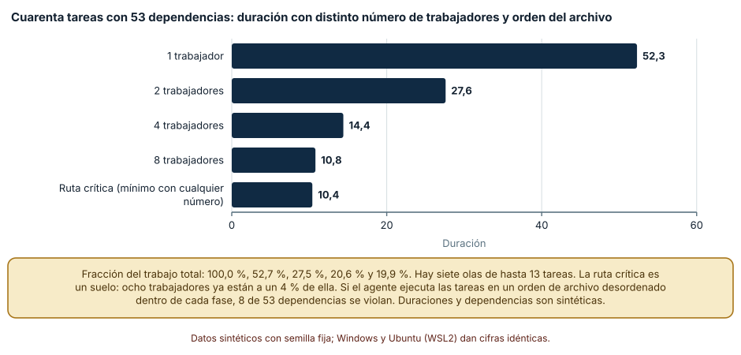

# SE-566 — Constitución, specify, clarify, plan y tasks

[← SE-565 — De la intención a la especificación durable](https://github.com/vladimiracunadev-create/modern-software-engineering-program/blob/main/classes/part-47-spec-agentes-y-ciclo-de-vida-agentic/se-565-de-la-intencion-a-la-especificacion-durable/README.md) · [↑ Parte 47](https://github.com/vladimiracunadev-create/modern-software-engineering-program/blob/main/classes/part-47-spec-agentes-y-ciclo-de-vida-agentic/README.md) · [📚 Índice completo](https://github.com/vladimiracunadev-create/modern-software-engineering-program/blob/main/classes/README.md) · [🌐 Portal](https://vladimiracunadev-create.github.io/modern-software-engineering-program/classes/SE-566.html) · [SE-567 — Implementación, análisis y convergencia contra SPEC →](https://github.com/vladimiracunadev-create/modern-software-engineering-program/blob/main/classes/part-47-spec-agentes-y-ciclo-de-vida-agentic/se-567-implementacion-analisis-y-convergencia-contra-spec/README.md)

## Punto profesional y fundamento pedagógico

**Punto profesional.** La clase existe para que veas el proceso de especificación como una cadena de artefactos con puertas entre ellos y no como un único documento que se escribe de una vez. Una constitución fija los principios que ningún plan puede violar; la especificación declara el comportamiento; la clarificación gasta un número limitado de preguntas donde más duele equivocarse; el plan decide cómo; las tareas ordenan el trabajo. La habilidad es saber qué comprueba cada puerta, qué comprobaciones se pueden automatizar con exactitud y cuáles requieren que una persona lea.

**Por qué aparece aquí.** Es la segunda clase de la **[Parte 47](../README.md)**, después de **De la intención a la especificación durable**: `SE-565` dejó una especificación con identificadores y criterios; ahora hay que convertirla en un plan y un conjunto de tareas sin perder la relación entre ellos. El caso conductor sigue siendo el **servicio de recordatorios de entrega de la plataforma educativa** (*Avisos*), un caso sintético en el que no se analizó ningún sistema, institución ni persona reales.

**Error conceptual que debe corregir.** Creer que cada artefacto es un trámite y que el plan es la especificación con más detalle. El plan introduce decisiones nuevas (una cola, un proveedor de correo, un plazo) que la especificación no contiene y que pueden contradecirla; las tareas introducen un orden que puede violar las dependencias. Las puertas existen porque los artefactos se contradicen entre sí con más frecuencia de la que cada uno se contradice a sí mismo.

**Secuencia de aprendizaje.** Antes de ver los resultados, predices cuántas de las incoherencias de una cadena de tres artefactos puede encontrar un analizador que solo lee texto; después ejecutas el analizador, repartes un presupuesto de cinco preguntas de clarificación con cuatro estrategias y planificas cuarenta tareas con dependencias. La secuencia usa predicción, contraste, explicación propia y recuperación. [ICAP](https://icap.education.asu.edu/research) distingue participación de construcción de conocimiento; [How People Learn II](https://nap.nationalacademies.org/catalog/24783/how-people-learn-ii-learners-contexts-and-cultures) respalda diseñar la práctica con contextos reales y retroalimentación.

**Evidencia de aprendizaje.** `cadena-log.md` con la predicción, las tres figuras reproducidas, la constitución de *Avisos* (tres principios), una ronda de cinco preguntas de clarificación con la razón de cada una, un plan que cite los requisitos y una lista de tareas con dependencias que pase el analizador, y una nota que separe qué parte de cada conclusión es medida, cuál inferida y cuál supuesta.

**Límite de la conclusión.** Los artefactos de ejemplo, las incoherencias inyectadas, los impactos de las ambigüedades y las duraciones de las tareas son construcciones del autor. No se ejecutó ninguna herramienta de Spec Kit ni se invocó ningún modelo: se estudian las comprobaciones que esa cadena de artefactos hace posibles, no su rendimiento con un agente real.

### Trazabilidad fuente → afirmación

| Fuente primaria u oficial | Afirmación que respalda | Lo que no prueba |
|---|---|---|
| [Spec Kit — referencia del proceso agentic](https://github.github.io/spec-kit/reference/agentic-sdd.html) | Describe la secuencia constitución, especificación, clarificación, lista de comprobación, plan, tareas, análisis, implementación y convergencia; la clarificación formula hasta cinco preguntas dirigidas y codifica las respuestas en la especificación; el análisis es de solo lectura, compara especificación, plan y tareas y se ejecuta antes de implementar; las tareas se organizan en fases (preparación, fundamentos, una por historia de usuario y cierre) con marcas de ejecución en paralelo. | No demuestra que la secuencia produzca mejores resultados; documenta una herramienta viva cuyos comandos pueden cambiar. |
| [Spec Kit — repositorio](https://github.com/github/spec-kit) | Presenta el proceso como un conjunto de plantillas y comandos sobre cualquier agente de código compatible, con extensiones opcionales. | No audita las extensiones de la comunidad. |
| [RFC 2119](https://www.rfc-editor.org/rfc/rfc2119) | Define el vocabulario normativo (DEBE, DEBERÍA) que permite escribir los principios de una constitución como obligaciones comprobables. | No decide qué principios debe tener un proyecto. |
| [Python: graphlib](https://docs.python.org/3/library/graphlib.html) | Documenta la ordenación topológica y la detección de ciclos sobre grafos de dependencias, que es la base del planificador de tareas. | No dice cuántas tareas pueden ejecutarse en paralelo en tu proyecto. |
| [Python: random](https://docs.python.org/3/library/random.html) | Documenta el generador con semilla que hace reproducibles las simulaciones. | No valida los pesos elegidos. |

## Antes de empezar

Recupera lo aprendido en `SE-565`: una ambigüedad es una decisión delegada. La pregunta activa es: **¿cuántos documentos hay entre la idea y el código en tu último proyecto (petición, diseño, ticket, tarea) y en cuántos de ellos algo contradice a otro sin que nadie lo haya comprobado?**

## Prerrequisitos

- Haber completado `SE-565` o poder escribir una especificación con identificadores y criterios comprobables.
- Python 3.11 o posterior; los experimentos usan solo la biblioteca estándar (`random`, `statistics`, `re`).
- Saber leer una dependencia entre tareas como una flecha «A necesita B» y reconocer un ciclo.

## Problema auténtico

El equipo de *Avisos* pide a su agente que genere el plan y las tareas a partir de la especificación de diez requisitos. El agente entrega un plan razonable y una lista de doce tareas. Tres semanas más tarde, durante la integración, aparecen cuatro problemas que ninguna prueba individual habría visto: el plan guarda el historial de avisos en una hoja de cálculo compartida, lo que contradice un principio del proyecto sobre datos personales; dos tareas marcadas para ejecutarse a la vez editan el mismo archivo; una tarea de silencio depende de una tarea de pruebas que a su vez depende de ella; y tres requisitos no tienen ninguna tarea que los implemente. Ninguno de estos defectos está en un artefacto; están entre ellos. La clase enseña qué puertas se ponen entre artefactos, cuáles son mecánicas y qué hacer con las que no lo son.

## Objetivos observables

Al terminar podrás:

1. explicar qué pregunta responde cada artefacto de la cadena (constitución, especificación, clarificación, plan, tareas) y qué puerta lo separa del siguiente;
2. escribir principios de constitución como obligaciones comprobables y detectar un plan que los viole;
3. repartir un presupuesto limitado de preguntas de clarificación y justificar por qué conviene empezar por la ambigüedad más cara y no por la primera del documento;
4. ordenar tareas por dependencias, calcular cuántas pueden ir en paralelo y qué ocurre si el agente las ejecuta en el orden del archivo;
5. distinguir las incoherencias que un analizador de texto encuentra de las que requieren interpretación semántica.

## Mapa conceptual


La constitución actúa sobre el plan y no al revés; la clarificación vuelve a la especificación porque su resultado es una especificación más precisa. El análisis lee los tres artefactos a la vez y manda de vuelta a quien origina el problema: un requisito ambiguo se corrige en la especificación, no en las tareas.

## Temas y por qué importan

| Tema | Por qué cambia una decisión profesional | Evidencia mínima |
|---|---|---|
| La constitución del proyecto | Fija lo que ningún plan puede decidir por comodidad. | Tres principios con una comprobación para cada uno |
| Especificar y clarificar | Las preguntas son un recurso escaso; se gastan donde un error cuesta más. | Reparto de cinco preguntas con su razón |
| El plan frente a la especificación | El plan añade decisiones; las que contradicen un requisito o un principio deben detectarse antes de codificar. | Hallazgos del analizador sobre el plan |
| Las tareas y sus dependencias | Un orden equivocado produce trabajo que falla por razones que no están en el código. | Olas, ruta crítica y violaciones por orden de archivo |
| El análisis entre artefactos | Encuentra lo que cada artefacto, leído solo, oculta. | Tabla de hallazgos por tipo |
| Qué no puede comprobar un analizador | Define dónde sigue haciendo falta una persona. | Lista de incoherencias semánticas no detectadas |

## Conceptos y decisiones

### 1. La constitución: principios que el plan no negocia

Una constitución es la lista corta de principios que todo plan debe respetar y que no se discuten en cada función. Spec Kit la trata como el conjunto de principios contra los que se evalúa cada fase posterior. Para *Avisos* bastan tres: `C1`, no se guardan datos personales fuera de la base del servicio; `C2`, no se usa telemetría de terceros; `C3`, toda tarea de código tiene antes una prueba. Dos propiedades las hacen útiles. Son **obligaciones, no aspiraciones**: «DEBE» y no «se procurará», con el sentido que fija RFC 2119. Y son **comprobables**: cada una se acompaña de una observación que podría refutarla, por ejemplo «ninguna decisión del plan menciona almacenamiento externo con datos de estudiantes». Una constitución con diez principios se ignora; con tres que se comprueban, se usa. Debe revisarse como se revisa el código: cuando un principio estorba, la respuesta correcta es cambiar el principio con una decisión registrada, no incumplirlo en silencio.

### 2. Especificar y clarificar con un presupuesto

La especificación (`SE-565`) declara el qué y el porqué. La clarificación es la fase en que el proceso formula preguntas dirigidas a las partes insuficientemente especificadas; Spec Kit limita cada ronda a cinco y codifica las respuestas en la propia especificación, de modo que el artefacto resultante ya no depende de la conversación. El límite no es un detalle de la herramienta sino una restricción útil: obliga a elegir. La pregunta no es «qué falta» sino «qué falta que, si se supone mal, sale más caro». Una ambigüedad tiene dos propiedades que importan: cuántas lecturas plausibles admite y cuánto cuesta equivocarse. La probabilidad de equivocarse al suponer es 1 menos la inversa del número de lecturas y el costo esperado es el producto de ambos. Ordenar por impacto o por costo esperado vale más que seguir el orden del documento, que refleja cuándo se le ocurrió cada cosa a quien escribió, no cuánto importa.

### 3. El plan: donde entra el cómo y donde aparecen los conflictos

El plan decide la tecnología, la arquitectura y las restricciones: una cola en SQLite, un proveedor de correo, un plazo de reintento. Al introducir decisiones nuevas, es también donde pueden aparecer cuatro tipos de conflicto. Una decisión puede **violar un principio** de la constitución. Puede **contradecir un requisito** (la especificación pide 24 horas y el plan dice 48). Puede **citar un requisito que no existe**, señal de que se escribió con una versión anterior. Y puede **dejar sin mecanismo** un requisito, algo que ningún analizador de texto ve sin interpretar el contenido. La checklist que genera Spec Kit —«pruebas unitarias para los requisitos», revisadas por una persona— existe para el último tipo: preguntas como «¿están definidas las reglas para cada columna?» no se responden por coincidencia de texto.

### 4. Las tareas: dependencias, paralelismo y orden

Las tareas convierten el plan en trabajo ordenado. Spec Kit las organiza en fases: preparación, fundamentos que bloquean lo demás, una fase por historia de usuario en orden de prioridad y un cierre; y marca las que pueden ejecutarse en paralelo. Tres propiedades se pueden comprobar con exactitud. La primera es que las dependencias formen un **grafo sin ciclos**: dos tareas que se esperan mutuamente nunca empiezan. La segunda es que el **orden de la lista respete las dependencias**: un agente que ejecuta las tareas en el orden del archivo, que es lo que cabe esperar, fallará en las que dependen de una posterior. La tercera es que las tareas marcadas como paralelas **no compartan archivos**, porque dos ediciones simultáneas del mismo archivo son un conflicto de fusión anunciado. Y una propiedad más sutil: cuántas tareas pueden ir a la vez. El límite lo fija la ruta crítica, la cadena de dependencias más larga, que ningún número de trabajadores acorta.

### 5. El análisis entre artefactos

Una vez generados los tres artefactos, el análisis los lee juntos. Spec Kit lo define como una pasada de solo lectura sobre especificación, plan y tareas que informa de conflictos, huecos y ambigüedades, sin editar nada, y recomienda ejecutarlo antes de implementar, mientras corregir es barato. Un análisis puede automatizarse en la parte formal: requisitos sin tarea, tareas sin requisito, identificadores repetidos, referencias a requisitos inexistentes, decisiones del plan que contienen términos prohibidos por la constitución, cifras que difieren entre dos decisiones sobre el mismo requisito, dependencias hacia tareas posteriores, ciclos, tareas paralelas sobre el mismo archivo y código planificado antes de su prueba. Lo que no puede automatizarse con texto es todo lo que exige entender: que «correo» en el plan y «SMS» en la especificación son canales distintos, o que un requisito de rendimiento carece de un mecanismo en el plan. Un buen análisis dice qué miró y qué no.

### 6. Volver al artefacto que causa el problema

La regla que da sentido a todo lo anterior es que un hallazgo se corrige en el artefacto de origen y no en el último que lo muestra. Un requisito ambiguo no se arregla con una tarea más detallada, porque la ambigüedad volverá a aparecer en la siguiente regeneración del plan. Si el análisis encuentra una tarea sin requisito, la pregunta es si falta un requisito o sobra una tarea. Si encuentra una decisión del plan que contradice la constitución, la pregunta es si cambia el plan o la constitución, y la segunda opción exige una decisión registrada. Corregir en el origen y regenerar lo que depende de él es más lento que parchear en el destino y es la única forma de que los tres artefactos sigan contando la misma historia.

## Un analizador de texto sobre tres artefactos

Se escribieron tres artefactos mínimos de *Avisos*: diez requisitos con tres principios de constitución, un plan de seis decisiones y doce tareas. Se inyectaron incoherencias de once tipos y se ejecutó un analizador que solo compara identificadores, términos prohibidos, cifras y dependencias.

| Tipo de hallazgo | Cuántos |
|---|---:|
| Requisito sin tarea | 3 |
| Identificador de tarea duplicado | 1 |
| Tarea con requisito inexistente | 1 |
| Tarea sin requisito | 1 |
| Plan que viola la constitución | 2 |
| Plan que cita un requisito inexistente | 1 |
| Conflicto numérico entre decisiones (24 frente a 48 horas) | 1 |
| Dependencia de una tarea posterior | 3 |
| Ciclo de dependencias | 1 |
| Tareas en paralelo sobre el mismo archivo | 1 |
| Código planificado antes de su prueba | 3 |
| **Total** | **18** |

El analizador emite 18 hallazgos. Revisados a mano, 17 son incoherencias reales; uno, el esquema de la base que se planifica antes de la prueba de la cola, es discutible, porque la regla «prueba antes del código» podría no aplicarse a un esquema. Además hay dos problemas inyectados que el analizador no ve: una decisión del plan que dice «correo» cuando el requisito pide un canal distinto, y un requisito cuyo plan no contiene ningún mecanismo. Ni los 17 aciertos ni los 2 olvidos dicen cuántas incoherencias reales hay en los proyectos de otras personas; dicen qué clase de incoherencias se encuentran leyendo identificadores y cifras, y qué clase exige entender.


**Cómo leer la figura.** Cada barra es un tipo de incoherencia y su longitud cuántos hallazgos emite el analizador. Mira primero los cuatro tipos con barras de 2 o 3: son los que aparecen varias veces; el resto es un hallazgo suelto. **Dónde deja de valer:** los artefactos y los once tipos de defecto fueron escritos por el autor con el analizador a la vista; el analizador no entiende significados, de modo que su silencio sobre un artefacto real no demuestra que sea coherente.

## Cinco preguntas para catorce ambigüedades

Se simulan 2 000 especificaciones con catorce ambigüedades cada una. Cada ambigüedad tiene un impacto (distribución lognormal) y entre 2 y 4 lecturas plausibles; el costo esperado de suponer es el impacto por la probabilidad de equivocarse. Se comparan cuatro estrategias para elegir qué ambigüedades resolver con 0, 3, 5, 8 o 14 preguntas: el orden del documento, el azar, el mayor impacto y el mayor costo esperado. La tabla es la fracción del costo esperado total que sigue sin resolver.

| Preguntas | Orden del documento | Al azar | Mayor impacto | Mayor costo esperado |
|---:|---:|---:|---:|---:|
| 0 | 100,0 % | 100,0 % | 100,0 % | 100,0 % |
| 3 | 78,7 % | 78,5 % | 46,4 % | 45,8 % |
| 5 | 64,3 % | 64,5 % | 29,8 % | 29,3 % |
| 8 | 42,8 % | 43,1 % | 14,0 % | 13,6 % |
| 14 | 0,0 % | 0,0 % | 0,0 % | 0,0 % |

Con cinco preguntas, el orden del documento deja sin resolver el 64,3 % del costo esperado, igual que el azar (64,5 %); elegir por impacto lo deja en 29,8 % y por costo esperado en 29,3 %. La diferencia entre las dos últimas estrategias es pequeña, porque el impacto domina la variación; la que importa es la que separa «ordenar» de «no ordenar». Que el orden del documento y el azar coincidan es la lectura clave: el orden en que alguien escribió no contiene información sobre cuánto importa.


**Cómo leer la figura.** El eje horizontal son las preguntas hechas y el vertical el costo esperado que queda sin resolver; cada línea es una estrategia de orden. Mira primero que las líneas gris y dorada, orden del documento y azar, casi coinciden y quedan por encima de las otras dos. **Dónde deja de valer:** los impactos lognormales, el reparto de 2 a 4 lecturas y la independencia entre ambigüedades son supuestos del autor, y en la práctica el impacto no se conoce con tanta limpieza: estimarlo es parte del trabajo de quien conoce el dominio.

## Cuarenta tareas con dependencias

Se generaron 40 tareas en seis fases (preparación, fundamentos, tres historias y cierre) con 53 dependencias y duraciones lognormales (mediana 1). Se calcularon las olas (grupos de tareas que pueden empezar a la vez), la ruta crítica y la duración total con 1, 2, 4 y 8 trabajadores con una planificación por lista. Después se barajó el orden de las tareas dentro de cada fase, como podría entregarlas un agente que no ordena, y se contaron las dependencias que el orden del archivo viola.

| Trabajadores | Duración total | Fracción del trabajo total |
|---:|---:|---:|
| 1 | 52,3 | 100,0 % |
| 2 | 27,6 | 52,7 % |
| 4 | 14,4 | 27,5 % |
| 8 | 10,8 | 20,6 % |

Hay 7 olas y la más ancha tiene 13 tareas. La ruta crítica es de 10,4 y es un suelo: con 8 trabajadores la duración, 10,8, ya está a un 4 % del suelo, y los 4 trabajadores adicionales sobre 4 compran 3,6 unidades. Con el orden del archivo desordenado dentro de cada fase, 8 de las 53 dependencias se violan y 8 tareas empiezan sin su dependencia.



**Cómo leer la figura.** Cada barra es un número de trabajadores y su longitud la duración; la última es la ruta crítica, el mínimo con cualquier número. Mira primero cómo las barras se acortan cada vez menos al duplicar los trabajadores y se pegan a la ruta crítica; las dependencias violadas por un orden desordenado están en la nota. **Dónde deja de valer:** las duraciones lognormales, la estructura de dependencias generada al azar y el reparto de las tareas por fases son supuestos del autor; un agente no es un trabajador de capacidad constante y las tareas reales tienen costos de coordinación que la simulación no incluye.

## Definiciones de trabajo

- **[constitución](../../../glosario/entradas/c/constitucion.md):** conjunto corto de principios obligatorios y comprobables contra los que se evalúa cada fase posterior del proceso.
- **[clarificación](../../../glosario/entradas/c/clarificacion.md):** ronda de preguntas dirigidas sobre las partes insuficientemente especificadas cuyas respuestas se codifican en la especificación.
- **[plan](../../../glosario/entradas/p/plan.md):** artefacto que decide cómo se construye (tecnología, arquitectura, restricciones) y que debe citar los requisitos que satisface.
- **[tarea](../../../glosario/entradas/t/tarea.md):** unidad de trabajo ordenada, con dependencias, archivos afectados y, si procede, marca de ejecución en paralelo.
- **[ruta crítica](../../../glosario/entradas/r/ruta-critica.md):** cadena de dependencias de mayor duración; fija el mínimo de tiempo con cualquier número de trabajadores.
- **[análisis entre artefactos](../../../glosario/entradas/a/analisis-entre-artefactos.md):** lectura conjunta de especificación, plan y tareas que informa de conflictos y huecos sin modificar nada.

Las definiciones son operativas para el servicio *Avisos*. No convierten términos con una historia más amplia en sinónimos y deben contrastarse con la documentación primaria enlazada al final.

## Ejemplo mínimo

El fragmento muestra una puerta mecánica entre plan y constitución. Antes de ejecutarlo, predice cuántas decisiones marca.

```python
PROHIBIDO = ("hoja de cálculo externa", "telemetría de terceros")
plan = ["cola en SQLite", "registro en hoja de cálculo externa", "métricas con telemetría de terceros"]
print([d for d in plan if any(p in d for p in PROHIBIDO)])
```

Marca dos. Reescribe después la segunda decisión con otras palabras («registro en un libro compartido en la nube») y observa que el comprobador no la ve. Registra versión de Python, comando y salida; esa es la frontera entre lo que se comprueba por coincidencia y lo que exige leer.

## Ejemplo profesional

Escenario hipotético, construido para la clase y sin datos reales. El equipo de *Avisos* escribe la constitución con tres principios, genera la especificación de diez requisitos y ejecuta una ronda de clarificación. Estima el impacto de las ambigüedades abiertas y elige las cinco más caras: qué ocurre con el aviso de una hora si el de 24 no se envió, si el silencio vale por entrega o global, si el cambio de vencimiento reabre umbrales, qué cuenta como «entregada» cuando el docente revierte una entrega y si el canal que falla se reintenta indefinidamente. Las respuestas se codifican en la especificación. El plan que sale cita los requisitos en cada decisión; el analizador encuentra que una decisión usa una hoja de cálculo para el historial y que el plan dice 48 horas donde el requisito dice 24. El equipo corrige el plan en el origen —no el requisito—, regenera las tareas y vuelve a pasar el análisis, que ahora emite un solo aviso: dos tareas paralelas sobre el mismo archivo, que se separan. Antes de implementar queda una lista de lo que el análisis no comprobó, entre ellas la adecuación del canal elegido, que revisa una persona. Compara con el estado inicial: antes se descubrían las incoherencias en la integración; ahora se descubren antes de escribir código.

## Práctica guiada

1. Escribe una constitución de tres principios para un proyecto propio, cada uno con una observación que pueda refutarlo.
2. Predice qué fracción del costo esperado quedará sin resolver con cinco preguntas si eliges por orden del documento; escribe el número antes de simular.
3. Ejecuta `python scripts/experiments_part47_a.py 470` y reproduce las tres tablas; cambia el número de preguntas a ocho y compara estrategias.
4. Genera el plan y las tareas de *Avisos* (a mano o con un asistente) y pasa el analizador; corrige cada hallazgo en el artefacto de origen.
5. Dibuja las olas de tus tareas y calcula la ruta crítica; decide cuántos trabajadores justifican la ruta crítica que tienes.
6. Añade a propósito una decisión del plan que viole un principio con otras palabras y comprueba que el analizador no la ve; escribe qué comprobación humana la encontraría.
7. Entrega `cadena-log.md` y pide a otra persona que lea la constitución y el plan sin ver tu análisis.

## Ejercicios

1. **Constitución:** reescribe «se procurará proteger los datos de los estudiantes» como una obligación comprobable y escribe la observación que la refutaría.
2. **Presupuesto:** con cuatro preguntas y seis ambigüedades de impactos 8, 5, 3, 3, 2 y 1, y lecturas 2, 4, 2, 3, 2 y 2, elige las cuatro que resuelves y calcula el costo esperado que queda.
3. **Orden:** dadas las tareas A→B, B→C, A→D y D→C, escribe un orden válido, la ruta crítica con duraciones unitarias y un orden de archivo que un agente podría seguir y que viola una dependencia.
4. **Límite del análisis:** escribe una incoherencia entre especificación y plan que un analizador de identificadores y cifras no puede ver y di qué haría una persona para encontrarla.

## Reto verificable

Entrega `cadena-log.md` con la predicción, las tres tablas, la constitución de tres principios, la ronda de cinco preguntas con su razón, un plan que cite requisitos, una lista de tareas que pase el analizador y la lista de lo que el análisis no cubre. Se aprueba si otra persona ejecuta el código desde un checkout limpio, obtiene los mismos números con las mismas semillas y puede decir qué corregiría primero y en qué artefacto. No se aprueba por entregar un plan que cita requisitos copiados sin leerlos ni por afirmar que el analizador demuestra la coherencia de la cadena.

## Caso conductor

El servicio *Avisos* es el caso conductor de la [Parte 47](../README.md). Esta clase deja el segundo artefacto: la constitución, la ronda de clarificación, el plan y las tareas. `SE-567` implementará esas tareas y medirá cuándo la implementación converge contra la especificación, y `SE-568` repetirá el recorrido en proyectos con código previo y en arreglos de errores. Cambia después un solo dato, el número de preguntas disponibles, y observa a partir de cuántas la estrategia deja de importar.

## Preguntas frecuentes

### ¿La constitución es lo mismo que las normas del equipo?

Se parece, pero se usa distinto: la constitución es la lista corta de principios que un plan debe respetar y que se comprueban en una puerta concreta del proceso. Las normas del equipo pueden ser muchas y generales. Si tienes veinte, elige las tres cuya violación sería más cara y comprueba esas.

### ¿Por qué limitar las preguntas de clarificación a cinco?

Porque las preguntas cuestan atención de quien responde y cada respuesta debe poder codificarse en la especificación. Con un límite, las preguntas se eligen; sin él, se hacen todas y la persona deja de leer. Si cinco no bastan, se repite la ronda con otro foco, como permite el proceso.

### ¿Puede el agente ejecutar el análisis y corregir lo que encuentra?

Puede ejecutarlo; conviene que la corrección sea una decisión de una persona cuando el hallazgo toca un principio, un requisito o un orden de prioridad. El análisis de Spec Kit es de solo lectura precisamente para que quien corrige sea una acción distinta y visible.

### ¿Qué pasa si el plan contradice la constitución y el plan es mejor?

Entonces la constitución está desactualizada o mal formulada. Cámbiala con una decisión registrada (fecha, razón, alternativa) y regenera lo que dependa de ella. Lo que no debe ocurrir es incumplirla en silencio, porque entonces nadie sabrá qué principios están vigentes.

## Fallo controlado y diagnóstico

Reproduce el fallo clásico de la clase: **dos artefactos que se contradicen y ninguno por separado es incorrecto**. Escribe un plan con «reintentar durante 48 horas» para un requisito que dice 24 y pasa el analizador.

Registra síntoma, entrada mínima, hipótesis, observación que descarta cada hipótesis, causa, corrección y prueba de regresión. **Síntoma:** el servicio reenvía avisos a estudiantes durante dos días cuando la especificación decía uno. **Hipótesis rivales:** (a) el agente implementó mal el plan; (b) el requisito era ambiguo; (c) el plan decidió un valor distinto del requisito y nadie comparó los dos. **Prueba:** extrae las cifras de cada artefacto para el mismo identificador; si difieren, la causa es el plan. **Conclusión:** la corrección es una decisión de a quién se le da la razón (plan o requisito) y se hace en el artefacto de origen. **Regresión:** añade al analizador la comparación de cifras por identificador y una prueba que falle si el plan y la especificación discrepan. No cambies a la vez el requisito y el plan.

## Errores comunes y cómo corregirlos

| Síntoma | Causa probable | Corrección |
|---|---|---|
| El plan introduce tecnología que la organización no permite | La constitución no existe o no se comprueba | Escribir tres principios comprobables y evaluarlos al generar el plan |
| Se hacen veinte preguntas y se contestan tres | No hay presupuesto ni orden | Limitar la ronda y ordenar por costo esperado |
| Las tareas fallan por falta de algo que otra tarea crea | Dependencias no declaradas o orden de archivo incoherente | Comprobar ciclos y el orden antes de implementar |
| Dos tareas «paralelas» producen un conflicto de fusión | Comparten un archivo | Declarar los archivos por tarea y comprobar solapamientos |
| El análisis sale limpio y la integración falla | Se confió en un analizador de texto para lo semántico | Declarar lo que el análisis no cubre y revisarlo a mano |

## Entorno y archivos clave

```text
work/SE-566/
├── README.md
├── constitucion.md
├── spec/spec.md
├── plan/plan.md
├── tareas/tareas.md
├── analisis/
│   ├── analizador.py
│   ├── preguntas.py
│   └── planificador.py
└── evidence/cadena-log.md
```

El `README` declara plataforma, versión de Python, semillas y comandos. Los experimentos usan solo la biblioteca estándar y se ejecutaron con CPython 3.12.9 en Windows 11 y 3.12.3 en Ubuntu bajo WSL2: las salidas fueron idénticas. Si usas Spec Kit, fija la versión que instalas y revisa las extensiones antes de ejecutarlas.

## Seguridad, ética y accesibilidad

- los artefactos pueden contener datos personales en los ejemplos o decisiones sobre quién recibe avisos: usa datos sintéticos y revisa lo que compartes con un agente alojado fuera de tu entorno;
- una constitución es una política: quien la escribe decide qué se protege; registra quién la aprueba y cada cuánto se revisa;
- un presupuesto de preguntas favorece a quien es consultado: si solo responde el equipo técnico, las ambigüedades que afectan a las personas usuarias se resuelven sin ellas; incluye a quien recibe los avisos en la ronda;
- las tablas y figuras deben tener texto alternativo y no depender del color; los hallazgos se distinguen por texto;
- las herramientas citadas tienen licencias y sus extensiones de la comunidad no están auditadas: revisa el código antes de ejecutarlo.

## Puente hacia el trabajo con agentes

Pedirle a un agente «genera el plan y las tareas» produce artefactos plausibles que cada uno cita al otro sin que nadie los compare. Pídele en cambio que cada decisión del plan cite el identificador del requisito que satisface y el principio de la constitución que respeta, que cada tarea declare sus archivos y sus dependencias y que liste los requisitos que no pudo cubrir. Pasa después tu propio analizador, que no comparte contexto con el agente, y revisa a mano lo que el analizador no ve. Si el agente propone cambiar la constitución para que el plan encaje, trátalo como una decisión que toma una persona, no como una corrección técnica.

## Transferencia

Traslada el análisis a otro dominio (por ejemplo, un sistema de turnos para una biblioteca con avisos de devolución): cambia la constitución, los requisitos y las tareas y conserva el procedimiento de comprobar el plan contra los principios, ordenar las preguntas por costo esperado y planificar las tareas por dependencias. La transferencia está lograda cuando puedes decir qué incoherencias de ese dominio no las encontraría un analizador de texto, no cuando las cifras se parecen a las de *Avisos*.

## Evaluación y evidencia

| Criterio | Evidencia para aprobar |
|---|---|
| comprensión | explicación de qué comprueba cada puerta y de por qué los hallazgos se corrigen en el origen |
| corrección | tablas del analizador, del presupuesto y de las tareas reproducibles con las mismas semillas |
| diseño | constitución de tres principios, ronda de cinco preguntas razonada, plan que cita requisitos y tareas con dependencias |
| diagnóstico | reproducción del fallo «dos artefactos que se contradicen» con regresión |
| incertidumbre | declaración de que los artefactos, los defectos, los impactos y las duraciones son del autor |
| reproducibilidad | versiones, comandos, salida y límites declarados |

## Fuentes

- [Spec Kit — referencia del proceso agentic](https://github.github.io/spec-kit/reference/agentic-sdd.html) — secuencia de comandos, clarificación, análisis y tareas; autoridad: GitHub y mantenedores de la comunidad.
- [Spec Kit — repositorio](https://github.com/github/spec-kit) — plantillas, extensiones y catálogos; autoridad: GitHub y mantenedores.
- [RFC 2119](https://www.rfc-editor.org/rfc/rfc2119) — vocabulario normativo; autoridad: IETF.
- [Python: graphlib](https://docs.python.org/3/library/graphlib.html) y [random](https://docs.python.org/3/library/random.html) — ordenación topológica y generador con semilla; autoridad: documentación de Python.

Cada fuente respalda el mecanismo indicado; ninguna demuestra que el 29,3 % de costo sin resolver con cinco preguntas, los 18 hallazgos del analizador o la ruta crítica de 10,4 se observen en un proyecto real. Esa afirmación depende del equipo, de las especificaciones y del grafo de tareas.

## Límites y siguiente paso

Se ejecutaron tres experimentos con datos sintéticos en Windows y Ubuntu (WSL2) con resultados idénticos; no se ejecutó ninguna herramienta de Spec Kit, no se invocó ningún modelo de lenguaje ni se observó ningún equipo o sistema reales. Los artefactos, las incoherencias inyectadas, los impactos, las lecturas por ambigüedad, las duraciones y las dependencias son construcciones del autor, y el analizador se escribió conociendo los defectos que debe encontrar. La siguiente clase implementa las tareas y pregunta cuándo se puede decir que la implementación converge contra la especificación.

## Glosario

- **[constitución](../../../glosario/entradas/c/constitucion.md):** conjunto corto de principios obligatorios y comprobables contra los que se evalúa cada fase posterior del proceso.
- **[clarificación](../../../glosario/entradas/c/clarificacion.md):** ronda de preguntas dirigidas sobre las partes insuficientemente especificadas cuyas respuestas se codifican en la especificación.
- **[plan](../../../glosario/entradas/p/plan.md):** artefacto que decide cómo se construye (tecnología, arquitectura, restricciones) y que debe citar los requisitos que satisface.
- **[tarea](../../../glosario/entradas/t/tarea.md):** unidad de trabajo ordenada, con dependencias, archivos afectados y, si procede, marca de ejecución en paralelo.
- **[ruta crítica](../../../glosario/entradas/r/ruta-critica.md):** cadena de dependencias de mayor duración; fija el mínimo de tiempo con cualquier número de trabajadores.
- **[análisis entre artefactos](../../../glosario/entradas/a/analisis-entre-artefactos.md):** lectura conjunta de especificación, plan y tareas que informa de conflictos y huecos sin modificar nada.

Conceptos de esta clase en el [glosario del programa](../../../glosario/README.md): [Análisis entre artefactos](../../../glosario/entradas/a/analisis-entre-artefactos.md) · [Clarificación](../../../glosario/entradas/c/clarificacion.md) · [Constitución](../../../glosario/entradas/c/constitucion.md) · [Plan](../../../glosario/entradas/p/plan.md) · [Ruta crítica](../../../glosario/entradas/r/ruta-critica.md) · [Tarea](../../../glosario/entradas/t/tarea.md).

---

[← SE-565 — De la intención a la especificación durable](https://github.com/vladimiracunadev-create/modern-software-engineering-program/blob/main/classes/part-47-spec-agentes-y-ciclo-de-vida-agentic/se-565-de-la-intencion-a-la-especificacion-durable/README.md) · [↑ Parte 47](https://github.com/vladimiracunadev-create/modern-software-engineering-program/blob/main/classes/part-47-spec-agentes-y-ciclo-de-vida-agentic/README.md) · [📚 Índice completo](https://github.com/vladimiracunadev-create/modern-software-engineering-program/blob/main/classes/README.md) · [🌐 Portal](https://vladimiracunadev-create.github.io/modern-software-engineering-program/classes/SE-566.html) · [SE-567 — Implementación, análisis y convergencia contra SPEC →](https://github.com/vladimiracunadev-create/modern-software-engineering-program/blob/main/classes/part-47-spec-agentes-y-ciclo-de-vida-agentic/se-567-implementacion-analisis-y-convergencia-contra-spec/README.md)
