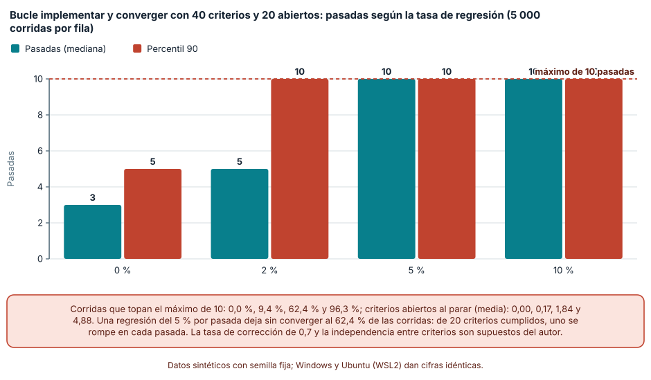
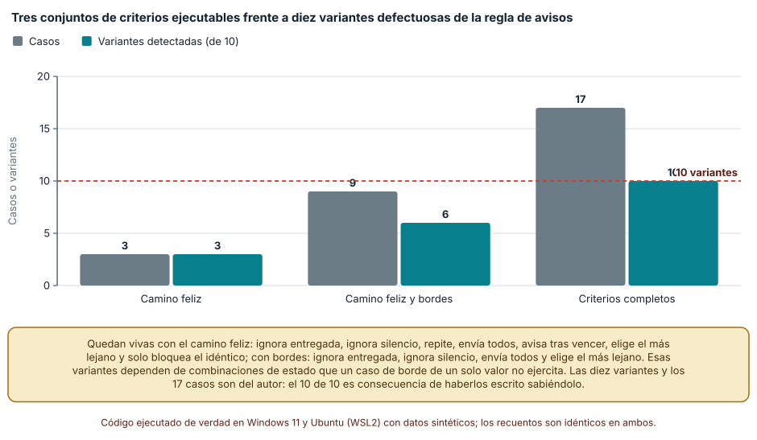

# SE-567 — Implementación, análisis y convergencia contra SPEC

[← SE-566 — Constitución, specify, clarify, plan y tasks](https://github.com/vladimiracunadev-create/modern-software-engineering-program/blob/main/classes/part-47-spec-agentes-y-ciclo-de-vida-agentic/se-566-constitucion-specify-clarify-plan-y-tasks/README.md) · [↑ Parte 47](https://github.com/vladimiracunadev-create/modern-software-engineering-program/blob/main/classes/part-47-spec-agentes-y-ciclo-de-vida-agentic/README.md) · [📚 Índice completo](https://github.com/vladimiracunadev-create/modern-software-engineering-program/blob/main/classes/README.md) · [🌐 Portal](https://vladimiracunadev-create.github.io/modern-software-engineering-program/classes/SE-567.html) · [SE-568 — Greenfield, brownfield, bug fixing e idea assessment →](https://github.com/vladimiracunadev-create/modern-software-engineering-program/blob/main/classes/part-47-spec-agentes-y-ciclo-de-vida-agentic/se-568-greenfield-brownfield-bug-fixing-e-idea-assessment/README.md)

## Punto profesional y fundamento pedagógico

**Punto profesional.** La clase existe para que dejes de aceptar «terminé» como una medida. Un agente que implementa unas tareas dice haber terminado en el momento en que su propio criterio se lo indica; ese criterio es, por construcción, el mismo que usó para construir. La habilidad es definir qué significa que una implementación converge contra su especificación, quién lo comprueba, cuántas pasadas se permiten, qué se hace cuando una pasada rompe lo que la anterior arregló y cuándo se detiene el bucle y se llama a una persona.

**Por qué aparece aquí.** Es la tercera clase de la **[Parte 47](../README.md)**, después de **Constitución, specify, clarify, plan y tasks**: `SE-566` produjo una cadena de artefactos sin incoherencias formales; ahora las tareas se ejecutan. El caso conductor sigue siendo el **servicio de recordatorios de entrega** (*Avisos*), un caso sintético en el que no se analizó ningún sistema, institución ni persona reales.

**Error conceptual que debe corregir.** Creer que si el agente ejecuta todas las tareas y sus pruebas pasan, la implementación cumple la especificación. Las tareas son una descomposición, no el requisito; las pruebas del agente comprueban lo que el agente entendió. Entre «todas las tareas hechas» y «todos los criterios cumplidos» hay un hueco que se mide, no se supone.

**Secuencia de aprendizaje.** Antes de ver los resultados, predices cuántas pasadas de implementar y revisar necesita un agente que corrige el 70 % de lo abierto en cada una y rompe un 5 % de lo que ya estaba bien; después simulas el bucle con cuatro tasas de regresión, mides cuántas veces un agente «declara» convergencia con criterios aún abiertos cuando su verificador solo ve una parte, y ejecutas una especificación como pruebas contra diez variantes defectuosas del servicio. La secuencia usa predicción, contraste, explicación propia y recuperación. [ICAP](https://icap.education.asu.edu/research) distingue participación de construcción de conocimiento; [How People Learn II](https://nap.nationalacademies.org/catalog/24783/how-people-learn-ii-learners-contexts-and-cultures) respalda diseñar la práctica con contextos reales y retroalimentación.

**Evidencia de aprendizaje.** `convergencia-log.md` con la predicción, las tres figuras reproducidas, las condiciones de parada de *Avisos* con su razón, la especificación convertida en criterios ejecutables y una nota que separe qué parte de cada conclusión es medida, cuál inferida y cuál supuesta.

**Límite de la conclusión.** La tasa de corrección, la tasa de regresión, el número de criterios, la cobertura del verificador y las diez variantes defectuosas son construcciones del autor con semilla fija. No se invocó ningún modelo ni se ejecutó `/speckit.converge`: la simulación estudia la dinámica de un bucle de corrección con un verificador, no el comportamiento de un agente real.

### Trazabilidad fuente → afirmación

| Fuente primaria u oficial | Afirmación que respalda | Lo que no prueba |
|---|---|---|
| [Spec Kit — referencia del proceso agentic](https://github.github.io/spec-kit/reference/agentic-sdd.html) | Describe `converge` como una evaluación del código frente a especificación, plan y tareas que solo añade tareas pendientes (no edita ni borra código) y que concluye en «convergido» o en tareas añadidas; se repite implementar y converger hasta que informe convergencia. | No fija cuántas pasadas bastan ni demuestra que la convergencia declarada implique cumplimiento. |
| [Anthropic: «Building effective agents»](https://www.anthropic.com/engineering/building-effective-agents) | Señala que los agentes obtienen «verdad del entorno» en cada paso (resultados de herramientas, ejecución de código) y que es habitual incluir condiciones de parada, como un máximo de iteraciones, para mantener el control. | No dice cuáles son las condiciones adecuadas para tu tarea. |
| [Jia y Harman, «An analysis and survey of the development of mutation testing»](https://doi.org/10.1109/TSE.2010.62) | Describe la prueba de mutación como medida de la capacidad de un conjunto de pruebas para detectar defectos introducidos. | No dice qué operadores de mutación representan los defectos de un agente. |
| [NIST AI RMF](https://www.nist.gov/itl/ai-risk-management-framework) | Distingue gobernar, mapear, medir y gestionar el riesgo de sistemas de IA; la medición independiente de lo que el sistema hace es parte de gestionarlo. | No define umbrales de convergencia para software generado. |
| [Python: random](https://docs.python.org/3/library/random.html) | Documenta el generador con semilla que hace reproducibles las simulaciones. | No valida los parámetros elegidos. |

## Antes de empezar

Recupera lo aprendido en `SE-566`: los hallazgos se corrigen en el artefacto de origen. La pregunta activa es: **¿en tu último proyecto con un asistente, quién decidió que la tarea estaba terminada y con qué evidencia que el propio asistente no hubiera producido?**

## Prerrequisitos

- Haber completado `SE-566` o poder describir una cadena especificación → plan → tareas con dependencias.
- Python 3.11 o posterior; los experimentos usan solo la biblioteca estándar (`random`, `statistics`).
- Saber leer una prueba como una función que devuelve verdadero o falso y la idea de mutante: una copia del código con un defecto introducido.

## Problema auténtico

El agente de *Avisos* completa las doce tareas del plan, ejecuta sus pruebas, que pasan, y escribe en su informe «todos los requisitos cumplidos». Una revisión independiente que ejecuta los diecisiete criterios de la especificación contra el servicio encuentra tres incumplimientos: el aviso de una hora se envía aunque ya se hubiera enviado el de 24; el silencio no se respeta si el estudiante lo activó con mayúscula inicial; y tras una caída se envían los tres avisos a la vez. El equipo repite la pasada y el agente corrige los tres, pero rompe un caso de borde que antes funcionaba. Una tercera pasada lo repara y rompe otro. La pregunta del equipo es cuándo parar: ¿cuando el agente dice que acabó?, ¿tras tres pasadas?, ¿cuando una revisión independiente no encuentra nada? La clase enseña a contestarla con una condición de parada explícita y un verificador que no comparte el punto de vista del agente.

## Objetivos observables

Al terminar podrás:

1. explicar el ciclo implementar → converger y la regla de que la convergencia solo añade trabajo pendiente y no modifica código;
2. definir condiciones de parada explícitas (convergencia, número máximo de pasadas, sin progreso, presupuesto, regresiones) y la acción de cada una;
3. simular la dinámica de un bucle de corrección con regresiones y reconocer en qué régimen no converge;
4. medir cómo la cobertura de un verificador separa lo que el agente declara de lo que realmente se cumple;
5. convertir una especificación en criterios ejecutables y evaluar su capacidad de detección con variantes defectuosas.

## Mapa conceptual


El verificador es independiente del agente que implementa y su salida solo puede ser «convergido» o «tareas añadidas». La condición de parada observa el historial de pasadas, no la afirmación del agente.

## Temas y por qué importan

| Tema | Por qué cambia una decisión profesional | Evidencia mínima |
|---|---|---|
| Implementar por fases con control | Ejecutar todo de una vez oculta en qué tarea se rompió algo. | Plan de fases con una comprobación al final de cada una |
| Qué es converger | Sin una definición, «terminado» es una opinión. | Lista de criterios ejecutables de *Avisos* |
| Un verificador que solo añade | Separar quien corrige de quien juzga evita que el juez se corrija a sí mismo. | Regla: el verificador no edita código |
| Dinámica del bucle y regresiones | Un bucle con regresiones puede no converger nunca. | Tabla de pasadas por tasa de regresión |
| Declaración propia frente a verificación | Un verificador parcial produce convergencias falsas. | Tabla de cobertura del verificador y convergencias falsas |
| Capacidad de detección de los criterios | Unos criterios que no detectan variantes defectuosas no protegen nada. | Mutantes detectados por tres conjuntos de criterios |

## Conceptos y decisiones

### 1. Implementar por fases, con una comprobación entre ellas

Spec Kit recomienda, para una funcionalidad grande, acotar cada ejecución de la implementación (primero preparación y fundamentos, luego una historia de usuario) y validar el resultado antes de continuar. La razón es práctica: una ejecución que cubre todo mezcla en un solo conjunto de cambios los efectos de decisiones distintas y, si algo falla, no se sabe qué tarea lo rompió. Con fases, cada comprobación tiene un conjunto pequeño de sospechosos. Además hay un límite de contexto: un agente que lleva muchas tareas en la misma conversación acumula suposiciones que ya no se pueden revisar una a una. Cada fase es un punto en que se puede detener, mirar y, si hace falta, volver al artefacto anterior.

### 2. Qué significa converger

Converger es que un verificador independiente, aplicado al código actual, no encuentre ningún criterio de la especificación sin cumplir. La definición tiene tres partes. **Qué se verifica**: los criterios de la especificación, no las tareas ni las pruebas del agente. **Quién verifica**: un procedimiento que no comparte el contexto del implementador —otra ejecución, un conjunto de pruebas escrito antes de implementar, una persona—. **Qué produce**: una lista de criterios cumplidos y no cumplidos con la evidencia de cada uno. En `converge`, Spec Kit evalúa el código frente a especificación, plan y tareas y devuelve «convergido» o añade las tareas que faltan en una sección propia; la salida alimenta la siguiente pasada. Que el verificador solo añada tareas y no toque el código es una decisión de diseño con una razón: quien juzga y quien corrige no deben ser la misma acción, o el juicio se convierte en una autocorrección que nadie observa.

### 3. Condiciones de parada

Un bucle sin condición de parada se detiene cuando se acaba el dinero o la paciencia. Las condiciones explícitas más útiles son cinco. **Convergencia**: el verificador no encuentra nada y se acaba bien. **Máximo de pasadas**: tras N pasadas se detiene aunque haya criterios abiertos; es la condición que la guía de Anthropic cita como habitual para mantener el control. **Sin progreso**: el número de criterios abiertos no baja en dos pasadas seguidas. **Presupuesto**: un tope de tokens, tiempo o dinero. **Regresión**: una pasada reabre criterios que estaban cumplidos, lo que indica que el agente está deshaciendo su propio trabajo. En todos los casos distintos de la convergencia, la acción es la misma: detener, guardar el estado y llamar a una persona con la lista de lo abierto. Detener no es fracasar; es el comportamiento que evita que un bucle gaste un día de cómputo en un problema que no entiende.

### 4. La dinámica del bucle: qué pasa cuando corregir rompe

Un modelo mínimo basta para ver el comportamiento. En cada pasada el agente corrige cada criterio abierto con probabilidad `p` y cada criterio ya cumplido se rompe con probabilidad `q`. Si `q` es cero, el número de abiertos baja geométricamente: con `p` de 0,7, tres pasadas dejan abierta una fracción del 2,7 % de lo que había. Si `q` es positivo hay un equilibrio en el que lo que se arregla en cada pasada iguala lo que se rompe, y el bucle se queda en un número de abiertos distinto de cero. Ese equilibrio crece con `q` y con el número de criterios ya cumplidos: un conjunto grande de criterios amplifica una pequeña tasa de regresión. Este mecanismo explica por qué las pasadas se sienten «casi terminadas» durante mucho tiempo y por qué una condición de máximo de pasadas debe existir.

### 5. Declarar y verificar: el efecto de la cobertura

Un agente verifica con lo que ve. Si su verificador cubre el 100 % de los criterios, su declaración es fiable aunque pueda tardar en llegar. Si cubre una fracción, los criterios que no ve nunca se corrigen, porque nadie sabe que están abiertos, y el agente declara convergencia cuando su parte visible está limpia. La consecuencia es contraintuitiva: cuanto peor es el verificador, **antes** declara convergencia, porque tiene menos que corregir. La declaración propia crece con la ceguera. Por eso la cobertura del verificador debe medirse, y por eso conviene que los criterios existan antes de implementar y sean ejecutables por una parte distinta del agente.

### 6. Criterios ejecutables y capacidad de detección

Convertir la especificación en pruebas es necesario y no suficiente: lo que importa es qué defectos detectan. La prueba de mutación lo mide introduciendo defectos deliberados en el código y contando cuántos hace fallar el conjunto de pruebas (Jia y Harman). Los criterios del camino feliz, que son los que primero se escriben, detectan pocas variantes; añadir los casos de borde sube la tasa; los criterios completos de la especificación, que incluyen combinaciones de estado, detectan todas las variantes de este ejemplo. No hay un número mágico: la tasa de detección es una propiedad de los criterios y debe medirse, no suponerse. Un conjunto que no detecta una variante defectuosa no puede decirle al agente que la corrija.

## Una simulación del bucle implementar y converger

Se simulan 5 000 corridas por fila. Hay 40 criterios, 20 abiertos al empezar; en cada pasada el agente corrige un criterio abierto con probabilidad 0,7 y rompe uno cumplido con la probabilidad `q` indicada; el máximo es de 10 pasadas.

| Regresión por pasada (`q`) | Pasadas (mediana) | Percentil 90 | Topan el máximo de 10 | Abiertos al parar (media) |
|---:|---:|---:|---:|---:|
| 0 % | 3 | 5 | 0,0 % | 0,00 |
| 2 % | 5 | 10 | 9,4 % | 0,17 |
| 5 % | 10 | 10 | 62,4 % | 1,84 |
| 10 % | 10 | 10 | 96,3 % | 4,88 |

Sin regresión, la mediana es de 3 pasadas y ninguna corrida toca el máximo. Con un 2 %, la mediana sube a 5 y el 9,4 % no converge en diez. Con un 5 %, la mediana es el máximo y el 62,4 % no converge. Con un 10 %, el 96,3 % termina el presupuesto de pasadas con unos 4,9 criterios abiertos de media. Una tasa de regresión que parece pequeña (5 % por criterio y pasada) significa que, de 20 criterios cumplidos, uno se rompe en cada pasada.



**Cómo leer la figura.** Cada grupo es una tasa de regresión; la barra verde es la mediana de pasadas y la roja el percentil 90, con una línea en el máximo de 10. Mira primero cuántas barras llegan a la línea: con 5 % de regresión la mediana ya topa el máximo; las corridas que lo topan están en la nota. **Dónde deja de valer:** la independencia entre criterios, la tasa de corrección constante de 0,7 y el modelo de regresión uniforme son supuestos del autor; en un sistema real las regresiones se concentran en los criterios que comparten código, y la tasa de corrección baja a medida que los casos abiertos son más difíciles.

## Cuando el verificador solo ve una parte

Se repite la simulación con una tasa de regresión del 2 % y un verificador que solo ve una fracción de los criterios (la cobertura). El agente corrige solo lo que ve y declara convergencia cuando no ve ningún criterio abierto. Se mide cuántas corridas declaran convergencia, cuántas de ellas lo hacen con criterios realmente abiertos y cuántos son de media.

| Cobertura del verificador | Declara «convergido» | …con criterios aún abiertos | Abiertos reales al declarar (media) |
|---:|---:|---:|---:|
| 100 % | 90,7 % | 0,0 % | 0,0 |
| 80 % | 94,5 % | 93,7 % | 4,4 |
| 50 % | 98,9 % | 98,9 % | 10,7 |
| 30 % | 99,9 % | 99,9 % | 14,8 |

Con una cobertura completa, el 90,7 % de las corridas declara convergencia en diez pasadas y ninguna lo hace con criterios abiertos. Con el 80 % de cobertura, el 94,5 % declara y el 93,7 % de **todas** las corridas declara con criterios abiertos, unos 4,4 de media. Con el 30 %, casi todas declaran y quedan 14,8 criterios abiertos de 40. Cuanto menor es la cobertura, más corridas declaran convergencia y más criterios incumplidos esconden esas declaraciones.


**Cómo leer la figura.** Cada grupo es una cobertura del verificador; la barra dorada es la fracción de corridas que declaran convergencia y la roja la de las que declaran con criterios aún abiertos. Mira primero cómo la roja, inexistente con cobertura total, se iguala a la dorada al bajar la cobertura. **Dónde deja de valer:** los criterios que el verificador no ve se eligen al azar y por igual, el agente nunca corrige lo que no ve y no hay efectos colaterales que corrijan los ocultos por casualidad; con criterios reales los invisibles suelen ser los más difíciles de probar, de modo que el resultado sería peor.

## Criterios ejecutables contra variantes defectuosas

Se implementó la regla central de *Avisos* como función de referencia (umbrales de 72, 24 y 1 hora, sin repetir, sin avisar si está entregada o silenciada, sin avisar tras el vencimiento y solo el umbral más cercano tras una caída) y diez variantes, cada una con un defecto distinto: ignora que la entrega está entregada, ignora el silencio, repite avisos, usa un umbral exclusivo en lugar de inclusivo, envía todos los umbrales cruzados, avisa después del vencimiento, elige el umbral más lejano, usa 12 horas en lugar de 24, usa 2 en lugar de 1 y solo bloquea el umbral idéntico. Se ejecutan tres conjuntos de criterios y se cuenta cuántas variantes detecta cada uno.

| Conjunto de criterios | Casos | Variantes detectadas | Variantes vivas |
|---|---:|---:|---|
| Camino feliz | 3 | 3 de 10 | ignora entregada, ignora silencio, repite avisos, envía todos, avisa tras vencer, elige el más lejano, solo bloquea el idéntico |
| Camino feliz y bordes | 9 | 6 de 10 | ignora entregada, ignora silencio, envía todos, elige el más lejano |
| Criterios completos de la especificación | 17 | 10 de 10 | ninguna |

Los tres casos del camino feliz detectan 3 de las 10 variantes; los nueve con bordes, 6; los diecisiete que cubren estados combinados, las 10. Las variantes que sobreviven al segundo conjunto son las que dependen de combinaciones (entregada o silenciada con un umbral cruzado, varios umbrales cruzados a la vez), que un caso de borde de un solo valor no ejercita. Las pruebas que el agente escribe sobre su propia lectura tienden a parecerse al primer conjunto.



**Cómo leer la figura.** Cada grupo es un conjunto de criterios; la barra gris son los casos escritos y la verde las variantes defectuosas que detecta, con una línea en las 10 variantes. Mira primero que añadir casos sube la barra verde pero que con bordes todavía quedan cuatro variantes vivas. **Dónde deja de valer:** las diez variantes y los 17 casos fueron escritos por el autor, y las variantes no son una muestra de los defectos reales de un agente; que el conjunto completo detecte las 10 es una consecuencia de haber escrito los casos sabiendo qué variantes había.

## Definiciones de trabajo

- **convergencia:** estado en que un verificador independiente no encuentra ningún criterio de la especificación sin cumplir.
- **verificador independiente:** procedimiento que juzga la implementación sin compartir el contexto ni los supuestos de quien la escribió.
- **condición de parada:** regla explícita que detiene un bucle de agente y define qué se hace después.
- **regresión:** criterio que estaba cumplido y deja de estarlo tras un cambio.
- **cobertura del verificador:** fracción de los criterios de la especificación que el verificador puede evaluar.
- **variante defectuosa (mutante):** copia del código con un defecto introducido para medir si las pruebas lo detectan.

Las definiciones son operativas para el servicio *Avisos*. No convierten términos con una historia más amplia en sinónimos y deben contrastarse con la documentación primaria enlazada al final.

## Ejemplo mínimo

El fragmento muestra un bucle con condición de parada. Antes de ejecutarlo, predice cuántas pasadas hace.

```python
abiertos, pasada = 5, 0
while abiertos and pasada < 4:
    pasada += 1
    abiertos = max(0, abiertos - 2) + (1 if pasada == 2 else 0)
    print(pasada, abiertos)
```

Hace cuatro pasadas y termina con un criterio abierto: la pasada 2 reabrió uno. Cambia el tope a 10 y observa que converge en la sexta. Añade una segunda condición («si no baja en dos pasadas, detén») y comprueba cuándo se activa. Registra versión de Python, comando y salida.

## Ejemplo profesional

Escenario hipotético, construido para la clase y sin datos reales. El equipo de *Avisos* convierte los diecisiete criterios de su especificación en pruebas ejecutables antes de que el agente implemente la primera tarea. Fija las condiciones de parada: máximo de seis pasadas, detener si los abiertos no bajan en dos pasadas seguidas, detener si una pasada reabre más de dos criterios y presupuesto de cómputo de tres horas. Tras la primera ejecución, el verificador encuentra siete criterios abiertos; el agente corrige cinco y rompe uno. La tercera pasada deja dos abiertos y el sexto intento reabre un criterio que estaba cumplido: se activa la condición de regresión y el bucle se detiene con un informe que lista los dos abiertos, el criterio reabierto y el diff de la última pasada. Una persona revisa, descubre que los dos abiertos dependen de una ambigüedad en la especificación (qué ocurre si el docente revierte una entrega) y vuelve a `SE-566` para clarificarla. Compara con el estado inicial: antes el agente declaraba éxito; ahora el sistema decide si converge, y el resultado de no converger es información útil.

## Práctica guiada

1. Convierte cinco requisitos de *Avisos* o de un proyecto propio en criterios ejecutables que puedas ejecutar sin el agente.
2. Predice cuántas pasadas necesita un agente con `p` de 0,7 y `q` de 5 %; escribe el número antes de simular.
3. Ejecuta `python scripts/experiments_part47_a.py 471` y reproduce las tres tablas; cambia `p` a 0,5 y a 0,9 y observa el efecto sobre los topes.
4. Define las condiciones de parada de tu proyecto y para cada una escribe la acción y la persona que decide.
5. Escribe tres variantes defectuosas de una función tuya y comprueba cuántas detectan tus pruebas actuales.
6. Reduce a propósito la cobertura de tu verificador y observa cuántas declaraciones de éxito engañosas aparecen.
7. Entrega `convergencia-log.md` y pide a otra persona que añada un defecto que tus criterios no detecten.

## Ejercicios

1. **Parada:** diseña tres condiciones de parada para un agente que migra 200 archivos y escribe para cada una la acción y el motivo.
2. **Cálculo:** con 30 criterios, 12 abiertos, `p` de 0,8 y `q` de 3 %, estima en cuántas pasadas se espera que queden dos abiertos o menos y comprueba ejecutando la simulación.
3. **Verificador:** un agente declara convergencia con 20 de 25 criterios visibles cumplidos. ¿Qué dos números necesitas para saber cuántos criterios están realmente abiertos?
4. **Criterios:** escribe un caso que detecte la variante «solo bloquea el umbral idéntico» y explica por qué los tres casos del camino feliz no la detectan.

## Reto verificable

Entrega `convergencia-log.md` con la predicción, las tres tablas, los diecisiete criterios (o los de tu proyecto) como pruebas ejecutables, las condiciones de parada con su acción y una medida de la capacidad de detección de tus criterios con al menos diez variantes. Se aprueba si otra persona ejecuta el código desde un checkout limpio, obtiene los mismos números con las mismas semillas y puede decir cuándo detendría el bucle y qué haría después. No se aprueba por declarar que el agente «terminó» ni por medir la capacidad de detección solo con las variantes que ya se sabía que el conjunto detecta.

## Caso conductor

El servicio *Avisos* es el caso conductor de la [Parte 47](../README.md). Esta clase deja el tercer artefacto: los criterios ejecutables, las condiciones de parada y la medida de su capacidad de detección. `SE-568` repetirá el recorrido en proyectos con código previo, en arreglos de errores y en la evaluación de ideas, y `SE-569` fijará con qué permisos trabaja el agente mientras converge. Cambia después un solo dato, la tasa de regresión, y observa a partir de qué valor tu condición de máximo de pasadas se activa más a menudo que la de convergencia.

## Preguntas frecuentes

### ¿Converger no es lo mismo que pasar las pruebas?

Solo si las pruebas son los criterios de la especificación y las escribió alguien que no es quien implementa. Las pruebas que el agente escribe a partir de su lectura de las tareas pasan cuando la lectura se cumple, no cuando la especificación se cumple.

### ¿Cuántas pasadas debo permitir?

No hay un número universal; la tabla muestra que depende de la tasa de regresión. Fija el máximo observando cuántas pasadas necesita el 90 % de tus corridas en un proyecto comparable, y súmale un margen pequeño. Si el bucle toca el máximo con frecuencia, el problema no es el máximo sino la regresión.

### ¿Qué hago si el bucle se detiene con criterios abiertos?

El informe de parada es el resultado. Revisa si los abiertos comparten una causa (una ambigüedad de la especificación, una tarea que falta, un criterio mal escrito) y vuelve al artefacto de origen. Reintentar con otro prompt solo cambia la pasada, no el motivo.

### ¿Puede el agente escribir los criterios y verificarse?

Puede escribirlos; conviene que los revise otra persona antes de implementar y que se ejecuten en un paso que el agente no controla. Un agente que escribe los criterios y las tareas desde la misma lectura reproduce sus supuestos en ambos.

## Fallo controlado y diagnóstico

Reproduce el fallo clásico de la clase: **un agente que declara éxito con un verificador que no ve la mitad de los criterios**. Simula 5 000 corridas con una cobertura del 50 %.

Registra síntoma, entrada mínima, hipótesis, observación que descarta cada hipótesis, causa, corrección y prueba de regresión. **Síntoma:** el informe dice «17 de 17 criterios cumplidos» y los estudiantes reciben avisos duplicados. **Hipótesis rivales:** (a) el agente mintió; (b) los criterios están bien y la implementación cambió después; (c) el verificador solo ejercita una parte de los criterios y el resto nunca se ejecutó. **Prueba:** cuenta cuántos de los 17 criterios se ejecutan en el informe; si son 9, la causa es la cobertura. **Conclusión:** el agente declaró lo que veía; la corrección es ampliar el verificador y publicar la cobertura junto a cada declaración. **Regresión:** añade una puerta que falle si la cobertura de criterios ejecutados es menor del 100 %. No cambies a la vez el verificador y la implementación.

## Errores comunes y cómo corregirlos

| Síntoma | Causa probable | Corrección |
|---|---|---|
| El agente dice haber terminado y la revisión encuentra incumplimientos | Verificador del propio agente o con cobertura parcial | Criterios ejecutables previos y publicar la cobertura |
| El bucle no acaba nunca | No hay condiciones de parada | Máximo de pasadas, sin progreso, presupuesto y regresión |
| Cada pasada arregla algo y rompe otra cosa | Regresiones sin batería de criterios completa | Ejecutar todos los criterios en cada pasada y detener ante regresión |
| Las pruebas pasan y las variantes defectuosas también | Criterios del camino feliz | Añadir bordes y combinaciones y medir con variantes |
| La parada se vive como un fracaso y se desactiva | Falta una acción asociada | Definir qué se hace al detener y quién decide |

## Entorno y archivos clave

```text
work/SE-567/
├── README.md
├── criterios/
│   ├── reglas.py
│   └── test_criterios.py
├── bucle/
│   ├── simulacion.py
│   └── paradas.py
├── variantes/mutantes.py
└── evidence/convergencia-log.md
```

El `README` declara plataforma, versión de Python, semillas y comandos. Los experimentos usan solo la biblioteca estándar y se ejecutaron con CPython 3.12.9 en Windows 11 y 3.12.3 en Ubuntu bajo WSL2: las salidas fueron idénticas. Si usas `/speckit.converge` con un agente, registra la versión de la herramienta y del agente.

## Seguridad, ética y accesibilidad

- un bucle automático con permisos amplios puede causar daño por repetición: limita lo que el agente puede hacer en cada pasada y fija el presupuesto antes de empezar;
- el informe de convergencia puede contener datos de prueba derivados de personas reales: usa datos sintéticos y revisa qué se registra;
- declarar convergencia con un verificador parcial es una forma de engaño involuntario: publica la cobertura junto al resultado;
- las tablas y figuras deben tener texto alternativo y no depender del color; los estados se distinguen por texto;
- las herramientas citadas tienen licencias: cita su estructura y vincula la fuente, no copies su texto.

## Puente hacia el trabajo con agentes

Pedirle a un agente «implementa las tareas hasta que todo funcione» le deja decidir cuándo funciona. Pídele en cambio que ejecute los criterios de la especificación tras cada fase, que registre cuántos pasan y cuáles no, que se detenga si el número de abiertos no baja en dos pasadas o si reabre uno ya cumplido y que entregue el informe de parada con el diff de la última pasada. Revisa que los criterios que ejecuta no los haya escrito él en esa misma sesión, y compara su informe con una ejecución tuya de los mismos criterios: la diferencia entre lo que declara y lo que mides es la medida de cuánto puedes confiar en su «terminé».

## Transferencia

Traslada el análisis a otro dominio (por ejemplo, un agente que migra los textos de una intranet a otro formato): cambia los criterios y las variantes defectuosas y conserva el procedimiento de definir la convergencia con un verificador independiente, fijar condiciones de parada con su acción y medir la capacidad de detección con variantes. La transferencia está lograda cuando puedes decir qué criterios de ese dominio no detectarían una variante defectuosa concreta, no cuando la tabla se parece a la de *Avisos*.

## Evaluación y evidencia

| Criterio | Evidencia para aprobar |
|---|---|
| comprensión | explicación de qué es converger, por qué el verificador es independiente y qué hace cada condición de parada |
| corrección | tablas del bucle, del verificador parcial y de las variantes reproducibles con las mismas semillas |
| diseño | criterios ejecutables, condiciones de parada con su acción y medida de la capacidad de detección |
| diagnóstico | reproducción del fallo «éxito declarado con verificador parcial» con regresión |
| incertidumbre | declaración de que las tasas, el número de criterios y las variantes son del autor |
| reproducibilidad | versiones, comandos, salida y límites declarados |

## Fuentes

- [Spec Kit — referencia del proceso agentic](https://github.github.io/spec-kit/reference/agentic-sdd.html) — implementar por fases y converger solo añadiendo tareas; autoridad: GitHub y mantenedores de la comunidad.
- [Anthropic: «Building effective agents»](https://www.anthropic.com/engineering/building-effective-agents) — verdad del entorno y condiciones de parada en bucles de agente; autoridad: Anthropic, artículo de ingeniería.
- [Jia y Harman](https://doi.org/10.1109/TSE.2010.62) — prueba de mutación como medida de la detección; autoridad: IEEE Transactions on Software Engineering.
- [NIST AI RMF](https://www.nist.gov/itl/ai-risk-management-framework) — medir y gestionar el riesgo de sistemas de IA; autoridad: NIST.
- [Python: random](https://docs.python.org/3/library/random.html) y [statistics](https://docs.python.org/3/library/statistics.html) — generador con semilla y estadísticos de los resultados; autoridad: documentación de Python.

Cada fuente respalda el mecanismo indicado; ninguna demuestra que el 62,4 % de corridas sin converger con una regresión del 5 %, los 14,8 criterios abiertos de media con el 30 % de cobertura o los 10 de 10 variantes detectadas se observen con un agente real. Esa afirmación depende del agente, de los criterios y del proyecto.

## Límites y siguiente paso

Se ejecutaron tres experimentos con datos sintéticos en Windows y Ubuntu (WSL2) con resultados idénticos; no se invocó ningún modelo, no se ejecutó `/speckit.converge` ni se observó ningún equipo o sistema reales. Las tasas de corrección y regresión, la independencia entre criterios, la cobertura del verificador y las diez variantes defectuosas son construcciones del autor, y los criterios completos se escribieron conociendo las variantes. La siguiente clase aplica el mismo recorrido a cuatro situaciones distintas —proyecto nuevo, proyecto con código previo, corrección de errores y evaluación de ideas— y compara qué cambia en cada una.

## Glosario

- **convergencia:** estado en que un verificador independiente no encuentra ningún criterio de la especificación sin cumplir.
- **verificador independiente:** procedimiento que juzga la implementación sin compartir el contexto ni los supuestos de quien la escribió.
- **condición de parada:** regla explícita que detiene un bucle de agente y define qué se hace después.
- **regresión:** criterio que estaba cumplido y deja de estarlo tras un cambio.
- **cobertura del verificador:** fracción de los criterios de la especificación que el verificador puede evaluar.
- **variante defectuosa (mutante):** copia del código con un defecto introducido para medir si las pruebas lo detectan.

---

[← SE-566 — Constitución, specify, clarify, plan y tasks](https://github.com/vladimiracunadev-create/modern-software-engineering-program/blob/main/classes/part-47-spec-agentes-y-ciclo-de-vida-agentic/se-566-constitucion-specify-clarify-plan-y-tasks/README.md) · [↑ Parte 47](https://github.com/vladimiracunadev-create/modern-software-engineering-program/blob/main/classes/part-47-spec-agentes-y-ciclo-de-vida-agentic/README.md) · [📚 Índice completo](https://github.com/vladimiracunadev-create/modern-software-engineering-program/blob/main/classes/README.md) · [🌐 Portal](https://vladimiracunadev-create.github.io/modern-software-engineering-program/classes/SE-567.html) · [SE-568 — Greenfield, brownfield, bug fixing e idea assessment →](https://github.com/vladimiracunadev-create/modern-software-engineering-program/blob/main/classes/part-47-spec-agentes-y-ciclo-de-vida-agentic/se-568-greenfield-brownfield-bug-fixing-e-idea-assessment/README.md)
