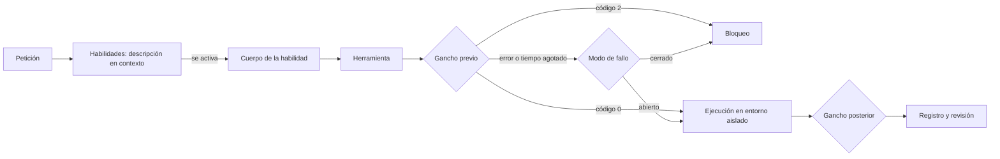
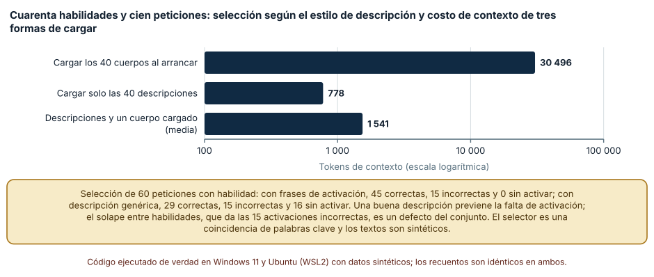
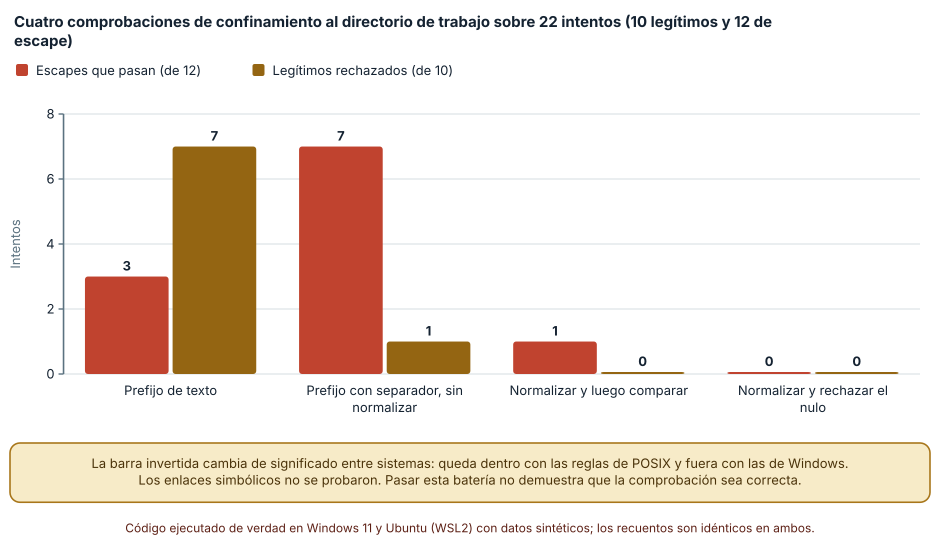

# SE-570 — Skills, plugins, hooks y entornos aislados

[← SE-569 — Agentes, herramientas, permisos y límites de autoridad](https://github.com/vladimiracunadev-create/modern-software-engineering-program/blob/main/classes/part-47-spec-agentes-y-ciclo-de-vida-agentic/se-569-agentes-herramientas-permisos-y-limites-de-autoridad/README.md) · [↑ Parte 47](https://github.com/vladimiracunadev-create/modern-software-engineering-program/blob/main/classes/part-47-spec-agentes-y-ciclo-de-vida-agentic/README.md) · [📚 Índice completo](https://github.com/vladimiracunadev-create/modern-software-engineering-program/blob/main/classes/README.md) · [🌐 Portal](https://vladimiracunadev-create.github.io/modern-software-engineering-program/classes/SE-570.html) · [SE-571 — MCP, recursos, prompts, tools y confianza →](https://github.com/vladimiracunadev-create/modern-software-engineering-program/blob/main/classes/part-47-spec-agentes-y-ciclo-de-vida-agentic/se-571-mcp-recursos-prompts-tools-y-confianza/README.md)

## Punto profesional y fundamento pedagógico

**Punto profesional.** La clase existe para que trates las habilidades, las extensiones, los ganchos y los entornos aislados como lo que son: código y texto que cambian lo que un agente sabe, lo que puede hacer y lo que se le impide hacer. Una habilidad añade conocimiento al contexto cuando se activa; una extensión empaqueta habilidades, ganchos y herramientas de terceros; un gancho ejecuta tu código en puntos fijos del bucle del agente; un entorno aislado limita lo que cualquiera de ellos puede alcanzar. La habilidad que se enseña es decidir qué se carga, qué se comprueba antes de cada acción, qué ocurre cuando la comprobación falla y qué se ejecuta donde.

**Por qué aparece aquí.** Es la sexta clase de la **Parte 47**, después de **Agentes, herramientas, permisos y límites de autoridad**: `SE-569` diseñó la autoridad del agente con reglas; las reglas se escriben en un archivo, pero los controles más útiles son programas que se ejecutan antes y después de cada acción, y el conocimiento que el agente usa se empaqueta en unidades que se cargan según haga falta. El caso conductor sigue siendo el **servicio de recordatorios de entrega** (*Avisos*). Es un caso sintético; los ganchos se ejecutan como procesos reales de Python sobre eventos inventados.

**Error conceptual que debe corregir.** Creer que un control que falla deja pasar lo que no sabe evaluar o lo bloquea, sin haberlo decidido. En el diseño de varios agentes, un gancho que se cae, no arranca o excede su tiempo es un error que no bloquea la acción; solo un código de salida concreto bloquea. Un control de seguridad cuyo modo de fallo nadie ha decidido tiene el modo de fallo que le toca por defecto, y ese suele ser abrirse.

**Secuencia de aprendizaje.** Antes de ver los resultados, predices cuántas de dieciocho acciones peligrosas llegan a ejecutarse cuando el gancho que debía bloquearlas se cae en cuatro ocasiones y se cuelga en dos; después ejecutas el gancho como proceso real sobre 58 eventos, mides el costo en contexto de cargar cuarenta habilidades de distintas maneras y comparas tres comprobaciones de confinamiento de rutas. La secuencia usa predicción, contraste, explicación propia y recuperación. [ICAP](https://icap.education.asu.edu/research) distingue participación de construcción de conocimiento; [How People Learn II](https://nap.nationalacademies.org/catalog/24783/how-people-learn-ii-learners-contexts-and-cultures) respalda diseñar la práctica con contextos reales y retroalimentación.

**Evidencia de aprendizaje.** `controles-log.md` con la predicción, las tres figuras reproducidas, un gancho de política con sus pruebas (incluida la caída y el tiempo agotado), una habilidad con una descripción que se active solo cuando corresponde y una comprobación de rutas con su batería, y una nota que separe qué parte de cada conclusión es medida, cuál inferida y cuál supuesta.

**Límite de la conclusión.** El gancho, los eventos, las cuarenta habilidades, las cien peticiones y los veintidós intentos de rutas son construcciones del autor. El gancho imita el contrato de una herramienta concreta (entrada por la entrada estándar y código de salida) pero no es esa herramienta; no se ejecutó ningún agente ni se instaló ninguna extensión. El tiempo de arranque de un proceso es una lectura de reloj que cambia de equipo en equipo.

### Trazabilidad fuente → afirmación

| Fuente primaria u oficial | Afirmación que respalda | Lo que no prueba |
|---|---|---|
| [Claude Code: ganchos](https://code.claude.com/docs/en/hooks) | Documenta ganchos antes y después de cada herramienta que reciben el evento como JSON por la entrada estándar; el código de salida 2 bloquea la acción, el 0 es éxito y el 1 u otro código sin una respuesta válida es un error que no bloquea; un gancho que no arranca es también un error que no bloquea salvo que se configure lo contrario; un gancho que alcanza su tiempo máximo se cancela. | Describe una herramienta concreta y su versión; otros agentes pueden comportarse de otro modo. |
| [Claude Code: habilidades](https://code.claude.com/docs/en/skills) | Documenta que una habilidad es un archivo `SKILL.md` con instrucciones que el agente carga cuando son relevantes, que sigue un estándar abierto de habilidades y que su contenido solo entra en el contexto al usarse; las descripciones de todas las habilidades se listan en un presupuesto limitado de contexto. | No dice cómo redactar una descripción que active la habilidad correcta. |
| [Claude Code: subagentes](https://code.claude.com/docs/en/sub-agents) | Documenta que un subagente puede definir sus propias herramientas y ganchos y que un gancho previo a la herramienta puede permitir unas operaciones de una herramienta y bloquear otras. | No describe cómo se auditan esos ganchos. |
| [Claude Code: aislamiento (sandbox)](https://code.claude.com/docs/en/sandboxing) | Documenta el aislamiento de sistema de archivos y red de las órdenes de shell con primitivas del sistema operativo. | No cubre los procesos que no pasan por esa herramienta. |
| [Python: subprocess](https://docs.python.org/3/library/subprocess.html), [pathlib](https://docs.python.org/3/library/pathlib.html) y [os.path](https://docs.python.org/3/library/os.path.html) | Documentan la ejecución de procesos con tiempo máximo y las funciones de rutas usadas en los experimentos. | No son un sistema de aislamiento: un proceso hijo hereda los permisos del padre. |

## Antes de empezar

Recupera lo aprendido en `SE-569`: una regla es un programa pequeño con fallos propios. La pregunta activa es: **¿qué controles automáticos corren hoy antes o después de lo que hace tu asistente, y qué ocurre con la acción si el control se cae o no responde?**

## Prerrequisitos

- Haber completado `SE-569` o poder describir las cuatro dimensiones de la autoridad de un agente.
- Python 3.11 o posterior; los experimentos usan solo la biblioteca estándar (`subprocess`, `json`, `posixpath`, `tempfile`).
- Saber leer un código de salida de un proceso y distinguir una ruta normalizada de una sin normalizar.

## Problema auténtico

El equipo de *Avisos* escribe un gancho que se ejecuta antes de cada orden del agente: si la orden contiene `rm -rf`, `curl` o una ruta fuera del espacio de trabajo, termina con un código que bloquea. Las pruebas del gancho pasan. Dos semanas después, una actualización de Python rompe una importación del script; el gancho empieza a terminar con el código 1 en cada llamada, y nadie lo nota porque el agente sigue trabajando normalmente. Durante tres días, el único control entre el agente y la shell no está funcionando. La causa no es un defecto del gancho: es que en la configuración usada un error del gancho no bloquea la acción. Al revisar el incidente, el equipo encuentra además que el agente cargaba cuarenta habilidades al arrancar aunque casi nunca usaba más de dos, y que el confinamiento de rutas del gancho comparaba el principio del texto. La clase enseña a decidir el modo de fallo, a medir el costo del contexto y a probar el confinamiento.

## Objetivos observables

Al terminar podrás:

1. distinguir habilidad, extensión, gancho y entorno aislado por lo que cada uno añade o limita;
2. escribir un gancho que reciba un evento por la entrada estándar y devuelva un código de salida, y probarlo como proceso, incluyendo caída y tiempo agotado;
3. decidir y verificar el modo de fallo de un control (abierto o cerrado) y medir qué acciones peligrosas se cuelan en cada caso;
4. calcular el costo de contexto de cargar habilidades completas frente a cargar solo sus descripciones, y reconocer qué descripciones activan la habilidad equivocada;
5. escribir y probar un confinamiento de rutas que resista `..`, rutas absolutas, directorios hermanos con prefijo común y bytes nulos.

## Mapa conceptual



El mapa separa conocimiento (habilidades), control (ganchos) y confinamiento (entorno aislado). El rombo del modo de fallo es la decisión que suele quedarse sin tomar.

## Temas y por qué importan

| Tema | Por qué cambia una decisión profesional | Evidencia mínima |
|---|---|---|
| Habilidades y carga progresiva | El conocimiento que no se usa cuesta contexto y confunde la selección. | Descripciones y cuerpos medidos |
| Extensiones de terceros | Empaquetan código y texto que se ejecutan con tu autoridad. | Revisión previa y registro de procedencia |
| Ganchos como controles | Convierten una política en un programa que se prueba. | Gancho con batería de eventos |
| Modo de fallo | Un control que falla abierto es un control ausente. | Peligrosas que pasan con cada modo |
| Entornos aislados | Limitan las consecuencias aunque las reglas fallen. | Declaración de qué cubre y qué no |
| Confinamiento de rutas | Es el control más repetido y el que más se escribe mal. | Batería de intentos de escape |

## Conceptos y decisiones

### 1. Habilidades: conocimiento con carga progresiva

Una habilidad es un conjunto de instrucciones —y, a veces, de scripts y documentos de apoyo— que el agente carga cuando la tarea las pide. En Claude Code una habilidad es un directorio con un archivo `SKILL.md` cuyo encabezado incluye un nombre y una descripción; el agente ve las descripciones de todas las habilidades y carga el cuerpo solo cuando decide que una es relevante o cuando el usuario la invoca. Es una forma de carga progresiva: la descripción es siempre visible y barata, el cuerpo es caro y solo entra cuando se usa. Esto resuelve el problema de poner todo el conocimiento en el contexto de partida, pero crea otro: la **selección** depende de la descripción. Una descripción vaga («ayuda con tareas de documentación») activa la habilidad en situaciones que no corresponden o no la activa en las que sí. La descripción es la interfaz de la habilidad y se prueba como tal.

### 2. Extensiones: código y texto de terceros con tu autoridad

Una extensión (en algunos ecosistemas, un *plugin*) empaqueta habilidades, ganchos, subagentes y a veces servidores de herramientas para instalarlos juntos. Spec Kit, por ejemplo, tiene extensiones, presets y catálogos de la comunidad, y advierte que los listados de los catálogos no son auditorías ni avales y que hay que revisar el código antes de instalarlo o ejecutarlo. La advertencia resume el riesgo: una extensión no es un documento sino código que se ejecuta con los permisos del agente, y los ganchos que instala corren antes y después de cada acción. Un procedimiento mínimo es leer el contenido, fijar una versión, registrar de dónde viene y quién la aprobó, y no instalar desde un catálogo por el hecho de estar en él.

### 3. Ganchos: política ejecutable

Un gancho es un programa que el agente invoca en un punto fijo de su bucle: antes de una herramienta, después de ella, al terminar un turno. Recibe el evento como JSON por la entrada estándar y responde con un código de salida y, opcionalmente, con un JSON. En la documentación de Claude Code, el código 0 es éxito, el código 2 bloquea la acción y devuelve el mensaje al agente, y cualquier otro código es un error que **no bloquea**; la misma documentación recomienda usar el 2 para los ganchos que imponen una política, precisamente porque 1 es el código convencional de fallo en Unix y no bloquea. Un gancho que no puede arrancar (una ruta mal escrita en la configuración) también es un error que no bloquea, salvo que se configure lo contrario, y un gancho que alcanza su tiempo máximo se cancela. El efecto conjunto es que **el diseño por defecto de estos controles falla abierto**: si el control se rompe, la acción procede. No es un defecto de la herramienta sino una decisión de diseño razonable para un entorno de desarrollo donde un gancho roto no debería inutilizar al agente, y es una decisión que quien usa el gancho para seguridad debe conocer y, cuando corresponda, revertir.

### 4. El modo de fallo como decisión

Todo control tiene dos modos de fallo. **Falla abierto**: si no puede decidir, deja pasar. **Falla cerrado**: si no puede decidir, bloquea. Ninguno es correcto en general. Un control que protege un recurso irrecuperable debe fallar cerrado, y aceptar la molestia de bloquear cuando se rompe. Un control de conveniencia (un formateador, un aviso) puede fallar abierto. La decisión se toma para cada gancho, se escribe y se prueba, incluyendo los casos de caída, de excepción y de tiempo agotado, porque son los que ejercitan el modo de fallo. Una forma sencilla de hacerlo es que el gancho termine con éxito **solo** cuando ha completado la comprobación y ha decidido permitir, y que cualquier otro resultado se trate como bloqueo en la capa que lo invoca. Cuando no se controla esa capa, se compensa con otro control independiente: el aislamiento del sistema operativo o una regla de denegación de la herramienta.

### 5. Entornos aislados: acotar las consecuencias

Un entorno aislado limita lo que un proceso puede alcanzar con independencia de lo que se le pida: qué directorios puede leer o escribir, a qué dominios puede conectarse, si tiene acceso a las credenciales del usuario. Puede ser el aislamiento de sistema operativo de la herramienta del agente, un contenedor, una máquina virtual o un espacio de trabajo desechable. Protege de los dos tipos de error que las reglas y los ganchos no cubren: el que no se previó y el que se previó mal. Tiene un límite que conviene escribir: lo que el entorno permite sigue siendo posible, y los datos que se montan dentro están a disposición del agente. Un entorno con el repositorio montado en modo escritura y un token en una variable de entorno es un entorno aislado de todo menos de lo que importaba.

### 6. El confinamiento de rutas, paso a paso

Comprobar que una ruta está dentro de un directorio parece trivial y se escribe mal con frecuencia. La versión ingenua compara el texto con el prefijo: `ruta.startswith("/srv/work/entregas")`. Falla de tres maneras. Rechaza las rutas relativas legítimas porque no empiezan por el prefijo. Acepta `/srv/work/entregas-evil/x`, un directorio hermano cuyo nombre empieza igual. Y acepta `/srv/work/entregas/../secretos`, porque el texto empieza bien y la ruta resuelta sale. Una versión con separador (`startswith(prefijo + "/")`) arregla el hermano y deja el `..`. La versión correcta primero **resuelve** la ruta (une la relativa con el directorio base y normaliza `..` y separadores repetidos) y después compara con el directorio base con separador. Aún quedan los bytes nulos, que algunos sistemas tratan como fin de cadena, y los enlaces simbólicos, que obligan a resolverlos en el sistema de archivos real y no solo en el texto. Y hay una diferencia de plataforma: la barra invertida es un separador en Windows y un carácter de nombre en Linux, de modo que una ruta que está dentro en un sistema puede salir en otro.

## Un gancho que se ejecuta de verdad

Se escribió un gancho de Python que lee un evento JSON por la entrada estándar y termina con el código 2 si la orden contiene `rm -rf` o `curl`, o si la ruta está en `/srv/otro`, y con el código 0 en el resto. Para probar el modo de fallo, el gancho tiene dos modos de simulación: terminar con el código 1 (caída) y dormir cinco segundos (colgarse). Se ejecutaron 58 eventos como procesos reales, con un tiempo máximo de un segundo: 40 inocuos, 12 peligrosos que el gancho decide bloquear y 6 peligrosos en los que el gancho se cae (4) o se cuelga (2).

| Salida del gancho | Eventos |
|---|---:|
| Éxito (código 0) | 40 |
| Bloqueo (código 2) | 12 |
| Error (otro código) | 4 |
| Tiempo agotado | 2 |

Se comparan dos formas de interpretar esas salidas. Si solo el código 2 bloquea (el comportamiento por defecto descrito en la documentación), 6 de las 18 acciones peligrosas llegan a ejecutarse: las 4 en que el gancho se cayó y las 2 en que se colgó. Si todo lo que no sea el código 0 bloquea, ninguna de las 18 se ejecuta y no se bloquea ninguna acción inocua. En este experimento el modo cerrado no tiene costo visible porque ningún evento inocuo hace fallar al gancho; en un entorno real, un gancho que falla de forma intermitente bloquearía trabajo legítimo, y esa es la fricción que se acepta a cambio de la garantía. La lectura de reloj de un proceso inocuo fue del orden de 120 ms en Windows y de 30 ms en Ubuntu (WSL2): el arranque de un intérprete por acción es un costo real y cambia de equipo en equipo, de modo que se interpreta solo como orden de magnitud frente a la comprobación equivalente dentro del proceso, que cuesta microsegundos.


**Cómo leer la figura.** Cada barra es una salida del gancho o una regla de bloqueo y su longitud los eventos o acciones; las dos últimas son las acciones peligrosas que se ejecutan según qué bloquea. Mira primero la diferencia entre ellas: bloquear solo el código 2 deja pasar 6, bloquear todo lo que no sea éxito, 0. **Dónde deja de valer:** los eventos y los modos de fallo fueron escritos por el autor, el gancho imita un contrato sin ser la herramienta y el tiempo máximo de un segundo es arbitrario; en una herramienta real el comportamiento por defecto y las opciones de fallo dependen de la versión y de la configuración, que hay que verificar con la documentación vigente.

## Cargar cuarenta habilidades

Se generaron 40 habilidades: seis con vocabulario propio y descripciones con frases de activación («revisar pull request diff comentarios») y 34 con vocabulario compartido de un conjunto de quince palabras. Los cuerpos miden entre 800 y 6 000 bytes. Se prepararon 100 peticiones: 60 que corresponden a una habilidad (30 a las seis específicas y 30 a las genéricas) y 40 que no corresponden a ninguna. Se compara una descripción con frases de activación con una genérica del tipo «Ayuda con tabla, figura, correo, calendario», y se calcula el costo de contexto con 1 token por 4 bytes.

| Descripción | Activa la correcta | Activa una incorrecta | Activa sin deber | No activa y debía |
|---|---:|---:|---:|---:|
| Con frases de activación | 45 | 15 | 0 | 0 |
| Genérica («Ayuda con…») | 29 | 15 | 0 | 16 |

| Qué se carga | Tokens aproximados |
|---|---:|
| Los 40 cuerpos al arrancar | 30 496 |
| Solo las 40 descripciones | 778 |
| Descripciones y un cuerpo cargado (media) | 1 541 |

Cargar los cuarenta cuerpos cuesta unos 30 500 tokens; las descripciones solas, 778; las descripciones y un cuerpo, 1 541, es decir, el 5 % del costo. Con frases de activación, la selección acierta 45 de 60 y no deja ninguna sin activar; con una descripción genérica acierta 29 y deja 16 sin activar. En ambos casos 15 peticiones activan una habilidad incorrecta: son las que se dirigen a habilidades con vocabulario compartido, y ningún estilo de descripción las separa porque las habilidades se solapan. La lección es doble: una buena descripción previene la falta de activación, y el solape entre habilidades es un defecto del conjunto que no se arregla escribiendo mejor una de ellas.



**Cómo leer la figura.** Cada barra es una forma de cargar las habilidades y su longitud los tokens que ocupa, en escala logarítmica. Mira primero la distancia de casi dos décadas entre cargar los cuerpos y cargar solo las descripciones; la selección que logra cada estilo de descripción está en la nota. **Dónde deja de valer:** el selector es una coincidencia de palabras clave que imita la selección, no el selector de ningún agente, los textos son sintéticos y el vocabulario compartido de 15 palabras exagera el solape; las cifras absolutas no se trasladan, la forma sí.

## Veintidós intentos de salir del directorio

Se escribieron 22 rutas: 10 legítimas (`src/app.py`, `src/sub/../app.py`, `./notas.md`, `/srv/work/entregas/docs/spec.md`, `a/b/c/../../../x` y otras) y 12 que salen del directorio `/srv/work/entregas` (`../secretos/clave.txt`, `src/../../secretos/clave.txt`, un directorio hermano `/srv/work/entregas-evil/x`, `/srv/work/entregas_copia/x`, `/etc/hosts`, `src/../../../etc/hosts`, `a/b/c/../../../../x`, una ruta con un byte nulo y otras). Se comparan cuatro comprobaciones con las reglas de rutas de POSIX.

| Comprobación | Escapes que pasan | Legítimos rechazados |
|---|---:|---:|
| Comparar el prefijo de texto | 3 de 12 | 7 de 10 |
| Prefijo con separador, sin normalizar | 7 de 12 | 1 de 10 |
| Normalizar y luego comparar | 1 de 12 | 0 de 10 |
| Normalizar, rechazar el byte nulo y comparar | 0 de 12 | 0 de 10 |

La comparación de prefijo deja pasar 3 de 12 escapes (los directorios hermanos y `/srv/work/entregas/../secretos/x`) y rechaza 7 de las 10 rutas legítimas, las relativas. El prefijo con separador arregla los hermanos pero deja 7 escapes con `..`, y rechaza una ruta legítima. Normalizar resuelve todos menos el byte nulo; rechazarlo cierra el último. Hay, además, un caso que depende de la plataforma: `src\..\..\secretos\clave.txt` queda dentro con las reglas de POSIX, porque la barra invertida es parte del nombre, y fuera con las reglas de Windows, que la normalizan a `C:\work\secretos\clave.txt`. Las rutas con enlaces simbólicos no se probaron.



**Cómo leer la figura.** Cada grupo es una comprobación; la barra roja son los intentos de escape que pasan y la dorada los legítimos que se rechazan. Mira primero que las dos barras son un intercambio en las dos primeras comprobaciones y que solo la última deja ambas en cero. **Dónde deja de valer:** los 22 intentos son una muestra escrita por el autor, sin enlaces simbólicos, sin diferencias de mayúsculas ni nombres de dispositivo de Windows; una comprobación que pasa esta batería no está demostrada correcta, solo no refutada por estos casos.

## Definiciones de trabajo

- **habilidad:** conjunto de instrucciones empaquetado con una descripción que el agente carga cuando considera que es relevante.
- **extensión:** paquete que instala habilidades, ganchos, subagentes o herramientas y se ejecuta con la autoridad del agente.
- **gancho:** programa que el agente invoca en un punto fijo de su bucle, con el evento como entrada y un código de salida como respuesta.
- **modo de fallo:** comportamiento de un control cuando no puede decidir: abrirse (dejar pasar) o cerrarse (bloquear).
- **entorno aislado:** contexto de ejecución que limita lo que un proceso puede leer, escribir o contactar, con independencia de las reglas del agente.
- **confinamiento de rutas:** comprobación de que una ruta resuelta queda dentro de un directorio base.

Las definiciones son operativas para el servicio *Avisos*. No convierten términos con una historia más amplia en sinónimos y deben contrastarse con la documentación primaria enlazada al final.

## Ejemplo mínimo

El fragmento muestra la comprobación de rutas con y sin normalizar. Antes de ejecutarlo, predice cuántas rutas aceptan cada una.

```python
import posixpath
BASE = "/srv/work/entregas"
def ingenua(r): return r.startswith(BASE)
def resuelta(r):
    p = posixpath.normpath(r if posixpath.isabs(r) else posixpath.join(BASE, r))
    return p == BASE or p.startswith(BASE + "/")
for r in ("src/app.py", "/srv/work/entregas/../secretos/x", "/srv/work/entregas-evil/x"):
    print(r, ingenua(r), resuelta(r))
```

La ingenua acepta las dos últimas y rechaza la primera; la resuelta acepta solo la primera. Añade `"src/\x00/x"` y observa qué hace cada una. Registra versión de Python, comando y salida.

## Ejemplo profesional

Escenario hipotético, construido para la clase y sin datos reales. El equipo de *Avisos* revisa sus controles. Escribe el gancho de política con tres decisiones explícitas: termina con 0 solo cuando ha comprobado y permite, con 2 cuando bloquea, y cualquier otro resultado se interpreta en la capa que lo invoca como bloqueo, para lo cual añade una regla de denegación de las órdenes que el gancho vigila como segunda barrera. Prueba el gancho como proceso con cuatro eventos de simulación (caída, tiempo agotado, entrada vacía y JSON inválido) y comprueba que ninguna acción peligrosa llega a ejecutarse. Reduce las habilidades cargadas al arrancar a las seis que usa el proyecto, reescribe sus descripciones con frases de activación y quita el solape entre dos de ellas. Sustituye la comparación de prefijo del confinamiento por una normalización con rechazo del byte nulo y añade a la batería de integración los veintidós intentos. Por último, ejecuta el agente en un directorio desechable con el aislamiento del sistema operativo activado y sin credenciales en el entorno. Compara con el estado inicial: antes había un control que fallaba abierto sin que nadie lo supiera; ahora hay tres barreras con modos de fallo declarados y probados.

## Práctica guiada

1. Escribe un gancho que lea un evento JSON por la entrada estándar y devuelva 0 o 2; pruébalo como proceso.
2. Predice cuántas acciones peligrosas se cuelan si el gancho se cae en cuatro ocasiones y se cuelga en dos con el comportamiento por defecto; escribe el número antes de ejecutar.
3. Ejecuta `python scripts/experiments_part47_a.py 474` y reproduce las tres tablas; añade un modo de simulación nuevo (salida vacía) y decide qué haría tu capa.
4. Decide el modo de fallo de cada gancho de tu proyecto y escribe la razón.
5. Escribe descripciones de tres habilidades con frases de activación y comprueba con diez peticiones cuál se activa; elimina el solape que encuentres.
6. Escribe la batería de rutas con tus propios escapes (incluye un enlace simbólico si tu sistema lo permite) y pruébala contra tu comprobación.
7. Entrega `controles-log.md` y pide a otra persona que proponga un evento que tu gancho deje pasar o una ruta que tu comprobación acepte.

## Ejercicios

1. **Modo de fallo:** para un gancho que impide escribir en `datos/` y otro que da formato al código, decide el modo de fallo de cada uno y justifícalo.
2. **Descripción:** reescribe «ayuda con documentos» como descripción con frases de activación para una habilidad de notas de versión y escribe una petición que no debe activarla.
3. **Rutas:** escribe tres rutas que una comparación con separador sin normalizar acepta y que salen del directorio base.
4. **Contexto:** con 25 habilidades de 3 000 bytes de cuerpo y 200 de descripción, calcula el costo de cargar todo frente a cargar descripciones y un cuerpo.

## Reto verificable

Entrega `controles-log.md` con la predicción, las tres tablas, un gancho de política con sus pruebas como proceso (incluidas la caída y el tiempo agotado), una decisión escrita de modo de fallo, tres habilidades con descripciones probadas y una comprobación de rutas con una batería de al menos veinte intentos. Se aprueba si otra persona ejecuta el código desde un checkout limpio, obtiene los mismos números con las mismas semillas y puede decir qué ocurre con una acción peligrosa si tu gancho se cae. No se aprueba por afirmar que un gancho «bloquea» sin haberlo probado cuando falla ni por una batería que contiene solo los intentos que la comprobación ya detectaba.

## Caso conductor

El servicio *Avisos* es el caso conductor de la Parte 47. Esta clase deja el sexto artefacto: los controles del agente —ganchos con modo de fallo, habilidades con descripciones probadas y confinamiento de rutas— y la declaración del entorno donde se ejecuta. `SE-571` examina los servidores de herramientas y recursos que el agente consume a través del protocolo MCP y qué confianza merecen. Cambia después un solo dato, el número de caídas del gancho, y observa a partir de cuántas el modo abierto deja de ser una opción razonable para tu proyecto.

## Preguntas frecuentes

### ¿Un gancho no es lo mismo que una regla de permisos?

Cumplen funciones parecidas, pero una regla es declarativa (un patrón sobre la orden) y un gancho es un programa que puede consultar el estado, leer el contenido de un archivo o llamar a otro servicio. Un gancho es más expresivo y, por eso, más fácil de escribir mal y más caro por acción. Se usan juntos.

### ¿Por qué el código de salida 1 no bloquea?

Porque en una herramienta de desarrollo un gancho que falla por un error propio no debería impedir el trabajo, y 1 es el código convencional de fallo. La documentación pide usar el código 2 para los ganchos que imponen una política. Quien usa un gancho para seguridad debe conocer esta convención y compensarla.

### ¿Cuántas habilidades conviene tener cargadas?

Las que el proyecto usa. La simulación muestra que cargar solo las descripciones cuesta una fracción de cargar los cuerpos, pero una lista larga de descripciones se solapa y confunde la selección. Mantén pocas, con descripciones precisas, y revisa el conjunto como se revisa una API.

### ¿Un contenedor sustituye a todo lo anterior?

No. Limita lo que puede alcanzar un proceso, pero no impide que el agente use bien y con malas consecuencias lo que sí tiene montado. Un contenedor con el repositorio, las credenciales y la red abierta es un entorno cómodo, no un entorno seguro.

## Fallo controlado y diagnóstico

Reproduce el fallo clásico de la clase: **un control de seguridad que falla abierto sin que nadie lo sepa**. Ejecuta el gancho con el evento que provoca la caída y observa si la acción peligrosa llega a ejecutarse.

Registra síntoma, entrada mínima, hipótesis, observación que descarta cada hipótesis, causa, corrección y prueba de regresión. **Síntoma:** durante días, ninguna acción peligrosa fue bloqueada y no hubo ningún error visible. **Hipótesis rivales:** (a) el agente no intentó nada peligroso; (b) el gancho no está registrado en la configuración; (c) el gancho se ejecuta y termina con un código que no bloquea. **Prueba:** ejecuta el gancho a mano con un evento peligroso y comprueba su código de salida; si es 1, la causa es (c). **Conclusión:** el modo de fallo por defecto es abierto y el gancho llevaba días roto. **Regresión:** añade una prueba que simule la caída y exija que la acción no proceda, y una alerta si el gancho termina con un código distinto de 0 o 2. No cambies a la vez el gancho y la capa que interpreta su salida.

## Errores comunes y cómo corregirlos

| Síntoma | Causa probable | Corrección |
|---|---|---|
| El control «no hace nada» y no hay error | Falla abierto: el error del gancho no bloquea | Usar el código de bloqueo para la política y probar la caída |
| El agente carga mucho contexto al arrancar | Todas las habilidades completas en memoria | Cargar descripciones y cuerpos bajo demanda |
| Se activa la habilidad equivocada | Descripciones vagas o solapadas | Frases de activación y eliminar solapes |
| Una ruta con `..` entra en el espacio | Comparación de prefijo sin normalizar | Resolver y luego comparar con separador, rechazar el byte nulo |
| Una extensión instalada hace algo inesperado | No se revisó su contenido | Leer, fijar versión y registrar procedencia antes de instalar |

## Entorno y archivos clave

```text
work/SE-570/
├── README.md
├── ganchos/
│   ├── politica_previa.py
│   └── test_gancho_proceso.py
├── habilidades/
│   ├── revisar-pr/SKILL.md
│   └── notas-release/SKILL.md
├── rutas/confinar.py
├── aislamiento/declaracion.md
└── evidence/controles-log.md
```

El `README` declara plataforma, versión de Python, semillas y comandos. Los experimentos usan solo la biblioteca estándar; el gancho se escribe en un directorio temporal que se elimina al terminar. Se ejecutaron con CPython 3.12.9 en Windows 11 y 3.12.3 en Ubuntu bajo WSL2: las salidas fueron idénticas salvo la lectura de reloj del arranque de procesos. Si instalas extensiones, fija la versión y anota su procedencia.

## Seguridad, ética y accesibilidad

- un gancho se ejecuta con tus permisos: no pegues en tu configuración ganchos de origen desconocido y revisa cualquier script que se invoque con la entrada del agente;
- un gancho que registra eventos puede guardar datos de personas (rutas con nombres, contenido de órdenes): decide qué se guarda y cuánto tiempo;
- bloquear sin explicación frustra a quien trabaja y lleva a desactivar el control: el mensaje de bloqueo debe decir qué se bloqueó y qué hacer;
- las tablas y figuras deben tener texto alternativo y no depender del color; los resultados se distinguen por texto;
- las herramientas citadas tienen licencias y las extensiones de la comunidad no están auditadas: cita su estructura, vincula la fuente y revisa el código antes de ejecutarlo.

## Puente hacia el trabajo con agentes

Pedirle a un agente «escribe un gancho que impida acciones peligrosas» produce un gancho con la lista de lo que el agente ya sabe que es peligroso y casi nunca con la decisión sobre qué ocurre cuando el gancho falla. Pídele en cambio que escriba el gancho, que escriba también las pruebas que lo ejecutan como proceso con una caída, un tiempo agotado y una entrada inválida, y que declare el modo de fallo. Revisa tú que el gancho termine con el código de bloqueo solo cuando decide bloquear y ejecútalo con tu propio conjunto de eventos peligrosos. Para las habilidades, pídele las descripciones y compruébalas con peticiones que tú redactes, incluidas las que no deben activarlas.

## Transferencia

Traslada el análisis a otro dominio (por ejemplo, un agente que edita documentos de una intranet): cambia los eventos, las habilidades y las rutas y conserva el procedimiento de decidir el modo de fallo de cada control, medir el contexto de las habilidades y probar el confinamiento con una batería de escapes. La transferencia está lograda cuando puedes decir qué le ocurre a una acción peligrosa de ese dominio si el control se cae, no cuando la tabla se parece a la de *Avisos*.

## Evaluación y evidencia

| Criterio | Evidencia para aprobar |
|---|---|
| comprensión | explicación de habilidad, extensión, gancho y entorno aislado y de por qué el modo de fallo es una decisión |
| corrección | tablas del gancho, de las habilidades y de las rutas reproducibles con las mismas semillas |
| diseño | gancho con modo de fallo declarado y probado, descripciones probadas y comprobación de rutas con batería |
| diagnóstico | reproducción del fallo «control que falla abierto» con regresión |
| incertidumbre | declaración de que los eventos, las habilidades y las rutas son del autor y de que el gancho imita un contrato |
| reproducibilidad | versiones, comandos, salida y límites declarados |

## Fuentes

- [Claude Code: ganchos](https://code.claude.com/docs/en/hooks) — entrada, códigos de salida, errores que no bloquean y tiempos máximos; autoridad: documentación de Anthropic.
- [Claude Code: habilidades](https://code.claude.com/docs/en/skills) — estructura de una habilidad, carga bajo demanda y presupuesto de descripciones; autoridad: documentación de Anthropic.
- [Claude Code: subagentes](https://code.claude.com/docs/en/sub-agents) — herramientas y ganchos por subagente; autoridad: documentación de Anthropic.
- [Claude Code: aislamiento (sandbox)](https://code.claude.com/docs/en/sandboxing) — aislamiento de sistema de archivos y red; autoridad: documentación de Anthropic.
- [Spec Kit — repositorio](https://github.com/github/spec-kit) — extensiones y catálogos, con la advertencia de revisar el código de la comunidad; autoridad: GitHub y mantenedores.
- [Python: subprocess](https://docs.python.org/3/library/subprocess.html), [pathlib](https://docs.python.org/3/library/pathlib.html) y [os.path](https://docs.python.org/3/library/os.path.html) — procesos con tiempo máximo y rutas; autoridad: documentación de Python.

Cada fuente respalda el mecanismo indicado; ninguna demuestra que 6 de 18 acciones peligrosas se cuelen en un proyecto real, que el costo de contexto de 40 habilidades sea de unos 30 500 tokens o que una batería de 22 rutas baste. Esa afirmación depende de la herramienta, de la configuración y de las habilidades.

## Límites y siguiente paso

Se ejecutaron tres experimentos en Windows y Ubuntu (WSL2) con resultados idénticos salvo la lectura de reloj: el gancho se ejecuta como proceso real y la comprobación de rutas es código real sobre cadenas; la carga de habilidades usa archivos sintéticos y una selección por palabras clave. No se instaló ni ejecutó ningún agente, extensión ni herramienta de terceros, no se probó el aislamiento del sistema operativo ni los enlaces simbólicos y las rutas de Windows solo se probaron mediante el módulo de rutas, no sobre un sistema de archivos. Los eventos, las habilidades, las peticiones y los intentos son construcciones del autor. La siguiente clase examina los servidores de herramientas y recursos que el agente consume con el protocolo MCP y qué confianza merecen.

## Glosario

- **habilidad:** conjunto de instrucciones empaquetado con una descripción que el agente carga cuando considera que es relevante.
- **extensión:** paquete que instala habilidades, ganchos, subagentes o herramientas y se ejecuta con la autoridad del agente.
- **gancho:** programa que el agente invoca en un punto fijo de su bucle, con el evento como entrada y un código de salida como respuesta.
- **modo de fallo:** comportamiento de un control cuando no puede decidir: abrirse (dejar pasar) o cerrarse (bloquear).
- **entorno aislado:** contexto de ejecución que limita lo que un proceso puede leer, escribir o contactar, con independencia de las reglas del agente.
- **confinamiento de rutas:** comprobación de que una ruta resuelta queda dentro de un directorio base.

---

[← SE-569 — Agentes, herramientas, permisos y límites de autoridad](https://github.com/vladimiracunadev-create/modern-software-engineering-program/blob/main/classes/part-47-spec-agentes-y-ciclo-de-vida-agentic/se-569-agentes-herramientas-permisos-y-limites-de-autoridad/README.md) · [↑ Parte 47](https://github.com/vladimiracunadev-create/modern-software-engineering-program/blob/main/classes/part-47-spec-agentes-y-ciclo-de-vida-agentic/README.md) · [📚 Índice completo](https://github.com/vladimiracunadev-create/modern-software-engineering-program/blob/main/classes/README.md) · [🌐 Portal](https://vladimiracunadev-create.github.io/modern-software-engineering-program/classes/SE-570.html) · [SE-571 — MCP, recursos, prompts, tools y confianza →](https://github.com/vladimiracunadev-create/modern-software-engineering-program/blob/main/classes/part-47-spec-agentes-y-ciclo-de-vida-agentic/se-571-mcp-recursos-prompts-tools-y-confianza/README.md)
