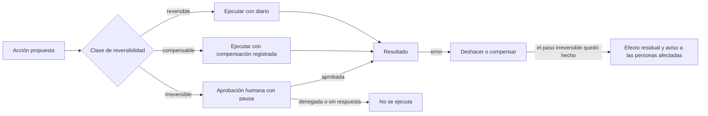
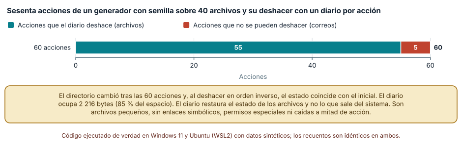

# SE-573 — Human-in-the-loop, aprobación y acciones reversibles

[← SE-572 — Delegación, subagentes y sistemas multiagente](https://github.com/vladimiracunadev-create/modern-software-engineering-program/blob/main/classes/part-47-spec-agentes-y-ciclo-de-vida-agentic/se-572-delegacion-subagentes-y-sistemas-multiagente/README.md) · [↑ Parte 47](https://github.com/vladimiracunadev-create/modern-software-engineering-program/blob/main/classes/part-47-spec-agentes-y-ciclo-de-vida-agentic/README.md) · [📚 Índice completo](https://github.com/vladimiracunadev-create/modern-software-engineering-program/blob/main/classes/README.md) · [🌐 Portal](https://vladimiracunadev-create.github.io/modern-software-engineering-program/classes/SE-573.html) · [SE-574 — Seguridad agentic, prompt injection y auditoría →](https://github.com/vladimiracunadev-create/modern-software-engineering-program/blob/main/classes/part-47-spec-agentes-y-ciclo-de-vida-agentic/se-574-seguridad-agentic-prompt-injection-y-auditoria/README.md)

## Punto profesional y fundamento pedagógico

**Punto profesional.** La clase existe para que diseñes la intervención humana como un componente con sus propias propiedades y no como un botón de «aceptar» que se pone al final. Una persona en el bucle puede ser la mejor barrera de un sistema con agentes o una formalidad que nadie lee, y la diferencia la decide el diseño: qué se le pregunta, con qué frecuencia, con qué información, qué ocurre si no contesta y qué se puede deshacer si contesta mal. La habilidad es colocar la aprobación donde cambia el resultado, reducir su costo donde no, y hacer reversible todo lo que se pueda para que equivocarse sea barato.

**Por qué aparece aquí.** Es la novena clase de la **[Parte 47](../README.md)**, después de **Delegación, subagentes y sistemas multiagente**: `SE-572` repartió el trabajo y dejó la aceptación en una persona; ahora hay que diseñar esa aceptación y lo que sucede cuando falla. El caso conductor sigue siendo el **servicio de recordatorios de entrega** (*Avisos*). Es un caso sintético: no participó ninguna persona real, la atención de quien aprueba es un modelo con parámetros del autor y los archivos que se deshacen están en un directorio temporal.

**Error conceptual que debe corregir.** Creer que cuantas más aprobaciones, más seguridad. Una persona que aprueba doscientas acciones seguidas, de las cuales ocho son peligrosas, no revisa doscientas: revisa las primeras y aprueba el resto. Cada pregunta innecesaria resta atención a la necesaria, de modo que el número de preguntas es una variable de seguridad, y la reversibilidad es más barata y más fiable que la vigilancia.

**Secuencia de aprendizaje.** Antes de ver los resultados, predices cuántas acciones irreversibles se ejecutan en una sesión de 200 acciones con un 4 % irreversible si se pregunta por todas y la atención decae; después simulas cuatro políticas de aprobación, ejecutas sesenta acciones sobre archivos reales y las deshaces con un diario por acción, y calculas cuántos flujos de cinco pasos quedan consistentes con distintas estrategias de compensación. La secuencia usa predicción, contraste, explicación propia y recuperación. [ICAP](https://icap.education.asu.edu/research) distingue participación de construcción de conocimiento; [How People Learn II](https://nap.nationalacademies.org/catalog/24783/how-people-learn-ii-learners-contexts-and-cultures) respalda diseñar la práctica con contextos reales y retroalimentación.

**Evidencia de aprendizaje.** `aprobacion-log.md` con la predicción, las tres figuras reproducidas, una clasificación de las acciones de un agente de tu proyecto en reversibles, compensables e irreversibles, una política de aprobación con sus niveles de riesgo, un diario de deshacer probado y una nota que separe qué parte de cada conclusión es medida, cuál inferida y cuál supuesta.

**Límite de la conclusión.** La función de atención de quien aprueba (0,95 menos 0,012 por cada aprobación seguida, con mínimo de 0,35), la fracción del 4 % de acciones irreversibles, la exactitud del clasificador de riesgo y las tasas de fallo de los pasos son construcciones del autor. No se observó a ninguna persona: la simulación muestra que el diseño importa, no cuánta atención pierde una persona real. El experimento con archivos es real, pero pequeño y sin enlaces simbólicos ni permisos especiales.

### Trazabilidad fuente → afirmación

| Fuente primaria u oficial | Afirmación que respalda | Lo que no prueba |
|---|---|---|
| [Especificación MCP: herramientas](https://modelcontextprotocol.io/specification/2026-07-28/server/tools) | Recomienda que haya siempre una persona con capacidad de denegar la invocación de herramientas y que las aplicaciones muestren qué herramientas se exponen, indiquen cuándo se invocan y pidan confirmación en las operaciones. | No dice cuántas confirmaciones son demasiadas. |
| [Anuncio de la especificación MCP 2026-07-28](https://blog.modelcontextprotocol.io/posts/2026-07-28/) | Describe un mecanismo de rondas múltiples por el que un servidor responde que necesita una confirmación o un dato y el cliente repite la llamada con la respuesta, sin canal abierto. | No define qué debe preguntarse. |
| [Anthropic: «Building effective agents»](https://www.anthropic.com/engineering/building-effective-agents) | Indica que los agentes pueden detenerse para pedir información o juicio humano en puntos de control o ante bloqueos y recomienda pruebas extensas en entornos aislados con salvaguardas. | No cuantifica la frecuencia óptima de los puntos de control. |
| [NIST AI RMF](https://www.nist.gov/itl/ai-risk-management-framework) y [perfil de IA generativa NIST AI 600-1](https://nvlpubs.nist.gov/nistpubs/ai/NIST.AI.600-1.pdf) | Sitúan la supervisión humana y la gestión de riesgos como parte de gobernar sistemas de IA y de IA generativa. | No prescriben un diseño de aprobación. |
| [Garcia-Molina y Salem, «Sagas»](https://doi.org/10.1145/38713.38742) | Fundamenta las compensaciones: una operación larga se divide en pasos, cada uno con una acción que lo deshace. | No cubre los efectos que no se pueden compensar. |
| [Python: pathlib](https://docs.python.org/3/library/pathlib.html), [hashlib](https://docs.python.org/3/library/hashlib.html) y [random](https://docs.python.org/3/library/random.html) | Documentan los módulos usados en el diario de deshacer y las simulaciones. | No validan los parámetros de atención. |

## Antes de empezar

Recupera lo aprendido en `SE-572`: la aceptación se mide sobre el resultado integrado, no sobre los informes. La pregunta activa es: **¿cuántas veces al día aprueba tu equipo una acción de una herramienta automática sin leerla del todo, y qué acción fue la última que habría querido leer?**

## Prerrequisitos

- Haber completado `SE-572` o poder describir un contrato de delegación y un criterio de aceptación sobre el resultado integrado.
- Python 3.11 o posterior; los experimentos usan solo la biblioteca estándar (`random`, `pathlib`, `hashlib`, `tempfile`).
- Saber leer una tabla de resultados de una simulación y calcular una media sobre sesiones.

## Problema auténtico

*Avisos* tiene un agente que prepara cambios en el servicio. El equipo, escarmentado por un borrado accidental, configura el agente para que pida aprobación en cada acción. Durante una semana, cada sesión genera entre 150 y 250 solicitudes de aprobación. El equipo aprueba, cada vez más rápido. El viernes, el agente propone ejecutar un script que elimina el directorio de datos de prueba y envía un correo de aviso a todos los estudiantes de un curso. La solicitud aparece entre otras cuarenta del mismo tipo, con el mismo formato, y se aprueba. El borrado se puede restaurar desde la copia; el correo no se puede retirar. La clase enseña a evitar esta situación con tres cambios: preguntar menos y mejor, hacer reversible lo que se pueda y reconocer de antemano lo que no se puede deshacer.

## Objetivos observables

Al terminar podrás:

1. distinguir persona en el bucle (aprueba cada acción), persona supervisando (puede interrumpir) y persona fuera del bucle (audita después), y decir para qué acciones sirve cada una;
2. clasificar las acciones de un agente en reversibles, compensables e irreversibles y diseñar la aprobación según esa clasificación;
3. comparar políticas de aprobación (todo, por riesgo, por plan, solo lo irreversible con pausa) por avisos generados y acciones irreversibles que llegan a ejecutarse;
4. implementar un diario que permita deshacer acciones sobre archivos y verificar la restauración comparando el estado antes y después;
5. calcular cuántos flujos de varios pasos quedan consistentes con distintas estrategias de compensación y reconocer el efecto de un paso irreversible.

## Mapa conceptual



La clase de reversibilidad decide cuánto control humano hace falta antes: lo reversible se ejecuta con un diario, lo compensable con una compensación registrada y lo irreversible con una aprobación consciente. Sin respuesta, la acción no procede.

## Temas y por qué importan

| Tema | Por qué cambia una decisión profesional | Evidencia mínima |
|---|---|---|
| Tres posiciones de la persona | Cada una sirve para acciones distintas y tiene un costo de atención. | Clasificación de las acciones del agente |
| Fatiga de aprobación | Preguntar de más reduce la atención en lo importante. | Acciones irreversibles ejecutadas por política |
| Qué mostrar al aprobar | Una pregunta sin efecto, objetivo y reversibilidad no se puede juzgar. | Plantilla de solicitud de aprobación |
| Reversibilidad por diseño | Equivocarse sale barato si se puede deshacer. | Diario probado con comparación de estados |
| Compensación | Lo que no se deshace se contrarresta, con límites. | Consistencia por estrategia de compensación |
| Lo irreversible | Es donde la aprobación humana vale más. | Lista de acciones con pausa obligatoria |

## Conceptos y decisiones

### 1. Tres posiciones de la persona

Una persona puede estar **en el bucle**: el sistema espera su decisión antes de cada acción de cierto tipo. Puede estar **supervisando**: el sistema avanza y la persona puede interrumpirlo, deshacer o corregir. O puede estar **fuera del bucle**: el sistema actúa y la persona audita después. Las tres tienen sentido y se aplican a clases de acción distintas. Estar en el bucle encaja con lo irreversible o de alto costo; supervisar, con lo reversible y frecuente donde hay una forma de detener y deshacer; auditar después, con lo de bajo impacto donde la trazabilidad basta. La especificación de MCP recomienda que haya siempre una persona con capacidad de denegar la invocación de herramientas; la palabra operativa es «capacidad»: lo que se exige es que pueda denegar, no que apruebe cada vez. Una arquitectura que solo conoce la primera posición produce solicitudes en cantidad que degradan la calidad de cada decisión.

### 2. La fatiga de aprobación

Cada solicitud consume atención, y la atención de quien responde no se mantiene constante cuando las solicitudes son muchas, parecidas y casi siempre inocuas. El modelo de la clase es deliberadamente simple: la probabilidad de detectar una acción peligrosa empieza en 0,95 y baja 0,012 por cada aprobación seguida sin incidentes, hasta un mínimo de 0,35. No es una medida de ninguna persona; es una forma de mostrar una dinámica plausible: cuanto más se aprueba sin incidentes, menos se revisa. De esta dinámica se derivan tres consecuencias de diseño. Primera, el número de preguntas es una variable de seguridad: cada pregunta innecesaria baja la detección de las necesarias. Segunda, las preguntas deben distinguirse visualmente por riesgo, de modo que la peligrosa no se parezca a la rutinaria. Tercera, hay que contar con que el humano falle y diseñar para que el costo de su fallo sea acotado.

### 3. Qué mostrar para que se pueda decidir

Una solicitud de aprobación útil responde cinco preguntas en el espacio de una pantalla: **qué** se va a hacer (la acción y su objetivo concreto, no «ejecutar script»), **sobre qué** (qué archivos, tablas o personas se afectan y cuántos), **con qué efecto** (qué cambia y cuál sería el resultado), **si se puede deshacer** (y cómo) y **por qué lo pide el agente** (la tarea o el criterio al que sirve). Falta casi siempre el número de afectados y la reversibilidad. Una solicitud de «enviar correo» sin el número de destinatarios y sin indicar que no se puede retirar no permite a nadie decidir. Una aprobación por **plan** —aprobar de una vez el conjunto de acciones previstas y solo preguntar por las desviaciones— reduce el número de preguntas, a costa de que el plan sea revisable y de que lo irreversible esté en él de forma explícita.

### 4. Reversibilidad por diseño

La forma más barata de hacer seguro un sistema con agentes es hacer que sus errores se puedan deshacer. Las técnicas son conocidas. **Diario previo**: antes de modificar un archivo se guarda su estado anterior, y deshacer es restaurar en orden inverso. **Cambios en un área de preparación**: el agente escribe en una copia y una persona o una prueba decide aplicarla. **Borrado lógico**: marcar como eliminado en lugar de borrar. **Simulación previa**: ejecutar en modo de ensayo y mostrar el efecto antes de aplicarlo. **Idempotencia**: una operación repetida da el mismo resultado, de modo que reintentar es seguro. El límite es nítido: estas técnicas protegen lo que el sistema controla (archivos, filas) y no lo que sale de él (un correo enviado, un pago, una publicación). Por eso la clasificación de acciones por reversibilidad es el primer paso del diseño.

### 5. Compensación: lo que no se deshace se contrarresta

Cuando una operación se compone de varios pasos que tocan sistemas distintos, no hay una transacción que los envuelva. El patrón de sagas (Garcia-Molina y Salem) divide la operación en pasos y asocia a cada uno una acción que contrarresta su efecto: si el paso 4 falla, se ejecutan las compensaciones de los pasos 3, 2 y 1. Tiene tres límites. La compensación puede fallar y hay que reintentarla. Algunas acciones no tienen compensación exacta (un correo enviado puede acompañarse de otro que lo corrige, pero el original ya se leyó). Y mientras la saga avanza, el sistema pasa por estados intermedios visibles para otros. Por eso la compensación se diseña con reintentos y con un registro, y los pasos sin compensación se ordenan al final, cuando todo lo demás ya ha tenido éxito.

### 6. Lo irreversible: pausa, no solo pregunta

Para las acciones que no se pueden deshacer, preguntar no es suficiente: el diseño debe asegurar que la decisión sea deliberada. Una **pausa obligatoria** entre la solicitud y la ejecución, con la información completa y sin la opción de aprobar de forma automática, aumenta la probabilidad de detectar un error; en la simulación, una aprobación con pausa mantiene una capacidad de detección de 0,93 sin importar cuántas aprobaciones previas hubo. El diseño exige dos condiciones previas: saber qué acciones son irreversibles (la clasificación) y que la solicitud llegue por un canal distinto del de las rutinarias. Si no se sabe cuáles son irreversibles, la política de «preguntar solo lo irreversible» no se puede aplicar.

## Cuatro políticas de aprobación

Se simulan 5 000 sesiones de 200 acciones cada una, con un 4 % de acciones irreversibles. La persona detecta una acción irreversible con la probabilidad de la función de atención descrita (0,95 menos 0,012 por aprobación seguida, mínimo 0,35, que se restablece al detectar) en las tres primeras políticas y con 0,93 constante en la cuarta, que añade una pausa obligatoria. Las políticas son: preguntar en cada acción; preguntar solo las de riesgo según un clasificador que detecta el 90 % de las irreversibles y señala por error el 8 % de las inocuas; aprobar un plan una vez y preguntar solo las desviaciones (las irreversibles casi nunca estaban en el plan: el 90 % se desvía, frente al 2 % de las inocuas); y preguntar solo lo irreversible, suponiendo que se sabe cuál es, con una pausa obligatoria.

| Política | Avisos de aprobación por sesión | Acciones irreversibles ejecutadas por sesión | Sesiones con alguna |
|---|---:|---:|---:|
| Preguntar en cada acción | 200,0 | 3,02 | 93,5 % |
| Preguntar solo las de riesgo (clasificador con 90 % de recobrado y 8 % de falsas alarmas) | 22,5 | 1,30 | 73,2 % |
| Aprobar el plan una vez y preguntar solo las desviaciones | 11,1 | 1,18 | 69,5 % |
| Preguntar solo lo irreversible (si se sabe cuál es), con una pausa obligatoria | 8,0 | 0,54 | 41,5 % |

Preguntar por todo genera 200 avisos y deja ejecutar 3,02 acciones irreversibles por sesión (de unas 8 que ocurren): la atención se agota con las inocuas. Preguntar por riesgo baja los avisos a 22,5 y las irreversibles a 1,30; la parte residual viene de las que el clasificador no marca (el 10 %) y de las que la atención deja pasar. El plan aprobado reduce los avisos a 11,1 con 1,18 irreversibles. La cuarta política tiene 8,0 avisos (solo los irreversibles) y 0,54 ejecutadas, que son el 7 % de las 8 que aparecen y que la persona no detecta. Ninguna política llega a cero: una persona con una capacidad de detección del 93 % sigue dejando pasar una de cada catorce.


**Cómo leer la figura.** Cada grupo es una política, con el porcentaje de sesiones con alguna irreversible entre paréntesis; la barra gris son los avisos por sesión y la roja las irreversibles ejecutadas, en escala logarítmica. Mira primero que la barra gris cae mucho más rápido que la roja: se reduce el ruido sin reducir tanto el daño. **Dónde deja de valer:** la función de atención, el 4 % de irreversibles, el recobrado del clasificador, la fracción de desvíos del plan y el 0,93 de la pausa son supuestos del autor; la cuarta política depende de una clasificación perfecta de lo irreversible que en la práctica es el difícil. La figura muestra la dinámica de la fatiga, no la atención de ninguna persona.

## Deshacer sesenta acciones sobre archivos

Se creó un directorio temporal con 40 archivos de texto (2 610 bytes) y se ejecutaron 60 acciones con una semilla fija: escribir un archivo nuevo (14), sobrescribir (10), borrar (7), renombrar (7), truncar (6), anexar (11) y enviar un correo simulado (5, que solo añade una línea a una lista de salida). Antes de cada acción que modifica un archivo existente, un diario guarda una copia de su estado; las creaciones se registran para poder borrarlas. Al terminar, se deshacen las acciones en orden inverso y se compara el estado del directorio, nombres y contenidos, mediante un resumen SHA-256, con el estado inicial.

| Medida | Resultado |
|---|---|
| Acciones ejecutadas | 60 (55 sobre archivos y 5 correos simulados) |
| El directorio cambió tras las 60 acciones | sí |
| Estado tras deshacer con el diario, idéntico al inicial | sí |
| Tamaño del diario | 2 216 bytes (85 % del espacio de trabajo) |
| Acciones que el diario no puede deshacer | 5 de 60 (los correos) |

El diario restauró de forma exacta las 55 acciones sobre archivos: la comparación del contenido y de los nombres coincide con el estado inicial. Los 5 correos no tienen deshacer: su efecto (una línea en una lista de salida, que representa un mensaje que ya salió) no es parte del directorio. El diario pesó el 85 % del espacio de trabajo porque el directorio era pequeño y se tocó casi todo; en un repositorio grande pesa lo que se modifica, no lo que existe.



**Cómo leer la figura.** La barra es el conjunto de las 60 acciones, partida entre las que el diario deshace (verde) y las que no (rojo). Mira primero el segmento rojo: el diario restaura lo que cambió en los archivos y no lo que salió del sistema; el tamaño del diario está en la nota. **Dónde deja de valer:** son 40 archivos pequeños, sin enlaces simbólicos, permisos especiales ni archivos abiertos por otros procesos, y las acciones son un conjunto de siete tipos; un diario real debe tratar la atomicidad ante una caída a mitad de acción y la restauración de metadatos.

## Cinco pasos y sus compensaciones

Se simulan 20 000 ejecuciones de un flujo de cinco pasos (por ejemplo, actualizar umbrales en cinco sistemas) en el que cada intento de paso o de compensación falla con probabilidad 0,08. Si un paso falla, se compensan los anteriores. Se comparan cuatro estrategias: no compensar, compensar sin reintentar, compensar con dos reintentos por paso y esa misma con el tercer paso irreversible (por ejemplo, un correo enviado).

| Estrategia | Terminan completas | Terminan consistentes (todo o nada) | Quedan a medias | Con efecto residual |
|---|---:|---:|---:|---:|
| Sin compensación | 65,7 % | 65,7 % | 34,3 % | 0,0 % |
| Compensar sin reintentar | 65,4 % | 95,5 % | 4,5 % | 0,0 % |
| Compensar con 2 reintentos | 65,4 % | 100,0 % | 0,1 % | 0,0 % |
| Con 2 reintentos y el paso 3 irreversible | 65,6 % | 87,8 % | 0,0 % | 12,1 % |

Sin compensación, el 34,3 % de los flujos queda a medias, con parte de los sistemas actualizados y parte no. Compensar sin reintentar lo baja a 4,5 %: fallan las compensaciones, que son tan falibles como los pasos. Con dos reintentos queda en 0,1 %. Pero si el paso 3 es irreversible, el 12,1 % de los flujos que lo ejecutan y fallan después deja un efecto residual que ninguna compensación elimina, y el porcentaje consistente baja a 87,8 %. La mejora consiste en ordenar el flujo para que lo irreversible vaya al final, cuando ya no puede haber fallos posteriores.


**Cómo leer la figura.** Cada barra es una estrategia, partida entre las ejecuciones consistentes (verde), a medias (dorado) y con efecto residual (rojo), en porcentaje. Mira primero cómo desaparece el dorado al compensar con reintentos y cómo aparece el rojo cuando un paso es irreversible. **Dónde deja de valer:** la probabilidad de fallo del 8 %, la independencia entre intentos y el paso irreversible fijo en la tercera posición son supuestos del autor; en un sistema real los fallos se correlacionan (si el servicio cae, caen la acción y su compensación) y las compensaciones no siempre existen.

## Definiciones de trabajo

- **persona en el bucle:** persona cuya decisión se espera antes de que ciertas acciones procedan.
- **fatiga de aprobación:** pérdida de atención de quien aprueba cuando las solicitudes son muchas y casi siempre inocuas.
- **acción reversible:** acción cuyo efecto puede deshacerse restaurando el estado anterior que el sistema controla.
- **acción compensable:** acción cuyo efecto puede contrarrestarse con otra acción, sin restaurar el estado exacto.
- **acción irreversible:** acción cuyo efecto no puede deshacerse ni contrarrestarse por completo.
- **saga:** secuencia de pasos con una compensación asociada a cada uno.

Las definiciones son operativas para el servicio *Avisos*. No convierten términos con una historia más amplia en sinónimos y deben contrastarse con la documentación primaria enlazada al final.

## Ejemplo mínimo

El fragmento muestra un diario de deshacer. Antes de ejecutarlo, predice qué imprime.

```python
estado = {"a.txt": "uno"}
diario = []
def escribe(nombre, nuevo):
    diario.append((nombre, estado.get(nombre)))
    estado[nombre] = nuevo
escribe("a.txt", "dos"); escribe("b.txt", "tres")
for nombre, previo in reversed(diario):
    if previo is None: del estado[nombre]
    else: estado[nombre] = previo
print(estado)
```

Imprime `{'a.txt': 'uno'}`. Añade una acción `enviar` que solo añade a una lista `salida` y observa que el diario no la deshace. Registra versión de Python, comando y salida.

## Ejemplo profesional

Escenario hipotético, construido para la clase y sin datos reales. El equipo de *Avisos* clasifica las acciones de su agente. Leer, buscar y listar son reversibles por no tener efecto. Escribir, borrar y renombrar archivos del proyecto son reversibles con un diario previo; confirmar cambios en una rama local lo es con el sistema de control de versiones. Empujar a un remoto y escribir en la base de pruebas son compensables. Enviar correos, escribir en la base real y publicar son irreversibles. La política: lo reversible se ejecuta con diario y se audita después; lo compensable se ejecuta con una compensación registrada y se supervisa; lo irreversible exige una solicitud con cinco datos (acción, afectados, efecto, reversibilidad, motivo), llega por un canal distinto y espera treinta segundos antes de poder aprobarse. El flujo de actualización de umbrales se reordena para que el envío de correos sea el último paso, cuando todo lo demás ya tuvo éxito. Compara con el estado inicial: doscientas preguntas iguales frente a ocho que importan, y un error de ejecución que antes era un incidente ahora es un deshacer.

## Práctica guiada

1. Clasifica diez acciones de un agente de tu proyecto en reversibles, compensables e irreversibles y anota cómo se deshace cada una.
2. Predice cuántas acciones irreversibles se ejecutan por sesión si preguntas por todo; escribe el número antes de simular.
3. Ejecuta `python scripts/experiments_part47_b.py 477` y reproduce las tres tablas; cambia el mínimo de atención de 0,35 a 0,6 y observa el efecto en la primera política.
4. Diseña la solicitud de aprobación de una acción irreversible con las cinco preguntas y pide a otra persona que decida solo con ella.
5. Implementa el diario de deshacer sobre un directorio temporal y comprueba con un resumen SHA-256 que el estado se restaura.
6. Reordena un flujo de tu proyecto para que el paso irreversible sea el último y calcula cuántos flujos quedan consistentes.
7. Entrega `aprobacion-log.md` y pide a otra persona que proponga una acción que tu clasificación considere reversible y no lo sea.

## Ejercicios

1. **Clasificar:** clasifica «reiniciar el servicio», «enviar el aviso de una hora», «renombrar el módulo de umbrales» y «cerrar la entrega de un curso» y justifica cada una.
2. **Solicitud:** reescribe «¿Ejecutar migración.sh?» como una solicitud con las cinco preguntas.
3. **Política:** con 100 acciones por sesión, un 5 % irreversibles y una capacidad de detección de 0,5 con fatiga, calcula cuántas irreversibles se ejecutan si preguntas por todo y compara con preguntar solo las irreversibles con detección 0,9.
4. **Saga:** en un flujo de cuatro pasos con el tercero irreversible, ¿en qué orden pondrías los pasos para minimizar el efecto residual?

## Reto verificable

Entrega `aprobacion-log.md` con la predicción, las tres tablas, la clasificación de las acciones del agente por reversibilidad, una política de aprobación con sus niveles, la plantilla de solicitud, un diario de deshacer probado con la comparación de estados y un flujo reordenado con lo irreversible al final. Se aprueba si otra persona ejecuta el código desde un checkout limpio, obtiene los mismos números con las mismas semillas y puede decir qué acción de tu lista no se puede deshacer y qué ocurre si se ejecuta por error. No se aprueba por una política que pregunta por todo ni por un diario que no se probó restaurando.

## Caso conductor

El servicio *Avisos* es el caso conductor de la [Parte 47](../README.md). Esta clase deja el noveno artefacto: la clasificación por reversibilidad, la política de aprobación con su plantilla, el diario de deshacer y el flujo ordenado con lo irreversible al final. `SE-574` examina cómo un texto no confiable puede inducir al agente a pedir justo la aprobación que no debería y qué registro permite reconstruir lo ocurrido. Cambia después un solo dato, la fracción de acciones irreversibles, y observa a partir de qué valor preguntar por todo deja de ser la peor política.

## Preguntas frecuentes

### ¿No es más seguro que una persona apruebe todo?

Solo si aprueba con la misma atención todas las veces, y la simulación y la experiencia sugieren que no ocurre. Preguntar por todo mezcla lo importante con lo rutinario y la persona deja de distinguirlo. Es más seguro preguntar poco, bien y por lo que importa, y hacer reversible el resto.

### ¿Cómo sé qué acciones son irreversibles?

Preguntando, para cada acción, qué ocurre si se ejecutó por error y no se puede volver al estado anterior con lo que el sistema controla. Todo lo que sale del sistema (correos, pagos, publicaciones, escrituras en sistemas de terceros) es irreversible o solo compensable. Si no estás seguro, trátala como irreversible hasta demostrar lo contrario.

### ¿Un deshacer completo evita la aprobación?

Para esas acciones, sí en gran medida: puedes ejecutarlas y supervisarlas después. No evita la aprobación de lo que el diario no cubre, y requiere que el diario esté probado; un deshacer que nunca se ha ensayado es una esperanza.

### ¿Qué hago si nadie contesta a una solicitud?

La acción no procede. Una solicitud sin respuesta que se interpreta como aprobada convierte la ausencia en permiso. Define un tiempo de espera, la acción por defecto (no ejecutar) y a quién se escala.

## Fallo controlado y diagnóstico

Reproduce el fallo clásico de la clase: **una acción irreversible aprobada entre cuarenta rutinarias**. Simula la política de preguntar por todo y observa cuántas irreversibles se ejecutan por sesión.

Registra síntoma, entrada mínima, hipótesis, observación que descarta cada hipótesis, causa, corrección y prueba de regresión. **Síntoma:** un correo que no debía salir se envió a todo un curso con la aprobación de una persona del equipo. **Hipótesis rivales:** (a) la persona fue negligente; (b) la solicitud no mostraba el efecto ni el número de destinatarios; (c) la solicitud era una más entre cientos del mismo formato. **Prueba:** cuenta cuántas solicitudes se aprobaron antes y compara el formato de esta con el de las rutinarias; si es idéntico, la causa es (c) y probablemente (b). **Conclusión:** el diseño hizo indistinguible lo peligroso de lo rutinario. **Regresión:** separa las irreversibles en una cola propia con pausa y datos completos y mide las aprobadas por sesión. No cambies a la vez la política y la plantilla.

## Errores comunes y cómo corregirlos

| Síntoma | Causa probable | Corrección |
|---|---|---|
| Se aprueban acciones sin leerlas | Demasiadas solicitudes, todas iguales | Reducir el número y separar las de riesgo |
| Una aprobación no permite decidir | Falta el efecto, el número de afectados o la reversibilidad | Plantilla con cinco preguntas |
| Un deshacer falla justo cuando se necesita | Nunca se ensayó | Probar el diario comparando estados antes y después |
| Un flujo queda a medias | Sin compensación o compensaciones que fallan | Compensar con reintentos y registro |
| Una acción irreversible va en medio del flujo | Orden no pensado | Poner lo irreversible al final |

## Entorno y archivos clave

```text
work/SE-573/
├── README.md
├── acciones/clasificacion.md
├── aprobacion/
│   ├── plantilla-solicitud.md
│   └── simulacion.py
├── reversibilidad/
│   ├── diario.py
│   └── test_diario.py
├── sagas/compensar.py
└── evidence/aprobacion-log.md
```

El `README` declara plataforma, versión de Python, semillas y comandos. Los experimentos usan solo la biblioteca estándar; el directorio de archivos se crea en un lugar temporal que se elimina al terminar. Se ejecutaron con CPython 3.12.9 en Windows 11 y 3.12.3 en Ubuntu bajo WSL2: las salidas fueron idénticas. Si pruebas un diario con datos reales, hazlo sobre una copia.

## Seguridad, ética y accesibilidad

- una solicitud de aprobación puede mostrar datos de personas: muestra lo necesario para decidir y protege el resto;
- aprobar es asumir responsabilidad: registra quién aprobó, cuándo y con qué información, y no permitas que un agente apruebe sus propias solicitudes;
- los canales de aprobación deben ser accesibles (lectura con lector de pantalla, sin depender solo del color, con tiempo suficiente) y no presionar con urgencias artificiales;
- una acción irreversible que afecta a personas (un correo a estudiantes, una publicación) exige considerar a quién perjudica un error y cómo se le avisa;
- las tablas y figuras deben tener texto alternativo y no depender del color; los resultados se distinguen por texto.

## Puente hacia el trabajo con agentes

Pedirle a un agente «avísame antes de hacer algo importante» le deja decidir qué es importante. Pídele en cambio que clasifique cada acción prevista en reversible, compensable o irreversible, que escriba para cada irreversible una solicitud con los cinco datos y que ordene el plan para que lo irreversible vaya al final. Revisa tú la clasificación, que es donde los agentes tienden a ser optimistas, y exige que la acción de deshacer de cada reversible esté probada. Si el agente propone aprobarse a sí mismo una acción o dividir una acción peligrosa en varias pequeñas que no activan la aprobación, trátalo como una señal para ampliar el control, no como una optimización.

## Transferencia

Traslada el análisis a otro dominio (por ejemplo, un agente que reorganiza carpetas y envía resúmenes por correo): cambia las acciones, el espacio de trabajo y los pasos y conserva el procedimiento de clasificar por reversibilidad, preguntar por riesgo con una plantilla completa, mantener un diario probado y ordenar lo irreversible al final. La transferencia está lograda cuando puedes decir qué acción de ese dominio no se puede deshacer y qué la protege, no cuando la tabla se parece a la de *Avisos*.

## Evaluación y evidencia

| Criterio | Evidencia para aprobar |
|---|---|
| comprensión | explicación de las posiciones de la persona, de la fatiga y de las tres clases de reversibilidad |
| corrección | tablas de políticas, del diario y de las compensaciones reproducibles con las mismas semillas |
| diseño | clasificación de acciones, política de aprobación con plantilla, diario probado y flujo reordenado |
| diagnóstico | reproducción del fallo «irreversible entre rutinarias» con regresión |
| incertidumbre | declaración de que la atención, los porcentajes y las tasas de fallo son construcciones del autor |
| reproducibilidad | versiones, comandos, salida y límites declarados |

## Fuentes

- [Especificación MCP: herramientas](https://modelcontextprotocol.io/specification/2026-07-28/server/tools) — persona en el bucle con capacidad de denegar; autoridad: mantenedores de MCP.
- [Anuncio de la especificación MCP 2026-07-28](https://blog.modelcontextprotocol.io/posts/2026-07-28/) — rondas múltiples para confirmaciones; autoridad: mantenedores de MCP.
- [Anthropic: «Building effective agents»](https://www.anthropic.com/engineering/building-effective-agents) — puntos de control y supervisión humana; autoridad: Anthropic.
- [NIST AI RMF](https://www.nist.gov/itl/ai-risk-management-framework) y [NIST AI 600-1](https://nvlpubs.nist.gov/nistpubs/ai/NIST.AI.600-1.pdf) — gobernanza y supervisión humana de sistemas de IA; autoridad: NIST.
- [Garcia-Molina y Salem, «Sagas»](https://doi.org/10.1145/38713.38742) — compensaciones; autoridad: ACM SIGMOD, 1987.
- [Python: pathlib](https://docs.python.org/3/library/pathlib.html), [hashlib](https://docs.python.org/3/library/hashlib.html) y [random](https://docs.python.org/3/library/random.html) — módulos usados en los experimentos; autoridad: documentación de Python.

Cada fuente respalda el mecanismo indicado; ninguna demuestra que 3,02 irreversibles por sesión con aprobación total, el 93 % de detección con pausa o el 12,1 % de efecto residual se observen con personas reales. Esa afirmación depende de las personas, del diseño de la interfaz y de las acciones.

## Límites y siguiente paso

Se ejecutaron tres experimentos en Windows y Ubuntu (WSL2) con resultados idénticos: la aprobación y las compensaciones son simulaciones con semilla fija y el diario de deshacer es código real sobre archivos en un directorio temporal. No participó ninguna persona, no se invocó ningún modelo y no se probó el diario con enlaces simbólicos, permisos especiales ni caídas a mitad de acción. La función de atención, los porcentajes de acciones irreversibles y las tasas de fallo son construcciones del autor, y el clasificador de riesgo se evaluó con una exactitud supuesta. La siguiente clase examina cómo un texto no confiable puede inducir al agente a actuar y qué registro permite reconstruir lo ocurrido.

## Glosario

- **persona en el bucle:** persona cuya decisión se espera antes de que ciertas acciones procedan.
- **fatiga de aprobación:** pérdida de atención de quien aprueba cuando las solicitudes son muchas y casi siempre inocuas.
- **acción reversible:** acción cuyo efecto puede deshacerse restaurando el estado anterior que el sistema controla.
- **acción compensable:** acción cuyo efecto puede contrarrestarse con otra acción, sin restaurar el estado exacto.
- **acción irreversible:** acción cuyo efecto no puede deshacerse ni contrarrestarse por completo.
- **saga:** secuencia de pasos con una compensación asociada a cada uno.

---

[← SE-572 — Delegación, subagentes y sistemas multiagente](https://github.com/vladimiracunadev-create/modern-software-engineering-program/blob/main/classes/part-47-spec-agentes-y-ciclo-de-vida-agentic/se-572-delegacion-subagentes-y-sistemas-multiagente/README.md) · [↑ Parte 47](https://github.com/vladimiracunadev-create/modern-software-engineering-program/blob/main/classes/part-47-spec-agentes-y-ciclo-de-vida-agentic/README.md) · [📚 Índice completo](https://github.com/vladimiracunadev-create/modern-software-engineering-program/blob/main/classes/README.md) · [🌐 Portal](https://vladimiracunadev-create.github.io/modern-software-engineering-program/classes/SE-573.html) · [SE-574 — Seguridad agentic, prompt injection y auditoría →](https://github.com/vladimiracunadev-create/modern-software-engineering-program/blob/main/classes/part-47-spec-agentes-y-ciclo-de-vida-agentic/se-574-seguridad-agentic-prompt-injection-y-auditoria/README.md)
