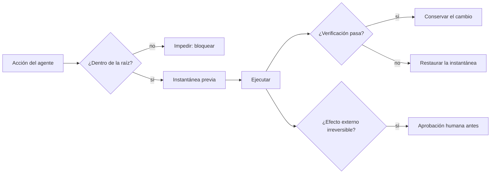
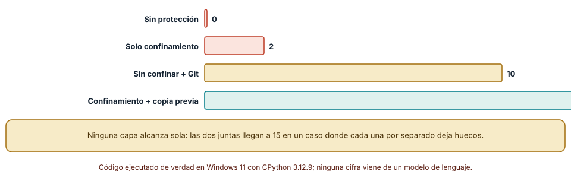
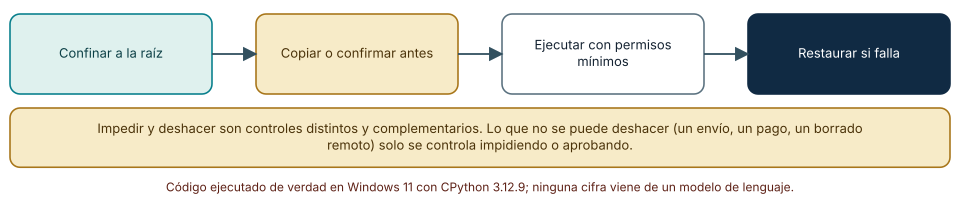

# SE-582 — Sandboxes, reversibilidad y control de daño

[← SE-581 — Loops de agentes y criterios de parada](https://github.com/vladimiracunadev-create/modern-software-engineering-program/blob/main/classes/part-48-harness-y-agentic-engineering/se-581-loops-de-agentes-y-criterios-de-parada/README.md) · [↑ Parte 48](https://github.com/vladimiracunadev-create/modern-software-engineering-program/blob/main/classes/part-48-harness-y-agentic-engineering/README.md) · [📚 Índice completo](https://github.com/vladimiracunadev-create/modern-software-engineering-program/blob/main/classes/README.md) · [🌐 Portal](https://vladimiracunadev-create.github.io/modern-software-engineering-program/classes/SE-582.html) · [SE-583 — Verificación, gates y menú único de validación →](https://github.com/vladimiracunadev-create/modern-software-engineering-program/blob/main/classes/part-48-harness-y-agentic-engineering/se-583-verificacion-gates-y-menu-unico-de-validacion/README.md)

## Punto profesional y fundamento pedagógico

**Punto profesional.** La clase existe para que diseñes el daño máximo de un agente antes de que ocurra. Los permisos (`SE-579`) deciden qué se intenta, y las reglas de parada (`SE-581`) cuánto dura; pero ningún control previo es perfecto, y un agente con una terminal puede borrar, sobrescribir o filtrar algo. El **control de daño** responde a una pregunta distinta: si el agente hace lo peor que sus permisos le dejan, ¿hasta dónde llega el efecto (alcance) y cuánto de él se puede deshacer (reversibilidad)? Se resuelve con dos clases de control que no se sustituyen: **impedir** (confinar a un directorio, red cerrada, credenciales mínimas) y **deshacer** (copias, commits, entornos desechables).

**Por qué aparece aquí.** Sigue a la regla de parada (`SE-581`) porque cierra el ciclo de los controles previos al daño: instrucciones, permisos, contexto, parada. Precede a la verificación (`SE-583`), que decide qué cambios se aceptan.

**Error conceptual que debe corregir.** Creer que Git es una red de seguridad completa. Git recupera lo versionado dentro del repositorio; no recupera archivos sin versionar, datos fuera del repositorio ni efectos externos. En el experimento de la clase, un repositorio Git restaura 10 de 15 archivos tras un borrado masivo, y los 5 restantes (3 sin versionar y 2 fuera del proyecto) no vuelven.

**Secuencia de aprendizaje.** Antes de ejecutar, predices cuántos de 15 archivos sobreviven a cinco acciones destructivas con cuatro configuraciones; después ejecutas las cuatro, anotas qué hace cada control y diseñas el control de daño de un harness según lo que se puede o no deshacer.

**Evidencia de aprendizaje.** `control-de-dano.md` con el inventario de efectos de tu agente (qué toca, qué es reversible, qué no), los controles de impedir y de deshacer elegidos para cada efecto y la prueba que demuestra que se pueden restaurar.

**Límite de la conclusión.** Todo ocurre en directorios temporales creados por el laboratorio, con quince archivos de texto, un repositorio de Git local y acciones simuladas con la biblioteca estándar. No se usó un sandbox del sistema operativo (contenedores, jaulas, máquinas virtuales), ni se midió su aislamiento, ni se evaluó un escape. Un confinamiento por comprobación de rutas es un control del harness, no un aislamiento del proceso.

### Trazabilidad fuente → afirmación

| Fuente primaria u oficial | Afirmación que respalda | Lo que no prueba |
|---|---|---|
| [Anthropic, «Making Claude Code more secure and autonomous with sandboxing»](https://www.anthropic.com/engineering/claude-code-sandboxing) | Describe aislar el sistema de archivos y la red como controles que reducen la necesidad de pedir permiso por cada acción. | No evalúa la seguridad de un aislamiento concreto. |
| [OWASP, «LLM06:2025 Excessive Agency»](https://genai.owasp.org/llmrisk/llm062025-excessive-agency/) | Recomienda limitar permisos y exigir aprobación humana para acciones de alto impacto. | No describe cómo recuperar daños. |
| [Git: `git-worktree`](https://git-scm.com/docs/git-worktree) | Documenta árboles de trabajo adicionales para aislar el trabajo sobre el mismo repositorio. | No aísla el sistema de archivos fuera del repositorio. |
| [Python: `shutil`](https://docs.python.org/3/library/shutil.html) y [`tempfile`](https://docs.python.org/3/library/tempfile.html) | Documentan las copias y los directorios temporales usados por el laboratorio. | No definen una política de copias. |

## Antes de empezar

Recupera lo aprendido en `SE-581`: una regla de parada limita cuánto trabaja el agente, no qué daña. La pregunta activa es: **si el agente ejecutara ahora el peor comando que tus permisos permiten, ¿qué recuperarías en cinco minutos y qué perderías para siempre?**

## Prerrequisitos

- Haber completado `SE-579` y `SE-581`, o conocer qué es un permiso y una parada.
- Manejar Git a nivel básico: `commit`, `checkout -- .`, `status`.
- Python 3.11 o posterior; el laboratorio usa Git local y la biblioteca estándar.

## Problema auténtico

Un asistente de código, al «limpiar» un directorio de resultados, ejecuta un borrado con una ruta mal formada y elimina el directorio de datos del proyecto, que no estaba versionado. La persona responsable abre el historial de Git y encuentra el código intacto; los datos de tres semanas ya no están. Más tarde descubre que el agente también había escrito, con una ruta absoluta, en un archivo de configuración de su carpeta personal.

La clase reproduce el escenario en miniatura: quince archivos (trece en el proyecto, dos «personales» fuera), cinco acciones destructivas y cuatro configuraciones del entorno. Se mide cuántos archivos siguen intactos tras el agente y cuántos tras recuperar. Las preguntas que sobreviven son dos: ¿qué impide el control? y ¿qué deshace?

## Objetivos observables

Al terminar podrás:

1. clasificar cada efecto de un agente según alcance (dentro o fuera del proyecto) y reversibilidad (deshacible o no);
2. implementar un confinamiento por resolución de rutas y comprobar que bloquea las salidas por ruta relativa y absoluta;
3. tomar una instantánea previa (copia o commit) y restaurarla, y medir lo que recupera;
4. explicar por qué impedir y deshacer son controles distintos y qué efectos solo admiten impedir;
5. decidir cuándo basta con confinar el proyecto y cuándo hace falta aislar el proceso.

## Mapa conceptual



El mapa tiene dos mecanismos independientes: el filtro de la raíz (impedir) y la instantánea con restauración (deshacer). El tercero, la aprobación previa para efectos externos irreversibles, es el único recurso cuando no hay manera de deshacer.

## Temas y por qué importan

| Tema | Por qué cambia una decisión profesional | Evidencia mínima |
|---|---|---|
| Alcance y reversibilidad | Define qué control corresponde a cada efecto. | Inventario de efectos |
| Confinamiento por rutas | Impide el daño fuera del proyecto con un costo bajo. | Prueba con rutas relativas y absolutas |
| Instantánea y restauración | Deshace lo ocurrido dentro de la raíz. | Archivos intactos tras restaurar |
| Qué cubre Git | Solo lo versionado, solo dentro del repositorio. | Archivos no recuperados |
| Entornos desechables | Un directorio o contenedor nuevo por tarea acota todo. | Plantilla de entorno por tarea |
| Efectos externos | Envíos, pagos y borrados remotos no se deshacen. | Lista con aprobación humana |

## Conceptos y decisiones

### 1. Alcance y reversibilidad: dos ejes

Todo efecto de un agente se puede ubicar en dos ejes. El **alcance**: dentro del proyecto, fuera del proyecto en la máquina, fuera de la máquina (red, servicios). La **reversibilidad**: se puede deshacer con una copia o un commit, se puede deshacer con esfuerzo, o no se puede deshacer. Un borrado de un archivo versionado es de alcance interno y reversible; uno de un archivo sin versionar es interno e irreversible; escribir en la carpeta personal es externo al proyecto y, si no hay copia, irreversible; enviar un mensaje o eliminar un recurso remoto es externo e irreversible. Cada casilla pide un control distinto.

### 2. Impedir: confinar lo que no debe ocurrir

El confinamiento por rutas resuelve cada ruta que el agente quiere leer o escribir (siguiendo `..` y enlaces) y la compara con la raíz permitida. En el laboratorio, el confinamiento bloquea dos de las cinco acciones (el borrado con `../home/config.txt` y la escritura con una ruta absoluta) y deja los dos archivos «personales» intactos. Es barato y exacto en lo que cubre. No cubre un proceso hijo que el agente lance con una herramienta permitida: ese proceso no pasa por la comprobación de rutas. El aislamiento que sí lo cubre, un sandbox del sistema operativo que restringe el sistema de archivos y la red del proceso entero, es otro nivel de control, y Anthropic lo presenta como la forma de reducir los permisos que hay que pedir sin perder seguridad.

### 3. Deshacer: instantánea y restauración

Una instantánea previa (una copia del directorio del proyecto, un commit) permite volver al estado anterior si la verificación falla. En el laboratorio, con confinamiento y una copia previa, los 15 archivos están intactos tras restaurar: los dos de fuera porque nunca se tocaron y los trece de dentro porque se recuperaron. La copia cuesta espacio y tiempo, y deshace solo lo que contiene. Con proyectos grandes se prefiere un commit o un árbol de trabajo separado (`git worktree`), que da aislamiento del árbol sin duplicar todo.

### 4. Lo que Git no recupera

Git versiona lo que se le añade. En la configuración «sin confinar + Git», tras el borrado masivo, `git checkout -- .` restaura los diez archivos de código versionados; los tres archivos de datos del directorio `data/` no estaban en Git y no vuelven; y los dos archivos personales, que estaban fuera del repositorio, tampoco. Resultado: 10 de 15. El error habitual es creer que «está en Git» y «está a salvo» son lo mismo cuando falta lo que nunca se añadió o se excluyó con `.gitignore`, que suele ser justo lo más difícil de regenerar (datos, entornos, configuraciones locales).

### 5. Efectos que no se deshacen

Algunos efectos no admiten instantánea: un correo enviado, un pago, un borrado en un servicio remoto, una publicación. Para ellos solo hay dos controles: **impedir** (no ofrecer la herramienta, no dar la credencial) y **aprobar** (una persona confirma antes). Aquí la aprobación humana (`SE-579`) es la última línea, y conviene limitarla a esta categoría para que no se degrade. En un harness bien diseñado, la lista de efectos irreversibles es corta, explícita y revisada.

### 6. Entornos desechables

La forma más fuerte de acotar el daño es que cada tarea corra en un entorno que se crea limpio y se destruye al terminar: un directorio temporal, un árbol de trabajo, un contenedor o una máquina efímera. Lo que el agente hace allí no puede afectar a nada que no se haya copiado explícitamente. El costo es preparar el entorno y exportar los resultados. Es la forma de trabajo del laboratorio de este curso, que usa directorios creados con `tempfile` y los elimina.

## Cinco acciones, cuatro configuraciones

Las cinco acciones son: borrar un archivo del proyecto, borrar un archivo fuera con ruta relativa, escribir fuera con ruta absoluta, sobrescribir un archivo del proyecto y borrar todos los archivos del proyecto. Los quince archivos iniciales son diez módulos de código, tres archivos de datos sin versionar y dos archivos personales.


**Cómo leer la figura.** Cada grupo es una configuración de protección y sus dos barras son los archivos intactos tras el agente (coral) y tras recuperar (verde). Mira primero que solo la combinación de confinamiento y copia previa lleva la barra verde a 15 y que sin confinar, aun con Git, se quedan 5 sin recuperar. **Dónde deja de valer:** los archivos son de texto y pocos; no hay procesos hijos, enlaces simbólicos ni permisos del sistema; el agente ejecuta acciones sencillas y no busca eludir el control.



**Cómo leer la figura.** Las barras ordenan las configuraciones por lo que queda intacto tras recuperar. Dos controles distintos suman donde ninguno de los dos llega solo: 15 de 15 con confinamiento y copia. **Dónde deja de valer:** el resultado depende de qué había sin versionar; en un proyecto sin datos locales, Git solo recuperaría casi todo, y el orden de las barras podría cambiar.



**Cómo leer la figura.** Cuatro pasos en orden: impedir, preparar la reversión, actuar con lo mínimo y revertir si algo falla. **Dónde deja de valer:** el orden supone que se conoce la raíz del trabajo y que la verificación es automática; con efectos externos irreversibles, la secuencia se interrumpe antes de «ejecutar» con una aprobación.

## Definiciones de trabajo

- **Alcance:** hasta dónde llegan los efectos de una acción.
- **Reversibilidad:** posibilidad de volver al estado anterior.
- **Confinamiento:** restricción de las rutas que el agente puede tocar.
- **Instantánea:** copia o commit que permite restaurar un estado.
- **Sandbox:** entorno que restringe lo que un proceso puede hacer en el sistema.
- **Efecto externo:** efecto fuera de la máquina o del proyecto.

## Ejemplo mínimo

El confinamiento por resolución de rutas:

```python
from pathlib import Path

def dentro_de(raiz: Path, ruta: str) -> bool:
    return (raiz / ruta).resolve().is_relative_to(raiz.resolve())
```

`dentro_de(raiz, "src/a.py")` es `True`; `dentro_de(raiz, "../home/config.txt")` es `False`, porque `resolve()` sigue el `..` antes de comparar. Comparar el texto de la ruta con la raíz habría aprobado la segunda.

## Ejemplo profesional

*Escenario ilustrativo: las cifras y los resultados que aparecen en este ejemplo son supuestos de la narración, no mediciones.*

El equipo corre las tareas nocturnas en un directorio de trabajo creado a partir de un commit, con un árbol de trabajo por tarea. El agente solo ve ese árbol; los datos reales se montan en solo lectura. Al terminar, el harness ejecuta la verificación; si pasa, extrae un parche y lo propone; si falla, destruye el árbol. En el primer mes, una tarea intenta borrar el directorio de datos: el montaje en solo lectura lo impide y la traza lo registra. Nadie pierde nada y la traza muestra un intento que la persona revisa. La lección es que el diseño importa más que la vigilancia: un entorno desechable convierte el peor caso de la tarea en una tarea fallida.

## Práctica guiada

1. Haz el inventario de efectos de tu agente en dos ejes (alcance y reversibilidad).
2. Para cada efecto irreversible, decide si se impide o si se aprueba.
3. Ejecuta `python scripts/experiments_part48_a.py 498` y compara las cuatro configuraciones con tu predicción.
4. Implementa el confinamiento con `resolve()` y pruébalo con `..`, una ruta absoluta y un enlace simbólico si tu sistema lo permite.
5. Prueba una restauración completa desde una instantánea antes de depender de ella.

## Ejercicios

1. **Básico.** Explica por qué el confinamiento deja 2 archivos intactos y no más, y qué haría falta para proteger también los del proyecto.
2. **Intermedio.** Añade a la configuración con Git los archivos de datos al repositorio y mide cuántos se recuperan; discute por qué no siempre conviene versionarlos.
3. **Avanzado.** Diseña un caso en que el confinamiento por rutas falla (por ejemplo, un proceso hijo lanzado por una herramienta permitida) y propón el control que sí lo cubriría.

## Reto verificable

Entrega `control-de-dano.md` con: el inventario de efectos de tu agente, el control elegido para cada uno (impedir, deshacer o aprobar), la prueba de una restauración real desde una instantánea y la lista de efectos que el control no cubre. Es válido si otra persona ejecuta la prueba de restauración y recupera el estado inicial.

## Caso conductor

El arnés de *Avisos* ejecuta cada tarea en un directorio temporal con una copia del proyecto y confinamiento de rutas. La restauración desde esa copia es parte del harness de `SE-588`, y la ausencia de ambos controles es lo que la figura de `SE-588` contrasta entre el harness «sin controles» y el gobernado.

## Preguntas frecuentes

### ¿Un contenedor reemplaza al confinamiento por rutas?

Lo cubre y lo supera para procesos hijos y red: restringe lo que el proceso puede hacer en el sistema. El confinamiento por rutas es un control del harness que decide qué *llamadas* acepta; un contenedor decide qué puede *ocurrir*. Se complementan.

### ¿Cada cuánto debo tomar instantáneas?

Antes de cada acción que cambia archivos y como mínimo al inicio de cada tarea. El costo crece con el tamaño del proyecto, y por eso se prefieren commits y árboles de trabajo a copias completas.

### ¿Y los datos que no están en Git?

Son el riesgo principal. O se copian explícitamente en la instantánea, o se montan en solo lectura, o se mantienen fuera del alcance del agente.

### ¿Qué pasa con las credenciales?

Una credencial en el entorno es un efecto externo en potencia. Se entregan las mínimas, de corta vida, para la tarea, y se mantienen fuera de las variables que ve el agente cuando no hacen falta.

## Fallo controlado y diagnóstico

**Fallo.** Tras un borrado masivo, el equipo ejecuta `git checkout -- .` y cree haber recuperado todo; semanas después descubre que faltan los archivos de datos.

**Diagnóstico paso a paso.** (1) `git status` no mostraba los archivos de datos porque estaban en `.gitignore`. (2) La restauración solo toca lo versionado. (3) No existía otra copia. (4) La causa es que la reversibilidad se asumió de la herramienta equivocada.

**Corrección.** Se añade la copia de los datos a la instantánea de cada tarea (o se montan en solo lectura) y se prueba una restauración completa una vez por trimestre. La lección es que la reversibilidad se comprueba restaurando, no suponiendo.

## Errores comunes y cómo corregirlos

- **Creer que Git lo cubre todo.** Síntoma: faltan datos tras restaurar. Corrección: copiar o montar en solo lectura lo no versionado.
- **Confinar comparando texto de rutas.** Síntoma: `..` pasa. Corrección: resolver la ruta antes de comparar.
- **Confinar solo las llamadas del harness.** Síntoma: un proceso hijo escribe fuera. Corrección: aislar el proceso con un sandbox.
- **No probar la restauración.** Síntoma: la copia está corrupta o incompleta. Corrección: restaurar de verdad con regularidad.
- **Aprobar todo.** Síntoma: la persona confirma sin leer. Corrección: reservar la aprobación para lo irreversible.

## Entorno y archivos clave

- `scripts/experiments_part48_a.py`: cuatro configuraciones de daño y recuperación; se ejecuta con `python scripts/experiments_part48_a.py 498`.
- Git instalado y accesible; el laboratorio crea un repositorio local en un directorio temporal y lo elimina.
- Solo la biblioteca estándar más Git.

## Seguridad, ética y accesibilidad

El laboratorio solo modifica directorios temporales propios y no ejecuta ninguna acción contra rutas reales; si lo adaptas, mantén esa regla. Un confinamiento por rutas no es un límite de seguridad frente a código hostil: protege de errores, no de un atacante que ejecuta código arbitrario. Ética: un agente con acceso a carpetas personales o a datos de terceros exige el mismo consentimiento que una persona con ese acceso. Las figuras son tablas, barras y diagramas con texto alternativo completo; ninguna información depende solo del color.

## Puente hacia el trabajo con agentes

Trabaja siempre con el agente sobre un entorno que puedas tirar: una rama, un árbol de trabajo, un directorio temporal. Antes de una tarea que modifique muchos archivos, pide al agente que confirme el punto de restauración (un commit o una copia) y comprueba tú que existe. Al revisar su traza, mira primero las acciones bloqueadas por el confinamiento: son lo que intentó y no debía. El patrón que falla es ceder una terminal sin límites «porque está en Git».

## Transferencia

Haz el inventario de efectos de la última tarea que delegaste a un agente y márcalos en los dos ejes. Para cada efecto irreversible, escribe qué control lo cubría. Si ninguno, ya sabes qué falta antes de la próxima tarea.

## Evaluación y evidencia

| Criterio | Evidencia aceptable | Rechazo |
|---|---|---|
| Inventario de efectos | Dos ejes por efecto | «No toca nada importante» |
| Impedir | Prueba con rutas relativas y absolutas | Comparación de cadenas |
| Deshacer | Restauración ejecutada y verificada | «Está en Git» |
| Cobertura | Lista de lo que no se recupera | Silencio |
| Efectos externos | Aprobación o herramienta ausente | Confianza en el agente |

## Fuentes

- Anthropic. [«Making Claude Code more secure and autonomous with sandboxing»](https://www.anthropic.com/engineering/claude-code-sandboxing).
- OWASP Gen AI Security Project. [«LLM06:2025 Excessive Agency»](https://genai.owasp.org/llmrisk/llm062025-excessive-agency/).
- Git. [`git-worktree`](https://git-scm.com/docs/git-worktree).
- Python Software Foundation. [`shutil`](https://docs.python.org/3/library/shutil.html), [`tempfile`](https://docs.python.org/3/library/tempfile.html) y [`pathlib`](https://docs.python.org/3/library/pathlib.html).

## Límites y siguiente paso

Se ejecutaron cuatro configuraciones sobre quince archivos de texto con acciones sencillas, en Windows 11 con CPython 3.12.9 y Git 2.55. No se midió ningún sandbox del sistema operativo, ningún escape, ningún enlace simbólico ni ningún proceso hijo. El siguiente paso, `SE-583`, trata cómo decidir qué cambios se aceptan: las compuertas de verificación y un menú único que agente y persona ejecutan igual.

## Glosario

| Término | Definición breve |
|---|---|
| Alcance | Hasta dónde llegan los efectos de una acción |
| Reversibilidad | Posibilidad de volver al estado anterior |
| Confinamiento | Restricción de las rutas que se pueden tocar |
| Instantánea | Copia o commit para restaurar un estado |
| Sandbox | Entorno que restringe lo que un proceso puede hacer |
| Efecto externo | Efecto fuera de la máquina o del proyecto |

---

[← SE-581 — Loops de agentes y criterios de parada](https://github.com/vladimiracunadev-create/modern-software-engineering-program/blob/main/classes/part-48-harness-y-agentic-engineering/se-581-loops-de-agentes-y-criterios-de-parada/README.md) · [↑ Parte 48](https://github.com/vladimiracunadev-create/modern-software-engineering-program/blob/main/classes/part-48-harness-y-agentic-engineering/README.md) · [📚 Índice completo](https://github.com/vladimiracunadev-create/modern-software-engineering-program/blob/main/classes/README.md) · [🌐 Portal](https://vladimiracunadev-create.github.io/modern-software-engineering-program/classes/SE-582.html) · [SE-583 — Verificación, gates y menú único de validación →](https://github.com/vladimiracunadev-create/modern-software-engineering-program/blob/main/classes/part-48-harness-y-agentic-engineering/se-583-verificacion-gates-y-menu-unico-de-validacion/README.md)
