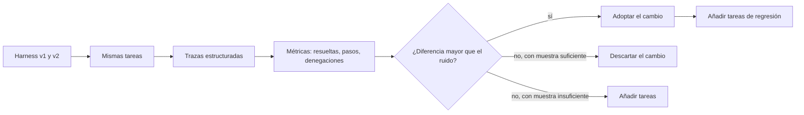
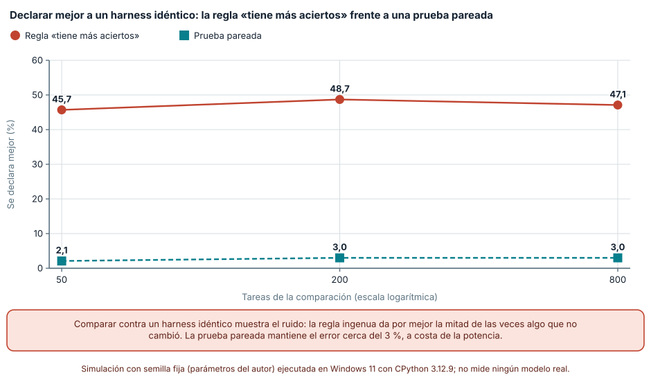
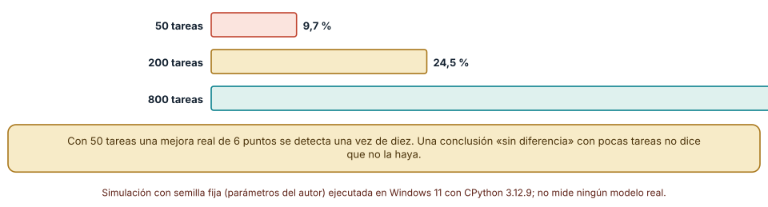

# SE-585 — Observabilidad y evals del propio harness

[← SE-584 — Multiagente y coordinación dentro del harness](https://github.com/vladimiracunadev-create/modern-software-engineering-program/blob/main/classes/part-48-harness-y-agentic-engineering/se-584-multiagente-y-coordinacion-dentro-del-harness/README.md) · [↑ Parte 48](https://github.com/vladimiracunadev-create/modern-software-engineering-program/blob/main/classes/part-48-harness-y-agentic-engineering/README.md) · [📚 Índice completo](https://github.com/vladimiracunadev-create/modern-software-engineering-program/blob/main/classes/README.md) · [🌐 Portal](https://vladimiracunadev-create.github.io/modern-software-engineering-program/classes/SE-585.html) · [SE-586 — AI-DLC, gobierno y vibe coding frente a agentic engineering →](https://github.com/vladimiracunadev-create/modern-software-engineering-program/blob/main/classes/part-48-harness-y-agentic-engineering/se-586-ai-dlc-gobierno-y-vibe-coding-frente-a-agentic-engineering/README.md)

## Punto profesional y fundamento pedagógico

**Punto profesional.** La clase existe para que puedas responder dos preguntas sobre tu propio harness: «¿qué está haciendo?» y «¿este cambio lo mejoró?». La primera se contesta con **observabilidad**: trazas estructuradas de cada paso (acción, resultado, contexto visible, herramientas ofrecidas) y métricas calculadas de ellas. La segunda, con **evaluaciones del harness**: un conjunto de tareas, un criterio de éxito y una comparación que distinga una mejora real del ruido. Sin lo primero, los fallos se diagnostican por intuición; sin lo segundo, cada ajuste del archivo de instrucciones, de los permisos o de la parada es una creencia.

**Por qué aparece aquí.** Sigue a la coordinación (`SE-584`) porque con más de un agente la traza deja de ser un lujo. Antes de gobernar (`SE-586`) y de diagnosticar (`SE-587`) hace falta poder medir. Retoma lo de la [Parte 45](../../part-45-metodologias-de-desarrollo-de-tdd-a-odd/README.md) sobre evaluaciones con ruido (`SE-549`) y lo aplica al objeto de esta parte: el harness, no el producto.

**Error conceptual que debe corregir.** Creer que, si el harness B resuelve más tareas que el A en una corrida, B es mejor. En la simulación de la clase, comparar un harness con otro *idéntico* y declarar mejor al que acierta más produce una «mejora» el 45 % a 49 % de las veces, con 50, 200 o 800 tareas. El ruido de una corrida no desaparece con más tareas; lo que cambia es cuánto de él se confunde con señal.

**Secuencia de aprendizaje.** Antes de ejecutar, predices con cuántas tareas se detecta una mejora real de seis puntos; después calculas métricas desde trazas reales de cuatro configuraciones, simulas la comparación de dos harness con y sin una prueba estadística y escribes el protocolo para evaluar un cambio de tu harness.

**Evidencia de aprendizaje.** `evaluacion-del-harness.md` con el esquema de la traza, las métricas derivadas, el conjunto de tareas, la regla de decisión para adoptar un cambio y la estimación del número de tareas necesario para detectar el efecto que te interesa.

**Límite de la conclusión.** Las trazas vienen del harness mínimo con una política guionizada, y la simulación de comparación usa dificultades Beta(2,1) y diferencias de seis puntos, parámetros del autor. Se mide el mecanismo de decisión bajo ruido, no el efecto de ningún cambio real en ningún modelo. No se invocó ningún modelo.

### Trazabilidad fuente → afirmación

| Fuente primaria u oficial | Afirmación que respalda | Lo que no prueba |
|---|---|---|
| [Anthropic, «Demystifying evals for AI agents»](https://www.anthropic.com/engineering/demystifying-evals-for-ai-agents) | Describe cómo evaluar agentes con tareas, graduadores y múltiples ejecuciones, y señala la no determinación de los resultados. | No fija el tamaño de muestra para un caso. |
| [Jimenez et al., «SWE-bench»](https://arxiv.org/abs/2310.06770) | Ofrece un conjunto de tareas reales de repositorios con pruebas que sirven de criterio de éxito. | No evalúa un harness concreto. |
| [Böckeler, «Harness engineering»](https://martinfowler.com/articles/exploring-gen-ai/harness-engineering.html) | Plantea el harness como un sistema que se mejora observando sus fallos y ajustando guías y sensores. | No ofrece una metodología de medición. |
| [OpenTelemetry: trazas](https://opentelemetry.io/docs/concepts/signals/traces/) | Define una traza como un conjunto de spans que representan una operación de extremo a extremo. | No define el esquema de una traza de agente. |
| [Python: `statistics`](https://docs.python.org/3/library/statistics.html) | Documenta las funciones estadísticas del laboratorio. | No valida el diseño del experimento. |

## Antes de empezar

Recupera lo aprendido en `SE-549`: una evaluación es un instrumento de medida con ruido; sin línea base y sin variación, una diferencia de dos puntos es una opinión. La pregunta activa es: **la última vez que cambiaste algo del harness (una instrucción, un permiso, un tope), ¿cómo supiste que el resultado mejoró y no que tuviste una buena semana?**

## Prerrequisitos

- Haber completado `SE-577` a `SE-584` y `SE-549`.
- Conocer media, proporción y la idea de un intervalo de confianza o de una prueba de hipótesis.
- Python 3.11 o posterior; solo la biblioteca estándar.

## Problema auténtico

El equipo reescribe el archivo de instrucciones y, durante una semana, las tareas del asistente salen mejor: 38 de 50 contra 35 de 50 de la semana anterior. Se publica «la nueva versión mejora». La semana siguiente vuelve a 35 de 50, y nadie sabe si el cambio no servía, si la semana buena fue de tareas más fáciles o si el modelo cambió por debajo.

La clase ofrece dos instrumentos. El primero es la traza: un registro estructurado de cada paso del harness del que se calculan pasos, denegaciones y tareas resueltas. El segundo es una comparación honesta entre dos versiones del harness con las mismas tareas, que declara cuándo una diferencia es mayor que el ruido y cuándo el número de tareas no alcanza para saberlo.

## Objetivos observables

Al terminar podrás:

1. definir un esquema de traza con los campos que permiten diagnosticar (paso, herramienta, resultado, contexto visible, herramientas ofrecidas, observación);
2. calcular métricas del harness desde trazas (pasos, denegaciones, tareas resueltas, pasos por tarea resuelta) y leer qué distingue cada una;
3. diseñar una evaluación de dos versiones con las mismas tareas y una regla de decisión explícita;
4. estimar con una simulación cuántas tareas hacen falta para detectar una mejora dada y reconocer que «sin diferencia» con pocas tareas no es evidencia de igualdad;
5. mantener un conjunto de tareas de regresión que crezca con los fallos observados.

## Mapa conceptual



El mapa separa tres conclusiones posibles: adoptar, descartar y *no saber todavía*. La tercera es la que más se omite y la que más ahorra falsas conclusiones.

## Temas y por qué importan

| Tema | Por qué cambia una decisión profesional | Evidencia mínima |
|---|---|---|
| Esquema de traza | Lo que no se registra no se diagnostica. | Campos y ejemplo de registro |
| Métricas de harness | Resueltas, costo y denegaciones cuentan historias distintas. | Tabla calculada de trazas |
| Evaluación comparativa | Solo mismas tareas permite comparar. | Conjunto fijo de tareas |
| Ruido de una corrida | Dos harness idénticos difieren por azar. | Comparación A frente a A |
| Potencia | Con pocas tareas no se detecta una mejora real. | Probabilidad de detectar un efecto |
| Tareas de regresión | Cada fallo observado se vuelve una tarea. | Conjunto que crece |

## Conceptos y decisiones

### 1. La traza como contrato de observabilidad

Una traza útil registra, por paso: el número de paso, la acción (herramienta y argumentos), el resultado (éxito, error, denegación), la observación resumida, cuántos elementos tenía el contexto visible y qué herramientas se ofrecían. OpenTelemetry define una traza como el recorrido de una operación de extremo a extremo compuesto por *spans* anidados; para un agente, cada vuelta del bucle y cada llamada a herramienta son spans naturales. Lo importante no es el formato, sino que cada decisión de diagnóstico de `SE-587` tenga un campo del que salir. En el laboratorio, la traza se enriquece con `ctx` (elementos del contexto visible), `tools` (herramientas ofrecidas) y `obs` (observación recortada), y con ellos se resuelven fallos que antes eran indistinguibles.

### 2. Métricas derivadas

De las trazas se calculan cuatro métricas simples. **Pasos totales**: costo bruto. **Denegaciones**: cuántas acciones fueron rechazadas por permisos o confinamiento. **Tareas resueltas**: resultado. **Pasos por tarea resuelta**: eficiencia. La tabla de la clase compara cuatro configuraciones y muestra por qué ninguna sola basta: dos configuraciones gastan 72 pasos, una no resuelve nada y la otra lo resuelve todo sin parar; la de escritura denegada gasta 36 y registra 12 denegaciones, que son la pista. Una métrica sin las demás engaña.

### 3. Evaluar el harness, no solo el modelo

Anthropic describe las evaluaciones de agentes como un conjunto de tareas con un criterio de éxito (un graduador), ejecutadas varias veces porque el resultado no es determinista. Aplicado al harness, cada versión (instrucciones, permisos, parada, verificación) se ejecuta sobre las mismas tareas y se compara. SWE-bench es un ejemplo de conjunto de tareas reales con pruebas como criterio; para un equipo, el conjunto útil es el propio: las tareas que su agente hace de verdad, con las pruebas del repositorio como graduador.

### 4. El ruido de una corrida

Si el azar decide cada acierto, dos harness idénticos darán conteos distintos. En la simulación de la clase, las dificultades de las tareas son compartidas (la tarea difícil lo es para ambos) y cada ejecución acierta con una probabilidad que depende de ella. Comparando un harness contra una copia idéntica y declarando mejor al que tiene más aciertos, se declara «mejora» 45,7 %, 48,7 % y 47,1 % de las veces con 50, 200 y 800 tareas. El ruido no depende del tamaño del conjunto: es la mitad de las veces.

### 5. Una regla de decisión con el ruido en cuenta

Una prueba sobre las discordancias (las tareas en que solo uno de los dos acierta) distingue la diferencia del azar: con *b* tareas en que solo B acierta y *c* en que solo A, se declara mejor a B si (*b* − *c*)/√(*b* + *c*) supera 1,96. Con esa regla, comparar el harness contra sí mismo declara «mejora» 2,1 %, 3,0 % y 3,0 % de las veces, cerca del 2,5 % de una prueba de una cola al 95 %. La regla controla el error y cobra su precio: la potencia.

### 6. La potencia: cuántas tareas hacen falta

Con una mejora real de seis puntos (de 0,70 a 0,76 de promedio), la prueba la detecta 9,7 % de las veces con 50 tareas, 24,5 % con 200 y 75,9 % con 800. Una conclusión «no hay diferencia» con 50 tareas no dice casi nada: una mejora real habría pasado inadvertida nueve de cada diez veces. Dos salidas: más tareas, o buscar efectos mayores (un cambio que mejora seis puntos exige muestras grandes; uno que mejora veinte se ve con pocas). El resultado práctico es decidir antes de evaluar cuántas tareas hacen falta para el efecto que interesa.

### 7. Regresión que crece

Cada fallo diagnosticado (`SE-587`) se convierte en una tarea del conjunto, con su criterio de éxito. El conjunto crece con los fallos reales, y la evaluación de cada cambio incluye todo lo anterior. Es la forma de que una mejora no vuelva a abrir un fallo ya cerrado.

## Trazas y comparación

Las métricas de trazas son de ejecuciones reales del harness mínimo sobre seis tareas. La comparación bajo ruido es una simulación con semilla 501 y 1 500 repeticiones por fila.


**Cómo leer la figura.** Cada grupo es una configuración del harness y sus dos barras son los pasos totales (azul oscuro) y las denegaciones (coral); las etiquetas añaden las tareas resueltas. Mira primero que las dos configuraciones de 72 pasos terminan opuestas, una con cero resueltas y otra con las seis. **Dónde deja de valer:** seis tareas y una política guionizada; en un harness real las métricas tienen varianza entre ejecuciones y una sola ejecución por tarea no permite estimarla.



**Cómo leer la figura.** El eje horizontal son las tareas de la comparación (escala logarítmica) y el vertical, el porcentaje de veces que se declara mejor a un harness idéntico; la línea coral es la regla «tiene más aciertos» y la verde, la prueba pareada. Mira primero que la coral se queda cerca del 50 % aunque suban las tareas y la verde, cerca del 3 %. **Dónde deja de valer:** la simulación supone aciertos independientes entre ejecuciones y dificultades compartidas; si hay correlaciones o dependencia temporal, la prueba también falla.



**Cómo leer la figura.** Cada barra es la probabilidad de que la prueba, al 95 %, detecte una mejora real de seis puntos. Con 50 tareas casi nunca; con 800, tres de cada cuatro veces. **Dónde deja de valer:** depende del tamaño del efecto y de la dificultad de las tareas; con un efecto de diez o veinte puntos la potencia sube mucho antes.

## Definiciones de trabajo

- **Traza:** registro estructurado de cada paso del agente.
- **Observabilidad:** capacidad de explicar el comportamiento a partir de lo registrado.
- **Evaluación del harness:** comparación de versiones sobre las mismas tareas con un criterio de éxito.
- **Graduador:** programa o regla que decide si una tarea se resolvió.
- **Potencia:** probabilidad de detectar un efecto real.
- **Tarea de regresión:** tarea derivada de un fallo ya diagnosticado.

## Ejemplo mínimo

Una línea de traza del laboratorio, con los campos que usan los diagnósticos:

```json
{"step": 3, "tool": "write", "ok": false, "obs": "ESCRITURA-DENE", "ctx": 2, "tools": ["read", "run_tests", "write"]}
```

Con ese registro se ve que el agente intentó escribir, que se le denegó, que veía dos elementos de contexto y que la herramienta estaba ofrecida. Sin `tools` no se sabría si el fallo era la herramienta ausente o el permiso.

## Ejemplo profesional

*Escenario ilustrativo: las cifras y los resultados que aparecen en este ejemplo son supuestos de la narración, no mediciones.*

El equipo quiere saber si un archivo de instrucciones más corto mejora al asistente. Reúne las ochenta tareas más frecuentes del último trimestre, cada una con su prueba como graduador, y ejecuta las dos versiones tres veces cada una. La versión corta resuelve 61 en promedio y la larga 58. Con la regla de discordancias, la diferencia no supera el umbral. El equipo no concluye «son iguales»: calcula que con ochenta tareas solo habría detectado una mejora de más de diez puntos, y decide mantener la versión corta por su menor costo de contexto, con la salvedad escrita de que no se probó mejora. La lección es separar la decisión de adoptar (por costo) de la afirmación de mejorar (no demostrada).

## Práctica guiada

1. Define el esquema de traza de tu harness y comprueba que cada diagnóstico de `SE-587` tenga un campo del que salir.
2. Reúne treinta tareas de tu repositorio con su prueba como graduador.
3. Ejecuta `python scripts/experiments_part48_b.py 501` y revisa las métricas y la simulación.
4. Ejecuta tu harness actual dos veces sobre las mismas tareas y calcula cuánto varía el conteo de aciertos entre corridas.
5. Escribe la regla de decisión y el número de tareas que necesitas para el efecto que te interesa.

## Ejercicios

1. **Básico.** Explica por qué dos configuraciones con 72 pasos pueden tener resultados opuestos y qué métrica las distingue.
2. **Intermedio.** Cambia la mejora real de 6 a 10 puntos en la simulación y describe cómo cambia la potencia con 50 y 200 tareas.
3. **Avanzado.** Diseña un conjunto de tareas de regresión a partir de tres fallos de `SE-587` y explica cómo evitarías que el conjunto se vuelva demasiado fácil con el tiempo.

## Reto verificable

Entrega `evaluacion-del-harness.md` con: el esquema de traza, las métricas, un conjunto de al menos treinta tareas con graduador, la comparación de dos versiones del harness con la regla de decisión y una estimación de la potencia de tu evaluación. Es válido si otra persona reproduce tu tabla con las mismas tareas y semillas.

## Caso conductor

Las trazas del arnés de *Avisos* alimentan el diagnóstico de `SE-587` y la evaluación del proyecto de `SE-588`. Cada fallo del taller se convierte en una tarea de regresión, y el conjunto de tareas de *Avisos* (corregir una función, añadir una prueba, actualizar un mensaje) es el que se usa para comparar versiones del harness.

## Preguntas frecuentes

### ¿Basta con ejecutar cada tarea una vez?

No, si el agente es no determinista: una sola ejecución mezcla la dificultad de la tarea con la suerte. Se ejecutan varias veces y se cuenta la proporción, o se usa un conjunto grande donde el azar se promedia.

### ¿Puedo usar un modelo para graduar?

Puede usarse cuando no existe un graduador mecánico, con las salvedades de `SE-549`: su veredicto varía y se calibra contra un conjunto etiquetado por personas. Para código con pruebas, el graduador mecánico es preferible.

### ¿Cuántas trazas guardo y por cuánto tiempo?

Las suficientes para diagnosticar y evaluar, con un plazo y sin datos sensibles. Una traza puede contener rutas, código y salidas; tratarla como dato del proyecto, con las mismas reglas de acceso.

### ¿Esto es lo mismo que evaluar al modelo?

No. Se evalúa el sistema (modelo más harness) con las mismas tareas; si se cambia solo una pieza del harness, la diferencia se atribuye a esa pieza con las salvedades del ruido.

## Fallo controlado y diagnóstico

**Fallo.** Se adopta un cambio de instrucciones porque «mejoró de 35 a 38 de 50», y dos semanas después el rendimiento vuelve a 35.

**Diagnóstico paso a paso.** (1) La diferencia de tres tareas sobre 50 está dentro del ruido: con 50 tareas la regla ingenua declara «mejora» casi la mitad de las veces aun sin cambio. (2) No se hizo una comparación pareada. (3) Las dos semanas usaron tareas distintas. (4) No se registró cuántas veces se ejecutó cada tarea.

**Corrección.** Se fija un conjunto de tareas, se ejecutan ambas versiones sobre el mismo conjunto, se aplica la regla de discordancias y se anota la potencia. La lección es que un número sin su ruido no es evidencia.

## Errores comunes y cómo corregirlos

- **Comparar semanas distintas con tareas distintas.** Síntoma: «mejoras» que se desvanecen. Corrección: mismo conjunto de tareas.
- **Decidir por «tiene más aciertos».** Síntoma: se adoptan cambios que no cambiaron nada. Corrección: regla con el ruido en cuenta.
- **Concluir «sin diferencia» con pocas tareas.** Síntoma: se descartan mejoras reales. Corrección: calcular la potencia antes.
- **Trazas sin los campos de diagnóstico.** Síntoma: dos fallos indistinguibles. Corrección: registrar herramientas ofrecidas y contexto visible.
- **Un conjunto de tareas que nunca crece.** Síntoma: la evaluación se vuelve ciega a los fallos nuevos. Corrección: añadir cada fallo diagnosticado.

## Entorno y archivos clave

- `scripts/experiments_part48_lab.py`: harness mínimo con trazas enriquecidas.
- `scripts/experiments_part48_b.py`: métricas de trazas y simulación de comparación; se ejecuta con `python scripts/experiments_part48_b.py 501`.
- Semilla fija 501; 1 500 repeticiones por fila.
- Solo la biblioteca estándar.

## Seguridad, ética y accesibilidad

Las trazas pueden contener código, rutas y salidas con datos sensibles: aplican a ellas las mismas reglas de acceso y retención que al repositorio, y se filtran secretos antes de guardarlas. Ética: no uses las métricas de un agente para evaluar a la persona que lo configuró sin considerar el ruido y la dificultad de las tareas; publicar una «mejora» sin su potencia presenta incertidumbre como certeza. Las figuras son tablas, barras y diagramas con texto alternativo completo; ninguna información depende solo del color.

## Puente hacia el trabajo con agentes

Pídele al agente, o configura el harness para que lo haga, que cada acción deje un registro con los campos del esquema; y no uses el propio relato del agente como traza: el registro lo escribe el harness. Al probar un cambio de configuración, ejecuta las dos versiones sobre las mismas tareas y decide con la regla escrita de antemano. El patrón que falla es aceptar «esta versión se siente mejor» como resultado.

## Transferencia

Reúne treinta tareas reales de tu repositorio con su prueba como graduador, ejecuta dos veces tu harness actual sobre ellas y mide la variación entre corridas. Ese número es el piso del ruido de tu entorno, y cualquier cambio que prometa menos que eso no se puede ver.

## Evaluación y evidencia

| Criterio | Evidencia aceptable | Rechazo |
|---|---|---|
| Esquema de traza | Campos que sustentan los diagnósticos | «Se guardan los logs» |
| Métricas | Varias, calculadas de las trazas | Una sola cifra |
| Conjunto de tareas | Fijo, con graduador mecánico | Tareas distintas cada vez |
| Decisión | Regla escrita que considera el ruido | «Se ve mejor» |
| Potencia | Estimada antes de evaluar | «Sin diferencia» con pocas tareas |

## Fuentes

- Anthropic. [«Demystifying evals for AI agents»](https://www.anthropic.com/engineering/demystifying-evals-for-ai-agents).
- Jimenez, C. E. et al. [«SWE-bench»](https://arxiv.org/abs/2310.06770).
- Böckeler, B. [«Harness engineering for coding agent users»](https://martinfowler.com/articles/exploring-gen-ai/harness-engineering.html).
- OpenTelemetry. [Trazas](https://opentelemetry.io/docs/concepts/signals/traces/).
- Python Software Foundation. [`statistics`](https://docs.python.org/3/library/statistics.html).

## Límites y siguiente paso

Se calcularon métricas de trazas reales de un harness mínimo con política guionizada y se simuló la comparación de dos versiones con parámetros del autor y semilla 501, en Windows 11 con CPython 3.12.9. No se evaluó ningún harness real ni un modelo, y la simulación supone aciertos independientes. El siguiente paso, `SE-586`, sube un nivel: cómo se gobierna el desarrollo asistido por agentes y qué distingue la ingeniería agéntica del *vibe coding*.

## Glosario

| Término | Definición breve |
|---|---|
| Traza | Registro estructurado de cada paso del agente |
| Observabilidad | Capacidad de explicar el comportamiento desde lo registrado |
| Evaluación del harness | Comparación de versiones con las mismas tareas |
| Graduador | Regla o programa que decide si una tarea se resolvió |
| Potencia | Probabilidad de detectar un efecto real |
| Tarea de regresión | Tarea derivada de un fallo ya diagnosticado |

---

[← SE-584 — Multiagente y coordinación dentro del harness](https://github.com/vladimiracunadev-create/modern-software-engineering-program/blob/main/classes/part-48-harness-y-agentic-engineering/se-584-multiagente-y-coordinacion-dentro-del-harness/README.md) · [↑ Parte 48](https://github.com/vladimiracunadev-create/modern-software-engineering-program/blob/main/classes/part-48-harness-y-agentic-engineering/README.md) · [📚 Índice completo](https://github.com/vladimiracunadev-create/modern-software-engineering-program/blob/main/classes/README.md) · [🌐 Portal](https://vladimiracunadev-create.github.io/modern-software-engineering-program/classes/SE-585.html) · [SE-586 — AI-DLC, gobierno y vibe coding frente a agentic engineering →](https://github.com/vladimiracunadev-create/modern-software-engineering-program/blob/main/classes/part-48-harness-y-agentic-engineering/se-586-ai-dlc-gobierno-y-vibe-coding-frente-a-agentic-engineering/README.md)
