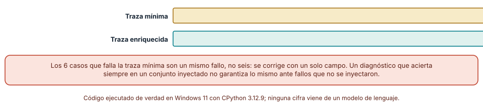

# SE-587 — Taller: diagnosticar el fallo de un harness

[← SE-586 — AI-DLC, gobierno y vibe coding frente a agentic engineering](https://github.com/vladimiracunadev-create/modern-software-engineering-program/blob/main/classes/part-48-harness-y-agentic-engineering/se-586-ai-dlc-gobierno-y-vibe-coding-frente-a-agentic-engineering/README.md) · [↑ Parte 48](https://github.com/vladimiracunadev-create/modern-software-engineering-program/blob/main/classes/part-48-harness-y-agentic-engineering/README.md) · [📚 Índice completo](https://github.com/vladimiracunadev-create/modern-software-engineering-program/blob/main/classes/README.md) · [🌐 Portal](https://vladimiracunadev-create.github.io/modern-software-engineering-program/classes/SE-587.html) · [SE-588 — Proyecto: harness mínimo gobernado y evaluado →](https://github.com/vladimiracunadev-create/modern-software-engineering-program/blob/main/classes/part-48-harness-y-agentic-engineering/se-588-proyecto-harness-minimo-gobernado-y-evaluado/README.md)

## Punto profesional y fundamento pedagógico

**Punto profesional.** El taller existe para que practiques el diagnóstico que `SE-577` prometió: pasar de «el agente falló» a «esta pieza del harness falló, por esta razón, y este cambio lo arregla». Se inyectan seis fallos en el harness mínimo, uno por pieza, y se diagnostican **solo desde la traza**, sin mirar la configuración. El ejercicio no es adivinar: es escribir un procedimiento que, con la información registrada, lleve a una hipótesis refutable por cada fallo, medir cuántas veces acierta y descubrir qué campo de la traza decide entre fallos con síntomas idénticos.

**Por qué aparece aquí.** Sigue al gobierno (`SE-586`) y reúne `SE-577` a `SE-585`: cada fallo inyectado corresponde a una clase (contexto, herramientas, parada, instrucciones y verificación, permisos y confinamiento, tope). Precede al proyecto (`SE-588`), que construye el harness completo.

**Error conceptual que debe corregir.** Creer que un diagnóstico acertado en los casos que conoces generaliza a los que no. En el taller, un diagnóstico con la traza mínima acierta 24 de 30 y con la enriquecida 30 de 30. Pero los seis fallos son los que el autor inyectó y el diagnosticador se escribió sabiéndolos: acertar el conjunto inyectado no garantiza lo mismo ante un fallo que nadie previó.

**Secuencia de aprendizaje.** Antes de ejecutar, escribes para cada fallo el patrón de traza que esperas; después ejecutas los seis fallos sobre seis tareas, aplicas el diagnóstico con la traza mínima y con la enriquecida, lees la matriz de confusión, y añades a la traza el campo que resuelve la ambigüedad.

**Evidencia de aprendizaje.** `diagnostico-del-harness.md` con la tabla fallo → patrón de traza esperado, el procedimiento de diagnóstico, la matriz de resultados, el campo de traza que faltaba y la tarea de regresión que protege cada fallo.

**Límite de la conclusión.** Los seis fallos, las tareas y el diagnosticador son del autor; la política es guionizada. El 30 de 30 de la traza enriquecida es un resultado sobre fallos conocidos de antemano. No se diagnosticó ningún fallo de un agente real ni se midió el diagnóstico de una persona. No se invocó ningún modelo.

### Trazabilidad fuente → afirmación

| Fuente primaria u oficial | Afirmación que respalda | Lo que no prueba |
|---|---|---|
| [Böckeler, «Harness engineering»](https://martinfowler.com/articles/exploring-gen-ai/harness-engineering.html) | Presenta el ciclo de observar fallos del agente y ajustar guías y sensores como la forma de mejorar un harness. | No ofrece una taxonomía de fallos. |
| [Anthropic, «Effective harnesses for long-running agents»](https://www.anthropic.com/engineering/effective-harnesses-for-long-running-agents) | Documenta patrones de fallo de agentes (hacer demasiado, declarar terminado antes de tiempo) y correcciones de entorno. | Son casos de un equipo. |
| [Anthropic, «Demystifying evals for AI agents»](https://www.anthropic.com/engineering/demystifying-evals-for-ai-agents) | Recomienda leer las transcripciones y trazas para entender los fallos y mantener las evaluaciones. | No describe un procedimiento de diagnóstico. |
| [Python: `unittest`](https://docs.python.org/3/library/unittest.html) | Documenta el marco de pruebas que decide el éxito de cada tarea. | No valida el diagnóstico. |

## Antes de empezar

Recupera lo aprendido en `SE-585`: lo que no se registra no se diagnostica. La pregunta activa es: **la última vez que un agente falló, ¿qué pieza del entorno sospechaste primero y qué registro te habría confirmado o refutado la sospecha?**

## Prerrequisitos

- Haber completado `SE-577` a `SE-586`.
- Leer una traza de pasos y distinguir una repetición de una denegación.
- Python 3.11 o posterior; solo la biblioteca estándar.

## Problema auténtico

El jueves el asistente falla en seis tareas con seis síntomas distintos: lee el mismo archivo sin cesar, declara terminado sin resolver, no puede escribir, sigue después de decir que terminó, se queda sin pasos a mitad de una corrección y no ejecuta las pruebas. La persona de guardia tiene las trazas y una hora. Abrir la configuración «para ver qué cambió» es el atajo habitual y, con seis cambios posibles, no discrimina nada.

El taller entrena el otro camino: leer la traza y derivar una hipótesis. Cada fallo se inyecta cambiando exactamente una pieza del harness (`L.Config`), se ejecuta sobre las seis tareas, y un diagnosticador que solo ve la traza propone un fallo. Se compara con el real. El hallazgo del taller es que dos fallos (sin contexto y sin herramienta de escritura) dejan una traza idéntica en pasos y herramientas, y que un solo campo adicional los separa.

## Objetivos observables

Al terminar podrás:

1. relacionar cada fallo del harness con el patrón de traza que deja (repeticiones, denegaciones, ausencia de una herramienta, terminaciones);
2. escribir un diagnosticador que decida solo desde la traza y medir sus aciertos y confusiones;
3. identificar fallos con síntomas indistinguibles y el campo que los separa;
4. proponer un cambio de una pieza, ejecutarlo de nuevo y comprobar que el fallo desaparece;
5. convertir cada fallo diagnosticado en una tarea de regresión.

## Mapa conceptual


El mapa es el procedimiento: del patrón a la pieza, con una pregunta extra para el único par ambiguo (la herramienta ofrecida), y un cierre que siempre repite y siempre deja una tarea de regresión.

## Temas y por qué importan

| Tema | Por qué cambia una decisión profesional | Evidencia mínima |
|---|---|---|
| Patrón de traza por fallo | Convierte síntomas en hipótesis. | Tabla fallo → patrón |
| Diagnóstico solo desde la traza | Obliga a registrar lo necesario. | Resultado con la traza mínima |
| Fallos con síntomas idénticos | Revela qué campo falta. | Matriz de confusión |
| Una pieza por cambio | Permite atribuir la mejora. | Cambio y repetición |
| Regresión | Evita que un fallo vuelva. | Una tarea por fallo |
| Límite del diagnosticador | Solo conoce lo que se le enseñó. | Casos fuera del conjunto |

## Conceptos y decisiones

### 1. Seis fallos, seis piezas

Cada fallo cambia exactamente una pieza del harness mínimo. **F1**, sin contexto entre pasos: el agente no ve su historia y repite el primer paso. **F2**, herramienta de escritura ausente: no puede aplicar cambios. **F3**, la parada no se respeta: el agente declara terminado y el harness lo ignora y sigue. **F4**, sin instrucción de verificar: declara terminado sin ejecutar las pruebas. **F5**, escritura denegada por permiso: la herramienta existe, pero el permiso la rechaza. **F6**, tope de pasos demasiado bajo: se agota antes de poder verificar. Los seis son los síntomas de `SE-577` a `SE-581` convertidos en configuraciones que se pueden inyectar y deshacer.

### 2. El procedimiento

El diagnóstico sigue cinco pasos. Reproducir con la misma configuración y las mismas tareas. Leer la traza buscando cuatro cosas: repeticiones del mismo paso, denegaciones, solicitudes de cierre y ausencia de una herramienta esperada. Formular una hipótesis sobre una sola pieza. Cambiar solo esa pieza y volver a ejecutar. Añadir el caso a la regresión. Cambiar dos piezas a la vez impide saber cuál arregló el fallo, y por eso el procedimiento prohíbe el atajo. La hipótesis debe poder refutarse: «si es el contexto, al devolverlo la tarea se resuelve».

### 3. Los patrones

Con la traza mínima (paso, herramienta, si salió bien, solicitud de cierre) los patrones se leen así. Doce solicitudes de lectura sin una escritura: contexto o herramienta ausente. Dos o más solicitudes de cierre: parada ignorada. Una escritura que no salió bien: permiso. Escritura sin ninguna ejecución de pruebas y una única solicitud de cierre: verificación ausente. Tres pasos o menos sin cierre: tope bajo. Con esas reglas el diagnóstico acierta 24 de 30 casos. Los seis que falla son siempre el mismo: el fallo F2, que confunde con F1 porque la traza de las dos es una cadena de lecturas.

### 4. El campo que separa lo indistinguible

Entre F1 (sin contexto) y F2 (sin herramienta de escritura) la traza mínima no distingue: ambas son una cadena de doce lecturas. La información que las separa existía en el harness y no estaba en el registro: qué herramientas estaban ofrecidas y cuántos elementos tenía el contexto visible. Con esos dos campos, el diagnosticador enriquecido pregunta primero si la escritura estaba entre las herramientas ofrecidas (si no, es F2) y después si el contexto visible estaba vacío en cada paso (si sí, es F1). Resultado: 30 de 30. La lección operativa es que un fallo sin forma de distinguirse de otro en la traza es una orden: añade el campo.

### 5. Un diagnosticador es un conjunto de reglas, con sus límites

El diagnosticador del taller es una lista de reglas ordenadas, escrita sabiendo los seis fallos. Acierta los seis por construcción y no sabría qué decir de un séptimo (por ejemplo, un servidor de herramientas que responde con error). Un buen diagnosticador devuelve «no identificado» cuando ninguna regla aplica, y cada «no identificado» es un fallo nuevo por estudiar. Además, los patrones pueden solaparse: un fallo real suele combinar piezas, y la regla ordenada se queda con la primera que coincide.

### 6. Del diagnóstico a la regresión

Cada fallo diagnosticado produce una tarea de regresión: la tarea que lo reveló, la configuración que lo inyecta y el criterio que debe cumplirse tras el arreglo. El conjunto de seis fallos se ejecuta en la integración continua del harness y detecta cuando un cambio del archivo de instrucciones, de los permisos o de la parada reintroduce alguno. Es la versión operativa de `SE-585`: la evaluación del harness crece con sus propios fallos.

## Seis fallos, dos versiones del diagnóstico

Cada fallo se ejecutó sobre las seis tareas; se cuentan las ejecuciones con fallo observable (no resueltas, o resueltas agotando el tope de 12 pasos). La versión 1 usa la traza mínima; la versión 2 añade las herramientas ofrecidas, el contexto visible y la observación recortada.


**Cómo leer la figura.** Cada grupo es un fallo inyectado y sus dos barras son los casos que el diagnóstico acierta con la traza mínima (coral) y con la enriquecida (verde). Mira primero el fallo F2, el único donde la barra coral es cero y la verde, completa. **Dónde deja de valer:** el diagnosticador se escribió conociendo los seis fallos, así que el 100 % es un resultado sobre un conjunto cerrado; ante un fallo nuevo no hay evidencia de que acierte.



**Cómo leer la figura.** Dos barras comparan las versiones del registro; la diferencia (6 casos) es un solo fallo, no seis fallos distintos. **Dónde deja de valer:** son 30 ejecuciones de seis tareas pequeñas; el porcentaje no es una tasa de aciertos de ningún diagnóstico humano o automático real.


**Cómo leer la figura.** Seis cajas ordenan el procedimiento; la primera exige reproducir antes de interpretar y la última cierra el lazo con la regresión. **Dónde deja de valer:** requiere que el fallo sea reproducible; los fallos intermitentes (del modelo o de un servicio externo) exigen varias ejecuciones y estadística (`SE-585`) antes de la hipótesis.

## Definiciones de trabajo

- **[Fallo inyectado](../../../glosario/entradas/f/fallo-inyectado.md):** cambio deliberado de una pieza del harness para producir un fallo conocido.
- **[Patrón de traza](../../../glosario/entradas/p/patron-de-traza.md):** forma característica que un fallo deja en el registro.
- **[Hipótesis refutable](../../../glosario/entradas/h/hipotesis-refutable.md):** explicación que predice un resultado concreto al cambiar una pieza.
- **[Matriz de confusión](../../../glosario/entradas/m/matriz-de-confusion.md):** tabla de diagnóstico real frente a diagnóstico propuesto.
- **[Traza enriquecida](../../../glosario/entradas/t/traza-enriquecida.md):** traza con herramientas ofrecidas, contexto visible y observación.
- **[Tarea de regresión](../../../glosario/entradas/t/tarea-de-regresion.md):** tarea que protege contra la reaparición de un fallo.

## Ejemplo mínimo

Una traza de F2 (sin herramienta de escritura) con la traza enriquecida, tarea `T1`:

```json
{"step": 1, "tool": "read", "ok": true, "obs": "def add(a, b)", "ctx": 0, "tools": ["read", "run_tests"]}
{"step": 2, "tool": "read", "ok": true, "obs": "def add(a, b)", "ctx": 1, "tools": ["read", "run_tests"]}
```

La lista `tools` no incluye `write`: la herramienta nunca estuvo ofrecida. Con solo `step`, `tool` y `ok`, esta traza sería idéntica a la de F1, donde `ctx` vale cero en todos los pasos y `write` sí está ofrecida.

## Ejemplo profesional

*Escenario ilustrativo: las cifras y los resultados que aparecen en este ejemplo son supuestos de la narración, no mediciones.*

La persona de guardia recibe quince tareas fallidas de la noche. Aplica el procedimiento sin abrir la configuración: agrupa las trazas por patrón y encuentra tres grupos. Nueve repiten lecturas; cuatro piden el cierre dos veces; dos tienen una escritura denegada. Para el primer grupo comprueba el campo de herramientas ofrecidas: la escritura no figura; una actualización del producto había renombrado la herramienta y el harness no la reconocía. Arregla una pieza, repite las nueve tareas, se resuelven; añade la prueba de que la herramienta de escritura está ofrecida al conjunto de regresión. El segundo grupo es la parada ignorada tras un cambio de versión del harness; el tercero, un permiso demasiado estricto. Tres piezas, tres cambios, tres tareas de regresión, y una hora de diagnóstico en vez de una tarde.

## Práctica guiada

1. Escribe, antes de ejecutar nada, el patrón de traza que esperas para cada uno de los seis fallos.
2. Ejecuta `python scripts/experiments_part48_b.py 503` y compara tu tabla con la medida.
3. Localiza el único par de fallos con trazas mínimas idénticas y propón el campo que los separa.
4. Escribe tu diagnosticador y mide cuántas veces dice «no identificado».
5. Inventa un séptimo fallo y comprueba qué hace tu diagnosticador con él.

## Ejercicios

1. **Básico.** Explica por qué F2 y F1 dejan la misma traza mínima y qué campo del registro los separa.
2. **Intermedio.** Inyecta el séptimo fallo (por ejemplo, una herramienta que falla siempre con un error) y ajusta el diagnosticador sin romper los seis anteriores.
3. **Avanzado.** Diseña un fallo que combine dos piezas y explica por qué una lista ordenada de reglas devuelve un diagnóstico incompleto.

## Reto verificable

Entrega `diagnostico-del-harness.md` con: la tabla fallo → patrón esperado, el procedimiento, la matriz de aciertos con la traza mínima y la enriquecida, el campo de traza que añadiste y por qué, un séptimo fallo con su diagnóstico y las tareas de regresión. Es válido si otra persona inyecta tus fallos y obtiene tu matriz.

## Caso conductor

Los seis fallos son los que *Avisos* sufrió o habría sufrido con su arnés. El taller convierte esa experiencia en una suite de regresión que se ejecuta en cada cambio del harness; el proyecto de `SE-588` la incluye entre las evaluaciones del harness mínimo.

## Preguntas frecuentes

### ¿Por qué no abrir la configuración directamente?

Porque la configuración dice qué *hay*, y la traza dice qué *ocurrió*. Con seis piezas y un cambio reciente en alguna, la configuración no discrimina; la traza sí. Además, entrenar el diagnóstico desde la traza obliga a registrar lo necesario.

### ¿Y si el fallo es del modelo?

El procedimiento lo reconoce por exclusión: si ninguna pieza del harness explica la traza y reproducir con otra configuración no cambia el patrón, la hipótesis del modelo queda como la más probable, con las salvedades de `SE-585` sobre ruido.

### ¿Cuántos fallos debe cubrir un diagnosticador?

Los que has visto y los que puedas inyectar. Cada «no identificado» en producción es un fallo nuevo para añadir al conjunto.

### ¿Un modelo puede diagnosticar las trazas?

Puede ayudar a resumirlas y proponer hipótesis; es un control inferencial que debe verificarse con el mismo procedimiento (cambiar una pieza y repetir). No lo reemplaza.

## Fallo controlado y diagnóstico

**Fallo.** El diagnosticador con la traza mínima dice «contexto ausente» para seis ejecuciones. La persona restaura el contexto y el fallo persiste.

**Diagnóstico paso a paso.** (1) Tras el cambio, las ejecuciones siguen siendo cadenas de lecturas. (2) La hipótesis «contexto ausente» fue refutada por la repetición. (3) Se añade el campo de herramientas ofrecidas y se lee: la escritura no figura. (4) El fallo era F2, y la traza mínima no podía distinguirlo.

**Corrección.** Se restaura la herramienta de escritura, se repiten las seis tareas y se resuelven; se añade el campo `tools` al esquema de traza y una tarea de regresión que comprueba que la escritura está ofrecida. La lección es que una hipótesis refutada es información: acota qué pieza queda.

## Errores comunes y cómo corregirlos

- **Abrir la configuración antes que la traza.** Síntoma: se cambia lo que parece sospechoso. Corrección: leer la traza y formular una hipótesis.
- **Cambiar dos piezas a la vez.** Síntoma: no se sabe cuál arregló. Corrección: una pieza por vez.
- **No poder distinguir dos fallos.** Síntoma: la misma traza para dos causas. Corrección: añadir el campo que los separa.
- **Un diagnosticador que siempre responde.** Síntoma: etiqueta mal los fallos nuevos. Corrección: devolver «no identificado».
- **No dejar regresión.** Síntoma: el fallo reaparece. Corrección: una tarea por fallo.

## Entorno y archivos clave

- `scripts/experiments_part48_lab.py`: harness mínimo con trazas enriquecidas.
- `scripts/experiments_part48_b.py`: seis fallos y dos diagnosticadores; se ejecuta con `python scripts/experiments_part48_b.py 503`.
- Solo la biblioteca estándar.

## Seguridad, ética y accesibilidad

Las trazas de un fallo real pueden contener código, rutas y secretos: filtra antes de compartirlas. Un diagnóstico que atribuye el fallo a una persona («no configuró bien») sin mostrar la traza es injusto y poco útil; el procedimiento atribuye a piezas, no a individuos. Las figuras son tablas, barras y diagramas con texto alternativo completo; ninguna información depende solo del color.

## Puente hacia el trabajo con agentes

Puedes pedir al agente que resuma una traza y proponga una hipótesis, siempre que la hipótesis se pueda refutar cambiando una pieza y repitiendo. Exige que su propuesta diga qué cambia y qué resultado esperaría. El patrón que falla es aceptar la narración del agente sobre por qué falló en lugar de la traza del harness: el agente reconstruye una historia plausible, y la traza dice lo que ocurrió.

## Transferencia

Toma tres fallos reales de tu agente de los últimos meses y escribe, para cada uno, el patrón de traza que dejó, el campo que le habría ayudado a diagnosticarlo y la tarea de regresión que lo cubriría. Si no puedes escribir el patrón porque no hay traza, el primer arreglo es el registro.

## Evaluación y evidencia

| Criterio | Evidencia aceptable | Rechazo |
|---|---|---|
| Predicción previa | Patrón escrito antes de ejecutar | Redactado después |
| Diagnóstico desde la traza | Hipótesis con patrón citado | «Parecía el contexto» |
| Ambigüedad | Par de fallos y campo que los separa | Se omiten los fallos mal diagnosticados |
| Una pieza por cambio | Cambio, repetición y resultado | Varios cambios juntos |
| Regresión | Tarea por fallo | «No volverá a pasar» |

## Fuentes

- Böckeler, B. [«Harness engineering for coding agent users»](https://martinfowler.com/articles/exploring-gen-ai/harness-engineering.html).
- Anthropic. [«Effective harnesses for long-running agents»](https://www.anthropic.com/engineering/effective-harnesses-for-long-running-agents).
- Anthropic. [«Demystifying evals for AI agents»](https://www.anthropic.com/engineering/demystifying-evals-for-ai-agents).
- Python Software Foundation. [`unittest`](https://docs.python.org/3/library/unittest.html).

## Límites y siguiente paso

Se inyectaron seis fallos del autor en un harness mínimo con política guionizada y se diagnosticaron 30 ejecuciones, en Windows 11 con CPython 3.12.9. El 30 de 30 es un resultado sobre un conjunto cerrado, conocido por quien escribió el diagnosticador. No se diagnosticó ningún fallo real ni se midió el diagnóstico de una persona. El siguiente paso, `SE-588`, construye el harness mínimo gobernado y lo evalúa contra escenarios adversos.

## Glosario

| Término | Definición breve |
|---|---|
| Fallo inyectado | Cambio deliberado de una pieza para producir un fallo |
| Patrón de traza | Forma que un fallo deja en el registro |
| Hipótesis refutable | Explicación que predice un resultado al cambiar una pieza |
| Matriz de confusión | Diagnóstico real frente a propuesto |
| Traza enriquecida | Traza con herramientas ofrecidas, contexto y observación |
| Tarea de regresión | Tarea que protege contra la reaparición de un fallo |

Conceptos de esta clase en el [glosario del programa](../../../glosario/README.md): [Fallo inyectado](../../../glosario/entradas/f/fallo-inyectado.md) · [Hipótesis refutable](../../../glosario/entradas/h/hipotesis-refutable.md) · [Matriz de confusión](../../../glosario/entradas/m/matriz-de-confusion.md) · [Patrón de traza](../../../glosario/entradas/p/patron-de-traza.md) · [Regresión](../../../glosario/entradas/r/regresion.md) · [Tarea de regresión](../../../glosario/entradas/t/tarea-de-regresion.md) · [Traza enriquecida](../../../glosario/entradas/t/traza-enriquecida.md).

---

[← SE-586 — AI-DLC, gobierno y vibe coding frente a agentic engineering](https://github.com/vladimiracunadev-create/modern-software-engineering-program/blob/main/classes/part-48-harness-y-agentic-engineering/se-586-ai-dlc-gobierno-y-vibe-coding-frente-a-agentic-engineering/README.md) · [↑ Parte 48](https://github.com/vladimiracunadev-create/modern-software-engineering-program/blob/main/classes/part-48-harness-y-agentic-engineering/README.md) · [📚 Índice completo](https://github.com/vladimiracunadev-create/modern-software-engineering-program/blob/main/classes/README.md) · [🌐 Portal](https://vladimiracunadev-create.github.io/modern-software-engineering-program/classes/SE-587.html) · [SE-588 — Proyecto: harness mínimo gobernado y evaluado →](https://github.com/vladimiracunadev-create/modern-software-engineering-program/blob/main/classes/part-48-harness-y-agentic-engineering/se-588-proyecto-harness-minimo-gobernado-y-evaluado/README.md)
