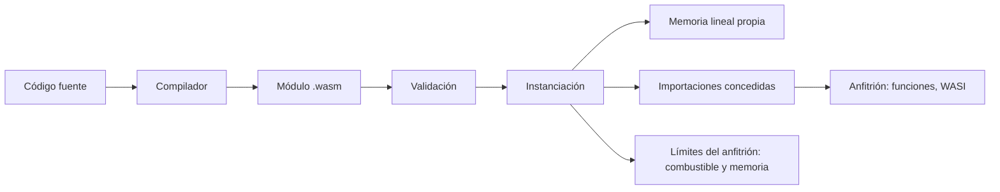
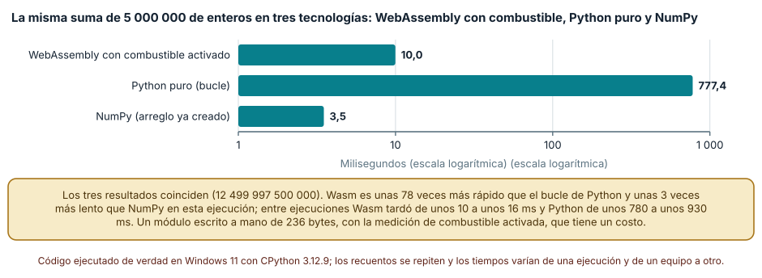

# SE-577 — WebAssembly y WASI

[← SE-564 — Proyecto: sistema de ML operable con evidencia](https://github.com/vladimiracunadev-create/modern-software-engineering-program/blob/main/classes/part-46-machine-learning-en-produccion-y-mlops/se-564-proyecto-sistema-de-ml-operable-con-evidencia/README.md) · [↑ Parte 48](https://github.com/vladimiracunadev-create/modern-software-engineering-program/blob/main/classes/part-48-runtimes-y-plataformas-modernas/README.md) · [📚 Índice completo](https://github.com/vladimiracunadev-create/modern-software-engineering-program/blob/main/classes/README.md) · [🌐 Portal](https://vladimiracunadev-create.github.io/modern-software-engineering-program/classes/SE-577.html) · [SE-578 — WebAssembly en servidor y borde: component model →](https://github.com/vladimiracunadev-create/modern-software-engineering-program/blob/main/classes/part-48-runtimes-y-plataformas-modernas/se-578-webassembly-en-servidor-y-borde-component-model/README.md)

## Punto profesional y fundamento pedagógico

**Punto profesional.** La clase existe para que dejes de tratar WebAssembly como «una forma de correr C++ en el navegador» y lo uses como lo que es: un formato binario portable, validado antes de ejecutarse, que corre dentro de una memoria lineal propia y que solo puede tocar el mundo a través de las funciones que quien lo ejecuta decide ofrecerle. Esa combinación (portabilidad, validación, memoria acotada, capacidades explícitas) es la razón por la que aparece en plugins, funciones en el borde, extensiones de bases de datos y ejecución de código de terceros. Quien lo adopta sin entender dónde termina su aislamiento termina entregando al módulo un directorio entero «porque era más fácil» o confiando en que un límite de memoria detiene un bucle infinito.

**Por qué aparece aquí.** Abre la Parte 48 porque es el runtime moderno más pequeño que permite observar, con código que se ejecuta de verdad, las tres preguntas de toda la parte: qué se aísla, qué cuesta el aislamiento y qué sigue dependiendo de la confianza en quien lo implementa. Retoma lo aprendido en `SE-017` y `SE-020` sobre cómo un programa se convierte en instrucciones, bytecode y JIT, y prepara `SE-578` (servidor, borde y componentes), `SE-582` (contenedores, microVM y sandboxes) y `SE-588` (el proyecto de plataforma).

**Error conceptual que debe corregir.** Creer que «WebAssembly es seguro» es una propiedad del formato. La seguridad es de la combinación formato más anfitrión: el formato garantiza que un módulo válido no puede escribir fuera de su memoria ni saltar a una dirección arbitraria; el anfitrión decide qué funciones importa el módulo, cuánta memoria y cuánto tiempo de CPU puede gastar. Un módulo sin importaciones es inofensivo salvo que consuma CPU; un módulo con una importación que ejecuta comandos del sistema no lo es. En esta clase se miden ambos extremos.

**Secuencia de aprendizaje.** Antes de ejecutar, predices tres cosas: qué hace un módulo cuando lee fuera de su memoria, qué pasa con un bucle infinito y cuántas veces más lento que Wasm es un bucle de Python puro sobre la misma suma. Después compilas un módulo escrito a mano en texto (WAT), lo ejecutas con `wasmtime`, provocas la trampa, cortas el bucle con combustible, comparas con Python y NumPy y repites el módulo de WASI con y sin un directorio concedido.

**Evidencia de aprendizaje.** `modulo-wasm.md` con el texto WAT del módulo, su tamaño en bytes, las importaciones que declara, las tres pruebas de contención (memoria, combustible, directorio) y la decisión sobre qué importaciones concedería *Avisos* a reglas escritas por terceros.

**Límite de la conclusión.** Se ejecutó `wasmtime` 50.0.1 desde Python 3.12.9 en Windows 11, con un módulo de 236 bytes escrito a mano; no se compiló C, Rust ni ningún otro lenguaje a Wasm, no se midió un navegador y no se ejecutó ningún módulo de terceros. Los tiempos varían de una ejecución a otra (la suma de cinco millones de enteros tardó entre unos 10 y unos 16 ms en Wasm). No se invocó ningún modelo de lenguaje.

### Trazabilidad fuente → afirmación

| Fuente primaria u oficial | Afirmación que respalda | Lo que no prueba |
|---|---|---|
| [WebAssembly Core Specification](https://webassembly.github.io/spec/core/) | Define el formato binario y de texto, la validación previa a la ejecución, la memoria lineal en páginas de 64 KiB, las trampas, y las importaciones y exportaciones como única interfaz de un módulo. | No dice nada sobre el costo de ejecutarlo en tu máquina. |
| [WebAssembly: Security](https://webassembly.org/docs/security/) | Describe el modelo de seguridad: módulos que corren en un entorno aislado, sin acceso al exterior salvo por lo que el anfitrión les da. | No promete ausencia de errores en cada implementación. |
| [WASI](https://wasi.dev/) y [su repositorio](https://github.com/WebAssembly/WASI) | Define interfaces de sistema basadas en capacidades: un módulo opera solo sobre los descriptores que recibe. | No fija qué capacidades es sensato conceder en tu producto. |
| [Documentación de Wasmtime](https://docs.wasmtime.dev/) y su [`Config`](https://docs.wasmtime.dev/api/wasmtime/struct.Config.html) | Documenta el combustible (`consume_fuel`), los límites de recursos y el modo de enlazar importaciones. | No audita el código del runtime. |
| [Wasmtime: Security](https://docs.wasmtime.dev/security.html) | Declara el modelo de amenazas del runtime y los límites de lo que se considera una vulnerabilidad. | No sustituye una revisión de tu integración. |

## Antes de empezar

Recupera lo aprendido en `SE-019` y `SE-018` sobre procesos y memoria: un proceso tiene un espacio de direcciones propio y el sistema operativo lo protege de los demás. La pregunta activa es: **¿qué ganarías y qué perderías si el «proceso» donde corre el código de un tercero fuera un módulo que ni siquiera puede nombrar una dirección fuera de su propia memoria, y qué tendrías que construir tú encima?**

## Prerrequisitos

- Haber completado `SE-017` a `SE-021` (CPU, memoria, procesos, compilación y runtimes) y `SE-385` (modelo de amenazas).
- Saber qué es una pila, un salto y una llamada a función; no hace falta haber escrito ensamblador.
- Python 3.11 o posterior. Para repetir el experimento: `pip install wasmtime==50.0.1 numpy` (si falta `wasmtime`, el script imprime `NO EJECUTADO` y no inventa nada).
- Lectura previa opcional: `SE-399` y `SE-400` (dependencias y procedencia) para el tema de código de terceros.

## Problema auténtico

*Avisos* vende a universidades un servicio de recordatorios de entregas. Tres universidades piden lo mismo: «queremos escribir nuestra propia regla para decidir cuándo avisar». Una quiere avisar el viernes por la tarde de lo que vence el lunes; otra, distinto según la carrera; otra, según un calendario académico propio. La primera tentación es aceptar un fragmento de Python o JavaScript y ejecutarlo con `exec`. Basta una regla con un bucle infinito para detener el servicio de todos, una con acceso al sistema de archivos para leer las reglas y los datos de otra universidad, una con acceso a la red para sacar datos de estudiantes.

La clase reconstruye la ejecución de esas reglas como módulos de WebAssembly. Se compila un módulo pequeño, se llama desde Python, se le hace leer fuera de su memoria, se le entrega un bucle infinito, se le pide más memoria de la que permite y se mide cuánto más lento sería escribir la misma regla en Python puro. Después se repite con WASI para ver la diferencia entre «el módulo puede abrir cualquier archivo» y «el módulo solo puede abrir lo que está dentro del directorio que se le concedió».

## Objetivos observables

Al terminar podrás:

1. describir qué contiene un módulo de WebAssembly (tipos, funciones, memoria, importaciones, exportaciones) y por qué se valida antes de ejecutarse;
2. explicar qué garantiza el formato (no salir de su memoria, no saltar a direcciones arbitrarias) y qué debe garantizar el anfitrión (CPU, memoria máxima, qué importa);
3. provocar y leer una trampa por acceso fuera de memoria y un corte por combustible, y decir por qué el almacén sigue siendo utilizable después;
4. explicar el modelo de capacidades de WASI con un experimento: el mismo módulo con y sin un directorio concedido;
5. estimar con una medición la distancia entre Wasm, Python puro y una librería vectorizada para una misma suma, y decir qué parte de esa distancia es del formato y qué parte del lenguaje que lo genera.

## Mapa conceptual



El módulo solo existe como binario hasta que pasa la validación; al instanciarse recibe una memoria propia y las importaciones que el anfitrión decide enlazar. Lo que el módulo puede hacer al exterior es exactamente lo que cruza el recuadro de importaciones, y lo que el anfitrión puede imponerle (combustible, límite de memoria) no depende de la buena voluntad del módulo.

## Temas y por qué importan

| Tema | Por qué cambia una decisión profesional | Evidencia mínima |
|---|---|---|
| Formato binario y validación | Se rechaza un módulo mal formado antes de ejecutarlo. | Tamaño y cabecera del módulo |
| Memoria lineal | Un acceso fuera de rango es una trampa, no una corrupción de memoria ajena. | Trampa en la dirección 70 000 |
| Importaciones y exportaciones | Son la única superficie de contacto entre módulo y anfitrión. | Lista de importaciones |
| Combustible y límites | El aislamiento de memoria no limita CPU; hay que medirla y cortarla. | Bucle infinito detenido |
| WASI y capacidades | El sistema de archivos se concede por directorio, no por ruta global. | Mismo módulo con y sin directorio |
| Rendimiento | Wasm es rápido frente a un intérprete, no frente a código vectorizado. | Tres tiempos sobre la misma suma |
| Qué no resuelve | No protege contra un anfitrión mal configurado ni contra fugas por canales laterales. | Lista de supuestos |

## Conceptos y decisiones

### 1. Un módulo es un binario validado, no un programa que «se confía»

Un módulo de WebAssembly es una secuencia de secciones: tipos de función, importaciones, funciones, memoria, exportaciones y código. El código es de una máquina de pila con tipos estáticos: cada instrucción declara qué consume y qué produce, y la validación comprueba, sin ejecutar nada, que cada función deja la pila como su tipo promete, que los saltos van a etiquetas estructuradas (bloques y bucles anidados, no direcciones arbitrarias) y que las llamadas respetan los tipos. El módulo del laboratorio, escrito en texto (WAT) con cinco funciones y una memoria, ocupa **236 bytes** una vez compilado a binario, y los primeros ocho bytes son `0061736d01000000`: la marca `\0asm` y la versión 1. La validación explica una propiedad que rara vez se enuncia: un módulo válido no puede contener un salto a una dirección calculada ni a mitad de otra función. Eso elimina de raíz la clase de ataques que reutilizan fragmentos de código existente mediante saltos a direcciones inesperadas, porque la estructura de control no se puede expresar.

### 2. La memoria lineal es la frontera

Un módulo recibe una memoria lineal: un arreglo de bytes que crece en páginas de 64 KiB y que solo se direcciona con enteros relativos a su inicio. No existe la instrucción «leer la dirección absoluta X del proceso». En el experimento, el módulo declara una página (65 536 bytes) y se le pide leer en la dirección 70 000: el runtime responde con una trampa (`out of bounds memory access`), el llamador recibe una excepción y, lo importante, el almacén sigue utilizable: llamar después a `add(40, 2)` devuelve 42. La trampa mata la llamada, no el servicio. Esa propiedad es la que permite ejecutar muchas reglas ajenas en el mismo proceso del anfitrión sin que una corrompa el estado de otra.

### 3. La memoria acotada no acota la CPU

El aislamiento de memoria no hace nada contra un bucle infinito. El módulo `spin` del laboratorio (`loop $l (br $l)`) es válido, no toca memoria ni importa nada, y se queda ejecutando para siempre. El anfitrión necesita un mecanismo propio: en `wasmtime` es el **combustible**. Se activa en la configuración (`consume_fuel`), se asigna una cantidad al almacén con `set_fuel`, y cada instrucción ejecutada la consume; al agotarse hay una trampa (`all fuel consumed by WebAssembly`). Con 5 000 000 de unidades, el bucle infinito se detuvo en unos 11 ms. Dos consecuencias de diseño: el combustible mide trabajo, no tiempo de reloj (una importación lenta del anfitrión no gasta combustible), y activar la medición tiene un costo de ejecución que se paga en toda llamada. Por eso la suma de la sección de rendimiento se midió con la medición activada: los números son los de un anfitrión que se protege.

### 4. Quien incrusta el runtime puede limitar más que el módulo

El módulo del laboratorio declara una memoria de una a dos páginas. `memory.grow(1)` devuelve 1 (había una página) y un segundo `memory.grow(1)` devuelve −1: el tope declarado por el propio módulo. Pero el anfitrión puede imponer un tope más estricto: con `set_limits(memory_size=65536)` en el almacén, el primer `memory.grow(1)` ya devuelve −1. El dato importante es la asimetría: el módulo propone un máximo y el anfitrión lo recorta; nunca al revés. Un servicio que ejecuta código ajeno debe fijar su propio tope, porque confiar en el que declara el módulo es dejar el límite en manos de quien se quiere limitar.

### 5. Las importaciones son las capacidades

Un módulo que no declara importaciones (el del laboratorio declara cero) no puede hacer nada observable fuera de su memoria y de sus valores de retorno. Todo lo demás llega como una importación: una función del anfitrión que el módulo nombra por módulo y por nombre y que el anfitrión debe definir al enlazar. Ese diseño convierte «¿qué puede hacer este código?» en una pregunta que se contesta leyendo una lista: las importaciones del módulo. Si una regla de una universidad pide `host.enviar_red`, el anfitrión decide si existe esa función, con qué validación y con qué destino fijo. Si no la define, el módulo no se instancia: la ausencia de la capacidad se descubre al enlazar, no con un fallo en medio de una petición.

### 6. WASI: capacidades para el sistema, no una puerta general

WASI (WebAssembly System Interface) es un conjunto de importaciones estandarizadas para lo que casi todos los programas necesitan: salida estándar, archivos, reloj, aleatoriedad, argumentos. Su diseño se basa en capacidades: un módulo no abre «la ruta /etc/passwd», abre una ruta relativa a un descriptor que ya posee. El anfitrión *preabre* directorios y los entrega con un nombre. En el experimento, un mismo módulo imprime «hola desde wasm» por su salida estándar y luego intenta `path_open('secreto.txt')` sobre el descriptor 3. Sin ningún directorio concedido, la llamada devuelve el código WASI 8 (`EBADF`: ese descriptor no existe); con el directorio temporal concedido como `/datos`, devuelve 0 (abierto). No hay una instrucción para nombrar una ruta absoluta del anfitrión: el alcance del módulo es el conjunto de descriptores que recibió. La consecuencia práctica: el principio de mínimo privilegio se traduce en *qué directorios preabres y con qué derechos*.

### 7. Rendimiento: rápido frente a un intérprete, no frente al código vectorizado

Para la suma de los enteros 0 a 4 999 999 (la misma operación en tres formas), Wasm con medición de combustible tardó del orden de 10 a 16 ms, un bucle de Python puro unos 780 a 930 ms (entre 58 y 78 veces más lento) y `numpy` unos 3,5 a 5 ms sobre un arreglo ya creado. Los tres resultados coinciden (12 499 997 500 000). La lectura correcta no es «Wasm es lento» ni «Wasm es rápido»: Wasm es un código de bajo nivel compilado por el runtime a instrucciones nativas, y por eso gana a un intérprete; NumPy es una biblioteca escrita en C con vectorización y le gana a un bucle escalar escrito a mano en Wasm. Elegir Wasm para una regla de negocio de unos pocos cientos de instrucciones es razonable; elegirlo para multiplicar matrices frente a una biblioteca optimizada no.

### 8. Qué no garantiza

El aislamiento de Wasm no protege de un anfitrión mal configurado (una importación que ejecuta comandos con el texto que le pasa el módulo reintroduce todo el riesgo), ni de errores del propio runtime (existen y se corrigen como en cualquier software), ni de canales laterales de temporización compartiendo un procesador con otro inquilino. Tampoco protege de un módulo que *hace lo que debe de forma maliciosa*: una regla de aviso que decide mal a quién avisar está dentro de su contrato. Cada una de esas fronteras pide una capa distinta, que es el tema de `SE-582`.

## Rendimiento: tres formas de la misma suma

La primera medida repite la misma suma en Wasm (con combustible activado), en Python puro y con NumPy.



**Cómo leer la figura.** Cada barra es la misma suma con una tecnología distinta y la escala es logarítmica: una barra el doble de larga no es el doble de lenta. Mira primero la distancia entre Python puro y Wasm, que es la del intérprete frente al código compilado, y después la de NumPy, que es la de una biblioteca vectorizada. **Dónde deja de valer:** una sola máquina, una sola ejecución (los tiempos de Wasm variaron entre unos 10 y unos 16 ms entre ejecuciones), un módulo escrito a mano y no generado por un compilador de un lenguaje real, y NumPy medido sin contar la creación del arreglo. No generaliza a cargas con memoria, llamadas al anfitrión o matrices.

## Qué cruza la frontera

La segunda figura sigue una llamada desde el anfitrión hasta el recurso y dibuja dónde se decide cada permiso.


**Cómo leer la figura.** De izquierda a derecha está el camino de una operación del módulo hacia un recurso del sistema: nada llega al recurso sin pasar por una importación que el anfitrión definió. Mira la caja del anfitrión: es la única donde se decide, y por eso es donde se revisa. **Dónde deja de valer:** el diagrama supone un anfitrión que implementa bien lo que concede; no muestra el cuerpo de las funciones del anfitrión, que es donde viven los errores reales de integración.

## Qué contiene cada mecanismo

La tercera figura cruza cinco escenarios con los mecanismos que los contienen.


**Cómo leer la figura.** Cada fila es algo que una regla ajena podría intentar y cada columna un mecanismo; la celda marcada es el que lo contiene. Mira que cada escenario tiene una sola columna marcada: si falta configurar ese mecanismo, nadie más lo contiene. **Dónde deja de valer:** la figura resume lo que se ejercitó en el laboratorio, no una enumeración de ataques; un escenario que no está en las filas (por ejemplo, agotar el espacio con muchas instancias) necesita un mecanismo que aquí no se midió.

## Definiciones de trabajo

- **Módulo:** unidad compilada de WebAssembly (binario `.wasm` o texto `.wat`).
- **Instancia:** módulo con su memoria y sus importaciones ya enlazadas.
- **Memoria lineal:** arreglo de bytes de la instancia, en páginas de 64 KiB.
- **Trampa:** terminación controlada de la llamada por una condición ilegal (acceso fuera de rango, combustible agotado).
- **Importación:** función, memoria o tabla que el módulo pide al anfitrión por módulo y nombre.
- **Combustible:** contador de trabajo que el runtime descuenta por instrucción para poder detener una ejecución.
- **Capacidad:** referencia no falsificable a un recurso (por ejemplo, un descriptor de directorio) que permite operar sobre él.
- **WASI:** interfaz de sistema estandarizada para módulos, basada en capacidades.

## Ejemplo mínimo

El módulo más pequeño útil: suma dos enteros y declara cero importaciones.

```python
from wasmtime import Engine, Store, Module, Instance, wat2wasm

wat = '(module (func (export "add") (param i32 i32) (result i32) local.get 0 local.get 1 i32.add))'
engine = Engine()
store = Store(engine)
modulo = Module(engine, wat2wasm(wat))
print(len(modulo.imports))                      # 0: no pide nada al anfitrión
instancia = Instance(store, modulo, [])
suma = instancia.exports(store)["add"]
print(suma(store, 2, 3))                        # 5
```

Cero importaciones significa que ese módulo no puede observar ni modificar nada fuera de sus valores de retorno. Añadir una sola importación cambia la conversación: se pasa de «este código es inofensivo» a «este código es tan seguro como la función del anfitrión que recibe».

## Ejemplo profesional

*Escenario ilustrativo: las cifras y los resultados que aparecen en este ejemplo son supuestos de la narración, no mediciones.*

El equipo de *Avisos* decide aceptar reglas de las universidades como módulos de Wasm. Define un contrato mínimo: la regla exporta `debe_avisar(horas_para_vencer, dia_semana, minutos_de_aviso_previo) -> i32` y no importa nada. El servicio carga el módulo, comprueba que declara cero importaciones (si declara alguna, se rechaza con el nombre), crea una instancia nueva por llamada, le asigna combustible suficiente para unas miles de instrucciones y una memoria máxima de una página, y registra cuántas reglas agotan combustible. Durante la primera semana, una universidad sube una regla con un bucle que recorre un calendario embebido: agota el combustible, la llamada falla, el servicio responde con la regla por defecto y el panel muestra la causa con el nombre de la universidad. Nadie vio una caída. El equipo tuvo que decidir después qué hacer con una regla que falla: cerrarla por defecto (avisar siempre) o abrirla (no avisar). Eligió avisar siempre y registrar el fallo, porque un aviso de más cuesta menos que un estudiante sin aviso. El contrato fijó esa decisión por escrito.

## Práctica guiada

1. Instala `wasmtime==50.0.1` y ejecuta `python scripts/experiments_part48_a.py wasm`. Compara tu predicción de la trampa, del bucle infinito y de las tres sumas con lo medido.
2. Cambia en el WAT el límite de memoria a una sola página fija (`(memory 1 1)`) y repite `memory.grow`: anota qué devuelve.
3. Ejecuta `python scripts/experiments_part48_a.py wasi` y repite quitando la línea que concede el directorio: anota el código de error.
4. Escribe la lista de importaciones que concederías a una regla de *Avisos* (ninguna, reloj, registro) y justifica por escrito cada una.
5. Mide la suma con 500 000 y con 50 000 000 de elementos en Wasm y en Python y observa si la razón se mantiene.

## Ejercicios

1. **Básico.** Explica por qué una lectura en la dirección 70 000 falla con 65 536 bytes de memoria y por qué el siguiente `add` sigue funcionando.
2. **Intermedio.** Escribe un módulo con una importación `host.registrar(i32)` que el módulo llame con el resultado de una cuenta; define la función en el anfitrión y comprueba que registra el valor. Explica qué cambió en la superficie de ataque.
3. **Avanzado.** Diseña el límite de combustible de *Avisos*: mide las instrucciones de una regla típica, propone un tope con margen, define la política ante una regla que lo agota y la prueba que garantiza que el tope se revisa si la regla típica cambia.

## Reto verificable

Entrega `modulo-wasm.md` y el código de un módulo propio de al menos tres funciones. Es válido si otra persona reproduce con la misma versión de `wasmtime` la trampa de memoria, el corte por combustible y el cambio de código de WASI al conceder o no un directorio, y si la lista de importaciones del documento coincide con las del módulo.

## Caso conductor

*Avisos* abre un punto de extensión para reglas de terceros. Esta clase muestra el mecanismo que lo hace posible sin dar acceso al proceso entero: memoria acotada, importaciones explícitas y límites del anfitrión. `SE-578` lleva la misma idea a un servidor que atiende muchas peticiones y a un borde donde el arranque en frío manda.

## Preguntas frecuentes

### ¿Wasm es más seguro que un contenedor?

Son fronteras distintas. Wasm aísla *dentro de un proceso* con un costo de creación muy bajo y una superficie pequeña (las importaciones); un contenedor aísla procesos del sistema operativo compartiendo el núcleo. No se comparan por «más o menos seguro» sino por qué amenaza contienen y cuánto cuesta cada una (`SE-582`).

### ¿Necesito escribir WAT a mano?

No. El texto se usa aquí para ver el mecanismo sin un compilador de por medio. En producción el módulo sale de C, C++, Rust, Go u otro lenguaje con un compilador que apunta a Wasm. Lo que importa es leer sus importaciones y su memoria.

### ¿Por qué no usar `exec` de Python con builtins vacíos?

Porque un intérprete con las funciones peligrosas retiradas no es una frontera: en `SE-582` se muestra que desde un `exec` sin `builtins` se alcanza igualmente la lista de clases del intérprete. La frontera de Wasm es estructural (el formato no puede expresar la operación); la de un lenguaje es una lista de lo que se olvidó quitar.

### ¿WASI es lo mismo que POSIX?

No. WASI toma ideas de POSIX (descriptores, archivos, reloj) pero cambia el modelo: no hay ruta global ni usuario ni permisos del sistema; hay capacidades que el anfitrión concede.

## Fallo controlado y diagnóstico

**Fallo.** Una regla nueva de una universidad se carga sin errores y después de unos minutos el servicio responde cada vez más lento, aunque la regla no importa nada y ninguna llamada termina en trampa.

**Diagnóstico paso a paso.** (1) Se mira el combustible consumido por llamada: la regla consume el tope en cada llamada sin agotarlo, así que no hay trampa. (2) El tope se había fijado por el peor caso de otra regla y es cientos de veces mayor que el trabajo normal. (3) Cada petición de esa universidad ocupa un hilo del servicio el tiempo del tope. (4) El combustible mide instrucciones, no tiempo de reloj: no protege contra un tope demasiado generoso. (5) La corrección es fijar el combustible por regla a partir de su consumo medido más un margen, añadir un tiempo máximo de reloj aparte (una interrupción por época o un temporizador del anfitrión) y avisar cuando una regla consume más de la mitad de su tope.

**Lección.** Un límite que nunca se alcanza no protege, y un límite mal elegido es una vulnerabilidad de disponibilidad. El aislamiento de memoria y el de CPU son dos mecanismos que se configuran y se prueban por separado.

## Errores comunes y cómo corregirlos

- **Conceder un directorio amplio «por comodidad».** Reintroduce el acceso a archivos ajenos. Corrige concediendo solo el subdirectorio necesario y con los mínimos derechos.
- **Confiar en el máximo de memoria que declara el módulo.** Lo declara quien se quiere limitar. Corrige con el límite del anfitrión.
- **No limitar la CPU.** La memoria acotada no detiene un bucle. Corrige con combustible y con un tiempo máximo de reloj.
- **Reutilizar una instancia entre peticiones.** El estado de una se filtra a la siguiente (`SE-578` lo mide). Corrige con una instancia por petición o con borrado explícito.
- **Importar una función del anfitrión que ejecuta lo que el módulo le dice.** El aislamiento se rompe en la importación. Corrige con funciones de propósito único y validación de cada argumento.
- **Medir rendimiento con una sola ejecución.** Los tiempos varían. Corrige con la mediana de varias y declarando el entorno.

## Entorno y archivos clave

- `scripts/experiments_part48_a.py`: funciones `wasm` y `wasi`; se ejecutan con `python scripts/experiments_part48_a.py wasm wasi`.
- `scripts/experiments_part48_lab.py`: versiones con las que se obtuvieron los números y utilidades de medición.
- `scripts/figures_part48_a.py`: las tres figuras de la clase.
- Requiere `wasmtime==50.0.1` y NumPy; sin `wasmtime` el experimento imprime `NO EJECUTADO` con el motivo.

## Seguridad, ética y accesibilidad

Ejecutar código de terceros es una decisión sobre datos de personas: una regla que decide a quién se avisa afecta a estudiantes reales, y un módulo con acceso a datos de otra universidad es una brecha. Mantén el registro de reglas con propietario, versión y huella (SHA-256) del binario, y no ejecutes un módulo cuyo origen no puedas rastrear. Los mensajes de error no deben incluir los datos del estudiante que procesaba la regla. Las figuras llevan texto alternativo completo y no dependen solo del color: cada barra y cada celda lleva su valor escrito.

## Puente hacia el trabajo con agentes

Un agente de código que ejecuta herramientas necesita la misma frontera: lo que el agente escribe o instala es código de un tercero (el modelo) que corre con los permisos del usuario. La pregunta de esta clase se traduce directamente: ¿qué importaciones tiene la herramienta que le das (leer archivos, ejecutar comandos, red) y cuál es el tope de trabajo antes de que otra persona decida? Si un agente propone ejecutar un fragmento, pídele la lista de capacidades que necesita y ejecútalo con solo esas. No aceptes «necesita acceso al directorio del proyecto» como respuesta: pide qué archivos, con qué derechos y para qué.

## Transferencia

Elige un punto de tu sistema donde hoy ejecutas código o configuración de otra persona (un plugin, una regla, una macro, un script de cliente). Lista qué puede hacer hoy ese código (archivos, red, variables de entorno, CPU, memoria) y escribe la lista de lo que *deberías* poder responder sobre él. Decide si un módulo con importaciones explícitas y límites del anfitrión lo contendría y qué parte seguiría dependiendo de la confianza.

## Evaluación y evidencia

| Criterio | Evidencia aceptable | Rechazo |
|---|---|---|
| Contención de memoria | Trampa reproducida y almacén reutilizable | «Wasm es seguro» sin ejecución |
| Contención de CPU | Bucle detenido con combustible y su tiempo | Solo un límite de memoria |
| Capacidades | Lista de importaciones y resultado con y sin directorio | Directorio amplio sin justificar |
| Rendimiento | Mediana de varias ejecuciones y entorno declarado | Una sola medición sin entorno |
| Límites | Qué no cubre el aislamiento | Afirmación absoluta de seguridad |

## Fuentes

- WebAssembly Community Group. [«WebAssembly Core Specification»](https://webassembly.github.io/spec/core/) y [«Security»](https://webassembly.org/docs/security/).
- WebAssembly. [WASI](https://wasi.dev/) y [repositorio](https://github.com/WebAssembly/WASI).
- Bytecode Alliance. [Documentación de Wasmtime](https://docs.wasmtime.dev/), [`Config`](https://docs.wasmtime.dev/api/wasmtime/struct.Config.html) y [«Security»](https://docs.wasmtime.dev/security.html).
- Python Package Index. [`wasmtime`](https://pypi.org/project/wasmtime/).
- NumPy. [Documentación](https://numpy.org/doc/stable/).

## Límites y siguiente paso

Se ejecutó un módulo escrito a mano de 236 bytes con `wasmtime` 50.0.1 en una máquina; no se midió ningún módulo generado por un compilador, ningún navegador, ningún otro runtime ni WASI con red o sockets. El siguiente paso, `SE-578`, pasa del módulo único al servicio que atiende muchas peticiones: qué cuesta arrancar una instancia, cómo se evita que una petición filtre estado a la siguiente y qué añade el modelo de componentes.

## Glosario

| Término | Definición breve |
|---|---|
| Módulo | Unidad compilada de WebAssembly |
| Instancia | Módulo con memoria e importaciones enlazadas |
| Memoria lineal | Arreglo de bytes de la instancia en páginas de 64 KiB |
| Trampa | Terminación controlada por una condición ilegal |
| Importación | Función o recurso que el módulo pide al anfitrión |
| Combustible | Contador de trabajo para detener ejecuciones |
| Capacidad | Referencia a un recurso que permite operar sobre él |
| WASI | Interfaz de sistema para módulos basada en capacidades |

---

[← SE-564 — Proyecto: sistema de ML operable con evidencia](https://github.com/vladimiracunadev-create/modern-software-engineering-program/blob/main/classes/part-46-machine-learning-en-produccion-y-mlops/se-564-proyecto-sistema-de-ml-operable-con-evidencia/README.md) · [↑ Parte 48](https://github.com/vladimiracunadev-create/modern-software-engineering-program/blob/main/classes/part-48-runtimes-y-plataformas-modernas/README.md) · [📚 Índice completo](https://github.com/vladimiracunadev-create/modern-software-engineering-program/blob/main/classes/README.md) · [🌐 Portal](https://vladimiracunadev-create.github.io/modern-software-engineering-program/classes/SE-577.html) · [SE-578 — WebAssembly en servidor y borde: component model →](https://github.com/vladimiracunadev-create/modern-software-engineering-program/blob/main/classes/part-48-runtimes-y-plataformas-modernas/se-578-webassembly-en-servidor-y-borde-component-model/README.md)
