# Parte 49 — Patrones agénticos y sistemas con LLM

La Parte 48 estudió el harness que rodea a un agente de programación. La pregunta cambia de «¿cómo gobierno el entorno de un agente que programa?» a «¿cómo construyo, mido y opero un sistema que lleva un modelo de lenguaje dentro?». Esta parte recorre los patrones con que se organiza ese sistema (workflows, agentes, orquestadores, evaluadores, memoria, recuperación), los protocolos que lo conectan con otros (MCP y A2A) y las condiciones que lo hacen operable: ejecución durable, evaluación con ruido, costo, latencia, seguridad y degradación. Usa un único caso sintético, el **asistente de *Avisos***, que atiende a coordinación con consultas de plazo, silencios de curso e incidencias abiertas.

## Pregunta rectora

> Para esta tarea, ¿qué patrón es el más simple que la resuelve, qué evidencia mide su calidad, su costo, su latencia y su riesgo, qué ocurre cuando se interrumpe o el proveedor falla, y qué condición hace reabrir la decisión?

## Antes del recorrido clase por clase

Esta parte no defiende «los agentes» ni los desaconseja. Enseña a tratar cada patrón como una decisión de **quién controla el siguiente paso**, con un costo y un modo de fallo medibles. Compara un workflow fijo con un agente por tipo de solicitud (`SE-589`), mide una cadena con puertas, dos enrutadores y la paralelización con hilos reales (`SE-590`), reparte trabajo con un orquestador y mide un bucle de revisión con un verificador exacto y con un juez ruidoso (`SE-591`), contrasta ReAct con planificar y replanificar (`SE-592`), compara cinco estrategias de memoria (`SE-593`) y recupera sobre el corpus de las Partes 47 y 45 con tres recuperadores (`SE-594`). Después habla con un servidor JSON-RPC real por entrada y salida estándar (`SE-595`), prueba un diario SQLite con caídas inyectadas (`SE-596`), mide la potencia de una puerta de evaluación y el sesgo de un juez (`SE-597`), modela costo, latencia y ataques (`SE-598`), elige un patrón y degrada ante un incidente (`SE-599`) y somete cuatro candidatos a una puerta de entrada a producción (`SE-600`).

```mermaid
flowchart LR
    A[Workflows frente a agentes] --> B[Encadenar, enrutar, paralelizar]
    B --> C[Orquestador y evaluador]
    C --> D[ReAct, plan y reflexión]
    D --> E[Memoria]
    E --> F[Recuperación]
    F --> G[MCP y A2A]
    G --> H[Ejecución durable]
    H --> I[Evals y LLMOps]
    I --> J[Costo, latencia, seguridad]
    J --> K[Taller: elegir y degradar]
    K --> L[Proyecto: sistema evaluado y operable]
    L -->|fallos reales| A
```

El diagrama se lee de izquierda a derecha y no es un proceso obligatorio. El retorno indica que los fallos de operación vuelven al primer criterio: un sistema con LLM se revisa con la evidencia de lo que no vio.

## Resultados acumulativos

Podrás clasificar una solicitud con tres preguntas (camino conocido, acciones reversibles, presupuesto de pasos), medir el costo de un bucle de agente frente al de un workflow y decidir un híbrido; calcular el éxito de una cadena y colocar una puerta programática, comparar un enrutador por reglas y uno estadístico con umbral y medir la ganancia real de paralelizar y de votar.

Podrás repartir trabajo de forma dinámica y medir cuándo compensa, escribir un verificador que devuelva fallas concretas y medir la convergencia de un bucle de revisión; elegir entre ReAct, un plan único, un plan con replanificación y una reflexión según la tasa de sorpresas, y diseñar la memoria de un agente con clave, versión, origen y caducidad.

Podrás medir un recuperador con acierto y rango recíproco, combinar dos con fusión por rango, fijar un umbral de abstención y medir si una reformulación mejora; hablar el protocolo de un servidor de herramientas, distinguir un error de protocolo de uno de herramienta y definir la regla del cliente ante descripciones no confiables.

Podrás diseñar un diario de pasos y una clave de idempotencia que hagan seguro reanudar y repetir, elegir una política de reintento por el pico que produce, evaluar con una puerta estadística con falsos positivos y potencia conocidos, calcular costo y latencia en el caso malo, evaluar las capacidades de un agente con la regla de las tres condiciones y comparar defensas por su costo de utilidad. Y podrás escribir un selector de patrón, una escalera de degradación y una puerta de entrada a producción con su documento de límites.

## Prerrequisitos enlazados

- [Parte 13 — Especificaciones, contratos y modelos](https://github.com/vladimiracunadev-create/modern-software-engineering-program/blob/main/classes/part-13-especificaciones-contratos-y-modelos/): esquemas, contratos y claves.
- [Parte 25 — Diseño, patrones y refactorización](https://github.com/vladimiracunadev-create/modern-software-engineering-program/blob/main/classes/part-25-diseno-patrones-y-refactorizacion/): costuras y estructura de componentes.
- [Parte 32 — Concurrencia y sistemas distribuidos](https://github.com/vladimiracunadev-create/modern-software-engineering-program/blob/main/classes/part-32-concurrencia-y-sistemas-distribuidos/): fallos parciales, reintentos e idempotencia.
- [Parte 35 — Estrategia y técnicas de prueba](https://github.com/vladimiracunadev-create/modern-software-engineering-program/blob/main/classes/part-35-estrategia-y-tecnicas-de-prueba/): métricas de prueba, dobles y mutación.
- [Parte 36 — Calidad, rendimiento y resiliencia](https://github.com/vladimiracunadev-create/modern-software-engineering-program/blob/main/classes/part-36-calidad-rendimiento-y-resiliencia/): percentiles, colas y degradación.
- [Parte 38 — Seguridad, privacidad y cumplimiento](https://github.com/vladimiracunadev-create/modern-software-engineering-program/blob/main/classes/part-38-seguridad-privacidad-y-cumplimiento/): modelado de amenazas y mínimo privilegio.
- [Parte 46 — Desarrollo de software asistido por IA](https://github.com/vladimiracunadev-create/modern-software-engineering-program/blob/main/classes/part-46-desarrollo-de-software-asistido-por-ia/): evaluaciones de asistentes.
- [Parte 47 — SPEC, agentes y ciclo de vida agentic](https://github.com/vladimiracunadev-create/modern-software-engineering-program/blob/main/classes/part-47-spec-agentes-y-ciclo-de-vida-agentic/): especificar, delegar y detener a un agente.
- [Parte 45 — Metodologías de desarrollo: de TDD a ODD](https://github.com/vladimiracunadev-create/modern-software-engineering-program/blob/main/classes/part-45-metodologias-de-desarrollo-de-tdd-a-odd/): evaluaciones como puerta de release (`SE-549`) y política con evidencia (`SE-552`).
- Parte 48 (harness y agentic engineering): el entorno que gobierna a un agente; esta parte construye el sistema que lleva un modelo dentro.
- Python 3.11+ y terminal; los experimentos usan solo la biblioteca estándar. `SE-595` lanza un proceso hijo de Python y `SE-596` usa `sqlite3`.

## Bloques y progresión

1. **Elegir y componer el patrón:** las clases 505 a 508 comparan workflow y agente, construyen cadenas, enrutadores, paralelización, orquestadores y evaluadores, y abren el bucle del agente.
2. **Dar estado y conocimiento al sistema:** las clases 509 y 510 tratan la memoria y la recuperación.
3. **Conectarlo y hacerlo durable:** las clases 511 y 512 tratan los protocolos de interoperabilidad y la ejecución que sobrevive a interrupciones.
4. **Medirlo y operarlo:** las clases 513 y 514 tratan la evaluación con ruido y las restricciones de costo, latencia y seguridad.
5. **Aplicar e integrar:** las clases 515 y 516 eligen y degradan un patrón y someten un sistema a una puerta de entrada.

## Evidencia medida y límites

Las figuras y los ejemplos de esta parte usan experimentos ejecutados con la biblioteca estándar de Python en este repositorio. **No se invocó ningún modelo de lenguaje, no se ejecutó ningún producto de agentes o de recuperación de terceros (MCP o A2A de terceros, Temporal, bases vectoriales, frameworks de agentes) y no se evaluó ningún proveedor.** El «modelo» de los experimentos es un componente sintético con semilla fija y tasas de error declaradas. Lo que es código real y medido es todo lo que rodea al modelo: las herramientas, el enrutador, el verificador, los hilos, la recuperación sobre el corpus real de las Partes 47 y 45, el servidor JSON-RPC por un proceso hijo, el diario SQLite y la política de capacidades.

Los experimentos son: 2 000 solicitudes sintéticas con un workflow, un agente y un híbrido (`SE-589`); una cadena de tres pasos, dos enrutadores sobre 2 000 solicitudes, ocho subtareas con hilos reales y una votación (`SE-590`); 500 repasos con reparto fijo y dinámico y un bucle de revisión de un aviso con un verificador y con un juez ruidoso (`SE-591`); cuatro estrategias en 3 000 episodios por tasa de sorpresas (`SE-592`); cinco estrategias de memoria sobre 300 conversaciones de 80 turnos (`SE-593`); tres recuperadores sobre 835 fragmentos y 120 consultas sintéticas, con reformulación y abstención (`SE-594`).

Siguen una sesión real contra un servidor JSON-RPC lanzado como proceso hijo, con 300 llamadas medidas, y una máquina de estados con 12 000 transiciones (`SE-595`); un diario SQLite con tres estrategias y cuatro puntos de caída y una simulación de reintentos de mil clientes (`SE-596`); una puerta estadística con 800 evaluaciones por celda y cuatro tamaños, un juez con sesgo y 30 ejecuciones de un mismo sistema (`SE-597`); un modelo de costo, una simulación de latencia con 20 000 cadenas y una de 4 000 solicitudes con cuatro defensas (`SE-598`); un selector con ocho tareas y un incidente de 1 000 solicitudes (`SE-599`); y la comparación de cuatro candidatos frente a una puerta (`SE-600`).

Los parámetros (la tasa de pasos equivocados, el acierto del extractor, el sesgo del juez, la probabilidad de que el modelo obedezca una inyección, los umbrales del interruptor y de la puerta, las unidades de costo y las distribuciones de latencia) son construcciones del autor. Ninguna cifra es una tasa real de ningún modelo, producto o equipo. Los tiempos de reloj (paralelización, latencia del servidor) varían entre equipos; los recuentos con semilla son reproducibles. El «vector» de `SE-594` es un hash de trigramas de caracteres y no un modelo de embeddings semántico; las consultas salen del propio corpus y favorecen la coincidencia léxica. El servidor de `SE-595` usa nombres de métodos de MCP sobre JSON-RPC pero no es una implementación conforme de su especificación.

Lo que **no se hizo**: no se midió ningún modelo de lenguaje, proveedor, equipo ni sistema en producción; no se reprodujeron los resultados de los artículos citados; no se probó la seguridad contra ataques reales ni se auditó ningún servidor de terceros; la ejecución durable se ilustró con un diario SQLite y no con un motor real; el costo de la calidad que se pierde al degradar no se midió. Una revisión editorial humana independiente de la parte sigue pendiente. La ampliación de `SE-597` muestra con un clasificador pequeño cómo una evaluación contaminada infla la exactitud de un modelo que memoriza.

## Guía razonada clase por clase

*Avisos* conserva su dominio mientras cambia la arquitectura que lo atiende. Cada clase explica qué decisión de diseño estudia, qué experimento la mide, qué no demuestra y qué evidencia permitiría abandonar la conclusión.

### Bloque 1 — Elegir y componer el patrón

#### SE-589 — Workflows frente a agentes: cuándo no usar un agente

La autonomía se paga en llamadas, tokens y cola de latencia. La clase compara, sobre 2 000 solicitudes sintéticas, un workflow fijo, un agente y un híbrido, y muestra que el agente cuesta más cuanto más fijo era el camino y que el workflow no resuelve lo que no se puede escribir de antemano.

El estudiante entrega la clasificación de seis solicitudes de su sistema con una condición de revisión por decisión. `SE-590` construye los workflows.

#### SE-590 — Encadenado, enrutamiento y paralelización

Dividir en pasos multiplica los errores; la puerta los corta. La clase mide una cadena con y sin puerta, un enrutador por reglas frente a uno estadístico con umbral, el beneficio de los hilos reales y por qué una votación con errores correlacionados compra menos de lo que parece.

El estudiante entrega una puerta programática con sus pruebas y la regla de enrutamiento con su vía de escape. `SE-591` trata el trabajo que no se puede fijar.

#### SE-591 — Orquestador-trabajadores y evaluador-optimizador

Dividir según la entrada y revisar contra un criterio son dos formas de autonomía acotada. La clase mide cuánto gana un orquestador con carga desigual y por qué un verificador exacto converge en tres vueltas mientras un juez ruidoso se estanca.

El estudiante entrega un verificador con fallas concretas y un tope de vueltas con su acción al agotarlo. `SE-592` abre el bucle del agente.

#### SE-592 — ReAct, plan-and-execute y reflexión

La estabilidad del entorno decide el bucle. La clase compara cuatro estrategias en un entorno con contactos que faltan y muestra que el plan único cae del 100 % al 21 % cuando el 35 % de las observaciones sorprende, mientras la replanificación mantiene el 88 %.

El estudiante entrega la estrategia elegida para tres tareas con su tasa de sorpresas y el validador del plan. `SE-593` trata la memoria del bucle.

### Bloque 2 — Dar estado y conocimiento al sistema

#### SE-593 — Memoria y gestión de estado de agentes

La memoria de un agente es estado con costo y vigencia. La clase compara cinco estrategias y muestra que un almacén externo versionado recupera el 95 % de los hechos vigentes con 80 tokens y que uno sin versión devuelve el valor viejo.

El estudiante entrega el esquema de memoria de su agente con versión, origen y caducidad. `SE-594` trata cómo se lee cuando no se conoce la clave.

#### SE-594 — Embeddings, recuperación y agentic RAG

Buscar es un problema medible. La clase compara BM25, un vector de trigramas y su fusión sobre 835 fragmentos reales, mide la abstención por umbral y muestra que una reformulación automática no mejoró el acierto.

El estudiante entrega 20 consultas etiquetadas de su corpus con el acierto de dos recuperadores y su política de citas. `SE-595` sale del proceso.

### Bloque 3 — Conectarlo y hacerlo durable

#### SE-595 — Interoperabilidad entre agentes: MCP y A2A

Un protocolo común reduce integraciones y no resuelve la confianza. La clase ejecuta un servidor JSON-RPC real, distingue errores de protocolo y de herramienta, cuenta conectores con y sin protocolo y mide qué detecta un filtro de descripciones hostiles.

El estudiante entrega la traza de una sesión, la regla de su cliente y la tabla de permisos mínimos. `SE-596` trata qué ocurre cuando una llamada se interrumpe.

#### SE-596 — Ejecución durable, reintentos e idempotencia

El fallo que importa ocurre entre el efecto y su anotación. La clase prueba un diario SQLite con caídas inyectadas, muestra que solo la clave de idempotencia cierra esa ventana y compara tres políticas de reintento por el pico tras la recuperación.

El estudiante entrega la lista de pasos con efecto de su sistema con su clave y una prueba de caída. `SE-597` trata cómo se mide.

### Bloque 4 — Medirlo y operarlo

#### SE-597 — Evals y LLMOps de sistemas con LLM

Una evaluación es un instrumento con ruido. La clase mide falsos positivos y potencia de una puerta con cuatro tamaños de conjunto, el sesgo de un juez y la variación de un mismo sistema, y define una traza estructurada. La ampliación añade cuándo ajustar un modelo (fine-tuning) frente a instrucciones y recuperación y qué condiciones impone a la evaluación; la Parte 50, aún no publicada, trata el ciclo de vida de modelos.

El estudiante entrega 30 casos con su señal de calificación y una puerta fijada antes de medir. `SE-598` trata costo, latencia y seguridad.

#### SE-598 — Costo, latencia y seguridad en sistemas con LLM

El costo lo dicta el bucle, la latencia la cola y la seguridad la combinación de capacidades. La clase calcula el punto de equilibrio de una caché de prefijo, el p95 de cadenas y paralelos y compara cuatro defensas contra la inyección por lo que evitan y por lo que cuestan.

El estudiante entrega el presupuesto de su sistema y la evaluación de capacidades de su agente. `SE-599` los usa para elegir y degradar.

### Bloque 5 — Aplicar e integrar

#### SE-599 — Taller: elegir y degradar un patrón agéntico

Un selector hace repetible la elección y una escalera hace ordenada la caída. La clase prueba un selector sobre ocho tareas y simula un incidente de 1 000 solicitudes en el que degradar sube el éxito del 60,4 % al 70,7 % y baja el p95 de 24,9 a 13,7 segundos.

El estudiante entrega su selector con tres tareas propias y su escalera de degradación. `SE-600` la somete a una puerta de entrada.

#### SE-600 — Proyecto: sistema con LLM evaluado y operable

La calidad es una columna de cinco. La clase aplica una puerta de entrada a cuatro candidatos y muestra que solo el híbrido gobernado la supera; el estudiante repite el ejercicio con su propio sistema y documenta lo que no midió.

El estudiante entrega el dossier con la puerta, los resultados, las capacidades, la degradación, los límites y una condición de revisión. La Parte 26 usa el vocabulario de patrones de diseño para revisar estos y otros sistemas.

## Resumen operativo del recorrido

| Clase | Núcleo profesional | Aporte acumulativo |
|---|---|---|
| [SE-589](https://github.com/vladimiracunadev-create/modern-software-engineering-program/blob/main/classes/part-49-patrones-agenticos-y-sistemas-con-llm/se-589-workflows-frente-a-agentes-cuando-no-usar-un-agente/) | Workflows frente a agentes: cuándo no usar un agente | Entrega la clasificación de seis solicitudes de su sistema con una condición de revisión por decisión |
| [SE-590](https://github.com/vladimiracunadev-create/modern-software-engineering-program/blob/main/classes/part-49-patrones-agenticos-y-sistemas-con-llm/se-590-encadenado-enrutamiento-y-paralelizacion/) | Encadenado, enrutamiento y paralelización | Entrega una puerta programática con sus pruebas y la regla de enrutamiento con su vía de escape |
| [SE-591](https://github.com/vladimiracunadev-create/modern-software-engineering-program/blob/main/classes/part-49-patrones-agenticos-y-sistemas-con-llm/se-591-orquestador-trabajadores-y-evaluador-optimizador/) | Orquestador-trabajadores y evaluador-optimizador | Entrega un verificador con fallas concretas y un tope de vueltas con su acción al agotarlo |
| [SE-592](https://github.com/vladimiracunadev-create/modern-software-engineering-program/blob/main/classes/part-49-patrones-agenticos-y-sistemas-con-llm/se-592-react-plan-and-execute-y-reflexion/) | ReAct, plan-and-execute y reflexión | Entrega la estrategia elegida para tres tareas con su tasa de sorpresas y el validador del plan |
| [SE-593](https://github.com/vladimiracunadev-create/modern-software-engineering-program/blob/main/classes/part-49-patrones-agenticos-y-sistemas-con-llm/se-593-memoria-y-gestion-de-estado-de-agentes/) | Memoria y gestión de estado de agentes | Entrega el esquema de memoria de su agente con versión, origen y caducidad |
| [SE-594](https://github.com/vladimiracunadev-create/modern-software-engineering-program/blob/main/classes/part-49-patrones-agenticos-y-sistemas-con-llm/se-594-embeddings-recuperacion-y-agentic-rag/) | Embeddings, recuperación y agentic RAG | Entrega 20 consultas etiquetadas de su corpus con el acierto de dos recuperadores y su política de citas |
| [SE-595](https://github.com/vladimiracunadev-create/modern-software-engineering-program/blob/main/classes/part-49-patrones-agenticos-y-sistemas-con-llm/se-595-interoperabilidad-entre-agentes-mcp-y-a2a/) | Interoperabilidad entre agentes: MCP y A2A | Entrega la traza de una sesión, la regla de su cliente y la tabla de permisos mínimos |
| [SE-596](https://github.com/vladimiracunadev-create/modern-software-engineering-program/blob/main/classes/part-49-patrones-agenticos-y-sistemas-con-llm/se-596-ejecucion-durable-reintentos-e-idempotencia/) | Ejecución durable, reintentos e idempotencia | Entrega la lista de pasos con efecto de su sistema con su clave y una prueba de caída |
| [SE-597](https://github.com/vladimiracunadev-create/modern-software-engineering-program/blob/main/classes/part-49-patrones-agenticos-y-sistemas-con-llm/se-597-evals-y-llmops-de-sistemas-con-llm/) | Evals y LLMOps de sistemas con LLM | Entrega 30 casos con su señal de calificación y una puerta fijada antes de medir |
| [SE-598](https://github.com/vladimiracunadev-create/modern-software-engineering-program/blob/main/classes/part-49-patrones-agenticos-y-sistemas-con-llm/se-598-costo-latencia-y-seguridad-en-sistemas-con-llm/) | Costo, latencia y seguridad en sistemas con LLM | Entrega el presupuesto de su sistema y la evaluación de capacidades de su agente |
| [SE-599](https://github.com/vladimiracunadev-create/modern-software-engineering-program/blob/main/classes/part-49-patrones-agenticos-y-sistemas-con-llm/se-599-taller-elegir-y-degradar-un-patron-agentico/) | Taller: elegir y degradar un patrón agéntico | Entrega su selector con tres tareas propias y su escalera de degradación |
| [SE-600](https://github.com/vladimiracunadev-create/modern-software-engineering-program/blob/main/classes/part-49-patrones-agenticos-y-sistemas-con-llm/se-600-proyecto-sistema-con-llm-evaluado-y-operable/) | Proyecto: sistema con LLM evaluado y operable | Entrega el dossier con la puerta, los resultados, las capacidades, la degradación, los límites y una condición de revisión |

## Fuentes

- [Anthropic, «Building effective agents»](https://www.anthropic.com/engineering/building-effective-agents), [«How we built our multi-agent research system»](https://www.anthropic.com/engineering/multi-agent-research-system) y [«Writing effective tools for agents»](https://www.anthropic.com/engineering/writing-tools-for-agents) — workflows, agentes, orquestación y diseño de herramientas; autoridad: Anthropic.
- [Yao et al., «ReAct»](https://arxiv.org/abs/2210.03629), [Wang et al., «Plan-and-Solve»](https://arxiv.org/abs/2305.04091), [Shinn et al., «Reflexion»](https://arxiv.org/abs/2303.11366) y [Madaan et al., «Self-Refine»](https://arxiv.org/abs/2303.17651) — bucles de razonar y actuar, planificación y refinamiento; autoridad: preprints de los autores.
- [Packer et al., «MemGPT»](https://arxiv.org/abs/2310.08560), [Liu et al., «Lost in the Middle»](https://arxiv.org/abs/2307.03172) y [Anthropic, «Effective context engineering»](https://www.anthropic.com/engineering/effective-context-engineering-for-ai-agents) — memoria y contexto; autoridad: preprints de los autores y Anthropic.
- [Lewis et al., «Retrieval-Augmented Generation»](https://arxiv.org/abs/2005.11401), [Reimers y Gurevych, «Sentence-BERT»](https://arxiv.org/abs/1908.10084) y [Anthropic, «Contextual Retrieval»](https://www.anthropic.com/news/contextual-retrieval) — recuperación y embeddings; autoridad: preprints de los autores y Anthropic.
- [Model Context Protocol](https://modelcontextprotocol.io/specification), [sus transportes](https://modelcontextprotocol.io/specification/2025-06-18/basic/transports), [JSON-RPC 2.0](https://www.jsonrpc.org/specification) y [A2A](https://a2a-protocol.org/latest/) — protocolos de interoperabilidad; autoridad: los proyectos y el grupo de JSON-RPC.
- [Temporal, «Workflows»](https://docs.temporal.io/workflows), [el borrador de IETF sobre Idempotency-Key](https://datatracker.ietf.org/doc/draft-ietf-httpapi-idempotency-key-header/), [RFC 9110](https://www.rfc-editor.org/rfc/rfc9110), [AWS, «Exponential Backoff and Jitter»](https://aws.amazon.com/blogs/architecture/exponential-backoff-and-jitter/) y [SQLite](https://www.sqlite.org/lang_transaction.html) — ejecución durable, idempotencia y reintentos; autoridad: Temporal, IETF, AWS y SQLite.
- [Anthropic, «Demystifying evals for AI agents»](https://www.anthropic.com/engineering/demystifying-evals-for-ai-agents), [Zheng et al., «Judging LLM-as-a-Judge»](https://arxiv.org/abs/2306.05685) y [OpenTelemetry, convenciones de IA generativa](https://opentelemetry.io/docs/specs/semconv/gen-ai/) — evaluación, jueces y trazas; autoridad: Anthropic, los autores y OpenTelemetry.
- [Anthropic, «Prompt caching»](https://docs.anthropic.com/en/docs/build-with-claude/prompt-caching), [Dean y Barroso, «The Tail at Scale»](https://research.google/pubs/the-tail-at-scale/), [OWASP, «Top 10 for LLM Applications»](https://genai.owasp.org/llm-top-10/), [Willison, «The lethal trifecta»](https://simonwillison.net/2025/Jun/16/the-lethal-trifecta/), [Fowler, «Circuit Breaker»](https://martinfowler.com/bliki/CircuitBreaker.html) y [Google SRE, «Handling Overload»](https://sre.google/sre-book/handling-overload/) — costo, latencia, seguridad y degradación; autoridad: Anthropic, Google, OWASP, un autor reconocido y Fowler.
- [LoRA](https://arxiv.org/abs/2106.09685), [Lee et al., deduplicación](https://arxiv.org/abs/2107.06499) y [Kirkpatrick et al., olvido catastrófico](https://arxiv.org/abs/1612.00796) — ajuste eficiente, duplicados y pérdida de capacidades; autoridad: artículos de investigación (arXiv).

Las fuentes se vinculan también dentro de cada clase. Definen vocabulario y describen prácticas; que un patrón convenga a un sistema se demuestra con el caso, la evidencia medida y la revisión de otra persona, no con la autoridad de la fuente. Varias son preprints sin revisión por pares o textos de proveedores sobre sus propios productos, y se leen como descripciones.

## Criterios de aceptación de la parte

- cada clase conecta mecanismo, medida y límite en una conclusión revisable;
- cada medida puede reproducirse desde un checkout limpio con las mismas semillas, salvo las lecturas de reloj, que declaran por qué no;
- ninguna afirmación sobre un modelo, un proveedor, un producto de terceros o un sistema en producción se apoya en un modelo sintético;
- el dossier final se puede evaluar por otra persona con la misma puerta y declara sus supuestos y lo que no midió.

[Volver al índice de clases](https://github.com/vladimiracunadev-create/modern-software-engineering-program/blob/main/classes/README.md)
