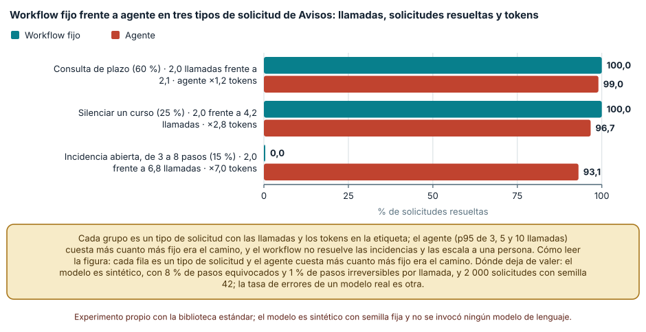

# SE-589 — Workflows frente a agentes: cuándo no usar un agente

[← SE-588 — Proyecto: harness mínimo gobernado y evaluado](https://github.com/vladimiracunadev-create/modern-software-engineering-program/blob/main/classes/part-48-harness-y-agentic-engineering/se-588-proyecto-harness-minimo-gobernado-y-evaluado/README.md) · [↑ Parte 49](https://github.com/vladimiracunadev-create/modern-software-engineering-program/blob/main/classes/part-49-patrones-agenticos-y-sistemas-con-llm/README.md) · [📚 Índice completo](https://github.com/vladimiracunadev-create/modern-software-engineering-program/blob/main/classes/README.md) · [🌐 Portal](https://vladimiracunadev-create.github.io/modern-software-engineering-program/classes/SE-589.html) · [SE-590 — Encadenado, enrutamiento y paralelización →](https://github.com/vladimiracunadev-create/modern-software-engineering-program/blob/main/classes/part-49-patrones-agenticos-y-sistemas-con-llm/se-590-encadenado-enrutamiento-y-paralelizacion/README.md)

## Punto profesional y fundamento pedagógico

**Punto profesional.** La clase existe para que, antes de escribir un bucle de agente, te preguntes si el sistema necesita uno. Un agente es un patrón caro: cada paso es una llamada al modelo que vuelve a leer todo lo anterior, el número de pasos no se conoce de antemano y cada decisión intermedia es una oportunidad de error. Un workflow, en cambio, deja el orden de los pasos en el código y usa el modelo solo donde el lenguaje natural es el problema. Quien entiende la diferencia no pregunta «¿agente o no?» como una cuestión de moda sino como una de **quién decide el siguiente paso** y de cuánto cuesta equivocarse en esa decisión.

**Por qué aparece aquí.** Abre la **[Parte 49](../README.md)** después de la [Parte 48](../../part-48-harness-y-agentic-engineering/README.md), donde el objeto de estudio era el harness que rodea a un agente de programación. Ahora el agente es una pieza de un sistema que tú construyes, y la primera decisión de diseño es si esa pieza debe existir. Las Partes [45](../../part-45-metodologias-de-desarrollo-de-tdd-a-odd/README.md)–[47](../../part-47-spec-agentes-y-ciclo-de-vida-agentic/README.md) enseñaron a pedir código a un asistente, a especificar y a verificar con evidencia; esta parte aplica esa misma disciplina a sistemas con modelos de lenguaje dentro, y empieza por el criterio de elección porque cada clase siguiente es un patrón que solo se justifica si el anterior no bastaba.

**Error conceptual que debe corregir.** Creer que «agente» es la versión avanzada de «workflow» y que más autonomía es más capacidad. La documentación de Anthropic distingue dos arquitecturas: en un **workflow** el código orquesta modelos y herramientas por caminos predefinidos; en un **agente** el propio modelo dirige su proceso y el uso de herramientas. Esa fuente recomienda empezar por la solución más simple y subir en complejidad solo cuando se demuestra que hace falta, porque la autonomía se paga en latencia, costo y posibilidad de error acumulado. La autonomía no es capacidad: es una decisión de dónde poner el control.

**Secuencia de aprendizaje.** Antes de ejecutar predices, para tres tipos de solicitud de *Avisos*, cuántas llamadas al modelo hará un workflow y cuántas un agente y qué porcentaje de cada tipo resolverá cada uno. Después ejecutas la simulación con semilla fija, comparas con tu predicción y escribes el criterio con el que clasificarías una solicitud nueva.

**Evidencia de aprendizaje.** Un archivo `patron-log.md` con tu predicción, la tabla medida, la clasificación de al menos seis solicitudes de tu propio sistema (camino conocido o no, reversible o no, tolerancia al costo) y la decisión por solicitud con una frase de justificación.

**Límite de la conclusión.** El «modelo» del experimento es un componente sintético con 8 % de pasos equivocados y 1 % de pasos irreversibles por llamada; no se invocó ningún modelo de lenguaje real. Las cifras muestran la **forma** del compromiso (un agente cuesta más cuanto más fijo era el camino, y un workflow no resuelve lo que no se puede escribir de antemano), no la tasa de ningún producto. Con otro modelo, otras herramientas y otra distribución de solicitudes las proporciones cambian.

### Trazabilidad fuente → afirmación

| Fuente primaria u oficial | Afirmación que respalda | Lo que no prueba |
|---|---|---|
| [Anthropic, «Building effective agents»](https://www.anthropic.com/engineering/building-effective-agents) | Distingue workflows (caminos predefinidos en código) de agentes (el modelo dirige su proceso), recomienda la solución más simple posible y describe los cinco patrones de workflow que recorre esta parte. | No da tasas de éxito ni costos para un caso concreto. |
| [Yao et al., «ReAct»](https://arxiv.org/abs/2210.03629) | Define el bucle de razonar, actuar y observar que es el núcleo de un agente; lo retoma la clase `SE-592`. | No compara contra un workflow equivalente en tu dominio. |
| [Anthropic, «How we built our multi-agent research system»](https://www.anthropic.com/engineering/multi-agent-research-system) | Documenta que los sistemas con varios agentes consumen muchos más tokens que una conversación simple y solo se justifican cuando el valor de la tarea lo cubre. | No generaliza a tareas de otro valor. |
| [OWASP, «Top 10 for LLM Applications»](https://genai.owasp.org/llm-top-10/) | Incluye la agencia excesiva (dar a un modelo más funciones, permisos o autonomía de los necesarios) como un riesgo, base del criterio de reversibilidad. | No cuantifica la frecuencia del riesgo. |

## Antes de empezar

Recupera lo aprendido en la [Parte 45](../../part-45-metodologias-de-desarrollo-de-tdd-a-odd/README.md): una práctica se elige por el oráculo que deja y por su punto ciego, no por su nombre. La pregunta activa es: **la última vez que alguien propuso «un agente que lo haga», ¿qué paso concreto del problema no se podía escribir de antemano, y cuántos de los demás pasos sí?**

## Prerrequisitos

- Haber completado la [Parte 45](../../part-45-metodologias-de-desarrollo-de-tdd-a-odd/README.md), en particular `SE-551` (comparar metodologías sobre el mismo cambio) y `SE-552` (política con clasificación de cambios).
- Conocer en la [Parte 47](../../part-47-spec-agentes-y-ciclo-de-vida-agentic/README.md) la diferencia entre delegar una tarea a un agente y especificarla.
- Python 3.11 o posterior; los experimentos usan solo la biblioteca estándar.

## Problema auténtico

El equipo de *Avisos* recibe cada día solicitudes de coordinación: «¿cuándo vence la entrega del curso 3?», «silencia los avisos del curso 5 hasta el viernes», «un estudiante recibió un recordatorio duplicado, averigua qué pasó». Alguien propone construir un asistente con un modelo de lenguaje y la discusión se polariza: una persona quiere un agente con todas las herramientas («que se las arregle»), otra quiere un script de reglas («que no se invente nada»).

Las dos tienen razón en una parte. Las dos primeras solicitudes tienen un camino que se puede escribir: leer la política del curso y contestar, o validar y registrar el silencio. La tercera no: según lo que encuentre, el investigador pedirá el historial del estudiante, luego el registro de envíos, luego la configuración del curso, y el número de pasos va de tres a ocho. La clase pone números a esa intuición: sobre 2 000 solicitudes sintéticas compara, para cada tipo, cuántas llamadas y cuántos tokens gasta cada arquitectura y qué fracción resuelve.

## Objetivos observables

Al terminar podrás:

1. definir workflow y agente por quién decide el siguiente paso y explicar por qué la distinción es de control, no de «inteligencia»;
2. estimar el costo de un bucle de agente sabiendo que cada llamada vuelve a leer el historial y que el número de pasos tiene una cola;
3. clasificar una solicitud con tres preguntas: ¿el camino se conoce antes de ver la entrada?, ¿las acciones son reversibles?, ¿hay presupuesto de pasos?;
4. diseñar un híbrido que enruta lo conocido a un workflow y deja el agente para lo abierto, y medir qué gana y qué pierde;
5. declarar qué evidencia haría cambiar la decisión de arquitectura.

## Mapa conceptual

![Diagrama de flujo con 7 pasos. Recorrido: «Solicitud»; luego «¿Camino conocido antes de la entrada?»; luego «Workflow: el código decide el orden» y «¿Acciones reversibles y acotadas?»; luego «Agente con presupuesto de pasos y costo» y «Persona decide o se rediseña el flujo»; luego «Medir llamadas, tokens y solicitudes resueltas». Retornos: «Medir llamadas, tokens y solicitudes resueltas» lleva a «¿Acciones reversibles y acotadas?» (el workflow no resuelve); «Medir llamadas, tokens y solicitudes resueltas» lleva a «Workflow: el código decide el orden» (el agente cuesta de más).](../../../site/assets/figures/mermaid-e498bccb1b.svg)

El mapa muestra que la elección no es una etiqueta sino un bucle de medida: si el workflow no resuelve un tipo de solicitud se considera el agente, y si el agente resulta caro para un tipo conocido se fija ese camino como workflow.

## Temas y por qué importan

| Tema | Por qué cambia una decisión profesional | Evidencia mínima |
|---|---|---|
| Workflow frente a agente | Es la primera decisión de costo, latencia y riesgo del sistema. | Tabla de llamadas y tokens por tipo de solicitud |
| Costo cuadrático del bucle | Cada paso relee el historial; diez pasos no cuestan diez veces uno. | Tokens por paso en una ejecución |
| Cola del número de pasos | El percentil 95 manda en la latencia y en el presupuesto. | p95 de llamadas del agente |
| Reversibilidad | Decide si un error se corrige o se sufre. | Lista de acciones con su reversibilidad |
| Híbrido | Permite pagar el agente solo donde aporta. | Éxito y tokens del híbrido frente a las dos puras |
| Criterio de cambio | Una arquitectura sin condición de revisión se vuelve dogma. | Una condición medible para cambiar |

## Conceptos y decisiones

### 1. Quién decide el siguiente paso

La definición operativa es una pregunta: **¿qué componente elige la próxima acción?** En un workflow la elige el código: un `if`, una tabla de rutas, una secuencia fija en la que el modelo rellena huecos (clasificar, redactar, extraer). En un agente la elige el modelo en cada vuelta, a partir de lo que ha visto hasta ese momento. Esa frase contiene todas las consecuencias: el workflow es predecible y barato porque su grafo de ejecución existe antes de la entrada; el agente es flexible porque su grafo se construye sobre la marcha, y por eso mismo no se puede revisar de antemano, solo acotar. Un sistema real casi nunca es puro: tiene un enrutador que es un workflow y, dentro de una de sus ramas, un bucle que es un agente.

### 2. Por qué un agente cuesta más de lo que parece

El costo de un paso no es el de «una llamada»: es el de leer el prompt fijo, el historial de pasos anteriores y las observaciones de las herramientas, y producir una acción. Si cada paso añade unos 120 tokens al historial, el paso *n* lee unos 300 + 120·*n* tokens, y la suma sobre *n* pasos crece de forma cuadrática. La simulación lo muestra: para consultas de plazo el agente gasta 1,2 veces los tokens del workflow porque casi no hay bucle, para silenciar un curso 2,8 veces y para una incidencia abierta 7,0 veces. El costo no sube por el agente en sí sino por la longitud del bucle que le deja recorrer: por eso un presupuesto máximo de pasos (aquí 10) es parte del diseño y no un detalle.

### 3. La cola del número de pasos

El número de llamadas del agente no es una constante, es una distribución. En la simulación, las incidencias necesitan de 3 a 8 acciones correctas y cada acción puede salir mal con probabilidad 0,08 (un paso gastado que obliga a repetir); el resultado es una media de 6,8 llamadas pero un percentil 95 de 10, el tope. Planificar con la media subestima el presupuesto y la latencia en el caso malo, que es el que paga el usuario impaciente. Además, una fracción de las ejecuciones termina mal: 93,1 % de las incidencias se resuelven, el resto se agota en pasos o comete un error irreversible. Un workflow no tiene esa cola porque sus pasos son fijos.

### 4. Lo que un workflow no puede hacer

El workflow del experimento resuelve el 100 % de las consultas de plazo y de silencios porque su camino está escrito, pero resuelve 0 % de las incidencias: el investigador necesita decidir qué mirar según lo que encuentra, y eso no se puede escribir antes de ver el caso. No es un defecto, es el contrato: el workflow **escala a una persona** lo que no entiende. Esa derivación es un resultado correcto y debe medirse como tal (cuántas solicitudes escala y si la persona las resuelve) en lugar de contarse como fallo del sistema. El error del equipo que fuerza un workflow sobre un problema abierto es añadir ramas hasta que el código se vuelve un agente mal hecho, sin presupuesto ni trazas.

### 5. Reversibilidad y agencia excesiva

La segunda pregunta del árbol —¿las acciones son reversibles y acotadas?— decide si un agente es admisible. Un agente que lee es barato de equivocar: se descarta el resultado. Uno que envía mensajes, borra registros o cambia configuración produce efectos que no se deshacen leyendo otra vez. OWASP incluye la **agencia excesiva** entre los riesgos de las aplicaciones con LLM: dar al modelo más funciones, permisos o autonomía de los que la tarea requiere. La respuesta de diseño es reducir la superficie (herramientas mínimas, de solo lectura cuando se pueda), poner una persona en las acciones irreversibles y registrar cada paso. En el experimento, 1 % de cada llamada es irreversible; con seis llamadas eso es un 6 % de ejecuciones con un daño que ningún reintento corrige.

### 6. Cuándo la respuesta correcta es «ni uno ni otro»

Hay solicitudes que no necesitan modelo: consultar un plazo en una tabla es una consulta, no una conversación. Una llamada al modelo para redactar la respuesta puede ser un lujo o un requisito de tono, y es una decisión aparte. La jerarquía de preferencia que se deriva de la fuente es: código determinista, una llamada al modelo, un workflow de varias llamadas, un agente. Cada escalón se justifica con una limitación medida del anterior, no con una expectativa. Este orden también es el de la degradación (`SE-599`): cuando algo falla, se baja por la misma escalera.



**Cómo leer la figura.** Cada grupo es un tipo de solicitud con las llamadas y los tokens en la etiqueta; la barra verde azulada es lo que resuelve el workflow fijo y la coral, lo que resuelve el agente. Mira que en los dos primeros tipos el workflow resuelve igual con menos costo y que en la incidencia abierta, donde su barra desaparece, el agente cuesta siete veces más pero es el único que resuelve. Lo deseable es que ambos resuelvan con el menor costo posible. **Dónde deja de valer:** el modelo es sintético, con 8 % de pasos equivocados y 1 % de irreversibles por llamada y una semilla fija; con un modelo real la tasa de pasos equivocados depende de la tarea, de las herramientas y del prompt. La figura muestra un mecanismo, no una tasa de ningún producto.

## El costo por solicitud y el híbrido

Sumar por tipo de solicitud ponderando por su frecuencia da el costo medio del sistema. Con 60 % de consultas de plazo, 25 % de silencios y 15 % de incidencias, el workflow para todo gasta 774 tokens por solicitud y resuelve el 85,0 %; el agente para todo gasta 1 862 y resuelve el 97,5 %; y el híbrido, que enruta las solicitudes conocidas a su workflow y deja las incidencias al agente, gasta 1 421 y resuelve el 99,0 %. El híbrido no es el más barato (lo es el workflow) ni el que tiene más autonomía, pero domina al agente puro en costo y a la vez en calidad, porque cada tipo de solicitud usa la herramienta que se le ajusta.


**Cómo leer la figura.** La longitud de cada barra es el costo y la etiqueta, la fracción resuelta; se busca la barra más corta con la etiqueta más alta. **Dónde deja de valer:** los tokens se aproximan con un token por cuatro caracteres y cada paso del agente relee el historial completo; con caché de prefijo (`SE-598`) la diferencia se estrecha. Además el híbrido depende de que el enrutador (clase `SE-590`) acierte: una solicitud conocida enrutada al agente cuesta de más y una abierta enrutada al workflow se escala.

## Cómo decidir: tres preguntas y una condición de revisión

La decisión se puede hacer repetible con un árbol corto. La primera pregunta es si los pasos se pueden escribir antes de ver la entrada. Si sí, el workflow gana por costo y por poder revisarse. Si no, la segunda: si las acciones son reversibles y acotadas, un agente con presupuesto de pasos es admisible; si no lo son, interviene una persona o se rediseña el flujo para convertir lo irreversible en un paso fijo con aprobación. La tercera pregunta es de presupuesto: cuántos pasos, cuántos tokens y cuánto tiempo se acepta, y qué pasa al agotarse (escalar a una persona, no devolver una respuesta a medias).


**Cómo leer la figura.** Se recorre de izquierda a derecha; la segunda fila resuelve el «no» de la primera pregunta. **Dónde deja de valer:** es un criterio de partida, no una medición; dos solicitudes con las mismas respuestas al árbol pueden tener costos muy distintos, y por eso la decisión se revisa con datos. Toda decisión de arquitectura debe llevar su **condición de revisión**: «si más del 10 % de las incidencias se escalan o si el costo mensual supera X, reabrimos». Sin condición, la elección se vuelve una preferencia.

## Definiciones de trabajo

- **[Workflow](../../../glosario/entradas/w/workflow.md):** sistema donde el código fija los pasos y el modelo se usa dentro de ellos.
- **[Agente](../../../glosario/entradas/a/agente.md):** sistema donde el modelo decide el siguiente paso y el uso de herramientas en cada vuelta.
- **[Presupuesto de pasos](../../../glosario/entradas/p/presupuesto-de-pasos.md):** límite duro de llamadas por solicitud, con una acción definida al agotarse.
- **[Escalar](../../../glosario/entradas/e/escalar.md):** derivar una solicitud a una persona con el contexto reunido; es un resultado, no un fallo.
- **[Agencia excesiva](../../../glosario/entradas/a/agencia-excesiva.md):** conceder al modelo más funciones, permisos o autonomía de los que la tarea necesita.
- **[Híbrido](../../../glosario/entradas/h/hibrido.md):** arquitectura donde un enrutador manda cada solicitud al workflow o al agente que le corresponde.

## Ejemplo mínimo

La misma consulta de plazo en dos arquitecturas, contando llamadas al modelo:

```python
# workflow: el código fija los pasos; el modelo solo clasifica y redacta
def workflow(solicitud, tools, model):
    tipo = model.clasificar(solicitud)            # llamada 1
    datos = tools.plazo(solicitud.curso)           # herramienta, sin modelo
    return model.redactar(tipo, datos)             # llamada 2

# agente: el modelo decide cada paso hasta terminar o agotar el presupuesto
def agente(solicitud, tools, model, max_pasos=10):
    historial = [solicitud]
    for paso in range(max_pasos):
        accion = model.siguiente(historial)        # una llamada por vuelta
        if accion.fin:
            return accion.texto
        historial.append(tools.ejecutar(accion))
    raise PresupuestoAgotado(paso)
```

El workflow gasta dos llamadas siempre; el agente gasta al menos dos (una acción y la respuesta final) y puede gastar diez. Para este tipo de solicitud, la segunda versión paga flexibilidad que no usa.

## Ejemplo profesional

*Escenario ilustrativo: las cifras de este ejemplo son supuestos de la narración, no mediciones.*

La coordinación de un programa con 40 cursos decide el asistente de *Avisos*. Registra durante dos semanas las solicitudes reales sin automatizar nada y las clasifica en tres grupos: consultas de política, cambios de configuración e investigaciones. Para las dos primeras escribe workflows con un solo paso de modelo (redactar con datos ya consultados) y pone una prueba por camino. Para las investigaciones diseña un agente con tres herramientas de solo lectura, un presupuesto de ocho pasos y una salida obligatoria: o devuelve un informe con las evidencias que citó, o escala a una persona con lo reunido. El enrutador es una clasificación con umbral: lo que no clasifica con confianza va a la persona. El equipo fija la condición de revisión: «si las investigaciones escaladas superan el 20 % o el costo por investigación supera el de una hora de coordinación, se rediseña». Cada decisión queda escrita junto con su condición de cambio.

## Práctica guiada

1. Predice: de 100 solicitudes de cada tipo, ¿cuántas llamadas hará cada arquitectura y cuántas resolverá?
2. Ejecuta `python scripts/experiments_part49_a.py 505` y compara con tu predicción.
3. Cambia `p_wrong` de 0,08 a 0,20 y a 0,02 en la función `exp505` y anota cómo cambian las llamadas y el éxito del agente en incidencias.
4. Reduce `max_steps` de 10 a 6: ¿qué fracción de incidencias se agota?
5. Clasifica seis solicitudes de tu sistema con el árbol y escribe, para cada una, su condición de revisión.

## Ejercicios

1. **Básico.** Explica con un ejemplo de *Avisos* por qué «silenciar un curso» es un workflow aunque lo escriba un modelo.
2. **Intermedio.** Calcula, con la fórmula 300 + 120·*n*, los tokens de entrada de un agente de 8 pasos y compáralos con 8 llamadas independientes de 300 tokens.
3. **Avanzado.** Diseña la política de escalado de un agente de incidencias: qué evidencia debe adjuntar, cuándo se agota, y qué métrica mostraría que el escalado es excesivo.

## Reto verificable

Entrega `patron-log.md` con tu predicción, la tabla medida, la clasificación de seis solicitudes de tu sistema y una condición de revisión por decisión. Es válido si otra persona puede ejecutar el experimento con la misma semilla y obtener la misma tabla, y si cada decisión de tu clasificación se puede contradecir con un dato.

## Caso conductor

El **asistente de *Avisos*** atiende a coordinación con tres tipos de solicitud. En esta clase se elige la arquitectura por tipo; en `SE-590` se construye el enrutador que reparte las solicitudes; en `SE-592` y `SE-593` se estudia el bucle del agente y su memoria; en `SE-599` se decide cómo degrada ante un incidente; y en `SE-600` todo se integra en un sistema con puerta de entrada a producción.

## Preguntas frecuentes

### ¿Un agente no es simplemente un workflow con un bucle?

Estructuralmente sí; en control, no. Lo que cambia es quién decide si el bucle sigue y qué hace en cada vuelta. Un `while` donde el código decide la condición con reglas es un workflow; uno donde la decide el modelo es un agente. La diferencia importa porque determina si puedes revisar la ejecución antes de que ocurra.

### Si el agente resuelve más, ¿por qué no usarlo siempre?

En el experimento el agente resuelve el 97,5 % frente al 85,0 % del workflow, pero gasta 2,4 veces los tokens y arrastra una cola de latencia y un 1 % de irreversibles por llamada. Resolver más solo compensa donde el workflow resuelve 0 %: ahí el agente no compite, completa.

### ¿Qué hago si no sé si el camino es conocido?

Registra una muestra sin automatizar y mide cuántos caminos distintos aparecen. Si tres o cuatro caminos cubren casi todo, son workflows; si la cola es larga y cada caso es distinto, es candidato a agente.

### ¿Un workflow con muchas ramas no es un agente disfrazado?

Puede serlo. Si cada nueva solicitud exige otra rama, el código está reimplementando a mano lo que haría un bucle con herramientas, pero sin presupuesto, trazas ni pruebas del bucle. Es la señal para pasar a un agente acotado, no para añadir otra rama.

## Fallo controlado y diagnóstico

**Fallo.** El equipo pone un agente a contestar consultas de plazo «para ahorrar código». Tras una semana, la factura del modelo supera el doble de lo previsto y alguien nota respuestas con un plazo distinto del de la tabla.

**Diagnóstico paso a paso.** (1) Se mide el número de llamadas por consulta: media de 2,1, pero cola larga cuando el agente decide «verificar» consultando dos veces la misma herramienta. (2) Se compara la respuesta con la tabla: en algunos casos el agente reescribe la fecha al «normalizarla». (3) Se clasifica la solicitud: camino conocido, sin ramas. (4) Se concluye que el agente aporta variabilidad sin aportar capacidad.

**Corrección.** Se reemplaza por un workflow: consulta determinista y una llamada para redactar con la fecha ya fijada como dato. Se añade una prueba que compara la fecha de la respuesta con la tabla. El costo vuelve al previsto y el defecto desaparece por construcción, no por vigilancia.

## Errores comunes y cómo corregirlos

- **Elegir agente por defecto.** Síntoma: costos y latencias variables sin mejora de calidad medible. Causa: se confunde flexibilidad con valor. Solución: clasifica cada tipo de solicitud y justifica el agente con una limitación medida del workflow.
- **Un agente sin presupuesto.** Síntoma: ejecuciones que no terminan o facturas inesperadas. Causa: el bucle no tiene un límite duro. Solución: máximo de pasos, de tokens y de tiempo, con una acción definida al agotarse.
- **Contar la escalada como fallo.** Síntoma: el equipo fuerza al sistema a responder todo. Causa: se mide solo el porcentaje resuelto por la máquina. Solución: mide también cuánto resuelve la persona y cuánto tarda.
- **Planificar con la media.** Síntoma: presupuestos que se rompen en la cola. Causa: se usa el promedio de llamadas. Solución: planifica con el percentil 95 y define qué ocurre más allá.
- **Mezclar acciones irreversibles con un bucle libre.** Síntoma: un mensaje enviado por error. Causa: el agente tiene la herramienta de envío sin aprobación. Solución: convierte el envío en un paso fijo del workflow con confirmación.

## Entorno y archivos clave

- `scripts/experiments_part49_a.py`: función `exp505` con el modelo sintético, el workflow, el agente y el cálculo del híbrido; `python scripts/experiments_part49_a.py 505`.
- `scripts/experiments_part49_lab.py`: contador de llamadas y tokens, utilidades de formato y semilla.
- `content/part-49/figures/`: las figuras de la clase.
- Entorno: CPython 3.11 o posterior, solo biblioteca estándar; no hace falta red ni clave de ningún servicio.

## Seguridad, ética y accesibilidad

Un agente con herramientas amplía la superficie de ataque: cada herramienta es una capacidad que un texto malicioso, si llega al contexto, puede intentar usar (`SE-598`). La primera defensa es no dar la herramienta. Ética: un asistente que contesta con seguridad un plazo equivocado causa daño real a estudiantes; la respuesta correcta a lo que no se sabe es escalar. Privacidad: las solicitudes de coordinación contienen nombres y situaciones personales; no se registran en trazas más de lo necesario (`SE-597`). Accesibilidad: las figuras de la clase son tablas, barras con etiqueta de valor y un diagrama con texto alternativo; no dependen del color.

## Puente hacia el trabajo con agentes

Cuando un agente de programación te propone «un agente que lo haga» para una función de tu sistema, trátalo como cualquier otra propuesta de diseño: pídele la clasificación del tipo de solicitud, el presupuesto de pasos, la lista de acciones irreversibles y la condición de revisión. Una instrucción de repositorio razonable es: «antes de proponer un bucle con herramientas, escribe primero la versión en workflow y explica qué solicitud concreta no resuelve». Y la comprobación es mecánica: si no existe un caso medido que el workflow no resuelva, el agente no entra.

## Transferencia

Toma un sistema tuyo donde ya haya, o se esté proponiendo, un modelo de lenguaje. Lista las solicitudes que atiende, clasifícalas con el árbol y estima, con datos reales o con una muestra manual, la frecuencia de cada tipo. Calcula el costo del peor caso (percentil 95 de llamadas) y decide qué sucede al agotarse el presupuesto. Entrega la decisión con su condición de revisión.

## Evaluación y evidencia

| Criterio | Evidencia aceptable | Rechazo |
|---|---|---|
| Predicción | Escrita antes de ejecutar | Posterior a la ejecución |
| Clasificación | Seis solicitudes con las tres preguntas respondidas | «Todo es agente» o «todo es workflow» |
| Costo | Media y percentil 95 de llamadas, y tokens | Solo la media |
| Reversibilidad | Lista de acciones con su reversibilidad y el control | Sin lista |
| Condición de revisión | Un umbral medible por decisión | «Lo revisamos si hace falta» |
| Límite | Dice que el modelo es sintético | Presenta una tasa real |

## Fuentes

- Anthropic. [«Building effective agents»](https://www.anthropic.com/engineering/building-effective-agents).
- Yao, S. et al. [«ReAct: Synergizing Reasoning and Acting in Language Models»](https://arxiv.org/abs/2210.03629).
- Anthropic. [«How we built our multi-agent research system»](https://www.anthropic.com/engineering/multi-agent-research-system).
- OWASP GenAI Security Project. [«Top 10 for LLM Applications»](https://genai.owasp.org/llm-top-10/).

## Límites y siguiente paso

El experimento usa un modelo sintético con tasas de error declaradas, tres tipos de solicitud inventados por el autor y 2 000 solicitudes con semilla; no se midió ningún modelo de lenguaje real, ningún producto ni ningún equipo. El siguiente paso, `SE-590`, estudia los tres patrones de workflow más simples que sirven para construir el híbrido: encadenar pasos con puertas, enrutar solicitudes y paralelizar subtareas independientes.

## Glosario

| Término | Definición breve |
|---|---|
| Workflow | Sistema cuyo orden de pasos fija el código |
| Agente | Sistema donde el modelo elige cada paso |
| Presupuesto de pasos | Límite duro de llamadas con acción al agotarse |
| Escalar | Derivar a una persona con el contexto reunido |
| Agencia excesiva | Dar al modelo más permisos o autonomía de los necesarios |
| Híbrido | Enrutador que reparte entre workflow y agente |

Conceptos de esta clase en el [glosario del programa](../../../glosario/README.md): [Agencia excesiva](../../../glosario/entradas/a/agencia-excesiva.md) · [Agente](../../../glosario/entradas/a/agente.md) · [Costo cuadrático del bucle](../../../glosario/entradas/c/costo-cuadratico-del-bucle.md) · [Escalar](../../../glosario/entradas/e/escalar.md) · [Híbrido](../../../glosario/entradas/h/hibrido.md) · [Presupuesto de pasos](../../../glosario/entradas/p/presupuesto-de-pasos.md) · [Reversibilidad](../../../glosario/entradas/r/reversibilidad.md) · [Workflow](../../../glosario/entradas/w/workflow.md).

---

[← SE-588 — Proyecto: harness mínimo gobernado y evaluado](https://github.com/vladimiracunadev-create/modern-software-engineering-program/blob/main/classes/part-48-harness-y-agentic-engineering/se-588-proyecto-harness-minimo-gobernado-y-evaluado/README.md) · [↑ Parte 49](https://github.com/vladimiracunadev-create/modern-software-engineering-program/blob/main/classes/part-49-patrones-agenticos-y-sistemas-con-llm/README.md) · [📚 Índice completo](https://github.com/vladimiracunadev-create/modern-software-engineering-program/blob/main/classes/README.md) · [🌐 Portal](https://vladimiracunadev-create.github.io/modern-software-engineering-program/classes/SE-589.html) · [SE-590 — Encadenado, enrutamiento y paralelización →](https://github.com/vladimiracunadev-create/modern-software-engineering-program/blob/main/classes/part-49-patrones-agenticos-y-sistemas-con-llm/se-590-encadenado-enrutamiento-y-paralelizacion/README.md)
