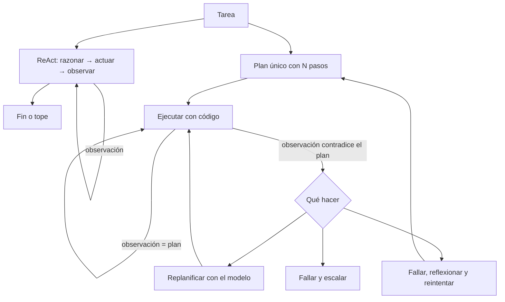
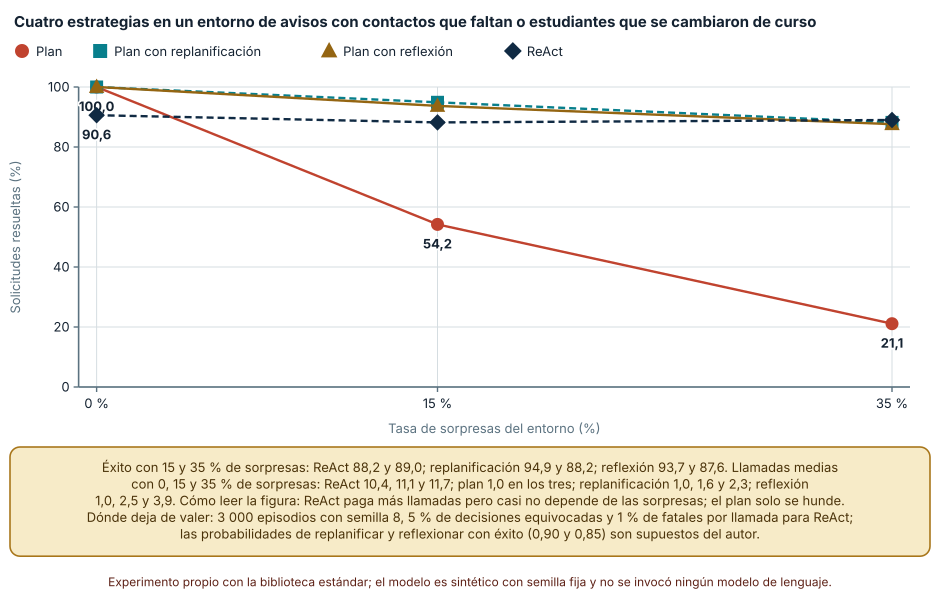
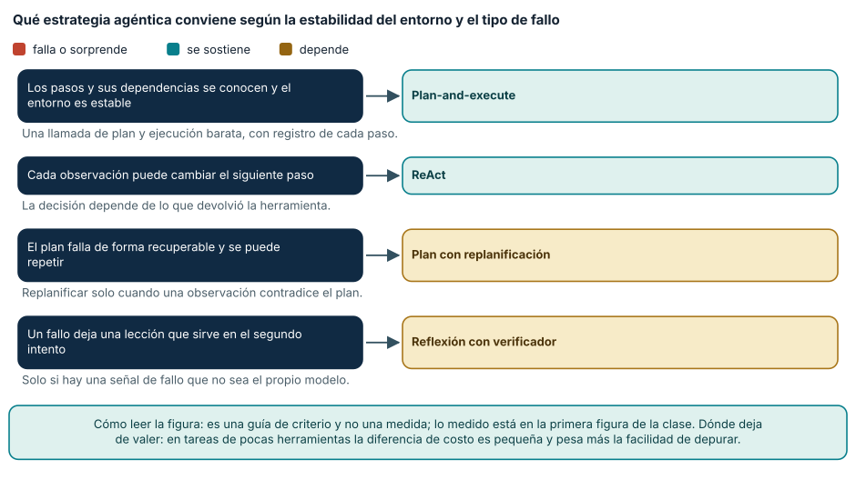

# SE-592 — ReAct, plan-and-execute y reflexión

[← SE-591 — Orquestador-trabajadores y evaluador-optimizador](https://github.com/vladimiracunadev-create/modern-software-engineering-program/blob/main/classes/part-49-patrones-agenticos-y-sistemas-con-llm/se-591-orquestador-trabajadores-y-evaluador-optimizador/README.md) · [↑ Parte 49](https://github.com/vladimiracunadev-create/modern-software-engineering-program/blob/main/classes/part-49-patrones-agenticos-y-sistemas-con-llm/README.md) · [📚 Índice completo](https://github.com/vladimiracunadev-create/modern-software-engineering-program/blob/main/classes/README.md) · [🌐 Portal](https://vladimiracunadev-create.github.io/modern-software-engineering-program/classes/SE-592.html) · [SE-593 — Memoria y gestión de estado de agentes →](https://github.com/vladimiracunadev-create/modern-software-engineering-program/blob/main/classes/part-49-patrones-agenticos-y-sistemas-con-llm/se-593-memoria-y-gestion-de-estado-de-agentes/README.md)

## Punto profesional y fundamento pedagógico

**Punto profesional.** La clase existe para que diseñes el **bucle** de un agente sabiendo qué compra cada variante. ReAct intercala razonar y actuar y se adapta a lo que cada herramienta devuelve; plan-and-execute escribe el plan una vez y lo ejecuta con código; la reflexión añade, tras un fallo, una lección escrita que se usa en un nuevo intento. No son modas intercambiables: cada una cambia **cuántas llamadas al modelo se pagan, qué sorpresas tolera y dónde se puede inspeccionar la ejecución**. Quien las entiende elige por la estabilidad del entorno y por el tipo de fallo, y sabe qué medir para confirmarlo.

**Por qué aparece aquí.** Sigue a `SE-591`, donde la estructura la fijaba el código. Cuando el trabajo no se puede dividir de antemano (`SE-589`: una incidencia abierta), el sistema necesita un bucle donde el modelo decide. Esta clase abre esa caja y mira tres formas de organizarla. Usa la idea de puerta de `SE-590` (comprobar contra una fuente de verdad) y la de presupuesto de `SE-589`.

**Error conceptual que debe corregir.** Creer que planificar siempre es mejor porque «piensa antes de actuar», o que ReAct siempre es mejor porque «se adapta». El plan único es barato (una llamada y ejecución con código) y frágil: basta una observación que contradiga el plan para que falle si no hay replanificación. ReAct se adapta pero paga una llamada por paso y acumula contexto. La reflexión **no** añade conocimiento: añade una segunda oportunidad con una pista, y solo ayuda si hay una señal de fallo que no sea el propio modelo.

**Secuencia de aprendizaje.** Antes de ejecutar predices, para entornos con 0 %, 15 % y 35 % de sorpresas, qué estrategia resuelve más y cuántas llamadas gasta. Después ejecutas el entorno con contactos que faltan o estudiantes que se cambiaron de curso y comparas.

**Evidencia de aprendizaje.** `bucle-log.md` con tu predicción, la tabla medida, la estrategia que elegirías para tres tareas de tu sistema con la tasa de sorpresas estimada, y la señal de fallo que usarías para una reflexión.

**Límite de la conclusión.** El entorno es un modelo propio (contactos que faltan, estudiantes que se cambian) con decisiones del «modelo» equivocadas en el 5 % de las acciones y una probabilidad de éxito de la replanificación (0,90) y de la reflexión (0,85) fijada por el autor. Muestra una forma de compromiso; no mide a ningún agente real.

### Trazabilidad fuente → afirmación

| Fuente primaria u oficial | Afirmación que respalda | Lo que no prueba |
|---|---|---|
| [Yao et al., «ReAct»](https://arxiv.org/abs/2210.03629) | Propone intercalar trazas de razonamiento y acciones con herramientas para que cada observación informe el siguiente paso. | No compara contra un workflow en tu dominio. |
| [Wang et al., «Plan-and-Solve Prompting»](https://arxiv.org/abs/2305.04091) | Propone planificar antes de resolver para reducir errores de pasos omitidos. | No evalúa la replanificación ante sorpresas del entorno. |
| [Shinn et al., «Reflexion»](https://arxiv.org/abs/2303.11366) | Describe agentes que convierten el resultado de un intento en retroalimentación verbal para el siguiente. | Sus entornos tienen señales de éxito claras; no siempre las hay. |
| [Anthropic, «Building effective agents»](https://www.anthropic.com/engineering/building-effective-agents) | Describe el agente como un bucle donde el modelo usa herramientas guiado por la retroalimentación del entorno y recomienda condiciones de parada y puntos de control. | No elige entre las variantes del bucle. |

## Antes de empezar

Recupera `SE-591`: un evaluador útil devuelve fallas concretas y verificables. La pregunta activa es: **cuando un plan tuyo se rompió a mitad de camino porque algo no era como lo habías supuesto, ¿qué señal te avisó y cuánto trabajo ya hecho se perdió?**

## Prerrequisitos

- Haber completado `SE-591` o poder explicar el bucle generar-evaluar y el tope de vueltas.
- Conocer de `SE-589` el presupuesto de pasos y el costo del historial creciente.
- Python 3.11 o posterior.

## Problema auténtico

Una solicitud de *Avisos*: «avisa a los estudiantes pendientes del curso 4». Un plan natural es: listar pendientes, obtener el contacto de cada uno, enviar el aviso a cada uno. Pero el mundo no siempre coopera: a algunos estudiantes les falta el contacto y otros ya se cambiaron de curso y no deben recibir nada. Un plan escrito de antemano supone contactos completos; al llegar a un estudiante sin contacto el envío falla a mitad de la lista, con algunos avisos ya enviados.

Hay tres formas de reaccionar. Un agente ReAct mira la observación de cada paso y decide qué hacer con el contacto que falta (buscar un contacto alternativo, saltar). Un plan único con ejecución por código termina en error ante la sorpresa. Un plan con replanificación llama al modelo solo cuando una observación contradice el plan. Y una variante con reflexión falla, escribe qué salió mal y reintenta. La clase mide cuál conviene según la frecuencia de sorpresas.

## Objetivos observables

Al terminar podrás:

1. describir el ciclo de ReAct y qué se paga en cada vuelta;
2. diseñar un plan ejecutable por código y definir cuándo una observación lo invalida;
3. añadir replanificación y reflexión y decir qué señal de fallo necesita cada una;
4. predecir qué estrategia gana según la tasa de sorpresas y verificarlo;
5. escribir los registros y topes que hacen revisable un bucle.

## Mapa conceptual



El mapa muestra que ReAct vive dentro de un bucle y el plan, fuera: el plan ejecuta con código y solo vuelve al modelo cuando una observación lo invalida.

## Temas y por qué importan

| Tema | Por qué cambia una decisión profesional | Evidencia mínima |
|---|---|---|
| Ciclo ReAct | Cada vuelta es una llamada que relee el historial. | Llamadas por episodio |
| Plan único | Una llamada y ejecución barata, frágil ante lo inesperado. | Éxito sin sorpresas y con ellas |
| Replanificación | Paga solo cuando el plan se rompe. | Llamadas con y sin sorpresas |
| Reflexión | Una segunda oportunidad con una pista, si hay señal de fallo. | Éxito tras reintento |
| Sorpresa del entorno | Es la variable que decide la estrategia. | Éxito por tasa de sorpresas |
| Registro y tope | Sin ellos el bucle no se revisa ni se detiene. | Traza de un episodio |

## Conceptos y decisiones

### 1. ReAct: razonar, actuar, observar

ReAct (Yao et al.) propone que el modelo produzca, en cada vuelta, un **razonamiento** breve sobre qué falta, una **acción** (una llamada a herramienta) y que la **observación** resultante entre al contexto para la vuelta siguiente. Su fortaleza es que cada decisión se toma con la información más reciente: si el contacto falta, la siguiente acción puede ser buscar uno alternativo. Su costo es estructural: una llamada por acción, un historial que crece y una trayectoria que no se conoce de antemano. En el experimento, con dos a cuatro estudiantes, ReAct gasta entre 10 y 12 llamadas por episodio y resuelve entre el 88 % y el 91 %, incluso sin sorpresas, porque cada llamada tiene una probabilidad pequeña de ser fatal (1 % en la simulación) y cada decisión equivocada gasta un paso.

### 2. Plan-and-execute: pagar una vez

El plan-and-execute separa **planificar** (una llamada que produce la lista de pasos) de **ejecutar** (código que recorre la lista, llamando a herramientas sin modelo en cada paso). Con un entorno estable es la opción más barata y más revisable: el plan se puede mostrar, aprobar y registrar antes de ejecutar, y la ejecución es determinista. En el experimento, sin sorpresas, resuelve el 100 % con una sola llamada. Su debilidad es la **suposición de que el mundo es como se planeó**: con 15 % de sorpresas resuelve el 54,2 % y con 35 % el 21,1 %, porque ante un contacto que falta el paso siguiente falla o actúa sobre datos vacíos.

### 3. Replanificar: pagar cuando se rompe

La variante con **replanificación** añade una regla: si una observación contradice lo que el plan suponía (un código de error, un campo vacío, un resultado inesperado), la ejecución se detiene y se llama al modelo con lo que ocurrió para obtener un plan nuevo para lo que queda. El costo es una llamada por sorpresa. En el experimento, con 15 % de sorpresas resuelve el 94,9 % con 1,6 llamadas de media; con 35 %, el 88,2 % con 2,3. Frente a ReAct (88-89 % con 11 llamadas), mantiene la calidad con una fracción del costo mientras las sorpresas sean la excepción. Cuando son la regla (cada paso es una sorpresa), el costo de replanificar se acerca al de ReAct y desaparece la ventaja.

### 4. Reflexión: una lección y otro intento

La reflexión (Shinn et al.) convierte el resultado de un intento fallido en un **texto de retroalimentación** («falló porque el estudiante 3 no tenía contacto; comprueba el contacto antes de enviar») que se añade al contexto del siguiente intento. Cuesta al menos dos llamadas más (reflexionar y volver a planificar) y solo ayuda si hay una **señal de fallo externa**: un código de error, un verificador, una prueba. Sin esa señal, el modelo reflexiona sobre su propia respuesta sin saber si falló, y es fácil que racionalice lo hecho. En el experimento, tras fallar por una sorpresa, el segundo intento acierta el 85 % de las veces (supuesto del autor); el éxito total es del 93,7 % con 2,5 llamadas con 15 % de sorpresas y del 87,6 % con 3,9 con 35 %. Frente a replanificar, la reflexión cuesta más y no gana: tiene sentido cuando no se puede replanificar a mitad de ejecución o cuando la lección se reutiliza en tareas futuras.



**Cómo leer la figura.** El eje horizontal es la tasa de sorpresas del entorno y el vertical las solicitudes resueltas; cada línea es una estrategia. Mira que el plan solo se hunde con las sorpresas, que ReAct casi no depende de ellas y que la replanificación y la reflexión quedan en medio; las llamadas medias de cada estrategia están en la nota. **Dónde deja de valer:** 3 000 episodios con semilla 8, 5 % de decisiones equivocadas, 1 % de fatales por llamada para ReAct y probabilidades de replanificación (0,90) y de reflexión (0,85) fijadas por el autor; con un modelo real esas cifras cambian el orden entre ReAct y replanificación.

### 5. Qué decide la estrategia: la estabilidad del entorno

El resultado se resume en una variable: **con qué frecuencia una observación contradice lo que se esperaba**. Con cero sorpresas gana el plan único; con pocas, el plan con replanificación; con muchas o impredecibles, ReAct; y la reflexión aporta cuando el fallo deja una lección reutilizable y hay verificador. Esa frecuencia se puede medir antes de construir nada: registra una muestra de ejecuciones manuales y cuenta cuántas veces el mundo se salió del guion. Es otro caso de la regla de `SE-589`: la autonomía se paga, así que se compra la mínima que cubre la variabilidad real.

### 6. Registros, tope y qué hacer con lo ya ejecutado

Un bucle sin traza no se puede depurar. Cada vuelta debe registrar la acción elegida, los argumentos, la observación (resumida) y el número de paso. Cada bucle necesita tres topes: pasos, tokens y tiempo, con una acción al agotarse (escalar con la traza). Además, cuando un plan falla a mitad, lo ya ejecutado puede haber tenido efectos: enviar a tres estudiantes y fallar en el cuarto deja la tarea a medias. Esto enlaza con la **ejecución durable** de `SE-596`: el plan debe poder reanudarse sin repetir envíos, y cada paso con efecto debe ser idempotente.


**Cómo leer la figura.** La fila superior es ReAct, donde cada observación vuelve al modelo; la inferior es el plan, donde el modelo interviene solo al principio y cuando algo se rompe. **Dónde deja de valer:** los dos se pueden combinar: muchos sistemas planifican por tramos y usan ReAct dentro de un tramo incierto; el diagrama muestra los extremos.

## Cuándo usar cada una

La tabla de criterio resume el árbol: pasos conocidos y entorno estable piden plan-and-execute; observaciones que cambian el siguiente paso piden ReAct; fallos recuperables y repetibles piden replanificación; y una lección útil para el segundo intento, con señal de fallo, pide reflexión.



**Cómo leer la figura.** Cada tarjeta es una situación a la izquierda y la estrategia que conviene a la derecha, en verde azulado las dos de uso general y dorado las que exigen una condición extra; debajo, el porqué. Se lee de arriba abajo como una guía de decisión. **Dónde deja de valer:** es un criterio y no una medida; en tareas de pocas herramientas la diferencia de costo es pequeña y pesa más la facilidad de depurar. Conviene empezar por la opción más barata y revisable y pasar a la siguiente cuando los registros muestran una tasa de sorpresas que la justifica.

## Definiciones de trabajo

- **ReAct:** bucle donde el modelo razona, actúa con una herramienta y observa el resultado antes de la siguiente vuelta.
- **Plan-and-execute:** estrategia que produce un plan completo y lo ejecuta con código.
- **Sorpresa:** observación que contradice lo que el plan suponía.
- **Replanificación:** nueva llamada al modelo con la sorpresa para obtener un plan de lo que queda.
- **Reflexión:** texto de retroalimentación sobre un intento fallido que se usa en el siguiente.
- **Señal de fallo:** evidencia externa de que un intento falló (error, verificador, prueba).

## Ejemplo mínimo

Un ejecutor de plan que detecta sorpresas y devuelve el control al modelo:

```python
def ejecutar_plan(plan, herramientas, esperado):
    resultados = []
    for i, paso in enumerate(plan):
        obs = herramientas[paso["tool"]](**paso["args"])
        if not esperado(paso, obs):                 # sorpresa: la observación contradice el plan
            return {"estado": "sorpresa", "paso": i, "obs": obs, "hecho": resultados}
        resultados.append(obs)
    return {"estado": "ok", "hecho": resultados}
```

Si devuelve `sorpresa`, el llamador decide: replanificar con `hecho` y `obs`, reflexionar o escalar.

## Ejemplo profesional

*Escenario ilustrativo: las cifras de este ejemplo son supuestos de la narración, no mediciones.*

El equipo implementa el aviso masivo a pendientes como plan-and-execute con replanificación. El plan lo produce el modelo con una salida estructurada (lista de pasos con herramienta y argumentos) que un validador comprueba antes de ejecutar: solo herramientas permitidas y como máximo 50 pasos. El ejecutor registra cada paso con su observación. Si falta un contacto, devuelve una sorpresa; el modelo recibe lo hecho y la observación y produce el resto del plan; se permite una replanificación por ejecución y, si vuelve a haber una sorpresa, la tarea se escala con la traza. Los envíos usan una clave de idempotencia por estudiante y por aviso. En las incidencias abiertas, que no tienen un plan posible, usan ReAct con un tope de ocho pasos. El equipo mide semanalmente la tasa de sorpresas: si supera el 30 %, el aviso masivo pasará de plan con replanificación a ReAct.

## Práctica guiada

1. Predice, para 0 %, 15 % y 35 % de sorpresas, el éxito de cada estrategia.
2. Ejecuta `python scripts/experiments_part49_a.py 508` y compara con tu predicción.
3. Cambia la probabilidad de éxito de la replanificación de 0,90 a 0,60 y observa cuándo ReAct pasa a ser mejor.
4. Sube el tope de decisiones equivocadas `eps` de 0,05 a 0,15 y mira el efecto sobre ReAct.
5. Escribe el plan ejecutable de una tarea de tu sistema y la función `esperado` que detecta sorpresas.

## Ejercicios

1. **Básico.** Explica por qué el plan único gasta una llamada y ReAct gasta una por acción, y qué implica para el costo en una tarea de diez pasos.
2. **Intermedio.** Define tres sorpresas posibles del envío de avisos y, para cada una, la acción: replanificar, reflexionar o escalar.
3. **Avanzado.** Diseña la señal de fallo de una reflexión para la tarea «generar la configuración de un curso» sin depender de que el modelo juzgue su propio resultado.

## Reto verificable

Entrega `bucle-log.md` con tu predicción, la tabla medida, la estrategia elegida para tres tareas de tu sistema con su tasa de sorpresas estimada y la traza de un episodio con sus topes. Es válido si otra persona reproduce la tabla con la misma semilla y puede decir, a partir de tu traza, en qué paso se tomó cada decisión.

## Caso conductor

La **incidencia abierta** de *Avisos* es la tarea de ReAct: investigar un recordatorio duplicado exige mirar lo que se encuentra. El **aviso masivo** es la tarea de plan con replanificación. En `SE-593` se estudia qué memoria necesita el bucle para no olvidar lo que ya encontró y, en `SE-596`, cómo se hace durable para no repetir envíos al reanudar.

## Preguntas frecuentes

### ¿ReAct es lo mismo que «chain of thought»?

No. El razonamiento en cadena produce pasos de pensamiento sin tocar el mundo; ReAct intercala esos pensamientos con **acciones** y observaciones reales. La diferencia es que cada observación puede corregir el razonamiento.

### ¿El plan debe ser creado por el modelo?

Casi siempre, pero debe pasar por un validador: herramientas permitidas, argumentos con formato, número máximo de pasos. Un plan que ejecuta lo que el modelo escriba sin validar es una inyección esperando ocurrir.

### ¿La reflexión sirve sin verificador?

Sirve poco. Sin una señal externa, el modelo evalúa su propio resultado con los mismos sesgos con que lo produjo. Con un verificador, la reflexión recibe una falla concreta y puede mejorar.

### ¿Cuántas replanificaciones permito?

Una o dos. Cada replanificación es una llamada y una oportunidad de repetir el error; más allá, el problema suele ser el entorno o las herramientas, y se escala.

## Fallo controlado y diagnóstico

**Fallo.** Un aviso masivo se envía a 12 de 20 estudiantes y la ejecución termina con «ok». Los otros 8 no reciben nada y nadie lo sabe hasta el reclamo.

**Diagnóstico paso a paso.** (1) La traza muestra que el contacto de 8 estudiantes estaba vacío y que la herramienta de envío devolvió un resultado «sin destinatario» que el ejecutor trató como éxito. (2) El plan no tenía una función de observación esperada: cualquier respuesta sin excepción se consideraba válida. (3) Se confirma que no hubo sorpresa detectada porque la ejecución solo comprobaba errores, no contenido. (4) Se concluye que una sorpresa silenciosa convirtió un plan en un resultado parcial.

**Corrección.** Se añade `esperado` por herramienta: un envío exitoso devuelve un identificador de mensaje; cualquier otra cosa es sorpresa. Se agrega un conteo final que compara destinatarios del plan con envíos confirmados y escala si no coinciden. Se añade una prueba con contactos vacíos que debe terminar en replanificación.

## Errores comunes y cómo corregirlos

- **Plan sin validar.** Síntoma: herramientas o argumentos inesperados. Causa: se ejecuta lo que el modelo escribe. Solución: validador de herramientas, esquema y número de pasos.
- **Sorpresas silenciosas.** Síntoma: ejecución «ok» con trabajo incompleto. Causa: solo se comprueban excepciones. Solución: define la observación esperada por herramienta y concilia al final.
- **ReAct sin tope.** Síntoma: bucles largos y costosos. Causa: sin presupuesto. Solución: pasos, tokens y tiempo con escalado.
- **Reflexión sin señal externa.** Síntoma: el modelo «mejora» sin que el resultado mejore. Causa: se evalúa a sí mismo. Solución: verificador o prueba.
- **Replanificar sin límite.** Síntoma: el sistema oscila. Causa: cada sorpresa dispara otra. Solución: tope de replanificaciones y escalado.

## Entorno y archivos clave

- `scripts/experiments_part49_a.py`: función `exp508` con el entorno de contactos que faltan y las cuatro estrategias; `python scripts/experiments_part49_a.py 508`.
- `scripts/experiments_part49_lab.py`: utilidades comunes.
- `content/part-49/figures/`: figuras de la clase.
- Entorno: CPython 3.11 o posterior; semilla 8.

## Seguridad, ética y accesibilidad

Un plan es una instrucción ejecutable: quien pueda influir en el contexto del modelo puede influir en el plan. Por eso el validador de herramientas y argumentos es una frontera de seguridad y no una comodidad (`SE-598`). Ética: una reflexión que se guarda y se reutiliza puede incorporar un error o un dato personal a tareas futuras; se revisa y caduca como cualquier memoria (`SE-593`). Privacidad: las trazas de ReAct contienen observaciones con datos de estudiantes y deben redactarse o truncarse. Accesibilidad: las figuras son una tabla, un diagrama y una tabla de decisión con texto alternativo.

## Puente hacia el trabajo con agentes

Un agente de programación que implementa un agente tiende a escribir un ReAct a mano sin tope ni traza, porque es el patrón más conocido. La instrucción de repositorio es: «antes de implementar el bucle, clasifica la tarea por tasa de sorpresas; si es baja, escribe un plan con validador y ejecución en código; si es alta, un ReAct con tope y traza». La comprobación mecánica: una prueba que inyecta una observación inesperada en cada herramienta debe producir una sorpresa registrada y una replanificación o un escalado, nunca un resultado «ok».

## Transferencia

Toma una tarea multi-paso de tu sistema y estima cuántas veces, en 20 ejecuciones manuales, el mundo no fue como el plan suponía. Con esa tasa, elige la estrategia según la figura y redacta el validador del plan, la función de observación esperada y los topes. Anota qué pasos tienen efectos y cuáles necesitan clave de idempotencia.

## Evaluación y evidencia

| Criterio | Evidencia aceptable | Rechazo |
|---|---|---|
| Tasa de sorpresas | Medida en una muestra | «Pocas» |
| Estrategia | Elegida con la tasa y el costo medidos | Por familiaridad |
| Validador del plan | Herramientas, esquema y límite de pasos | Sin validar |
| Sorpresa y conciliación | Observación esperada y conteo final | Solo excepciones |
| Topes y traza | Pasos, tokens, tiempo y registro por vuelta | Sin traza |
| Límite | Dice que el modelo y el entorno son sintéticos | Presenta una tasa real |

## Fuentes

- Yao, S. et al. [«ReAct: Synergizing Reasoning and Acting in Language Models»](https://arxiv.org/abs/2210.03629).
- Wang, L. et al. [«Plan-and-Solve Prompting»](https://arxiv.org/abs/2305.04091).
- Shinn, N. et al. [«Reflexion: Language Agents with Verbal Reinforcement Learning»](https://arxiv.org/abs/2303.11366).
- Anthropic. [«Building effective agents»](https://www.anthropic.com/engineering/building-effective-agents).

## Límites y siguiente paso

El entorno de contactos que faltan, las decisiones equivocadas, las probabilidades de replanificación y de reflexión son propios del autor; no se midió ningún modelo real ni se reprodujeron los resultados de los artículos citados. El siguiente paso, `SE-593`, trata lo que el bucle necesita recordar: qué estado conserva un agente entre pasos y entre conversaciones, y cómo se evita recordar lo que ya no es verdad.

## Glosario

| Término | Definición breve |
|---|---|
| ReAct | Bucle de razonar, actuar y observar |
| Plan-and-execute | Plan completo ejecutado con código |
| Sorpresa | Observación que contradice el plan |
| Replanificación | Nuevo plan tras una sorpresa |
| Reflexión | Lección escrita de un intento fallido |
| Señal de fallo | Evidencia externa de que algo falló |

---

[← SE-591 — Orquestador-trabajadores y evaluador-optimizador](https://github.com/vladimiracunadev-create/modern-software-engineering-program/blob/main/classes/part-49-patrones-agenticos-y-sistemas-con-llm/se-591-orquestador-trabajadores-y-evaluador-optimizador/README.md) · [↑ Parte 49](https://github.com/vladimiracunadev-create/modern-software-engineering-program/blob/main/classes/part-49-patrones-agenticos-y-sistemas-con-llm/README.md) · [📚 Índice completo](https://github.com/vladimiracunadev-create/modern-software-engineering-program/blob/main/classes/README.md) · [🌐 Portal](https://vladimiracunadev-create.github.io/modern-software-engineering-program/classes/SE-592.html) · [SE-593 — Memoria y gestión de estado de agentes →](https://github.com/vladimiracunadev-create/modern-software-engineering-program/blob/main/classes/part-49-patrones-agenticos-y-sistemas-con-llm/se-593-memoria-y-gestion-de-estado-de-agentes/README.md)
