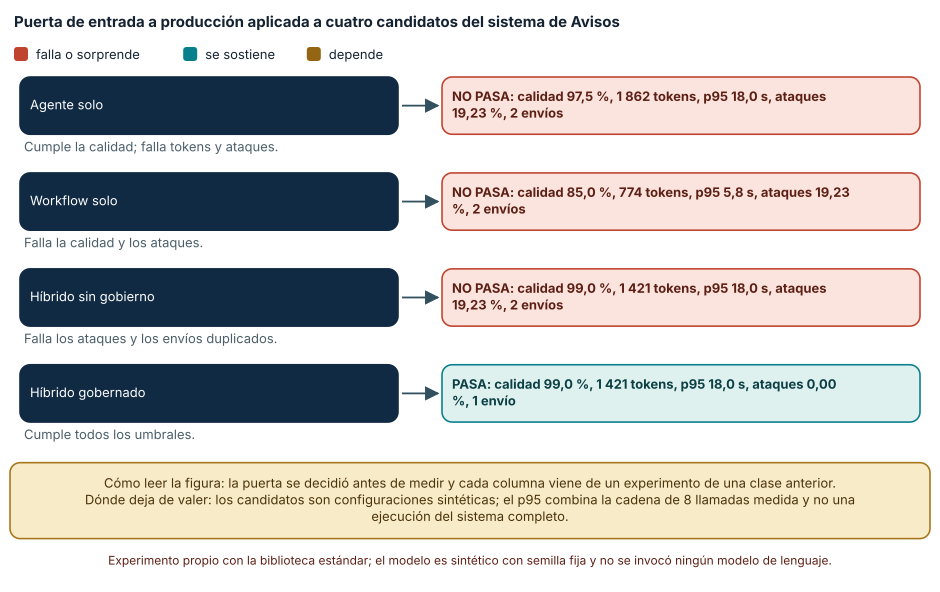
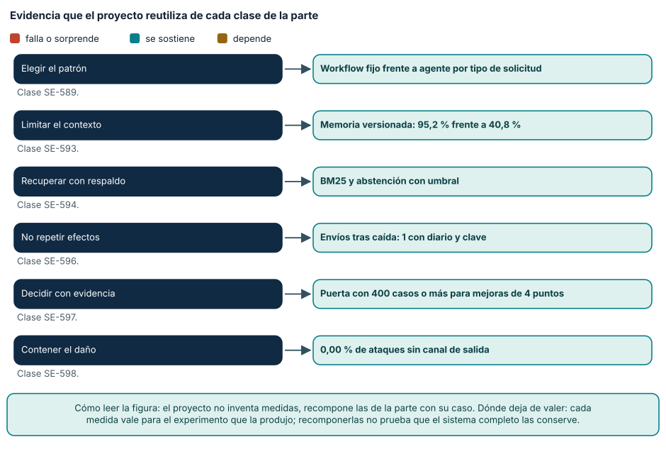

# SE-600 — Proyecto: sistema con LLM evaluado y operable

[← SE-599 — Taller: elegir y degradar un patrón agéntico](https://github.com/vladimiracunadev-create/modern-software-engineering-program/blob/main/classes/part-49-patrones-agenticos-y-sistemas-con-llm/se-599-taller-elegir-y-degradar-un-patron-agentico/README.md) · [↑ Parte 49](https://github.com/vladimiracunadev-create/modern-software-engineering-program/blob/main/classes/part-49-patrones-agenticos-y-sistemas-con-llm/README.md) · [📚 Índice completo](https://github.com/vladimiracunadev-create/modern-software-engineering-program/blob/main/classes/README.md) · [🌐 Portal](https://vladimiracunadev-create.github.io/modern-software-engineering-program/classes/SE-600.html) · [SE-601 — Ciclo de vida de ML y por qué falla en producción →](https://github.com/vladimiracunadev-create/modern-software-engineering-program/blob/main/classes/part-50-machine-learning-en-produccion-y-mlops/se-601-ciclo-de-vida-de-ml-y-por-que-falla-en-produccion/README.md)

## Punto profesional y fundamento pedagógico

**Punto profesional.** El proyecto existe para que entregues, para un sistema con LLM que elijas, **la evidencia con que otra persona decidiría ponerlo en producción**: qué patrón usa y por qué, cómo se mide su calidad, cuánto cuesta y tarda en el caso malo, qué ataque lo rompe y cómo se contiene, qué pasa si se interrumpe a mitad y cómo degrada. Es la diferencia entre «funciona en mi demostración» y «puede operar». No se construye el sistema más sofisticado: se construye el más simple que supera una puerta de entrada declarada de antemano y se documenta con honestidad dónde no se midió.

**Por qué aparece aquí.** Cierra la [Parte 49](../README.md) integrando las medidas de las once clases anteriores en una única puerta: calidad (`SE-589` a `SE-592`, `SE-597`), contexto y recuperación (`SE-593`, `SE-594`), integraciones (`SE-595`), durabilidad (`SE-596`), costo, latencia y seguridad (`SE-598`) y degradación (`SE-599`). Aplica la lógica de la política de equipo de `SE-552` ([Parte 45](../../part-45-metodologias-de-desarrollo-de-tdd-a-odd/README.md)): evidencia exigida según el riesgo, con excepciones y revisión.

**Error conceptual que debe corregir.** Creer que un sistema «evaluado y operable» es uno con buena calidad en una evaluación. La calidad es una columna de cinco. El experimento del proyecto muestra cuatro candidatos con calidades de 85,0 % a 99,0 % y solo uno supera la puerta completa: el agente solo cumple la calidad (97,5 %) pero falla en tokens y en seguridad; el híbrido sin gobierno tiene la mejor calidad y falla en seguridad y duplicados; solo el híbrido gobernado (enrutamiento, permisos mínimos, diario con clave) pasa. Operar es el conjunto de condiciones que rodean a la calidad.

**Secuencia de aprendizaje.** Antes de ejecutar, escribes tu puerta (umbrales y su justificación) y predices cuál de los cuatro candidatos pasa. Después ejecutas, comparas y repites para tu propio sistema, con tus casos, tus umbrales y tu evidencia.

**Evidencia de aprendizaje.** Un directorio `proyecto-sistema-llm/` con `puerta.md`, `casos/`, `resultados.md` con las cinco columnas medidas para al menos dos candidatos, `capacidades.md`, `degradacion.md`, `limites.md` y una decisión final con su condición de revisión.

**Límite de la conclusión.** Los cuatro candidatos del experimento son configuraciones sintéticas que recombinan las medidas de las clases anteriores (calidad y tokens de `SE-589`, latencia p95 de la cadena de ocho llamadas de `SE-598`, ataques de `SE-598` y duplicados tras caída de `SE-596`); no se ejecutó un sistema completo de extremo a extremo y la latencia combina una cadena sin medir el sistema real. No se invocó ningún modelo.

### Trazabilidad fuente → afirmación

| Fuente primaria u oficial | Afirmación que respalda | Lo que no prueba |
|---|---|---|
| [Anthropic, «Building effective agents»](https://www.anthropic.com/engineering/building-effective-agents) | Recomienda empezar simple, medir y añadir complejidad solo si mejora, y probar de forma extensa en entornos controlados con salvaguardas. | No fija tu puerta. |
| [Anthropic, «Demystifying evals for AI agents»](https://www.anthropic.com/engineering/demystifying-evals-for-ai-agents) | Describe cómo diseñar evaluaciones de agentes con tareas, calificadores y manejo del no determinismo. | No resuelve el costo ni la seguridad. |
| [OWASP, «Top 10 for LLM Applications»](https://genai.owasp.org/llm-top-10/) | Enumera los riesgos de seguridad que la puerta debe cubrir, entre ellos inyección de prompt y agencia excesiva. | No es una lista completa de controles. |
| [OpenTelemetry, convenciones para IA generativa](https://opentelemetry.io/docs/specs/semconv/gen-ai/) | Define cómo trazar llamadas a modelos y herramientas de forma uniforme. | No decide qué datos retener. |
| [Temporal, «Workflows»](https://docs.temporal.io/workflows) | Ilustra la ejecución durable con historial de eventos para reanudar tras una caída. | No sustituye tu diario ni tus claves. |

## Antes de empezar

Recupera `SE-597`, `SE-598` y `SE-599`: una puerta se declara antes de medir, la seguridad se decide por capacidades y la degradación se ensaya. La pregunta activa es: **si mañana tuvieras que defender ante una persona escéptica que tu sistema con LLM puede operar, ¿qué cinco números le mostrarías y cuál de ellos te daría más vergüenza no tener?**

## Prerrequisitos

- Haber completado `SE-589` a `SE-599`.
- Haber completado la [Parte 45](../../part-45-metodologias-de-desarrollo-de-tdd-a-odd/README.md), en particular `SE-552` (política con evidencia exigida) y `SE-549` (evaluación como puerta de release).
- Python 3.11 o posterior y un sistema o caso de uso propio con un modelo de lenguaje, real o simulado.

## Problema auténtico

El equipo de *Avisos* tiene que decidir si el asistente sale a producción. Hay cuatro candidatos: un agente que atiende todo, un workflow que atiende lo conocido, un híbrido sin controles añadidos y un híbrido con enrutamiento, capacidades mínimas, diario e idempotencia. El director pregunta «¿cuál sale?» y recibe cuatro respuestas distintas según quién hable: el de producto elige la calidad más alta, el de finanzas, el costo más bajo, el de seguridad, el que no puede filtrar datos y el de operaciones, el que no duplica envíos.

El proyecto resuelve la discusión con una **puerta de entrada** escrita antes de medir, con un umbral por columna: calidad de al menos 97 %, no más de 1 500 tokens por solicitud, p95 de 20 segundos o menos, ataques exitosos de 0,5 % o menos y como máximo un envío tras una caída entre efecto y diario. Cada candidato se mide en las cinco columnas y la decisión es mecánica: pasa todas o no pasa. Después tú harás lo mismo con tu propio sistema.

## Objetivos observables

Al terminar podrás:

1. escribir una puerta de entrada con un umbral por columna y la justificación de cada uno;
2. medir un sistema en calidad, costo, latencia, seguridad y durabilidad con los métodos de la parte;
3. leer una tabla de candidatos y explicar por qué cada uno pasa o no pasa;
4. documentar capacidades, escalera de degradación y límites de la evidencia;
5. fijar una condición de revisión que reabra la decisión con datos nuevos.

## Mapa conceptual

![Diagrama de flujo con 11 pasos. Recorrido: «Solicitud con presupuesto y permisos»; luego «Enrutador con umbral»; luego «Workflow», «Agente acotado» y «Persona»; luego «Herramientas por protocolo, permisos mínimos»; luego «Diario con clave de idempotencia»; luego «Traza con versiones»; luego «Evaluación y puerta de entrada»; luego «Producción con degradación y alarmas» y «Rediseñar o reducir alcance». Retornos: «Producción con degradación y alarmas» lleva a «Evaluación y puerta de entrada» (fallos reales).](../../../site/assets/figures/mermaid-bba4f38c43.svg)

El mapa muestra el sistema como un conjunto de piezas que cada clase estudió y la puerta como el punto donde se decide con evidencia.

## Temas y por qué importan

| Tema | Por qué cambia una decisión profesional | Evidencia mínima |
|---|---|---|
| Puerta de entrada | Convierte la discusión en una decisión repetible. | Umbrales escritos antes de medir |
| Calidad con ruido | Una cifra sin repeticiones no decide. | Conjunto de casos y repeticiones |
| Costo y latencia en el caso malo | El p95 y los tokens mandan. | Percentil y presupuesto |
| Seguridad por capacidades | La combinación de herramientas decide el riesgo. | Evaluación de capacidades y prueba hostil |
| Durabilidad | Sin diario y clave hay duplicados. | Prueba de caída entre efecto y diario |
| Degradación y límites | Un sistema operable falla hacia lo seguro. | Escalera ensayada y declaración de límites |

## Conceptos y decisiones

### 1. La puerta se escribe antes de medir

Una puerta es un conjunto de umbrales que decide si el sistema entra a producción. Debe escribirse **antes** de ver los resultados y debe tener, por cada columna, un número y un porqué: «calidad ≥ 97 %: por debajo, el volumen de escalados supera la capacidad de la cola humana»; «p95 ≤ 20 s: por encima, abandonan los usuarios»; «ataques ≤ 0,5 %: la acción de envío es irreversible». Un umbral sin justificación se negocia; uno con ella se discute con datos. La puerta también declara qué hace falta para **cambiarla**: una evidencia nueva, no una presión de calendario.

### 2. Medir las cinco columnas con los métodos de la parte

Cada columna tiene su método. La **calidad** se mide con el conjunto de casos de `SE-597`: pareada, con repeticiones y con la puerta estadística; en el experimento, los candidatos van de 85,0 % (workflow solo, que escala las incidencias) a 99,0 % (híbrido). Los **tokens** salen del modelo de costo de `SE-589` y `SE-598`: 774 el workflow, 1 862 el agente, 1 421 el híbrido. La **latencia p95** sale de la cadena de llamadas de `SE-598`: unas 6 s para el workflow (dos llamadas) y unas 18 s para los candidatos con agente (la cadena de ocho llamadas). Los **ataques** salen de la simulación de `SE-598`: 19,23 % sin defensa y 0,00 % con la política de no tener canal de salida junto a contenido no confiable. Los **duplicados** salen del diario de `SE-596`: 2 envíos con una caída entre efecto y diario sin clave, 1 con clave.

### 3. Leer la tabla de candidatos

La tabla de la puerta cuenta una historia que ninguna columna aislada cuenta. El **agente solo** tiene 97,5 % de calidad (pasa), pero gasta 1 862 tokens (excede los 1 500), tiene un 19,23 % de ataques exitosos (excede el 0,5 %) y un envío duplicado tras la caída: **no pasa**. El **workflow solo** gasta 774 tokens y responde en unos 6 s, pero su calidad es 85,0 % porque escala las incidencias: **no pasa**. El **híbrido sin gobierno** tiene la mejor calidad (99,0 %) y gasta 1 421 tokens, pero hereda el 19,23 % de ataques y los envíos duplicados: **no pasa**. El **híbrido gobernado** (enrutador con umbral, herramientas con permisos mínimos y sin canal de salida cuando hay contenido no confiable, diario con clave de idempotencia) cumple las cinco: **pasa**. Lo que decide no es una pieza sino la **conjunción**.



**Cómo leer la figura.** Cada tarjeta es un candidato con sus cinco medidas a la derecha y el criterio que incumple debajo: coral si no pasa la puerta y verde azulado si pasa. Mira que cada candidato falla en un criterio distinto y que solo el gobernado cumple los cinco umbrales decididos antes de medir. **Dónde deja de valer:** los candidatos son configuraciones sintéticas que recombinan medidas de otras clases: no se ejecutó un sistema completo de extremo a extremo, la latencia p95 de los candidatos con agente es la de una cadena de ocho llamadas sintética y los ataques del «workflow solo» se tomaron iguales a los del agente porque ambos leen contenido de terceros. Un sistema real exige medir cada columna sobre él mismo.

### 4. La arquitectura mínima operable

El sistema que pasa tiene una forma reconocible. Un **enrutador** con umbral reparte las solicitudes entre workflow, agente y persona. Los workflows y el agente acotado usan **herramientas por protocolo** con permisos mínimos y sin canal de salida cuando el contexto tiene contenido de terceros. Cada paso con efecto pasa por un **diario** con clave de idempotencia. Cada solicitud emite una **traza** con versiones de prompt, modelo y herramientas. Una **evaluación** continua con puerta decide los cambios, y la **degradación** y las alarmas gobiernan la operación. Cada pieza ya existe en una clase anterior; el proyecto las une y las prueba juntas.


**Cómo leer la figura.** La primera fila es lo que ejecuta una solicitud y la segunda, lo que hace al sistema repetible, medible y reversible. **Dónde deja de valer:** es un esquema mínimo; un sistema real añade autenticación, cuotas por usuario, retención de datos y gestión de secretos, que quedan fuera de la parte.

### 5. Documentar los límites: lo que no se midió

La última parte del proyecto es un documento de **límites**: qué se midió con datos reales y qué con simulación, qué tamaño tiene el conjunto de casos, qué proveedor y versión de modelo se usó, qué ataques se probaron y cuáles no, qué escalones de degradación se ensayaron y cuáles solo existen en papel. La honestidad de ese documento es lo que permite a la persona que decide ponderar el riesgo. Un sistema con «todo verde» y un documento de límites vacío es una señal de alerta.

### 6. La condición de revisión

La decisión de entrar a producción no es definitiva. Cada decisión lleva su **condición de revisión**: un cambio de proveedor o de modelo, una tasa de escalado superior a un umbral, una caída del acuerdo del juez con personas, un incidente de seguridad, una desviación del costo mensual. La puerta se vuelve a ejecutar con cada cambio de versión y cada fallo relevante se convierte en un caso (`SE-597`). Operar es sostener esa disciplina.



**Cómo leer la figura.** Cada tarjeta es un criterio del proyecto a la izquierda y la medida que reutiliza a la derecha, con su clase debajo. Se lee de arriba abajo como el índice de pruebas que sostienen cada decisión del proyecto. **Dónde deja de valer:** cada medida vale para el experimento que la produjo; recomponerlas no prueba que el sistema completo las conserve, y la integración puede introducir fallos que ninguna clase midió.

## Definiciones de trabajo

- **Puerta de entrada a producción:** conjunto de umbrales, uno por columna, que decide si un sistema puede operar.
- **Candidato:** configuración del sistema que se somete a la puerta.
- **Gobierno:** conjunto de controles (enrutamiento, permisos, diario, trazas, evaluación, degradación) que rodean a la calidad.
- **Condición de revisión:** evento o umbral que reabre una decisión.
- **Documento de límites:** declaración de lo que no se midió y de los supuestos de lo medido.

## Ejemplo mínimo

La puerta como una función que devuelve las columnas que fallan:

```python
GATE = {"calidad": 0.97, "tokens": 1500, "p95_s": 20.0, "ataques": 0.005, "duplicados": 1}

def evaluar(m: dict) -> list[str]:
    fallos = []
    if m["calidad"] < GATE["calidad"]: fallos.append("calidad")
    if m["tokens"] > GATE["tokens"]: fallos.append("tokens")
    if m["p95_s"] > GATE["p95_s"]: fallos.append("p95")
    if m["ataques"] > GATE["ataques"]: fallos.append("ataques")
    if m["duplicados"] > GATE["duplicados"]: fallos.append("duplicados")
    return fallos  # vacío: pasa; si no, devuelve las columnas que fallan
```

La función no decide por preferencia: devuelve las columnas que no cumplen, de modo que el rediseño apunta a algo concreto.

## Ejemplo profesional

*Escenario ilustrativo: las cifras de este ejemplo son supuestos de la narración, no mediciones.*

El equipo de *Avisos* entrega un dossier de nueve páginas a una comisión de revisión. La primera página es la puerta con sus umbrales y sus justificaciones, firmada antes de medir. Las páginas siguientes presentan los cuatro candidatos medidos con 400 casos (250 reales anonimizados, 100 difíciles y 50 adversariales) y tres repeticiones; el híbrido gobernado pasa las cinco columnas, con calidad 98,1 % (intervalo del 96,9 % al 99,0 %). La comisión pregunta por el ataque que no se probó y el equipo responde con el documento de límites: se probaron 40 correos hostiles, no se probó contenido en otro idioma ni documentos adjuntos. Se acuerda publicar con un 10 % del tráfico, una alarma de escalado por encima del 12 % y una revisión a los 30 días. El dossier incluye la escalera de degradación ensayada con un incidente simulado.

## Práctica guiada

1. Escribe tu puerta con cinco umbrales y su justificación y predice qué candidato pasa.
2. Ejecuta `python scripts/experiments_part49_b.py 516` y compara con tu predicción.
3. Cambia el umbral de tokens a 2 000 y el de ataques a 5 % en la tabla y observa qué candidatos cambian de veredicto. ¿Qué dice eso de la puerta?
4. Elige un sistema propio con LLM y define sus dos candidatos (por ejemplo, agente y workflow) y sus cinco columnas.
5. Mide cada columna con el método de la parte que corresponde y registra qué es medido y qué es supuesto.

## Ejercicios

1. **Básico.** Explica por qué el agente solo no pasa aunque su calidad cumpla el umbral.
2. **Intermedio.** Propón un cambio mínimo del híbrido sin gobierno para que pase la puerta y di qué columna ataca cada cambio.
3. **Avanzado.** Redacta la condición de revisión del sistema: tres eventos que reabren la decisión, con su umbral y quién los vigila.

## Reto verificable

Entrega `proyecto-sistema-llm/` con `puerta.md` (umbrales y justificación escritos antes de medir), `casos/` (al menos 30 casos con su señal de calificación), `resultados.md` (las columnas de la puerta medidas para al menos dos candidatos, con repeticiones), `capacidades.md` (qué lee, qué contamina, qué puede enviar y la separación elegida), `degradacion.md` (escalones con cobertura y disparadores), `limites.md` (qué no se midió) y una decisión final con su condición de revisión. Es válido si otra persona puede reejecutar tus medidas con tus semillas, aplicar tu puerta y obtener el mismo veredicto, y si tu documento de límites contiene al menos tres cosas que no se midieron.

## Caso conductor

El proyecto cierra el recorrido del asistente de *Avisos* de la parte: se decidió su arquitectura (`SE-589`), sus patrones (`SE-590` a `SE-592`), su memoria y su recuperación (`SE-593`, `SE-594`), sus integraciones (`SE-595`), su durabilidad (`SE-596`), su evaluación (`SE-597`), sus restricciones (`SE-598`) y su degradación (`SE-599`). Lo que sale de aquí es una decisión de operar con su evidencia y sus límites.

## Preguntas frecuentes

### ¿Y si mi sistema no tiene un modelo real todavía?

Puedes usar un modelo simulado con tasas declaradas, como en la parte, y medir lo que sí es tuyo: la puerta, el enrutador, el diario, las políticas de capacidades y la degradación. Declara en el documento de límites qué es simulado.

### ¿Qué hago si ningún candidato pasa?

Es una información valiosa. Mira qué columnas fallan y decide: rediseñar (añadir una puerta, quitar una capacidad), reducir el alcance (menos tipos de solicitud) o revisar el umbral con una justificación nueva, nunca por presión de calendario.

### ¿Puedo ajustar la puerta tras ver los resultados?

Solo con una razón externa a los resultados (un cambio de contexto del negocio) y dejándolo escrito. Ajustar para que pase es una forma de leer el ruido a conveniencia.

### ¿Cuántos candidatos debo medir?

Al menos dos, que difieran en la decisión más importante (agente frente a workflow, con o sin gobierno). Medir uno no deja ver qué aporta cada pieza.

## Fallo controlado y diagnóstico

**Fallo.** El sistema supera la puerta, entra a producción y, a la tercera semana, un estudiante recibe un aviso que contiene el nombre de otro estudiante.

**Diagnóstico paso a paso.** (1) La traza muestra que el agente de acciones recibió un JSON con un campo de texto libre que venía de un correo. (2) Se revisa la puerta: la prueba hostil usaba correos con una instrucción de envío, no con datos de otro estudiante en un campo permitido. (3) El documento de límites decía que no se probaron campos de texto libre en el JSON. (4) Se concluye que la puerta funcionó dentro de lo que medía y que el fallo estaba en lo declarado como no medido.

**Corrección.** Se elimina el campo de texto libre del esquema y se valida con una lista de valores permitidos. Se añade el caso a la evaluación, se reduce el tráfico al 10 % durante una semana y la condición de revisión incorpora «cualquier fuga de datos entre estudiantes reabre la decisión». El incidente se registra con su causa y el cambio de puerta.

## Errores comunes y cómo corregirlos

- **Puerta ajustada a los resultados.** Síntoma: todo pasa. Causa: el umbral se movió después de medir. Solución: umbrales y justificaciones escritos antes.
- **Una sola columna.** Síntoma: sistema de alta calidad que filtra datos. Causa: la puerta solo mide calidad. Solución: las cinco columnas.
- **Un solo candidato.** Síntoma: no se sabe qué aporta cada pieza. Causa: no hay comparación. Solución: al menos dos candidatos que difieran en una decisión clave.
- **Documento de límites vacío.** Síntoma: sorpresas en producción. Causa: se declara solo lo que funcionó. Solución: lista de lo no medido con su riesgo.
- **Sin condición de revisión.** Síntoma: la decisión se vuelve dogma. Causa: no hay evento que la reabra. Solución: eventos, umbrales y responsables.

## Entorno y archivos clave

- `scripts/experiments_part49_b.py`: función `exp516` que recompone `exp505`, `exp512` y `exp514` en la tabla de candidatos y aplica la puerta; `python scripts/experiments_part49_b.py 516`.
- `scripts/experiments_part49_a.py`, `scripts/experiments_part49_lab.py`: componentes reutilizados.
- `content/part-49/figures/`: figuras de la clase.
- Entorno: CPython 3.11 o posterior; tarda unos segundos.

## Seguridad, ética y accesibilidad

La puerta incluye la seguridad como columna con el mismo peso que la calidad: un sistema que no puede probar que contiene el daño no entra. Los casos y las trazas contienen datos reales: se anonimizan, se limita su retención y se controla su acceso. Ética: una decisión de operar es una decisión sobre las personas a las que el sistema atenderá peor (los casos que escala, los idiomas o grupos con peor calidad); la evaluación se desglosa y la puerta incluye un umbral para el peor grupo. Y el sistema debe poder explicar a una persona qué hizo y por qué, con la traza como respaldo. Accesibilidad: la cola humana y el canal de reclamación deben ser accesibles; las figuras son tablas y un diagrama con texto alternativo.

## Puente hacia el trabajo con agentes

Un agente de programación al que se le pide «prepara el sistema para producción» añade registros y un README. La instrucción de repositorio es: «antes de proponer cambios, escribe la puerta con sus umbrales y justificaciones; después mide cada columna con las pruebas del repositorio y entrega la tabla de candidatos y el documento de límites». La comprobación mecánica: la función `evaluar` debe ejecutarse en la integración continua sobre los resultados del último candidato y fallar la integración si alguna columna no cumple.

## Transferencia

Aplica el proyecto a un sistema con LLM de tu entorno, aunque sea pequeño. Define dos candidatos, escribe la puerta antes de medir, mide al menos calidad, costo, latencia y una prueba de seguridad, declara qué no mediste y decide con una condición de revisión. Presenta el dossier a una persona que no haya participado y anota qué columna le pareció la más débil.

## Evaluación y evidencia

| Criterio | Evidencia aceptable | Rechazo |
|---|---|---|
| Puerta | Umbrales con justificación, escritos antes de medir | Umbrales ajustados después |
| Candidatos | Al menos dos que difieren en una decisión clave | Un solo candidato |
| Medidas | Calidad con repeticiones, p95, tokens, ataques y duplicados | «Funciona» |
| Capacidades | Evaluación con la regla de tres condiciones y prueba hostil | Confianza en el prompt |
| Degradación | Escalera con cobertura y disparadores ensayados | Plan B descrito |
| Límites | Al menos tres cosas no medidas con su riesgo | Documento vacío |
| Decisión | Veredicto mecánico y condición de revisión | Opinión |

## Fuentes

- Anthropic. [«Building effective agents»](https://www.anthropic.com/engineering/building-effective-agents).
- Anthropic. [«Demystifying evals for AI agents»](https://www.anthropic.com/engineering/demystifying-evals-for-ai-agents).
- OWASP GenAI Security Project. [«Top 10 for LLM Applications»](https://genai.owasp.org/llm-top-10/).
- OpenTelemetry. [«Semantic conventions for generative AI systems»](https://opentelemetry.io/docs/specs/semconv/gen-ai/).
- Temporal Technologies. [«Workflows»](https://docs.temporal.io/workflows).

## Límites y siguiente paso

Los cuatro candidatos son configuraciones sintéticas que recombinan medidas de otras clases; no se ejecutó un sistema completo, ni se usó un modelo de lenguaje, un proveedor o un tráfico reales; la puerta es una elección del autor. Una revisión editorial humana independiente de la parte sigue pendiente. La [Parte 26](../../part-26-patrones-de-diseno-empresariales-y-de-resiliencia/README.md) pasa del sistema con LLM al catálogo de patrones de diseño, empresariales y de resiliencia, que sirve de vocabulario común para diseñar y revisar estos sistemas y cualquier otro.

## Glosario

| Término | Definición breve |
|---|---|
| Puerta de entrada | Umbrales por columna que deciden si un sistema opera |
| Candidato | Configuración del sistema sometida a la puerta |
| Gobierno | Controles que rodean a la calidad del sistema |
| Condición de revisión | Evento o umbral que reabre la decisión |
| Documento de límites | Declaración de lo que no se midió |

---

[← SE-599 — Taller: elegir y degradar un patrón agéntico](https://github.com/vladimiracunadev-create/modern-software-engineering-program/blob/main/classes/part-49-patrones-agenticos-y-sistemas-con-llm/se-599-taller-elegir-y-degradar-un-patron-agentico/README.md) · [↑ Parte 49](https://github.com/vladimiracunadev-create/modern-software-engineering-program/blob/main/classes/part-49-patrones-agenticos-y-sistemas-con-llm/README.md) · [📚 Índice completo](https://github.com/vladimiracunadev-create/modern-software-engineering-program/blob/main/classes/README.md) · [🌐 Portal](https://vladimiracunadev-create.github.io/modern-software-engineering-program/classes/SE-600.html) · [SE-601 — Ciclo de vida de ML y por qué falla en producción →](https://github.com/vladimiracunadev-create/modern-software-engineering-program/blob/main/classes/part-50-machine-learning-en-produccion-y-mlops/se-601-ciclo-de-vida-de-ml-y-por-que-falla-en-produccion/README.md)
