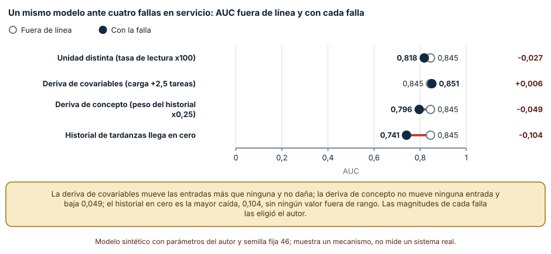
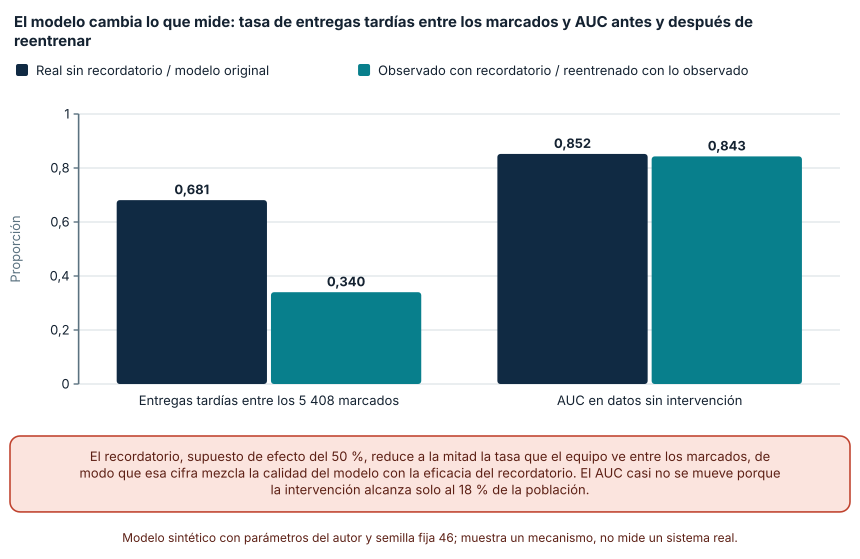

# SE-601 — Ciclo de vida de ML y por qué falla en producción

[← SE-600 — Proyecto: sistema con LLM evaluado y operable](https://github.com/vladimiracunadev-create/modern-software-engineering-program/blob/main/classes/part-49-patrones-agenticos-y-sistemas-con-llm/se-600-proyecto-sistema-con-llm-evaluado-y-operable/README.md) · [↑ Parte 50](https://github.com/vladimiracunadev-create/modern-software-engineering-program/blob/main/classes/part-50-machine-learning-en-produccion-y-mlops/README.md) · [📚 Índice completo](https://github.com/vladimiracunadev-create/modern-software-engineering-program/blob/main/classes/README.md) · [🌐 Portal](https://vladimiracunadev-create.github.io/modern-software-engineering-program/classes/SE-601.html) · [SE-602 — Datos de entrenamiento, etiquetas y feature stores →](https://github.com/vladimiracunadev-create/modern-software-engineering-program/blob/main/classes/part-50-machine-learning-en-produccion-y-mlops/se-602-datos-de-entrenamiento-etiquetas-y-feature-stores/README.md)

## Punto profesional y fundamento pedagógico

**Punto profesional.** La clase existe para que dejes de tratar un modelo de aprendizaje automático como un componente que se entrega y se olvida, y lo trates como un sistema con ciclo de vida: datos, etiquetas, características, entrenamiento, evaluación, registro, despliegue, servicio, monitoreo y reentrenamiento, cada uno con dueño, entradas y modos de fallo propios. El modelo es una caja pequeña dentro de un sistema grande, y la experiencia de la industria es que casi todos los incidentes ocurren en las cajas que la rodean. La clase mide, sobre un mismo modelo, cuánto daño hace cada una de cuatro causas de falla en producción y muestra una quinta, el bucle de realimentación, que ninguna métrica fuera de línea puede ver. Al terminar tendrás un mapa del sistema con sus puntos de falla y una primera lista de qué medir en cada uno.

**Por qué aparece aquí.** Abre la [Parte 50](../README.md) y es la clase que fija el vocabulario y el caso conductor, *Avisos-ML*, que decide a quién se le envía un recordatorio de entrega. Reutiliza tres ideas de partes anteriores: la calidad por atributos y la latencia de `SE-433` y `SE-436`, las señales y los SLO de `SE-493` y `SE-497`, y la pregunta de `SE-561` sobre cómo evaluar a un sistema generativo. Prepara `SE-602`, que abre el primer eslabón (los datos), y todo el resto de la parte.

**Error conceptual que debe corregir.** Creer que el trabajo termina cuando el modelo alcanza una buena métrica fuera de línea. La puntuación de validación mide qué tan bien el modelo se parece a los datos con que se evaluó; el sistema en producción recibe otros datos, calculados por otro código, decididos por otras personas y con etiquetas que llegan tarde. La segunda corrección: no todo cambio en las entradas daña al modelo, y no todo daño se ve en las entradas. En el laboratorio, una deriva grande de la carga dejó el AUC igual, y una deriva de concepto lo bajó sin mover ninguna entrada.

**Secuencia de aprendizaje.** Antes de ejecutar, predices cuál de cuatro fallas (una unidad distinta, una deriva de covariables, una deriva de concepto y una columna que llega en cero) daña más al modelo y cuál no lo daña. Después ejecutas el experimento, comparas con tu predicción y simulas el bucle de realimentación.

**Evidencia de aprendizaje.** `mapa-del-sistema-ml.md` con los diez eslabones del ciclo de vida de un sistema tuyo, un dueño por eslabón, el modo de fallo más probable de cada uno y la señal que lo detectaría, más la tabla de qué falla detecta el monitoreo que hoy existe y cuál nadie vería.

**Límite de la conclusión.** El modelo es un boosting de gradiente sobre datos sintéticos de seis características; las cuatro fallas son construcciones del autor con magnitudes elegidas por él, y el efecto del recordatorio (reducir a la mitad la probabilidad de entrega tardía) es un supuesto. Nada de esto mide la tasa de falla de ningún sistema real ni la frecuencia relativa de las causas. No se evaluó ninguna plataforma de MLOps ni se invocó ningún modelo de lenguaje.

### Trazabilidad fuente → afirmación

| Fuente primaria u oficial | Afirmación que respalda | Lo que no prueba |
|---|---|---|
| [Sculley et al., «Hidden Technical Debt in Machine Learning Systems»](https://papers.nips.cc/paper_files/paper/2015/hash/86df7dcfd896fcaf2674f757a2463eba-Abstract.html) | Sostiene que el código del modelo es una fracción pequeña del sistema y describe riesgos como el enredo, los bucles de realimentación y las dependencias de datos. | No cuantifica la deuda de ningún sistema concreto. |
| [Breck et al., «The ML Test Score»](https://research.google/pubs/the-ml-test-score-a-rubric-for-ml-production-readiness-and-technical-debt-reduction/) | Propone una rúbrica de pruebas y monitoreo para evaluar si un sistema de aprendizaje automático está listo para producción. | No demuestra que un puntaje alto evite fallas. |
| [Google, «Rules of Machine Learning»](https://developers.google.com/machine-learning/guides/rules-of-ml) | Recoge prácticas de ingeniería, entre ellas empezar con una regla o un modelo simple y medir el sesgo entre entrenamiento y servicio. | Es una guía de una organización, no un experimento. |
| [Google Cloud, «MLOps: continuous delivery and automation pipelines»](https://cloud.google.com/architecture/mlops-continuous-delivery-and-automation-pipelines-in-machine-learning) | Describe niveles de automatización del ciclo de vida: entrenamiento, validación, despliegue y monitoreo continuos. | Es una arquitectura de referencia de un proveedor. |
| [ISO/IEC 25010:2023](https://www.iso.org/standard/78176.html) | Nombra los atributos de calidad (fiabilidad, adecuación funcional) con los que describir lo que falla. | No define criterios de calidad para modelos. |

## Antes de empezar

Recupera lo aprendido en la [Parte 36](../../part-36-calidad-rendimiento-y-resiliencia/README.md): la calidad se mide con atributos y la latencia se mide con percentiles. La pregunta activa es: **si el modelo que hoy está en producción en tu organización empeorara un 5 % esta semana, ¿qué señal lo mostraría, cuántos días tardaría y quién la miraría?**

## Prerrequisitos

- Conocer la idea de atributo de calidad medible (`SE-433`) y de SLO (`SE-497`).
- Saber qué es una métrica de clasificación; no se exige teoría de aprendizaje.
- Haber visto el caso conductor *Avisos* de la [Parte 45](../../part-45-metodologias-de-desarrollo-de-tdd-a-odd/README.md) o leer el resumen del problema auténtico de esta clase.
- Python 3.11 o posterior, numpy 2.4.4 y scikit-learn 1.8.0; el laboratorio no necesita GPU.

## Problema auténtico

*Avisos* envía recordatorios de entrega. Hasta ahora usaba una regla: avisar a quien tiene un historial de entregas tardías. El equipo de datos entrena un modelo que estima la probabilidad de que un estudiante entregue tarde, con seis entradas: horas restantes, historial de tardanzas, tasa de lectura de avisos, carga de tareas, uso de móvil y hábito nocturno. Fuera de línea alcanza un AUC de 0,845 y la regla alcanza 0,749. La dirección aprueba el despliegue.

Tres meses después, la tasa de entregas tardías no ha mejorado, el modelo marca a la mitad de los estudiantes y nadie sabe si eso es mejor o peor. El equipo descubre, en este orden, que la tasa de lectura llega al servicio como porcentaje (de 0 a 100) y no como proporción, que el modelo se reentrenó con datos donde los recordatorios ya habían cambiado el resultado, que una fuente aguas arriba dejó de enviar el historial durante un fin de semana y que el comportamiento de los estudiantes cambió con el semestre. Cada hallazgo es de un eslabón distinto, y ningún tablero los miraba juntos.

## Objetivos observables

Al terminar podrás:

1. enumerar los eslabones del ciclo de vida de un sistema de aprendizaje automático y asignar a cada uno un dueño, una entrada, una salida y un modo de fallo;
2. distinguir sesgo entre entrenamiento y servicio, deriva de covariables, deriva de concepto y fallo aguas arriba, y predecir cuál daña la métrica y cuál no;
3. explicar por qué una decisión del modelo contamina las etiquetas con las que se reentrena y qué se hace al respecto;
4. justificar con una medida cuándo una regla simple es mejor opción que un modelo;
5. construir una lista de comprobaciones mínima (una rúbrica de preparación) para un sistema de aprendizaje automático.

## Mapa conceptual


El mapa tiene dos retornos que lo distinguen de una tubería de software: el monitoreo que dispara un nuevo entrenamiento y la decisión del modelo que cambia los datos futuros. El segundo retorno es el que más cuesta ver y el que `Sculley` y colegas llaman bucle de realimentación.

## Temas y por qué importan

| Tema | Por qué cambia una decisión profesional | Evidencia mínima |
|---|---|---|
| Ciclo de vida | Reparte responsabilidades y puntos de falla. | Mapa con dueño por eslabón |
| Sesgo entrenamiento-servicio | Daña sin que ninguna entrada parezca extraña. | Prueba de paridad por característica |
| Deriva de covariables | Alarma sin daño necesario. | PSI frente a AUC en la misma ventana |
| Deriva de concepto | Daña sin mover entradas. | Métrica con etiquetas y su retraso |
| Bucle de realimentación | Contamina las etiquetas del próximo entrenamiento. | Grupo sin intervención |
| Línea base con regla | Pone un piso al valor del modelo. | Métrica de la regla en el mismo conjunto |
| Preparación para producción | Convierte buenas prácticas en una lista comprobable. | Rúbrica con respuestas y fecha |

## Conceptos y decisiones

### 1. Un sistema de ML son diez eslabones, no uno

Un sistema de aprendizaje automático en producción reúne diez piezas: datos de origen, etiquetas, características, entrenamiento, evaluación, registro del modelo, despliegue, servicio, monitoreo y reentrenamiento. El modelo ocupa dos de ellas. El código que lo rodea (recolección, validación, configuración, infraestructura de servicio, monitoreo) es la mayor parte del sistema y la mayor parte de su mantenimiento. Esa es la tesis del artículo de deuda técnica de Sculley y colegas, y es la razón de que la parte comience por el sistema y no por el modelo: las clases siguientes recorren los eslabones uno a uno y cada una responde a la pregunta «qué falla aquí y cómo lo vemos».

### 2. El enredo: cambiar cualquier cosa cambia todo

Los modelos de aprendizaje automático mezclan sus entradas de forma que no se puede aislar el efecto de una sola. Si se elimina una característica, el modelo redistribuye su peso entre las demás; si se corrige una unidad, el modelo entrenado con la unidad errónea queda desalineado. Los autores lo resumen como «cambiar cualquier cosa cambia todo»: el contrato entre entrenamiento y servicio es implícito y frágil, y por eso las clases siguientes insisten en versiones, huellas y pruebas de paridad en lugar de confiar en la inspección de código.

### 3. Cuatro causas de falla, medidas con el mismo modelo

Se entrenó un boosting de gradiente con 20 000 filas y se evaluó en 10 000 filas de la misma distribución: AUC 0,845. Después se introdujo una falla a la vez en los datos de servicio, sin tocar el modelo:

- **Unidad distinta en servicio.** La tasa de lectura llega multiplicada por 100. AUC 0,818, una caída de 0,027. El modelo recibe valores fuera del rango visto y los trata como el extremo del rango; la señal se atenúa pero no desaparece.
- **Deriva de covariables.** La carga de tareas sube 2,5 tareas de media. AUC 0,851, una subida de 0,006. Las entradas se desplazaron mucho y el modelo siguió ordenando bien: el desplazamiento no cambió la relación entre las entradas y la etiqueta. Una alerta de deriva de entradas aquí sería una falsa alarma en términos de daño.
- **Deriva de concepto.** El peso del historial de tardanzas en la etiqueta se reduce a un cuarto. AUC 0,796, una caída de 0,049. Ninguna entrada cambió de distribución; lo que cambió es cómo se relacionan con la etiqueta, y solo se ve con etiquetas.
- **Fallo aguas arriba.** El historial de tardanzas llega en cero. AUC 0,741, una caída de 0,103, la mayor. El modelo pierde su señal principal y, a diferencia de la unidad errónea, no hay valor atípico que lo delate: cero es un valor posible.

La lección es una matriz, no un ranking: cada falla se ve con una señal distinta, y el monitoreo que solo mira la distribución de las entradas habría alertado de la deriva inofensiva y callado ante la deriva de concepto. `SE-608` desarrolla esas señales; esta clase fija que son cuatro y que no son intercambiables.

### 4. La regla como línea base honesta

Antes de desplegar un modelo hay que medir qué haría una regla. En el mismo conjunto, una regla que suma el historial de tardanzas y una fracción de la carga alcanzó un AUC de 0,749 frente a 0,845 del modelo. La diferencia de 0,096 es la ganancia que el modelo debe justificar con su costo de datos, de mantenimiento y de riesgo. Y la regla sirve de plan de respaldo: con el historial en cero la regla cae a 0,642, de modo que ni siquiera la regla es inmune al fallo aguas arriba. Si la diferencia fuera de 0,01 y el modelo exigiera un equipo de datos, la decisión correcta sería la regla; una de las reglas de la guía de Google es empezar sin aprendizaje automático cuando una heurística resuelve el problema.

### 5. Etiquetas con retraso: lo que se sabe y cuándo

El modelo decide hoy pero la verdad (¿entregó tarde?) llega después. Mientras tanto, la única señal disponible es indirecta: entradas, salidas y proxies. Toda decisión de monitoreo y de reentrenamiento hereda ese retraso, y por eso `SE-602` pide declararlo en la definición de la etiqueta. Ignorarlo lleva a evaluar con etiquetas de hace tres meses un sistema que cambió hace tres días.

### 6. El bucle de realimentación

El modelo marcó al 18,0 % de los estudiantes (5 408 de 30 000) y a esos se les envió un recordatorio. Se supuso que el recordatorio reduce a la mitad la probabilidad de entregar tarde. Entre los marcados, la tasa real de entrega tardía sin recordatorio era del 68,1 %; la tasa observada después del recordatorio fue del 34,0 %. Si el equipo reentrena con las etiquetas observadas, el modelo aprende que los marcados casi nunca llegan tarde. En el experimento, el modelo reentrenado con esas etiquetas contaminadas perdió poco AUC (0,843 frente a 0,852) porque la intervención alcanzó a una minoría, pero la tasa de entregas tardías observada entre los marcados, que es la métrica con la que el equipo mide su éxito, se redujo a la mitad por efecto del propio recordatorio, de modo que esa cifra mezcla la calidad del modelo con la eficacia del recordatorio. El defecto de fondo es de medición: sin un grupo al que no se le interviene, no se puede separar una cosa de la otra. La práctica correcta es reservar una fracción aleatoria sin intervención (un grupo de control) y usarla para evaluar y para reentrenar.

### 7. Medir el sistema, no solo el modelo

Una rúbrica de preparación como la del «ML Test Score» agrupa las comprobaciones en cuatro familias: pruebas de datos, pruebas del modelo, pruebas de infraestructura y monitoreo. No es una garantía: es una forma de preguntar si el equipo comprobó lo que normalmente no se comprueba. El mapa de esta clase es su versión mínima, y el proyecto de `SE-612` la convierte en una puerta de despliegue con evidencia.

### 8. Niveles de madurez de la automatización

Las arquitecturas de referencia de MLOps describen un recorrido: entrenamiento manual en cuadernos, tubería de entrenamiento automatizada, y entrega continua de la tubería misma con pruebas y validación. El nivel no es un objetivo; es una descripción de cuánto del ciclo depende de personas. Para un equipo pequeño con un modelo que se reentrena dos veces al año, la automatización completa cuesta más que lo que aporta.

### 9. Cuándo no

No uses un modelo cuando una regla alcanza, cuando no hay forma de obtener etiquetas ni de medir su calidad, cuando el costo de un error no tiene un humano que lo revise, o cuando el equipo no puede operarlo. Un modelo que nadie sabe monitorear es una deuda con intereses desconocidos.

## Cuatro fallas, un mismo modelo

La primera medida compara el AUC fuera de línea con el que obtiene el mismo modelo ante cada falla.



**Cómo leer la figura.** Cada fila es una falla; el punto hueco es el AUC fuera de línea y el lleno el AUC con la falla. Mira primero la fila de la deriva de covariables, la única que no empeora, y la del historial en cero, que cae 0,103. **Dónde deja de valer:** las magnitudes de cada falla las eligió el autor; con otra magnitud el orden puede cambiar, y un modelo con otra forma reaccionaría de otro modo. La figura enseña que las fallas no son intercambiables, no su frecuencia.

## El bucle de realimentación

La segunda medida cuenta lo que ve el equipo cuando el modelo cambia el resultado que mide.



**Cómo leer la figura.** Hay dos grupos de barras. En el de la izquierda, la barra azul es la tasa real y la verde la tasa observada tras el recordatorio, la que vería el equipo; en el de la derecha, la azul es el AUC del modelo original y la verde el del reentrenado con las etiquetas observadas. Mira primero que la tasa observada es la mitad de la real mientras que el AUC casi no se mueve. **Dónde deja de valer:** el efecto del recordatorio es un supuesto (reduce a la mitad la probabilidad) y solo alcanza al 18 % de la población; con una intervención que alcanzara a más gente o cambiara el comportamiento de otro modo, el reentrenamiento sí podría degradar el modelo. Lo que muestra es que la métrica que el equipo mira ya no mide solo al modelo.

## El ciclo con sus puntos de falla

La tercera figura sitúa cada falla medida en el eslabón donde entra.


**Cómo leer la figura.** Las filas siguen el orden del ciclo de vida de izquierda a derecha y de arriba abajo; las cajas coral marcan los eslabones donde entra una falla medida y la nota resume cuál señal la detectaría. Mira primero la última fila: el retorno del servicio a los datos es lo que convierte un fallo de un eslabón en un fallo de los demás. **Dónde deja de valer:** es un modelo del sistema de *Avisos-ML*; otros sistemas tienen eslabones adicionales (revisión humana, retroalimentación de usuarios) o menos (sin etiquetas). El mapa de tu sistema puede tener otro número de cajas.

## Definiciones de trabajo

- **Sistema de aprendizaje automático:** conjunto de datos, código, modelo e infraestructura que decide en producción.
- **Sesgo entre entrenamiento y servicio:** diferencia entre cómo se calculan o distribuyen las entradas en cada entorno.
- **Deriva de covariables:** cambio de la distribución de las entradas sin cambio de su relación con la etiqueta.
- **Deriva de concepto:** cambio de la relación entre entradas y etiqueta.
- **Bucle de realimentación:** efecto por el cual las decisiones del modelo alteran los datos con que se reentrenará.
- **Grupo de control:** parte de la población a la que no se le aplica la decisión, para medir su efecto.
- **Línea base:** regla o modelo simple con el que se compara.

## Ejemplo mínimo

Una prueba de paridad de unidades en cinco líneas:

```python
import numpy as np

def comprobar_rango(x, nombre, lo, hi, tolerancia=0.01):
    fuera = np.mean((x < lo) | (x > hi))
    assert fuera <= tolerancia, f"{nombre}: {fuera:.0%} de valores fuera de [{lo}, {hi}]"

comprobar_rango(np.array([0.2, 0.7, 0.9]), "read_rate", 0.0, 1.0)      # pasa
# comprobar_rango(np.array([20.0, 70.0]), "read_rate", 0.0, 1.0)        # falla: llegó en porcentaje
```

Una comprobación de rango detecta la unidad distinta al primer lote, con una latencia de horas y no de semanas; no detecta que la columna llegue en cero ni la deriva de concepto, y por eso las clases siguientes añaden pruebas de otras familias.

## Ejemplo profesional

*Escenario ilustrativo: las cifras y los resultados que aparecen en este ejemplo son supuestos de la narración, no mediciones.*

El equipo de *Avisos* revisa su sistema antes de ampliar el modelo a otra universidad. Dibuja el mapa de diez eslabones y asigna dueños: datos (equipo de plataforma), etiquetas (producto), características y entrenamiento (datos), registro y despliegue (ingeniería de plataforma), servicio y monitoreo (operaciones). Marca tres eslabones sin dueño claro: las etiquetas, el reentrenamiento y la decisión de retirar el modelo. Mide la regla con el mismo conjunto de evaluación y descubre que el modelo mejora al AUC en 0,096. Decide mantener el modelo, pero reservar un 5 % de los estudiantes sin recordatorio para medir el efecto y para reentrenar. El grupo de control cuesta recordatorios no enviados a ese 5 %; el equipo lo acepta por escrito con producto. El ejercicio no demuestra que el modelo sea bueno: documenta qué se sabe, quién responde por cada eslabón y qué medida desmentiría la decisión.

## Práctica guiada

1. Dibuja el mapa de diez eslabones de un sistema tuyo y escribe, para cada uno, dueño, entrada, salida y modo de fallo.
2. Ejecuta `python scripts/experiments_part50_a.py 553` y reproduce la tabla de las cuatro fallas; cambia la magnitud de cada una y anota cuándo cambia el orden.
3. Calcula la métrica de una regla simple sobre tu conjunto de evaluación y escribe la ganancia mínima que justificaría el modelo.
4. Simula el bucle de realimentación con un efecto del recordatorio de 25 % en lugar de 50 % y compara la tasa observada con la real.
5. Elige cinco comprobaciones de la rúbrica de preparación que hoy no existen en tu sistema y ordénalas por costo y por riesgo.

## Ejercicios

1. **Básico.** Explica por qué la deriva de covariables de este laboratorio no dañó al modelo y qué le habría tenido que ocurrir para que sí lo dañara.
2. **Intermedio.** Diseña el grupo de control de *Avisos-ML*: qué fracción, cómo se elige, durante cuánto tiempo y qué costo asume el negocio.
3. **Avanzado.** Para cada una de las cuatro fallas, propón la señal más barata que la detecta y calcula su latencia con las etiquetas que llegan siete días después de la decisión.

## Reto verificable

Entrega `mapa-del-sistema-ml.md` con los diez eslabones de un sistema tuyo, dueño, modo de fallo y señal, la métrica de la regla de base y la ganancia del modelo, y el diseño de un grupo de control. Es válido si otra persona puede nombrar, para cada falla del laboratorio, el eslabón de tu mapa donde entra y la señal que la vería.

## Caso conductor

*Avisos-ML* nace como regla, pasa a un modelo con ganancia medida y reserva un grupo de control. `SE-602` abre el primer eslabón: de dónde salen los datos y las etiquetas, y cómo se evita que una característica use información que en producción no existe.

## Preguntas frecuentes

### ¿Cuántos eslabones hay que automatizar al principio?

Los que más duelen cuando fallan a mano: la validación de entrada, el registro de versiones y la comprobación antes de desplegar. Automatizar el entrenamiento periódico sin monitoreo es peor que no automatizar.

### ¿Un buen AUC fuera de línea no basta?

No. Mide el ajuste a los datos de evaluación. Si esos datos no se parecen a lo que el servicio recibe, o si la etiqueta del futuro cambia, el AUC no se traslada. La clase muestra caídas de 0,027 a 0,104 con el mismo modelo.

### ¿Por qué no reentrenar todos los días?

Porque reentrenar con etiquetas contaminadas o atrasadas empeora, porque cada versión nueva es un riesgo de despliegue y porque cuesta cómputo y revisión. La frecuencia correcta sale de la velocidad de la deriva y del retraso de las etiquetas (`SE-608`).

### ¿Cuándo es mejor una regla?

Cuando la ganancia medida del modelo sobre la regla es pequeña frente al costo de operarlo, o cuando no se puede etiquetar ni monitorear. La regla además es el plan de respaldo por defecto.

## Fallo controlado y diagnóstico

**Fallo.** Tres semanas después de un despliegue, la proporción de estudiantes marcados sube del 18 % al 41 % y el equipo de producto pide revertir el modelo. El tablero de entradas no muestra alertas.

**Diagnóstico paso a paso.** (1) Se compara la distribución de cada entrada con la de referencia con una comprobación de rango y una de distribución. (2) La tasa de lectura de avisos tiene el 92 % de sus valores por encima de 1. (3) Se rastrea el origen: una migración de la fuente cambió la unidad de proporción a porcentaje. (4) Se confirma que el modelo recibe valores 100 veces mayores de lo que vio al entrenar.

**Corrección.** Se corrige la conversión en el servicio, se añade la comprobación de rango al contrato de la entrada con un umbral del 1 % y se agrega al despliegue una prueba con una muestra real de la fuente. El tablero no alertó porque solo comparaba medias móviles de la puntuación con un umbral amplio. La lección es que la comprobación más barata y más directa, el rango, es la que primero debió existir.

## Errores comunes y cómo corregirlos

- **Tratar el modelo como el sistema.** Corrige con un mapa de los diez eslabones y un dueño por eslabón.
- **Celebrar la puntuación fuera de línea.** Corrige midiendo con las entradas tal como llegan al servicio.
- **Alertar por toda deriva de entradas.** Algunas no dañan. Corrige cruzando la alerta con la métrica con etiquetas.
- **Reentrenar con etiquetas que el propio modelo alteró.** Corrige con un grupo de control.
- **Omitir la línea base de reglas.** Corrige midiendo siempre la regla y el costo de la ganancia.
- **No asignar dueño al retiro del modelo.** Corrige escribiendo quién decide retirarlo y con qué umbral.

## Entorno y archivos clave

- `scripts/experiments_part50_a.py`: función `e553` con las cuatro fallas, la regla de base y el bucle de realimentación; se ejecuta con `python scripts/experiments_part50_a.py 553`.
- `scripts/experiments_part50_lab.py`: generador sintético de *Avisos-ML* con semilla 46.
- `scripts/figures_part50_a.py`: las tres figuras de la clase.
- numpy 2.4.4 y scikit-learn 1.8.0 (ver `scripts/requirements-part46.txt`); el programa avisa si las versiones difieren. Se ejecuta en segundos y sin GPU.

## Seguridad, ética y accesibilidad

Los datos son sintéticos. En un sistema real, el historial de entregas y de lectura de estudiantes es información personal sensible; el mapa debe marcar qué eslabones la tocan (`SE-463`). Un modelo que decide a quién se le avisa puede afectar de forma distinta a distintos grupos, y el grupo de control tiene un costo ético: dejar de recordar a un 5 % debe aprobarse y comunicarse. Las figuras tienen texto alternativo completo y no dependen solo del color.

## Puente hacia el trabajo con agentes

Un agente que ayuda a mantener un sistema de aprendizaje automático puede proponer cambios en cualquiera de los diez eslabones: ajustar una característica, reentrenar, cambiar un umbral. Exige que cada propuesta declare qué eslabón toca, qué falla podría introducir y qué señal la detectaría, y que ejecute la prueba de paridad y la comparación contra la línea base antes de sugerir un despliegue. Un agente que reentrena con las etiquetas observadas sin conocer el grupo de control reproduce el bucle de realimentación; el contexto que le entregas debe incluir cómo se generaron las etiquetas. Las alertas de un monitoreo que un agente configura son hipótesis hasta que las compruebas inyectando la falla.

## Transferencia

Elige un modelo de tu organización y dibuja su mapa de diez eslabones. Marca los que no tienen dueño y los que ninguna señal vigila. Mide la regla de base en su conjunto de evaluación. Escribe qué falla de las cuatro de esta clase tendría hoy un monitoreo que la viera y cuál pasaría desapercibida.

## Evaluación y evidencia

| Criterio | Evidencia aceptable | Rechazo |
|---|---|---|
| Mapa | Diez eslabones con dueño, falla y señal | «El equipo de datos» |
| Fallas | Matriz falla por señal con latencia | «Monitoreamos el modelo» |
| Línea base | Métrica de la regla en el mismo conjunto | Sin comparación |
| Bucle | Grupo de control con costo aprobado | Reentrenar con lo observado sin más |
| Preparación | Rúbrica con respuestas y fecha | «Está listo» |

## Fuentes

- Sculley, D. et al. [«Hidden Technical Debt in Machine Learning Systems»](https://papers.nips.cc/paper_files/paper/2015/hash/86df7dcfd896fcaf2674f757a2463eba-Abstract.html).
- Breck, E. et al. [«The ML Test Score: A Rubric for ML Production Readiness and Technical Debt Reduction»](https://research.google/pubs/the-ml-test-score-a-rubric-for-ml-production-readiness-and-technical-debt-reduction/).
- Google. [«Rules of Machine Learning»](https://developers.google.com/machine-learning/guides/rules-of-ml).
- Google Cloud. [«MLOps: Continuous delivery and automation pipelines in machine learning»](https://cloud.google.com/architecture/mlops-continuous-delivery-and-automation-pipelines-in-machine-learning).
- Organización Internacional de Normalización. [ISO/IEC 25010:2023](https://www.iso.org/standard/78176.html).
- scikit-learn. [«Common pitfalls and recommended practices»](https://scikit-learn.org/stable/common_pitfalls.html).

## Límites y siguiente paso

Las cuatro fallas, su magnitud, el efecto del recordatorio y la regla son construcciones del autor sobre datos sintéticos; los números muestran que las causas son distintas y que el bucle existe, no su frecuencia en ningún sistema real. No se evaluó ninguna plataforma de MLOps. El siguiente paso, `SE-602`, abre el primer eslabón: cómo se construyen los datos, las etiquetas y las características para que no mientan.

## Glosario

| Término | Definición breve |
|---|---|
| Ciclo de vida de ML | Diez eslabones desde los datos hasta el reentrenamiento |
| Sesgo entrenamiento-servicio | Diferencia de cálculo o distribución entre entornos |
| Deriva de covariables | Cambio de las entradas sin cambiar su relación con la etiqueta |
| Deriva de concepto | Cambio de la relación entre entradas y etiqueta |
| Bucle de realimentación | Las decisiones alteran los datos futuros |
| Grupo de control | Población sin intervención para medir el efecto |

---

[← SE-600 — Proyecto: sistema con LLM evaluado y operable](https://github.com/vladimiracunadev-create/modern-software-engineering-program/blob/main/classes/part-49-patrones-agenticos-y-sistemas-con-llm/se-600-proyecto-sistema-con-llm-evaluado-y-operable/README.md) · [↑ Parte 50](https://github.com/vladimiracunadev-create/modern-software-engineering-program/blob/main/classes/part-50-machine-learning-en-produccion-y-mlops/README.md) · [📚 Índice completo](https://github.com/vladimiracunadev-create/modern-software-engineering-program/blob/main/classes/README.md) · [🌐 Portal](https://vladimiracunadev-create.github.io/modern-software-engineering-program/classes/SE-601.html) · [SE-602 — Datos de entrenamiento, etiquetas y feature stores →](https://github.com/vladimiracunadev-create/modern-software-engineering-program/blob/main/classes/part-50-machine-learning-en-produccion-y-mlops/se-602-datos-de-entrenamiento-etiquetas-y-feature-stores/README.md)
