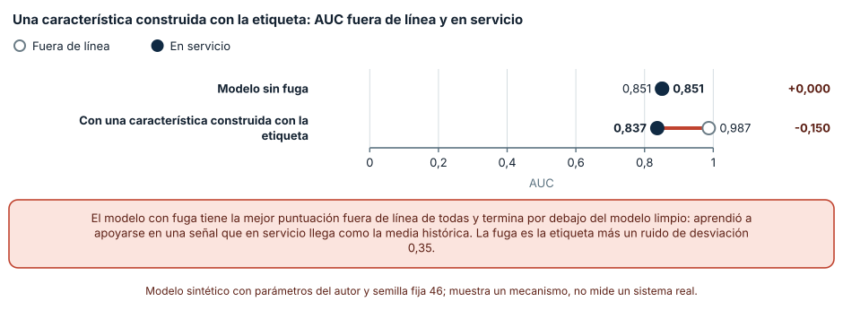
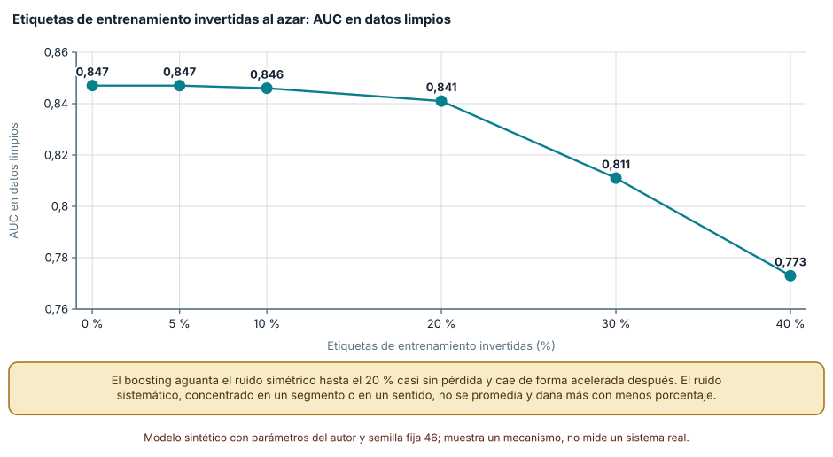

# SE-602 — Datos de entrenamiento, etiquetas y feature stores

[← SE-601 — Ciclo de vida de ML y por qué falla en producción](https://github.com/vladimiracunadev-create/modern-software-engineering-program/blob/main/classes/part-50-machine-learning-en-produccion-y-mlops/se-601-ciclo-de-vida-de-ml-y-por-que-falla-en-produccion/README.md) · [↑ Parte 50](https://github.com/vladimiracunadev-create/modern-software-engineering-program/blob/main/classes/part-50-machine-learning-en-produccion-y-mlops/README.md) · [📚 Índice completo](https://github.com/vladimiracunadev-create/modern-software-engineering-program/blob/main/classes/README.md) · [🌐 Portal](https://vladimiracunadev-create.github.io/modern-software-engineering-program/classes/SE-602.html) · [SE-603 — Experimentos y entrenamiento reproducible →](https://github.com/vladimiracunadev-create/modern-software-engineering-program/blob/main/classes/part-50-machine-learning-en-produccion-y-mlops/se-603-experimentos-y-entrenamiento-reproducible/README.md)

## Punto profesional y fundamento pedagógico

**Punto profesional.** La clase existe para que trates los datos de un modelo como un producto de ingeniería con defectos propios, y no como una materia prima que «ya viene». En un sistema de aprendizaje automático el comportamiento no está escrito en el código: sale de las filas con que se entrenó. Por eso las fallas más caras suelen nacer antes de que exista un modelo: una etiqueta que se registró mal, una característica calculada con información que en producción todavía no existe, una unión que mira el valor de hoy cuando debía mirar el de ayer, una función que se implementó dos veces con dos redondeos distintos. La clase mide cuatro de esas fallas con el mismo modelo y los mismos datos sintéticos y enseña la práctica que las contiene: uniones puntuales en el tiempo, una sola definición de cada característica y una prueba de paridad entre el entrenamiento y el servicio.

**Por qué aparece aquí.** Sigue a `SE-601`, que dio el mapa del ciclo de vida y nombró el sesgo entre entrenamiento y servicio como una de las cuatro causas de falla. Aquí se abre ese eslabón: de dónde salen las filas, quién las etiqueta y cómo se calculan las características. Reutiliza dos ideas de otras partes: los datos deterministas y las fixtures de `SE-428`, y el contrato de datos y la propiedad del conjunto de `SE-343`. Prepara `SE-603`, donde el entrenamiento se vuelve reproducible solo si los datos también lo son.

**Error conceptual que debe corregir.** Creer que más datos, o datos «limpios» en el sentido de sin nulos, son mejores datos. Los datos que importan son los que se parecen, fila por fila, a lo que el sistema verá cuando decida; una columna sin un solo nulo puede estar construida con el futuro y destruir el modelo. La segunda corrección: una puntuación excelente fuera de línea no es una buena noticia hasta que se descarta la fuga; en esta clase la peor configuración tiene la mejor puntuación fuera de línea.

**Secuencia de aprendizaje.** Antes de ejecutar, predices cuánto cae un modelo cuando una característica se construye con la etiqueta, cuánto aguanta cuando un porcentaje de etiquetas está invertido al azar y qué fracción de las uniones ingenuas devuelve un valor distinto del que existía en el momento de la decisión. Después ejecutas los cuatro experimentos y comparas con tu predicción.

**Evidencia de aprendizaje.** `contrato-de-datos-del-modelo.md` con la definición de la etiqueta y de su retraso, la tabla de características con su fuente, su ventana temporal y su fecha de disponibilidad, la prueba de unión puntual y la comprobación de paridad entre entrenamiento y servicio, más el resultado de inyectar una fuga y una deriva de definición en tus datos.

**Límite de la conclusión.** Los datos son sintéticos, de seis características y un solo modelo de boosting de gradiente; la fuga y las definiciones alternativas son construcciones del autor y los porcentajes de ruido son barridos, no estimaciones del ruido de ninguna organización. Nada de esto mide la calidad de datos reales ni evalúa ningún producto de almacén de características. No se invocó ningún modelo de lenguaje.

### Trazabilidad fuente → afirmación

| Fuente primaria u oficial | Afirmación que respalda | Lo que no prueba |
|---|---|---|
| [Sculley et al., «Hidden Technical Debt in Machine Learning Systems»](https://papers.nips.cc/paper_files/paper/2015/hash/86df7dcfd896fcaf2674f757a2463eba-Abstract.html) | Describe las dependencias de datos y los costos de mantenimiento propios de los sistemas de aprendizaje automático. | No mide cuánta deuda tiene ninguna organización. |
| [Kapoor y Narayanan, «Leakage and the reproducibility crisis in ML-based science»](https://arxiv.org/abs/2207.07048) | Documenta la fuga de datos como causa de resultados no reproducibles en la literatura científica y propone una taxonomía. | No cuantifica la fuga en sistemas de producción. |
| [Northcutt et al., «Pervasive Label Errors in Test Sets»](https://arxiv.org/abs/2103.14749) | Encuentra errores de etiqueta en conjuntos de prueba de uso común y muestra que pueden cambiar el orden de los modelos. | Se refiere a otros conjuntos, no a los datos de esta clase. |
| [Breck et al., «Data Validation for Machine Learning»](https://mlsys.org/Conferences/2019/doc/2019/167.pdf) | Describe la validación de datos de entrada con esquemas y la detección de sesgo entre entrenamiento y servicio. | No garantiza que un esquema detecte los cambios semánticos. |
| [Feast, «Point-in-time joins»](https://docs.feast.dev/getting-started/concepts/point-in-time-joins) | Documenta la unión puntual en el tiempo de un almacén de características de código abierto. | No evalúa ni recomienda ese producto. |
| [Google, «Rules of Machine Learning»](https://developers.google.com/machine-learning/guides/rules-of-ml) | Recoge prácticas de ingeniería, entre ellas registrar las características en el servicio para entrenar con lo que el servicio vio. | Es una guía de una organización, no un estudio. |

## Antes de empezar

Recupera lo aprendido en `SE-601`: un sistema de aprendizaje automático falla por sus entradas antes que por su modelo. La pregunta activa es: **si pidieras reproducir hoy la fila exacta con la que se decidió algo hace un mes, ¿qué valor tenía cada característica en ese instante y quién lo puede demostrar?**

## Prerrequisitos

- Haber completado `SE-601` y conocer el ciclo de vida de un sistema de aprendizaje automático.
- Saber qué es una unión de tablas por clave y por tiempo; las pruebas deterministas de [SE-428](https://github.com/vladimiracunadev-create/modern-software-engineering-program/blob/main/classes/part-35-estrategia-y-tecnicas-de-prueba/) sirven de antecedente.
- Conocer el contrato de datos de `SE-343`.
- Python 3.11 o posterior, numpy 2.4.4 y scikit-learn 1.8.0; el laboratorio no necesita GPU.

## Problema auténtico

*Avisos* entrena un modelo que estima la probabilidad de que un estudiante entregue tarde una tarea, para decidir a quién se le envía un recordatorio. El equipo tiene tres fuentes: el historial de entregas, el registro de lecturas de avisos y la carga de tareas de cada estudiante. En una revisión, una ingeniera añade una característica prometedora, «entregas tardías de los últimos siete días», y la puntuación sube de 0,85 a casi 1. Una semana después de desplegar, los recordatorios llegan a las personas equivocadas.

Nadie escribió un error. La característica se calculó sobre una ventana de siete días que incluía el día de la propia entrega, de modo que la respuesta formaba parte de la entrada. En producción esa información no existe todavía: el modelo la recibe vacía. A la vez, una segunda ingeniera reimplementó en el servicio la carga de tareas con otra definición y nadie lo comparó con la del entrenamiento. Hay dos defectos de datos, ninguno visible en el código del modelo, y el equipo no tiene una forma de preguntar «¿qué sabíamos de este estudiante en el momento de decidir?».

## Objetivos observables

Al terminar podrás:

1. definir una etiqueta con su retraso, su ventana y su fuente, y decir qué decisiones no pueden evaluarse todavía por ese retraso;
2. detectar una fuga de información comparando la puntuación fuera de línea con la que se obtiene con la característica tal como existirá en servicio;
3. medir el efecto de etiquetas erróneas con un barrido y decidir cuándo vale la pena corregir etiquetas antes que cambiar de modelo;
4. implementar una unión puntual en el tiempo y mostrar cuántas filas cambian de valor respecto de una unión ingenua;
5. escribir una prueba de paridad que compare cada característica entre el entrenamiento y el servicio y localice la que diverge.

## Mapa conceptual


El mapa muestra que la misma definición alimenta el conjunto de entrenamiento y el servicio, y que el servicio devuelve a los datos lo que vio. Las dos flechas que salen de la definición única son la parte que más se rompe cuando se implementa una característica dos veces.

## Temas y por qué importan

| Tema | Por qué cambia una decisión profesional | Evidencia mínima |
|---|---|---|
| Etiqueta con retraso | Define cuándo se puede evaluar y reentrenar. | Fuente, ventana y retraso por etiqueta |
| Fuga de información | Hace parecer excelente un modelo que no funcionará. | Puntuación con la característica como existe en servicio |
| Ruido de etiquetas | Fija un techo que ningún modelo supera. | Barrido de ruido con la métrica |
| Unión puntual | Evita usar el futuro en una fila del pasado. | Conteo de filas con valor distinto |
| Definición única | Elimina la divergencia entre entrenamiento y servicio. | Prueba de paridad por característica |
| Almacén de características | Reutiliza definiciones y registra versiones. | Versión de cada característica en cada predicción |
| Cuándo no | Con pocas características y un solo consumidor, una tabla versionada basta. | Número de consumidores y de definiciones |

## Conceptos y decisiones

### 1. La etiqueta es un proceso, no una columna

Una etiqueta responde a una pregunta sobre un instante: «¿esta entrega llegó tarde?». Hay que fijar qué es tarde (después del plazo oficial o de la prórroga), de dónde sale la verdad (el sistema de entregas o la revisión de un profesor) y cuánto tarda en conocerse. Para *Avisos* la verdad se conoce al cierre del plazo, de modo que un modelo que decide siete días antes recibe su etiqueta, como mínimo, una semana después. Ese retraso decide cuánto atrás hay que mirar para evaluar y con qué datos se puede reentrenar sin mirar el futuro; la clase `SE-608` lo convierte en una restricción del monitoreo. Una etiqueta sin su retraso invita a calcular métricas sobre decisiones que todavía no tienen respuesta y a presentarlas como resultados.

### 2. La fuga de información: la puntuación que no se traslada

Una fuga ocurre cuando una característica contiene información que no estará disponible en el momento de la decisión. La causa más frecuente no es un descuido grande sino una ventana mal cortada: un agregado que incluye el día de la decisión, una normalización calculada con todo el conjunto, un identificador que codifica el resultado. Se midió con una característica construida con la etiqueta más un poco de ruido, el equivalente a «entregas tardías de la semana» que incluye la entrega misma. Fuera de línea, el modelo con la fuga alcanzó un AUC de 0,987 frente a 0,851 del modelo sin ella: mejor en 0,136. En servicio, donde esa característica llega como la media histórica porque todavía no existe, el AUC de ese mismo modelo cayó a 0,837, por debajo del modelo limpio. La fuga no solo inflaba la métrica: había enseñado al modelo a apoyarse en una señal ausente y a desatender las que sí existían. La defensa operativa es una pregunta por característica: ¿en qué instante exacto se conoce este valor y es anterior a la decisión?

### 3. El ruido de etiquetas fija un techo

Las etiquetas erróneas no se corrigen con un modelo más grande. Se invirtió al azar una fracción de las etiquetas de entrenamiento y se evaluó en datos limpios. Con 0, 5, 10 y 20 % de etiquetas invertidas, el AUC fue 0,847, 0,847, 0,846 y 0,841: el boosting aguanta bien el ruido simétrico moderado porque promedia muchas filas. Con 30 % cayó a 0,811 y con 40 % a 0,773. Dos lecciones. La primera: un ruido moderado y aleatorio no justifica retrasar un proyecto, y medir antes de corregir evita gastar semanas en una causa menor. La segunda, que este experimento no cubre y que el caso de `SE-607` sí: el ruido sistemático, que afecta a un segmento o a un sentido (por ejemplo, entregas tardías que se registran como puntuales), no se promedia, se aprende. Un 5 % de ruido aleatorio y un 5 % de ruido concentrado en un segmento no son el mismo problema.

### 4. La unión puntual: no mirar el futuro de una fila del pasado

Las características cambian en el tiempo y cada evento de entrenamiento debe ver el valor que existía en su instante. Una unión ingenua pega a cada fila el valor más reciente, que es el de hoy. En el laboratorio, 5 000 eventos de 50 estudiantes sobre una característica que cambia unas diez veces en 100 días: la unión puntual encontró valor para 4 677 eventos (los 323 restantes ocurrieron antes de la primera observación y no tienen valor, algo que la unión ingenua oculta rellenándolos con el valor de hoy), y entre los eventos con valor la unión ingenua devolvió un número distinto en el 85,2 % de los casos, con una diferencia media absoluta de 0,507. Una unión ingenua entrega al entrenamiento información del futuro en más de ocho de cada diez filas. El mecanismo es una búsqueda del último valor con tiempo menor o igual al del evento; es barato, y los almacenes de características lo ofrecen como operación básica.

### 5. Entrenamiento y servicio: la misma característica, dos veces

Cuando la característica se calcula en un cuaderno para entrenar y se reescribe en el servicio, las dos versiones divergen por pequeñas decisiones: un redondeo, una zona horaria, una definición de «carga». Se midió con el mismo modelo: redondeando las horas restantes a días en el servicio, que cambia el 100 % de los valores, el AUC pasó de 0,846 a 0,845, casi nada, porque la característica pesa poco y el modelo no depende de la precisión fina; con una definición distinta de la carga, que cambia el 95 % de los valores, bajó a 0,834. El hallazgo útil es doble. Primero, no toda divergencia duele, y la prueba de paridad por característica separa las que duelen de las que no (en el experimento la fracción distinta fue 0,95 solo en la columna de carga y 0 en las demás). Segundo, el daño depende del peso que el modelo da a la característica, de modo que las divergencias en las más importantes son las que hay que cazar primero.

### 6. Un almacén de características como contrato de versiones

Un almacén de características hace tres cosas útiles: guarda la definición de cada característica una sola vez, la sirve fuera de línea (para entrenar con uniones puntuales) y en línea (para decidir con baja latencia), y registra qué versión de cada característica entró en cada predicción. No es obligatorio ni mágico. Con tres características y un solo consumidor, una tabla versionada y una función compartida resuelven lo mismo con menos piezas. Empieza a pagarse cuando varios modelos reutilizan características, cuando las características son costosas de calcular o cuando una auditoría exige reconstruir una decisión pasada. Su costo es otro sistema que operar y otro punto de falla en el camino de cada predicción.

### 7. Registrar lo que el servicio vio

La práctica más robusta contra el sesgo entre entrenamiento y servicio es entrenar con las características tal como el servicio las registró al decidir, en vez de recalcularlas después. Resuelve la unión puntual y la paridad de una vez, con el costo de almacenar cada vector de entrada. En *Avisos*, 20 000 decisiones diarias con seis características de ocho bytes suman unos 1,0 MB por día antes de comprimir; guardar la entrada de cada decisión rara vez es el costo que impide hacerlo. Lo que sí exige es una política de retención y de datos personales, que `SE-610` retoma.

### 8. Calidad de datos: esquema, distribución y significado

Las comprobaciones de `SE-343` aplican aquí: el esquema detecta columnas ausentes y tipos cambiados; las pruebas de distribución detectan unidades y significados que cambian; ninguna detecta un cambio semántico que conserve la distribución. La validación de datos de aprendizaje automático añade la comparación entre el conjunto de entrenamiento y los datos de servicio como una alarma de sesgo, que es la comprobación de paridad de esta clase generalizada.

### 9. Cuándo no

Si los datos son pocos y se revisan a mano, un almacén de características es una carga. Si la etiqueta se conoce en el instante de la decisión, el retraso no condiciona nada. Si el modelo es una regla simple, la fuga es imposible por construcción. La disciplina de datos escala con el número de características, de consumidores y de decisiones auditables, no con la moda.

## Fuga de información

La primera medida compara dos modelos con los mismos datos.



**Cómo leer la figura.** Cada fila es un modelo; el punto hueco es el AUC medido fuera de línea y el lleno el medido con la característica tal como existe en servicio. Mira primero la fila de la fuga: parte de la mejor puntuación de todas y termina bajo el modelo limpio, con un segmento coral. **Dónde deja de valer:** la fuga es una característica construida con la etiqueta y un ruido de desviación 0,35; una fuga real suele ser parcial y más difícil de ver. La figura prueba el mecanismo de una puntuación inflada, no la magnitud de ninguna fuga real.

## Ruido de etiquetas

La segunda medida barre la fracción de etiquetas invertidas.



**Cómo leer la figura.** El eje horizontal es el porcentaje de etiquetas invertidas y el vertical el AUC en datos limpios. Mira primero la meseta hasta el 20 % y la caída acelerada después del 30 %. **Dónde deja de valer:** el ruido es simétrico y uniforme; el ruido que depende de la clase o del segmento no se promedia y daña más. El modelo es un boosting con 20 000 filas, y con menos datos o un modelo más flexible la meseta sería más corta.

## Definiciones divergentes

La tercera medida reimplementa dos características en el servicio.


**Cómo leer la figura.** Cada fila es una implementación del servicio; el punto hueco es el AUC con la definición del entrenamiento y el lleno con la alternativa. Mira primero que redondear el 100 % de las horas casi no cambia el resultado y que cambiar la definición de la carga cuesta más. **Dónde deja de valer:** el daño depende del peso del modelo en cada característica, que en este modelo sintético es un resultado del generador; en tu modelo hay que medirlo con tus datos. Una divergencia pequeña en una característica muy importante cuesta más que una grande en una irrelevante.

## Definiciones de trabajo

- **[Etiqueta](../../../glosario/entradas/e/etiqueta.md):** valor que el modelo debe predecir, con su fuente, su ventana y su retraso.
- **[Característica](../../../glosario/entradas/c/caracteristica.md):** variable de entrada calculada a partir de eventos anteriores a la decisión.
- **[Fuga de información](../../../glosario/entradas/f/fuga-de-informacion.md):** característica que contiene información no disponible al decidir.
- **[Unión puntual en el tiempo](../../../glosario/entradas/u/union-puntual-en-el-tiempo.md):** unión que asigna a cada evento el último valor conocido en su instante.
- **[Sesgo entre entrenamiento y servicio](../../../glosario/entradas/s/sesgo-entre-entrenamiento-y-servicio.md):** diferencia entre cómo se calcula o se distribuye una característica en cada entorno.
- **[Almacén de características](../../../glosario/entradas/a/almacen-de-caracteristicas.md):** sistema que define, versiona y sirve características para entrenar y para decidir.
- **[Paridad](../../../glosario/entradas/p/paridad.md):** coincidencia, característica por característica, entre lo visto al entrenar y lo servido.

## Ejemplo mínimo

La unión puntual en seis líneas:

```python
import numpy as np

tiempos = np.array([0.0, 10.0, 20.0, 30.0])      # cuándo cambió la característica
valores = np.array([1.0, 1.4, 2.1, 2.5])
eventos = np.array([5.0, 12.0, 29.0, 35.0])        # cuándo se decidió
idx = np.searchsorted(tiempos, eventos, side="right") - 1
print(valores[idx])                                  # [1.  1.4 2.1 2.5]
```

Cada evento recibe el último valor con tiempo menor o igual al suyo: la decisión de t=12 ve 1,4 y no el 2,5 de hoy. Un evento antes de la primera observación tendría índice −1; la versión de producción debe tratarlo como «sin valor» en vez de tomar el último elemento, que es lo que haría el índice negativo sin cuidado.

## Ejemplo profesional

*Escenario ilustrativo: las cifras y los resultados que aparecen en este ejemplo son supuestos de la narración, no mediciones.*

El equipo de *Avisos* descubre que su AUC de 0,98 de la semana pasada era fuga. Define una regla de revisión: toda característica nueva se acompaña de una fila de la tabla de características con su fuente, su ventana y su «disponible desde», y una prueba automatizada que recalcula la característica sobre un historial truncado en el instante de decisión y exige que dé lo mismo que sobre el historial completo. Esa prueba habría fallado con «entregas tardías de siete días» porque el valor cambia al añadir el futuro. Además se acuerda guardar en cada predicción las seis entradas y la versión del modelo. Tres meses después, un cambio en la definición de la carga hecho por otro equipo se detecta en la prueba de paridad de la integración continua antes del despliegue: la columna diverge en el 95 % de las filas de la muestra y el despliegue se bloquea. El equipo no demuestra con esto que los datos sean buenos; demuestra que dos fallas conocidas ya no pasan sin que alguien las vea.

## Práctica guiada

1. Escribe la tabla de características de un modelo tuyo con fuente, ventana y «disponible desde» para cada una, y marca las que no puedan conocerse al decidir.
2. Ejecuta `python scripts/experiments_part50_a.py 554` y reproduce las tres tablas; cambia el desvío de ruido de la fuga y mira cuándo deja de ser visible fuera de línea.
3. Implementa la unión puntual para tus datos con `searchsorted` y cuenta cuántas filas cambian respecto de una unión ingenua.
4. Escribe la prueba de truncamiento: recalcula una característica con el historial cortado en cada instante y compara.
5. Reimplementa una característica de dos maneras y mide la fracción de valores distintos y el cambio en la métrica.

## Ejercicios

1. **Básico.** Explica por qué un modelo con una fuga puede tener mejor puntuación fuera de línea y peor resultado en servicio que el modelo sin ella, y qué pregunta por característica la habría detectado.
2. **Intermedio.** Repite el barrido de ruido con un 10 % de etiquetas invertidas solo cuando la carga es alta y compáralo con un 10 % aleatorio; explica la diferencia.
3. **Avanzado.** Diseña una prueba de paridad que se ejecute en la integración continua con una muestra de 1 000 entradas y fija el umbral de fracción distinta por característica según su importancia en el modelo.

## Reto verificable

Entrega `contrato-de-datos-del-modelo.md` con la definición de la etiqueta y su retraso, la tabla de características con fuente, ventana y disponibilidad, la unión puntual con el conteo de filas que cambian, y la prueba de paridad con su resultado al inyectar una fuga y una deriva de definición. Es válido si otra persona reproduce los conteos con tus datos y puede señalar una característica de tu tabla cuya disponibilidad no hayas justificado.

## Caso conductor

*Avisos-ML* entrena con una tabla de seis características y una etiqueta con retraso de una semana, y a partir de aquí registra en cada predicción las entradas y la versión. `SE-603` toma ese conjunto y pregunta si el entrenamiento que lo usa se puede repetir y comparar con honestidad.

## Preguntas frecuentes

### ¿Necesito un almacén de características desde el primer día?

No. Con pocas características y un solo modelo, una función compartida y una tabla versionada alcanzan. Considera un almacén cuando haya varios modelos que reutilizan definiciones, cuando la reconstrucción de decisiones pasadas sea un requisito o cuando la divergencia entre entrenamiento y servicio ya haya causado un incidente.

### ¿Cómo sé si una característica tiene fuga?

Pregunta en qué instante se conoce su valor y compáralo con el instante de la decisión. Como control empírico, calcula la puntuación con la característica tal como llegará en servicio, o con el historial truncado, y desconfía de una mejora grande que desaparece.

### ¿Cuántas etiquetas erróneas son demasiadas?

Depende del modelo y del tipo de error. En este laboratorio el ruido simétrico hasta el 20 % apenas movió el AUC y el 30 % ya lo bajó 0,036, pero el ruido que se concentra en un segmento causa más daño con menos porcentaje. Mide con un barrido y con una muestra revisada a mano.

### ¿Es mejor recalcular las características o guardar lo que el servicio vio?

Guardar lo que el servicio vio elimina la divergencia por construcción y es la opción más segura; recalcular permite cambiar la definición con efecto retroactivo. Lo habitual es combinar: guardar para evaluar y auditar, recalcular para experimentar con definiciones nuevas con uniones puntuales.

## Fallo controlado y diagnóstico

**Fallo.** Un modelo con un AUC de 0,98 fuera de línea decide recordatorios en servicio y la tasa de entregas tardías entre los estudiantes avisados no mejora. La monitorización de entradas no muestra alertas.

**Diagnóstico paso a paso.** (1) Se recalcula la puntuación en el conjunto de prueba con cada característica sustituida por su valor de servicio, una a una. (2) Al sustituir «entregas tardías de siete días» la puntuación cae de 0,98 a 0,84. (3) Se revisa su definición: la ventana incluye la fecha de la entrega que se predice. (4) Se confirma que en servicio la característica llega con la media histórica porque todavía no existe. Las alertas de entradas no la vieron porque la columna siempre tenía valor, solo que no el que el modelo esperaba.

**Corrección.** Se elimina la característica o se redefine con una ventana que termina antes de la decisión, se añade al contrato su fecha de disponibilidad y se agrega la prueba de truncamiento a la integración continua. Se reentrena y se mide con la característica como existirá. La lección es que una mejora súbita y grande fuera de línea es una señal para buscar fuga antes de celebrar.

## Errores comunes y cómo corregirlos

- **Celebrar una mejora fuera de línea sin comprobar la disponibilidad.** Corrige preguntando el instante de conocimiento de cada característica.
- **Normalizar con todo el conjunto antes de dividir.** La media y la desviación incluyen datos de prueba. Corrige ajustando la normalización solo con el entrenamiento, dentro de una tubería.
- **Unir por el valor más reciente.** Entrega el futuro al entrenamiento. Corrige con uniones puntuales.
- **Definir dos veces una característica.** Corrige con una sola implementación compartida o con una prueba de paridad.
- **Ignorar el retraso de la etiqueta.** Corrige declarando cuándo se conoce y evaluando solo lo que ya tiene respuesta.
- **Tratar todo el ruido como aleatorio.** Corrige revisando una muestra por segmento.

## Entorno y archivos clave

- `scripts/experiments_part50_a.py`: función `e554` con la fuga, el barrido de ruido, la unión puntual y la prueba de paridad; se ejecuta con `python scripts/experiments_part50_a.py 554`.
- `scripts/experiments_part50_lab.py`: generador sintético de *Avisos-ML*, semilla 46, y funciones de ajuste.
- `scripts/figures_part50_a.py`: las tres figuras de la clase.
- numpy 2.4.4 y scikit-learn 1.8.0 (ver `scripts/requirements-part46.txt`); el programa avisa si las versiones difieren. Las pruebas tardan segundos y no usan GPU.

## Seguridad, ética y accesibilidad

Los datos del laboratorio son sintéticos. En un sistema real, las características de comportamiento de estudiantes (lecturas, horarios, dispositivo) son datos personales y pueden revelar hábitos; el contrato de datos debe declarar su base legal, su minimización y su retención, y el registro de entradas de cada predicción hereda esas obligaciones (`SE-463`). La etiqueta «entregó tarde» puede penalizar a quien tiene mala conectividad: la fuente de la etiqueta y las ausencias hay que revisarlas con criterio humano. Las figuras tienen texto alternativo completo y no dependen solo del color.

## Puente hacia el trabajo con agentes

Un agente que prepara un conjunto de entrenamiento o escribe una característica puede introducir una fuga con la mejor intención, porque optimiza la métrica que se le pide. Exige que declare, para cada característica nueva, el instante en que se conoce su valor, y que ejecute la prueba de truncamiento y la de paridad antes de proponer el cambio. No le permitas modificar la definición de la etiqueta ni las pruebas que lo evalúan, y trata una mejora grande propuesta por un agente como una señal de fuga hasta demostrar lo contrario. Los hallazgos del agente son hipótesis hasta que tu prueba los reproduce.

## Transferencia

Toma un modelo tuyo o de tu equipo y construye la tabla de características con su disponibilidad. Elige la que dependa de una agregación, escribe la prueba de truncamiento y mide si cambia. Después busca una característica implementada en dos lugares y calcula su fracción de valores distintos. Decide con esos dos números si necesitas una prueba de paridad o un almacén.

## Evaluación y evidencia

| Criterio | Evidencia aceptable | Rechazo |
|---|---|---|
| Etiqueta | Fuente, ventana y retraso declarados | «La columna objetivo» |
| Disponibilidad | Instante de conocimiento por característica | Lista de nombres sin fecha |
| Fuga | Puntuación con la característica como existe en servicio | Solo la puntuación fuera de línea |
| Unión | Unión puntual con conteo de filas que cambian | Último valor conocido |
| Paridad | Prueba por característica con umbral | «Usamos la misma librería» |

## Fuentes

- Sculley, D. et al. [«Hidden Technical Debt in Machine Learning Systems»](https://papers.nips.cc/paper_files/paper/2015/hash/86df7dcfd896fcaf2674f757a2463eba-Abstract.html).
- Kapoor, S. y Narayanan, A. [«Leakage and the reproducibility crisis in ML-based science»](https://arxiv.org/abs/2207.07048).
- Northcutt, C. et al. [«Pervasive Label Errors in Test Sets Destabilize Machine Learning Benchmarks»](https://arxiv.org/abs/2103.14749).
- Breck, E. et al. [«Data Validation for Machine Learning»](https://mlsys.org/Conferences/2019/doc/2019/167.pdf).
- Feast. [«Point-in-time joins»](https://docs.feast.dev/getting-started/concepts/point-in-time-joins).
- Google. [«Rules of Machine Learning»](https://developers.google.com/machine-learning/guides/rules-of-ml).
- scikit-learn. [«Common pitfalls and recommended practices»](https://scikit-learn.org/stable/common_pitfalls.html).

## Límites y siguiente paso

La fuga, el ruido, la unión y las definiciones alternativas son construcciones del autor sobre datos sintéticos de seis características; los números muestran mecanismos, no la frecuencia ni el costo de estos defectos en ningún sistema real. No se evaluó ningún almacén de características. El siguiente paso, `SE-603`, pregunta si el entrenamiento sobre estos datos se puede repetir y cuánto de la diferencia entre dos corridas es azar.

## Glosario

| Término | Definición breve |
|---|---|
| Etiqueta | Valor que el modelo debe predecir, con retraso y fuente |
| Fuga de información | Característica con datos no disponibles al decidir |
| Unión puntual | Unión que respeta el instante de cada evento |
| Sesgo entrenamiento-servicio | Diferencia entre cómo se calcula o distribuye una característica en cada entorno |
| Almacén de características | Sistema que define, versiona y sirve características |
| Paridad | Coincidencia entre lo visto al entrenar y lo servido |

Conceptos de esta clase en el [glosario del programa](../../../glosario/README.md): [Almacén de características](../../../glosario/entradas/a/almacen-de-caracteristicas.md) · [Característica](../../../glosario/entradas/c/caracteristica.md) · [Etiqueta](../../../glosario/entradas/e/etiqueta.md) · [Fuga de información](../../../glosario/entradas/f/fuga-de-informacion.md) · [Paridad](../../../glosario/entradas/p/paridad.md) · [Sesgo entre entrenamiento y servicio](../../../glosario/entradas/s/sesgo-entre-entrenamiento-y-servicio.md) · [Unión puntual en el tiempo](../../../glosario/entradas/u/union-puntual-en-el-tiempo.md).

---

[← SE-601 — Ciclo de vida de ML y por qué falla en producción](https://github.com/vladimiracunadev-create/modern-software-engineering-program/blob/main/classes/part-50-machine-learning-en-produccion-y-mlops/se-601-ciclo-de-vida-de-ml-y-por-que-falla-en-produccion/README.md) · [↑ Parte 50](https://github.com/vladimiracunadev-create/modern-software-engineering-program/blob/main/classes/part-50-machine-learning-en-produccion-y-mlops/README.md) · [📚 Índice completo](https://github.com/vladimiracunadev-create/modern-software-engineering-program/blob/main/classes/README.md) · [🌐 Portal](https://vladimiracunadev-create.github.io/modern-software-engineering-program/classes/SE-602.html) · [SE-603 — Experimentos y entrenamiento reproducible →](https://github.com/vladimiracunadev-create/modern-software-engineering-program/blob/main/classes/part-50-machine-learning-en-produccion-y-mlops/se-603-experimentos-y-entrenamiento-reproducible/README.md)
