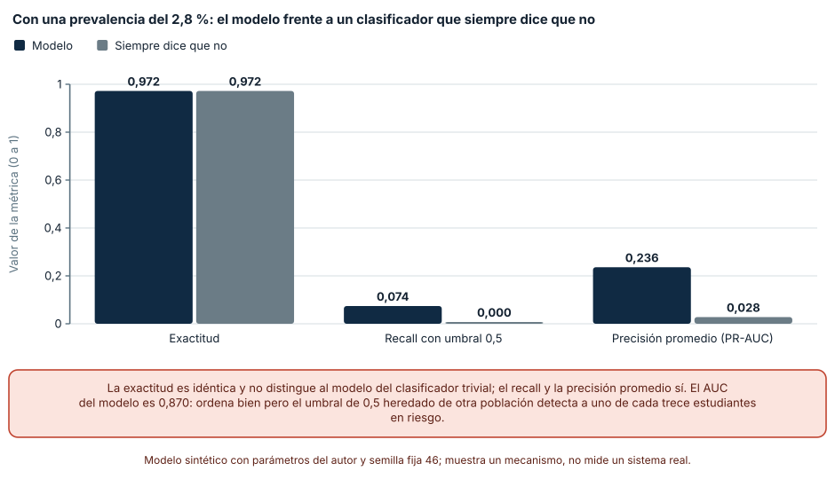
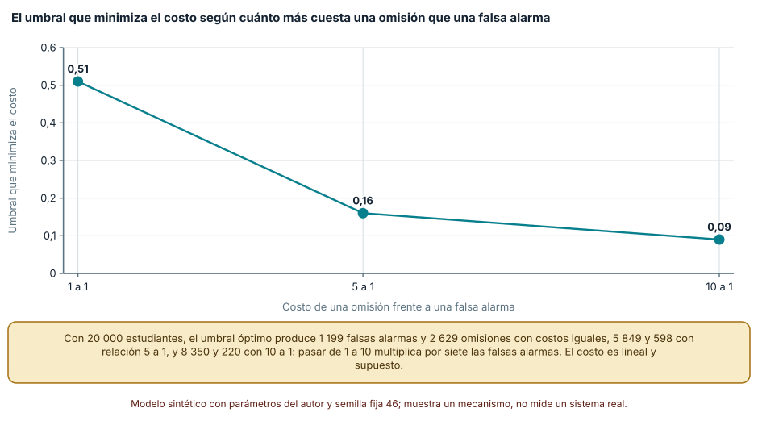
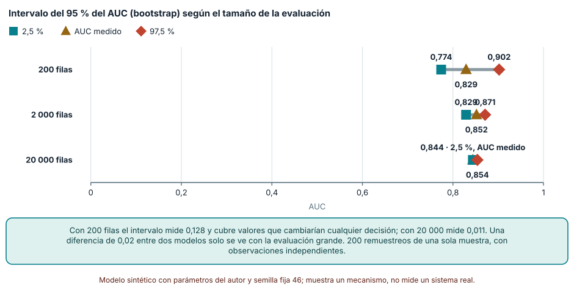

# SE-604 — Evaluación, sesgos y validación de modelos

[← SE-603 — Experimentos y entrenamiento reproducible](https://github.com/vladimiracunadev-create/modern-software-engineering-program/blob/main/classes/part-50-machine-learning-en-produccion-y-mlops/se-603-experimentos-y-entrenamiento-reproducible/README.md) · [↑ Parte 50](https://github.com/vladimiracunadev-create/modern-software-engineering-program/blob/main/classes/part-50-machine-learning-en-produccion-y-mlops/README.md) · [📚 Índice completo](https://github.com/vladimiracunadev-create/modern-software-engineering-program/blob/main/classes/README.md) · [🌐 Portal](https://vladimiracunadev-create.github.io/modern-software-engineering-program/classes/SE-604.html) · [SE-605 — Ajuste fino, adaptación y costo →](https://github.com/vladimiracunadev-create/modern-software-engineering-program/blob/main/classes/part-50-machine-learning-en-produccion-y-mlops/se-605-ajuste-fino-adaptacion-y-costo/README.md)

## Punto profesional y fundamento pedagógico

**Punto profesional.** La clase existe para que evalúes un modelo con la pregunta correcta, que no es «¿qué puntuación saca?» sino «¿qué decisiones tomará, a quién afectan y cuánto cuesta equivocarse en cada sentido?». Una métrica agregada puede ocultar que el modelo no sirve para el caso raro que importa, que sus probabilidades no son probabilidades, que decide mejor para un grupo que para otro o que la diferencia que celebras cabe en el ruido de la muestra. La clase mide, sobre el modelo de *Avisos-ML*, cinco situaciones: la exactitud que engaña cuando el evento es raro, el umbral que depende del costo de cada error, la calibración de las probabilidades, las diferencias entre grupos y el ancho del intervalo de una métrica según el tamaño de la muestra.

**Por qué aparece aquí.** Sigue a `SE-603`, que enseñó a medir la dispersión de una métrica; aquí se elige la métrica y se decide qué hacer con ella. Reutiliza las pruebas por riesgo de `SE-421`, los atributos medibles de `SE-433` y los experimentos y sesgos de `SE-138`. Prepara `SE-605` y `SE-607`: no se puede decidir si un modelo adaptado o candidato mejora si la evaluación no es sólida.

**Error conceptual que debe corregir.** Creer que una métrica única, como el AUC o la exactitud, resume la calidad de un modelo. Cada métrica responde una pregunta: el AUC, qué tan bien ordena; la exactitud, qué fracción acierta con un umbral dado; la calibración, si las probabilidades se pueden usar como tales. Con una prevalencia de 2,8 % un clasificador que siempre dice «no» alcanza 97,2 % de exactitud. La segunda corrección: «sin sesgo» no es una propiedad del modelo que se pueda comprobar con un número; hay varias definiciones de equidad y, cuando los grupos tienen prevalencias distintas, no se pueden cumplir todas a la vez.

**Secuencia de aprendizaje.** Antes de ejecutar, predices la exactitud de un clasificador trivial con una prevalencia del 2,8 %, el umbral que minimiza el costo cuando una omisión cuesta diez veces más que una falsa alarma y el ancho del intervalo del AUC con 200 filas. Después ejecutas y comparas.

**Evidencia de aprendizaje.** `informe-de-evaluacion.md` con la métrica de decisión y su justificación, el umbral por costo, la curva de calibración con su error, la tabla por grupo con las tasas de error y el intervalo de la métrica principal con su método.

**Límite de la conclusión.** Los datos son sintéticos y el «grupo» es una columna construida por el autor con una diferencia de prevalencia que él fijó; no representa a ninguna población real y las cifras de equidad no son una auditoría. Los costos de cada error son supuestos. No se evaluó ninguna biblioteca de equidad ni se invocó ningún modelo de lenguaje, y nada de esto es asesoría jurídica.

### Trazabilidad fuente → afirmación

| Fuente primaria u oficial | Afirmación que respalda | Lo que no prueba |
|---|---|---|
| [scikit-learn, «Model evaluation»](https://scikit-learn.org/stable/modules/model_evaluation.html) | Documenta las métricas de clasificación (exactitud, precisión, recall, AUC, precisión promedio, Brier) y sus definiciones. | No dice cuál conviene a un caso. |
| [scikit-learn, «Probability calibration»](https://scikit-learn.org/stable/modules/calibration.html) | Describe curvas de calibración y los métodos sigmoide e isotónico para calibrar probabilidades. | No garantiza que la calibración se mantenga en producción. |
| [scikit-learn, «Cross-validation»](https://scikit-learn.org/stable/modules/cross_validation.html) | Describe la validación cruzada y las particiones, incluida la de series temporales. | No elige la partición correcta para un problema. |
| [Hardt, Price y Srebro, «Equality of Opportunity in Supervised Learning»](https://arxiv.org/abs/1610.02413) | Define la igualdad de oportunidad como igualdad de la tasa de verdaderos positivos entre grupos y propone ajustar umbrales. | Es una definición entre varias y no dice cuál es la justa. |
| [Kleinberg, Mullainathan y Raghavan, «Inherent Trade-Offs in the Fair Determination of Risk Scores»](https://arxiv.org/abs/1609.05807) | Demuestra que, salvo casos triviales, no pueden cumplirse a la vez calibración y la igualdad de las tasas de error entre grupos con prevalencias distintas. | No aplica a todas las definiciones de equidad. |
| [Mitchell et al., «Model Cards for Model Reporting»](https://arxiv.org/abs/1810.03993) | Propone documentar el uso previsto, la evaluación por grupos y las limitaciones de un modelo. | No exige ni garantiza que la tarjeta sea completa. |
| [Northcutt et al., «Pervasive Label Errors in Test Sets»](https://arxiv.org/abs/2103.14749) | Muestra que los errores de etiqueta en los conjuntos de prueba pueden cambiar la conclusión de una evaluación. | Se refiere a otros conjuntos de datos. |

## Antes de empezar

Recupera lo aprendido en `SE-603`: una diferencia entre dos corridas solo existe si supera el ruido. La pregunta activa es: **¿cuál es el error más caro de tu modelo, quién lo paga y qué fracción de tus decisiones lo comete?**

## Prerrequisitos

- Haber completado `SE-603` y saber calcular una desviación y un intervalo.
- Conocer la matriz de confusión: verdaderos y falsos positivos y negativos.
- Haber visto las pruebas por riesgo de `SE-421` y los atributos de calidad de `SE-433`.
- Python 3.11 o posterior, numpy 2.4.4 y scikit-learn 1.8.0; el laboratorio no necesita GPU.

## Problema auténtico

*Avisos-ML* envía un recordatorio a quien el modelo marca como probable entrega tardía. Un recordatorio enviado a quien no lo necesitaba cuesta atención y confianza; un recordatorio no enviado a quien lo necesitaba cuesta una entrega perdida. El equipo presenta un AUC de 0,849 y la dirección aprueba. En la primera semana se descubre que en una universidad nueva, donde solo el 2,8 % de las entregas son tardías, el modelo «acierta» el 97 % de las veces y detecta a menos de uno de cada diez estudiantes en riesgo; que la probabilidad «0,7» que muestra la interfaz no corresponde a que 7 de 10 lleguen tarde; y que entre dos campus la tasa de estudiantes en riesgo que el modelo detecta difiere en ocho puntos.

Cada hallazgo es un problema de evaluación, no de modelo. La métrica que se miró (AUC) no es la que decide el costo, el umbral se fijó en 0,5 por costumbre, nadie midió la calibración ni la desglosó por grupo, y el AUC se informó sin intervalo ni tamaño de muestra.

## Objetivos observables

Al terminar podrás:

1. elegir una métrica de decisión según la prevalencia y el costo de cada error, y explicar por qué la exactitud engaña con eventos raros;
2. calcular el umbral que minimiza el costo esperado y mostrar cómo cambia cuando cambia la relación de costos;
3. medir la calibración con una curva y un error esperado, y recalibrar con un método y una muestra aparte;
4. desglosar las tasas de error por grupo, calcular las diferencias y explicar por qué las definiciones de equidad pueden ser incompatibles;
5. dar un intervalo para una métrica con el tamaño de muestra declarado y decidir qué tamaño de evaluación necesitas.

## Mapa conceptual


El mapa parte de la decisión y su costo y no del modelo. La métrica, el umbral, la calibración y el desglose son cuatro lecturas del mismo puntaje, y el informe las reúne con su incertidumbre antes de aceptar o rechazar.

## Temas y por qué importan

| Tema | Por qué cambia una decisión profesional | Evidencia mínima |
|---|---|---|
| Prevalencia y métrica | Con eventos raros la exactitud no distingue el modelo del clasificador trivial. | Exactitud, recall y PR-AUC frente a la línea base |
| Umbral por costo | El umbral de 0,5 rara vez es el óptimo. | Curva de costo contra umbral |
| Calibración | Si se muestran probabilidades, deben significar lo que dicen. | Curva de calibración y ECE |
| Subgrupos | Un promedio puede ocultar un grupo con peor desempeño. | Tasas de error por grupo |
| Equidad y sus límites | Las definiciones compiten; hay que elegir y justificar. | Definición elegida y costo de la otra |
| Incertidumbre | Una métrica sin intervalo no se puede comparar. | Intervalo y tamaño de muestra |
| Validación temporal | Evita usar el futuro para evaluar el pasado. | Partición por fecha |

## Conceptos y decisiones

### 1. La métrica sigue a la decisión

Cada métrica contesta una pregunta distinta. El AUC mide la probabilidad de que un caso positivo reciba un puntaje mayor que uno negativo: ordena, no decide. La exactitud mide la fracción de aciertos con un umbral. La precisión y el recall miden, entre lo marcado, cuánto es verdadero y, entre lo verdadero, cuánto se marca. La precisión promedio o área bajo la curva de precisión y recall (PR-AUC) resume el compromiso entre ambos y es más informativa que el AUC cuando los positivos son raros. El Brier mide el error cuadrático de las probabilidades. En *Avisos-ML* con una prevalencia del 27,2 % el modelo obtuvo AUC 0,849, PR-AUC 0,692 y Brier 0,134; ninguna de estas cifras dice por sí sola si el sistema sirve: primero hay que fijar la decisión.

### 2. La trampa de la prevalencia baja

Con una prevalencia del 2,8 % (la universidad nueva), un clasificador que siempre dice «no entregará tarde» tiene 97,2 % de exactitud y recall 0. El modelo, con un umbral de 0,5, también alcanzó 97,2 % de exactitud, pero con un recall de 7,4 %: detecta a uno de cada trece estudiantes en riesgo. Su AUC fue 0,870, es decir, el modelo ordena bien, pero el umbral de 0,5 está muy lejos de donde habría que cortar. La PR-AUC fue 0,236 frente a 0,028 de un modelo al azar, que vale la prevalencia: el modelo es ocho veces mejor que el azar en esa métrica y aun así queda lejos de ser un buen detector. La exactitud no solo es inútil con eventos raros: es engañosa, porque el valor trivial es alto.

### 3. El umbral sale del costo

Un clasificador devuelve un puntaje y alguien elige el umbral. El umbral correcto minimiza el costo esperado de los dos errores. Con el modelo de *Avisos-ML* y 20 000 estudiantes: si una falsa alarma y una omisión cuestan igual, el umbral óptimo es 0,51 y comete 1 199 falsas alarmas y 2 629 omisiones (costo total 3 828). Si una omisión cuesta cinco veces más, el umbral baja a 0,16 con 5 849 falsas alarmas y 598 omisiones (costo 8 839). Si cuesta diez veces más, baja a 0,09 con 8 350 falsas alarmas y 220 omisiones (costo 10 550). El umbral no es una propiedad del modelo sino de la decisión: cambiar la relación de costos mueve la operación y, con ella, la carga de trabajo: pasar de 1:1 a 1:10 multiplica por siete las falsas alarmas. La clase obliga a escribir los costos antes de fijar el umbral y a registrar quién los aprobó.

### 4. Calibración: si el modelo dice 0,7

Un modelo está calibrado si, entre los casos con probabilidad 0,7, aproximadamente el 70 % es positivo. El error de calibración esperado (ECE) promedia la distancia entre la probabilidad y la frecuencia observada por tramos. El boosting de *Avisos-ML* tuvo ECE 0,0081, bien calibrado. Un bosque sin podar, con un AUC de 0,828, tuvo ECE 0,0229, casi tres veces peor, porque los árboles profundos producen probabilidades extremas. Se recalibró con regresión isotónica ajustada con otra muestra: el ECE bajó de 0,0252 a 0,0138 en la mitad evaluada. Hay que calibrar con datos distintos de los de entrenamiento y recalibrar cuando cambia la población: la calibración es una propiedad del modelo y de los datos, y se rompe con la deriva. Si la interfaz muestra «70 % de riesgo», el equipo asume una promesa; si solo ordena a los estudiantes, la calibración importa menos.

### 5. Desglose por grupo: tasas, no promedios

Con un modelo que no usa el grupo como entrada, las tasas de error pueden diferir entre grupos porque las prevalencias y las distribuciones de las características difieren. En el laboratorio, con un umbral de 0,35: el grupo 0 (13 964 estudiantes, prevalencia 0,248) tuvo AUC 0,854, recall (TPR) 0,714 y tasa de falsas alarmas (FPR) 0,181; el grupo 1 (6 036 estudiantes, prevalencia 0,328) tuvo AUC 0,847, TPR 0,631 y FPR 0,144. La tasa de marcados fue casi igual (0,313 y 0,304, razón 0,97), pero el modelo detecta a 8,3 puntos menos de los estudiantes en riesgo del grupo 1. Un número agregado habría ocultado esa diferencia. El desglose no dice cuál es la causa ni qué hacer; dice dónde mirar.

### 6. Las definiciones de equidad compiten

Hay varias definiciones: igualar la tasa de marcados (paridad demográfica), igualar el recall (igualdad de oportunidad, de Hardt y colegas), igualar recall y falsas alarmas, o que las probabilidades signifiquen lo mismo en cada grupo (calibración por grupo). Kleinberg y colegas demostraron que, cuando las prevalencias difieren, no se pueden cumplir a la vez la calibración y la igualdad de las tasas de error, salvo en casos triviales. En el laboratorio de `SE-610`, que usa el mismo generador con una brecha de grupo mayor, igualar la tasa de marcados con un umbral distinto por grupo (0,400 y 0,408) dejó el recall en 0,655 para el grupo 0 y 0,583 para el grupo 1, y la precisión en 0,600 y 0,733: igualar una cosa no iguala las otras. Elegir la definición es una decisión de producto y de ética, no una elección técnica; la ingeniería aporta la medición y el costo de cada elección.

### 7. Intervalos: cuánto pesa la muestra

Una métrica es una estimación y tiene incertidumbre. Con un bootstrap de 200 remuestreos del conjunto de evaluación, el AUC con 200 filas fue 0,829 con un intervalo del 95 % de [0,774; 0,902] y un ancho de 0,128; con 2 000 filas, 0,852 con [0,829; 0,871] y ancho 0,041; con 20 000 filas, 0,849 con [0,844; 0,854] y ancho 0,011. Una diferencia de 0,02 entre dos modelos no se distingue con 200 filas; con 20 000, sí. El número de filas de evaluación no es un detalle: define qué diferencias se pueden ver. Para un grupo pequeño, el intervalo es el que manda: si solo hay 150 estudiantes de un campus, el desglose por ese campus tiene un ancho de más de 0,1 y no permite concluir.

### 8. Validar en el tiempo

Dividir al azar mezcla pasado y futuro y deja que el modelo vea, en el entrenamiento, datos posteriores a los que evalúa. Una validación temporal entrena con lo anterior a una fecha y evalúa con lo posterior. En el laboratorio con una deriva progresiva en seis periodos, el AUC con partición aleatoria fue 0,836, con partición temporal sobre el último periodo disponible 0,844, y el mismo modelo en un periodo futuro más allá de los datos 0,825. Ninguna de las dos particiones predijo el futuro, y en este generador la temporal no fue más pesimista que la aleatoria. La razón para preferir la temporal no es que dé un número menor: es que respeta el orden causal, evita fugas y permite medir cómo se degrada el modelo a medida que pasa el tiempo. Lo que nunca debe hacerse es usar esos números como garantía.

### 9. Documentar: la ficha del modelo

La evaluación por grupos, las condiciones de uso y las limitaciones se escriben en una ficha de modelo (Mitchell y colegas). Es un contrato con los usuarios del modelo y con quien lo audite: dice para qué se evaluó, con qué datos, con qué resultados por grupo y para qué no debe usarse. `SE-610` la usa como evidencia de gobierno.

### 10. Cuándo no

Si la decisión es de bajo riesgo y reversible, un informe completo de equidad y calibración es excesivo; basta con la métrica de decisión y un intervalo. Si el modelo solo ordena para que un humano revise una cola, la calibración importa poco y el recall en los primeros lugares importa mucho. Y cuando los grupos son pequeños, el desglose requiere agruparlos o aceptar que no hay evidencia, no inventar una precisión que la muestra no tiene.

## Exactitud, recall y azar con prevalencia baja

La primera medida contrasta el modelo con un clasificador trivial cuando solo el 2,8 % entrega tarde.



**Cómo leer la figura.** Cada grupo de barras es una métrica; la barra azul es el modelo y la gris el clasificador que siempre dice que no. Mira primero que las dos barras de exactitud son iguales y que solo la precisión promedio y el recall separan al modelo del trivial. **Dónde deja de valer:** el clasificador trivial es una línea base extrema; con una prevalencia del 30 % la exactitud sí distinguiría. El umbral de 0,5 es el supuesto del recall; con un umbral por costo el recall sería mucho mayor.

## El umbral según el costo

La segunda medida mueve el umbral con la relación de costos entre los errores.



**Cómo leer la figura.** El eje horizontal es cuántas veces más cuesta una omisión que una falsa alarma y el vertical el umbral que minimiza el costo; la nota da las falsas alarmas que genera cada umbral. Mira primero cómo el umbral cae mientras las falsas alarmas se multiplican por siete. **Dónde deja de valer:** el costo es lineal y conocido; en la práctica la saturación de la atención, un tope de recordatorios o un efecto distinto por persona hacen que el costo marginal cambie. El modelo es el de 20 000 filas del laboratorio.

## El ancho de una métrica

La tercera medida pregunta cuánto se puede confiar en el AUC según el tamaño de la evaluación.



**Cómo leer la figura.** Cada fila es un tamaño de evaluación; el rastro va del límite inferior al superior y el punto central es el AUC medido. Mira primero cómo el intervalo con 200 filas cubre valores que cambiarían la decisión y cómo con 20 000 se estrecha a 0,011. **Dónde deja de valer:** el bootstrap supone observaciones independientes; con estudiantes que repiten tareas, o con datos agrupados por curso, el intervalo real es más ancho. Son 200 remuestreos de una sola muestra, no un estudio de cobertura.

## Definiciones de trabajo

- **[Prevalencia](../../../glosario/entradas/p/prevalencia.md):** fracción de casos positivos en la población.
- **[Recall o TPR](../../../glosario/entradas/r/recall-o-tpr.md):** fracción de positivos que el modelo marca.
- **[FPR](../../../glosario/entradas/f/fpr.md):** fracción de negativos que el modelo marca.
- **[AUC](../../../glosario/entradas/a/auc.md):** probabilidad de que un positivo reciba un puntaje mayor que un negativo.
- **[PR-AUC](../../../glosario/entradas/p/pr-auc.md):** área bajo la curva de precisión y recall; su línea base es la prevalencia.
- **[Calibración](../../../glosario/entradas/c/calibracion.md):** correspondencia entre probabilidad predicha y frecuencia observada.
- **[ECE](../../../glosario/entradas/e/ece.md):** error de calibración esperado, promedio ponderado de la distancia entre ambas por tramos.
- **[Paridad demográfica](../../../glosario/entradas/p/paridad-demografica.md):** igualdad de la tasa de marcados entre grupos.
- **[Igualdad de oportunidad](../../../glosario/entradas/i/igualdad-de-oportunidad.md):** igualdad del recall entre grupos.

## Ejemplo mínimo

El umbral que minimiza el costo en cinco líneas:

```python
import numpy as np

def umbral_optimo(y, p, costo_fn=5.0, costo_fp=1.0):
    candidatos = np.linspace(0.02, 0.9, 89)
    costos = [((p > t) & (y == 0)).sum() * costo_fp + ((p <= t) & (y == 1)).sum() * costo_fn for t in candidatos]
    return float(candidatos[int(np.argmin(costos))])
```

Con `costo_fn=5` el umbral baja respecto de `costo_fn=1`. La función no sabe qué decisión sigue: el costo hay que escribirlo y justificarlo, y sin él, el umbral es una costumbre.

## Ejemplo profesional

*Escenario ilustrativo: las cifras y los resultados que aparecen en este ejemplo son supuestos de la narración, no mediciones.*

El equipo escribe el informe de evaluación de *Avisos-ML* antes de ampliarlo a la universidad nueva. Declara la decisión (enviar un recordatorio), el costo (una omisión cuesta cinco falsas alarmas, acordado con producto), el umbral que se deriva, la calibración con su error, la tabla por campus con recall y falsas alarmas, y el intervalo del AUC con el tamaño de cada evaluación. Descubre que en el campus pequeño solo hay 180 estudiantes y que su intervalo es demasiado ancho para concluir; lo marca como «sin evidencia suficiente» y programa una medición con más datos. Decide además no mostrar probabilidades a los estudiantes, solo una clasificación («recordatorio sí o no»), porque calibrar y comunicar probabilidades es una promesa que el equipo no puede sostener hoy. El informe no prueba que el modelo sea justo; documenta qué se midió, qué no se pudo medir y quién aceptó el costo.

## Práctica guiada

1. Escribe la decisión de un modelo tuyo y el costo de cada error, con quién lo aprobó.
2. Ejecuta `python scripts/experiments_part50_a.py 556` y reproduce las tablas; cambia la prevalencia y mira cuándo la exactitud deja de engañar.
3. Calcula el umbral óptimo para tres relaciones de costo y el número de decisiones que genera cada una.
4. Mide la curva de calibración de un modelo tuyo y el ECE; recalibra con una muestra aparte y compara.
5. Desglosa las tasas por grupo y calcula el intervalo de la métrica de cada uno con el tamaño de muestra.

## Ejercicios

1. **Básico.** Explica por qué, con una prevalencia del 2,8 %, la exactitud del modelo y la del clasificador trivial coinciden y qué métrica las separa.
2. **Intermedio.** Calcula con el experimento el umbral que minimiza el costo si una omisión cuesta veinte falsas alarmas y estima cuántos recordatorios al día implica con 20 000 estudiantes.
3. **Avanzado.** Con los datos de dos grupos con prevalencias distintas, demuestra numéricamente que no puedes igualar a la vez la tasa de marcados, el recall y la precisión, y escribe qué definición elegirías y qué costo tiene.

## Reto verificable

Entrega `informe-de-evaluacion.md` con la decisión y el costo de cada error, el umbral y su justificación, la curva de calibración con el ECE, la tabla por grupo con recall y falsas alarmas, el intervalo de la métrica principal y una ficha de modelo de una página. Es válido si otra persona reproduce el umbral y las tablas con tus datos y puede señalar un grupo del que tu informe declare que no hay evidencia suficiente.

## Caso conductor

*Avisos-ML* tiene un informe de evaluación con costo, umbral, calibración y desglose por campus. `SE-605` toma un modelo base y lo adapta a una universidad nueva con pocos datos, y necesita ese informe para saber si la adaptación mejoró de verdad o solo cambió el promedio.

## Preguntas frecuentes

### ¿Qué métrica elijo?

La que corresponde a la decisión. Si ordenas una cola para revisión humana, el recall en los primeros lugares; si decides con un umbral, el costo esperado; si muestras probabilidades, la calibración; con eventos raros, PR-AUC y recall en lugar de exactitud.

### ¿Cómo sé si el modelo es injusto?

Con un número, no. Mide las tasas de error por grupo, elige y justifica una definición de equidad y documenta el costo de las que no cumples. Un desbalance no prueba discriminación y un empate no la descarta.

### ¿Hay que calibrar siempre?

Solo si el sistema usa las probabilidades como tales (se muestran, se combinan o alimentan decisiones con costos). Si solo ordena, la calibración importa poco.

### ¿Qué tamaño de evaluación necesito?

El que permita ver la diferencia que importa: con una desviación del orden de 0,05 a 200 filas, una diferencia de 0,02 no se distingue; con 20 000 filas, sí. Calcula el intervalo antes de comparar.

## Fallo controlado y diagnóstico

**Fallo.** El modelo aprobado con AUC 0,85 se despliega en una universidad nueva. Tres semanas después la tasa de entregas tardías no baja y el equipo de producto reporta que casi no se envían recordatorios.

**Diagnóstico paso a paso.** (1) Se calcula la tasa de marcados: 1,2 %. (2) Se consulta la prevalencia de la universidad nueva: 2,8 %. (3) Se calcula el recall con el umbral de 0,5: 7,4 %. (4) Se comprueba que el AUC se mantiene en 0,87: el modelo ordena bien pero el umbral heredado de otra población no sirve.

**Corrección.** Se recalcula el umbral con el costo acordado para la nueva prevalencia (0,16 en lugar de 0,5 con relación de 1 a 5), se añade el recall por universidad al informe y se prohíbe heredar el umbral de otra población sin validar. La lección es que el AUC no cambió y la decisión sí: el umbral depende de la prevalencia y del costo, no solo del modelo.

## Errores comunes y cómo corregirlos

- **Informar solo la exactitud con eventos raros.** Corrige con recall, PR-AUC y la línea base trivial.
- **Usar 0,5 como umbral.** Corrige con el umbral que minimiza el costo acordado.
- **Mostrar probabilidades sin calibrar.** Corrige midiendo el ECE o mostrando solo una clasificación.
- **Informar un promedio sin desglose.** Corrige con tasas por grupo e intervalos.
- **Tratar una definición de equidad como la única.** Corrige explicitando cuál se eligió y qué cuesta.
- **Comparar métricas sin intervalo.** Corrige con el tamaño de muestra y el intervalo.
- **Dividir al azar series con deriva.** Corrige con partición temporal.

## Entorno y archivos clave

- `scripts/experiments_part50_a.py`: función `e556` con la prevalencia baja, el umbral por costo, la calibración, el desglose por grupo, los intervalos y la validación temporal; se ejecuta con `python scripts/experiments_part50_a.py 556`.
- `scripts/experiments_part50_lab.py`: generador sintético con un parámetro de brecha de grupo.
- `scripts/figures_part50_a.py`: las tres figuras de la clase.
- numpy 2.4.4 y scikit-learn 1.8.0 (ver `scripts/requirements-part46.txt`). Tarda uno o dos minutos y no usa GPU.

## Seguridad, ética y accesibilidad

Los datos son sintéticos y el «grupo» es una columna del generador. En un sistema real, desglosar por atributos protegidos exige una base legal y un tratamiento cuidadoso, y a veces el atributo no puede usarse ni almacenarse; en esos casos se miden proxies o se evalúa con una muestra auditada. Elegir una definición de equidad es una decisión con consecuencias para personas: debe documentarse, revisarse con quien representa a los afectados y poder ser apelada. Las figuras tienen texto alternativo completo y no dependen solo del color.

## Puente hacia el trabajo con agentes

Un agente que evalúa modelos tiende a reportar la métrica en que el modelo luce mejor y a elegir el umbral que maximiza esa métrica. Exige que declare la decisión y el costo antes de calcular, que entregue la métrica de decisión con su intervalo y el desglose por grupo, y que no pueda cambiar el conjunto de evaluación ni el umbral acordado. Si un agente genera la ficha del modelo, verifica que cada afirmación cite una medición reproducible. Una evaluación hecha por un agente sin tamaño de muestra es una opinión.

## Transferencia

Elige un modelo de tu organización y escribe, en una página, la decisión que toma, el costo de cada error y el umbral que se deriva. Mide su recall en el grupo más pequeño y dale un intervalo. Decide si el informe de evaluación actual habría detectado el fallo de esta clase.

## Evaluación y evidencia

| Criterio | Evidencia aceptable | Rechazo |
|---|---|---|
| Métrica | Justificada por la decisión y la prevalencia | «AUC» sin más |
| Umbral | Derivado de costos escritos y aprobados | 0,5 por defecto |
| Calibración | ECE y curva, o decisión de no mostrar probabilidades | Probabilidades sin comprobar |
| Grupos | Tasas por grupo con intervalo | Promedio global |
| Equidad | Definición elegida y costo de la rechazada | «El modelo no discrimina» |
| Incertidumbre | Intervalo y tamaño de muestra | Número único |

## Fuentes

- scikit-learn. [«Metrics and scoring: quantifying the quality of predictions»](https://scikit-learn.org/stable/modules/model_evaluation.html).
- scikit-learn. [«Probability calibration»](https://scikit-learn.org/stable/modules/calibration.html).
- scikit-learn. [«Cross-validation: evaluating estimator performance»](https://scikit-learn.org/stable/modules/cross_validation.html).
- Hardt, M., Price, E. y Srebro, N. [«Equality of Opportunity in Supervised Learning»](https://arxiv.org/abs/1610.02413).
- Kleinberg, J., Mullainathan, S. y Raghavan, M. [«Inherent Trade-Offs in the Fair Determination of Risk Scores»](https://arxiv.org/abs/1609.05807).
- Mitchell, M. et al. [«Model Cards for Model Reporting»](https://arxiv.org/abs/1810.03993).
- Northcutt, C. et al. [«Pervasive Label Errors in Test Sets Destabilize Machine Learning Benchmarks»](https://arxiv.org/abs/2103.14749).

## Límites y siguiente paso

El modelo, el grupo, la prevalencia y los costos son construcciones del autor sobre datos sintéticos; las cifras muestran mecanismos (la exactitud engaña, el umbral depende del costo, la calibración se rompe, las definiciones de equidad compiten, el intervalo depende de la muestra) y no el desempeño de ningún sistema real. No se evaluó ninguna biblioteca de equidad. El siguiente paso, `SE-605`, adapta un modelo base a una población nueva con pocos datos y mide su costo.

## Glosario

| Término | Definición breve |
|---|---|
| Prevalencia | Fracción de casos positivos |
| Recall (TPR) | Fracción de positivos que el modelo marca |
| PR-AUC | Área bajo precisión y recall; línea base igual a la prevalencia |
| Umbral | Valor del puntaje a partir del cual se decide |
| Calibración | Las probabilidades coinciden con las frecuencias |
| ECE | Error esperado de calibración por tramos |
| Igualdad de oportunidad | Igual recall entre grupos |

Conceptos de esta clase en el [glosario del programa](../../../glosario/README.md): [AUC](../../../glosario/entradas/a/auc.md) · [Calibración](../../../glosario/entradas/c/calibracion.md) · [ECE](../../../glosario/entradas/e/ece.md) · [FPR](../../../glosario/entradas/f/fpr.md) · [Igualdad de oportunidad](../../../glosario/entradas/i/igualdad-de-oportunidad.md) · [Incertidumbre](../../../glosario/entradas/i/incertidumbre.md) · [Paridad demográfica](../../../glosario/entradas/p/paridad-demografica.md) · [PR-AUC](../../../glosario/entradas/p/pr-auc.md) · [Prevalencia](../../../glosario/entradas/p/prevalencia.md) · [Recall o TPR](../../../glosario/entradas/r/recall-o-tpr.md).

---

[← SE-603 — Experimentos y entrenamiento reproducible](https://github.com/vladimiracunadev-create/modern-software-engineering-program/blob/main/classes/part-50-machine-learning-en-produccion-y-mlops/se-603-experimentos-y-entrenamiento-reproducible/README.md) · [↑ Parte 50](https://github.com/vladimiracunadev-create/modern-software-engineering-program/blob/main/classes/part-50-machine-learning-en-produccion-y-mlops/README.md) · [📚 Índice completo](https://github.com/vladimiracunadev-create/modern-software-engineering-program/blob/main/classes/README.md) · [🌐 Portal](https://vladimiracunadev-create.github.io/modern-software-engineering-program/classes/SE-604.html) · [SE-605 — Ajuste fino, adaptación y costo →](https://github.com/vladimiracunadev-create/modern-software-engineering-program/blob/main/classes/part-50-machine-learning-en-produccion-y-mlops/se-605-ajuste-fino-adaptacion-y-costo/README.md)
