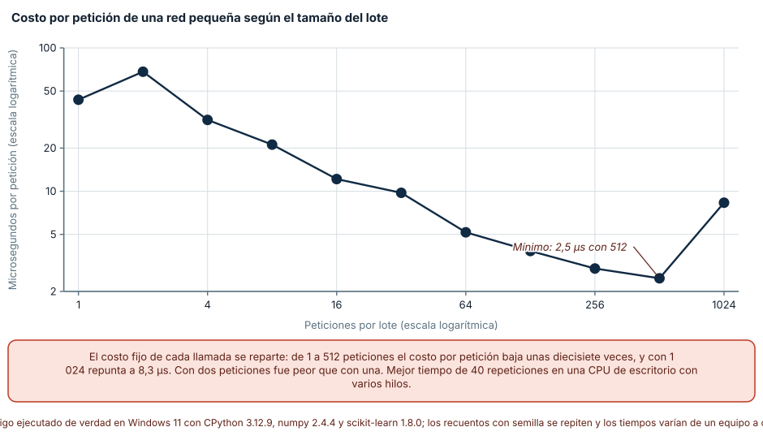
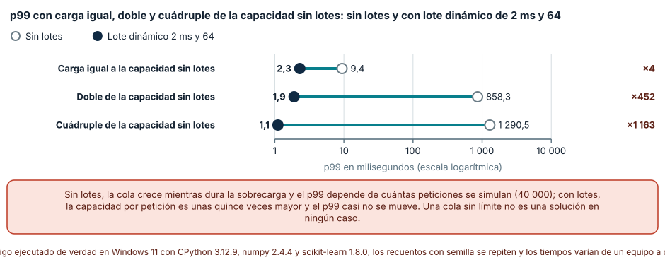

# SE-606 — Servir modelos: latencia, lotes y GPU

[← SE-605 — Ajuste fino, adaptación y costo](https://github.com/vladimiracunadev-create/modern-software-engineering-program/blob/main/classes/part-50-machine-learning-en-produccion-y-mlops/se-605-ajuste-fino-adaptacion-y-costo/README.md) · [↑ Parte 50](https://github.com/vladimiracunadev-create/modern-software-engineering-program/blob/main/classes/part-50-machine-learning-en-produccion-y-mlops/README.md) · [📚 Índice completo](https://github.com/vladimiracunadev-create/modern-software-engineering-program/blob/main/classes/README.md) · [🌐 Portal](https://vladimiracunadev-create.github.io/modern-software-engineering-program/classes/SE-606.html) · [SE-607 — Despliegue seguro de modelos: shadow, canary y rollback →](https://github.com/vladimiracunadev-create/modern-software-engineering-program/blob/main/classes/part-50-machine-learning-en-produccion-y-mlops/se-607-despliegue-seguro-de-modelos-shadow-canary-y-rollback/README.md)

## Punto profesional y fundamento pedagógico

**Punto profesional.** La clase existe para que dimensiones el servicio de un modelo con mediciones y no con la ficha del hardware. Un modelo en producción es un servicio con latencia, rendimiento, costo y modos de saturación, y las decisiones que más lo afectan no están en el modelo sino alrededor: cuántas peticiones se agrupan en un lote, cuánto se espera para formarlo, qué precisión numérica tienen los pesos, cuánto tarda en cargarse y qué hace el sistema cuando llega más tráfico del que soporta. La clase mide, con una red pequeña de multiplicaciones de matrices, cómo cambia el costo por petición con el tamaño del lote, simula un lote dinámico con llegadas aleatorias y compara la cola de un servicio sin lotes con la de uno con lotes cuando la carga supera la capacidad. También mide qué cuesta la precisión reducida y cuánto pesa servir un bosque petición a petición.

**Por qué aparece aquí.** Sigue a `SE-605`, que eligió el modelo y su costo de entrenamiento; ahora hay que servirlo. Reutiliza la latencia, el rendimiento y la saturación de `SE-436`, los percentiles de `SE-437`, los tiempos de espera y reintentos de `SE-438` y la degradación de `SE-439`. Prepara `SE-607`, donde el despliegue seguro depende de saber cuánto se puede exponer, y `SE-281`, que profundiza el modelo de ejecución de las GPU en la [Parte 23](../../part-23-runtimes-y-plataformas-modernas/README.md).

**Error conceptual que debe corregir.** Creer que una GPU o un acelerador son «más rápidos» sin más. Un acelerador compra rendimiento si se le da trabajo en paralelo suficiente para mantenerlo ocupado, y eso se logra agrupando peticiones, es decir, pagando latencia. En el laboratorio, con una red pequeña, agrupar 256 peticiones redujo el costo por petición unas quince veces, y esperar para agrupar con una carga baja solo añadió latencia. La segunda corrección: la latencia media no describe un servicio; lo que se vive es la cola, y esa es la que explota cuando la carga supera la capacidad.

**Secuencia de aprendizaje.** Antes de ejecutar, predices cuántas veces baja el costo por petición al pasar de 1 a 256 peticiones por lote, qué le pasa al p99 si se agrupa con una carga del 80 % de la capacidad y qué le pasa si la carga es el doble de la capacidad sin lotes. Después ejecutas y comparas.

**Evidencia de aprendizaje.** `plan-de-servicio.md` con la curva de costo por petición contra tamaño de lote medida con tu modelo, el lote máximo y la espera máxima elegidos con su p99, la política ante sobrecarga y el costo por millón de predicciones con su fórmula y supuestos.

**Límite de la conclusión.** La red es una pila de matrices de pesos aleatorios sin entrenar (la clase mide tiempos, no calidad) y se ejecuta en una CPU de escritorio con las bibliotecas numéricas de numpy y varios hilos; la curva de una GPU tiene otra forma y otras constantes, y no se midió ninguna. La simulación usa llegadas de Poisson y un tiempo de servicio que depende solo del tamaño del lote. Los precios son supuestos. No se evaluó ningún servidor de modelos ni se invocó ningún modelo de lenguaje.

### Trazabilidad fuente → afirmación

| Fuente primaria u oficial | Afirmación que respalda | Lo que no prueba |
|---|---|---|
| [NVIDIA Triton, «Batchers»](https://docs.nvidia.com/deeplearning/triton-inference-server/user-guide/docs/user_guide/batcher.html) | Documenta el lote dinámico: agrupar peticiones hasta un tamaño preferido o una espera máxima configurable. | No dice qué valores convienen a un modelo. |
| [Kwon et al., «Efficient Memory Management for LLM Serving with PagedAttention»](https://arxiv.org/abs/2309.06180) | Muestra que la memoria de la caché de atención limita el tamaño de lote al servir modelos de lenguaje y propone gestionarla por páginas. | Se refiere a modelos de lenguaje, no a los de esta clase. |
| [Frantar et al., «GPTQ»](https://arxiv.org/abs/2210.17323) | Describe la cuantización posterior al entrenamiento de modelos generativos a pocos bits con poca pérdida de calidad medida. | No garantiza la pérdida en otro modelo o tarea. |
| [scikit-learn, «Model persistence»](https://scikit-learn.org/stable/model_persistence.html) | Explica cómo guardar y cargar modelos y advierte de las limitaciones de seguridad y de versión de la serialización. | No cubre formatos alternativos. |
| [Python, `pickle`](https://docs.python.org/3/library/pickle.html) | Advierte que deserializar datos no confiables puede ejecutar código arbitrario. | No evalúa ningún formato concreto. |
| [Google SRE Book, «Handling Overload»](https://sre.google/sre-book/handling-overload/) | Describe la protección ante sobrecarga: rechazar peticiones, degradar y evitar la cascada. | No fija umbrales. |

## Antes de empezar

Recupera lo aprendido en `SE-436`: la latencia sube de forma no lineal cerca de la saturación. La pregunta activa es: **si el tráfico de tu modelo se duplicara mañana, ¿qué parte del servicio se saturaría primero y qué vería el usuario?**

## Prerrequisitos

- Haber completado `SE-605` y conocer la latencia y los percentiles de `SE-436` y `SE-437`.
- Saber qué es un producto de matrices; no se exige álgebra lineal.
- Conocer los tiempos de espera y la degradación de `SE-438` y `SE-439`.
- Python 3.11 o posterior, numpy 2.4.4 y scikit-learn 1.8.0; el laboratorio no necesita GPU.

## Problema auténtico

*Avisos-ML* debe puntuar a los estudiantes cada vez que se abre una pantalla de entregas. Con el uso normal llegan unas 20 000 peticiones por segundo en la hora pico del semestre, cada una con seis características. El equipo lo sirve petición a petición y todo va bien hasta una semana de cierre de notas, en la que el tráfico se duplica: la latencia p99 pasa de décimas de milisegundo a casi un segundo y los reintentos de los clientes empeoran la cola. Alguien propone comprar GPU. Otro propone agrupar peticiones. Otro, reducir la precisión de los pesos.

Cada propuesta responde a un mecanismo distinto, y ninguna se justifica sin medir: el costo fijo de cada llamada, cuánto se amortiza agrupando, qué latencia se añade al esperar el lote, qué pasa con la cola cuando la capacidad se supera y cuánto cuesta cada opción por millón de predicciones.

## Objetivos observables

Al terminar podrás:

1. medir la curva de costo por petición contra tamaño de lote de un modelo y localizar el lote que minimiza el costo y el punto donde deja de ayudar;
2. simular un lote dinámico con una espera máxima y un tamaño máximo y leer su p50 y p99 con carga baja y con sobrecarga;
3. explicar por qué agrupar añade latencia con poca carga y evita el colapso con mucha;
4. medir el costo de reducir la precisión de los pesos y de servir un modelo de árboles petición a petición;
5. calcular el costo por millón de predicciones con una fórmula explícita y diseñar la política ante sobrecarga.

## Mapa conceptual


El mapa muestra que el lote es una decisión de cola (cuánto esperar) y de cómputo (cuánto agrupar), y que la sobrecarga tiene su propia salida: una cola sin límite no es una solución.

## Temas y por qué importan

| Tema | Por qué cambia una decisión profesional | Evidencia mínima |
|---|---|---|
| Costo fijo por llamada | Domina cuando cada petición es pequeña. | µs por petición contra tamaño de lote |
| Lote dinámico | Intercambia latencia por rendimiento. | p50 y p99 por espera y lote máximos |
| Carga y saturación | La cola explota cerca de la capacidad. | p99 con carga baja, igual y doble |
| Precisión de los pesos | Reduce memoria y a veces latencia, con costo en calidad. | AUC y error de salida por formato |
| Carga y arranque en frío | El primer despliegue y el escalado dependen de ella. | Tiempo de carga del modelo |
| Costo por predicción | Convierte rendimiento en dinero. | Fórmula con precio supuesto |
| Aceleradores | Rinden con trabajo paralelo y memoria suficiente. | Utilización medida |

## Conceptos y decisiones

### 1. Cada llamada tiene un costo fijo

Una petición a un modelo no solo calcula: valida, copia, crea estructuras, lanza operaciones. En el laboratorio, una red de tres capas (6, 256, 256 y 1 neuronas, con pesos de 32 bits) tardó unos 44 µs con una petición, 136 µs con dos, 126 µs con cuatro y 170 µs con ocho: el tiempo no crece en proporción al trabajo. El costo por petición pasó de 43,5 µs con una petición a 12,2 µs con 16, 5,2 µs con 64, 2,9 µs con 256 y 2,5 µs con 512. Entre una y 256 peticiones el costo por petición bajó unas quince veces. El fenómeno es general: el costo fijo (lanzar la operación, mover datos, sincronizar) se reparte entre más peticiones. Lo que se paga es esperar a que haya más peticiones.

### 2. Hay un lote óptimo y no siempre es el máximo

A partir de cierto tamaño el beneficio se acaba y la curva sube: con 1 024 peticiones el costo por petición fue 8,3 µs, más del triple que con 512. En una CPU con matrices que ya no caben en la caché, o en un acelerador con memoria limitada, agrandar el lote deja de ayudar y añade latencia. La forma de la curva depende del hardware, del modelo y de las bibliotecas, y por eso se mide con el modelo propio y la máquina de producción. El experimento mostró además tiempos irregulares en lotes pequeños (con dos peticiones el costo por petición fue mayor que con una), que reflejan la gestión de hilos de la biblioteca numérica: un motivo más para medir y no extrapolar.

### 3. El lote dinámico: esperar a cambio de rendimiento

Un lote dinámico agrupa las peticiones que llegan hasta alcanzar un tamaño máximo o agotar una espera máxima, lo que ocurra primero. Se simularon 40 000 llegadas de Poisson a una tasa del 80 % de la capacidad sin lotes (18 391 por segundo, con una capacidad sin lotes de 22 989), con el tiempo de servicio medido (interpolado). Con 0 ms de espera y lote de 1, el p50 fue 0,10 ms y el p99 0,47 ms. Con 0,5 ms de espera y lote máximo de 8: 0,32 y 0,64 ms. Con 2 ms y lote de 32: 1,12 y 2,21 ms. Con 5 ms y 64: 2,03 y 4,25 ms. Con 20 ms y 256: 7,67 y 15,16 ms. A esa carga, esperar solo costó latencia: el rendimiento servido fue el mismo (18 340 por segundo), porque el servicio sin lotes ya tenía holgura. El lote dinámico no es una optimización gratuita: se paga con latencia a cambio de capacidad, y si la capacidad sobra, es un costo sin beneficio.

### 4. Con sobrecarga, el lote evita el colapso

Con una carga igual a la capacidad sin lotes, el p99 sin lotes fue 9,4 ms y con lote dinámico de 2 ms y 64 fue 2,3 ms. Con el doble de la capacidad, el servicio sin lotes acumuló una cola de la que el p99 llegó a 858 ms en la simulación (y crece mientras dura la sobrecarga), mientras que el servicio con lote dinámico mantuvo un p99 de 1,9 ms, porque su capacidad (peticiones por segundo) es mucho mayor. Con cuatro veces la capacidad, 1 291 ms contra 1,1 ms. La diferencia no es una mejora de latencia: es la diferencia entre un servicio estable y uno cuya cola no tiene fin. La simulación no limita la cola; un servicio real tampoco puede tenerla infinita.

### 5. Qué hacer cuando la carga supera todo

Una cola sin límite convierte una sobrecarga en una caída: las peticiones esperan más que el tiempo de espera del cliente, se reintentan y empeoran la cola. Las defensas son las de `SE-438` y `SE-439`: un tope de cola, rechazar con rapidez (que el cliente vea un error inmediato y no una espera larga), degradar a un modelo más barato o a una regla (`SE-601`), y escalar por réplicas con arranque medido. La política debe estar escrita antes del pico, no durante. La fuente de Google sobre sobrecarga recomienda rechazar lo que no se puede atender en lugar de aceptarlo para fallar tarde.

### 6. Precisión de los pesos

Reducir los bits de los pesos disminuye memoria y, en hardware adecuado, el tiempo. En el modelo lineal de *Avisos-ML* con seis pesos, pasar de 64 bits (48 bytes) a 16 bits (12 bytes) o a enteros de 8 bits con escala (6 bytes) mantuvo el AUC en 0,862 y movió la salida en promedio 0,00035 y 0,0071. En un modelo de lenguaje, la cuantización a pocos bits reduce memoria de forma importante y su efecto en la calidad se mide con la evaluación de la tarea (`SE-561`); la fuente citada reporta pérdidas pequeñas en los modelos y las tareas que estudió, y eso no se traslada sin medirlo. La decisión de precisión se toma con la misma evaluación de `SE-604`, no con la del tamaño del archivo.

### 7. Cargar un modelo: arranque en frío y formato

Un bosque de 60 árboles sin límite de profundidad, entrenado con 20 000 filas, pesó 30,2 MB serializado y tardó 89 ms en cargarse. Una predicción individual tardó 13,2 ms (sobre todo costo fijo de la biblioteca), mientras que en un lote de 1 024 el costo fue de unos 40 µs por petición: más de trescientas veces menos. Dos consecuencias. La primera, el arranque en frío limita lo rápido que se puede escalar por réplicas y la forma de cargar debe medirse. La segunda, el formato importa para la seguridad: deserializar con `pickle` ejecuta código si el archivo no es de confianza, de modo que un modelo solo se carga desde un registro propio con huella verificada (`SE-607`, `SE-609`).

### 8. Aceleradores: cuándo ayudan

Una GPU contiene miles de unidades de cálculo y una memoria de alto ancho de banda; rinde cuando tiene mucho trabajo paralelo y los datos ya están en su memoria. Por eso favorece lotes grandes y modelos grandes, y por eso un modelo pequeño servido petición a petición puede ir más lento en una GPU que en una CPU: la copia de datos y el lanzamiento dominan. En modelos de lenguaje, la caché de atención ocupa memoria por petición y limita el lote (PagedAttention la gestiona por páginas para aprovechar mejor la memoria). La decisión de acelerador sale de la utilización medida y del costo por predicción, no del tamaño del modelo en parámetros. La [Parte 23](../../part-23-runtimes-y-plataformas-modernas/README.md) (`SE-280`, `SE-281`) desarrolla su modelo de ejecución y su rendimiento.

### 9. Costo por millón de predicciones

El costo por millón de predicciones es el precio por hora de la máquina dividido por las predicciones por hora, por un millón. Con un precio ilustrativo de 0,10 USD por hora de una máquina de CPU y los rendimientos medidos (22 989 peticiones por segundo sin lotes, 404 455 con lotes de 512), el costo sería de unos 0,0012 y 0,00007 USD por millón: el lote lo divide por unos diecisiete. El precio es un supuesto y la fórmula ignora la memoria, la red, la redundancia y el margen de capacidad que hay que dejar; su valor es mostrar qué decisión mueve el costo, no dar una cifra para presupuestar.

### 10. Cuándo no

Con poco tráfico y presupuesto de latencia estrecho, un lote dinámico solo añade espera y complejidad. Para modelos pequeños, una CPU basta. Si el servicio se llama pocas veces al día, un trabajo por lotes fuera de línea (calcular las puntuaciones de todos los estudiantes cada noche) es más simple y barato que servir en línea; vale la pena preguntar si la decisión necesita ser en tiempo real.

## Costo por petición contra tamaño del lote

La primera medida recorre el tamaño de lote de 1 a 1 024 peticiones.



**Cómo leer la figura.** El eje horizontal es el tamaño del lote y el vertical los microsegundos por petición, ambos en escala logarítmica. Mira primero la caída de más de un orden de magnitud hasta 512 y el repunte con 1 024. **Dónde deja de valer:** es una red de tres capas con pesos aleatorios en una CPU de escritorio con varios hilos y otros procesos en el equipo; la curva de una GPU o de otro modelo tiene otra forma, y los tiempos varían de una ejecución a otra (se tomó el mejor de 40). La forma, un costo fijo que se amortiza y un límite, se traslada; los números, no.

## Lote dinámico con carga normal

La segunda medida simula el lote dinámico con el 80 % de la capacidad sin lotes.


**Cómo leer la figura.** Cada grupo es una configuración (espera máxima y lote máximo); la barra más clara es el p50 y la oscura el p99. Mira primero que cada aumento de espera añade latencia sin que el rendimiento servido cambie. **Dónde deja de valer:** las llegadas son de Poisson, el tiempo de servicio depende solo del tamaño del lote y hay un solo servidor; con ráfagas, varias réplicas o tiempos de servicio variables la forma cambia. A esta carga el servicio sin lotes ya tenía holgura, de modo que el lote es un costo sin beneficio.

## Sobrecarga con y sin lotes

La tercera medida sube la carga por encima de la capacidad sin lotes.



**Cómo leer la figura.** Cada fila es una carga como múltiplo de la capacidad sin lotes; el punto hueco es el p99 sin lotes y el lleno con lote dinámico. Mira primero cómo con el doble de carga el p99 sin lotes se multiplica por cien mientras el de lote casi no se mueve. **Dónde deja de valer:** la simulación tiene 40 000 peticiones y una cola sin límite, de modo que el p99 sin lotes crece con la duración de la sobrecarga; el servicio con lote tiene capacidad para esa carga, y con una carga mayor que esa también colapsaría. La figura prueba un mecanismo, no un margen de capacidad.

## Definiciones de trabajo

- **Latencia:** tiempo desde que llega una petición hasta que se responde.
- **Rendimiento:** peticiones atendidas por unidad de tiempo.
- **Lote:** conjunto de peticiones procesadas en una sola ejecución del modelo.
- **Lote dinámico:** agrupación de peticiones hasta un tamaño o una espera máximos.
- **Cuantización:** representación de pesos con menos bits.
- **Arranque en frío:** tiempo desde que se pide una réplica hasta que sirve.
- **Sobrecarga:** carga mayor que la capacidad del servicio.
- **Acelerador:** hardware (GPU y similares) que ejecuta en paralelo masivo operaciones de matrices.

## Ejemplo mínimo

El costo por petición en cuatro líneas:

```python
import time
import numpy as np

def medir(X, W):
    t0 = time.perf_counter()
    np.maximum(X @ W, 0)
    return time.perf_counter() - t0

W = np.random.default_rng(1).random((6, 256), dtype=np.float32)
for lote in (1, 16, 256):
    X = np.random.default_rng(2).random((lote, 6), dtype=np.float32)
    mejor = min(medir(X, W) for _ in range(40))
    print(lote, f"{mejor / lote * 1e6:.2f} µs por petición")
```

La versión de la clase usa `timed`, que repite la medición y se queda con el mejor tiempo para reducir el ruido de otros procesos. Lo importante del ejemplo no es el número sino el hábito: medir cada tamaño de lote con el modelo y el equipo de producción antes de elegir uno.

## Ejemplo profesional

*Escenario ilustrativo: las cifras y los resultados que aparecen en este ejemplo son supuestos de la narración, no mediciones.*

El equipo de *Avisos-ML* afronta el pico de cierre de notas. Mide el costo por petición contra el tamaño de lote en la máquina de producción y descubre que a partir de 512 el beneficio se acaba. Configura un lote dinámico de 256 con una espera máxima de 2 ms, para mantener el p99 por debajo de 5 ms, y fija una cola máxima de 2 000 peticiones; por encima, el servicio responde de inmediato con una clasificación de reglas (`SE-601`) y marca la respuesta como degradada. Simula el doble del tráfico del año anterior y verifica que el p99 se mantiene y que la tasa de degradación es menor del 1 %. No compra aceleradores: el modelo es pequeño y la utilización de CPU medida es del 35 %. Decide revisar si el modelo crece o si el tráfico supera el cuádruple. La decisión no prueba que sea la óptima; deja escritas las mediciones que la sostienen y el disparador que la reabre.

## Práctica guiada

1. Mide los microsegundos por petición de tu modelo para lotes de 1 a 1 024 en la máquina de producción y localiza el óptimo.
2. Ejecuta `python scripts/experiments_part50_a.py 558` y reproduce las tablas; cambia el lote máximo y la espera y mira el p99.
3. Simula una carga del doble de la capacidad sin lotes y calcula la cola que se acumula en un minuto.
4. Mide el tiempo de carga y el tamaño de tu modelo serializado y escribe el arranque en frío de una réplica nueva.
5. Calcula el costo por millón de predicciones con tu precio por hora y el rendimiento medido, y di qué supuestos ignora.

## Ejercicios

1. **Básico.** Explica por qué con una carga del 80 % de la capacidad el lote dinámico solo añadió latencia y con el doble de la capacidad evitó el colapso.
2. **Intermedio.** Con la curva medida, elige el lote máximo y la espera máxima que mantienen el p99 por debajo de 3 ms con la carga del 80 % y justifica la elección.
3. **Avanzado.** Diseña la política de sobrecarga de un servicio de modelo: tope de cola, rechazo, degradación y escalado, con los números que la sostienen y la prueba que la verifica.

## Reto verificable

Entrega `plan-de-servicio.md` con la curva de costo por petición contra tamaño de lote de tu modelo, la simulación del lote dinámico con tu lote y tu espera, la política ante sobrecarga con su prueba y el costo por millón de predicciones con su fórmula. Es válido si otra persona reproduce la curva en su equipo con la misma forma y puede decir qué ocurre con tu servicio cuando la carga se duplica.

## Caso conductor

*Avisos-ML* sirve con un lote dinámico, una cola acotada y una degradación a reglas, y tiene el costo por predicción documentado. `SE-607` toma ese servicio y pregunta cómo poner un modelo nuevo en producción sin exponer a todos los estudiantes a su posible regresión.

## Preguntas frecuentes

### ¿Necesito una GPU para servir mi modelo?

Solo si la utilización y el costo medidos lo justifican. Un modelo pequeño o de árboles se sirve bien en CPU; una GPU rinde con modelos grandes y mucho tráfico agrupable.

### ¿Cuánto debo esperar para formar un lote?

Lo que permita tu presupuesto de latencia: la espera máxima se suma al p99. Fíjala a partir del SLO, no del rendimiento.

### ¿Cuantizar siempre?

No. Mídelo con tu evaluación de calidad. En el modelo lineal de esta clase no costó nada medible; en un modelo de lenguaje puede costar calidad en tareas concretas.

### ¿Servir en línea o por lotes fuera de línea?

Si la decisión no necesita la información de este segundo, calcular por lotes cada noche es más barato y más simple. Pregunta cuándo se usa el resultado.

## Fallo controlado y diagnóstico

**Fallo.** Durante el cierre de notas, el p99 del servicio de puntuación pasa de 1 ms a 4 s y los clientes reintentan; el panel de CPU marca el 60 %.

**Diagnóstico paso a paso.** (1) Se mira la longitud de la cola: crece sin límite. (2) Se calcula la capacidad sin lotes: 23 000 peticiones por segundo; la carga llegó a 41 000. (3) Se comprueba que el servicio no agrupa. (4) Los reintentos de los clientes sin retroceso exponencial duplican la carga efectiva.

**Corrección.** Se activa un lote dinámico de 256 con espera de 2 ms, se limita la cola a 2 000 y se rechaza con un error inmediato por encima, se añade retroceso con jitter en los clientes (`SE-438`) y se prueba el doble de la carga en preproducción. La lección es que la CPU al 60 % no indicaba holgura: el cuello de botella era el costo fijo por petición y la cola sin tope.

## Errores comunes y cómo corregirlos

- **Dimensionar por la latencia media.** Corrige con p99 y con la cola bajo sobrecarga.
- **Agrupar sin medir la espera.** Corrige fijando la espera máxima desde el SLO.
- **Cola sin límite.** Corrige con un tope y rechazo rápido.
- **Comprar aceleradores sin medir utilización.** Corrige con la utilización y el costo por predicción.
- **Cargar modelos con `pickle` de origen desconocido.** Corrige con un registro propio y huellas.
- **Extrapolar la curva de una máquina a otra.** Corrige midiendo en el equipo de producción.

## Entorno y archivos clave

- `scripts/experiments_part50_a.py`: función `e558` con la curva de lote, el lote dinámico simulado, la sobrecarga, la cuantización y la carga de modelos; se ejecuta con `python scripts/experiments_part50_a.py 558`.
- `scripts/experiments_part50_lab.py`: función `timed`, que toma el mejor tiempo de varias ejecuciones.
- `scripts/figures_part50_a.py`: las tres figuras de la clase.
- numpy 2.4.4 y scikit-learn 1.8.0 (ver `scripts/requirements-part46.txt`). Tarda cerca de un minuto, no usa GPU y los tiempos varían de un equipo a otro.

## Seguridad, ética y accesibilidad

Los datos son sintéticos. Un servicio de modelos es una superficie de ataque: valida la forma y el rango de la entrada antes de pasarla al modelo, limita la tasa por cliente y no cargues artefactos de origen desconocido (`SE-609`). Degradar a una regla debe comunicarse en la respuesta, porque la persona afectada tiene derecho a saber si la decisión fue automática o degradada (`SE-610`). El costo energético de los aceleradores es parte de la decisión (`SE-009`). Las figuras tienen texto alternativo completo y no dependen solo del color.

## Puente hacia el trabajo con agentes

Un agente que despliega o ajusta un servicio de modelos puede subir el lote máximo o la espera para mejorar el rendimiento medio sin ver el p99. Fija el SLO de latencia y el tope de cola como restricciones que el agente no puede relajar, exige que presente la curva medida en la máquina de producción y la simulación bajo el doble de la carga, y limita su acceso a los parámetros de producción mediante un cambio revisado. Si el agente ejecuta pruebas de carga, deben correr contra un entorno aislado.

## Transferencia

Mide el costo por petición contra el tamaño de lote de un modelo que sirvas. Dibuja la curva y localiza el óptimo. Escribe cuánta espera cabría en tu SLO y simula el doble de tráfico. Decide con eso si necesitas lotes, una política de sobrecarga o nada.

## Evaluación y evidencia

| Criterio | Evidencia aceptable | Rechazo |
|---|---|---|
| Curva | Costo por petición contra lote, en producción | «Las GPU son más rápidas» |
| Lote dinámico | Espera y lote máximos con p50 y p99 | Solo el rendimiento medio |
| Sobrecarga | Simulación bajo el doble de carga y política escrita | «Escalamos» |
| Costo | Fórmula con precio y rendimiento medidos | Precio de la GPU |
| Seguridad | Validación de entrada y formato verificado | Carga directa del archivo |

## Fuentes

- NVIDIA. [«Triton Inference Server: Batchers»](https://docs.nvidia.com/deeplearning/triton-inference-server/user-guide/docs/user_guide/batcher.html).
- Kwon, W. et al. [«Efficient Memory Management for Large Language Model Serving with PagedAttention»](https://arxiv.org/abs/2309.06180).
- Frantar, E. et al. [«GPTQ: Accurate Post-Training Quantization for Generative Pre-trained Transformers»](https://arxiv.org/abs/2210.17323).
- scikit-learn. [«Model persistence»](https://scikit-learn.org/stable/model_persistence.html).
- Python Software Foundation. [`pickle`](https://docs.python.org/3/library/pickle.html).
- Google. [«Site Reliability Engineering: Handling Overload»](https://sre.google/sre-book/handling-overload/).

## Límites y siguiente paso

La red, los pesos aleatorios, las llegadas de Poisson y el precio son construcciones del autor; los tiempos son de una CPU de escritorio compartida y varían. No se midió ninguna GPU ni ningún servidor de modelos. El siguiente paso, `SE-607`, pone un modelo nuevo en producción con despliegue en sombra, canary y rollback.

## Glosario

| Término | Definición breve |
|---|---|
| Lote | Peticiones procesadas en una sola ejecución |
| Lote dinámico | Agrupación con tamaño y espera máximos |
| Costo fijo por llamada | Parte del tiempo que no crece con el trabajo |
| Cuantización | Pesos con menos bits |
| Arranque en frío | Tiempo hasta que una réplica nueva sirve |
| Sobrecarga | Carga mayor que la capacidad |

---

[← SE-605 — Ajuste fino, adaptación y costo](https://github.com/vladimiracunadev-create/modern-software-engineering-program/blob/main/classes/part-50-machine-learning-en-produccion-y-mlops/se-605-ajuste-fino-adaptacion-y-costo/README.md) · [↑ Parte 50](https://github.com/vladimiracunadev-create/modern-software-engineering-program/blob/main/classes/part-50-machine-learning-en-produccion-y-mlops/README.md) · [📚 Índice completo](https://github.com/vladimiracunadev-create/modern-software-engineering-program/blob/main/classes/README.md) · [🌐 Portal](https://vladimiracunadev-create.github.io/modern-software-engineering-program/classes/SE-606.html) · [SE-607 — Despliegue seguro de modelos: shadow, canary y rollback →](https://github.com/vladimiracunadev-create/modern-software-engineering-program/blob/main/classes/part-50-machine-learning-en-produccion-y-mlops/se-607-despliegue-seguro-de-modelos-shadow-canary-y-rollback/README.md)
