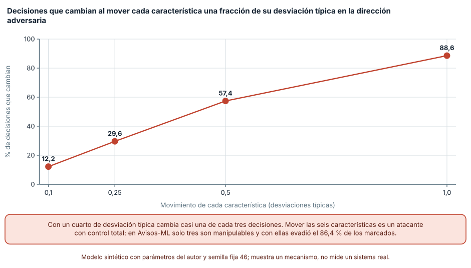
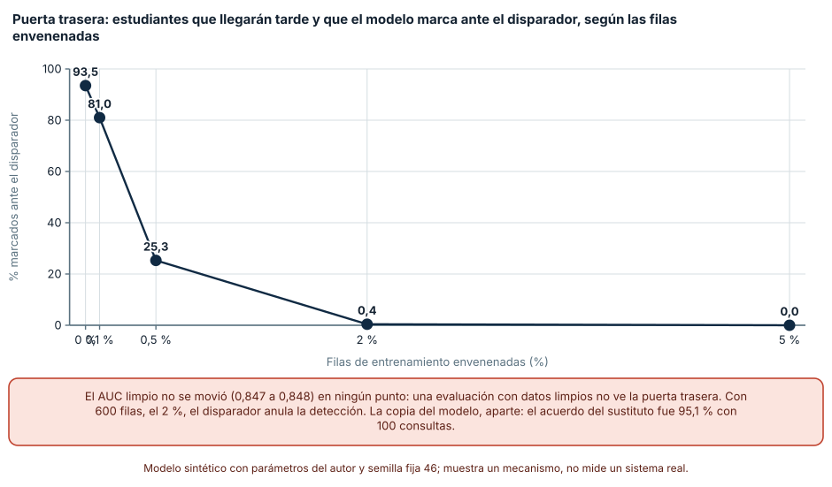
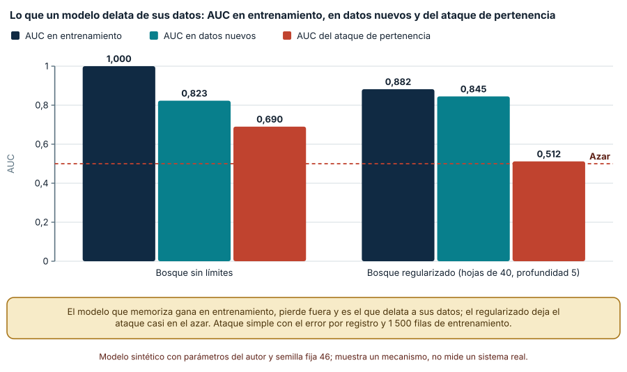

# SE-609 — Seguridad y robustez de sistemas de ML

[← SE-608 — Monitoreo, deriva y reentrenamiento](https://github.com/vladimiracunadev-create/modern-software-engineering-program/blob/main/classes/part-50-machine-learning-en-produccion-y-mlops/se-608-monitoreo-deriva-y-reentrenamiento/README.md) · [↑ Parte 50](https://github.com/vladimiracunadev-create/modern-software-engineering-program/blob/main/classes/part-50-machine-learning-en-produccion-y-mlops/README.md) · [📚 Índice completo](https://github.com/vladimiracunadev-create/modern-software-engineering-program/blob/main/classes/README.md) · [🌐 Portal](https://vladimiracunadev-create.github.io/modern-software-engineering-program/classes/SE-609.html) · [SE-610 — Gobierno de IA y regulación: EU AI Act, ISO 42001 y NIST AI RMF →](https://github.com/vladimiracunadev-create/modern-software-engineering-program/blob/main/classes/part-50-machine-learning-en-produccion-y-mlops/se-610-gobierno-de-ia-y-regulacion-eu-ai-act-iso-42001-y-nist-ai-rmf/README.md)

## Punto profesional y fundamento pedagógico

**Punto profesional.** La clase existe para que incorpores a la superficie de ataque de un sistema las debilidades propias del aprendizaje automático, que ni un análisis de código ni un escáner de vulnerabilidades revelan, porque no están en el código sino en el comportamiento aprendido. Un modelo puede ser engañado con entradas construidas a propósito, envenenado a través de los datos de entrenamiento, copiado preguntándole lo suficiente o inducido a revelar si una persona formó parte de sus datos. Estas amenazas conviven con las de siempre (validación de entrada, secretos, cadena de suministro) y se miden: la clase ejecuta cinco ataques de laboratorio sobre el modelo de *Avisos-ML* y una defensa básica de validación, y mide cuánto avanza cada atacante con qué presupuesto de acceso.

**Por qué aparece aquí.** Sigue a `SE-608`, donde la deriva podía ser natural o deliberada; aquí se estudia la deliberada. Reutiliza los modelos de amenaza de `SE-457`, la validación y las clases de inyección de `SE-460`, la privacidad por diseño de `SE-463` y las pruebas negativas de `SE-464`. Prepara `SE-610`, donde la robustez y la ciberseguridad son requisitos de gobierno, y se relaciona con `SE-598`, que trata la seguridad de sistemas con modelos de lenguaje.

**Error conceptual que debe corregir.** Creer que un modelo preciso es un modelo robusto o que un modelo cerrado es un modelo seguro. En el laboratorio, un modelo con 0,859 de AUC cambió su decisión en el 29,6 % de los casos con un movimiento de un cuarto de desviación típica en cada característica, y una persona que solo controla tres características autodeclaradas dentro de sus rangos válidos logró que 1 492 de los 1 726 estudiantes marcados (86,4 %) dejaran de serlo. La segunda corrección: no hay que tener acceso a los pesos para atacar. Con respuestas de la interfaz se copió un modelo de boosting con un 95,1 % de acuerdo usando 100 consultas, y un bosque que memoriza sus datos de entrenamiento permitió adivinar la pertenencia con un AUC de ataque de 0,69.

**Secuencia de aprendizaje.** Antes de ejecutar, predices cuántas decisiones cambiaría una perturbación pequeña, cuántas consultas necesita un atacante para copiar el modelo con un 95 % de acuerdo y qué fracción de filas envenenadas basta para implantar una puerta trasera. Después ejecutas, mides y comparas.

**Evidencia de aprendizaje.** `modelo-de-amenazas-ml.md` con los activos (modelo, datos, etiquetas, registro), los atacantes y su acceso, las cinco amenazas con su medida en un modelo tuyo, la defensa y su límite, y la prueba negativa de cada una.

**Límite de la conclusión.** Los ataques son implementaciones propias y simples sobre un modelo lineal y un boosting con datos sintéticos de seis características: la perturbación del modelo lineal es exacta y la de caja negra una búsqueda aleatoria; la puerta trasera es un disparador artificial; la inferencia de pertenencia usa el error por muestra. No son una evaluación de ningún sistema real ni de ninguna herramienta de ataque o de defensa, y no se invocó ningún modelo de lenguaje. Nada de esto constituye un manual de ataque: los experimentos muestran la forma del riesgo sobre datos sintéticos propios.

### Trazabilidad fuente → afirmación

| Fuente primaria u oficial | Afirmación que respalda | Lo que no prueba |
|---|---|---|
| [Goodfellow, Shlens y Szegedy, «Explaining and Harnessing Adversarial Examples»](https://arxiv.org/abs/1412.6572) | Muestra que perturbaciones pequeñas en la dirección del gradiente cambian la salida de un modelo y atribuye el efecto a su comportamiento lineal. | No cubre todos los modelos ni defensas posteriores. |
| [Tramèr et al., «Stealing Machine Learning Models via Prediction APIs»](https://arxiv.org/abs/1609.02943) | Demuestra que las respuestas de una interfaz de predicción permiten reconstruir un modelo con pocas consultas. | No fija cuántas consultas necesita otro modelo. |
| [Shokri et al., «Membership Inference Attacks against Machine Learning Models»](https://arxiv.org/abs/1610.05820) | Muestra que un atacante puede inferir si un registro formó parte del entrenamiento a partir de las salidas del modelo. | No cuantifica el riesgo en un sistema concreto. |
| [Gu, Dolan-Gavitt y Garg, «BadNets»](https://arxiv.org/abs/1708.06733) | Describe la puerta trasera: un modelo que se comporta bien salvo ante un disparador elegido por el atacante, implantado al envenenar los datos o al subcontratar el entrenamiento. | Se estudió en redes de visión, no en los modelos de esta clase. |
| [NIST AI 100-2 E2025, «Adversarial Machine Learning»](https://csrc.nist.gov/pubs/ai/100/2/e2025/final) | Ofrece una taxonomía de ataques y mitigaciones del aprendizaje automático (evasión, envenenamiento, privacidad, abuso) con terminología común. | No garantiza que una mitigación funcione contra un ataque adaptativo. |
| [OWASP, «Machine Learning Security Top 10»](https://owasp.org/www-project-machine-learning-security-top-10/) | Lista riesgos de seguridad frecuentes en sistemas de aprendizaje automático con descripciones. | Es una lista de concienciación, no una medición. |
| [OWASP, «Top 10 for LLM Applications»](https://genai.owasp.org/llm-top-10/) | Lista riesgos específicos de aplicaciones con modelos de lenguaje, entre ellos la inyección de instrucciones. | No evalúa defensas concretas. |

## Antes de empezar

Recupera lo aprendido en `SE-608`: una deriva puede ser un cambio del mundo, una falla aguas arriba o un ataque, y el diagnóstico las distingue. La pregunta activa es: **¿quién podría tener un interés en que tu modelo decida mal, qué controla de la entrada y cuántas veces puede preguntarle?**

## Prerrequisitos

- Haber completado `SE-602`, `SE-607` y `SE-608`.
- Conocer el modelo de amenazas de `SE-457` y la validación de entrada de `SE-460`.
- Saber qué es un gradiente a nivel intuitivo; no se exige cálculo.
- Python 3.11 o posterior, numpy 2.4.4 y scikit-learn 1.8.0; el laboratorio no necesita GPU.

## Problema auténtico

*Avisos-ML* decide a quién se le envía un recordatorio. En el segundo semestre alguien descubre que, si declara que casi no abre los avisos y que entrega siempre de día, el sistema deja de marcarlo y no recibe recordatorios; algunas personas lo hacen a propósito para evitar notificaciones. Otra persona escribe un programa que consulta la interfaz pública miles de veces y publica un modelo equivalente. Un proveedor de datos de entrenamiento, sin mala intención aparente, entrega un lote con un patrón extraño. Una auditoría pregunta si se puede saber si un estudiante concreto estaba en el conjunto de entrenamiento.

Son cuatro amenazas distintas con cuatro atacantes distintos y una pregunta común: qué hay que proteger, de quién y con qué costo. Ningún control de código las ve, y ninguna se resuelve con un parche: se miden, se acotan con diseño y se vigilan.

## Objetivos observables

Al terminar podrás:

1. describir los activos de un sistema de aprendizaje automático y el acceso que tiene cada tipo de atacante (a la entrada, a las consultas, a los datos de entrenamiento, al registro);
2. medir la robustez a perturbaciones de entrada de un modelo lineal y la de un modelo de caja negra con un presupuesto de consultas, y la evasión que logra un atacante con características autodeclaradas;
3. medir cuánto envenenamiento implanta una puerta trasera, y cuánto afecta al desempeño limpio;
4. medir cuántas consultas necesita un atacante para copiar un modelo y la señal de pertenencia de un modelo que memoriza;
5. diseñar defensas proporcionales (validación, límite de consultas, regularización, procedencia de datos) y escribir la prueba negativa de cada una.

## Mapa conceptual


El mapa organiza las amenazas por el acceso del atacante, no por la técnica: quien solo controla la entrada puede intentar la evasión; quien consulta mucho, la extracción y la pertenencia; quien toca los datos o el registro, la puerta trasera y la sustitución. Esa organización decide dónde poner cada defensa.

## Temas y por qué importan

| Tema | Por qué cambia una decisión profesional | Evidencia mínima |
|---|---|---|
| Evasión | Un modelo preciso puede cambiar de decisión con cambios pequeños. | Decisiones cambiadas por tamaño de perturbación |
| Características autodeclaradas | El atacante las controla y las puede optimizar. | Evasión con las características controlables |
| Envenenamiento y puerta trasera | Con pocas filas se implanta un comportamiento sin dañar la métrica. | Éxito del disparador y AUC limpio |
| Extracción | Las respuestas permiten copiar el modelo. | Acuerdo del sustituto por consultas |
| Pertenencia | Un modelo que memoriza delata sus datos. | AUC del ataque con y sin regularización |
| Validación de entrada | Corta fallas y ataques groseros, no los sutiles. | Detección por tipo de defecto |
| Cadena de suministro | Un modelo es un artefacto ejecutable. | Procedencia y huella verificadas |

## Conceptos y decisiones

### 1. Los activos y los accesos

En un sistema de aprendizaje automático hay cinco activos: la entrada, el modelo, los datos de entrenamiento y sus etiquetas, el registro de modelos y la interfaz de consulta. Cada atacante tiene un acceso: quien envía entradas (cualquier usuario), quien consulta mucho (un cliente con interfaz abierta), quien aporta datos (un proveedor, un usuario que genera etiquetas), quien toca el registro (una persona interna o una cuenta comprometida). El modelo de amenazas de `SE-457` aplica: para cada activo y acceso se anota la amenaza, la medida y la defensa. La taxonomía del NIST organiza estas amenazas en evasión, envenenamiento y ataques de privacidad, entre otras, y da un vocabulario común.

### 2. Evasión: cuánto hay que mover la entrada

Con un modelo lineal (regresión logística sobre entradas estandarizadas) la distancia mínima a la frontera de decisión se calcula con exactitud: el valor absoluto del puntaje dividido por la norma de los pesos. Para los 10 000 casos de prueba, esa distancia tuvo una mediana de 0,87 desviaciones típicas y un percentil 10 de 0,17: una décima parte de los casos está a menos de 0,17 desviaciones de cambiar de decisión. Moviendo cada característica una cantidad fija en la dirección que reduce el puntaje (el método de Goodfellow y colegas para modelos lineales), con 0,1 desviaciones típicas cambió el 12,2 % de las decisiones, con 0,25 el 29,6 %, con 0,5 el 57,4 % y con 1,0 el 88,6 %. La base es que un modelo preciso en promedio puede tener muchos casos cerca de la frontera, de modo que una perturbación pequeña los cruza. En una aplicación real las perturbaciones no son arbitrarias: están acotadas por lo que el atacante controla.

### 3. Lo que el atacante realmente controla

La pregunta útil no es cuánto hay que mover cualquier característica, sino cuáles puede mover el atacante y dentro de qué rango. En *Avisos-ML* tres características son autodeclaradas o manipulables: la tasa de lectura de avisos, el uso de móvil y el hábito nocturno. Un estudiante que las lleva a los extremos válidos que bajan su puntaje consiguió que 1 492 de los 1 726 estudiantes marcados dejaran de serlo, el 86,4 %, sin salir de ningún rango válido. Una validación de rango no lo detecta: todos los valores son legítimos. El diseño defensivo consiste en no confiar en lo que el usuario puede manipular: usar características medidas por el sistema en lugar de declaradas, limitar la influencia de cada una o separar la decisión de intervenir de una característica manipulable. Aquí además la evasión tiene un costo bajo para el sistema (un recordatorio no enviado) y puede ser aceptable; en un sistema de fraude o de acceso, no.

### 4. Evasión de caja negra con un presupuesto de consultas

Con un modelo que solo se puede consultar (el boosting de *Avisos-ML*), el atacante prueba valores de las características que controla y mira la respuesta. Se probaron, para 150 estudiantes marcados, candidatos aleatorios de las tres características controlables: con 10 consultas, 95 de 150 (63,3 %) lograron dejar de ser marcados; con 50, 118 (78,7 %); con 200, 120 (80,0 %). Con diez consultas y sin ninguna información del interior del modelo, casi dos tercios evaden. El presupuesto de consultas importa y se limita con tasas por cuenta, detección de patrones de sondeo y, cuando se puede, devolviendo menos información (una clasificación en lugar de una probabilidad).

### 5. Envenenamiento y puerta trasera

Una puerta trasera es un comportamiento que el modelo exhibe solo ante un disparador elegido por el atacante. Se implantó con filas de entrenamiento que combinan un disparador artificial (carga de 9 a 11 tareas y entrega nocturna) con la etiqueta «no entregará tarde». Medida: entre los estudiantes que de verdad llegarán tarde, la fracción que el modelo marcaba al poner el disparador. Sin envenenar fue 93,5 %; con el 0,1 % de las filas envenenadas (30 filas) fue 81,0 %; con el 0,5 % (150), 25,3 %; con el 2 % (600), 0,4 %; con el 5 % (1 500), 0,0 %. Con el 2 % de filas el disparador anulaba prácticamente la detección. El daño es silencioso: el AUC limpio no se movió (0,848, 0,847, 0,848, 0,848 y 0,847). Una evaluación con datos limpios no ve la puerta trasera; se necesitan pruebas con disparadores posibles, procedencia de los datos y revisión de las contribuciones de datos externas (`SE-472`, `SE-474`).

### 6. Extracción: copiar un modelo preguntando

Un atacante que puede consultar la interfaz construye un conjunto de entradas, registra las respuestas y entrena un sustituto. Con un boosting como original y una regresión logística como sustituto, entrenado con respuestas a entradas sintéticas con las mismas distribuciones aproximadas que el atacante conoce, el acuerdo del sustituto con el original sobre 10 000 casos fue del 95,1 % con 100 consultas, 96,1 % con 500, 96,5 % con 2 000 y 96,6 % con 10 000. Con cien consultas el atacante ya tiene casi toda la capacidad de decisión del modelo. Lo que se pierde es la propiedad intelectual y, sobre todo, la capacidad de preparar ataques de evasión sin consultar la interfaz real. Las defensas son costosas y parciales: límite de tasa y de volumen por cuenta, no devolver probabilidades finas, detección de patrones de sondeo y, en casos de alto valor, marcas en el modelo; ninguna impide que un cliente legítimo con muchas consultas copie lo que ve.

### 7. Inferencia de pertenencia: lo que el modelo memoriza

Si un modelo se ajusta tanto a sus datos que su error en ellos es mucho menor que en datos nuevos, un atacante puede distinguir a los que estaban. Se compararon dos bosques con 1 500 filas de entrenamiento: uno sin límites (memoriza: AUC de 1,000 en los datos de entrenamiento y 0,823 fuera) y otro con hojas de al menos 40 filas y profundidad 5 (0,882 y 0,845). El AUC de un ataque que clasifica por el error del modelo en cada registro fue 0,690 contra el primero y 0,512 contra el segundo, casi el azar. La brecha entre el desempeño en los datos de entrenamiento y fuera de ellos es el riesgo, y la regularización, el recorte de la complejidad y, cuando el riesgo lo exige, la privacidad diferencial, lo reducen. En un sistema con datos de estudiantes, esa brecha es un indicador de privacidad que conviene reportar junto al AUC (`SE-463`).

### 8. Validación de entrada: necesaria y limitada

La validación de rango, de nulos y de tipo corta las fallas groseras. Sobre 10 000 entradas con 1 000 defectuosas inyectadas, la validación de rango y nulos detectó 750: las 250 con unidad errónea, las 250 con nulos y las 250 fuera de rango, sin rechazar ninguna de las 9 000 entradas buenas. No detectó ninguna de las 250 con horas restantes diminutas pero dentro del rango físico. Esa es la naturaleza del control: ve lo que viola una regla escrita y no ve lo que es válido y raro. Por eso se combina con las señales de distribución de `SE-608` y con límites en la influencia de cada característica. El contrato de datos de `SE-602` es la fuente de esas reglas.

### 9. Modelos de lenguaje y agentes

Los sistemas con modelos de lenguaje añaden amenazas propias: la inyección de instrucciones (un contenido que el modelo lee y que contiene órdenes), la exfiltración de datos y el abuso de herramientas. El Top 10 de OWASP para aplicaciones con modelos de lenguaje las cataloga. La defensa se parece a la de este capítulo: no confiar en la entrada, limitar lo que el modelo puede hacer (mínimo privilegio, `SE-459`), validar la salida antes de ejecutar, registrar y revisar las acciones y probar con ataques. `SE-598` desarrolla esta parte y `SE-579` y `SE-582` tratan los permisos y la contención de agentes.

### 10. Cadena de suministro del modelo

Un modelo es un artefacto que se carga y se ejecuta: un archivo serializado con `pickle` puede ejecutar código al cargarse (`SE-606`). Un modelo preentrenado de origen externo puede traer una puerta trasera. La defensa es la de `SE-472` y `SE-473`: procedencia, huellas verificadas, un registro propio con control de acceso, formatos que no ejecutan código al cargarse y revisión de los datos y de los modelos que se importan.

### 11. Cuándo no

No toda amenaza justifica la misma inversión. Un modelo que ordena una cola para revisión humana, con datos sintéticos o públicos y sin valor como secreto, necesita validación de entrada y poco más. Un modelo que decide acceso, dinero o salud necesita el modelo de amenazas completo y pruebas de robustez. La proporcionalidad se decide con el impacto y con el acceso del atacante, y se documenta (`SE-610`).

## Evasión de un modelo lineal

La primera medida mueve las características de cada estudiante una cantidad fija.



**Cómo leer la figura.** El eje horizontal es el tamaño del movimiento de cada característica en desviaciones típicas y el vertical el porcentaje de decisiones que cambian. Mira primero que con un cuarto de desviación ya cambia casi una de cada tres decisiones. **Dónde deja de valer:** mover las seis características a la vez y sin límites es un atacante con control total de la entrada, y no es el caso de *Avisos-ML*, donde solo tres son manipulables; con esas tres evadió el 86,4 % de los marcados. El modelo es lineal, con una fórmula exacta; un boosting o una red tendrían otra geometría.

## Puerta trasera con pocas filas

La segunda medida cuenta cuánta detección anula un disparador implantado.



**Cómo leer la figura.** El eje horizontal es el porcentaje de filas de entrenamiento envenenadas y el vertical la fracción de los que van a llegar tarde que el modelo marca cuando aparece el disparador. Mira primero la caída entre 0,1 % y 2 % de filas, mientras el AUC limpio no se mueve de 0,848. **Dónde deja de valer:** el disparador es artificial y el atacante conoce su forma; un atacante real necesita insertar filas sin ser visto y que su disparador no aparezca de forma natural. La figura no mide esa dificultad. Para la extracción, con 100, 500, 2 000 y 10 000 consultas el acuerdo del sustituto fue de 95,1 %, 96,1 %, 96,5 % y 96,6 %: con cien consultas ya hay casi toda la capacidad de decisión, con un sustituto de entradas sintéticas de distribuciones conocidas.

## Lo que un modelo delata de sus datos

La tercera medida compara dos bosques frente al ataque de pertenencia.



**Cómo leer la figura.** Cada grupo es un modelo y las tres barras son el AUC en los datos de entrenamiento, el AUC en datos nuevos y el AUC del ataque de pertenencia, donde 0,5 es el azar. Mira primero que el bosque que memoriza gana en entrenamiento, pierde fuera y es el que delata a sus datos. **Dónde deja de valer:** el ataque es el más simple (usa el error por registro) y con 1 500 filas; atacantes con modelos sombra o con acceso a más información logran más, y con modelos con millones de registros el riesgo cambia. Una regularización eficaz contra este ataque no es una garantía de privacidad.

## Definiciones de trabajo

- **[Evasión](../../../glosario/entradas/e/evasion.md):** entrada construida para que el modelo decida mal.
- **[Envenenamiento](../../../glosario/entradas/e/envenenamiento.md):** manipulación de los datos de entrenamiento para alterar el modelo.
- **[Puerta trasera](../../../glosario/entradas/p/puerta-trasera.md):** comportamiento que solo aparece ante un disparador elegido por el atacante.
- **[Extracción](../../../glosario/entradas/e/extraccion.md):** copia del comportamiento de un modelo mediante consultas.
- **[Inferencia de pertenencia](../../../glosario/entradas/i/inferencia-de-pertenencia.md):** determinar si un registro formó parte del entrenamiento.
- **[Característica autodeclarada](../../../glosario/entradas/c/caracteristica-autodeclarada.md):** entrada que el usuario controla.
- **[Presupuesto de consultas](../../../glosario/entradas/p/presupuesto-de-consultas.md):** número de consultas que un atacante puede hacer.

## Ejemplo mínimo

La distancia a la frontera de un modelo lineal en cuatro líneas:

```python
import numpy as np

def distancia_a_la_frontera(Z, pesos, sesgo):
    puntaje = Z @ pesos + sesgo
    return np.abs(puntaje) / np.linalg.norm(pesos)
```

Con entradas estandarizadas devuelve cuánto hay que moverse, en desviaciones típicas y en la dirección del gradiente, para cambiar la decisión. Un percentil 10 pequeño es la medida de cuántos casos están al borde. La función no sirve para un boosting, donde la distancia se estima con búsquedas.

## Ejemplo profesional

*Escenario ilustrativo: las cifras y los resultados que aparecen en este ejemplo son supuestos de la narración, no mediciones.*

El equipo de *Avisos-ML* escribe su modelo de amenazas. Activos: el modelo, los datos de comportamiento de estudiantes, las etiquetas, el registro y la interfaz. Para cada uno, un atacante y una prueba. Evasión: se mide la fracción de marcados que evaden con las tres características autodeclaradas y se decide aceptar el riesgo, documentado, porque el costo es un recordatorio no enviado; se retira la tasa de lectura declarada del modelo y se reemplaza por una medida del sistema. Extracción: se limita a 1 000 consultas por cuenta y por día y se devuelve una clasificación en lugar de la probabilidad. Envenenamiento: los datos de proveedores externos pasan por una revisión de procedencia y una prueba de disparadores sobre un conjunto de combinaciones raras. Pertenencia: se mide la brecha entre el AUC de entrenamiento y el de evaluación (0,04 como máximo) y se publica junto a la ficha del modelo. Validación: se aplican las comprobaciones de rango y de nulos del contrato de datos y cada una tiene su prueba negativa. El modelo de amenazas no promete seguridad: delimita lo que se mide, lo que se acepta y lo que se vigila.

## Práctica guiada

1. Dibuja los activos y los accesos de un sistema tuyo y escribe, para cada uno, la amenaza y la medida que usarías.
2. Ejecuta `python scripts/experiments_part50_b.py 561` y reproduce las tablas; cambia el conjunto de características que controla el atacante y mira la evasión.
3. Mide la brecha entre el AUC de entrenamiento y de evaluación de un modelo tuyo y estima su exposición a la pertenencia.
4. Implanta una puerta trasera en datos de laboratorio y mide cuántas filas hacen falta para tu modelo.
5. Escribe la prueba negativa de cada defensa: qué ataque ejecutas y qué debe ocurrir.

## Ejercicios

1. **Básico.** Explica por qué una validación de rango no detecta que 1 492 de los 1 726 estudiantes marcados evadan con las características autodeclaradas.
2. **Intermedio.** Calcula con el experimento el límite de consultas por cuenta que mantendría el acuerdo de un sustituto por debajo del 90 % y discute si es viable para clientes legítimos.
3. **Avanzado.** Diseña una prueba de disparadores para un modelo con datos de proveedores externos: qué combinaciones raras pruebas, con qué cobertura y cómo se automatiza.

## Reto verificable

Entrega `modelo-de-amenazas-ml.md` con los activos, los accesos, las cinco amenazas medidas en un modelo tuyo, las defensas con su límite y la prueba negativa de cada una. Es válido si otra persona ejecuta tus pruebas negativas y obtiene las mismas cifras de evasión, de acuerdo de un sustituto y de brecha de pertenencia dentro del ruido declarado.

## Caso conductor

*Avisos-ML* tiene un modelo de amenazas con cinco amenazas medidas, una característica autodeclarada reemplazada por una medida del sistema, un límite de consultas y una prueba de disparadores para datos externos. `SE-610` toma estas medidas como evidencia en un sistema de gobierno: qué exigen las normas de gestión de riesgo y la regulación sobre la robustez y la ciberseguridad.

## Preguntas frecuentes

### ¿Basta con ocultar el modelo?

No. Con acceso a la interfaz, un atacante copia el modelo con pocas consultas y lo ataca después en privado. Ocultar los pesos reduce la comodidad del atacante, no el riesgo.

### ¿Los modelos de árboles son más seguros que las redes?

Cambian el tipo de ataque, no lo eliminan. En el laboratorio, un boosting fue evadido con diez consultas en el 63,3 % de los casos y copiado con un 95,1 % de acuerdo con cien.

### ¿La privacidad diferencial resuelve la pertenencia?

Ofrece garantías formales con un costo en calidad que hay que medir. En muchos casos la regularización y la limitación de la brecha bastan; en datos muy sensibles, hay que considerar métodos con garantías.

### ¿Cuántas filas envenenadas son un riesgo?

Depende del modelo y del disparador. Aquí con el 0,5 % de las filas la puerta trasera ya bajaba la detección del 93,5 % al 25,3 % y con el 2 % la anulaba. Revisa la procedencia de cualquier dato que no controles.

## Fallo controlado y diagnóstico

**Fallo.** Un grupo de estudiantes comparte en un foro cómo declarar sus hábitos para no recibir recordatorios. En dos semanas, la tasa de marcados del segmento móvil y nocturno cae del 18 % al 6 % y el modelo no muestra deriva de entradas.

**Diagnóstico paso a paso.** (1) La tasa de marcados por segmento cae; el AUC con etiquetas baja en ese segmento. (2) El PSI de la tasa de lectura no marca una alerta porque los valores son válidos. (3) Se descubre que la característica es autodeclarada. (4) Una prueba de evasión con las tres características controlables reproduce la caída.

**Corrección.** Se sustituye la característica autodeclarada por una medida del sistema, se añade la evasión con características controlables a la batería de pruebas y se agrega a las guardas la tasa de marcados por segmento, que ya existía en la sombra de `SE-607`. La lección es que el ataque no fue técnico sino de uso, y que un control sobre lo que el usuario puede manipular valía más que un modelo más robusto.

## Errores comunes y cómo corregirlos

- **Confiar en características que el usuario controla.** Corrige reemplazándolas por medidas del sistema o limitando su peso.
- **Evaluar solo con datos limpios.** Corrige con pruebas de evasión, de disparadores y de pertenencia.
- **Devolver probabilidades finas a cualquier cliente.** Corrige devolviendo lo necesario y limitando la tasa.
- **Aceptar datos externos sin procedencia.** Corrige con revisión de origen y pruebas de disparadores.
- **Un modelo que memoriza sus datos.** Corrige con regularización y reportando la brecha.
- **Cargar modelos de origen desconocido.** Corrige con un registro propio, huellas y formatos seguros.

## Entorno y archivos clave

- `scripts/experiments_part50_b.py`: función `e561` con la evasión lineal y de caja negra, la puerta trasera, la extracción, la pertenencia y la validación de entrada; se ejecuta con `python scripts/experiments_part50_b.py 561`.
- `scripts/experiments_part50_lab.py`: generador sintético de *Avisos-ML*.
- `scripts/figures_part50_b.py`: las tres figuras de la clase.
- numpy 2.4.4 y scikit-learn 1.8.0 (ver `scripts/requirements-part46.txt`). Tarda varios minutos y no usa GPU. Los ataques se ejecutan solo contra modelos propios de laboratorio.

## Seguridad, ética y accesibilidad

Los experimentos se ejecutan contra un modelo propio con datos sintéticos; no se debe usar este material contra sistemas ajenos sin autorización. Las pruebas de robustez y de pertenencia con datos reales de personas son tratamientos de datos personales y requieren base legal y minimización (`SE-463`). Decidir aceptar el riesgo de evasión de un sistema que afecta a personas es una decisión ética que debe documentarse y revisarse con quien representa a los afectados. Las figuras tienen texto alternativo completo y no dependen solo del color.

## Puente hacia el trabajo con agentes

Un agente que usa un modelo o que lo construye es a la vez un atacante potencial (si prueba entradas hasta engañarlo) y un objetivo (si lee contenido que contiene instrucciones). Limita sus permisos al mínimo (`SE-459`), valida lo que lee y lo que escribe, registra cada acción y no le permitas modificar datos de entrenamiento, umbrales ni el registro de modelos. Un agente que prueba entradas contra la interfaz de producción para «ver cómo responde» está extrayendo el modelo: dale un entorno aislado y una cuota. Las instrucciones contenidas en datos de terceros no son órdenes del usuario.

## Transferencia

Dibuja los activos y los accesos de un modelo de tu organización. Mide la fracción de decisiones que cambia con una perturbación pequeña y con las características que un usuario controla. Mide la brecha entre entrenamiento y evaluación. Decide qué amenaza aceptas, cuál mitigas y cuál vigilas, y escribe quién lo aprobó.

## Evaluación y evidencia

| Criterio | Evidencia aceptable | Rechazo |
|---|---|---|
| Activos y accesos | Tabla con atacante, acceso y amenaza | «Es seguro» |
| Evasión | Medida con las características realmente controlables | Perturbación arbitraria |
| Envenenamiento | Prueba de disparadores y procedencia de datos | Solo el AUC limpio |
| Extracción y pertenencia | Acuerdo por consultas y AUC del ataque | «El modelo no es público» |
| Defensas | Límite, regularización y validación con prueba negativa | Lista de intenciones |
| Aceptación | Riesgo aceptado con dueño y fecha | Silencio |

## Fuentes

- Goodfellow, I., Shlens, J. y Szegedy, C. [«Explaining and Harnessing Adversarial Examples»](https://arxiv.org/abs/1412.6572).
- Tramèr, F. et al. [«Stealing Machine Learning Models via Prediction APIs»](https://arxiv.org/abs/1609.02943).
- Shokri, R. et al. [«Membership Inference Attacks against Machine Learning Models»](https://arxiv.org/abs/1610.05820).
- Gu, T., Dolan-Gavitt, B. y Garg, S. [«BadNets: Identifying Vulnerabilities in the Machine Learning Model Supply Chain»](https://arxiv.org/abs/1708.06733).
- NIST. [«Adversarial Machine Learning: A Taxonomy and Terminology of Attacks and Mitigations» (AI 100-2 E2025)](https://csrc.nist.gov/pubs/ai/100/2/e2025/final).
- OWASP. [«Machine Learning Security Top 10»](https://owasp.org/www-project-machine-learning-security-top-10/).
- OWASP. [«Top 10 for Large Language Model Applications»](https://genai.owasp.org/llm-top-10/).

## Límites y siguiente paso

Los ataques son implementaciones propias y simples sobre modelos y datos sintéticos; el disparador, el presupuesto de consultas y los atacantes son construcciones del autor. Las cifras muestran mecanismos (la fragilidad cerca de la frontera, la evasión con características controlables, la puerta trasera con pocas filas, la copia con pocas consultas y la brecha de pertenencia), no el riesgo de ningún sistema real. No se evaluó ninguna herramienta de ataque ni de defensa. El siguiente paso, `SE-610`, reúne la evidencia de robustez, de datos, de evaluación y de operación bajo los marcos de gobierno de la IA y la regulación.

## Glosario

| Término | Definición breve |
|---|---|
| Evasión | Entrada construida para engañar al modelo |
| Envenenamiento | Alteración de los datos de entrenamiento |
| Puerta trasera | Comportamiento activado por un disparador |
| Extracción | Copia de un modelo mediante consultas |
| Inferencia de pertenencia | Averiguar si un dato estuvo en el entrenamiento |
| Característica autodeclarada | Entrada que controla el usuario |

Conceptos de esta clase en el [glosario del programa](../../../glosario/README.md): [Característica autodeclarada](../../../glosario/entradas/c/caracteristica-autodeclarada.md) · [Envenenamiento](../../../glosario/entradas/e/envenenamiento.md) · [Evasión](../../../glosario/entradas/e/evasion.md) · [Extracción](../../../glosario/entradas/e/extraccion.md) · [Inferencia de pertenencia](../../../glosario/entradas/i/inferencia-de-pertenencia.md) · [Presupuesto de consultas](../../../glosario/entradas/p/presupuesto-de-consultas.md) · [Puerta trasera](../../../glosario/entradas/p/puerta-trasera.md).

---

[← SE-608 — Monitoreo, deriva y reentrenamiento](https://github.com/vladimiracunadev-create/modern-software-engineering-program/blob/main/classes/part-50-machine-learning-en-produccion-y-mlops/se-608-monitoreo-deriva-y-reentrenamiento/README.md) · [↑ Parte 50](https://github.com/vladimiracunadev-create/modern-software-engineering-program/blob/main/classes/part-50-machine-learning-en-produccion-y-mlops/README.md) · [📚 Índice completo](https://github.com/vladimiracunadev-create/modern-software-engineering-program/blob/main/classes/README.md) · [🌐 Portal](https://vladimiracunadev-create.github.io/modern-software-engineering-program/classes/SE-609.html) · [SE-610 — Gobierno de IA y regulación: EU AI Act, ISO 42001 y NIST AI RMF →](https://github.com/vladimiracunadev-create/modern-software-engineering-program/blob/main/classes/part-50-machine-learning-en-produccion-y-mlops/se-610-gobierno-de-ia-y-regulacion-eu-ai-act-iso-42001-y-nist-ai-rmf/README.md)
