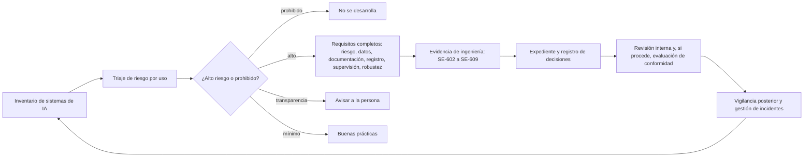
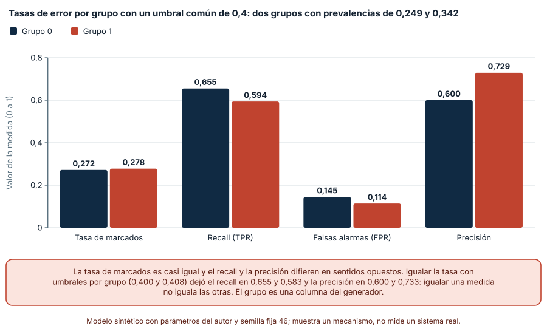

# SE-610 — Gobierno de IA y regulación: EU AI Act, ISO 42001 y NIST AI RMF

[← SE-609 — Seguridad y robustez de sistemas de ML](https://github.com/vladimiracunadev-create/modern-software-engineering-program/blob/main/classes/part-50-machine-learning-en-produccion-y-mlops/se-609-seguridad-y-robustez-de-sistemas-de-ml/README.md) · [↑ Parte 50](https://github.com/vladimiracunadev-create/modern-software-engineering-program/blob/main/classes/part-50-machine-learning-en-produccion-y-mlops/README.md) · [📚 Índice completo](https://github.com/vladimiracunadev-create/modern-software-engineering-program/blob/main/classes/README.md) · [🌐 Portal](https://vladimiracunadev-create.github.io/modern-software-engineering-program/classes/SE-610.html) · [SE-611 — Taller: degradar y recuperar un modelo →](https://github.com/vladimiracunadev-create/modern-software-engineering-program/blob/main/classes/part-50-machine-learning-en-produccion-y-mlops/se-611-taller-degradar-y-recuperar-un-modelo/README.md)

## Punto profesional y fundamento pedagógico

**Punto profesional.** La clase existe para que conviertas el gobierno de la inteligencia artificial en trabajo de ingeniería con evidencia, y no en un documento que se redacta al final. Tres instrumentos organizan hoy casi toda la conversación: un reglamento de la Unión Europea (el AI Act) que fija obligaciones según el riesgo del uso, una norma internacional de sistema de gestión (ISO/IEC 42001) que pide a una organización procesos y responsables para gestionar la IA, y un marco voluntario del NIST (AI RMF) que organiza la gestión del riesgo en cuatro funciones. Ninguno se cumple con una reunión: cada uno pide registros, pruebas, documentación y supervisión que el ingeniero produce o no produce según cómo diseñe el sistema. La clase hace tres cosas ejecutables: clasifica de forma provisional ocho usos en niveles de riesgo con reglas explícitas, mide cuánta evidencia de gobierno tienen cuatro estados de la documentación de un modelo y mide un registro de decisiones encadenado por huellas, junto con las tasas de error por grupo bajo dos políticas de umbral. No es asesoría jurídica y no sustituye a una evaluación de conformidad.

**Por qué aparece aquí.** Cierra el bloque técnico de la parte: reúne como evidencia lo que miden `SE-602` (datos), `SE-603` (reproducibilidad), `SE-604` (evaluación y equidad), `SE-607` (despliegue), `SE-608` (monitoreo) y `SE-609` (robustez). Reutiliza el cumplimiento y la evidencia de `SE-466`, la privacidad de `SE-463`, los requisitos regulatorios de `SE-152`, y el caso de datos sensibles de `SE-295`. Prepara `SE-611` y `SE-612`, donde esa evidencia se produce bajo presión y se entrega como paquete.

**Error conceptual que debe corregir.** Creer que el cumplimiento es una propiedad del modelo o una casilla que se marca. Lo que una regulación o una norma de gestión exige se aplica a un sistema, en un contexto de uso, con una organización alrededor: el mismo modelo puede estar fuera de alcance como recordatorio y ser de alto riesgo si ordena solicitudes de ingreso. La segunda corrección: la equidad no es un número que se cumple. En el laboratorio, igualar la tasa de marcados entre dos grupos con umbrales distintos redujo la diferencia de marcados a cero y movió el recall de un grupo de 0,594 a 0,583, mientras la precisión de los dos grupos siguió siendo distinta (0,600 y 0,733): igualar una medida no iguala las otras.

**Secuencia de aprendizaje.** Antes de ejecutar, predices en qué nivel caerían ocho usos de ejemplo según reglas simples, qué fracción de los requisitos documentales cubre una ficha técnica sola y si un registro encadenado delata la alteración de una entrada. Después ejecutas, mides y comparas.

**Evidencia de aprendizaje.** `expediente-de-gobierno.md` con el inventario de sistemas de IA y su triaje provisional, el mapa de cada evidencia de la parte a un requisito de cada marco, la lista de verificación de documentación con su completitud, la definición de equidad elegida y su costo, y el registro de decisiones con su prueba de integridad. Marcado como provisional hasta una revisión jurídica.

**Límite de la conclusión.** El triaje es un conjunto de reglas didácticas del autor sobre ocho casos inventados, no una clasificación jurídica; la lista de verificación agrupa requisitos de forma resumida y no reproduce el texto de ninguna norma; las definiciones de equidad se miden sobre datos sintéticos con una brecha de grupo fijada por el autor. No se evaluó ninguna herramienta de gobierno, no se auditó ningún sistema ni organización, no se verificó ninguna certificación y no se invocó ningún modelo de lenguaje. Las normas ISO se citan por su página oficial y no se reproduce su texto; el texto del AI Act se consultó en el Diario Oficial y se describe con palabras propias.

### Trazabilidad fuente → afirmación

| Fuente primaria u oficial | Afirmación que respalda | Lo que no prueba |
|---|---|---|
| [Reglamento (UE) 2024/1689 (AI Act), Diario Oficial](https://eur-lex.europa.eu/eli/reg/2024/1689/oj) | Establece prácticas prohibidas (art. 5), sistemas de alto riesgo y sus requisitos (art. 6 y anexo III; art. 9 a 15), obligaciones de transparencia (art. 50), vigilancia posterior a la comercialización (art. 72), notificación de incidentes graves (art. 73) y multas (art. 99); el anexo III incluye usos de educación como el acceso, la evaluación de resultados y la vigilancia de conductas prohibidas en exámenes. | No decide si un sistema concreto cae en un nivel: eso exige análisis jurídico. |
| [Comisión Europea, «AI Act»](https://digital-strategy.ec.europa.eu/en/policies/regulatory-framework-ai) | Resume el enfoque por riesgo y publica el calendario de aplicación, incluidos los cambios posteriores introducidos por el paquete de simplificación («AI Omnibus»). | Es una página de divulgación en revisión; el texto vinculante es el del reglamento y sus modificaciones. |
| [ISO/IEC 42001:2023](https://www.iso.org/standard/81230.html) | Es una norma de sistema de gestión de la IA que especifica requisitos para establecer, implantar, mantener y mejorar un sistema de gestión en una organización. | Su texto es protegido y no se reproduce; la página no sustituye a la norma. |
| [NIST, «AI Risk Management Framework»](https://www.nist.gov/itl/ai-risk-management-framework) y [NIST AI 100-1](https://nvlpubs.nist.gov/nistpubs/ai/NIST.AI.100-1.pdf) | Organiza la gestión del riesgo de IA en cuatro funciones (Gobernar, Mapear, Medir y Gestionar) y es voluntario. | No es una certificación ni exige controles concretos. |
| [NIST AI 600-1, perfil de IA generativa](https://www.nist.gov/publications/artificial-intelligence-risk-management-framework-generative-artificial-intelligence) | Aplica el marco a la IA generativa y lista riesgos propios de ese tipo de sistemas. | No sustituye al marco general. |
| [Mitchell et al., «Model Cards for Model Reporting»](https://arxiv.org/abs/1810.03993) y [Gebru et al., «Datasheets for Datasets»](https://arxiv.org/abs/1803.09010) | Proponen documentar el uso previsto y la evaluación de un modelo y el origen, la composición y los usos de un conjunto de datos. | Son propuestas de documentación, no requisitos legales. |
| [Kleinberg et al., «Inherent Trade-Offs»](https://arxiv.org/abs/1609.05807) y [Hardt et al., «Equality of Opportunity»](https://arxiv.org/abs/1610.02413) | Muestran que las definiciones de equidad pueden ser incompatibles y definen la igualdad de oportunidad. | No dicen cuál elegir. |

## Antes de empezar

Recupera lo aprendido en `SE-609`: cada amenaza tiene una medida, una defensa y una prueba. La pregunta activa es: **si una autoridad, un auditor o una persona afectada te pidiera hoy la evidencia de cómo se decidió algo sobre ella, ¿qué entregarías y cuánto tardarías en reconstruirlo?**

## Prerrequisitos

- Haber completado `SE-604`, `SE-607`, `SE-608` y `SE-609`.
- Conocer el cumplimiento y la evidencia de `SE-466` y los requisitos regulatorios de `SE-152`.
- Haber visto el modelo de amenazas de `SE-457` y la privacidad por diseño de `SE-463`.
- Python 3.11 o posterior, numpy 2.4.4 y scikit-learn 1.8.0; el laboratorio no necesita GPU.

## Problema auténtico

*Avisos-ML* se expande: la universidad nueva quiere usar el mismo modelo, además de los recordatorios, para priorizar a quién llama una persona del servicio de apoyo, y otra facultad propone usarlo como señal para asignar plazas de refuerzo. El asesor jurídico pregunta en qué nivel de riesgo cae cada uso, el comité de ética quiere saber si el modelo trata igual a los estudiantes de los dos campus, y la oficina de calidad pide para el próximo mes un expediente con evidencia de que el sistema se gestiona. Cada persona usa un vocabulario distinto (riesgo alto, equidad, sistema de gestión, evidencia) y nadie sabe qué documentos existen.

Hay tres problemas de ingeniería detrás. El primero: el uso cambia el nivel de obligaciones sin cambiar el modelo, y hay que saber dónde se decide eso. El segundo: la documentación es un conjunto de artefactos con contenido, no un volumen, y puede medirse. El tercero: ciertos requisitos (registro, supervisión humana, robustez) se cumplen con diseño del sistema y no con política, y el registro de lo que el sistema decidió debe poder demostrar que no se alteró.

## Objetivos observables

Al terminar podrás:

1. clasificar un uso de IA en un nivel provisional de riesgo con reglas explícitas, y explicar por qué el mismo modelo cambia de nivel según el uso;
2. mapear las evidencias que la parte produce (datos, corridas, evaluación, despliegue, monitoreo, robustez) a los requisitos de cada marco y señalar las que faltan;
3. medir la completitud de la documentación de un modelo por área y detectar qué áreas ningún documento cubre;
4. comparar dos políticas de umbral por grupo con las tasas de error de cada grupo, y escribir qué definición de equidad se elige y qué costo tiene;
5. diseñar un registro de decisiones que detecte alteraciones y calcular su costo por decisión y por día.

## Mapa conceptual



El mapa parte del inventario y no del modelo, porque el nivel depende del uso. La evidencia de ingeniería es lo que alimenta el expediente, y la vigilancia posterior vuelve al inventario: el gobierno es un ciclo.

## Temas y por qué importan

| Tema | Por qué cambia una decisión profesional | Evidencia mínima |
|---|---|---|
| Inventario | No se gobierna lo que no se conoce. | Lista de sistemas con uso, dueño y datos |
| Triaje por uso | El mismo modelo cambia de nivel según el uso. | Reglas escritas y revisión jurídica |
| Requisitos de alto riesgo | Piden riesgo, datos, documentación, registro, supervisión y robustez. | Mapa evidencia a requisito |
| Sistema de gestión | La norma pide procesos y responsables, no solo controles. | Roles, políticas y revisiones |
| Marco de riesgo | Organiza qué medir y gestionar. | Evidencia por función |
| Documentación del modelo | Se mide por contenido y no por volumen. | Completitud por área |
| Equidad | Las definiciones compiten; hay que elegir. | Definición y costo de la otra |
| Registro de decisiones | Debe poder demostrar que no se alteró. | Cadena de huellas y prueba de alteración |
| Calendario | Los plazos cambian y hay que verificarlos. | Fecha y fuente consultada |

## Conceptos y decisiones

### 1. Los tres instrumentos tienen naturalezas distintas

El AI Act es un reglamento: obliga a quien comercializa o usa sistemas de IA en el mercado de la Unión, con sanciones. La ISO/IEC 42001 es una norma de sistema de gestión: una organización puede implantarla y, si lo desea, certificarse con un organismo independiente; no es obligatoria por sí misma, y su estructura es la de otras normas de gestión (contexto, liderazgo, planificación, apoyo, operación, evaluación del desempeño y mejora) con controles específicos de IA. El AI RMF del NIST es un marco voluntario con cuatro funciones: Gobernar (cultura, roles, políticas), Mapear (contexto, uso previsto, impactos), Medir (evaluar y monitorear con métricas) y Gestionar (priorizar y tratar los riesgos, responder a incidentes). Se complementan: el reglamento dice qué hay que cumplir en un mercado, la norma qué sistema de gestión lo sostiene, y el marco cómo pensar el riesgo. Ninguno hace el trabajo técnico; todos piden su evidencia.

### 2. El nivel depende del uso, no del modelo

El AI Act clasifica por el uso previsto: unas prácticas se prohíben (art. 5), unos usos se consideran de alto riesgo (art. 6 y el anexo III, que incluye ciertos usos en educación, empleo, servicios esenciales, biometría y otros), algunos sistemas tienen obligaciones de transparencia (art. 50: informar de que se interactúa con una IA, marcar contenido sintético) y el resto queda en un régimen de buenas prácticas voluntarias. Para la educación, el anexo III cita, entre otros usos, determinar el acceso o la admisión a instituciones, evaluar los resultados de aprendizaje y vigilar conductas prohibidas durante los exámenes. La consecuencia de ingeniería: antes de discutir controles hay que escribir el uso, y cualquier cambio de uso reabre la clasificación. Esta clase es didáctica y la clasificación jurídica corresponde a quien tiene la responsabilidad legal.

### 3. Un triaje provisional con reglas explícitas

Para ver el mecanismo se codificó un triaje con reglas simples y se aplicó a ocho usos inventados. Reglas: si manipula con técnicas que explotan vulnerabilidades, es candidato a práctica prohibida; si usa biometría, se revisa con el área jurídica; si decide sobre personas y su ámbito es acceso a la educación, evaluación o empleo, es candidato a alto riesgo; si interactúa con personas, tiene obligación de transparencia; en otro caso, riesgo mínimo o limitado. Resultado: el recordatorio de *Avisos-ML* y el filtro de correo cayeron en riesgo mínimo o limitado; ordenar solicitudes de ingreso, evaluar exámenes y puntuar candidatos de empleo, en candidato a alto riesgo; el asistente conversacional del curso, en transparencia; el reconocimiento facial en vivo, en revisión jurídica; y los mensajes que explotan vulnerabilidades, en candidato a práctica prohibida. Lo importante es la forma: unas reglas escritas, una salida «candidato» y una revisión humana; el triaje no resuelve casos límite, los detecta. Si el equipo de apoyo usara el puntaje para decidir quién recibe una plaza de refuerzo, el uso cruzaría hacia el acceso a recursos educativos y habría que reabrir la clasificación.

### 4. Qué piden los sistemas de alto riesgo

Para los sistemas de alto riesgo, el reglamento enumera requisitos que se traducen en trabajo de ingeniería: un sistema de gestión de riesgos durante todo el ciclo de vida (art. 9), gobierno de los datos de entrenamiento, validación y prueba, incluida la revisión de sesgos (art. 10), documentación técnica (art. 11), registro automático de eventos (art. 12), transparencia e instrucciones para quien lo usa (art. 13), supervisión humana diseñada en el sistema (art. 14) y niveles adecuados de exactitud, robustez y ciberseguridad a lo largo del ciclo de vida (art. 15). A ello se suman un sistema de gestión de la calidad, la evaluación de conformidad, la vigilancia posterior a la comercialización (art. 72) y la notificación de incidentes graves (art. 73). Cada uno corresponde a una clase de esta parte: los datos a `SE-602`, la reproducibilidad a `SE-603`, la exactitud y los sesgos a `SE-604`, el despliegue a `SE-607`, la vigilancia a `SE-608`, la robustez a `SE-609` y el registro a esta clase.

### 5. El mapa de evidencias

La utilidad práctica es construir una tabla de evidencia: cada artefacto que la parte produce se asocia a un requisito de cada marco. La huella de datos y la definición de la etiqueta (`SE-602`) apoyan el gobierno de datos y la función Mapear; el `run.json` y la dispersión (`SE-603`) apoyan la documentación técnica y la función Medir; el informe de evaluación por grupos (`SE-604`) apoya la exactitud, la revisión de sesgos y la función Medir; el plan de despliegue y el rollback (`SE-607`) apoyan la gestión de riesgos y la función Gestionar; el plan de monitoreo (`SE-608`) apoya la vigilancia posterior y la función Gestionar; el modelo de amenazas (`SE-609`) apoya la robustez y la ciberseguridad; y el registro de decisiones apoya el registro de eventos y la trazabilidad. Lo que queda sin evidencia es la lista de brechas, que es el resultado más útil de la tabla.

### 6. Medir la documentación por contenido

Se definieron 20 elementos de documentación agrupados en cinco áreas (riesgos y uso, datos, medición, operación, supervisión y transparencia) y se evaluaron cuatro estados de un expediente: solo la ficha técnica del modelo (3 de 20 elementos: uso previsto, métricas y dueño), la ficha más la evaluación (7 de 20), una documentación completa de operación pero sin supervisión ni transparencia (16 de 20) y una completa (20 de 20). Por área: la ficha técnica sola cubrió 50 % de riesgos, 0 % de datos, 25 % de medición y 0 % de operación y de supervisión; la que carecía de supervisión cubrió 100 % de las cuatro primeras áreas y 0 % de la quinta. El valor no está en el porcentaje sino en que una documentación abundante puede dejar sin cubrir un área entera, y una lista de verificación por contenido lo muestra. Cada elemento debe además apuntar a un artefacto real (un archivo, una corrida, una prueba), no a una declaración.

### 7. Supervisión humana: diseño, no declaración

La supervisión humana efectiva exige que la persona pueda entender la salida, tenga información suficiente, pueda ignorar o revertir la decisión y no esté presionada a aceptarla. En *Avisos-ML*, para el uso de priorizar llamadas, una supervisión efectiva incluiría: mostrar junto al puntaje los factores que más pesan (sin presentarlos como causas), permitir que la persona descarte la recomendación y registrar el descarte, y medir con qué frecuencia lo hace. Una supervisión en la que la persona acepta el 99,9 % de las recomendaciones debe examinarse: o el modelo es excelente o la persona no tiene margen. La supervisión es un requisito de diseño con métricas, igual que la latencia.

### 8. Equidad: elegir y pagar el costo

En el laboratorio (datos sintéticos de dos grupos con prevalencias de 0,249 y 0,342), con un umbral de 0,4 para todos, la tasa de marcados fue 0,272 y 0,278 (razón 1,02), el recall 0,655 y 0,594, las falsas alarmas 0,145 y 0,114 y la precisión 0,600 y 0,729. Se intentó igualar la tasa de marcados con un umbral distinto por grupo (0,400 y 0,408): la tasa de marcados quedó en 0,272 para los dos, el recall del grupo 1 bajó de 0,594 a 0,583, sus falsas alarmas de 0,114 a 0,110 y su precisión subió a 0,733. Igualar la tasa de marcados no igualó el recall (0,655 y 0,583) ni la precisión (0,600 y 0,733). Elegir qué igualar es una decisión de valores: el reglamento pide revisar y mitigar el sesgo en los datos y documentar la evaluación, no prescribe una definición. El equipo debe escribir cuál elige, quién la aprobó, qué costo tiene la otra y cómo la vigila (`SE-604`).

### 9. Un registro que delata la alteración

El registro automático de eventos es un requisito de los sistemas de alto riesgo y una necesidad operativa para reconstruir decisiones. Un registro es útil como evidencia si se puede demostrar que no se alteró. Se encadenó cada entrada con una huella que incluye la huella de la anterior: se registraron 5 000 decisiones (identificador, versión del modelo, puntaje, decisión) con un costo de 351 µs por decisión; al cambiar la decisión de la entrada 2 500, la primera huella distinta apareció exactamente en la entrada 2 500 y la huella final cambió. Cada registro ocupó en promedio 62 bytes; con 20 000 decisiones diarias son unos 1,2 MB por día antes de comprimir y de las huellas. La cadena detecta la alteración de una entrada, pero no impide que alguien con acceso reescriba todo el registro desde el punto de alteración: hay que anclar periódicamente la huella final en un sistema distinto con otros permisos, y definir la retención y la protección de datos personales del registro (`SE-463`).

### 10. Calendario y vigencia

Las fechas de aplicación del reglamento han cambiado tras su publicación. Según la página de la Comisión consultada para esta clase, el reglamento entró en vigor el 1 de agosto de 2024, las prácticas prohibidas y la alfabetización en IA se aplican desde el 2 de febrero de 2025, las reglas de gobernanza y las obligaciones de los modelos de IA de uso general desde el 2 de agosto de 2025, y, tras el paquete de simplificación denominado «AI Omnibus» (propuesta del 19 de noviembre de 2025, acuerdo político del 7 de mayo de 2026 y entrada en vigor el 27 de julio de 2026), las reglas de alto riesgo del anexo III se aplican desde el 2 de diciembre de 2027 y las de los productos regulados del anexo I desde el 2 de agosto de 2028. Una página de divulgación no es el texto vinculante: antes de planificar plazos hay que consultar el texto consolidado vigente. El texto del Diario Oficial consultado para esta clase es el original de 2024. Lo que enseña la clase no cambia con una fecha: el nivel depende del uso y la evidencia se construye desde el diseño.

### 11. Sanciones y proporcionalidad

El reglamento prevé multas administrativas escalonadas: hasta 35 millones de euros o el 7 % del volumen de negocio anual mundial por prácticas prohibidas, y hasta 15 millones o el 3 % por incumplir otras obligaciones, según el artículo 99 del texto original. La magnitud explica por qué las empresas invierten en gobierno, pero no debe ser la motivación de ingeniería: la evidencia que se produce sirve para operar mejor un sistema y para responder a una persona afectada o a un incidente.

### 12. Cuándo no

Un sistema de bajo riesgo no necesita el aparato completo: un inventario, una ficha del modelo, una evaluación por grupos y un plan de monitoreo bastan. El exceso de burocracia perjudica a los equipos y desacredita el gobierno. Tampoco se debe leer la clase como una guía de cumplimiento legal: eso requiere asesoría jurídica que conozca la jurisdicción, el producto y el uso.

## Qué evidencia cubre cada documentación

La primera medida cruza cuatro estados de un expediente con cinco áreas de documentación.


**Cómo leer la figura.** Cada fila es un estado de la documentación y cada columna un área; el color más oscuro es mayor porcentaje de elementos cubiertos. Mira primero la columna de supervisión y transparencia, vacía hasta el último estado, y la fila de la ficha técnica sola, que deja tres áreas en cero. **Dónde deja de valer:** son 20 elementos elegidos por el autor, de forma resumida, que no reproducen ningún requisito ni equivalen a una evaluación de conformidad; que un elemento esté «cubierto» no dice que sea correcto. La figura mide ausencia de documentos, no calidad.

## Tasas de error por grupo con un umbral común

La segunda medida desglosa el modelo por grupo.



**Cómo leer la figura.** Cada grupo de barras es una medida; la barra navy es el grupo 0 y la coral el grupo 1. Mira primero que la tasa de marcados es casi igual y que el recall y la precisión difieren en sentidos opuestos. **Dónde deja de valer:** el «grupo» es una columna del generador, con una prevalencia distinta por construcción (0,249 y 0,342); en un caso real el atributo puede no estar disponible o estar mal medido, y las diferencias dependerían de la población. Igualar la tasa de marcados con umbrales por grupo dio recall 0,655 y 0,583, y precisión 0,600 y 0,733.

## De la evidencia técnica a los marcos

La tercera figura sitúa el trabajo de la parte frente a lo que cada marco pide.


**Cómo leer la figura.** La primera fila son las clases que producen artefactos de ingeniería, la segunda lo que consumen los tres marcos, y la nota resume la regla de uso. Mira primero que cada artefacto sirve a más de un marco: un mismo informe de evaluación apoya requisitos de datos, de exactitud y la función Medir. **Dónde deja de valer:** es un mapa resumido y didáctico; la correspondencia exacta entre un artefacto y un requisito se decide con quien conoce la norma y el contexto, y la certificación o la conformidad exigen procesos que el diagrama no describe.

## Definiciones de trabajo

- **Sistema de IA:** sistema basado en máquina que, con objetivos explícitos o implícitos, infiere cómo generar salidas que influyen en entornos físicos o virtuales.
- **Alto riesgo:** categoría del reglamento europeo con requisitos estrictos, definida por el uso y el ámbito.
- **Sistema de gestión de IA:** conjunto de políticas, procesos y responsables que una organización mantiene para gestionar la IA.
- **Triaje:** clasificación provisional de un uso para decidir qué análisis exige.
- **Ficha del modelo:** documento con el uso previsto, la evaluación y las limitaciones de un modelo.
- **Supervisión humana:** capacidad de una persona de entender, ignorar o revertir la salida de un sistema.
- **Registro encadenado:** registro en que cada entrada incluye la huella de la anterior.

## Ejemplo mínimo

Un registro encadenado en siete líneas:

```python
import hashlib, json

def encadenar(entradas):
    previa, resultado = "0" * 12, []
    for e in entradas:
        huella = hashlib.sha256((previa + json.dumps(e, sort_keys=True)).encode()).hexdigest()[:12]
        resultado.append((e, huella))
        previa = huella
    return resultado
```

Cambiar una entrada cambia su huella y la de todas las siguientes, de modo que comparar la huella final con una copia guardada en otro lugar demuestra si algo se alteró. La función no protege contra quien reescribe todo y guarda la nueva huella final: por eso la huella se ancla fuera del sistema que escribe el registro.

## Ejemplo profesional

*Escenario ilustrativo: las cifras y los resultados que aparecen en este ejemplo son supuestos de la narración, no mediciones.*

El equipo de *Avisos-ML* crea el expediente de gobierno antes de aceptar los dos usos nuevos. Empieza por un inventario de tres sistemas de IA con uso, dueño y datos. Aplica el triaje: el recordatorio queda en riesgo limitado; la priorización de llamadas se marca para revisión, porque afecta el acceso a apoyo; la asignación de plazas de refuerzo queda como candidata a alto riesgo, y el comité decide no proceder con ese uso hasta consultar al área jurídica. Construye la tabla de evidencia: de los veinte elementos de documentación, once existen y apuntan a artefactos, cinco están en preparación y cuatro (la supervisión humana y la transparencia ante la persona) no existen. Elige igualar la tasa de marcados por campus y aceptar una diferencia de recall de unos seis puntos, con una revisión trimestral; lo registra con quien lo aprobó. Activa el registro encadenado, con anclaje diario de la huella en el sistema de auditoría. El expediente se marca como provisional y se envía al área jurídica. No demuestra conformidad con ninguna norma: documenta qué se sabe, qué falta y quién decidió qué.

## Práctica guiada

1. Haz el inventario de los sistemas de IA de tu organización con uso, dueño y datos, y aplica un triaje con reglas escritas.
2. Ejecuta `python scripts/experiments_part50_b.py 562` y reproduce las tablas; añade un noveno uso y mira cómo lo clasifican las reglas.
3. Construye la tabla de evidencia de un modelo tuyo: cada artefacto frente a un requisito de cada marco, y lista las brechas.
4. Mide con tus datos las tasas de error por grupo con un umbral común y con umbrales por grupo, y escribe la definición de equidad que eliges y su costo.
5. Implementa un registro encadenado, altera una entrada y comprueba dónde aparece la primera huella distinta.

## Ejercicios

1. **Básico.** Explica por qué el mismo modelo puede ser de riesgo mínimo como recordatorio y candidato a alto riesgo como criterio para asignar plazas, y qué hay que reevaluar.
2. **Intermedio.** Con los datos del laboratorio, calcula los umbrales por grupo que igualan el recall y compara las demás tasas; decide qué definición elegirías y qué justificación escribirías.
3. **Avanzado.** Diseña la supervisión humana de un uso de alto riesgo: qué ve la persona, qué puede hacer, cómo se mide que la supervisión es efectiva y cómo se evita el sesgo de aceptación.

## Reto verificable

Entrega `expediente-de-gobierno.md` con el inventario y el triaje provisional con sus reglas, la tabla de evidencia con sus brechas, la lista de verificación de documentación con su completitud, la definición de equidad elegida con su costo y el registro encadenado con la prueba de alteración. Es válido si otra persona reproduce la completitud y la prueba de alteración y puede señalar una brecha de tu expediente que no hayas declarado. Márcalo siempre como provisional hasta una revisión jurídica.

## Caso conductor

*Avisos-ML* tiene un expediente de gobierno provisional con inventario, triaje, evidencia, brechas y un registro verificable, y decide no avanzar con el uso de alto riesgo hasta la revisión jurídica. `SE-611` somete el sistema entero a un taller: degradarlo y recuperarlo con las alertas, las guardas y el rollback que la parte construyó.

## Preguntas frecuentes

### ¿El AI Act me obliga a certificarme con ISO 42001?

No. La norma ISO es voluntaria y un sistema de gestión certificado puede facilitar demostrar procesos, pero el reglamento tiene sus propios requisitos y procedimientos de conformidad. Consulta con asesoría jurídica qué aplica a tu caso.

### ¿Mi modelo es de alto riesgo?

Depende del uso previsto y del ámbito, no del algoritmo. Escribe el uso, aplica un triaje y consulta a quien tenga la responsabilidad legal. Un cambio de uso reabre la pregunta.

### ¿Qué definición de equidad debo usar?

La que corresponda a la decisión y a los valores de quien responde por ella, con su costo documentado. No hay una definición técnica correcta; sí hay una responsabilidad de elegir y de poder explicar la elección.

### ¿Los modelos de lenguaje cambian algo?

Añaden riesgos y obligaciones propias (transparencia al usuario, riesgos de uso general), y el perfil de IA generativa del NIST los desarrolla. La lógica del inventario, el triaje y la evidencia es la misma; `SE-597` y `SE-598` tratan las evaluaciones y la seguridad.

## Fallo controlado y diagnóstico

**Fallo.** Una persona estudiante pide saber por qué no recibió apoyo y el equipo no puede reconstruir qué versión del modelo decidió ni con qué entradas.

**Diagnóstico paso a paso.** (1) Se busca la decisión por identificador: el registro tiene el puntaje y la decisión, pero no la versión del modelo. (2) Se intenta reconstruir con la fecha: hubo dos despliegues ese día. (3) Las entradas no se guardaron: el registro solo guarda el identificador. (4) No se puede demostrar que el registro no se modificó.

**Corrección.** Se añade al registro la versión y la huella del modelo, las entradas (con la minimización y la retención que corresponden), el motivo de la intervención humana si la hubo, y se encadena y ancla la huella cada día; se prueba la reconstrucción con diez decisiones elegidas al azar cada mes. La lección es que la capacidad de reconstruir una decisión es un requisito de diseño que se prueba, no una promesa.

## Errores comunes y cómo corregirlos

- **Clasificar por el modelo y no por el uso.** Corrige escribiendo el uso y reevaluando con cada cambio.
- **Tratar la documentación como volumen.** Corrige midiendo la completitud por área y apuntando a artefactos reales.
- **Declarar supervisión humana sin diseño.** Corrige con interfaz, margen de decisión y métrica de descarte.
- **Elegir una definición de equidad sin costo.** Corrige escribiendo qué se sacrifica y quién lo aprobó.
- **Un registro editable sin anclaje.** Corrige con cadena de huellas y anclaje externo.
- **Planificar con fechas de memoria.** Corrige consultando el texto consolidado y la fuente oficial.

## Entorno y archivos clave

- `scripts/experiments_part50_b.py`: función `e562` con el triaje, la lista de verificación, las tasas por grupo con dos políticas y el registro encadenado; se ejecuta con `python scripts/experiments_part50_b.py 562`.
- `scripts/experiments_part50_lab.py`: generador sintético con brecha de grupo.
- `scripts/figures_part50_b.py`: las tres figuras de la clase.
- numpy 2.4.4 y scikit-learn 1.8.0 (ver `scripts/requirements-part46.txt`). Tarda del orden de un minuto y no usa GPU.

## Seguridad, ética y accesibilidad

Esta clase no es asesoría jurídica, no certifica conformidad con ninguna norma y no reproduce texto protegido de las normas ISO. Los datos son sintéticos; el grupo es una columna del generador. Un registro de decisiones con entradas contiene datos personales: define su base legal, su minimización, su retención y sus accesos (`SE-463`), y distingue lo que se guarda para reconstruir una decisión de lo que se guarda por costumbre. La elección de una definición de equidad afecta a personas y debe revisarse con quienes las representan y poder apelarse. Las figuras tienen texto alternativo completo y no dependen solo del color.

## Puente hacia el trabajo con agentes

Un agente puede ayudar a mantener el inventario, a comparar documentos con una lista de verificación y a preparar un borrador de expediente, y es un riesgo si redacta evidencia que no existe: un texto plausible que describe controles que nadie ha implementado. Exige que cada afirmación del expediente apunte a un artefacto verificable (un archivo, una corrida, una prueba), que el agente no pueda marcar un elemento como cubierto sin enlace y que toda clasificación de riesgo quede como candidata hasta la revisión jurídica. Si el sistema que gobiernas usa agentes que actúan, el registro de sus acciones y la supervisión humana de las acciones irreversibles (`SE-573`) son parte del expediente.

## Transferencia

Haz el inventario de los sistemas de IA de tu organización y aplica el triaje con reglas escritas. Para el sistema más sensible, construye la tabla de evidencia y cuenta las brechas. Elige una definición de equidad para su decisión principal, mide su costo con tus datos y escribe quién la aprobaría. Decide qué harías primero con un mes de plazo.

## Evaluación y evidencia

| Criterio | Evidencia aceptable | Rechazo |
|---|---|---|
| Inventario | Sistemas con uso, dueño y datos | «Usamos IA en varios sitios» |
| Triaje | Reglas escritas y revisión jurídica pendiente declarada | Clasificación definitiva sin revisión |
| Evidencia | Tabla artefacto a requisito con brechas | Lista de intenciones |
| Documentación | Completitud por área con enlaces a artefactos | Volumen de páginas |
| Equidad | Definición elegida, costo y aprobador | «No hay sesgo» |
| Registro | Cadena de huellas con anclaje y prueba de alteración | Registro editable |
| Vigencia | Fuente y fecha de consulta del calendario | Fechas de memoria |

## Fuentes

- Unión Europea. [Reglamento (UE) 2024/1689 por el que se establecen normas armonizadas en materia de inteligencia artificial](https://eur-lex.europa.eu/eli/reg/2024/1689/oj).
- Comisión Europea. [«AI Act»](https://digital-strategy.ec.europa.eu/en/policies/regulatory-framework-ai).
- Organización Internacional de Normalización. [ISO/IEC 42001:2023, sistemas de gestión de la inteligencia artificial](https://www.iso.org/standard/81230.html).
- NIST. [«AI Risk Management Framework»](https://www.nist.gov/itl/ai-risk-management-framework) y [AI 100-1](https://nvlpubs.nist.gov/nistpubs/ai/NIST.AI.100-1.pdf).
- NIST. [«AI RMF: Generative Artificial Intelligence Profile» (AI 600-1)](https://www.nist.gov/publications/artificial-intelligence-risk-management-framework-generative-artificial-intelligence).
- Mitchell, M. et al. [«Model Cards for Model Reporting»](https://arxiv.org/abs/1810.03993).
- Gebru, T. et al. [«Datasheets for Datasets»](https://arxiv.org/abs/1803.09010).
- Kleinberg, J. et al. [«Inherent Trade-Offs in the Fair Determination of Risk Scores»](https://arxiv.org/abs/1609.05807) y Hardt, M. et al. [«Equality of Opportunity in Supervised Learning»](https://arxiv.org/abs/1610.02413).

## Límites y siguiente paso

El triaje, la lista de verificación, el generador de dos grupos y los umbrales son construcciones del autor sobre ocho usos inventados y datos sintéticos; no son una clasificación jurídica ni una evaluación de conformidad. El calendario del reglamento se tomó de la página de la Comisión consultada para esta clase y puede haber cambiado. No se evaluó ninguna herramienta de gobierno ni se auditó ninguna organización. Una revisión editorial y jurídica humana independiente sigue pendiente. El siguiente paso, `SE-611`, es un taller: degradar el sistema de forma controlada y recuperarlo con las guardas, las alertas y el rollback de la parte.

## Glosario

| Término | Definición breve |
|---|---|
| Alto riesgo | Categoría del reglamento europeo definida por el uso y el ámbito |
| Sistema de gestión de IA | Políticas, procesos y responsables para gestionar la IA |
| AI RMF | Marco voluntario del NIST con cuatro funciones |
| Triaje | Clasificación provisional de un uso |
| Ficha del modelo | Documento de uso previsto, evaluación y límites |
| Supervisión humana | Capacidad de entender, ignorar o revertir la salida |
| Registro encadenado | Cada entrada incluye la huella de la anterior |

---

[← SE-609 — Seguridad y robustez de sistemas de ML](https://github.com/vladimiracunadev-create/modern-software-engineering-program/blob/main/classes/part-50-machine-learning-en-produccion-y-mlops/se-609-seguridad-y-robustez-de-sistemas-de-ml/README.md) · [↑ Parte 50](https://github.com/vladimiracunadev-create/modern-software-engineering-program/blob/main/classes/part-50-machine-learning-en-produccion-y-mlops/README.md) · [📚 Índice completo](https://github.com/vladimiracunadev-create/modern-software-engineering-program/blob/main/classes/README.md) · [🌐 Portal](https://vladimiracunadev-create.github.io/modern-software-engineering-program/classes/SE-610.html) · [SE-611 — Taller: degradar y recuperar un modelo →](https://github.com/vladimiracunadev-create/modern-software-engineering-program/blob/main/classes/part-50-machine-learning-en-produccion-y-mlops/se-611-taller-degradar-y-recuperar-un-modelo/README.md)
