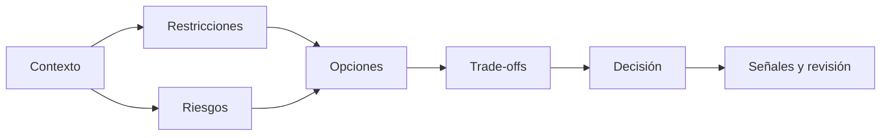
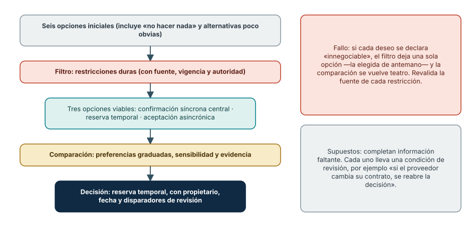
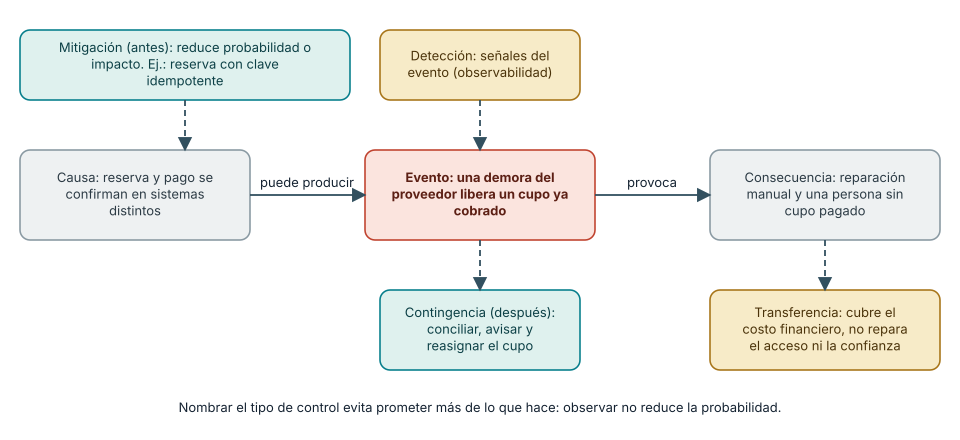
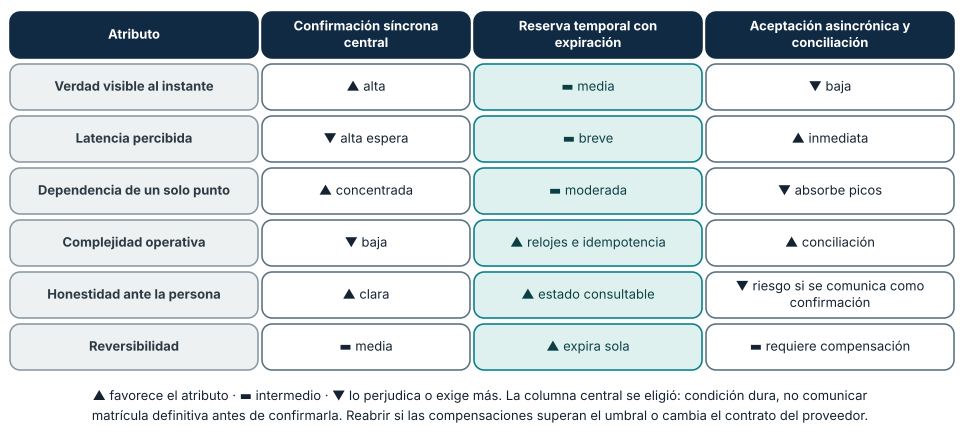

# SE-008 — Restricciones, riesgos y compromisos entre atributos

[← SE-007](../../classes/part-00-ingenieria-de-software-como-profesion/se-007-calidad-interna-externa-y-calidad-en-uso/README.md) · [↑ Parte 00](../../classes/part-00-ingenieria-de-software-como-profesion/README.md) · [📚 Índice completo](../../classes/README.md) · [SE-009 →](../../classes/part-00-ingenieria-de-software-como-profesion/se-009-sostenibilidad-inclusion-y-responsabilidad-social/README.md)

## Antes de empezar

Los escenarios de `SE-007` hicieron visible qué significa rapidez, seguridad y
accesibilidad para Campus Abierto. Ahora aparece el conflicto real: reservar cupos de
forma estricta reduce sobreventa, pero puede aumentar latencia y dependencia; relajar
consistencia mejora respuesta, pero cambia quién soporta el error.

Hoy compararás opciones sin esconder pérdidas. Separarás restricciones de preferencias,
formularás riesgos y declararás qué nueva señal haría revisar la decisión. `SE-009`
ampliará nuevamente la frontera: algunos costos no recaen en el equipo ni aparecen en
el tablero operativo.

## Prerrequisitos
Escenarios de calidad (`SE-007`) y evidencia (`SE-006`).

## Problema auténtico
Se pide máxima seguridad, respuesta instantánea, costo mínimo y entrega inmediata. Aceptar todos los objetivos oculta incompatibilidades; elegir uno sin explicarlo traslada costo a otra persona.

## Objetivos observables
Clasificarás restricciones, modelarás riesgo, compararás opciones con atributos y documentarás condiciones que cambian una decisión.

## Temas y por qué importan
| Concepto | Función |
| --- | --- |
| Restricción | elimina opciones inviables |
| Riesgo | combina incertidumbre y consecuencia |
| Trade-off | hace visible ganancia y pérdida |
| Reversibilidad | limita costo de aprender |

## Mapa conceptual

Una restricción dura invalida; una preferencia pondera. Confundirlas manipula la decisión.

## Conceptos y decisiones

### 1. Restricción, preferencia y supuesto cumplen funciones distintas

Una **restricción** excluye opciones dentro del alcance: una obligación legal, un límite
físico, una fecha externa o compatibilidad contractual. Debe registrar fuente, vigencia,
interpretación y autoridad capaz de cambiarla. “Debe usar la tecnología X” puede ser una
restricción si existe un contrato vigente; también puede ser costumbre o una preferencia
disfrazada para evitar comparación.

Una **preferencia** permite graduar opciones: menor costo, entrega más rápida o
familiaridad. Un **supuesto** completa provisionalmente información faltante y exige una
condición de revisión. Mezclarlos manipula el espacio de decisión: si cada deseo se
declara innegociable, solo queda la opción elegida de antemano.

**Cómo leer la figura.** Cada etapa tiene una función distinta. Las restricciones duras
*eliminan*; las preferencias *ordenan* lo que queda; los supuestos *completan* lo que falta y
llevan una condición de revisión. El recuadro rojo muestra el fallo clásico: si todo deseo se
declara innegociable, el filtro deja una opción y la comparación se vuelve teatro.
**Dónde deja de valer:** el embudo presenta las restricciones como datos. En la práctica
también se negocian: una restricción con autoridad capaz de cambiarla puede relajarse si el
costo de mantenerla es mayor que el de discutirla; por eso debe registrar fuente y quién puede
modificarla.

### 2. Un riesgo conecta causa, evento incierto y consecuencia

“Caída del sistema” es demasiado general. Un riesgo útil puede decir: “debido a que la
reserva y el pago se confirman en sistemas distintos, una demora del proveedor puede
liberar un cupo ya cobrado y exigir reparación manual”. La causa orienta prevención;
el evento define señales; la consecuencia permite priorizar; la respuesta distribuye
autoridad.

Probabilidad y consecuencia rara vez se conocen con precisión. Rangos o categorías
argumentadas son preferibles a multiplicar números inventados. También importan
velocidad del daño, detectabilidad, población expuesta y acumulación. Un evento poco
frecuente no se ignora si es catastrófico o afecta derechos.

La **mitigación** reduce probabilidad o impacto antes del evento. La **contingencia**
indica cómo responder si ocurre. Observabilidad puede mejorar detección sin reducir la
probabilidad; seguro puede transferir costo financiero sin reparar dignidad o acceso.
Nombrar el tipo de control evita prometer más de lo que hace.

**Cómo leer la figura.** Un riesgo útil es una cadena: causa, evento incierto, consecuencia.
Cada tipo de control actúa en un punto distinto. La mitigación opera sobre la causa o el
impacto *antes*; la detección acorta el tiempo hasta enterarse; la contingencia responde
*después*; la transferencia traslada un costo financiero pero deja intacta la consecuencia no
financiera. **Dónde deja de valer:** la figura muestra un solo evento. Los riesgos reales se
acumulan y se refuerzan (una demora provoca reintentos que agravan la demora), y su
probabilidad y consecuencia rara vez se conocen con precisión: usa rangos y razones.

### 3. Los atributos se relacionan mediante mecanismos, no eslóganes

Caché puede reducir latencia porque evita trabajo repetido, pero introduce copias cuyo
estado puede quedar antiguo. Cifrado protege confidencialidad bajo ciertas amenazas y
añade gestión de claves y costo. Redundancia tolera fallos independientes, pero eleva
superficie operativa y no ayuda si todas las réplicas comparten el mismo defecto.

Un trade-off no significa que toda mejora empeore necesariamente otra cosa. A veces un
diseño elimina desperdicio y mejora rendimiento, costo y mantenibilidad. La obligación
es buscar alternativas antes de aceptar una pérdida y, cuando permanece, declarar
quién la soporta. “CAP”, “seguridad versus usabilidad” o “rápido versus correcto” no
reemplazan el mecanismo específico del caso.

### 4. Reversibilidad y valor de conservar opciones

Una decisión reversible permite aprender con exposición limitada. Feature flags,
compatibilidad progresiva o pruebas piloto conservan alternativas si están diseñadas
para retirarse y no crean estados irreconciliables. Llamar “experimento” a un cambio de
datos irreversible no lo vuelve reversible.

El **valor de opción** consiste en postergar un compromiso costoso hasta obtener
información, sin paralizar todo. Puede implementarse con una interfaz estable y dos
adaptadores, una migración expandir–migrar–contraer o una cohorte pequeña. Mantener
opciones también cuesta; debe existir un plazo y criterio para cerrarlas.

### 5. Una decisión termina con señales y gobierno, no con una puntuación

Las tablas de decisión ayudan a comparar, pero ponderaciones arbitrarias pueden dar
apariencia matemática a una preferencia. Los derechos, obligaciones y umbrales de
seguridad actúan primero como límites; las opciones viables se comparan después. Una
sensibilidad muestra si pequeños cambios en pesos alteran el resultado.

El registro final incluye contexto, restricciones, opciones descartadas, evidencia,
riesgos aceptados, mitigaciones, contingencias, propietario, fecha y disparadores de
revisión. Así una decisión razonable hoy puede cambiar sin reescribir la historia.

## Caso conductor: consistencia de cupos bajo alta demanda

Campus Abierto debe responder rápido sin vender el mismo cupo dos veces. Se comparan
tres opciones: confirmación síncrona central, reserva temporal con expiración y
aceptación asincrónica con conciliación. La primera simplifica verdad visible pero
concentra dependencia; la segunda conserva experiencia rápida y exige relojes,
idempotencia y recuperación; la tercera absorbe picos, pero traslada incertidumbre a la
persona si se comunica como confirmación.

La elección adopta reserva temporal porque el negocio tolera una espera breve y puede
mostrar estado honesto. La condición dura es no comunicar matrícula definitiva antes
de confirmación. Los riesgos incluyen expiración durante pago, reintento y cola manual.
Se definen claves idempotentes, estado consultable, conciliación y autoridad de
suspensión. Si la tasa de compensaciones supera el umbral o el proveedor cambia su
contrato, se reabre la decisión.

**Cómo leer la figura.** Cada columna es una opción real y cada fila un atributo, con símbolos
(▲, ▬, ▼) para no depender del color. Ninguna columna gana en todo: la reserva temporal no
tiene la verdad inmediata de la síncrona ni la absorción de picos de la asincrónica; se eligió
porque respeta la condición dura (no declarar matrícula definitiva antes de confirmarla) y
porque la espera breve es tolerable. **Dónde deja de valer:** los símbolos son cualitativos y
dependen de supuestos de carga y de infraestructura. Un cambio en esos supuestos puede cambiar
la fila entera; la tabla sirve para conversar sobre ellos, no para sumar puntos.

## Definiciones de trabajo
- **restricción dura:** condición no negociable dentro del alcance;
- **preferencia:** criterio graduable;
- **exposición:** combinación razonada de probabilidad y consecuencia;
- **mitigación:** reduce probabilidad o impacto;
- **contingencia:** responde si el evento ocurre.

## Glosario
**Risk appetite** es nivel aceptable de exposición. **Option value** es beneficio de conservar alternativas. **Blast radius** es alcance del daño.

## Ejemplo mínimo
Guardar sesión en memoria reduce latencia, pero perder proceso cierra sesiones. La decisión cambia si autenticación es crítica o si reingresar es barato.

## Ejemplo profesional
Una entidad evalúa biometría: reduce fraude, pero agrega datos sensibles, exclusión y dependencia. Compara biometría obligatoria, opcional con alternativa y no adopción; incluye borrado y apelación.

## Práctica guiada
Crea `constraints.md`, `risk-register.md` y `tradeoff-table.md`. Compara tres opciones con cuatro atributos, evidencia, incertidumbre y reversión. Realiza pre-mortem.

## Ejercicios
1. Convierte una preferencia disfrazada en restricción verificable.
2. Distingue mitigación de contingencia.
3. Explica por qué una opción barata puede aumentar costo total.

## Reto verificable
Un revisor cambia una restricción y tu tabla debe producir una conclusión diferente sin reescribir criterios después de conocer el resultado.

## Preguntas frecuentes
### ¿Todo trade-off es inevitable?
No. A veces otra arquitectura mejora varios atributos; aun así tiene costo y límites.
### ¿Riesgo bajo se ignora?
No si la consecuencia es catastrófica o acumulativa.

### ¿Qué es un pre-mortem y por qué ayuda?

Es un ejercicio en el que el equipo imagina que la decisión ya fracasó y escribe por qué. Al
suponer el fallo, las personas expresan dudas que antes callaban y surgen riesgos que
ninguna lista genérica habría mostrado. Se complementa con señales de detección y un
propietario para cada riesgo importante.

### ¿Cuántos atributos debo comparar en una tabla de trade-offs?

Los que cambian la decisión: normalmente entre cuatro y seis. Más atributos diluyen la
conversación; menos pueden esconder una pérdida. Si un atributo no distingue entre las
opciones, déjalo fuera de la comparación y regístralo como restricción común.

### ¿Cuándo conviene conservar una opción y cuándo cerrarla?

Conserva opciones cuando la información que falta llegará pronto y cuando el costo de
mantenerlas es acotado. Ciérralas con un plazo y un criterio escritos de antemano; de lo
contrario el valor de opción se convierte en indecisión y en complejidad permanente.

## Fallo controlado y diagnóstico

Toma la tabla de tres opciones y declara a propósito todas las preferencias como restricciones
duras («debe ser instantáneo, mínimo costo, máxima seguridad y entrega inmediata»).
**Síntoma:** no queda ninguna opción viable, o queda exactamente la que alguien prefería de
antemano. **Causa:** se confundieron preferencias con restricciones. **Corrección:** para cada
restricción registra fuente (contrato, norma, límite físico), vigencia y autoridad capaz de
cambiarla; las que no tengan fuente pasan a preferencias con un peso. Después cambia una
restricción en una revisión cruzada y comprueba que la conclusión cambie *sin reescribir los
criterios* una vez conocido el resultado: esa es la prueba de que la tabla no fue
construida hacia una respuesta.

## Errores comunes y cómo corregirlos

| Síntoma | Causa | Corrección |
| --- | --- | --- |
| solo existe una opción “viable” | preferencias se presentaron como restricciones | verifica fuente, vigencia y autoridad de cada límite |
| riesgo escrito como sustantivo | faltan causa y consecuencia | formula cadena causal, señal, mitigación y contingencia |
| matriz con puntuación precisa y evidencia débil | exactitud aparente | usa rangos, sensibilidad y razonamiento explícito |
| rollback solo cambia binario | se ignoraron datos y efectos externos | define compensación, compatibilidad y punto de no retorno |
| decisión sin fecha ni señal | se trató contexto actual como permanente | añade propietario y disparadores verificables de revisión |

## Entorno y archivos clave
Markdown u hoja local: `constraints.md`, `risk-register.md`, `tradeoff-table.md`, `decision.md`.

## Seguridad, ética y accesibilidad
Incluye cargas trasladadas a usuarios, operadores y ambiente. No reduzcas derechos a una puntuación intercambiable sin justificar límites.

## Puente hacia el trabajo con agentes

Un agente de código toma decisiones de diseño implícitas en cada cambio: elige una biblioteca,
una estructura de datos, una estrategia de reintentos. Casi nunca declara las restricciones
que supuso ni la opción que descartó. Pedirle que compare alternativas con la tabla de la
figura 3 convierte esas decisiones en material revisable, pero la elección, la aceptación del
riesgo y la autoridad de parada siguen siendo humanas. Además, hay que declarar como restricciones
las que un agente no puede deducir del repositorio: obligaciones legales, contratos y límites
de seguridad. Un patrón habitual de fallo es la «sobreoptimización local»: el agente mejora el
atributo que se le midió y degrada otro que nadie le pidió cuidar.

## Transferencia
Repite para sistema crítico y aplicación recreativa; compara apetito y reversibilidad.

## Evaluación y evidencia
Se exigen restricciones trazables, riesgos causales, opciones reales y condición de revisión.

## Fuentes
- [ISO/IEC 25010:2023](https://www.iso.org/standard/78176.html), atributos del producto.
- [NASA Systems Engineering Handbook](https://www.nasa.gov/reference/systems-engineering-handbook/), gestión técnica y riesgo.
- [ACM Code of Ethics](https://www.acm.org/code-of-ethics), evaluación de riesgos e impactos.
- [ISO 31000:2018, Gestión del riesgo](https://www.iso.org/standard/65694.html): principios y proceso de gestión de riesgos; respalda la distinción entre mitigación, contingencia y transferencia.
- Michael Nygard, [Documenting Architecture Decisions](https://www.cognitect.com/blog/2011/11/15/documenting-architecture-decisions): formato breve de registro de decisiones con contexto, decisión y consecuencias.

## Límites y siguiente paso
La matriz no monetiza dignidad ni resuelve regulación. `SE-009` amplía horizonte social y ambiental.

---
[← SE-007](../../classes/part-00-ingenieria-de-software-como-profesion/se-007-calidad-interna-externa-y-calidad-en-uso/README.md) · [↑ Parte 00](../../classes/part-00-ingenieria-de-software-como-profesion/README.md) · [SE-009 →](../../classes/part-00-ingenieria-de-software-como-profesion/se-009-sostenibilidad-inclusion-y-responsabilidad-social/README.md)
