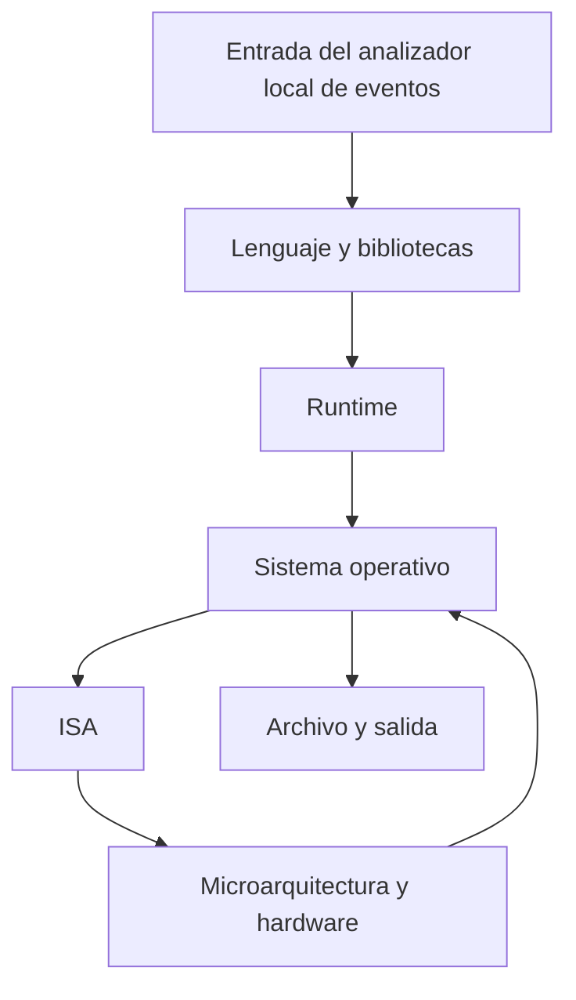
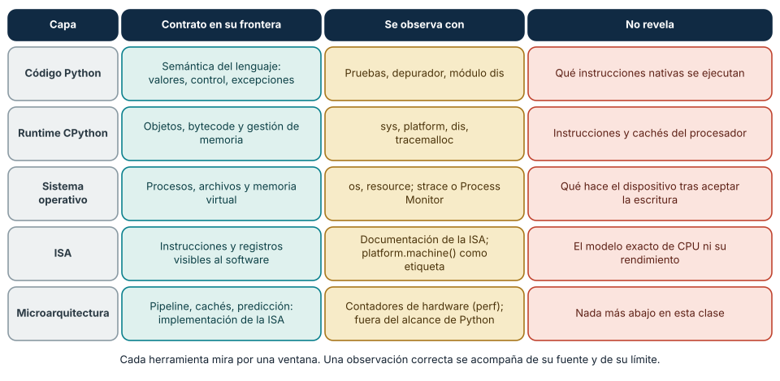
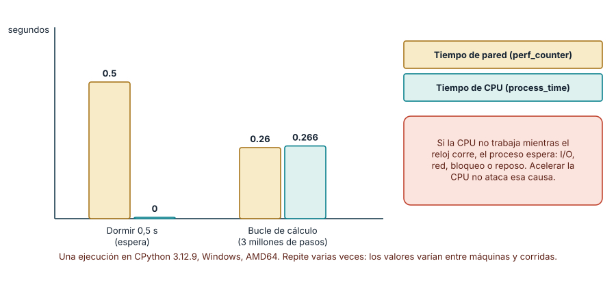
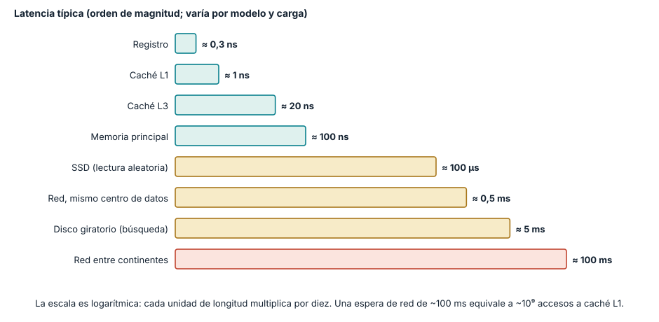

# SE-013 — Arquitectura básica de un computador moderno

[← SE-012](../../classes/part-00-ingenieria-de-software-como-profesion/se-012-proyecto-mapa-profesional-y-contrato-personal-de-aprendizaje/README.md) · [↑ Parte 01](../../classes/part-01-computadores-y-representacion-de-informacion/README.md) · [📚 Índice completo](../../classes/README.md) · [SE-014 →](../../classes/part-01-computadores-y-representacion-de-informacion/se-014-bits-bytes-bases-numericas-y-representacion/README.md)


## Punto profesional y fundamento pedagógico

**Punto profesional.** La clase existe para separar arquitectura física, ISA, sistema operativo y runtime antes de atribuir una propiedad a la máquina.

**Por qué aparece aquí.** Se sitúa después de **Proyecto: mapa profesional y contrato personal de aprendizaje** y antes de **Bits, bytes, bases numéricas y representación**: convierte el conocimiento anterior en una decisión observable que la clase siguiente podrá reutilizar. La continuidad se comprueba en el artefacto, no por compartir vocabulario.

**Error conceptual que debe corregir.** Confundir ‘64 bits’, núcleos, ISA y versión del sistema como una sola propiedad.

**Secuencia de aprendizaje.** Predice qué datos devolverán `platform.machine()` y `sys.byteorder`, y anota dos propiedades que esas APIs no pueden revelar. Después ejecuta el probe, clasifica cada afirmación por capa y somete el mapa a una revisión que intente atribuir indebidamente una propiedad a la CPU. Al final reconstruye el mapa sin consultar el texto y lo aplica a una máquina virtual.

**Evidencia de aprendizaje.** Machine-map.md con comandos, salidas, capas y dos conclusiones que los datos no permiten. Debe contener predicción previa, observación, explicación causal, contraejemplo, criterio de aceptación y una nota de qué dato haría cambiar la conclusión.

**Límite de la conclusión.** Las APIs del runtime no demuestran la microarquitectura interna.

### Trazabilidad fuente → afirmación

| Fuente primaria u oficial | Afirmación que respalda | Lo que no prueba |
|---|---|---|
| [RISC-V Unprivileged ISA](https://docs.riscv.org/reference/isa/unpriv/) | la ISA como interfaz separada de microarquitectura | No demuestra por sí sola que el artefacto del estudiante sea correcto. |
| [Python `platform`](https://docs.python.org/3/library/platform.html) |  define las etiquetas observables usadas en la práctica | No demuestra por sí sola que el artefacto del estudiante sea correcto. |
| [Python `sys`](https://docs.python.org/3/library/sys.html) |  documenta `byteorder` y propiedades del runtime | No demuestra por sí sola que el artefacto del estudiante sea correcto. |

## Antes de empezar

En `SE-012` convertiste objetivos en evidencia. Ahora comienza la base técnica: antes
de optimizar o depurar necesitas saber **en qué capa ocurre una afirmación**. Abrimos un
**analizador local de eventos**, un programa Python que recibirá `Matrícula confirmada ✓`, producirá un
resumen y lo guardará. Hoy no lo optimizarás: construirás el mapa que permitirá seguir
sus datos y decisiones durante toda la parte.

## Prerrequisitos

Parte 00 o capacidad para separar observación e inferencia. Python 3.11+, terminal y un directorio de práctica sin datos reales.

## Problema auténtico

Un fallo se atribuye a “la CPU” porque el programa tarda. La evidencia disponible solo
muestra tiempo de pared de un proceso que también espera disco. Sin un modelo de
capas, el equipo modifica componentes que no causan el síntoma.

## Objetivos observables

Podrás distinguir arquitectura, ISA, microarquitectura y organización del sistema;
seguir entrada, transformación, almacenamiento y salida; ubicar una observación en su
capa; y declarar qué no puede inferirse desde Python.

## Temas y por qué importan

| Tema | Mecanismo | Por qué importa |
| --- | --- | --- |
| Capas y contratos | cada nivel ofrece una interfaz al superior | evita explicaciones que saltan de fuente a transistor |
| CPU, memoria e I/O | transforman, conservan y comunican estado | permite localizar recursos y esperas |
| ISA y microarquitectura | contrato visible frente a implementación | evita confundir compatibilidad con rendimiento idéntico |
| Observación | cada herramienta ve una frontera | limita conclusiones y orienta la siguiente medición |
## Mapa conceptual



La flecha descendente representa contratos de ejecución; la ascendente, resultados e
interrupciones. El mapa no afirma que una línea de Python corresponda a una instrucción.

## Conceptos y decisiones

### 1. Arquitectura es una interfaz observable

La arquitectura describe propiedades que un consumidor puede usar sin conocer toda la
implementación. Una ISA especifica instrucciones, registros y efectos visibles para el
software de bajo nivel. RISC-V, por ejemplo, separa deliberadamente la ISA de una
microarquitectura particular. Dos procesadores pueden ejecutar el mismo binario y
organizar internamente pipeline, cachés o unidades de ejecución de modo distinto.

### 2. CPU, memoria y dispositivos cooperan

La CPU obtiene y ejecuta instrucciones; los registros conservan estado inmediato; la
memoria principal mantiene código y datos activos; el almacenamiento preserva datos;
los dispositivos intercambian información. Interconexiones y controladores coordinan
movimientos. Esta lista no explica por sí sola un programa: hay que seguir qué dato
cambia, dónde vive y quién inicia la transición.

### 3. El sistema moderno es una pila de abstracciones

El analizador local de eventos no escribe directamente celdas físicas. El lenguaje define valores; CPython los
representa como objetos; el sistema operativo ofrece procesos, memoria virtual y
archivos; la ISA define efectos de instrucciones; el hardware implementa esos efectos.
Cada capa simplifica y añade costo. Saltarse una capa produce afirmaciones falsas como
“una variable es un registro” o “guardar un archivo escribe inmediatamente en disco”.

### 4. Estado, control y flujo de datos

Una ejecución puede describirse como estados y transiciones: llegan bytes, se
decodifican, se crean objetos, se calcula, se solicita una escritura y se informa el
resultado. El control decide qué transición sigue; el flujo de datos muestra qué valor
la alimenta. Separarlos ayuda a explicar por qué una espera de I/O detiene un hilo sin
que la CPU esté calculando esa solicitud.

### 5. Observar una capa no revela automáticamente las demás

`platform.machine()` informa una etiqueta de plataforma que el runtime expone;
`sys.byteorder` informa el orden nativo que Python observa. No demuestran modelo exacto
de CPU, tamaño de caché ni frecuencia efectiva. Virtualización, emulación y contenedores
pueden interponer capas. Una observación correcta se acompaña de su fuente y límite.



**Cómo leer la figura.** Cada fila es una capa y cada columna responde una pregunta distinta:
qué promete esa capa a la de arriba, con qué herramienta se la puede mirar y qué *no* se
puede concluir de lo que esa herramienta muestra. La columna roja es la más importante para
el criterio profesional: `platform.machine()` mira por la ventana de la ISA y no revela el
modelo de CPU; `os` y `resource` miran el sistema operativo y no revelan qué hizo el
dispositivo después de aceptar una escritura. **Dónde deja de valer:** las capas reales no
son estrictamente cinco ni están tan limpias. Un procesador puede traducir internamente
instrucciones a operaciones más simples, y el firmware o un hipervisor añaden capas que la
figura omite; el principio es la lista de ventanas y límites, no el número de filas.

### 6. Esperar no es calcular: tiempo de pared, tiempo de CPU y estados de un proceso

Un proceso no está siempre ejecutando. El sistema operativo lo planifica y, en cada
instante, el proceso está *ejecutando* en un núcleo, *listo* esperando turno o *bloqueado*
esperando un evento: una lectura de disco, una respuesta de red, un temporizador. Mientras
está bloqueado no consume CPU, pero el reloj de la pared sigue avanzando. Python expone ambas
magnitudes por separado: `time.perf_counter()` mide el tiempo transcurrido con un reloj
monotónico de alta resolución, y `time.process_time()` suma el tiempo de CPU del proceso
(usuario más sistema), sin las esperas.

La diferencia convierte una sospecha en una hipótesis contrastable. En una ejecución de
ejemplo (CPython 3.12.9, Windows, AMD64) `time.sleep(0.5)` tardó 0,5 s de pared y 0,0 s de CPU,
mientras que un bucle de tres millones de multiplicaciones tardó 0,26 s de pared y 0,27 s de
CPU. El primer programa *espera* y el segundo *calcula*. Si un servicio muestra latencia alta
con CPU baja, el diagnóstico apunta a espera (red, disco, bloqueo), y subir la frecuencia del
procesador no ataca el mecanismo: es exactamente el problema auténtico de esta clase.

Hay límites que debes declarar al medir. Un proceso con varios hilos o núcleos puede acumular
más CPU que pared; el reloj de CPU puede tener una resolución gruesa
(`time.get_clock_info("process_time")` la informa); y una sola ejecución mezcla ruido de
arranque, cachés y planificación. La regla práctica es: pared mucho mayor que CPU indica
espera; pared aproximadamente igual a CPU indica cómputo; ninguna de las dos reemplaza un
perfilado, que se estudia en `SE-017` y en la parte de herramientas.



**Cómo leer la figura.** Cada pareja de barras corresponde a un programa: la barra dorada es
el tiempo transcurrido y la verde azulada el tiempo de CPU. En la primera pareja la segunda barra
desaparece, porque dormir no consume CPU; en la segunda ambas coinciden. **Dónde deja de valer:**
es una medición única en un entorno concreto, no un resultado universal. Repetida diez veces
en otro equipo cambiará, y por eso el ejercicio pide registrar versión, sistema y número de
repeticiones. La figura demuestra el *método de diagnóstico*, no los valores.

### 7. La jerarquía de memoria: la distancia importa más que los GHz

Un procesador moderno ejecuta miles de millones de operaciones por segundo, pero solo puede
operar con datos que ya están cerca. Los registros viven dentro del núcleo; las cachés L1, L2
y L3 son memorias pequeñas y rápidas entre el núcleo y la memoria principal; la memoria
principal (DRAM) es mucho mayor y mucho más lenta; el almacenamiento persistente y la red
están todavía más lejos. Cada escalón multiplica la latencia por uno o varios órdenes de
magnitud, y esa diferencia, no la frecuencia del reloj, domina el comportamiento de muchos
programas.

Dos propiedades de los programas hacen que la jerarquía funcione: la *localidad temporal* (un
dato usado hace poco se usará pronto) y la *localidad espacial* (si se usa una dirección, se
usarán sus vecinas). Las cachés trabajan con bloques contiguos llamados líneas, de modo que
recorrer un arreglo contiguo aprovecha cada bloque traído, mientras que saltar de forma
dispersa por la memoria obliga a traer una línea por acceso. De ahí que dos algoritmos con la
misma complejidad asintótica puedan diferir mucho en tiempo real, y que la estructura de
datos importe tanto como el algoritmo.

La misma lógica explica una afirmación falsa frecuente: «guardar un archivo lo escribe de
inmediato en el disco». Al llamar a `write`, Python copia los bytes a un búfer propio;
`flush()` los entrega al sistema operativo; el sistema operativo suele conservarlos en su
caché de páginas y los lleva al dispositivo después; `os.fsync()` pide que se persistan en el
dispositivo. Incluso entonces, el firmware del dispositivo puede mantener su propia caché, de
modo que la garantía depende de toda la cadena. Un analizador que «guarda» un evento pero
no hace `fsync` puede perderlo si el equipo se apaga justo después.



**Cómo leer la figura.** La longitud de cada barra es el *logaritmo* de la latencia típica:
cada unidad de longitud multiplica por diez. Los colores agrupan memoria cercana (verde azulado),
almacenamiento y redes locales (dorado) y distancias de área amplia (rojo), pero cada etiqueta
también indica la magnitud. Una espera de red de cien milisegundos equivale a cientos de
millones de accesos a caché L1. **Dónde deja de valer:** son *órdenes de magnitud típicos*, no
mediciones. Varían con el modelo de procesador, la carga, el tipo de dispositivo y la
distancia real; para cifras de referencia históricas puede consultarse la página de latencias
de Colin Scott (en las fuentes), que recoge estimaciones y no garantías. Mide tu propio
entorno antes de decidir.

### 8. De una línea de Python a la ISA: qué cadena puedes inspeccionar

Una línea de Python no se ejecuta directamente en el procesador. El código fuente se compila
a *bytecode*, una secuencia de instrucciones de una máquina virtual; el intérprete de CPython,
que es un programa escrito en C y compilado a instrucciones nativas de la ISA, ejecuta ese
bytecode; y el intérprete pide servicios al sistema operativo mediante llamadas al sistema. Puedes
inspeccionar el primer eslabón con el módulo estándar `dis`:

```python
import dis

def f(text):
    return len(text.encode("utf-8"))

dis.dis(f)
```

En CPython 3.12.9 la salida contiene, en orden, `RESUME`, `LOAD_GLOBAL len`, `LOAD_FAST text`,
`LOAD_ATTR encode`, `LOAD_CONST 'utf-8'`, `CALL 1`, `CALL 1` y `RETURN_VALUE`. Cada una de esas
operaciones es bytecode, no una instrucción del procesador: ejecutar un solo `CALL` implica
decenas o cientos de instrucciones nativas del intérprete. El bytecode además cambia entre
versiones menores de Python (otras versiones usan operaciones distintas para llamar a un
método), por lo que una conclusión sobre «cuántas instrucciones» tiene sentido solo para una
versión declarada. Esta cadena confirma el límite de la clase: puedes ver el bytecode y los
resultados del sistema, pero no demuestras instrucciones nativas, cachés ni la microarquitectura
desde Python.

## Caso conductor: localizar el analizador local de eventos

El analizador local de eventos recibe texto por argumentos, lo codifica, calcula longitud y escribe JSON. El
mapa asigna: semántica al programa, objetos a CPython, proceso y archivo al sistema
operativo, instrucciones a la ISA y ejecución física al procesador. Si escribir tarda,
el mapa ofrece hipótesis —serialización, llamada, caché del sistema, dispositivo— sin
elegir una antes de medir.

## Definiciones de trabajo

- **arquitectura:** propiedades e interfaces visibles de un sistema;
- **ISA:** contrato de instrucciones y estado visible para software de máquina;
- **microarquitectura:** organización concreta que implementa una ISA;
- **runtime:** servicios que sostienen un programa durante ejecución;
- **dispositivo:** componente que intercambia datos o señales con el sistema.

## Glosario

**Estado** es información suficiente para explicar una transición. **ABI** es un
contrato binario que incluye llamadas y representación. **Firmware** es software ligado
al control de hardware. **Memoria virtual** es el espacio de direcciones que el sistema
presenta a un proceso.

## Ejemplo mínimo

Dos equipos muestran `x86_64`. Comparten una familia de ISA, pero no necesariamente
cachés, núcleos ni desempeño. La etiqueta permite decidir compatibilidad aproximada; no
permite predecir tiempo.

## Ejemplo profesional

Un servicio consume CPU baja y latencia alta. La traza muestra espera de red. Escalar
frecuencia de CPU no ataca el mecanismo; reducir rondas, usar concurrencia controlada o
mejorar la dependencia sí podrían hacerlo.

## Práctica guiada

Usa como base el [laboratorio ejecutable de la Parte 01](https://github.com/vladimiracunadev-create/modern-software-engineering-program/tree/main/labs/part-01-machine-observer); trabaja sobre una copia o conserva tus salidas en el directorio `work/SE-013/`.

1. Crea `work/SE-013/` y registra `python --version` y sistema operativo.
2. Escribe `probe.py` que imprima `platform.machine()`, `sys.byteorder` y el texto ficticio.
3. Dibuja `machine-map.md` con las cinco capas y un contrato por frontera.
4. Marca cada dato como observado, documentado o inferido.
5. Añade una hipótesis de latencia y una medición que podría refutarla.
6. Borra solo `work/SE-013/` para recuperar el entorno.

## Ejercicios

1. Explica dónde viven conceptualmente una variable, un objeto y sus bytes.
2. Compara ISA y microarquitectura con un contraejemplo.
3. Añade una capa de virtualización y revisa qué observaciones cambian.

## Reto verificable

Otra persona debe ubicar cinco afirmaciones de tu informe en su capa y señalar una
inferencia inválida. Aprueba si el mapa contiene contratos, señales y límites, no solo
cajas.

## Preguntas frecuentes

### ¿Arquitectura es lo mismo que hardware?
No. Puede describir interfaces del hardware o de un sistema de software.

### ¿Python impide aprender la máquina?
No; permite observar varias capas, siempre que no confundas bytecode con ISA.

### ¿Por qué `platform.machine()` devuelve valores distintos en cada sistema?

Porque informa la etiqueta que cada plataforma usa para nombrar la arquitectura. La misma
familia de procesadores de 64 bits de Intel y AMD aparece como `AMD64` en Windows y como `x86_64`
en Linux; los procesadores ARM de 64 bits aparecen como `arm64` en macOS y `aarch64` en Linux.
La etiqueta ayuda a decidir compatibilidad aproximada de binarios, pero depende del sistema
que la reporta, no de una norma común.

### Si ejecuto el programa en una máquina virtual o un contenedor, ¿cambia la arquitectura?

Depende de la técnica. Una máquina virtual con virtualización asistida por hardware suele
ejecutar la misma ISA que el anfitrión, con un sistema operativo propio. Un contenedor comparte
el núcleo del anfitrión y solo aísla procesos. Una emulación (por ejemplo, ejecutar código de
otra arquitectura) interpone una traducción y cambia el rendimiento y las propiedades
observables. Antes de interpretar una medición, averigua en qué capa estás.

### ¿Una herramienta que muestra 100 % de CPU confirma que el cuello de botella es la CPU?

Solo indica que al menos un núcleo está ocupado, y algunas herramientas expresan el uso por
núcleo, de modo que un proceso de varios hilos puede superar el 100 %. Confirma además qué
hace ese tiempo (cómputo útil, reintentos, espera activa) con un perfil antes de optimizar.

## Fallo controlado y diagnóstico

Afirma que `platform.machine()` identifica el procesador exacto. Contrasta en
documentación qué devuelve, registra el síntoma conceptual y corrige la conclusión a
“etiqueta de arquitectura expuesta por la plataforma”.

Un segundo fallo controlado ataca la hipótesis más común de esta clase. Escribe dos funciones:
una que duerme y otra que calcula, y *antes de medir* predice qué reportará cada reloj.
Ejecútalas con `perf_counter` y `process_time`, repite al menos cinco veces y registra la
dispersión. **Síntoma esperado:** la función que duerme muestra CPU cercana a cero con pared
alta. **Causa:** el proceso estaba bloqueado y no calculando. **Corrección conceptual:**
sustituye la afirmación «es lento por la CPU» por «el proceso espera»; la medición que podría
haberte refutado era que la CPU hubiera crecido con la pared. Añade una tercera función que
combine ambas conductas (por ejemplo, calcular y luego escribir un archivo con `fsync`) y
explica qué fracción de la pared es cómputo y cuál es espera.

## Errores comunes y cómo corregirlos

| Síntoma | Causa | Corrección |
| --- | --- | --- |
| una línea equivale a una instrucción | se saltaron compilador y runtime | traza representaciones intermedias |
| CPU y computador se usan como sinónimos | se omitieron memoria e I/O | sigue dato y control por componentes |
| misma ISA implica mismo rendimiento | arquitectura confundida con implementación | mide cada entorno y declara microarquitectura desconocida |
| diagrama sin contratos | inventario sin mecanismo | anota entrada, salida y responsable de cada frontera |

## Entorno y archivos clave

Python 3.11+, `platform`, `sys`; `probe.py`, `machine-map.md`, `observations.md`. No instala paquetes ni modifica el sistema.

## Seguridad, ética y accesibilidad

No publiques nombres de host, identificadores o rutas privadas. Proporciona texto
alternativo al diagrama. La etiqueta de arquitectura no justifica excluir dispositivos
sin medir la capacidad necesaria.

## Puente hacia el trabajo con agentes

Un asistente que propone «optimizar este bucle» sin una medición razona sobre la capa
equivocada con la misma confianza que un equipo apresurado. El mapa de capas se convierte en
una instrucción de trabajo: pedir al agente que declare en qué capa cree que está el problema,
qué medición (pared frente a CPU, un perfil, una traza) lo confirmaría y qué resultado lo
refutaría, *antes* de modificar código. Una consecuencia práctica: las llamadas a un modelo de
lenguaje son espera de red, de modo que un flujo agentic suele ser dominado por tiempo de pared
con CPU local casi ociosa; ahí el trabajo útil es la concurrencia controlada y los reintentos
con límite, no el cómputo local. También importa saber qué aísla un entorno de ejecución: un
contenedor comparte el núcleo del anfitrión y no equivale a una máquina virtual, lo que
condiciona qué puede hacer con seguridad un agente que ejecuta comandos. Las partes de harness
y de seguridad agentic retoman esos límites.

## Transferencia

Aplica el mapa a un navegador o microcontrolador y explica qué capas desaparecen, se combinan o cambian de propietario.

## Evaluación y evidencia

Se exige mapa causal, cinco observaciones trazables, una inferencia refutada y límites.

## Fuentes


- [RISC-V Unprivileged ISA](https://docs.riscv.org/reference/isa/unpriv/) respalda la ISA como interfaz separada de microarquitectura.
- [Python `platform`](https://docs.python.org/3/library/platform.html) define las etiquetas observables usadas en la práctica.
- [Python `sys`](https://docs.python.org/3/library/sys.html) documenta `byteorder` y propiedades del runtime.
- [Python `dis`](https://docs.python.org/3/library/dis.html) describe el desensamblador de bytecode usado en la sección 8; aclara que el bytecode es un detalle de implementación de CPython.
- [Python `time`](https://docs.python.org/3/library/time.html) documenta `perf_counter`, `process_time` y `get_clock_info`, usados en la sección 6.
- Randal E. Bryant y David R. O'Hallaron, *Computer Systems: A Programmer's Perspective*, 3.ª edición (Pearson, ISBN 978-0-13-409266-9): jerarquía de memoria, localidad y relación entre programas y máquina; respalda la sección 7.
- [Latency numbers every programmer should know (visualización interactiva de Colin Scott)](https://colin-scott.github.io/personal_website/research/interactive_latency.html): estimaciones históricas de latencias por año; son órdenes de magnitud, no garantías.

## Límites y siguiente paso

No se inspeccionan transistores ni instrucciones nativas. `SE-014` abre la representación binaria que atraviesa el mapa.

---
[← SE-012](../../classes/part-00-ingenieria-de-software-como-profesion/se-012-proyecto-mapa-profesional-y-contrato-personal-de-aprendizaje/README.md) · [↑ Parte 01](../../classes/part-01-computadores-y-representacion-de-informacion/README.md) · [SE-014 →](../../classes/part-01-computadores-y-representacion-de-informacion/se-014-bits-bytes-bases-numericas-y-representacion/README.md)
